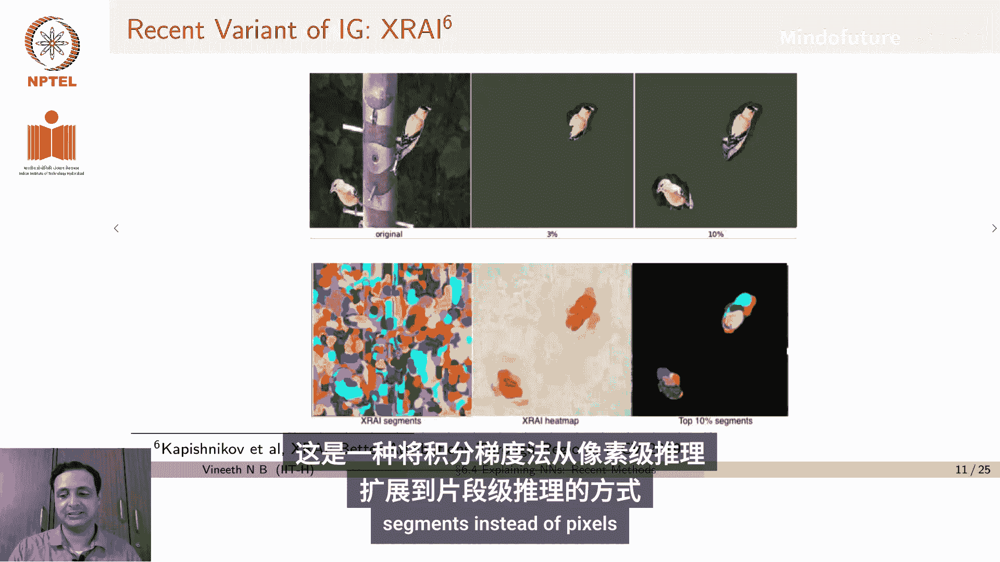

# 【NPTEL】计算机视觉的深度学习 p41 P41_解释CNN - 最新方法 - 第一部分 -BV1vNWkzpEua_p41-

In the last few years。Researchers have extended methods such as grad cam， grad cam plus plus。

 as well as the use of other。Statistics such as gradients and activations and so on and so forth to improve explanation methods。

This is what we will focus on in this lecture， which is on recent methods for explaining CNNNs。

 so this is not just about explaining CNNNs。These methods are developed more broadly for explaining any kind of a neural network。

Let's see a few of them in this lecture。So， if you recall our discussion on visualizing the data gradients。

Our overall approach was you forward past your data X any input image to get the output through the neural network。

 let us assume that the neural network is given by a function F。

 you get a y is equal to F of x and y is the neural network output corresponding to a particular class。

 it was a particular score the baby saw it。Then we do a backdrop to the image。To get the gradient。

 do y by do x。And using those gradients， we visualized the image back in terms of the gradients by taking the maximum among the gradient across the channels and we get such an attribution map。

Recall an attribution map is。A map of how much each input attributes to the output。

 that's the reason it's called an attribution map。Let's now ask if this is sufficient to explain a deep neural network。

Is this method sufficient？The answer is not always。

 so lets see a counter example where such an approach of using gradients can actually fail。

Let' us consider a scenario where we have two inputs i1 and i2。They are fed into the next layer。

 so the bottom is the input， the top is the output。 This neural network is presented this way。

And these go into the next layer where let's say we have a Re activation function and which now gives out an output h which is given by max of 0 comma1 minus i1 minus i2。

 let's assume that those are the weights that the neural network has actually learned at that time。

And let's also assume that the final output y is given by 1 minus h。

 this is one such neural network that may be learned。

When you train among when when you train a model。So if you visualized the gradients in this kind of a setting。

 you would notice that on the x axis， if you had i1 plus i2， you would notice that。Itch。

Is max of0 comma 1 minus i1 minus i2， which means when i1 plus i2 becomes greater than1。

H is always 0。Until then it would be 1 minus i1 plus i2。

 so you see the graph of h will be this blue line here where it is1 minus i1 plus i2 until 1 and when i1 plus i2 exceeds 1 it becomes 0。

On the other hand， the graph of y is given by 1 minus h。Which means。

It increases as H decreases until 1。And when H becomes 0， y stay static at 1。

This is evident from this kind of a construction of a neural network。This is fair。Now。

 why are we bringing up this example， what do we really want to see？We've already given a hint here。

We are talking about something called a saturation problem。 So what does that mean。

We notice here that the gradient of h with respect to both i1 and i2 is 0 when i1 plus i2 is greater than 1。

Which means as soon as the sum of the inputs exceeds  one， the gradient is going to become 0。

So if the gradient is 0。The guided back or any other method that you use to get visualize your data gradients in the first place will also be0。

 that is one part of it。The second part is that the gradient of y with respect to h is negative clearly you can see that as edge goes down y goes up。

 which means the gradient of y with respect to h is negative。Remember that in guided backdrop。

 we said that any negative gradient would also be made zero when you back propagate。

Which means even from 0 to 1 when i plus i1 plus i2 goes from 0 to 1。Even in that range。

The gradient of y will be negative and will make it zero due to the guided back approach。

Which means the gradient now is always going to be 0 everywhere。

 which is not going to be useful at all。😊，We call this the saturation problem。

So how do you solve such a problem？So this problem was first pointed out by a work called Deeplift in 2017。

And what deeplift proposed to address this issue is？Let us not use gradients。

 but let us use a variant of a gradient。Remember， a gradient by definition of first principles is you infiniteitsimally perturb an input and see what change it causes in the output。

😊，Now we are saying let's not look at an infinite dissimal change in the input or a perturbation in the input。

Let's instant see。If we had some reference input and our current input moves away from that reference input by a certain delta Xi。

 one of the attributes， X is one of your input attributes。For an image。

 you could consider it to be one of your input pixels。So。

 and then we see what is the difference in output with respect to some reference output？So。

 if we moved from some reference input by a certain amount。

 how much does the output move from some reference output？So it's no more an infiniteal change。

 We keep a baseline for input and output and see if we move from the baseline by a certain amount。

 how much do we move from a baseline in the output， It's， as you can see。

 an extension of the idea of a of a gradient。And then you assign at contribution scores。

 these contribution scores are given by c sub delta X delta t such that the summation of all delta X delta Ts over all your attributes has to equal delta t because that is the overall change in your output so that is how the contributions of each input towards the change in the output is measured。

You can see now that with this kind of an approach。

 the saturation problem that we saw on the earlier slide will go away because no more no more will you be considering the difference between successive points on your。

X axis， but you will always be looking at it as a difference with respect to the reference which you could keep as 0 and then why even whether a point was at y1 i1 plus i2 is equal to 1。

1 or i1 plus i2 is equal to 1。2 it will still have a difference with respect to reference 0 and there will be a valid gradient and your gradient will no more be 0。

That's the way deeplift counters this saturation problem。

So deeplift introduces three a few different rules， in fact three different rules。

 but we will talk about one of them here to be able to explain it for more details you can look at the paper。

This rule is known as the rescale rule and it broadly explains the idea behind the paper。

So you start from an output layer L and you proceed backwards layer by layer。Redistributing。

The difference of prediction scored from baseline until input layer is reached。

Let's explain that more clearly。Let us assume now that ZjiI is equal to WjiI in the L plus1 layer into the activation of the previous layer XilL。

 so XilL into WjiI L plus 1 becomes Z JI in the next layer。That's the notation were using。Similarly。

 Z JI dash is Wji I L plus 1。Into X dashash where X dashash is the baseline input or the reference input that we talked about。

So how do we use these？Let us now consider that R is the relevance of unit I and superscript L denotes the layer L。

So， the R in the last layer capital L， capital L is the total number of layers。

 so R in the last layer would be given by Y of x minus y of x dash。

Where x dash is the baseline reference input and you are going to see what is the change in the output as you change the reference input and that is going to be your relevance of unit I in your last layer if there is no change that is going to be 0 otherwise。

For all previous layers， R of small L is given by summation over Js。

 which is all the neurons that you have that that particular neuron is connected to in the next layer。

ZjiI minus ZjiI dash by summation of all ZjiI minus ZjiI dash in that layer into Rj L plus 1。

Let's try to draw that out to make it a little clearer。

 So you have a particular layer with a few different neurons。

 you have a particular next layer with a few different neurons。

 We already know how to compute the relevances in the last layer we are now taking one specific neuron I in the L layer Let's call this the layer L。

 So we take all the Js that are in the L plus1 layer。

 So these are the Js that we have in the L plus one layer。And we see in the L plus 1 layer。

 so lets consider one particular J its relevance would have already been computed that would be given by Rj L plus1。

And how much did it contribute to the relevance at RIL that would be given by ZjiI minus ZjiI bar minus the summation of all ZjiI minus Zji bars that particular in that particular layer？

So， that gives you an estimate of。What is the relevance of node I at the L layer？

You keep back propagating these relevances all the way back and then you get an estimate of the relevance of each input at layer 1。

 which will be your input layer。Note here that the key difference the process of back propagation is very similar to what we did with gradients。

 but we are not computing gradients here， we are actually computing how much did the activation at any layer change by giving a baseline input instead of the current input that difference is what we are measuring as the gradient and the rest of the process stays very similar to what we did with back propagation。

So this is the idea of using deep lift to understand how each input neuron。

Attributes to every output neuron Yi in this particular case。A popular method。

 another popular method rather is known as integrated gradients very popularly used today。😊。

An integrated gradient is motivated by an observation similar to deeplift which is shown here。

 so if you have a given image which is an image of a fire boat。

And if you only used the vanilla data gradients to see where the fireboard is。

 you get a set of gradients such as what you see on the right side。

This kind of a structure in the gradients is predominantly because of a saturation problem that you will see on the next slide。

So what do we do？What integrated gradients does is to avoid this problem of saturated gradients by accumulating gradients at different pixel intensities of the given image。

Let's see this in more detail。So， here are the same set of gradients。

 but now each image in this set of tiles here is the input image however。

 with a reduced in intensity at each pixel by a particular scale so you notice here that。

There is an alpha of 0。02， alpha of 0。04， alpha of 0。06， alpha of 0。08， so on and so forth。

All of this says that this first set of gradients were obtained by taking the given image and scaling down its intensity by。

To the level of 002 so it becomes a imagine an image that is an interpolation between a black image and the current given image but you weight the black image to a level of 98% and the current image to a level of 2% that is what alpha is equal to 0。

02 will give you。Similarly， you can do alpha e equal to 0。04， Al is equal to 0。06。

 so on and so forth and you get a different set of images and for each input image you can compute your data gradient and now you see that you start seeing most structure more clearer structure in the data gradients why is this clearer structure because this is a firebo you would ideally want to localize the boat as well as all of these water streams because that's part of the nature of the boat itself and that's what you see on all of these gradients here but as you go closer and closer to the full image you see that perhaps the gradients are closer to each other and hence the method if you use any data gradient it thinks that all of the pixels have about the same gradient and then you end up getting a cluster of gradients like this which really don't isolate out the key pixels。

Lets see this also mathematically to make this a bit clearer and mathematically this is achieved using what is known as a path integral and that is the reason it is called integrated gradients。

Let us try to see how that is defined Ig or the integrated gradient along8 dimension for input x and baseline x prime。

 which we just took as a black image when I gave the example a minute ago is given by Iig i of x is equal to X minus X prime when you have X prime to be black image that will always be 0 so this will just be。

Xi itself and you integrate alpha from 0 to 1 and then you do do f where f is the neural network x prime plus alpha into x minus x prime by doxi into do alpha。

What is this partial derivative it is taking x prime plus alpha into x minus x prime so you have a black image and you keep adding little and little of the given image to the black image。

And now you take the output of the neural network F as you forward propagate that。

Constructed image between a black image and a given image and differentiate and that with respect to the input。

 Now you compute the data gradient of this。Interpolated image and you find all such interpolated images as you move alpha from 0 to 1 and then integrate all of them to be able to get an integrated data gradient。

They show that this kind of an approach can lead to more robust attributions。

But in practice it is not possible to integrate over all possible alpha values so we come up with an approximation where we take a set of alpha values。

 we define a set of intervals between 0 and 1 and we keep stepping on from each of those intervals so summation goes from k is equal to 1 to M and then you have a k by m so you take it at1 by m 2 by m3 by m4 by m so until m by M1 so you keep taking those steps of your input image added to a baseline image or a black image and then you compute your data gradient and average out all your data gradients and that becomes your integrated gradient。

Now you have an IG attribution map which focuses on the fire boat as well as those streams of water。

 which is far more convincing than what we saw initially。The vanilla gradient。

Another approach that was proposed is known as smooth Gr which uses a very similar idea as integrated gradient but a more heuristic and a simpler approach it says lets add pixelwise Gaussian noise to many copies of the image and average the resulting gradient why do I have to do the path integral to go from say a black image to the given image instead let me take a given image andll just distort it in several ways using by adding Gaussian noise and now I'll compute data gradient for each of those images when I forward propagate that image through a model and I average all of those gradients and I now get a new data gradient which I am going to use as my final attribution map。

An interesting observation that you can notice here is that this method talks about removing noise from the salliency map by adding noise to the input。

 which is an interesting approach and it actually works reasonably well。😊，In fact。

 there are many other methods now which have added a smooth variant to their approach。 For example。

 there is also a smooth I G approach which takes the integrated gradient。

And takes a smooth version of it by adding gaussian noise to different inputs and then averaging the data gradients。

So here you see an example of a result。You have the original image。

 you can see that the vanilla gradients are spread out across the image you do see an outline of the structure but otherwise the gradients are spread out across the image。

 but by doing smooth gra you get a fairly robust attribution map of the gradients which corresponds to the object。

A more recent variant of integrated gradient is known as XR AI， it was published in ICCB of 2019。

Where the idea is to take integrated gradients， but in the context of computer vision to treat it in terms of segments rather than pixels。

So far we talked about attribution maps of every pixel towards a particular output class。

But doing it at the level of every pixel can become tedious in an image。😊。

Instead can we reason at the level of segments in an image is what X AI tries to do fairly practical approach。

 What it does is you first get the attribution map given by Ig。

 so that's the first step that you need to do。I should point out here again that all these methods that we are covering this entire week。

 including this lecture， the previous lecture。All of their cases in all of their cases。

We already have a trained model。 We are now talking about after a trained model。

 what are the different things we can do。 These are not methods that affect the training of a neural network。

 that part of it we already did。 we are now trying to see， given a trained network。

 how can you explain its behavior。Let's come back to XR AI。

 so you get an attribution map given by Ig。And then you over segment the image。

 which means you get a lot of segments in the image。And now you start with an empty mask。

 which means there' is no mask to start with。And then youd add a region which has the highest sum of attributions in a given segment。

 so you have a number of segments in an image， you pick the segment which has the highest attribution among all its pixels in that segment and that is the first segment that you are going to add as corresponding to a particular class。

 remember these attributions that you have that you add into a segment are attributions with respect to a particular output or a particular class。

Let's see a couple of examples here。So， here you see an original image。

 so integrated gradients does give you a region around those hot balloons。

 you also get a few other places some gradient。But by doing XRAI。

 you get a fairly neater presentation of which aspects or which regions of the image were responsible for these objects to be called hot air balloons。

Lets see another example， so here is an original image。And。As you keep adding 3% of segments。

10% of segments you see that more and more objects keep getting added。

 the way it happens is you start with XRI segments。

 so this is the over segmenteged image that we are talking about at the bottom。

 so you now try to find out which of these segments has highest attribution pixels highest sum of attributions of pixels corresponding to the object bird。

And you take that region。And if you take the top 3% of such segments， you would get。This region。

 if you take the top 10% of such segments across all your segments。

 you would get these two regions and these would be the corresponding XRA AI heat maps。

So it is a way of extending integrated gradients to reasoning at the level of segments instead of pixels。

