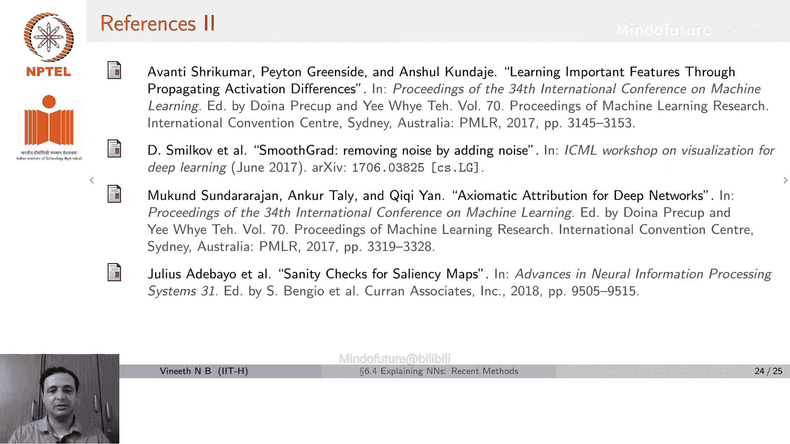

# 【NPTEL】计算机视觉的深度学习 p42 P42_解释CNN - 最新方法 - 第二部分 -BV1vNWkzpEua_p42-

A popular approach for explainable machine learning in general， not just neural networks。

 not just CNNs is known as lineme Lime stands for local interpretable model agnostic explanations。

So each of those words means something which should become clearer when we explain the method。

The way the method works is to approximate any underlying model by an interpretable， linear model。

Let's see how it does that。So you you first have a train model and now you are going to train an interpretable model。

On top of some small perturbations of a given instance。

So here is an intuitive visualization of the lime approach。

So the blue and pink background here give the black box models decision function F。

 so that is the classification boundary that you have between two classes。

 let' us assume it's a binary classification problem and all of these pink regions correspond to one class。

 all of these blue regions correspond to the other class。

The bold Red Cross is one specific test instance that you have given， which you have to explain。

 so I have been given an image， for instance， of a cat， and I now have to explain。

 and let's assume that this is the decision boundary of a CNN。

 I now have to explain why this Red Cross is called a cat。

So that what that is what we have been talking about so far。

 this is just a different way of viewing the same problem。And finally。

 you also have a dashed line here。Which is a learned explanation。Now。

 let's see how this explanation is learnt。The way it is learned is to take this bold red cross。

 which is a given image。Construct a few perturbations of the image。So you could now take an image。

Aclude a part of it。Aclude a segment of it， acclude an object in it， whatever it be。

 these are different kinds of perturbations that you construct around the image。

And you notice that when you remove a certain portion。

 our model classifies it as positive and when you remove another portion。

 our model classifies as as classifies it as negative and that' is why you see these plus。

reds and these blue dots， which means those respective perturbations were classified by our model as belonging to class 1 or class 2。

So you should be able to intuitively understand now how this can be used。

If I know which perturbations are making me lose the class label and make it go to another class。

 you know that they are my most important regions in the image。

2 for a particular class label to be assigned to that image。 Let's see this in more detail。So。

 given a point x， that is your bold red cross， let z prime be a point obtained by perturbing one dimension or region in x。

 so you could perturb a pixel or you could perturb a particular region。

 you could do occlusion kind of experiments or you could just perturb an entire region of an image。

And capital Z is the set of all perturbations。Let us assume that we have some metric pix of Z prime。

 which is proximity measure between instances Z prime and x， so for example， if you take this。呃。

The not bold plus and the bold plus the distance between them is what we are going to refer to as pi x of Z prime。

 This could be a distance metric such as an inverse exponential distance metric。

 so you could have an exponent of minus d x Z prime whole square where these is a squared distance divided by some sigma square which can be predefined by a given user。

F is again the model being explained。Our goal now is given these perturbations Z prime and your original image X。

 we want to build a model G of Z primes such that G of Z prime is equal to Wg into Z prime which is the linear model。

 such that the output of G of Z prime is the same as the output of F of Z prime。

 so which means we want this to be also equal to F of Z prime， What do we mean。

Remember that F is this function that' is already given to us。

G is this linear model that we are trying to develop using only those pertuurbed examples and we are saying now that G should be learned in the neighborhood of x in such a way that it makes the same decisions on all of these perturbations that the original model would on those if you gave those as inputs so in a sense G is like a local approximation of F F is what occurs across the domain of the inputs。

If you take a particular example and perturbations of that example that around its neighborhood。

 then G would be a linear model that approximates the original decision surface of F in that local neighborhood。

Now we want to learn Wg， that would be our goal because we want to learn that linear model Wg is learned by minimizing。

You take to Z and Z primes belonging to Z。P x of z。

 which is the distance of x from z F of z minus g of z prime。

 so you want to ensure that the decisions of F as well as the decision of G are。

Together they make the same prediction and you also want to keep in mind how far z is from x。

 so if it is very far away， you can perhaps allow it to make a little bit of mistake。

 but if it' is close by you want this you don't want to lose anything in the decision at all Thats the loss function that we use to learn G of Z prime。

Let's see how this is used so given an image such as this。

 so your perturbations could be where you take let's say the face of the dog and remove it and give the rest of the image and see what the network predicts as Similarlyly you may receive you may remove these strings in the guitar and see what the model predicts as Similarlyly then you remove your。

The board of the guitar and you would see what the model predicts as and based on all of these if you learn a G the way we talked about it you would get your WGs which would tell you how much each of these Z primes weighs towards these decisions。

😊，In a sense that tells you which of these Z primes is most important for a particular decision。

 rather you would be able to say that these are the regions in the image that are most important to call this image as corresponding to electric guitaritar。

These are the regions that are most important to call this image as corresponding to acoustic guitar。

 and these are the regions corresponding to this image which correspond to the label labed off。

Lme also has a fidelity slash interability trade off and the reason for this is the loss function that we used。

Tries to ensure that the function G， the linear model that we learn should be approximating f in the locality defined by pi of x。

 So the goodness of function G is very important。At the same time。

 you also don't want G to be too complex a function。

So G ideally is a model that belongs to the class of all interpretable models。

 so a simple example would be a linear model。And we define omega of g to be the complexity of the G model what do we mean by complexity if we are using G to be a decision tree it could be a depth of the tree if we are using a linear model it would be the number of non0 weights。

If we are using it for image based analysis， we may simply say that the number of super pixels should not be greater than a certain amount。

What is the superpixel， the region？Super pixel is just a region of an image。

 we wouldn't want more than three to four regions to be。

A non zero in that model when you make your decision。

 remember in this case that G is a specific model learned for only one image that bold red Cross that we saw。

 if you gave a different image， you will have to learn a different G。

So this is the complexity of the G model in the earlier example that we talked about a couple of slides back we learned a sparse linear model you could use say L1 regularization to make your model sparse as you may have learned in machine learning that's what we use here to be able to get these models to be sparse。

So now why does that matter， you could now view explanations in lime as a trade off between the fidelity。

 which is the fidelity of G to f which is given by the first term and the complexity or the interpretability of the explanation which is the second term。

 it may not be possible for both of these to be minimized。If you want G to be truer to F。

 you may need a more complex G。But if you make a more complex G。

 the interpreterability could be reduced。So it could lead to this kind of a trade off。

But irrespective， if you choose a linear model for G， it does work fairly well in various settings。

The last model that we will see here。Is inspired by what are known as Shaly values in game theory。

 This method is called Shap and was introduced in New Europes of 2017。To understand this model。

 lets define a few notations， let n be the total number of features in our in our method。

 in our setting。Let small v be a value function similar to attribution。

 but we see there's a slight difference。A value function that assigns a real number to any coalition S subset of n。

By coalition we mean a subset of features Why are we calling it coalition because this is inspired from game theory So in fact。

 an example where Shaplely values can be used is imagine a football team and you want to find out。

How important messy is for say the Barcelona team right so you want if you want to find that out you have a team already let's say a five to six players and you see if you added messy to that what value would the team now obtain with messy and without messy with the other five players so so now that team is what we refer to as coal so in game theory could be players or any other context but for us each of those are attributes we are saying that if we already have phi attributes if we now add a sixth attribute how much is our value changing that's what we want to measure。

And phi sub v of I is the attribution score for a feature I。Given these notations。

Attribution score in Sha in the Sha method is given by。The marginal contribution。

 that player in our case， a feature or an attribute or a dimension， whatever you want to call it。

A marginal contribution that player I makes upon joining the team。

Averaged over all orders in which the team can be formed。

Let lets again take the example of Mey so if you wanted to understand what value Liononl Mey brings to the Barcelona football team。

You consider the other players in the team and you consider them in all possible permutations and see if Mey's added how the value changes so you take first three players add Mey。

 see how the value changes， you take seven players add Mey see how the value changes。

 you take seven different players add Mey see how the value changes average the value increase that you got across all of these possible subsets and that's the value that Mey would bring to the Barcelona team。

Formerally， you would write this as5hi v of I is equal to summation over all the subsets without messy。

 without I。1 by n prime one by n factorial into s factorial into n minus s minus1 factorial。

 this looks at all possible combinations in the subset without messy given n to be the total number of players or features for us。

And this term here says v of S union I minus v of S。

 What if you add an I to the team S minus only the team S without I。

 that's the value of adding player I to a coal。So， I hope you can translate this to understanding the usefulness of a feature in a neural network。

 but we have to answer one question what is V for a neural network， what is that value。

 how do you measure that？So if you have a function F， which is a neural network。

 which is for predicting。Then we are going to define V as v of S。

 which is where s is a subset of features is given by expectation of P of X prime given x。

F of x union x prime S dash S dash is the complement of S。Rather。

 we are saying now that the value of a set S is given by。Expectation over。

Expectation over all possible probabilities of picking elements x prime given a subset X already given a team of or a set of features S already F of X union x prime as dash。

What would be the output if you added an X prime from S dash to excess？So you take all of those。

F's outputs take the expectation that becomes the value of s here。

But in this particular method of Sha。We assume that the features are independent。

 which means this conditional probability simply becomes the probability of picking a particular feature from S dash。

which is given by x prime， so you try to see given an excess what happens if you add a feature from x prime and then what is a new output if you take the expectation of all possible x primes that is the value of s。

There is an extension of Sha called deep Sha once again where the input features are assumed to be independent of one another and the explanation model is linear。

But now the reason it's called deep Sha Sha is it's a combination of Sha and deeplift。

And you take a distribution of baselines and compute the deeplift attribution for each input baseline pair。

 and then you average the resulting attributions per input example to define your V or value function the value function In short。

 the value function is inspired from deeplift。Thats the that is the idea here。

 the rest of it goes back and follows so the final attribution score would still be given by this equation here。

 we are only now talking about how the v is defined using these equations。

Having seen these different methods to be able to explain the decisions of CNNs or neural networks neural network models。

An important question to ask is how do you evaluate these explanations？😊。

Do you have an idea of how do you check the goodness of these explanations？

In all of the results that we showed so far。We showed qualitative results。

 so we took an image and said， look at this， it seems to work well。

But when you have a million images in your test set。

 you really cannot look at every image in that test set and study whether cam is working better or deeplift is working better or deep shot is working better。

 you need some objective metric that averages the performance across all of your images。

How do you do this？A simple way would be to take the intersection over Union Iuu of the thresholded salient region with a ground truth bounding box if it is available。

So if somebody already told you that given an image。I have a cat in the image。

 but I also am giving you a bounding box around the cat let's say that is part of the data set。

Then if my salency map has a high intersection over union。With this particular a cat。

 what is intersection over union， we will see this in more detail when we see other tasks such as detection in vision。

 but。If that intersection over union is high， we assume that our Saency map or our method to compute the Saency map has worked fairly well。

😊，What else can we use。There is another metric that's been recently proposed in Europes of 2018 and BMVC of 2018。

 which is called faithfulfulness。😊，In faithfulness。

 we measure the correlation between the attribution scores and the output differences on perturbation。

😊，So we are trying to see is if you per up an input and you see an output change。Then。

And if you see a significant output change， then the attribution of that input should also be high。

Because that that affected the output significantly so the correlation between the attribution score and the output differences on perturbation should ideally be high。

😊，So， here is the equation we say that faithfulness is given by rh。

 which is the correlation of r comm delta r is the relevance of a particular pixel I and delta is the output difference when Xi is the image obtained after perturbing pixel I。

😊，Another metric which was defined in the BMVc paper here is known as the causal metric。😊。

And it has two variants known as deletion and insertion metric。

 let us see the deletion metric and the insertion metric turns out to be complementary so in the deletion metric you first delete pixels sequentially。

😊，Based on what our method says is most relevant first for a particular outcome。

 so if we think the pixels of a cat are the most relevant for calling it a cat。

 remove those pixels from the image， so replace it with a black pixel or a gray pixel so remove those pixels from the image。

And then you compute the AU， I hope all of you know what AU is AU is the area of area under ROC curve。

Whi is a standard metric is used in several machine learning settings。

 so you compute your area under ROC curve of the network output。

As so the area under ROC curve you would know has two axis where generally you vary some threshold and see what happens to a certain set of metrics that you are monitoring and you ideally want your ROC curve to be something like this with a high area ideally but in this particular case we see。

What is the function of the perturbed inputs versus the amount of perturbation？

You are trying to see as you keep increasing the perturbation。

What happens to the function of perturbed inputs， does it change a lot？As you vary x axis。

 if y axis changes a lot， then perhaps those pixels do have a high influence on the output。

But because we have deleted the most relevant pixels we would want。

The AUC to be lesser here after the removal of a particular pixel so if you remove the most relevant pixel and plotted an RC curve the way we saw it here which means you put up the input and see how much the output changes and you plot this as a curve。

 you would want the AUC to be low after removing the most relevant pixel。

You could also look at this complementaryly and see it as an insertion metric where you insert pixels sequentially least relevant first in this case a higher AUC is better。

Just the way we spoke about it for the deletion metric。

Another recent metric that is been proposed in Europes of 2019 is known as Rar Rar stands for Remove and Retrain what the Rar metric suggests is you get a saency map for each image in your training data。

You retrain the model after perturbing the most relevant pixels。

The new model should have a large reduction in accuracy。 So if you take an image of a cat。

You know what saency map you got for a cat， you now pertu all of those pixels。

 you should ideally see a reduction in accuracy of the model calling it a cat。That's the ro metric。

There have also been some things called sanity checks for salliency maps that's been proposed。

 youre going to leave this as homework reading for you。And there's also work。

That was published in ICL of 2017 known as aximatic attributions。

 which defined a set of axioms for any of these attribution method。

It says that any attribution method be it Gcam， be it lime， be it deeplift。

 all the different methods that we saw this week must satisfy certain axioms for it to be for them to be reliable in practice。

 What are those axioms， once more， a homework for you to go back and read those axioms。

To summarize this lecture。Both deeplift and integrated gradients overcome the saturating gradient problem。

Although deeplift is generally faster because integrated gradients has to compute the data gradients across an entire path of different inputs。

However， Deeplift violates one of the axioms we talked about on the previous slide known as implementation invari axiom。

Maybe you should try finding out why as a homework。

Smooth intetor gradients are generally preferred over inte gradients when sparsity is desired。

For better interpretability in terms of visual coherence。

 XRAI is a good choice because it reasons at the level of regions rather than pixels。

Lme is a model agnostic method， it can be used on top of any machine learning model because you can any good to approximate it as a linear model at the end。

And it can be used for image data， text data， tableular data， so on and so forth。

It is a bit slow because you have to train a model for every input image that you have and it also sometimes is inconsistent between runs。

 but it is a model that is actually used by。By many companies today， in fact。

Shap has a strong game thetic background， but to actually make it work。

 you have to use some approximations in the real world。

So your homework is going to be about going through the list of axioms of attribution in this work and for each axiom try to find out the attribution methods that satisfy that the methods that we have covered in this week that satisfy that particular axiom。

Also go through the proposed sanity checks and experimental findings in this paper。

Both of these papers are good reads。And from a programming perspective play with Capam。

 it' is a popular library for model interpretation by Facebook Open source。

 you can also try visualizing any models that you have built in your assignment so far through the lens of open AI microscope for visualization and understanding。

Here are some other resources there' is a very nice book by Christopher Molar known as interpretpretable machine learning covers all of these methods in more detail if you are interested it's an online book and there is also a collection of tutorials and software packages on this link that you see here。

The references。So this lecture。Are here。

