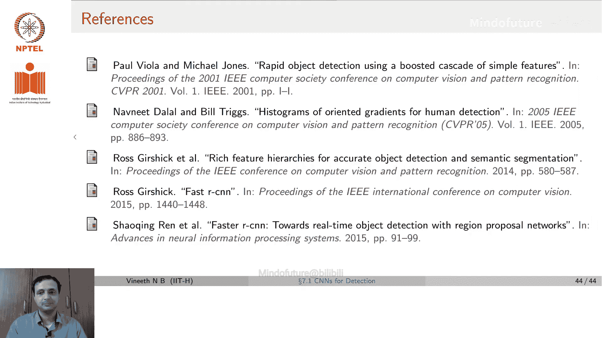

# 【NPTEL】计算机视觉的深度学习 p45 P45_用于目标检测的CNN I - 第二部分 -BV1vNWkzpEua_p45-

Having seen。How object detection was performed。In the pre deep learning era as well as how basic CNNs can be adapted to object detection。

Let's now move to how object detection is done today in terms of contemporary methods。

Existing methods that obviously are based on top of CNNs。

Can be broadly divided into what are known as region proposal based methods and dense sampling based methods。

 so we will cover region proposal based methods in the rest of this lecture and take up dense sampling methods in the next lecture。

In region proposal based methods， the framework is。Composed of two stages。In the first stage。

There is a network or a module that proposes different regions that could contain objects。

And in the second stage， a classifier， in our case。

 a CNN takes those regions and classifies them as belonging to an object or could even belong to the background。

This is more robust in performance， but is slow because of the two stage approach。On the other hand。

Dense sampling based approaches are a single stage approach where the proposal of regions。

And the classification or detection of those regions in the objects is all done in one shot。

Through a dense sampling procedure。This is simpler and faster。

 but sometimes can fall short of the accuracy when compared to region proposal methods。

Let's now discuss region proposal methods。So the earliest one was known as the R CNN or the region based CNN。

 which is proposed in CVPR of 2014 by Rosdership。This approach。

It hass a first stage where it uses a method known as selective search。

Which is an image processing method。 It doesn't use a neural network for that。

 but using a selective search approach。It proposes several regions that could have objects。

Each of these regions is then evaluated by a CNN to perform classification as well as do bounding box regression to get the correct localization inside those region proposals。

 remember and we talked about over feet we said that we could divide these into two heads。

 we will continue to use that for all detection methods that we will see。

How do you do that first stage selective search？So。

 the Select search module uses a graph based image segmentation or a mean shift based image segmentation to get an initial set of region hypothesis。

So these hyposes are then hierarchically grouped。Based on region similarity measures like color。

 texture， size， region fillings， so on and so forth。So， if you had。

If you used color for grouping up regions you may end up getting an object such as this；

 if you used texture for grouping up regions you may get a region such as this or if you used region filling you may end up getting a region such as this。

In practice， you have an image。You use an existing segmentation method we covered this in the initial weeks。

You will get various different segments that you see here。

Then you combine these segments using agglomative clustering， if you recall。Using either color cues。

 texture cues or region filling cues or any similar cues and this gives us regions of larger of a larger scale。

Now， how do we use these regions？Once you get these region proposals。

This particular method selects 2000 such region proposals so by combining and quaing different subregs。

 you get somewhere around 2000 region proposals。Each of these region proposals are warped to the same size。

Why do we need that？Because we are going to give that as input to the CNN。And remember。

The CNN can only take a fixed input size。As its input dimension。

You cannot give a 20 cross 20 image and 100 cross 100 image a CNN can only accept。One size。

 that's the nature of the architecture that we that we use。

 So whatever be the size of the region proposals， they are all war to make it the same size。

 So there could be some artifacts of stretching because of this。And these proposals。😊。

Are then given to a CNN， so in this particular work， the CNN was like an Alexnet or a VGG。

Then you get feature maps out of the CNN。That goes through a fully connected network。

And then there are three components。You have a softmax component that does classification of each of these regions。

Into one of the known classes that you're looking for while performing detection。

It also has an SVM which is actually used for classification we'll explain that in a moment。😊。

And finally， it also takes the feature maps。Through a different fully connected layer to perform bounding box regression。

Ill repeat that this bounding box regression step that you see here。

Does not you already have a region given to you this remember that this region is a part of the original image。

😊，So what the bounding box aggression module does here。

Is to give you the offset from this region in the original image to the correct bounding box。

 So if this region was in specific location of the original image。

The bounding box regression module may give values such as plus 1-2 and maybe plus 3-4。

 which means that the top left corner should be moved by one pixel further on the X axis moved by two pixels to the left on the y axis and the height and the width must be adjusted by plus 3 and minus-4 so on and so forth。

 so this bounding box module regression module predicts the offsets from the current location of the box that you have。

Now lets see the entire training procedure。So， in the first step。You consider all of these modules。

 the CNN， the feature maps， the fully connected network。

And you fine tune this fully connected network。To the wared images using a softm and a cross interval loss。

We generally refer to cross entropy loss also as log loss because when you have multiple classes。

Your cross entropy loss turns out to be simply the log of the probability of the ground truth class。

Wso。Because you would have your。Crossenttropy loss to be given by Yi summation over I Yi log pi this is your crossenttropy loss remember that your ground truth is going to be one only for the correct class and is going to be zero for all other classes so you will be left with just minus log pi no summation and that is why we sometimes call crossenttropy loss as just log loss because when you use it for a multiclass classification setting that' is what it turns out to be。

So that's the first step to tune the CNN so you already initialized the CNN with weights of an AlexNe model or a VGG model。

 now you further refine those weights by using a log loss and the softmax in the last layer through the fully connected network and the feature maps。

In the second step。You now take the outputs of the fully connected neural network。

And use them as representations of each of these regions。And then train a class specific SVM。

 depending on the number of classes in your detection problem。

 you could be detecting say up to 20 different kinds of objects or even further。

You would then learn 20 different SVMs based on the features that youve got as output of the fully connected network and then the SVM is then used to make the final decision of the class in that region。

And the stage3 is training the fully connected layer for performing bounding box aggression where one would you use one would use L2 loss or the mean square error loss。

 Remember they both are synonymous。 What are the limitations of R c。Firstly。

It is a multistage pipeline of training as as we just saw you have to first train one head。

 then you have to take representations and train 20 different SMs or as many different SMs as classes and then you also have to train a bounding box regression head。

Can we make this simpler。We will see this in a minute。But before that。

 the extraction of region proposals initially。Could require a lot of time and space。 remember。

 we have to do segmentation， coalalize them and then finally pass each region proposal through the CNN and get your。

And get your classification bounding box offset， so on。A data set such as Pascal VOC， which has 5。

000 images approximately。requiredquid about  two and a half GPU days and several hundred GBBs of storage。

 which can turn out to become impractical。And using RCnn at test time。

 the object detection took about 47 seconds， which is not really real time。

This led to the development of the fast R CNN approach by the same authors in fact。

 and it was published in ICCV of 2015。In this case， there were。😊。

A couple of different innovations that were introduced。

One idea was while we still do selective search。To get the region proposals。

We would map these region proposal locations。Directly to the feature maps after sending the full image through the CNN。

If you go back and see how it was done earlier， earlier。

 each region proposal was fed individually to the CNN。

But now we are saying that we will feed only the entire image to the CNN。

This helps us because otherwise we had to do 2000 forward propagations where 2000 are the number of region proposals。

Through the scene。Now we just need to do one forward prop through the CNN， which is the entire image。

Through selective search， we would get a lot of region proposals。

We now map because the reason proposals have certain coordinates in the original image。

 you can map those coordinates to the feature maps that you get as the output of the CNN。

And once you get these feature maps， you have two heads。

 one for classification where log loss is used。One for bonding box aggression where L2 loss is used。

No more need for SMs， which seems obvious， but that's how this method was improved。

So now how is the region of interest projected so we said that you take these region proposals that are outputs of the selective search approach and map them into the feature maps。

 how would you do that if this was one of your region proposals let us assume that the6 cross8 patch was a region proposal in your original image。

Then remember that your CNN follows a set of steps where the image gets in most likelihood downsized as you go through each iteration because if you perform convolution。

 the image size reduces， if you perform pooling， it further reduces and so on。

So you take the same region proposals dimensions， keep forward propagating it through a similar set of operations and you would notice that this six cross 8 patch matches to this two cross 3 patch on the feature maps as a next step。

After。Projecting the region proposals onto the feature maps。

We need to bring all of these region proposals to the same size for the same reason that we said that the next layers can only take input of the same size。

To do this， fast RCNN proposes a module known as ROI pooling。

 ROI stands for region of interest again。The Ris can be of different scales so to get a scale invariant way of pooling。

So what Rway pullinging does is。Given any region which is say of size small edge cross W。

 it converts it into a region of capital edge cross capital W grid of subwind。

With each subwinddo of size H by capital H and W by capital W。 So for example。

 if you had an8 cross 8 region。And your target size was two cross 2。

You would accordingly divide this eight cross8 into a two cross2 grid and do pool inside each of these two cross two regions and get your output in the target location so your pooling here would happen in this location you would do say a max pooling and only the max value would go here so on and so forth so if you had a four cross6 region of interest then you would still have to do a two cross to you still want a two cross2 output so you divide it this way now and you pull across all of these six pixels and that value goes here so that's how Ry pooling works。

And once ROI pooling is done， you then send it through further layers。

 fully connected layers and at the end of which you have two heads with two different loss functions。

 so you have a multitask loss， one task for classification and one task for regression。

 so if we assumed that U is the true class and V are the ground truth bounding box regression targets。

If p is the predicted class probability。And T are the bounding box regression offsets for the true class。

And the loss for each region of interest would be。The classification loss。Plus。

 your localization loss by localization loss， we mean the bounding box regression loss。

The classification loss， as we just said， is given by minus log P。

 the cross entropy loss simplifies into a log loss。

And the localization loss is prefixed by an indicator function which states that we are going to compute this only for the true class for the other classes we dont need to compute this kind of a localization that is what the indicator function dictates。

😊，What is the localization loss in fast star CM？Earlier we said we typically use the L2 loss。

 but in fast our CNN。The method recommends the use of a new loss known as the smooth L1 loss。

Note that album loss。Is the sum of the pairwise differences between dimensions and their corresponding absolute values？

And this is used instead of the L2 loss and a smooth version of the L2 L1 loss。

 remember that L1 loss any absolute value function looks somewhat like this。

That is the f of x is equal to absolute value function， but this function can become nondiiable at 0。

 so to avoid that you have a smooth variant of the l1 loss known as smooth l1 loss which is given by 05 x squared if x is less than 1 otherwise x minus 0。

5 otherwise so this would give you。A slightly smooth when it comes close to the0。

 it becomes quadratic， so you would have a slightly smooth function。

 but otherwise its absolute value or L1 everywhere else。Whyise smooth El loss。

It turns out that smooth L1 loss is less sensitive to outliers than L2 loss。Why is this so？

His homework for you。And we'll discuss that in the next lecture。

So the summary of Fast RCNN is given an image， you still have a selective search。

You also forward propagate the full image through the CNN。

 say an AlexNe or VGG whose output gives you a depth of feature maps like the output of any convolutional layer。

Now you project all the region proposals that you got through selective search onto these feature maps this avoided。

 as we said， multiple multiple forward propagations through the convolutional layer。

Then you perform ROI pooling to get all those region proposals to the same size。

You then send this through a fully connected network which has a softm head or a classification head and a bounding box。

 a regression head。With these improvements。😊，Fat R CNN significantly outperformed R CNN in training time and test time。

Fast R CNNnN took about 8。75 R for training while RCnN took 84 R for training。

 that's a 10x reduction。Importantly， a test time while R CNNnN took。47 or 49 seconds for。

Doing detection on each image， this came down to 2。

3 seconds for faster CNN and just 03 seconds if you had to avoid the region proposal finding step。

So that gives us a clue on what needs to be done next， which is we have to find a way of avoiding。

The process of getting region proposals using selective search。Because among the 2。3 seconds。

 it looks like two seconds is required just for that step。This leads us to faster R CNNn。

Faster our CNNN replaces selective search with a region proposal network。

 so instead of getting region proposals through segmentation methods that are offline。

 you are going to try to see if this can also be done as part of the neural network itself。

This was proposed in Europes of 2015。And let's see how this is done。So given an image。You forward。

 propagate the image through the。A CNN， like Alexnet or BGG。You get a set of feature maps。Now。

 these feature maps are provided to the regionion Pro network。

Whose job is to tell us which regions are likely to have an object？

It does not worry about classifying the object。It only worries about objectiveness of a region。

And these regions are then provided through an ROI pooling layer that part of it is very similar to fast RCNN and finally you have classification on bounding box regression just like how we add it with fast RRCNN。

How does the region proposal network work？It uses what are known as anchor boxes of different scales and aspect ratios to identify multiple objects in a given window。

Let's see how that works。So given a particular window。

 so let's say any particular window in an image。So， it takes different。Predefined anchor boxes。

 So you can define an anchor box， which is defined given a particular location。

 You can define an anchor box that's given by。This rectangle here。

 you can define an anchor box that is given by this this rectangle here and you can define an anchor box that is given by different this rectangle here。

So these are a set of predefined rectangles， which given the center can。

Define several kinds of regions around that center。What does the region proposal network learn。

 it has its own loss function to learn that part of the network。Recall inception net。

 recall that in inception net we had certain loss functions at different stages of the network。

 you could consider this to be similar to that。So， here the output expectedant of the region proposal network is is any of these anchor boxes an object？

So you're only looking for object or not an object。So there are no further classes。

 it's a binary classification problem。And if you had k anchor boxes， which， as I just mentioned。

 are predefined， you have to define them when you start。And if you had your depth to be if you had 5。

 12 cross 20 cross 15 to be your image features， then you are going to have k cross 20 cross 15 as the output。

And you would have 4 k cross 20 cross 15 as the bounding box offsets for each of these anchor regions。

So this part of the network。Does do a bounding box offset recognition or。Fine tuning。

 but it also checks whether a region is an object or not an object。Let's then see what happens。

So you are going to have a fully convolutional layer。

Wwhich is does objectness classification and bounding box regression so in this case we are talking about say nine anchor boxes which is what was k on the previous slide but this could be different based on what one chooses to do in a given setting。

So in the first step。You take the input image。You take a CNN pretrained on Alexnet。

 use the feature maps， send it through a region proposal networks which are which is a further set of convolutional layers and check for objectness and bounding box coordinates and train this region proposal part of the network。

 you can fine tune the previous weights to。This is step one。In the second step。

You take these region proposals obtained from the Reg proposal network。

Feed that onto the feature maps， those are going to be your regions now。

The rest of it stays very similar to fast CNN， and you train all these weights using your classification loss and bounding box Boing box regression loss where now the classification loss tries to categorize a region into any of。

Say 20 objects or how manyeever objects you have in a given problem setting。

So this is the second step， which is very similar to what is done in fast R CNN。In step 3。

The CNN is made common for your entire network as well as the region Proal network。

 so you share those parameters and you train your RPPN while freezing your CNN parameters to help improve the RPPN's performance。

And finally in step 4， you freeze everything else in the network and only fine tune your F networks to get your final classification output and bounding box offset regression outputs。

😊，This is the four step training procedure proposed by faster RCN。And using this approach。😊。

The test time speed reduces from 2。3 seconds to 。2 seconds。

 which becomes closer to real time for every image。

The homework for this lecture would be to go through the Vi Jones object detection framework and a very nice write up on called object detection for dummies linked here and if youd like to understand overfeet here is a link。

There is also a nice video series on evolution of object detection models， if you like。

And here is the exercise that we left for you。Smooth L1 loss is less sensitive to outliers than L2 loss as was proposed in fast Star CNN。

Can you try to find out why？The next lecture， we will talk about dense sampling methods for object detection。

