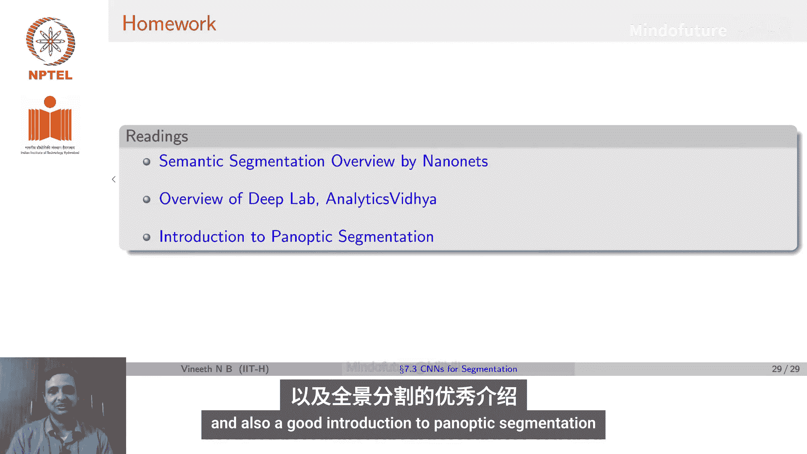

# 【NPTEL】计算机视觉的深度学习 p47 P47_用于分割的CNN -BV1vNWkzpEua_p47-

Having seen detection。Well now move on to segmentation of images using CNN architectures。

Well quickly review the exercise from the previous lecture。Given to bounding boxes in an image。

 an upper left box， which is two cross to。And a lower right box， which is two cross 3。

 and overlapping region of one cross  one。 What is the IOU。This should be a simple one。

So you have an upper left。Which is two cross2。And then you have a lower right。

This is two cross three。What。A one cross one overlap。

So the total number of boxes here are nine of which the intersection is one box。

So your overall IOU would be one by9。And the second question consider using yolo on a 19 cross 19 grid 20 classes。

5 anchor boxes， the output volume would be。Remember， we said it is s into s。Into 5。B。

 that's the number of anchor boxes plus C number of classes， and that's the final answer you get。

We assume here that C the number of classes also includes the background if you want to have background as a separate class。

 then you will have to add C to be 21。So let's recall image segmentation in the first place。

Early on in the lectures， we talked about different image segmentation methods such as watershed。

 graph cut， normalized cut， mean shift， so on and so forth。To an extent。

 these methods inspired early versions of CNN architectures for tasks such as detection and segmentation。

 in fact RC， which uses selective search to get region proposals。

 in fact used a Min cut segmentation method known as CPMC constrained parametricic min cuts to generate the region proposals。

But well now move on to deep neural networks for segmentation。So。

 the task at hand for us to start with is going to be semantic segmentation where wed like to assign a class label to every pixel in the image。

How do you solve this problem。Using neural networks in particular， convolutional neural networks。

Were going to cast this as a pixel voice classification problem。Well， so far。

We spoke about image level classification where we had only a label at the level of an image then we went to detection where we had labels at the levels of bounding boxes where we not only gave class label but also an offset to the bounding box to make a final prediction。

But in semantic segmentation， we are going to classify at the level of every pixel。So for each image。

Each pixel has to be labeled with a semantic category。So。

 you can assume that creation of a data set for semantic segmentation is very annotation intensive。

There have been various architectures in recent years such as FCNs Senet unit， PSPnet， DL， MacarciN。

 we cover each of them in this lecture。Starting with FcNs or fully convolutional networks for semantic segmentation。

 which was proposed in 2015 and 16。They adapted various classification networks such as VGGNe。

 Google Ne， so on and so forth。Into fully convolutional networks。

By converting the Fc layers into one cross1 layers， we saw that with a single shot detection methods。

 it is the same idea here because for semantic segmentation you still have to classify at the level of a pixel so you do not want to move away from the convolutional regime。

What do we do to obtain the classification for each pixel。

 we can have a one cross one convolutional layer at the end of any CNN。

And have c plus1 channels in that final output volume where C is the number of classes and the plus one is for say a background class。

But do you see any problem with this approach？There is a problem when you use convolutional layers。

 which is。All standard Cns keep down sampling as you go further down the layer。

Be it through convolution or through or through pooling。

 which means your output feature maps are not going to be the same size as your input。

But we finally want to give a pixel level。Label in the input resolution in the input images resolution。

So what do we do？We already know the answer。We can ups sampleampble after a certain stage。

So you have convolutional layers and after a certain stage you upsemble。

 ups sampleble and bring the feature maps to the same dimension as your input image。

How do we ups sampleble？One of the methods that we have discussed before is transpose convolution。

Let us quickly recall transpose convolution， so this was the one dimensional example we spoke when we discussed convolutional neural networks so where your output can be larger than your input。

And here is the illustration that we gave for transpose convolution where you have a dilation in your convolution when you take the filter and apply it on an input image。

Because there is a dilation transpose convolution is also known as dilated convolution。

Or it is also sometimes referred to as address convolution， as we will see a little later。

Because it dilates when you perform the convolution。So now in FcNs。

 this is the idea that' is used to ups sampleample after a certain level。

Let's see an FcN architecture with a VGG backbone。So if you have a VGG16 backbone。

The first thing that was done in FCN is to remove all the fully connected layers so what you have now are only the convolutional layers of BGG16 so you can see all the standard standard feature maps of BGG16。

The three F layers are replaced with 1 decoconvolutional layers and the last 1 deco convolutional layers has c plus 1 filters。

 so you can see here the last one has 21 dimensional filters this was applied on a data that had 20 classes so it was 21 dimensional。

However， you notice here that。While you have 21 channels。

 the output is still smaller in size when compared to the input resolution。

 so you finally have one up samplingling layer which is done using transpose convolution to get back to the original size。

This is what was done in fully convolutional networks。However。

 is transpose convolution the only way to obtain the up samplingling？Not necessary。

 we can do several things including skip connections which we will see later。

 but before we go there we will talk about another method that came around the same time as FcNs known as segmentss。

Segets are what you see here in the image， you have an input image， you have an output。

And the architecture is a fully convolutional encoder decoder architecture。

How is this different from FcNs？Very similar to FcNs， the encoder is Vg16 without Fc layers。

The decoder maps the low resolution encode of feature maps to input resolution here there is a difference from FCN FcN had only one up samplingling layer towards the end。

Whereas segment has a sequence of decoder layers which mirror the architecture of your encoder。

 so the encoder and decoder architectures are mirrors of each other。

The important contribution in Snet was to avoid transpo convolution in up samplingling。So。

 how does segmentnet do the up samplingling in that case。

 it actually uses the pooling indices that were obtained in the encoder layers and uses them to be able to ups sampleampble。

Let's see how this is done。So if you had an output map from a particular decoder stage。

We use the max pool indices from the original encoder。

 so let us assume the max pool indices were 001010101 so a would go to the 00 location which would be the top left。

B would go to the 10th location， which would be the bottom left。C would go to the 10 location。

 which would be the bottom left and D would go to 01 which should be top right。Now。

 this becomes an upampled version of a previous layers output map in the decoder。

And one can continue to do this to get your final up sampleled image。

What do we mean by max pool indices in your encoder whenever you had a pooling layer？

You keep track of the indices of which of those entries in a two cross2 patch or three cross through three cross 3 patch depending on what pooling you are doing。

 you store the winning indices in a separate memory buffer and we are going to use that max pool indices to ups sampleample back to higher resolutions。

Why is this good？Storing Max pool indices。Is more efficient than storing full feature maps of the encoder。

And in each stage of the decoder， the max pooling indice of the corresponding encoder is used to produce the upsampled feature map so if you see the complete image。

 the pooling indices of this encoder feature map goes to this decoder。

This encoder's feature map goes to this decoder and so on and so forth。What is the loss function。

 So we've seen a couple of architectures now， FcNs and segmentsnets。

What would one use as a loss function to train such networks。

Simple it the sum of pixel vice cross enro losses。 remember in both Fcn and segmentnet。

Your output is going to be a volume。Which would be the size of the input resolution。

 but the number of channels would be the number of classes plus one for background。

So you can actually have for each pixel a vector of probabilities which is in your output volume now you could compute the pixel level cross entropy for each pixel you can sum all of them up and that becomes your loss function which because it a sum of cross entroies will remain differentiable。

A third kind of architecture， which also came in the 2015- 16 timeframe is known as unit。

Unit is also a fully convolutional encoder decoder architecture。

But it introduces the concept of skip connections in a different way from segment。

In the contracting path， that is the encoder path is an existing classification network with F layers removed similar to Senet and FCNs。

But in the expanding path。In addition to up samplingling of feature maps。

The network also receives corresponding feature maps of the contracting path。

Along with further convolutional layers。Finally， at the end。

 you have a one cross one convolution with C plus1 channels where C being the number of classes。

The up samplingampling in unit is performed using transpose convolution to cross through transpose convolution with strip 2 and padding 0。

And the number of feature channels are halved in each up samplingling step。

 which means the total input dimensions will double now with a two cross to transpose convolution and channels being halved the total input map dimensions will double at this time。

So the original unit architecture。Unpaed convolutions are performed。

 which means the output segmentation is smaller than the input by a constant border width。

Let' us look at the visual， so here is the unit。And the shape of it tells why it is called the unit architecture。

 you can once again see the contracting path is similar to any other architecture without FCN layers and in the expanding path in addition to doing transpose convolution at each step。

You also receive the corresponding feature maps of your contracting path， which is added to your。

To your expanding path。So that gives a localization information from the encoder to each step of the decoder beyond just up samplingling。

 so you get additional information from the corresponding layer of the encoder rather than rely only on up samplingling as in segmentnet or FCN。

Unit was originally proposed for biomedical image segmentation。It was in fact。

 published in a medical conference Mkai。How do you think this can affect the learning of the unit model？

Biomedical limit segmentation has some unique challenges。 Firstly。

 often you do not have training data sets which are of the order of1 million or even tens of thousands。

Very few training images may be available。So， this particular work。

Employed excessive data augmentation。By applying elastic deformations to available training images。

 which was one of the contributions。Another challenge in the medical domain is there could be many objects of the same class touching each other。

Because there could be objects which are similar to each other placed next to each other。

 so unit also proposes a loss function which penalizes pixels closer to edges more than pixels away from edges。

Edges are extremely critical for medical image segmentation。Over the years。

 there have been several variants of unit。Mostly by changing the architecture by replacing the convolutional blocks with dense blocks and increasing the depth of the unit。

 so on and so forth。Another network used for segmentation。Is known as the PSP net。And the PSP net。

Starts by asking the question。What challenges could you face if you applied F CNs on complex scenes。

If you think deeper， you would notice that Fcs do not learn patterns that are cot。For example。

 we know that cars are on roads while boats are around rivers。

And Fcns may can can also predict parts of an object as different categories， for example。

 it can look at a skyscraper and think。Pixels belong to different buildings because of the sheer scale of that object。

Thirdly。Eps could fail to detect large objects or small objects depending on the architecture and the receptive field employed in the architecture。

So how can we address some of these constraints？PSPnet hypothesizes that one should use global context information。

To improve segmentation performance。So how do you get global context information？

Segment at multiple scales so when you segment at a lower resolution you are actually trying to bring more global information into the segmentation result。

So PSP net introduces a pyramid pooling module。Where given an image。

 you forward propagate it through a CNNn。And then there is a pooling layer。

That pools at multiple scales。What are the different scales there is a course scale which is simply a global average pooling。

 so this would be one cross one cross C where C are the number of channels。

And each successive pooling level gives increasedized information localization information。So。

 you would have your pooled outputs to be1 cross one cross C。

 that is the global average pooling so each of the C channels here in the convolutional output feature map。

You would take the channel global average pull and get one scalr。And for each of these C channels。

 you would get one cross one cross C， similarly two cross2 cross C。3 cross。

 three cross C and six cross6 cross C， and those are the four scales that PSP employs remember that when you do pooling。

Typically， the number of channels do not reduce， you operate channel voice。So once these four scales。

 pooling is done。The PSP net。Now applies a convolutional one cross one convolution on each of these。

mapps that came from the pooling operations to reduce the number of channels in the output。

By how much does each of these one cross one convolutions reduce the channel size by？By one fourth。

There's a reason for that。 The reason is， once these。One crossman convolutions are performed。

All of these are upsampled and concatenated。So， each of these pulled maps are up sampleled using simple bilinear interpolation and then they are concatenated and this concatenated volume is going to have the same number of channels as the original feature map。

Once this is done， this is。Then send through a convolutional layer to get your final prediction of segmentation。

Another method is known as DeepLb， which is a popular method for semantic segmentation。

Which is similar to PSP net。In this case， the image goes through several blocks of convolution。

And then。Instead of having a pooling layer which splits the image into four different scales。

 it performs address spatial pyramid pooling so this module is known as the ASPP module。Remember。

 address。Convolution is the same as dilated convolution or transpo convolution or sometimes even called fractionally strideed convolution so when your stride is less than one。

So， then you get the same effect as performing pooling at multiple scales。

 so at a spatial pyramid pooling you could say is a different way of implementing your pyramid pooling module in PSP net。

So， once you do your atpatial pyramid pooling， you once again ups sampleample concatenate and you finally get your result on that concatenated volume。

Dela has gone through a few different versions over the years and。

One of the more recent versions known as DLb V3。Adds a few modules to the basic DL architecture in this DL V 3 module。

Image level features are also passed on to the ASPP module。

There is batch normalization which is used for easier training and there is also an entire decoder architecture which is used to refine the segmentation results so you can see here that you have the ASPP module。

Using which。You perform one cross one convolution， three cross  three convolutions。

 so on and so forth， you get a set of feature maps。Which are concatenated。

One cross1 convolution is done to reduce the depth of those channels and that is then sampled by 4 and passed on to the decoder along with the output of the ASPP module。

These are then concatenated and you finally have one more convolution at the end。

To and then ups sampleample and make your predictions at the end。

 remember that this predict when we say prediction， it is going to be again an output volume。

Whose resolution is the same as the input image and the number of channels would be C plus 1 where C is the number of classes plus1 for background。

Moving on from semantic segmentation， instant segmentation is a slightly more challenging task than semantic segmentation。

In semantic instance segmentation or what is popularly known as instant segmentation。

 our goal is to not only give a class label for every pixel but to also assign an object ID for each of the objects。

So if there are multiple people or multiple chairs or multiple dogs。

You want to also separate those people。The instances of the people and instances of the dog。

 which the basic semantic segmentation task did not consider。In semantic segmentation。

A dog would be a dog。Dog pixel， whether they were two dogs or three dogs or four dogs。

 all of them would just be classified as dog。But in instant segmentation， we want dog  one， Do 2。

 dog 3 and dog4。And the challenge here is you may not know the number of dogs。

Which is similar to the detection problem。Which is why one of the most popular approaches for instant segmentation known as mask or CNN。

Actually tries to improve upon faster R CNN to achieve instance segmentation。

So mask RCNN was proposed in ICCV of 2017 and it uses a faster RCNN like architecture but adds a branch to also mask out and get instance level segmentation。

So you could look at mask Rcn as faster Rc with FcN on the regions of interest。

It adds a parallel head， along with your。SPM object classifier or simply your classification module and your bounding box offset regressor。

 you now add a mask predictor that is the third head。

An important contribution in mask R CNNnN to be able to achieve the mask accurately was a module known as ROi Al。

And since Ma R CNN operates in the framework of faster R CNN。The main。

Limitation of faster R CNN that this module addresses is that when you map。Object proposals。

To feature space recall that both in Fast RRCN and faster RRCN。

 you had certain object proposals and you map them to a certain feature space。

And feature space could be of a different resolution than the resolution in which you obtained your object proposals。

In both faster CNN and faster R CNN。We simply warp it to the size required and then bring your object proposals to that dimension。

However， when you do something like this， you could face errors due to quantitization。

Why does this matter。This matters because one pixel in feature space could be equivalent to many pixels on an image because the feature space is smaller in later convolutional layers when compared to the initial input。

When you try to get a mask。These few pixels can bring a significant error in the final performance。

So how do we overcome this problem？Ri align performs bilinear interpolation to get the exact coordinate for。

The locations where the object proposals match to a given feature map。

This preserves translation equivaris of masks。What do we mean？

We mean that given an image where an object could be located in this yellow box or red box。

Both could be valid detections， but the mask position in each of these bounding boxes is different。

So， by translation equivariance， we mean that if the object has moved by a certain amount inside the bounding box。

 the mask also has to move the certain by the same amount。

And this can be achieved by the ROI All layer。So， the way ROI align does it is when you convert your object proposals。

To locations on your feature map。If the location turns out to be in between a few pixels on your feature map。

 then you you perform bilinear interpolation。Of the pixels around the feature map。

 And then you get your specific。Pixel value at that specific point pointed by the object proposal。

 and that is what is then。Poolll to get your fixed dimensional representation that goes to later layers of your faster RCNN architecture。

So， in addition to your standard faster are seen in architecture with a classification loss and a bounding box loss。

We also have a mask head with the mask R CNN。And what the mask R CNNnN does is it uses an FcN kind of a branch。

 so which means it's fully convolutional。And for each ROi， the mask size is 28 cross 28。

 as you can see here。And it is finally rescaled to the bounding box size and then overlaid on the image during inference so this mask as you can see here is obtained for every ROI and then finally overlaid back on the input image at inference time。

A last and more recent form of segmentation that is popular is known as panoptic segmentation。

Poptic segmentation。Combins semantic segmentation and instance segmentation。So semantic segmentation。

 as you can see， is where you segment the pixels of all objects， but all instances remain the same。

Instant segmentation is where you only care about the instances of the objects in your categories。

 but you label each instance separately。And panoptic segmentation is the union of the two where you label every pixel as belonging to different objects and you also ensure that each instance of an object gets a different label altogether。

So， how do you perform panoptic segmentation so this work was first introduced at CVPR of 2019 about a year old。

And one could achieve panoptic segmentations using a couple of architectures so you could perform mask RCNN to get instant segmentation results you could do a dilated FCN to get semantic segmentation results and then you merge the two to get panoptic segmentation that is one approach so this particular work actually implements a couple of approaches and then。

Studies how this needs to be evaluated differently。

So another approach is you could take a feature pyramid network instead of what we saw here instead of using a dilated FCN or a mask RCNN。

 you could use an FPN， a featureyramid network and then send those detections through a mask RCNN head to get your instance level segmentations and you could also send those different feature maps。

Through a pixel level recognition head through your semantic segmentation。

 So in both these approaches， there is an instant segmentation pathway。

And there is a semantic segmentation pathway， which are combined to give your panoptic segmentation。

What would be the loss function here？The last function recommended is a combination of both semantic segmentation and panoptic and instant segmentation remember that instant segmentation。

The way we saw at Macar CNN has three losses， classification。Bounding box and the mask loss。

And then for semantic segmentation， you have your standard pixel voice cross entropy loss。

One of the challenges of panoptic segmentation is that it cannot be evaluated using the metrics one may use for semantic segmentation or instant segmentation。

Why is this so？In semantic segmentation。We use IOu and per pixel accuracy。

 so you can try to see if you drew a set of pixels that belong to a particular object。

You could try to get the intersection over union with the ground truth of that object。

You could also get a per pixel accuracy because you are going to predict probabilities at each pixel level for all the classes that you have you can also look at that accuracy as a metric。

😊，On the other hand， for instant segmentation。Which is similar to detection。

 you would have average precision over different AuU thresholds。

Why cannot we use these for panoptic segmentation？That is because this could cause asymmetry for classes with or without instance level annotations。

Remember that in panoptic segmentation。You could have certain classes where there are multiple instances。

 for example， people or dog。And there could be certain classes such as Sky Road。

 which may not have many instances。So， to combine these metrics without considering these aymmetries may not be wise。

So， this particular work recommends a new metric known as the PQ metric。How does the Pq metric work？

You can look at this example here， let us assume that this is your correct ground truth。

 so theres sky， there is grass， there are three people that is the instant segmentation part of it and then there is a dog。

Let us assume now that whatever model we came up with predicted it this way。The sky， it got it right。

The grass， it got it right。The dog became person。And instead of three people。

 it only predicted two people where it combined two of these people。

So how do you now measure error of this kind of a system？So。

 the way this approach recommends is you first write out all your true positives。

 which would be your two people which are true positives between your ground truth and prediction。

There is a false negative， which is the person you missed。And there is a false positive。

 which is the person you added instead of a dog。So for a ground truth segment， G。

And for a predicted segment P。The PQ metric is computed as。

Sumation over all Pgs belonging to true positives intersection over union for those PGs。

Divided by number of true positives plus half times number of false positives plus half times number of false negatives。

If you analyze this， this can be written as。The numerator stays the same way。

 lets multiply and divide by number of true positives。

Then you would get the first term to be this way and the second term to be number of true positives by number of true positives plus half false positives plus half false negatives。

So the first term here gives the segmentation quality。Among the true postors。

What was the IOU for all of your segments。And the second part gives the recognition quality as to among all of your。

Possible segments。 How many of them did we get as true positive。So。

 you have a part of it that checks for segmentation quality and a part of it that checks for recognition quality and that is why this metric becomes useful for pan optic segmentation。

For more details， please read a good overview of semantic segmentation by nanonets。

A good overview of B P semantic segmentation method， which is a popular one at Anas with。

And also a good introduction to Panoptic segmentation。

