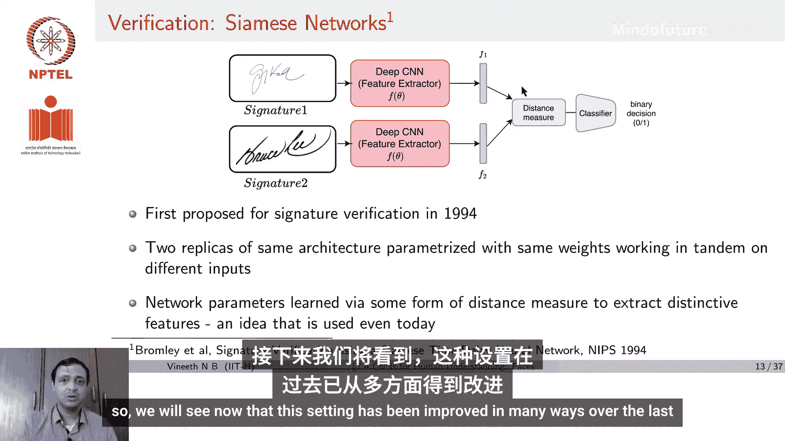

# 【NPTEL】计算机视觉的深度学习 p48 P48_用于人类理解的CNN - 面部 - 第一部分 -BV1vNWkzpEua_p48-

Willll now move。To another important task where CNNns have been extremely useful over the last few years。

In computer vision tasks， CNNs are used in understanding humans from various different perspectives in this first lecture we look at。

Understanding phases and processing phases for tasks such as recognition and verification。

Face recognition has remained an extremely important computer vision task for several decades now as part of biometrics。

 it has applications in security， finance， healthcare。

And various other aspects of society and finance。Unconstrained face recognition。

 which is about recognizing faces in the wild。Is a very challenging problem because of the variations that you could have in lighting。

 in occlusions， in posts or alignment， in expressions， so on and so forth。

Face recognition is not a new topic， it's been around for several decades now because of its importance。

Algothmically speaking。The first face recognition efforts started in the 60s with this work from Woodrowbe Bled soap。

Then came in the 1970s from Takyio Knae， then one of the most popular algorithms in early face recognition in the 90s known as eigenfaces。

 which repurposes principal component analysis in a slightly different way to perform face recognition。

Then came various approaches using local feature analysis for face recognition。

Then came elastic bunch graph matching。Of course， we had the face detector from Viallo Joness that was an important component of face recognition systems。

Locally binary patterns， local binary patterns which we talked about and we talked about handcrafted features。

Were extensively used for face analysis tasks。Then towards the end of the first decade of the 21st century came sparse feature representations for face analysis tasks and of course since 2014 deep neural network based approaches for face recognition。

 which well focus on in this lecture。From a hardware perspective。

Cameras began way back in 1915 with a digital camera coming in the 90s。😊。

Then face recognition shifted to surveillance cameras， camera， smartphones。Knect Base devices。

 Microsoft Connect based devices that you see on your Xbox。

Google Glas kind of devices towards the end of the first decade of 21st century。And in 2011。

 Samsung Galaxy had their face unlock feature implemented as part of the smartphone。

And then came the RGBD camera and more recently body cameras that can do face recognition。

All of this has been very well chronicled in a recent article known as 50 years of biometric research。

 accomplishments， challenges and Opport。Do look at it if you have time。

A standard phase recognition pipeline as used in as deep learning is employed for is given by this diagram here。

So you start with an input image。You first perform phase detection because you have to isolate the faces from the image。

Once phase detection is done， there are a few pre processing tasks that need to be done before you give。

The cropped face for a recognition task。So， the first task is to align the face to a set of predefined geometry。

The second task which is optional， depends on the application is to check whether this image is a spoof or life。

Did I hold up an image to the camera or is it really my face？Once that check is done， if it is spoof。

 you conclude this pipeline right there， but if it is not a spoof， we go on to the next stage。

The next stage could be looked at as phase processing there are two kinds one to many and many to one once again depending on what application you want to use these for。

 we will see both of these in more detail in a couple of slides from now。

 of course the preprosing task is an optional task depending on whether you need it for a given application。

And once you have your training data after all of these processing steps。

 you provide this to a convolutional neural network for feature extraction。And at the end。

 you use different kinds of loss functions such as Euclidean distance or angular distance so on and so forth to train the CNN。

At test time。You have a testament which goes through a similar round of processing。

And once you have a test data after processing， you extract the features and you finally match the final embedding of that phase using various approaches such as matching against a threshold or doing nearest neighbor matching or as we will see doing metric learning or sparse representations。

We will see some of these over the next few slides。Broadly speaking， one could say。

That to deploy face recognition systems in the wild。It's a combination of detection。

Alignment and matching。As we will see， matching can be of several kinds too。

 when we talk about faces。So， the key components are face processing where you could have a one to many augmentation or a many to one normalization will describe both of these very soon。

Then you have a deep feature extraction through a network architecture and a corresponding loss function and finally you match these embeddings or features or representations using various different approaches。

What is this preprocess step that we just spoke about？One can perform one to many augmentation。

 which is the standard data augmentation that we spoke about。

where we could generate many patches or many images by varying the face image in different ways。

 an example could be by rotating the face image in different ways。

 you could be simulating different poses of the person to an extent。😊。

And this kind of an augmentation can help the face recognition system be more robust。On another hand。

 one may also want to get a single canonical view of a person by normalizing several face images onto a standard model。

For example， you could have all these different images of a single person。

 as you can see these have variations from an illumination standpoint。

 these have variations from a post standpoint。😊，How do you get these。

 these could be obtained at different points in time。

Or this could be obtained as frames in a single video sequence say as a person was speaking and maybe his head was moving and you capture all of those frames and then you normalize all of those frames into a single frame which。

Gives a frontal view which can be used for further processing。

A lot of work in this space which we may not be able to focus on in this course also corresponds to the idea of using 3D models for face recognition。

Such a normalization approach can help in preserving identity despite variations in lighting。

 expression and background because once you normalize for these factors。

You are likely to have a canonical image that a CNN may do better on while performing a recognition task。

So what network architectures have been used for face recognition over the years？

So we will focus on the deep learning era for face recognition in this particular lecture。

At each stage over the last few years， the architecture used to face recognition mirrors the CNN development at that stage。

So if you see this timeline below here。2012 was Alexnet。So deep F。

 which was one of the first comprehensive efforts of using the new generation CNNNs for face recognition。

 used Alexnet as its main backbone architecture。Subsequently came FaceNe in 2015 that used Google net。

VGG face in 2015 that used VGGnet。And a network known as sphere phase in 2017， that used renets。

A network known as VGG phase 2 in 2017 that used S an excitation net。😊。

A more comprehensive listing can be seen here， a table that was obtained from this paper known as deep face recognition a survey and you can see here that the backbone architecture of all of these different methods have predominantly been the popular architectures that have been successful over the last few years while there have been a few deviations where researchers have。

Ved the architecture slightly for a large part the backbones of face recognition architectures in recent years have been Alexnet。

 VGG， ResNe and so on and so forth。The entire space of face recognition can broadly be divided into two kinds of tasks that are required from an application standpoint。

Verification and identification。In both these cases。Generally。

 it's the last stage of the architecture that changes。You have an image。

 you perform detection in alignment， you get a cropped image that is well aligned。

Then you take a deep CNN， a feature extraction network。

 get a feature representation which is then passed on to a verification system or an identification system。

What is face identification？Face identification is the task of assigning a given input image。

To a person name or identity from a database。It would be a one to many matching。

 so you have a given image and you have to match this image with many identities in your database to find the closest match。

So this task is very similar to the classification task that we have been speaking about so far such as an imagenet where given an image。

 you match with thousand different classes and find which is the class that should be assigned to this image。

This is generally formulated as a K plus1 multiclass classification problem。

where you do have one additional class in case the face comes from outside the database。

 so your input is the face image and the output is the identity class or the face ID。

What is the loss function used in this scenario， standard softm and cross entropy loss that we have been visiting all the while？

So， you have a last linear layer which parameterizes the subjects。

 the representations of the subjects and the cross entropy can be given by this form where the x here。

Is the penultimate layers representation on top of which you have some weights which gives you the final outputs in that last layer on which you apply the softmax activation function and then the cross entropy loss。

To remind you here。These values。Are also known as logics。

The set of outputs of a neural network before you apply the Somax activation function are also referred to as the logics of a neural network。

And generally， when you use the softm and cross entropy loss。

 these embeddings that you get before you apply the softm geometry look like。

Ellips where you have a large interclass variance because that is not the focus of the cross entropy loss。

 but you have a good interclass variance where you separate these classes using this loss。

Now for the verification task。The verification task is about verifying whether two images belong to the same identity。

This is a one to one matching task。Given an input image。

And an identity that the person claims to have。This task has to ascertain whether the input image belongs to that identity。

You could imagine this setting to be in an immigration setting where a passport is presented to an immigration officer and the officer looks at your face to check if the face matches the image and the identity on the passport。

It's a one to one matching。The immigration officer is not comparing your image with a database of identities。

 but is only verifying whether you are the person you claim to be。So， in this case。

 your input is a face image and the face ID unlike the identification setting。😊。

And the output is a binary classification problem with states whether its a match or not a match。😊。

So illustratively speaking， you have an image。You have a convolutional neural network。

 you get a feature representation。You have your phase database from which one identity is picked out based on what the person claims himself or herself to be and there is a similarity measure that is used to check。

The similarity between these two images and a binary decision of match or not match is taken。

One can also perform identification as a verification task。How is this done？

You can now take a testa image。Take the feature representation through a convolutional neural network and for each of your identities in your database。

 you can check whether there is a match or not a match。😊。

This would make an identification task as a verification task。Why is this even talked about。

 why is this useful？This removes the need to retrain the model on addition of new face classes to the database。

So if you had thousand people in your database and you trained the CNN already。

If a new person is added you again have to retrain your c because the number of neurons in your last layer will now get added by one however if we treat this as a verification problem we only need the representation of the neural network and the matching with respect to every new identity can be done using other similarity metrics this makes this approach scalable。

Identification however， could have multiple verification steps which means error could get amplified if there was error anywhere in the pipeline that could now get amplified because you are now comparing with multiple verification that you are going through now multiple verification steps。

😊，In this case， the goal would be to develop an very accurate and efficient verification system so that it can then also be used effectively for identification。

😊，One of the earliest efforts for verification was the Siamese networks way back in 1994。

This was first proposed for the task of signature verification。

So a certain bank has a person's signature on their records and if a person visits the bank on a particular date and signs again the bank has to check if the signature matches the signature on the records this task is signature verification。

So the architecture proposed in a Siamese network as the name says it comes from the Siamese twins is to have the same CNN architecture replicated twice where the signature currently given passes through the same CNN。

 the signature on the records passes through the same CNN and you get two different representations F1 and F2。

And there has to be a distance measure that checks how close these two representations are。

 which is then passed on to a binary classifier to give the decision of a match or not a match。So。

 an important takeaway from this approach is that。The representations have to be learned in such a way to respect the distance measure that is used to compare these two features。

So we will see now that this setting has been improved in many ways over the last。😊。

