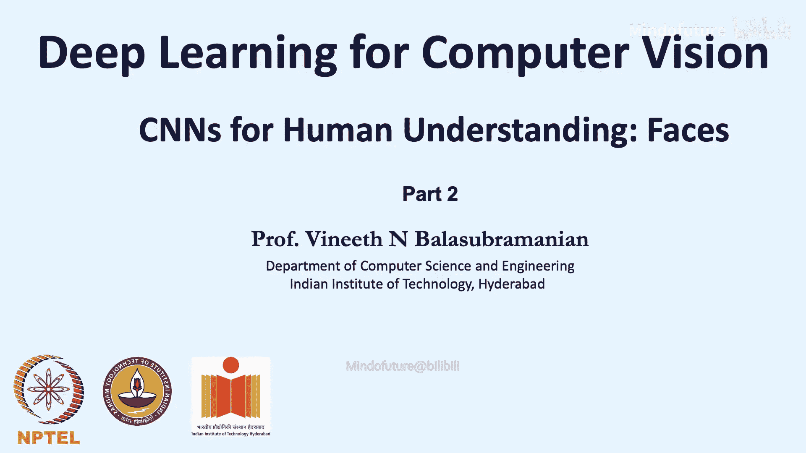
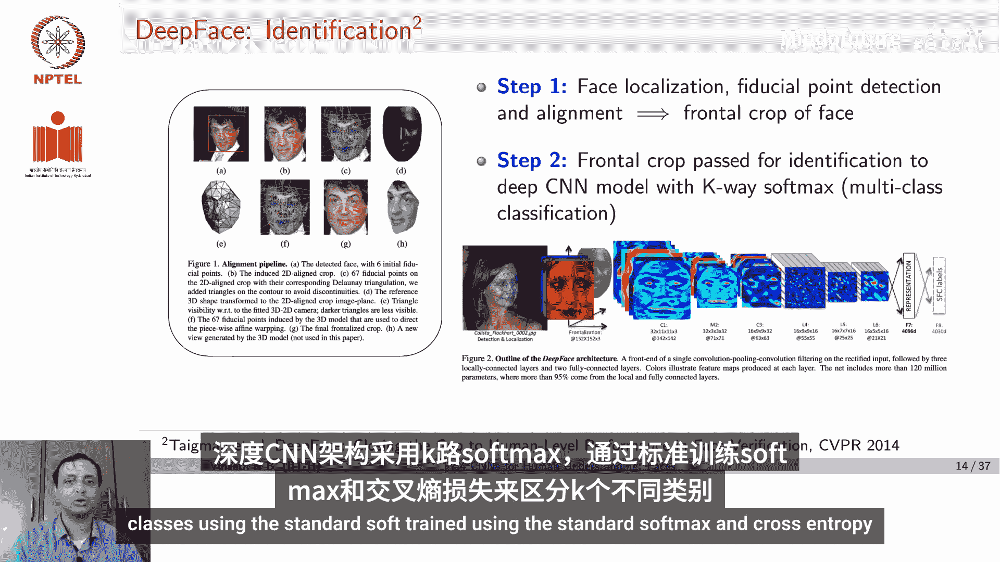
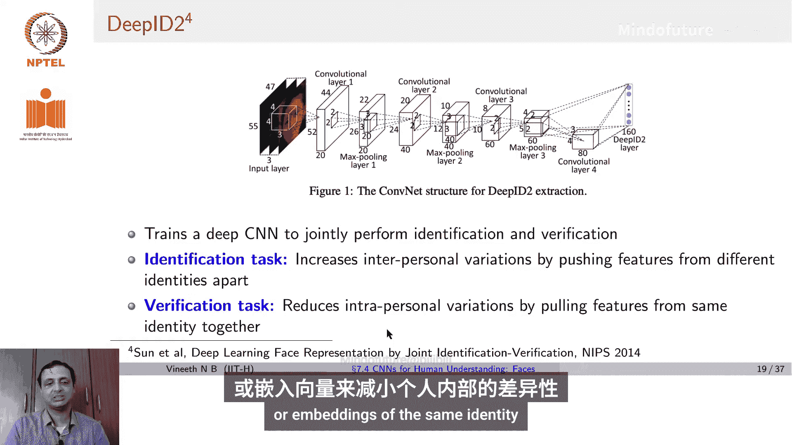
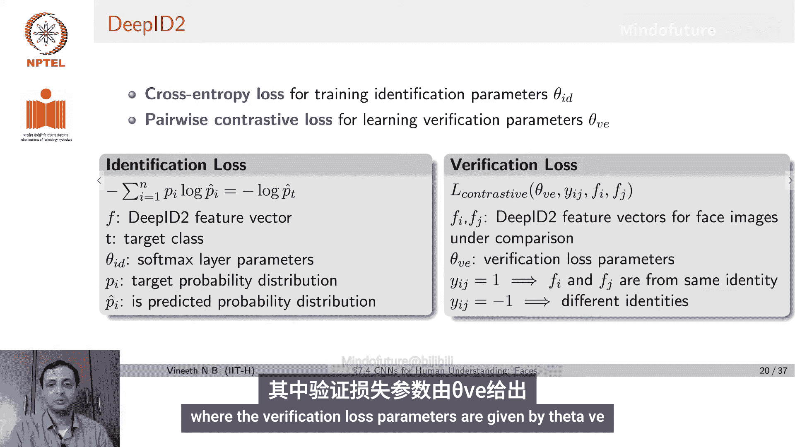
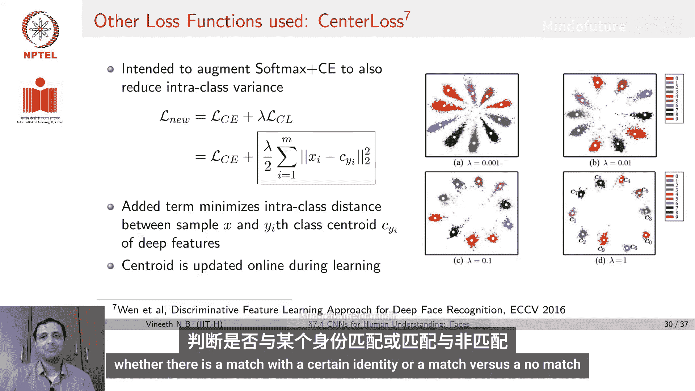
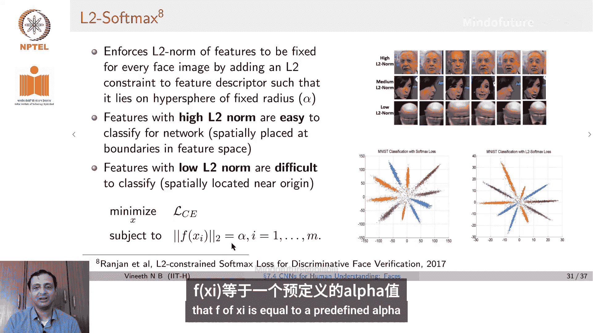
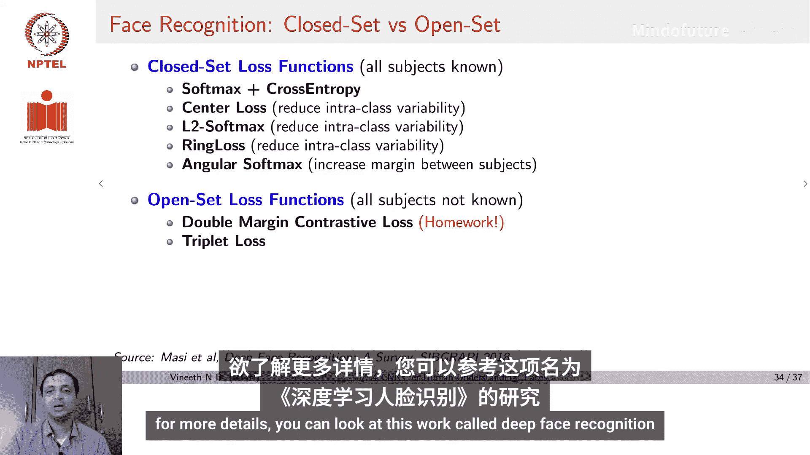
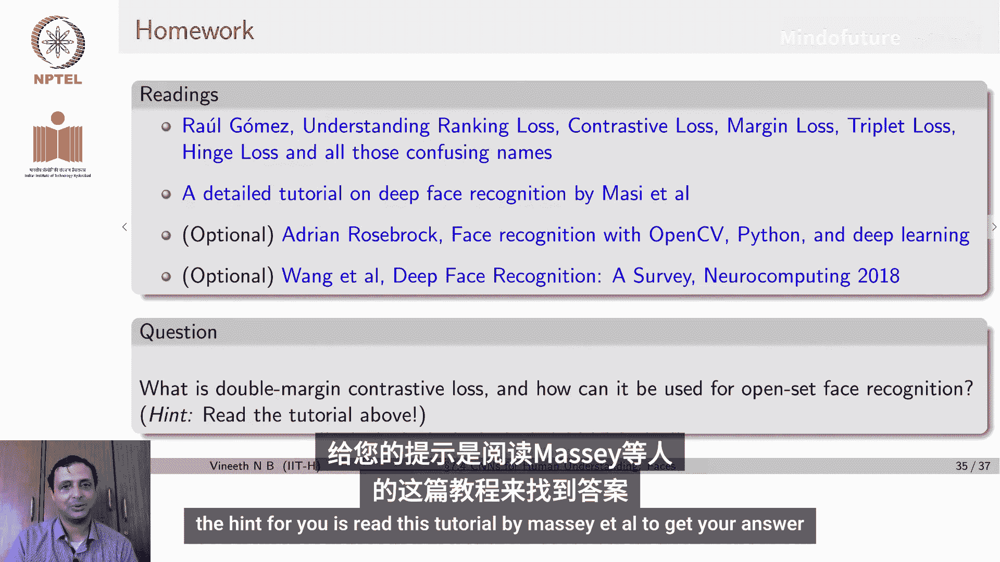

# 【NPTEL】计算机视觉的深度学习 p49 P49_用于人类理解的CNN - 面部 - 第二部分 -BV1vNWkzpEua_p49-

Now well move on to some of the recent efforts that have used CNNs to perform face identification and verification。

One of the first efforts in recent years since the success of Alexni was Deep F。

 which was published in CVPR of 2014。Which。First performed a pre processingsing step which included phase localization。

 fiduial point detection and alignment to get a frontal crop of the face。This image on the left。

Shows the steps that were involved to obtain the frontal crop。Given the input image。

 the first step is to detect the face and crop out the face from the image。

Then about 67 fiduial points are detected on the 2 d crop and they are triangulated。

These 67 fiduial points are different markers on the face such as tip of the nose。

 corners of the eyes， corners of the lips， so on and so forth。

 there are existing methods that can do that once this is done these are then cast on to a 3D model onto which this particular face image is projected。

And that 3D model is then normalized。😊，Into a 2 d face image。

 which is with its corresponding fidduial points， which is converted to a frontal crop of the image。

And finally， since we now have the 3D model of the same person's face。

 you could also generate other pose of the same person。So。

 the frontal crop that we talk talk about here in step1 is this image G。

 which you can see is fairly well normalized when you compare to the image B。

This frontal crop is passed on to the deep CNN model。

 deep CNN architecture with a K way soft max for differentiating between K different classes using the standard soft trained using the standard soft max and cross entropy loss。

For the verification part， Deepface used a Siamese network kind of an approach。

Where the representation learned from the identification task is frozen for verification。

 so these architecture parameters are frozen。Given a face image I and its corresponding image in the record which the person claims to be。

 you get two representations F1 and F2， which is G of I1 and G of i2。

The network is then trained the rest of the network is then trained by taking an absolute difference between F1 and F2 followed by a fully connected layer and then your final binary decision as sigmoid activation function。

So， the distance induced in this particular scenario is f1 minus f2 of I。😊，Into alpha。

Where alpha is a weight learnt in this particular layer。

And the final output is then a match or a not match or a same or a not same。

This approach that was proposed in Deepface， which was taken from the Siamese network idea of the 90s。

 has since been expanded in several ways。And one of the primary ideas which has been used is the notion of what is known as contrastive loss。

Contrastive loss is a loss that is used for training the neural network based on the paradigm of metric learning in machine learning。

Metric learning methods in machine learning attempt to learn a distance metric rather than use a Euclidean distance metric or a cosine distance metric。

😊，So， the same idea is now used to learn distinctive discriminative feature representations for the task that you want to use these representations for。

So， in the phase verification scenario， our objective is to map the input into an embedding space。

Where the distance between points are。Correspond to semantic similarity。

Euclidean distance could do it， but if we could learn a distance that does this more effectively that would be more useful and that is what most of these methods try to do there have been various formulations such as pairwise contrastive laws。

 ranking loss， triplet loss so on and so forth。We will see some of these or the rest of this lecture。

😊，Pairwises contrastive laws came from a work in 2006 introduced by Haddel where an approach to learn a mapping invariant to complex transforms was introduced。

And as we just said， the idea was to make similar points close to each other on the embedding manifold。

 so this representation that you get as output of your CNN is also called an embedding。

And if we now assume that those。Low dimensional embeddings。

 generally these embeddings have a lower dimensionality than the image itself。

 the image could be a 200 cross 200 image whereas the embedding could just be a000 dimensional vector or a 4000 dimensional vector。

😊，We ideally want these embeddings that lie on say  a000 dimensional manifold or a 4000 dimensional manifold to be similar to each other for similar entities and far away from each other for dissimilar entities。

So， our goal here is to learn W the weights of the neural network in a way in which the distance or Gw of x1 minus Gw of x2 given x1 and x2 our inputs。

To approximate the semantic similarity of the inputs。Let's see how this is done。So。

 the overall algorithms ideology can be given by this algorithm environment here。

Given a training data set。😊，You first identify the set of samples that are similar to each other and put them in a set。

 say s of Xi given an input Xi。We identify the samples Xj that are similar to Xi。

In the face verification context， it could be other pictures of the same person。

We also say that Y Ij， which is given X and Xj， would be 0 if these points are similar similarly you identify dissimilar points。

Which could be images of two different people where you give a label why Ij is equal to 1。Now。

 what do we want to do when we train？For each pair X I Xj in the training set。If YIj is equal to 0。

 that means they are similar images。We then update W to decrease the distance Gw ofxi minus Gw of x2 xj。

And if Yj is equal to one that is dissimilar images， then we would like to increase this distance Dw。

😊，Let's see now how this is done using a single loss function。

So given x1 and x2 be a pair of high dimensional input vectors。

Let y be a binary label given to be 0 if x1 and x2 are similar。And one， otherwise。

Then the pairwise contrastive laws L contrastive is given by。

1 minus y by 2 Dw square plus y by 2 max of0 comma m minus Dw square。The first term， as you can see。

 gets activated only when y is equal to 0 and the second term gets activated only when y is equal to 1。

When y is equal to 0， the images are similar。So you' are minimizing DW square。

 which is what we'd like to do。And when y is equal to 1， you have dissimilar images as input。😊。

Then you' are minimizing the max of0 comma M minus Bw squared。

Let us analyze this M is a user defined margin that you want the dissimilar images to at least be separated by a certain number。

 10 units or 20 units in your manifold so on and so forth。

And this states that if dw square is greater than m。😊，Then the second quantity will become negative。

 the max would become0 and you are saying that there is nothing to do Dw square or the distance between the dissimilar images is already greater than my user defined margin m。

😊，So this term would disappear。However， if dw square is less than m。In that scenario。

 you would be minimizing m minus Dw square which is equivalent to maximizing Dw square or the distance between these dissimilar images。

😊，This idea is used in the subsequent network deep ID2， which is proposed in Ns of 2014。😊，So。

 this similar to deep face trains a deep CNN to jointly perform identification and verification where。

It can be argued that the identification task increases interpersonal variations。

 you are trying to separate different identities apart images of different identities or embeddings of different identities。

And the verification task reduces intrapersonal variations by bringing together features or embeddings of the same identity。

😊。

How is this implemented？In deep ID2， crossenttropy loss is used for the identification parameters and pairwise contrastive laws is used for learning the verification parameters。

 so you have theta ID which correspond to the weights of the identification module and theta verification which correspond to the verification module。

The identification loss is given by cross entropy as you can see here where theta ID。

 the softm layer parameters， the last layer parameters for identification and similarly the pairwise contrastive loss where the verification loss parameters are given by theta VE。

But deep I2 uses a different way of learning the entire pipeline which is slightly different and lets see this algorithm here。

So given that you sample two training samples， X I，I and X IJ from your training data。So。

 you now have F， which is the output of the convolutional layer for X and Fj。

 which is the output of the basic backbone CNN for Xj。

this backbone CNN is parameterized by weights theta C。Now。

 the gradient of theta identification is given by。Do identification loss。

 that's your cross entropy loss。Vas of F， LI theta ID with respect to theta ID。

Plus do identification or cross entropy loss F J L J theta I by do theta ID。

 so in this case you are using the cross entropy loss for both F and FJ。Similarly。

 the gradient for the verification parameters is given by some coefficient lambda times which is used for weighting。

 though verification loss， FFj Yj theta verification by do theta verification where the verification loss is given by the pairwise contrastive loss where we know that in this particular case Yj was set to1 if the identities were the same and Yj was set to minus1 if the identities were dissimilar。

Then similarly， dofi and do Fj was given by。Remember。

 F and Fj are the gradient with respect to the embeddings F and Fj， which are outputs of the CNN。

Which is given by do identification plus do verification for F。😊，And though Fj is similarly for Fj。

And the final gradient for the entire CNN parameters is given by。Do F I。Into do。

CnN of X by do theta c into plus do plus grad fj into do c of xj by do theta c rather。

You are ensuring that the weight updates for the CNN are shared between the gradient are firstly updated using the gradients using both the Xi outputs and the XJ outputs and the same weights are then shared for both the CNN architectures that are applied on both Xi and Xj。

So to summarize， theta ID and theta verification are separately updated via respective objectives。

 but theta C， which are the weights of the backbone CNN before you branch out into verification and identification are trained via a weighted contribution from both identification and verification objectives。

😊，This enables the backbone network。To both learn good。

Interpersonal features and interpersonal features。Subsequently came faceNe。

 which was developed in CVPR of 2015。Which premised that existing architectures for face recognition。

 including deep face and deep ID2， typically learnt an entire neural network and then used one of the penult made layers which is called a bottleneck layer。

For and those embeddings for any final decision making in matching。

Is there a problem with this approach？😊，Facenet claimed yes。It has an indirectness。😊。

Because we do not know what those embeddings from an intermediate layer or a penimate layer or what is called as a bottleneck layer could be used for in later tasks。

And because it was not explicitly trained for a later phase or a later task that those embeddings are used for。

 it may be ineffective。So faceNe rather tries to ensure that its goal is to output a good representation。

There are no further goals of classification， which are。

Considered separately based on the learned representation。In fact。

 FaceNet learns a 128 dimensional embedding using a new loss function known as a triplet loss function which is commonly used across several settings in deep learning today。

So， here is the idea of triplet loss； it is an extension of contrastive loss。

While contrastive laws used similar and dissimilar examples。Triiplate loss uses a triplet。

What does the triplet are made of？An anchor point。A positive point and a negative point。

So given any input。which is an anchor point for us now we now then have a positive point which has the same identity as the anchor and a negative point which has a different identity as the anchor。

We now try to use all these three in while learning through a loss function and our goal here obviously is to ensure that the distance between the anchor and the negative sample is at least a certain margin more than the distance between the anchor and the positive sample。

😊，How do we implement this using a loss function？We have a triplet constraint that states f of xa minus f of xp to normalhole square。

Plus， alpha must be less than f of x A minus f of x M。 We are saying that the distance of the anchor。

To the negative sample must be at least a certain margin m。

 which is m is a positive sorry alpha here。😊，Alpha is a positive quantity more than the distance of the anchor to Xp。

 which is the positive sample。So you could visualize this as you have an anchor image that is given as input to your CNN model。

 you have a positive example for that anchor image and you also have a negative example for that anchor image in your dataset。

You first ensure that after you get the representations。As output of your CNN architecture。

 the same CNN architecture is used for all these three inputs very similar to before you ensure that these representations are normalized so that you get f ofx is equal to one for each of these representations so you normalize those vector representations that you get。

Now， this would be equivalent to each of these points lying on a unit hypersphere or a unit ball in which of a dimensional space。

 128 dimensional space that you are considering here。

And your goal now is to frame theta or the weights of the neural network。😊。

Given all these triplets to ensure that f of xa minus f of X p whole square plus alpha is less than f of xa minus f of xN where alpha is margin。

This is achieved by using the triplet loss， which is given by f of xa minus f of xp whole square minus f of xa minus f of xn whole square plus alpha。

😊，It is simple to see that this will now try to ensure that this loss at least has a certain margin of alpha between the distance to the negative sample to the anchor and the positive sample to the anchor。

One question here is how do you select these triplets given an anchor image？

You could have what are known as easy triplets， where it is very clear as to what the positive sample is and what the negative sample is。

 however。Easy triples may not really facilitate learning。

They may not be able to allow the network to learn distinctive features。So。

 it may be important to select triplets that initially violate the triplet constraint so that the network learns。

And eventually perhaps over time， change the nature of triplets。

So you could first choose what are known as hard triplets。

 given a mini batch of triplet samples that you are going to use to train this neural network。

 you could choose only the hard positives and the hard negatives。

What are hard positives where F of x A minus f of X p is maximized those samples where the distance to positive samples is the highest would be a hard positive。

And where the distance of the anchor to a negative is minimum would be a hard negative。😊。

So we choose those kinds of samples in a given mini batch as hard triplets that we can train the network on。

So FaceNe actually uses online triplet sampling where hard positives and negatives are sampled from every mini batch。

There is one problem here though if you choose very hard negatives early on there could be bag local minima and the training could collapse so the idea would be to choose semi hard negatives in the initial stage。

And then move on to more harder negatives in later stage of training。

How do you choose semi hard negatives we ideally want to choose negatives that lie inside the margin between alpha was the margin。

 so we want to choose those kinds of samples to start with it may not necessarily be the minimum distance but we want to choose a negative sample that is inside the margin。

How do do you choose such a semi hard example？You can pick f of xa minus f of xp square is less than f of xa minus f of xn you ignore the alpha that we had and this way you may end up choosing samples that are lying inside the margin while you train initially。

Going further over triplet loss。In 2017 there was an approach known as Angular softmax loss that intended to improve identification and verification performance with faces it can also be used for other domains。

And these set of diagrams from the paper illustrate the overall idea。

So if you had an original softmax loss。And you considered the embeddings of the neural network before applying the softmax loss。

 whatever embedding you had from the penalty made layer before applying the softmax activation function and the cross entropy loss after that。

You may have an embedding something like this where。

All these points will yellow in color belong to one class。 all these points that are。

Pink in color or purple in color belong to the other class。So。

 one can see that if you now if you normalize these vectors and get a unit norm。

 it may be a little difficult to use the cosine distance between these two to separate the identities you can see here that there are certain points where the yellow and the purple almost overlap。

This could be improved by using a modified softmax loss where you normalize your weight vectors before obtaining these embeddings。

 we will see the formal definition soon。And this particular work proposes an angular softm where you enhance the distinction between the positive class embeddings and the negative class embeddings so that then you could use a cosine distance metric to effectively separate the identities or get similarity between the identities。

😊，Why is this important in this context remember that for most of these identification or verification methods the last step is a step of matching using a distance metric and one distance metric that could be used for matching is the cosine similarity or the angle between these representations。

😊，So we now look at different definitions of these modified softmax losses。So。

 the original softmax loss can be written as。E power， ideally， this would have been a。

Zdi which would have been the logics of the neural network。

 but those logics can be written as w Xi plus B where Xs are the activations of the layer before applying the softmax。

So that is what you have as the definition of Somax now one could write out this dot product Wx that you have here。

As normm W into normm x into cost theta Yi that is the definition of the dot product plus the bias BYi remember we are looking at the Y label and that is why this subscript BYI。

So this is your standard of max loss。The modified softmax loss is given by。

After you penultimate layer of the neural network， before you apply the softmax。

 you normalize the weights that you obtain and then apply the softmax。So。

 in this case the norms of the weights w1 and w2 for any other for any other neuron remember that you are going to have different weights for every neuron connecting to that last layer so each of those weights are normalized to 1 now your softmax loss becomes this first term here norm of w becomes1 and it also ensures that the bias becomes0 that' is also done as part of the operation so your new modified loss looks something like this where the norm of w becomes 1 and the bias becomes 0 these are operations that are performed before applying the softmax。

The anglengular soft Max loss。Extend this。 Extends this to make the。

Angle corresponding to the positive class be scaled by m while the angles corresponding to all other classes not scaled by the same M value M is a positive positive constant。

This ensures that the angle is further separated between the positive class and the rest of the classes remember that the final match to check whether a feature belongs to one class and the other class would be given by where cost theta of I。

Is greater than costs theta of J， you would then say that this point belongs to the8h label and not the J label。

And by doing Angular softmax， we are ensuring that we would now have cause of m theta I。

 which is likely to be greater than co theta J。We are trying to ensure that for the positive class。

 the cost value can be further separated from the cost value for the angle with respect to the other classes。

 That's the main idea for the anglengular softm。So。

 here is another visualization from the same paper the softmax decision boundary can be given by w1 minus w2 x plus b1 minus B2 taking the activations from two different classes remember you are going to have multiple classes in that last layer we are considering two classes w1 and the weights corresponding to them are w1 and W2 and this is your softmax decision boundary。

You see here that。When you have your softmax decision boundary。

 you are separating those two classes this particular way in your modified softmax boundary you are normalizing your weights and hence all your points lie on a unit ball。

And you are now trying to ensure that you get a separation such as this。

Your points belong to positive classes lie on one side of the ball and your points belonging to the negative class lie on the other side of the ball。

This is a little bit better because in the previous softmax approach you don't know where these two balls may overlap with each other you are now trying to ensure that these go on different sides of the same ball but we still have a problem with modified softmax at these points which are close to each other at where ball where the classes meet in the ball。

And anglengular softm tries to ensure that that separation is further maximized by having。

W1 in a further arc on one side of the ball and w2s on the other side of the arc in the other side of the ball。

The further separation helps better classification in the final step。

Over the last few years there have been other ideas to improve these loss functions a lot of these have been used in the face analysis context。

Center loss is another approach that was proposed in 2016。

Whi was a loss added to the cross entropy loss where in addition to the standard cross entropy loss。

 we also obtain a centroid for each class label。And for a point belonging to a particular class。

 we also minimize the distance of this representation to the centroid of that particular class which this data point belongs to。

So these centroids are also updated online during learning as you keep training over different iterations。

 you get these centroids based on the representations in each particular iteration over training and in that iteration we try to ensure that the representations are close to the centroid of that particular class。

And the diagram on the left on the right shows that as you vary the coefficient lambda which weights how which tells you how much you are going to weight that distance to the centroid。

😊，You can see that initially when lambda has a very small value you get a certain separation with respect to the centroid and as you weight lambda more and more you see that all the embeddings of a particular class end up going close to the centroid which are given by these white dots in each of these classes。

This allows good separation between the classes when you want to make your final decision on whether there's a match with a certain identity or a match versus a no match。

L2 softm is another improvement。Which tries to ensure that the L2 norm of the features。

Before the softmax。Ly on a certain hypersphere of a fixed radius alpha。

Instead of normalizing the features to ensure they have a unit norm。

 this approach tries to ensure that they have a particular norm alpha。And this。

 the intuition behind this approach。Comes from their observation that features with high L2 norm are easy to classify。

And features with low L2 norm because they could be close to the origin could be more difficult to classify when it is more close to the origin。

 the points could look more close to each other when the points have a high L2 norm they are further away from the origin and hence could be separated a bit more easily。

So， in this case， the optimization turns out to be you minimize cross entropy loss such that the representations that you get before you apply a softmax。

Ensures that f ofxi is equal to a predefined alpha。

This was further improved in ring loss in 2018。😊，which is this a very similar idea as L2 softmax。

 however， even in this case you minimize the cross entropy loss such that f of Xi is equal to some norm R。

 but the difference from L2 softmax is that in this particular case you also learn the R as part of your training process。

So， the neural network decides what should be the value of the L normm value also in addition to learning the weights of the neural network。

 this is known as ring loss because you are trying to project the feature representations before the softmax layer onto a ring whose radius is also decided by the neural network。

Based on these approaches， there have been a slew of efforts。

 Co phase proposed in 2018 proposes a large margin based cosine loss for face recognition。

 uniform phase proposed in 2019 proposes a uniform loss to learn equi distributed representations so that you exploit the full feature space rather than focus on one ball around the origin。

Regular phase proposed in 2019 again。Propos an exclusive regularization to explicitly enlarge angular distance between different entities。

😊，Group face， which was very recently proposed in 2020。

 uses multiple group aware representations to improve the quality of the embedding。😊，Curricula phase。

 which was again a recent work in 2020， proposes adaptive curriculum learning to adjust the relative importance of easy and hard samples in different training stages。

😊，Curriculum learning is。A facet of training deep neural networks where initially you expose the model to say simple training examples and then gradually increase the difficulty of the training examples to help the neural network learn better so we saw this with triple mining where we said lets start with semi hardd negatives before we go to hard negatives and this approach called curricicular phase to this further to propose an adaptive curriculum learning loss。

To conclude this lecture， face recognition also has what is known as a closed set and an open set setting。

In a closed set setting。😊，You have a set of pre given identities that you have to match an input image to。

And one could use a softm plus cross entropy loss or a center loss， L2 loss， ring loss。

 anglengular softmax loss， so on and so forth to implement closed set face recognition。

On the other hand， in open set face recognition。😊，One could have people。

 images of people that are not in your database and the neural network has to at least say that this person does not belong to the database and is unknown to the current system。

How do you what kind of loss functions do you use to train such a network？

There is what is known as double margin contrastive loss that could be repurposed to achieve this even triplet loss could be used to achieve open set face recognition。

For more details， you can look at this work called Deep F recognition a Sur by Mari and others。

So your homework readings for this lecture is going to be a very nice blog on understanding ranking loss。

 contrastive loss， margin loss， triplet loss， so on and so forth in case they are all confusing to you。

A very detailed tutorial on deepface recognition by Mari and others and if you are interested looking at a Python code base for face recognition with open CV and also the entire paper on deepface recognition a survey。

So， the question that we left behind was what is double margin contrastive loss and how can it be used for open set face recognition？

😊，The hint for you is read this tutorial by Marci etal to get your answer。

。