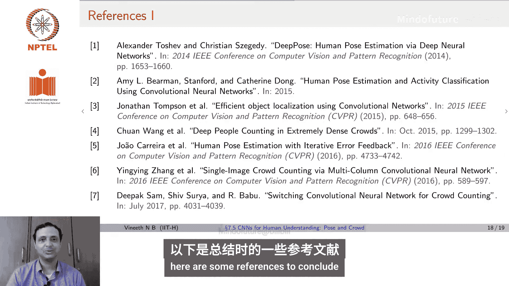

# 【NPTEL】计算机视觉的深度学习 p50 P50_用于人类理解的CNN - 人体姿态和人群 -BV1vNWkzpEua_p50-

Beyond face understanding。CNNs have been used for many other human understanding tasks。

Gesure recognition， emotion recognition， ga recognition， so on and so forth。

But to give a flavor of different varieties of tasks。We will now look at two other tasks。

 human post estimation and crowd counting using deep learning and CNs。

The task of human pose estimation。Is the problem of localization of human joints such as elbows。

 wrists， so on and so forth in both images and videos。Where would such an task be used。

 It could be for sports analytics。 It could be for the Microsoft X box that detects your pose and accordingly asks your avatar on the screen to play a particular tennis shot or a golf swing。

Existing methods， especially deep learning based methods for human post estimation。

Are broadly categorized into single person pipelines where you are trying to get the pose of just a single person in the frame or a multi person pipeline where there could be multiple people in the frame and you would like to know the pose of each of them。

What you see here are illustrations of how op estimation model works。

What we are ideally looking for is the positions of each of these joints that you see on any of these images。

As you can see here。There are many challenges， firstly。

This seems different from the tasks that we have seen so far。

 different from image level classification or detection or segmentation or face verification as another task。

And we will see how this is done using CNNs in this lecture beyond that you can also see that when occlusions come into play。

 especially self occlusions where a part of the human body occludes another part。

This task can get very challenging。Before we actually go ahead and discuss the methods。

We'll try to first ask the question， how would you know whether you develop whether the model that you developed for human pose estimation is good or not。

How do you evaluate it？There are。Well knownn metrics today。

 so some of the metrics are PCP which stands for percentage of correct parts which states that a limb is considered detected if the distance between the detector joint and the true joint is less than half the limbs length so you could have a long limb or a short limb depending on which part of the body you are trying to model and if the distance between the predicted joint position。

And the correct joint position is less than half the length of that limb。

We consider that to be a fairly correct prediction。

 This is known as PCP at 05 if you consider quarter limb length。It would be PCP at 0。25。

A related metric is known as percentage of detected joints， PDdJ。

Which states that the detected joint is correct。If the distance between the predictedor and the detector joint。

Is within a certain fraction of the tarsu diameter。So。

 you could look at the torso diameter as a central scale for the person that you are modeling in that particular when you are trying to predict the pose of that person。

So if you say PDdj at 0。2， you want to ensure that the distance between the predicted and the true joint is less than 0。

2 times the torso diameter of the person under consideration。

There has also been a different metric known as object key point similarity based MAP。

 which you can see is an equivalent of IOU for human pose estimation。

Which is given by summishino I exponent of minus D square by 2 a square K square。

Into an impulse function to check whether VI is greater than 0 or not。

 let us try to explain each of these quantities of which the denominator is going to be over all possible eyes。

😊，DI here is the Euclidean distance。😊，Between a detected key point and the corresponding ground truth。

 which is the actual presence of the joint。 So that' is the D that you see in the numerator here。

VI is the visibility flag of the ground truth， as we said there could be certain joints that are occluded by other joints and trying to get a correct estimate of that joint would be would be an impossible task。

So， by ensuring that you have a visibility flag for each joint。

 you know that if a joint was not visible， any error on that joint can be weighted to a lower extent。

So， V is a visibility flag of a ground truth S is the object scale。

So this distance between the detected point and ground truth has to be normalized by the scale of that particular object。

 so if that object is very large in the image this distance could be relatively larger than for another human in the same image where the object scale is small。

Finally， K is a per key point user defined constant just to control fall off that you could consider as a hyperparmeter。

So as you can see here， we now have a metric that is an inverse expon of the distance which means it gives an extent of how good the prediction is。

 but it factors in scale as well as visibility of the joint to evaluate your final performance。😊。

With these metrics specified， let' us now talk about methods for human pose estimation estimationation using deep neural network models。

The precursor of all of such models was called Dpo， which was proposed in 2014。

This was perhaps the first work to kick off deep learning based human pose estimation。

In this approach an image was given to a model and the architecture at that time was of course Alexnet inspired because in 2014 that was one of the most common models in practice。

The only change from the original Enet architecture is in the output space。Now。

 you are not predicting a class label for the entire image。

But you are going to predict a set of joint positions， 2 d joint positions， X， I， Y I for each joint。

On your input image。 So your output is given by y。Whi is a set of Ys where each Yi contains x by coordinates for the corresponding corresponding joint。

What would be the loss to use here？The loss would be a mean square error for the position of every joint or the L2 norm for the position of every joint with respect to the ground truth of that joint。

This method did not stop here。To further improve the performance。

 it also used what are known as cascaded reggressors to improve the precision of the location of each joint。

What did this mean？Once you identify a joint position in your initial stage。

You crop out a region around the joint position。And that region is scaled up to the input of the entire CNN and this again predicts a refined value of the joint position inside that patch which helps you fine tune your joint position over multiple stages。

So， these crop images are fed into the network in next stages and this ensures that across the finer image scales。

 you get precise key point locations as output。Another approach。

 which took this in a different direction， which was also an error。

An iterative error feedback based the approach， but approach this differently was a method proposed in 2016。

😊，Where。The entire prediction started with a mean post skeleton。

Which is then updated iteratively over many steps。So you have an input image。

And you have a average human post skeleton here。And the job of the neural network。

Is only to predict the deviation from the mean post skeleton。So， given an image。

Concateninated with its output representation。The neural network now is trained to predict the correction that brings the mean pose closer to the ground truth。

 Lets see this in a bit more detail。In the first stage， xn would be the image I itself。

 That's the image that's given here。And this image is given to the neural network and the neural network predicts an epsilon T for each joint which would be the deviation from the mean pose that is your epsilon T here。

😊，This epsilon T is added to Yt， which was the pose in your previous step and you get a new post yt plus 1。

And now this y T plus one is overlaid on the image and a patch around it is now used to again。

 refine the。Refine the error and the deviation to get a new epsilon T and this is now iterated over and over again to get a final estimate of the pose。

Visually here are a couple of illustrations so you see here that on this image the mean pose is overlaid on this image you can see the mean pose is often a person standing upright and in every step the mean pose is adjusted towards getting the pose of this particular person and you can see that after four steps the predicted pose becomes close to the ground truth which is shown in the last column。

You see a couple of more examples here where this can be challenging you can see once again here the standing pose and over a few steps you get the pose of the person squatting on a particular location while regression based methods that we saw on the earlier slides try to predict the joint location。

Another family of methods for human pose estimation are detection based where you at at a single shot try to get the regions of each of these joints as a heat map。

Methods that have used this kind of an approach， one of which was proposed in 2015。

Try to also employ a course to find multi scale strategy to help refine these heat maps to get better joint localizations。

Let's look at this approach here。So in this approach。

 an input image is given to a coarse heat map model。Which gives you the heat map of joint locations。

 This could be a standard CNN backbone with minor modifications。 And for each joint。

That you have predicted here around that could be located at the center of a particular heat map。

 you crop out a patch around it and then have a fine heat map model which improves the localization of the joint in that particular location。

Lets see let's now see this fine heat mapap model in a bit more detail。

So for each joint location in the course heat map， which could be the center of a particular region of the heat map。

You have a multi scale pyramid if the original image was 64 cross 64。

 you have 128 cross 128 and 256 cross 26 versions of it。

 you correspondingly crop out a 9 cross 9 and 18 cross 18 and a 36 cross 36 region。

And now each of these three regions go through separate convolutional pipelines you can see here that the 9 cross 9 goes through this pipeline the 18 cross 18 goes through two different pipelines with different convolutional filters and the 36 cross 36 goes through different pipeline different convolutional plus re layers and now all of these are ups sampleampled to 36 cross 36 obviously the top one doesn't need up samplingling the remaining ones are ups sampleled to 36 cross 36 all these feature maps are concatenated to make the final prediction which is more precise for that particular joint。

This refinement process helps the final performance。Another approach。

 as we mentioned is another category of methods， as we mentioned。

 is when there are multiple people whose pose you would like to estimate。😊。

Here there are broadly two kinds of pipelines， the methods are very similar to what we saw earlier。

 but two pipelines which are different， one of them is known as the top down pipeline。

In this particular case， we would like to detect all persons the pose of all persons in the given image。

 so we first of all start by detecting all people in the given image。😊。

Then for each bounding box of the people detected， you run a single post estimation approach that we just saw on the previous slides。

You could help refine the post estimates using some global context information if you like。

So here is an illustration， you have an input image。

2 people detected using a human detector using any other detection approach now you crop out these two people and run a single human pose estimator using a regression or a detection based approach and you can get the skeleton and similarly for the other person and you then overlay both of these skeletons on the input image。

On the other hand you can also have a bottom up pipeline where you reverse the process where initially you detect all the key points in the image。

 irrespective of whom it belongs to so you just detect all the key points so you could use a detection based approach where you get a heat map for the full image and the centers of all of these heat mapap regions could be different key points you do not know which key point belongs to which person。

Once these key points are detected。Then you associate these key points to human instances using different methods。

And for more details of these methods， you can see this survey called deep learning based 2D human pose estimation。

Evidently you can see that in this approach， inference is likely to be much faster because you are processing all people's information at the same time rather than run each people's bounding box through different pipelines。

Another task that we mentioned that we will look at is the task of crowd counting。

Crowd counting is an extremely important task for urban planning， public safety， security。

 governance， so on and so forth。However， this can be a very challenging task in practice。

You could face several challenges such as occlusion， as you can see here。

 in a single patch in this image， there are so many different faces denoted by green dots。

 each of which are occluded heavily with respect to the other。

You could have a very complex background。You could have scale variations depending on what perspective the camera took the picture from。

You could have a non uniform distribution of people across this across the image。

You could have perspective distortions， you could have rotation issues。

You could have illumination variant， variations such as a show where you may want to count the number of people or you could be faced with weather changes。

So all of these make this problem of crowd counting extremely hard。

Existing methods in using CNNs for crowd counting can be categorized into three different kinds of methods。

 one that use a basic CNN architecture to achieve the purpose as we will see soon where you have an input you have a simple CNN and you get a density map as the output of the model itself and the peaks in the heat map of the density map can give you an estimate the count of the people that are in a given picture。

Another approach is a multi column approach。Which hypothesisthesizes that to be able to count crowds when you have people in different scales。

 people faces in different scales， a big face， a small face， so on and so forth。

You need to counter this with a multi column approach with where each column looks at faces in a different scale。

So， you can see that here where given an input， you now convert it to a multi scale a pyramid kind of an approach where in each of these individual pipelines you are trying to detect phases of a certain scale。

😊，A third approach is a single column approach again， but this approach tries to observe。

Performance of multi column approaches and simplify them to an extent to ensure that their network architecture is not too complex。

Let's see each of these approaches in more detail。So。

 the basic C in an approach looks at crowd counting problem as a regression problem where given an image you have to predict a number as the output。

So here are some training data points where given a set of crowd positive examples and the counts in each of these images。

 similarly negative examples of other scenes where the crowd count is 0。

Each of these training samples are fit through a CNN architecture and the output is a count of the people in that image which can directly be solved through regression and say L2 loss or a smooth L1 loss。

So， you could here have an expanded set of negative samples because it is perhaps easier to get images without people whose ground root counts are zeros and this helps reduce interference and get better performance。

Across the positive samples。However， you can make out that is this a crude approach and it can be sensitive。

😊，To density， distribution of crowd， scale of people， so on and so forth。

That leads us to multi column based approaches which try to address the fact that people's faces could be at different scales in an image。

So this in such a multi columnlum cn each individual pipeline looks at an input image at different scales you can see here a con 9 cross 9 filter。

 a con 7 cross 7 filter and a con 5 cross 5 filter which looks at a multiple scales in the input and this helps get a better performance towards the end where after。

The last layers of each of these pipelines， the feature maps are merged and then you have a con one cross one layer to get a density map on the same resolution as input。

So here is a here are so few illustrations given test image and the corresponding ground truth。

 you can see the estimated。Heat map here whose speaks you can consider to be able to get an estimate of the count if required in certain applications a density map by itself may actually serve the purpose。

 but if a count is required one could infer the count using these heat maps。

A further approach of a multi multi column CNN expanded on the approach on the previous slide and introduced the concept of a switch classifier。

 This work was done in 2017。Where each patch of an input image was given to a switch layer。

Which decided which of these resolutions was the right scale for this particular patch。So。

 the switch classifier， which you can see on the rightmost region here， took the patch of the image。

And then gave an output to see among these three scales which you had as individual columns in your CNN in the multicollumn CNN。

 it now says that for this particular patch R3 is the right scale to detect faces in and now that patch is given to this CNN and the density map at that scale is used to get the final outcome。

Why does this make sense， This comes from the fact that。

Within a local region of an image it is likely that scales of faces are going to be maintained within the same range whereas in another patch of the image there could be a scale that is very different so this uses that locality of scale in crowds to switch the corresponding CNN pipeline for each region and thereby achieve a good performance towards the end。

And at the end， it uses weighted averaging to fuse the features which can be which can be used globally。

Single column Cns are derived from multi column CNNns by making some observations from their performance。

One of the first efforts here in 2018 observed that a single column in a multi column CNN for crowd counting retained about 70% of the accuracy on certain data sets so why make the architecture complex。

So this single column here uses a standard set of convolutional layers initially。

And then on passes feature maps from earlier layers to later layers which are obtained after deconvolution。

So you can see here that after con 6。The feature map from the previous layer is concatenated and then you do deconvolution。

 which is the equivalent of up samplingling here to get a higher resolution image。

Then a feature map from an earlier layer is added to this ups sampleample image to get a new feature map and these are passed through a certain set of convolutions and finally a one cross one convolution to get the final density map。

In this particular case， theconvolution was used instead of up samplingling or element by summation also。

 this work used both density map base loss as well as count base loss to train the neural network。So。

 all these approaches assume that the ground truth density map is given as well as the head count is given and so you can use the loss corresponding to both of these to back propagate and train the rest of the neural network so what loss do you use and L2 loss on the density map and if it's a count you can just use an L1 loss on the count which is the absolute value or the difference between your predicted count and the correct count。

Another single column CNN， a more recent one in 2019 observed that low level features from multi columnlumn CNNs had very similar functions。

 very similar features in the in the crowd counting context。

 so what they propose is to retain the same pipeline for initial layers of the CNN。

And when you go to the later layers， have a multi scale pyramid。

 which is known as a scale pyramid module。😊，Which combines features。

At different scales to get the final output of the density map。So， in this particular case。

 the scale pyramid module was implemented using dilated convolution at different scales to be able to。

Analyze faces at different scales and this was placed between conn 43 and con 51 of a VGg16 architecture。

So you can see here a few examples where given an image。The estimated count and the correct count。

 and you can see that in most of these cases was fairly close to a certain error。

Tolerance to the ground truth estimate。So the homework for this lecture is a very nice blog post on human post estimation by nanonets as well as the survey on density estimation and crowd counting that was recently released in 2020。

😊，If you are interested， you can also read this survey on  2D human pose estimation。

The exercise for this lecture or a thought experiment for this lecture is。CNNs。

 when used especially for human understanding， can suffer from biases in dataset sets。

 so depending on which race dominates the kind of people in a particular dataset for human pose estimation or face recognition。

 the decisions could be biased by those statistics in the dataset。

Before we talk about addressing those biases， how do you first of all find if a model that you trained for a human based task is biased？

Think about it。Here are some references to conclude。

