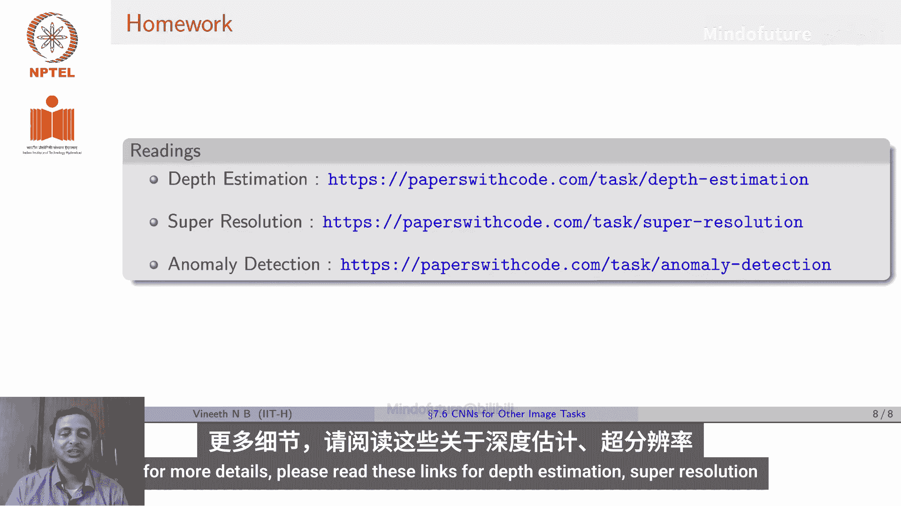

# 【NPTEL】计算机视觉的深度学习 p51 P51_用于其他图像任务的CNN -BV1vNWkzpEua_p51-

In the last lecture of this week。We will very briefly look at few other applications such as depth estimation。

Super resolution and anomaly detection ways in which CNns can be used for these tasks。Taking the。

Application of depth estimation。Given a scene， such as what you see。On this image。

 there are objects at several depths from the perspective of the camera。 You have the road。

You have a pillar at one corner of the seam， you have the car itself and you also have the person standing on the pavement。

 each of whom almost act like different layers at different depths from the camera。

The question that wed like to ask here is can we get estimates of depth using just single images？

Existing methods for depth estimation， including the human visual system。

 rely on stereo estimates where there are two cameras。

But the question we'd like to ask now is can you get depth from just a single2D image。

 and there have been efforts to do this。 We look at a couple of samples briefly in this lecture。So。

One of the earliest efforts of using deep CNNs for depth estimation was in Europe Europe's 2014 where given an input。

A coursear level CNN is used to forward propagate the image and then at the end of the last layer。

 get a pixel level estimate of the depth for each。Each pixel in the image。

This estimate very similar to the approaches for。😊。

Pos estimation or similar applications that we have seen also uses a refinement step to improve the precision of the depth estimate。

😊，In this case， how this is done is the same image。

Also with a different filter at a different resolution is passed to a finer depth estimation network。

And in addition to this network， the coar estimate of the other network is also passed and concatenated as an input in an intermediate layer。

 And together， these two are combined to give a refined depth estimate， which is more accurate。

Here are examples of this kind of an approach。Where given an input。

 the output of the course network looks something like this and after refinement it starts becoming more usable。

Here's another example， given an input image。Here is the depth estimate from the course network and here is the depth estimate after getting this from the final network。

 the assumption here is you have a pixel wise estimate of the depth provided to you as ground truth。

So you could get a simple L2 error or a mean square error pixel Vi to be able to use as a loss function to train these networks。

A more contemporary approach for depth estimation called Genet is very popularly used。

 we will only visit this briefly since it brings in concepts from vision which we have not covered in detail in this particular course。

😊，But this network performs both depth estimation and camera motion estimation and pose estimation in a combined framework。

 but lets focus on the depth estimation part here。😊，It assumes that。

depth can be estimated when you have a sequence of images rather than a single image which is likely to happen if you are using this for an application say like autonomous driving。

 you have a camera that is captured as a car drives and you are going to get a sequence of frames which can be given as input as a volume。

😊，Just like how we gave RGB channels as inputs to a CNN so far， this network takes。

The frames captured over an entire image sequence over time as different channels of an input volume。

Theent depth network estimates depth on each of these channels and the interactions between the depth maps of these temporal frames give an estimate of what is known as rigid flow。

 which is the flow of stationary objects in the scene。

And this is then combined with a non rigid motion localizer which uses optical flow if you recall we talked about optical flow in the initial lectures of this course so it uses an optical flow based based approach to get a non rigid motion localizer this is for dynamic content in the scene。

And finally using the combining the rigid flow and the non rigid motion localizer。

 the final flow or the depth is predicted for each each of these for this entire scene and at the end a consistency check is done to check for。

Whether the flow predictions take care of occlusions and even non Lambertian surfaces。

For more details， you can see this paper this was published in CBPR 2018。Another task。😊。

Which is growingly popular with deep neural networks is the task of super resolution。

Can you see a difference in these two images？There is no semantic difference。

 but there is perceptual difference in terms of the resolution of the right image or the left image。

And this is used extensively to improve the resolution of content。Today。

 televisions have already started enhancing the resolution of the image presented on the screen using such approaches。

Here is an example of an LG screen which in its settings allows you to choose an AI enhanced resolution up scaling option which in fact does super resolution to get the final image on the screen so it is ultraHD where you use CNN based approaches to superreol images and get a better resolution on the screen。

So how do you do super resolution？There are multiple ways in which this can be done we will talk about a c and based approach now。

Later in this course， we will also talk about generative based approaches or what are known as G based approaches to superresol content to image content2。

Let's see how this is done using CNNs。You have a seemingly low resolution image that is provided as input to a set of convolutional layers which use the idea that a patch around a pixel can be used to improve the resolution of the image around that pixel in the output image。

Let's see this in more detail。You have a low resolution image input which is passed on to get n1 feature maps of the low resolution image so you have f1 of y is going to be w1 into y plus B1 where y we assume is the input。

And using that F1y， you going forward propagate that to N2 feature maps of the next layer。

 which gives you F2 y， which is a re over a linear layer of the F1y feature maps。And finally。

 these F2Y's are used over a linear layer over a set of weights to get the final reconstruction of the high resolution image。

Assuming that you have data of high resolution versions of low resolution images。

 you can use a pixelix Vi loss to train this entire CNN。How does this work？

Given this input image of the butterfly wing。The feature maps of the first convolutional layer here。

Obtain feature maps such as these， some of them recognize edges。

 slightly vary textures or so on and so forth。These feature maps are passed on to the next convolutional layer whose feature maps may look something like this。

And finally， all of this information together is put together to get the final output。😊。

So you can see that given this input。To this super resolution， CNN M。

 you get an output where the resolution and the。Contrast looks far better from a perceptual point of view。

A third task that we will briefly describe to close the lectures in this week is the task of anomaly detection。

😊，It' is a need in many applications today where given a set of inputs or set of data points。

One may need to find out which of these is an outlier or anomalous with respect to the distribution that we are handling。

Generally speaking， given say keywords such as table chair， computer， cupboard bed or farraday。

 Newton， Edison， Beethoven or pen calculator calculator， pencil ink。

 you are looking to find the odd one out computer in the first case。

Beethoven in the second case and calculator in the third case。

But how do we do this with images using a CNN is what we will talk about now？So。

 our goal now is to find out an out of distribution image from a given training data。

 so an image comes which is not in the training data。

How do you now distinguish this from what you have in the data？Let's consider。

A known CNN architecture。Lets assume this neural network is trained on， say cats and dogs。Now。

 at test time， you now get an image that does not belong to the classes that the network was trained on。

We call such an image as an out of distribution image。

If you simply try to classify this into a cat or a dog。😊。

This is not really going to give you a useful answer because that is the label space that you have in the neural network but that is not going to give you a useful answer and trying to give probabilities for cat and dog is flawed by design。

😊，So what do we do？We're going to look at the softmax activation function that you use in the last layer。

And a recent work which tried to propose an interesting approach for detecting such anomalies or out of distribution images proposed that you could use the notion of what is known as temperature which is this new added component in the softmax activation function。

What does temperature do？P is a constant that you provide as input to the Somax activation function。

As you can see here。😊，P scales down the inputs that are provided to the exponential function here。

How does this help？By scaling things down， the exponential function will now be able to separate these values that you get for different classes better。

This idea of using temperature in softmax is used in many other kinds of applications。

 and we will see some of them a little later in this course。In addition to temperature。😊。

There is another contribution this approach makes this work was published in 2018。

Assuming that the model predicted a dog as the output for a given image。

 you do not know if the image was really of a dog or an out of distribution image。😊。

You now consider the gradient of the loss function with respect to this input。

Consider the sign of the negative gradient。😊，And now add an epsilon perturbation。

 add or subtract based on the sign an epsilon perturbation to the input。😊，Why do we do this。

 we expect that if this was really a dog image。😊，Adding this perturbation would help us recognize better that its a dog or the softmax outputs would make it even clearer that it is a dog by taking the log softmax。

 the gradient of the log softmax and its sign in this perturbation calculation。On the other hand。

 if it was an out of distribution image and you added this perturbation。

 now the softmax output outputs would get a bit more confused。This simple intuition is now used。😊。

To reconstruct an image based on this perturbation， a small perturbation。

 you provide that as input to the neural network again。

And now you look at its output and see if the output was greater than a threshold。

 you now you say that it is not an anomaly， it is perhaps an image of a dog itself。😊。

But if the output now is less than a threshold， because that's when the confusion among the softm would increase。

 it is an anomaly。A simple approach without changing much in the entire pipeline of the neural network or the architecture or the training。

 but it actually works well to detect an out of distribution image or an anomaly in practice。

For more details， please read these links for depth estimation。

 super resolution or anomaly detection。

🎼。