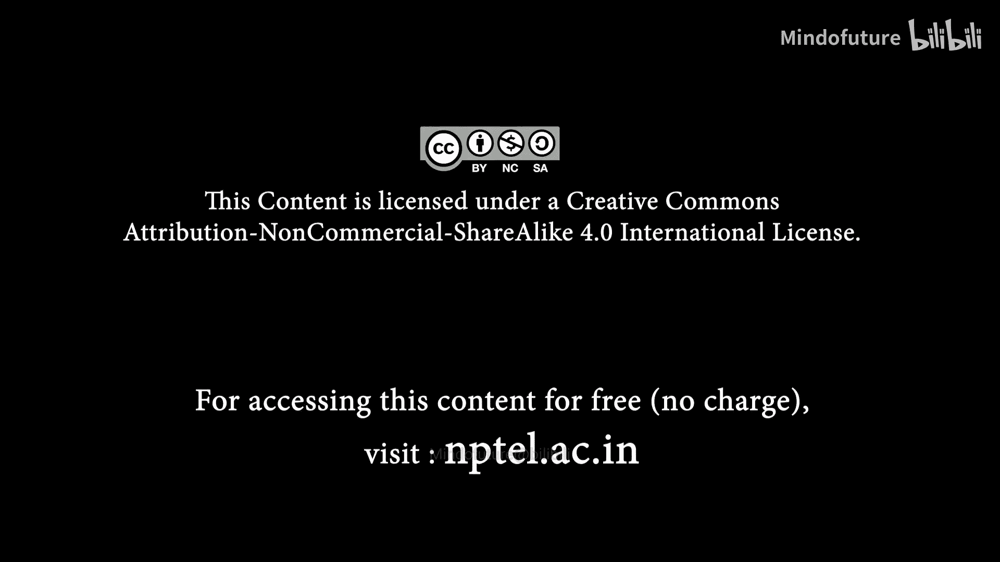
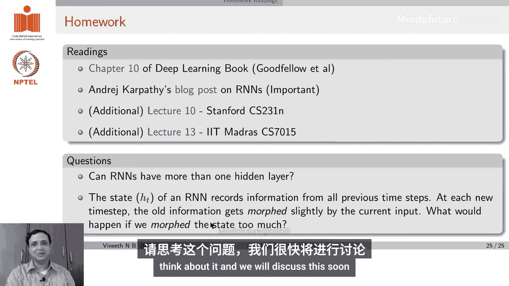

# 【NPTEL】计算机视觉的深度学习 p52 P52_循环神经网络 - 介绍 -BV1vNWkzpEua_p52-

So far。We have seen how CNN's convolutional neural networks work。

 how back propagation is used to train them。How they can be used for image classification。

 what loss functions we use， how do you visualize and understand CNnN？

We have also seen how CNNNs can be extended for other tasks such as detection， segmentation。

 face recognition， as well as miscellaneous other tasks。

This week we will move on to another pillar of the space of deep learning。

 which is recurrent neural networks。Recurrent neural networks are intended to process time sequences。

 which means in terms of applying it to computer vision。

 they become relevant when you have videos as input。Before we get started on the topic。

 we had one question that we left behind from last week when we completed our lectures on CNNs for human Undering and the question an important one in today's times was。

How do you find bias in a model？If you had a face recognition model。

How do you know if the model is biased to a certain segment of population or the data set？

Hope you had a chance to think about it。 This is an important problem in today's times when such technologies are being deployed at a fairly large scale。

A simple check is if you think there could be a particular feature or an attribute。

 such as say the background of a particular person。

Then you could change that attribute in your input。And see if the prediction changes。If this happens。

The model is relying on that feature to make its prediction。And if you think that should not exist。

You should try to regularize based on that attribute。

 use data augmentation methods to vary that attribute's value and ensure the model does not change its prediction。

We will now move on to recurrent neural networks， this lecture slides are based on the CS231N course by Fili and the course from IIT Madras by Mihikara。

The broader context of recurrent neural networks is sequence learning problems。

So far with both feet forward and convolutional neural networks。

The size of the input was always fixed。Given a CNN， you always fed， say。

 a 32 cross 32 image for image classification。Each input was also independent of the previous or future inputs。

And the computations， outputs， decisions for two successive images were completely independent of each other。

What do we mean？This also relates to the common property called IID。

 which we associate with data sets in machine learning。

IID stands for Idently independentlyly distributeded。If we have a data set of images。

We assume that each image in the data set is identically independently distributed。Which means？

That ir respect of which order you provide these images in， your model is likely to learn the same。

Prediction function at the end。So respectspec of the input being。

 say this image or this image or this image， obviously the class label changes。

 but nothing else changes in the model parameters or the architecture。However。

There are another category of problems known as sequence learning problems。

Which requires something more than what we've seen so far。

If you take this example of text auto completion， something that you perhaps encounter on a daily basis。

 see if you said Google Autocomplete A， you have a certain set of recommendations。

 if you say Google autocomplete B， you have a certain set of recommendations and similarly for C。

In such problems， successive inputs are no longer independent。

You to make a prediction at a particular state， you do need to look at the inputs at previous time steps。

This is something that we did not need so far when we talked about feed forward networks or CNnNs。

And in this kind of problems， the length of the inputs and number of predictions you need to make may also not be fixed。

So an example here is if you say Google autocompte C。The last word could be code or could be country。

These have different lengths。And you want your model to be independent of such constraints。

Another important takeaway in such problems is。Irrespective of what you may have as the input。

 whether you had two words before the C or three words before the C or one word before the C。

The model has to perform the same task。Across all of these contexts。Given a previous fair phrase。

 it has to now predict the next set of characters。 That task does not change irrespective of at what line step you are trying to make the prediction。

If a user typed one word， you still have to predict the next set of characters。

 if the user typed two words your context increases， the temporal context increases in length。

 but what the task has to achieve remains the same。

These kinds of problems are known as sequence learning problems。

The neural network architecture that is designed to handle such sequence learning problems。

Are known as recurrent neural networks， and we will see why they are called so soon。

If you visualized a standard feet forward vanilla neural network as。

This kind of visualization where you have an input。Say a set of hidden layers and an output。

Then the variance of recural neural networks can be visualized as。😊。

You could have n1 too many variant。Where your input is at one time step。

But your output is actually a sequence of outputs over time steps。What's an example？

Image captioning where your input is a single image。

And your output is a sequence of words where one word has to follow the previous word to make a complete sentence。

You call this one to many where you have one input and many outputs。Similarly。

 you could have a mini to one architecture。Where you have inputs at multiple time steps。

 but you make a prediction at one particular time step。What's an example here？

Action prediction where you have a sequence of video frames as input。

And the model has to give one particular class after seeing the full input sequence， for example。

 after seeing a complete video of say， a football game， maybe this particular。

Outcome should predict whether that snippet of the video was a goal scoring event or not a goal scoring event。

There is also a scenario of a many to many setting where given a set of multiple inputs over time steps。

The output also has to have multiple outputs over time steps。

This is called many to many and an example would would be video captioning where the input is a video which is a set of frames over time and the output a set of words over time again。

You could also have a slightly。Ved many to many setting where you have a set of inputs over time。

 a set of outputs over time again， but the outputs and the inputs are synchronized at each input。

An example here could be video classification Act frame level。

 so you have a video coming in as input to your model。

 which means remember a video has a temporal component to it。But at the same time。

 you want to make predictions at the level of every frame。

That would be a many to many setting in this particular context。

So how do we really model such tasks involve sequences we saw。High level architectures。

 but how do you actually learn the models with these architectures how do we account for dependence between inputs which is common in time series data。

How do you account for variable number of inputs， how do you ensure that for example。

 if you take image captioning it could be variable number of inputs or variable number of outputs if you took image captioning given an image you could have a caption which has seven words given another image you could have a caption which is 10 words how do you allow multiple outputs variable number of outputs or similarly variable number of inputs for another application。

A third consideration is how do you also ensure？That the function executed at each time step is the same。

Why do we need this？Irrespective of where a frame was in a video。

You want to have the same logic to be able to execute your prediction。

This is similar to what we said in convolution where we said that irrespective of whether a cat was on the top left or the bottom right。

We want to say that a cat exists in an image。We overcame that problem。

Through the idea of convolution。But how do we do that now over time series and sequence learning problems is what we are going to talk about over the next few slides。

So， the high level abstraction of a recurrent neural network is this figure here。

 you have an input x， an output y。And in between you have what is known as a recurrent neural network as the word says there is a recurrence here which is now represented by this cell loop。

😊，The key idea of Rns。Is that they have an internal state which is updated as a sequence is processed。

One could view this internal state as some kind of a memory that retains some information from past data of the same time series and this idea is something that we will talk about later this week also。

If one unfolded the recurrence。You would get a network such as this where you have a set of inputs x1 to xt over time。

 so that's a sequence of inputs that you have and that's why we are looking at this as a sequence learning problem。

And for each input。You can give that input to an RNN block so this RNN block could be a single hidden layer。

 could be multiple hidden layers， could have skip connections could have any other architectures inside this RNN block but we are going to look at that as one single abstraction and the output of that RNN is the output of the model at that time step。

This would be the entire unfolded Rnn。And when you work with Aroninms。

 you have to decide beforehand how much you want to unroll an Aronm。What do we mean？

Given a particular problem， you have to decide what this small T must be。

Do you want to look at the past 20 frames to make a decision。

 do you want to look at the past 100 frames to make a decision or do you want to look at the past 200 frames to make a decision？

This is something that has to be decided before you start learning an R&N。

This P here would correspond to that length of the sequence that you want to look at while making the prediction。

And once tea is decided。😊，You could unroll the RnN this way where the same operations inside this RnN block。

Is used for the input at every time step。As we said earlier。

 depending on what application you are using rs for， you could have an output at each time step。

Or you could have an output only at the last time step。

Or you could also have a sequence of outputs that follows the input at the last time step。

 All those possibilities are variants of this abstraction that we see on the screen。

Let's go into some more details now， so we said it's a recurring neural network and we also said that we want this RnN block here to repeat the same operation for the inputs at every time step。

So what is that recurrence operation that we want to actually use？

The recurrence formula at every time step for us would be given an input Xt at a particular time step。

And ht minus 1 is the state of the Rnn in the previous time step。

Then youre going apply some function， this function are the parameters inside the aronin with some weights U and W。

And you get an output h at that time step， which is passed on to the next state of the RnN。

 which process the input at the next time step。Here is a visualization。At time step T1。

 given an input x1 and it not an initial state， the RnN processes these two inputs h not an x1 using weights。

 say U and w is which are matrices of weights。And outputs a y1 if an output is required at that time step。

And a state H1， which is passed on to the next time step of the Aronin。But the next time step。

The RN receives x2 and h1 as input。Uses the same weights UW as the previous time step。

 remember we said。We want the RnN to treat every frame as a similar kind of input and perform similar operations。

 although they are different although they are differently placed in time。So。

 the RnN at the second time step outputs y2 if an output is required at that stage depending on the problem and h2 which is its state hidden state which is passed on to the RNN at the third time step and this is continued all the way till the last time step。

So the recurrence formula just to repeat is ht is equal to F UW where UNW are those weight matrices。

Given input Xt and Ht minus1。The key observation here is that the same function and the same set of parameters are used at every time step。

That doesn't change， and that's where the recurrence actually lies in a recurrent neural network。So。

 you could now think of using activation functions depending on the task that you have。

 so this recurrence relation that we just wrote here would now be H is equal to。

 say a tanhch activation function which is commonly used in recurrence recurrent neural networks。

U into xt u is a matrix of weights that multiplies xt plus w into ht minus1 where w is a matrix of weights that multiplies the input ht minus1。

Yt could have a soft max of V into Ht。So if you had an output Ht that comes out of this Rn。

Then you have a set of weights v here which multiplies VHt and then if you are dealing with a classification problem you apply a softm on that VHt to give your final output of the Ar。

And the weights here going from x to rnn would be U。

And the weights that look at ht minus1 and given Ht would be w。

So you can see that there are three matrices of weights。

 of course w could change based on how many layers you have inside the RnN block。

 otherwise you have three sets of weights here that operate on input。

 hidden state and hidden state to output。This is sometimes called also an almon RNM。

After Prohey Jeff Gerey Heman， who was responsible with initiating these ideas。

To go forward and understand how the RnN is actually trained。

We will take one step back and look at the notion of what are known as computational graphs。

Computational graphs。Are a very common approach to implement neural networks。

 both inference and how they are back propagated today。

 including in frameworks such as Pytorch or TensorFlow so we will review computational graphs in general first and then talk about how computational graphs are defined for rs。

So computational graph is a directed graph。Whose nodes correspond to either operations or variables？

The values that are fed into the nodes and come out of the nodes are tensors。

Tenssors recall are multi dimensional arrays， generally anything greater than two dimensions or two dimensional。

嗯。Gralization of a vector would be a matrix， a generalization of a matrix would generally be called a tensor a tensor generally subsumes scalrs vectors matrices into all of them tensors is the more general term to represent these quantities。

And as I just mentioned， the computational graph can be instantiated to do both a forward pass through a neural network as well as a backward pass through a neural network。

Let's take a simple example before we talk about neural networks。

 lets talk about how we can use computational graphs to create expressions and compute them。So。

 if you had the expression。E is equal to a plus b into b plus 1， this is an arithmetic expression。

There are three operations here， two additions and one multiplication。

And one could write this entire expression or operation as a sequence of intermediate operations。

What are those intermediate operations？You can first say C is equal to a plus B。

D is equal to b plus1 and sorry and e is equal to c into D， which is your final output。

 So that you are saying that the first term here is。C， the second term here is B。

 and then you finally multiply the two to get an E。This seems trivial， why are we talking about this？

One could now write this as a computational graph。You have values A and B given as input。

You compute C given by a plus B。Then you compute D， which depends only on B， which becomes b plus 1。

And then you combine C and D to get your final output E， which is C into D。

How do you evaluate these expressions， let's say you had specific values of A and B given to you。

 how do you evaluate this expression using a computational graph。😊。

You would set the input variable to certain values that are given to you。

 for example a is a particular value and B is a particular value and then you would compute the nodes up the graph from those variable instance values all be to the root node to get your final answer。

So it could look something like this。😊，You set a is equal to 2。You said B is equal to one。

You first compute c is equal to a plus B， which means you get C is equal to 3。

 similarly d is equal to 2， and then you combine them and get your final answer for E。

 which is E is equal to 6。That was nice and simple。

But how do you use such a computational graph for the backward pass？

If you want to do back propagation。Or， in other words。

How do you use computational graph to compute gradients of derivatives？The key here。

Is that to understand gradients， you need to understand the edges of a computational graph。

Because the edges denote how a particular variable affects another variable。For example。

If you had the same computational graph。You have a at this leaf node here and you have C is equal to a plus B at a parent of that leaf node。

Now， one could write do C by do a as。You have C is equal to a plus B。

 hence do c by O will be equal to 1， Similarlyly on this edge connecting B and C。

 do C by do will also be 1 because c is equal to a plus B and so on and so forth for every set of edges in this graph。

So， how we doing this， we are applying the standard sum rule and product rule appropriately to the gradients to compute each of those gradients at the edges。

And to get your final gradient。😊，You could sum over all possible paths from one node to another。

 multiplying the derivatives on each edge of the path together。 So， for example。

 if we want do E by do a。We look at all possible paths that take us from a to E。

 so in this particular case that would be just this this path。

You multiply all the gradients that are on that part， so in this case it will be1 into2。

 and that gives you the gradient of do e by do a。Similarly， if you had to compute do E by do B。

You would have to consider all possible parts that take you from B to E。

You multiply the gradients in each of these parts and add up both these parts contributions and you will get your final gradient。

So once again， do e by do b in this case would be1 into 2 plus1 into 3。

That's how you would use a computational graph to get your gradients in a particular expression。So。

 to give you a more。A concrete example in a framework that you may be using， which is Pytoch。

Pych changes are tracked on the go during the forward pass。

 allowing for the creation of such a computational graph， which is called a dynamic graph。

And when you say loss dot backward， when you compute。

When you actually train a neural network in Pytoch， if you say see ort backward for instance。

Then it could be loss for training a neural network or in if you are just evaluating an expression you could just say c dot backward in this particular example that we saw and when you do C dot backward。

😊，The Pytoch framework triggers the computation of the gradients and you can then print out the gradients of every edge or every gradient in your expression computation。

What about computational graphs for neural networks， feed forward neural networks？

Sa if you had a couple of layers in a neural network given an input X。

 let's say your hidden layer H is10 H of W X plus B， W X plus B is your。

Linear combination of your inputs x and lets assume you have a nonlinear activation function tan0 H on each of those nodes and that gives you a vector H。

Then you apply another set of weights v on H to give you your final output y。

 where B and A are your biases。If this was your of。

A mathematical representation of a fit forward neural network。

Your corresponding computational graph would look like。Your first inputs are W and x based on that。

 you get a certain output here。And then you combine that with plus b and you can then get a certain output。

And then finally you take that and apply tan0 H and get your tanh of U so this first step here can be represented as a computational graph that is a sequence that takes W X and b as inputs and outputs H。

Similarly， now for the next operation you can now consider h as the input v as the other input a as the other input and the computational graph at this time would be this set of operations。

 obviously the input to one of the nodes in this computational graph is the edge which came as an output from the previous computational graph。

Now， coming back to RNNs， since RNNs are slightly complex。

 lets try to view RNNs from the point of view of computational graphs。So given input x1 and H not。

The input is given to F UW， which is what we talked about earlier and F UW outputs h1。

Then h1 and x2 go to a few w again， which is the same function that is evaluated at each time step as we already mentioned。

Then F UW at second time step gives you H2。And this is again recurrently given at the next time step and so on and so forth until you get the final hidden state at the last time step of this sequence。

So from a computational graph perspective。The inputs UW here。

Wwhich are the weights of the matrix of the the weight matrices rather are the same for every time step and that is what is shown by these arrows that go into F UW at every time step。

If you had a many to many RnN。You would only slightly change this because now you are going to have outputs at every time step which you did not have in the previous RnN that we just saw。

You could now have an output L1 that comes out of the many to many Rnn。

 which is what is finally given as output to the user。

You could also look at combining all of these L1 L2 L3 L。Until Lt to give your final L as the output。

Why does this matter？If you look at say， video captioning。

 which would have been an instance of such and many to many architecture。You could look at L1， L2。

 L3， LT， so on and so forth as variables that hold each word of the caption and L be the final caption that is given as output of the RN。

If you considered a many to one architecture， the computational graph would look something like this。

 the initial part more or less remains the same， but the output y now is only at the last time step。

Is this complete？Not really in terms of the computational graph。

 you also need the connections where the hour or the y could be an output that also receives h1， h2。

 h3 so and so on as also inputs to compute the final output value。In case of a one too many setting。

You could have this kind of a computational graph where the input is only x at the first time step。

But you now have outputs at every time step y1， y 2， y 3 through yt。

One question here is what would you give as inputs at intermediate time steps？

Why do we need to talk about this？Remember， F UW is the same function at every time step。

We already know that at the first time step F UW needed two inputs x and Hn。

 which means at every time step it does need two inputs。What do we do？One option。

We can input zeros at every time step that could be one option that we can provide。

Another option which is also sometimes followed is the output of the previous time step could also be given as input at the next time step by adjusting for dimensions。

you could use the output at the previous time step also as input the to the next time step。

Why is this relevant？To generate the next word in a caption。

You could provide the previous word in the caption to help the model generate the appropriate next word to give a more tangible example。

 so lets consider。A RNN model， let us assume that the inputs and the outputs come from our vocabulary H ELO。

And your input character， let' us say is h， which is denoted as 10000。

 such a representation is also known as a one hot vector。

A1 hot vector is a vector which has a1 at the position of the input that is given there at the position from the vocabulary and a 0 elsewhere since H was the first character here if your input character was h the corresponding1 hot vector would be 1。

0000。And given that as inputs。😊，Let' us assume that you have a hidden layer。

 you have an output layer and let' us assume that the output layer had d set of outputs and doing a softm you end up getting a certain set of probabilities where the second one has the highest probability which means you are going to predict the next character as E。

Now this character is given as input to the next time step。

 remember we just said the y1 is given as input to the next time step the next time step as x2。So E。

 because of position of E as the second index in your vocabulary will be given by one hot vector 0100 and this is then passed through the same network and you now get a softmax。

Output as 025。2。5。05 the highest one is the third one which is an L and that's the output of the RnN at that time step。

That L is then again given as input to the next time step and L is denoted as 0，0。

10 because of the position of L in that in the vocabulary once again you do this process and it once again gives L as the output。

That L is given to the next time step and the output then is0 and at some point。

The entire Rnn model can give an end token as the output to know where these set of outputs end。

 so an end token would be a default character。In the vocabulary。

 and that would be predicted when the Rnn model decides to end the generation of that particular word。

As homework。Your readings would be chapter 10 of the deep learning book。

Andrery Kpathy's excellent blog post on RNN and additionally。

 if you'd like to go through the Stanford CS231 N course or the IT Me CS 7015 course。

In the next lecture， we will talk about how these rs can be trained using back propagation before that a couple of questions for you。

Can aronance have more than one hidden layer？We answered that question。

 but think about it to ensure it can。And the next question is the state H of an RNN records information from all previous time steps。

At each new time step。In a sense， the old information gets moed slightly by the current input。

 so you have an ht minus1 that comes， you have an Xt that comes。

The previous steps state is now modified due to the input that comes at this time step。

What would happen if we morphth the state too many， too much。Rather。

 what would happen if you pay a lot of attention only to the current input and lesser to the previous time steps state？

Think about it， and we'll discuss this soon。

