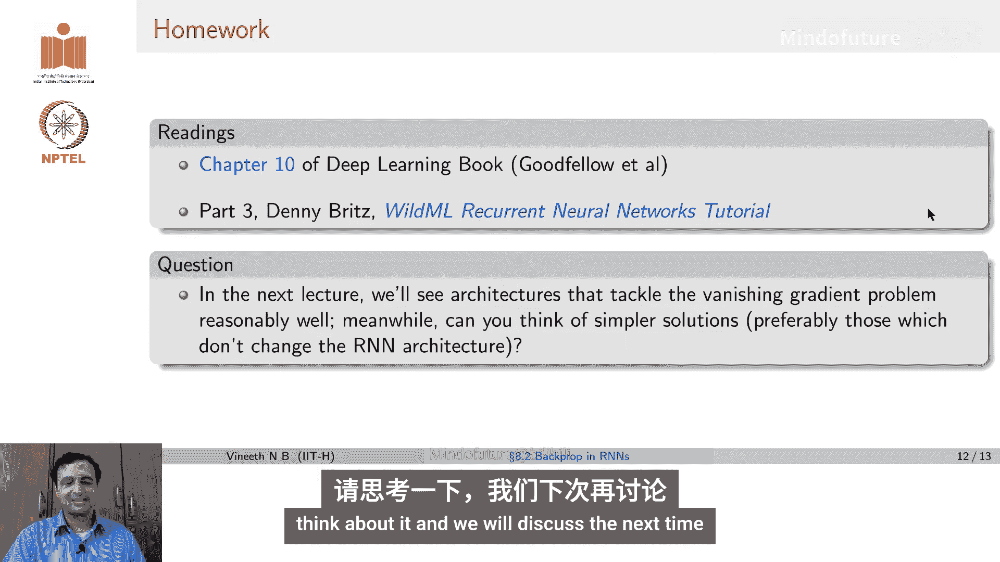

# 【NPTEL】计算机视觉的深度学习 p53 P53_RNN中的反向传播 -BV1vNWkzpEua_p53-

Well now move on to back propagation in orinance。Before we go there。

 we left behind a couple of questions。Can Arons have more than one hidden layer？

We already answered the question。We said that you can have as many hidden layers as you want in each RNN block。

In fact， you could also stack RnN blocks if you like one on top of each other so you could have an input that goes to one Rnn block。

 whose output goes to another RnN block， which is then given to the output at that particular time step and then similarly this RnN block would go over time。

And its outputs would go to the upper RNN block， so in such an architecture which is also known as a stagged RNN。

 the weights share at each level are all shared so at this level all the weights are the same across all the time steps and at level2 all the weights are the same across all of time time steps。

Such an architecture is known as a stacked irononm。Going forward。We asked the question。

Given that the state of an RNN records information from all previous time steps。

 what would happen if we morphed the state at a given time too much？With the current input。

The answer is evident here again。The effect of previous time steps will be reduced。

 which may not be desirable for sequence learning problems。

Moving on now to back propagation in Aronance， let's first revisit the forward pass in Aronance。

Assuming that this is now。Your diagram for visualizing an Rnn。

 you have an input x weights U hidden state h weights w then weights v that take you to an output y hat then your forward pass equations are given by Ht is equal to tan0 h of UXt plus wht minus1 and Yt hat is the soft max of Vht。

This would be your forward pass equations for an RNN thats solving a classification problem where you have the output layer defined by a softmax。

What is the cross entropy loss in this setting you could have use because it is a classification problem。

 you could have the standard cross entropy loss as given by this formula。Now。

 if we want to compute the gradients of error E with respect to the three sets of weights that we have here。

 U， V and W， let us assume that these gradients are going to be used to update the weights using stochastic gradient descent。

 exactly the same way we did this for feet forward neural networks or CNs。

And it's also important to keep in mind。That depending on the kind of RNN variant that you are using。

 you could have an error in each time step。If you had a many to one setting。

 you may have an error only at one time step， but in a more general case of an rnn。

 you could have an error for your output at every time step so you could have an error E0 at time step t equal to 0。

 similarly E1 at time step t is equal to 1 and so on and so forth in this case till E4。

The question now is how do you compute the gradient of the error with respect to Uv and W？

How do you do this？It' is similar to the general principle of computing the gradient for any other neural network。

If a weight influenced an output through multiple paths then you have to sum up the contribution of that weight to the output along all possible paths in our case you would have a weight here。

 here， here， here， for all the time steps and all of them are the same weights in an R&m。

So if we had to compute do e by do w where e is an overall error。

Do e by do w would be given by summation over t do E T by do w where E T is the error at each time step。

So our next question boils it down to。How do you compute each of these do et0 by doWs？

Let's see that now。Before we go into computing do E by dow。

 let us take a simpler case and try to compute do et by do v in particular let us consider do E3 by do v which is let's say the third time step。

So to compute do E3 by do v。Let's assume that we can write Z3 to be Vh3。

Then the gradient can be computed as do e3 by do v will be do e3 by do y3 hat。Into do y3 hat by Dobe。

Now y3 hat is a soft max of Z 3， that is the way we have defined this network。

 so you would have this by chain rule as do E3 by do y3 hat into do y3 hat by do Z3 into do Z3 by Do v。

Now this assuming that you have a linear activation function or let' us assume that this activation function is trivial and let us assume that do e3 by do y3 hat if you use mean squared error or cross entropy let' us assume that it boils down to a simple y3 hat minus y3 where y3 hat is the predicted output and y3 is the expected output and do z3 by do v would be H3 because of the definition of Z3 itself。

This becomes the gradient for do e3 by dov， so you would sum up do e3 by dov plus do e2 by dov plus do e1 by dov and so on and so forth to get the gradient of the overall error with respect to V。

Once you compute that， you can update all the weights in V using gradient descenter。

Now let's move on to the next case， which is do e3 by dow。Recall again that in rnN we have U。

 V and W， we need to compute the gradients of the error with respect to each of them。

So let's say we have to compute do e3 by dow。That would now be written as very similar to what we wrote for v do e3 by dow would be do e3 by do y3 hat into do y3 hat by do h3 h3 is going to be here。

And do h 3 by dow， which is the w that you have coming into it from the previous layer。

The question now is， is this good enough？If we now took this quantity and summed up do e3 by dow plus do e2 by dow and so on。

 would we have solved do e3 by dow overall？Unfortunately， no。Because while do h3 depends on w。

 do h3 also depends on h2， which in turn depends on w again。Which means。

Chain rule needs to be applied again to be able to complete this computation of Do e3 by doW。

Why did we not need this with V because we didn't have this problem？

Because it was directly connecting edge to thearrow。So how do we complete this？😊。

So H3 depends on w via H2， H1 and all other earlier hidden states。そ。Which means。

Do E3 by doW can be written as。K going from 0 to 3。

 do e3 by do y3 hat into do y3 hat by do h3 into do h3 by do hk where k would go from 0 to 3 into do hk by do w。

What about do e3 pi dow？We are going to leave that as homework because it is going to be very similar to do e3 by do W。

You only have to apply the chain rule in a principled manner。Just to complete this discussion。

 so if one had to look at this， how would it look in expansion， it would look like Do e3。

By Do y3 hat。Into dough。Y 3 hat。By do et3。Into Do H3 by dow。Plus。All these the first two terms。

We will just repeat as they are and then you will have a do h3 by do h2 into do h2 by dow and you will have further sumations that do similar chain rules for H1 and so on and so forth。

Remember， this summation now is only for Do e3 by doW。

You will have similarly another summ for do E 4 by doW， do e2 by doW， so on and so forth。

 and your final gradient for W has to add up all of those to compute do E by doW。So。

 if you now observe。Do h3 by do hk when k is equal to 1。

 as we just said can be expanded as do h3 by do h1 would be do h3 by do h2 do h2 by do h1。So。

 this entire gradient can now be succinctly written as summation k going from 0 to 3。

Do e3 by do y3 hat into do y3 hat by do h3 and all these terms in between can be subsumed into a product which is given by do hj by do hj minus1 and you still have would have the summation that goes from k going from 0 to to 3。

Do you see any problem in this particular approach？If you thought carefully。

You will realize that RNNs are often used for time series data that can be reasonably long。

You could be using it for data that has 20 time steps。50 time steps。

 100 time steps depending on the nature of the problem that you're dealing with。So。

 when you now back propagate， you are going to be multiplying the gradients across all of these time steps。

So if you saw on the slide earlier， you would have this term which continues to multiply these activations across multiple time steps。

Now， why could that cause a problem？If your gradient for each of those values is less than1。

 the multiplying these terms will lead to a vanishing gradient problem because the multiplication of values less than 1 will quickly go to 0。

Is this really a problem？Let's consider， say a sigmoid activation function that we use in a layer in the RNM。

So， we know that the sigmoid function is upper bounded by 1 the values lie between 0 and 1 lets even if we took a10h activation function it would lie between minus1 and 1 so the gradient of the sigmoid activation function it is also upper bounded by 1 which means all these terms will have gradients which are upper bounded by 1 and what does that tell us。

It means that the gradients in this particular computation do e3 by dow will quickly vanish over time。

And an earlier time step。😊，The weights or the impact of an earlier time step may never be felt on a later time step because the gradients。

That you get。Due to an earlier time step。Its most likely will become zero because of this product over a long range of activations across many time steps。

So， effectively， although you want RNN to model long term temporal relations。

 you may not really be able to achieve that purpose because of the vanishing gradient problem because an earlier time step may not really influence an output at a later time step。

How do you combat this problem？We will see this in the next lecture。

 there are already solutions for this problem and we will see this in the next lecture。😊。

But before we go there。😊，Let's ask the counter question。

What if I did not use a sigmoid activation function？

What if I just use the linear activation function， let us assume on the contrary that each of my gradients do h 3 by do h2 or do h 2 by doh1 with very high values。

Then， multiplying all of them could lead to what is known as the exploding gradient problem because the product of values say in the range of 10 by multiplying three such values you will quickly go to1 3 magnitude and that can lead to an explosion exploding gradient problem。

This generally is not too much of an issue during implementation。

Can you think why this may be the case？The answer is firstly， it is likely to show up as NN。

 not a number during implementations。And more importantly。

 you can simply clip the gradients beyond a particular value， this is known as gradient clipping。😊。

And it is very popularly done today while training neural networks where you say that if the gradient exceeds 10。

 you are going to stop the maximum value it can obtain as 10。😊，So even if your gradient was 10 part3。

 you are only going to choose it as 10 and move on with the rest of the computations。

This generally takes care of the exploding gradient problem。😊。

Although the vanishing gradient problem remains and we will see this in the next lecture。😊。

So your homework for this lecture is continue to read chapter 10 of the deep learning book and also go through this excellent wild ML RNN tutorial by Denny Brititz which explains。

Back propagation and RNM very， very well。The question that we are going to leave behind at the end of this lecture is。

As I just mentioned in the next lecture， we will see how you can change an RNN architecture to avoid the vanishing gradient problem。

But。Can you solve or address the vanishing gradient problem without any change in the overall architecture through some choices。

 can you solve the vanishing gradient problem？Think about it and we'll discuss the next time。

Eフs。