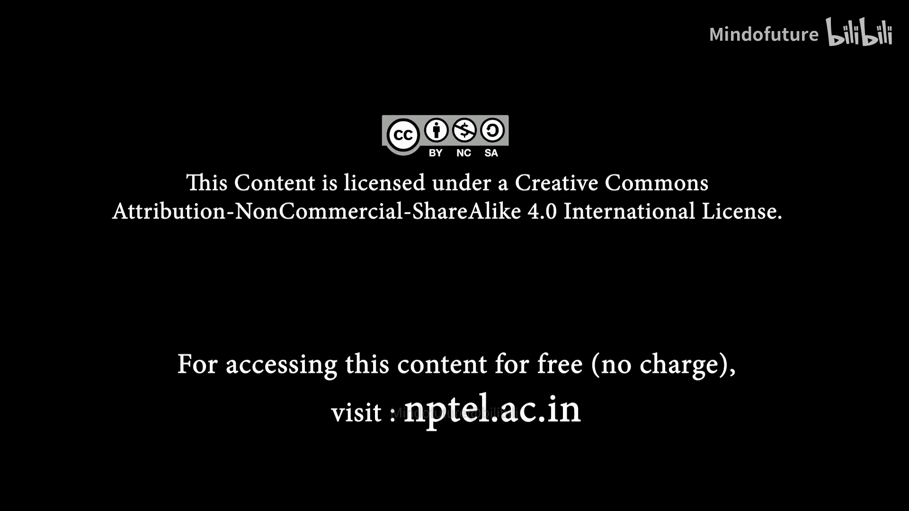
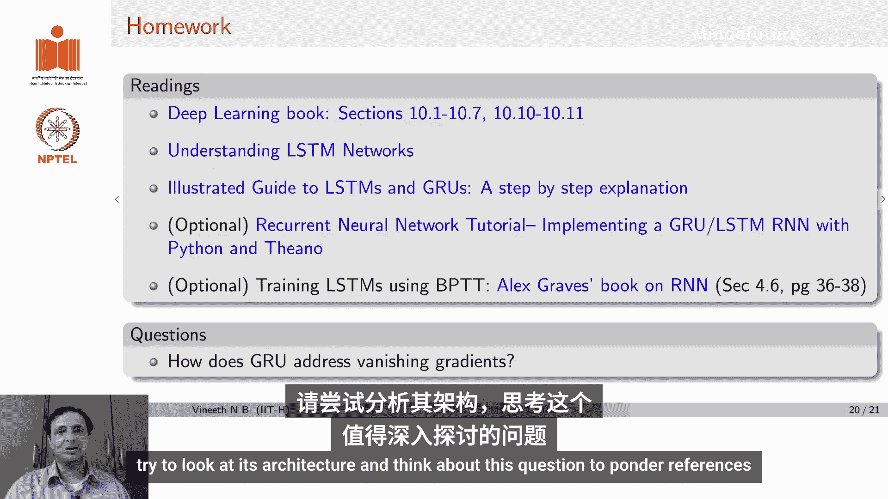

# 【NPTEL】计算机视觉的深度学习 p54 P54_LSTM和GRU -BV1vNWkzpEua_p54-

We will now talk about how to solve the vanishing ingredient problem using changes in the architecture of an RN。

In particular， we will talk about LSTMs and GRUs。One question that we left behind。Was。

How do you tackle the vanishing gradient problem in RnN？Without changing the architecture。

You could do a few things you could use relu instead of tan h and sigmoid remember Relu does not vanish the gradient。

 it keeps the gradient at least the positive for the positive activations it keeps the gradient as it is。

You could regularize in some way， you could initialize the weights in some way that helps carry forward the gradients backward。

And you could also consider using only short time sequences so that the gradient does not vanish。

Within that short time frame。Let's revisit this problem of long term dependencies。So， if you had。

A situation where you are dealing with a sequence learning problem。

 which say wants to predict the sentence， the clouds are in the sky。Or it wants to。Classify。

 say the sentiment or the category of the sentence。

And RronN may be good enough because the word sky may only depend on the word cloud。

 which I say just two words before if you remove all the basic words in the phrase。However。

 if you have a more。Detail sentence， a longer sentence such as I grew up in France。

I speak fluent French。Now， the word French at a particular time step may depend on some of the word that was used several words ago。

These long term dependencies may not really get captured by an RNN。

Because the presence of the word France may not really have an impact on the word French because the gradients may vanish between these two time steps。

So we are going to talk about how we address this in this lecture just to recall。

RNMs are trained using back propagation through time。

The limitations of back propagation through time that we discussed were vanishing gradients and exploding gradients。

Expllooding gradients， we said we could handle using gradient clipping。😊。

How do you now address vanishing gradient using changes in RNN architecture are through LSTMs and GRUs as examples and well discuss both of them in detail in this lecture。

LSTM stands for long short term memory。It was introduced way back in 1997 by Hawk writer Renshmeid Huber。

Primarily intended to address this long term dependency problem。

 although it was not in the same form that we will discuss now。

 but we will also discuss its evolution as we go forward。So here is the design of an LSTM。

At eat step T。In an RNN， we had a hidden state which the RnN block would output。Now， in an LSTM。

 we would have a hidden state which an LSTM block would output and also an internal cell state which maintains the information across a temporal context。

The cell stores long term information。And the LSTM block can erase。

Write and read information from that cell state。Based on whatever a context defines。

The selection of what information you can forget or read or write is controlled by three gating mechanisms。

 one for erasing， one for writing and one for reading。And on each time step。

 these gates could assume values。Open， which would be one。

 which would allow all the information to pass through。Closed， which would be0。

 which would not allow any information to pass through or somewhere in between you can also have an information lying between0 and1。

These gate values are dynamic and are learned and computed based on the input at a particular time step and the hidden state that comes from the previous time step。

Let's see this each of these componentss in more detail。

A RNN has a general form of a chain of repeating modules。So if you took a vanilla RnN。

The repeating module is perhaps a single layer with a tanhch activation function。As we said earlier。

 it can also be not just a single layer but two3 layers。

 but that would be the repeating block that is applied to each to the input at each time step。😊。

So this diagram here， you have an input x t minus1 at t minus 1。

 x t at time t and x t plus 1 at time t plus 1。And what you see here is a single neural network layer which has a tanh activation function and the input at a particular time step Xt as well as ht minus1 which is the output of the previous RnN block is provided as input a tanh is applied that gives us Ht and that Ht is given as output as well as given to the next RnN block at the next time step。

That's the vanilla aronin that we've seen so far drawn in a different way。

Let's now try to draw a parallel with LSTMs。LSTMs have a similar structure。Once again。

 its a chain of repeating modules where you apply the same block at every time step。

But now the structure of each block is not just one layer or two layers， it is different。

It contains four different layers and they are not sequential layers unlike the networks we have seen so far。

They also interact with each other。We will see each of these layers in detail。So in this case。

 you can see that you have four different layers denoted by these four blocks， four yellow blocks。

One of them is known as a forgetgate gate which decides to forget some cell content coming from the previous state。

Another of them is known as an input gate and that's why you see a sigmoid activation function here given by sigma。

So these ones are sigmoid activation functions。And the reason we use sigmoid here is because we want the output to lie between 0 and 1。

So， the input gate。Along with a tanh activation function decides how much of the input should be written。

And also adds that new cell content at the end。So that's what happens here。And finally。

 there is an output gate which decides how much of the cell state should be exposed as the hidden state。

😊，So cell state is denoted as c subt and the hidden state is denoted as H subt and a part of the cell state is revealed as hidden state to the next time step as well as an output of the cell for further processing。

Let's see each of these in more detail。So， the cell state。😊，Contains。

Information which you can look at as a memory across a temporal context and the information can flow across the cell state unchanged if you see this diagram here。

 this is just the diagram from the previous slide。With a few components grayed out for the sake of explanation。

 so you can see here that the information in a cell state CT passes as it is to the previous cell state c minus1。

Why is this important？Try to connect this to the vanishing gradient and we will come back and talk about this point later in this lecture。

The only thing that we have is a multiplication operation here and an additionion operation here。😊。

The multiplication operation decides whether you want to forgetgate something from a previous cell state c minus-1 that contains a sigmoid neural network layer which which has a dimension as the size of the cell state and has a value between 0 and 1 for each dimension of that cell state so for each dimension of the cell state。

 you can decide how much of that information you want to retain using this multiplication operation here。

 this multiplication operation is a0 twice or elementwise multiplication operation。

Then you also have an addition operation here which decides how much of that information gets added to how much of an information coming in gets added to this new cell state。

😊，Now let's talk about the forgetgate gate to start with。The Fugate gate。

 which is one of the layers inside the LSTM block。Takes input Xt。Takes input Ht minus1。

 very similar to the RnN block that we saw so far。Then it has a set of learnable weights， WF。

 those WFs are learned while training， you have a bias Bf corresponding to the weights。

 and then you apply apply a sigmoid activation function to ensure your outputs lie between 0 and1。

That's the output of the frigate gate。And what does the forget gate do。

 it does an element twice multiplication with the previous cell state C minus1 to decide how much of that information should be erased and how much of that information should be kept。

😊，Similarly， the input gate decides what information to remove from the cell state。So。

 the input gate also receives a copy of xt and ht minus1 as input similar to forgate gate。

Has its own weights， W， a bias B。And operates a sigmoid activation function to ensure the output lies between 0 and 1。

And in this particular part of the architecture you also have another component which takes the same input ht minus1 xt remember those are the only two inputs that you get to an RNN block it is the same inputs here。

😊，Whi has its own weights WC， a bias bc applies a 10h activation function so that you can have both negative and positive values and you get an output c c tilde T。

Let's see how these are combined now。So the final cell state CT is given by。😊。

Ft element wise product c minus1， so this tells you which dimensions of the previous cell state c minus1 should be forgotten and to what extent。

And the IT input gate is multiplied with CT tilde to decide what should be written on to the current cell state so you have a cell state which is like a memory。

In the current time step， you want to decide what aspect of the memory do you want to remove and what new content do you want to add to the memory？

Finally， you have the output gate。Which controls what parts of the cell state are provided as the hidden state which goes to the next time step and the output。

So， Ot is another gate similar to the forgetgate gate and the input gate once again receives ht minus 1 and xt as input。

Has its own weights w not and B not sigmoid activation function because it's also a gating mechanism。

And this is now combined with C， which is the current cell state element wise to decide what should be the Ht that is provided to the next cell state next next state as well as to the output。

To summarize these in equations， so Ft is a fergate gate which controls what is kept versus what is forgotten from the previous cell state。

The input gate controls what parts of the new cell content are written to the cell。

The output gate controls what part of the cell are output to the hidden state。

 all of them use a sigmoid activation function so that the output is similar to a gating mechanism and lies the values lie between0 and 1。

And CT tilde is the new cell content that you want to write to the cell。

 so that is just a simple processing of the inputs。

And C finally is obtained by forgetting some content from the previous state and writing some new cell content。

FT controls ct minus1 and the input gate I controls the CT tilde。

 which you ideally want to write under the cell state。And finally， the hidden state。😊。

Is and decides to read some content from the cell as output using the output gate。

 It again uses a tannnage to maintain。Negative and positive values。

Lets ask a couple of questions here to understand how this entire setup works。

What can you tell about the cell state C？If the fergate gate is set to1。

And the input gate is set to 0。Let us try to analyze this。

 the fergate gate is set to all ones and the input gates is set to zeros。😊，What would happen？

From this equation here for C。You can notice that the information of the cell coming in from the previous cell state will continue to be preserved because there there would be no input that would be added due to the input gates being  zero and the C tilde would not have effect on the cell state。

😊，Let's ask another question。What would happen if you fix all input gate to all ones？

Forget gate to all zeros。An output gate to all ones。If you thought carefully。

 this will almost be the standard RNN。Think about it to ensure you can understand this why do we say almost standard RnN？

The only difference now is there would be a tann hich that gets added here。

 which was not there in the vanilla aret。Now， let's come back and ask this question。

It seems like a complex architecture。 One point to add to the discussion so far is that these four layers in an LSTM are not necessarily sequential the way we have seen networks so far。

 we of course saw skip connections where any layer could be connected to any other layer。

 Similarlyly， even in an LSTM， there are interactions between the layers to to achieve a specific objective。

Now， let's try to ask。How does the LSTM really solve the vanishing ingredient problem？

The key to that lies in this highway here between c and ct minus1。

We are going to call that the gradient highway。So， whatever gradient of the error that you receive at CT will be passed on a to ct minus1。

Earlier we had to worry about that being mitigated by the activation function across a layer so on and so forth here if you notice between c minus1 and CT there is no layer per se。

The only thing that exists between them is the output of the forgetgate gate。😊。

Which is just a vector， it is not a layer， there are no weights， it is just a vector。

 Why is this not a problem？This is not a problem because the job of the forgetgate gate is to decide how much ct minus 1 should contribute to CT。

So if the gradient is reduced to a previous state。Based on how much it contributed。

 that's a fair gradient。 We won't be worry about。 we won't be worried about it。

The gradient does not get mitigated because of any other operations in the LSTM it depends only on the Fo gate and the forget gates job is to control how much of the previous cell state goes to the next cell state so the gradient would only get mitigated by that。

That much amount for each of the dimensions in the previous cell state。

This allows LSTM to solve the vanishing gradient problem。 So once again。

 if you go back to the equations here。This equation on CT tells us that ct when you it depends on ct minus1 only with respect to Ft while the second term here。

 the I into C tilde。Could still be affected by the vanishing gradient problem。

We don't worry about it because there is another component which will allow the gradient to pass through A is through the LSTium network to earlier time stepss。

This allows addressing the vanishing gradient problem in LSTMs。

Over the years since LSTMs came way back in 1997， there have been a few variants of LSteems that have been developed。

A couple of popular variants are one of them is known as an LSTM with Phole connections。😊。

The reason it is called an LSTM with peoplehole connections is in the computation of the Fgate gate。

 input gate and output gate。😊，You notice that in addition to Ht minus1 and xt。

 you also provide ct minus1 as inputs and for the output gate you also give CT as input。So。

 you are allowing your gates to peep into the cell state and then decide which dimension you should cut down or which dimension you should let through that why that is why these are known as LSTMs with peoplehole connections。

Similarly， there has also been another variant known as。

An LSTM with coupled fort and input gates where instead of having a separate forgate gate and an input gate。

The cell state is computed as Ft element voice product ct minus1 and 1 minus Ft element voice product C tilde。

So you had an IT in the vanilla version of the LSTM but in this version the Ft doubles up to serve both these purposes so FT tells you how much to forget and  one minus Ft lets you tells you how much to let it。

😊，This is a variant that has been proposed。So， the history of LSTMs to summarize is in 1997。😊。

Haw writer and Schmiduber first proposed LSTMs and the learning at that time used was known as real time recurrent learning with back propagation。

There was no forgetgate gate in this version of the LSTM in the late 90s。Then in 1999。

 Schmid Huber again， their group introduced the Fugate gate into the LSTMs in 2000。

 the variant with peoplehole connections was introduced。And in 2005， Alex Gves。😊。

Whose who is probably responsible for the version of RronNs and Lsteums that we see today。

 introduce the vanilla Estium， as we know today with all the components。Over the last few years。

 especially between 2013 to 15， LSTMs started achieving state of the art results on various applications such as handwriting recognition。

 speech recognition， machine translation， passing， image captioning， so on and so forth。

 that they started becoming the default choice for doing sequence learning。However。

 while we won't have the opportunity to discuss this now in 2020 as we speak。

 one of the hottest trends to handle sequence learning problems are known as transformers。😊。

Transformers use the idea of what is known as self attention。In fact， in a recent competition。

A summary report of all the methods that participated in that competition WMT stands for machine translation it is a machine translation which is a sequence learning problem when we say machine translation we mean an application such as Google Trans to go from English to German or Hindi to English so on and so forth。

So with all the participants that provided entries to this competition。

 only seven of them were RNN based while 105 of them was transformer based。😊。

That should give you an idea of what is the latest trend at this time。In 2014。

There was another variant similar to LSTM known as the gated recurrent unit GRU。

 which was also proposed。😊，Which is also used popularly as an alternative for LSTM today。

It was proposed by Chang etal。So， the main idea here is very similar to the coupled forget and input gates。

😊，GRs combine Fgate and input gates into a single update gate。

It also merges the cell state and hidden state。And this is the overall architecture。

 let's see this in some more detail。😊，So in this。GR。You have only two gates instead of an input gate。

 a4 gate gate and an output gate。Now you have only two gates。

These gates are called an update gate and a reset gate。

 so these look exactly the same as any other gates that we saw with an LSTM， but now。

The new hidden state content is given by the reset gate the reset gate looks at Ht minus1 which is the hidden state coming from the previous time step。

 decides how much of that should be processed and then gives you an updated hidden state so the reset gate selects useful parts of the previous hidden state and uses this to compute the new hidden state。

And the final hidden state that' is exposed out of the GRU block is 1 minus Z T Z T is the update gate。

Into H T minus1 plus Z T into H T tder。So， the update gate controls what is kept from the previous hidden state and what is updated to the new hidden state。

So to understand this further。Let' us ask this question what happens if the reset gate is set to all ones and the update gate is set to all zeros？

Let us try to analyze this if the reset gate is set to all ones。😊，This would just remain ht minus1。

 there would be no impact there it would just remain as ht minus1 if the update gate is all zeros。

The second term here would disappear because all those terms would become zeros。

And the first term here would ensure you will have all once。

 which means ht will simply become ht minus 1 and the second term this entire computation from the current time step would not be considered at all。

So， effectively very similar to what we talked about as one of the cases with LSTMs。Here。

 the same state from the previous time step would be retained and there would be no influence of the current input。

To summarize the differences between GRUs and LTMs。

The input and forget gates of LSTMs are combined by an update gate in GRUs。

And the reset gate is applied directly to the previous hidden state in GRUs。So。

 GRUs have two gates and LSTM has three gates； what does this tell us？

Lesser parameters to learn in GRs so learning could be better even with lesser data。

GRUs don't have any internal memory the cell state CT。

 whatever is the internal cell state is also exposed as it is because there is no formal output gate to control how much of the cell state is output out of the cell state。

In general， LSTM is a common preferred choice， especially if you know that your data has long range dependencies or if you have large amounts of training data。

 but if you want better speed and fewer parameters and maybe smaller data sets。

 GRUs are a good choice to try for sequence learning problems。

Your homework would be to continue to read chapter 10 of the deep learning book and these nice links on understanding LSTMs and GRU networks。

And if youd like to understand how LSTMs are trained using back propagation through time。

 this is Alex Grave's book on Rnn Alex Gves， as we said。

 was responsible for designing the first LSTM and there is also a nice code tutorial here if you would like to understand the hands on site。

 you would have assignments to also。Get a hands on experience。 But if you'd like to go through this。

 you can。😊，Let us try to leave one question for you to take away we did answer how LSTMs address vanishing gradient。

How do GRUs address vanishing gradients？Try to look at its architecture and think about this question。

To呃 to bond。

References。

