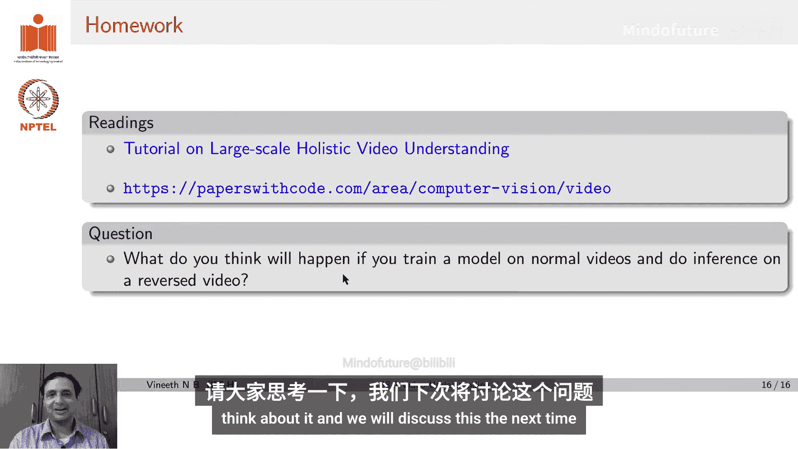

# 【NPTEL】计算机视觉的深度学习 p55 P55_使用CNN和RNN进行视频理解 -BV1vNWkzpEua_p55-

Having seen Rrons which deal with temporal sequences。

We will now move to temporal sequences in vision， computer vision， which are videos。

So we will try to see how videos are processed using CNNNs and Rs。

The one question that we left behind the last lecture was how do GRUs address vanishing gradients？

the answer is the same as LSTMs， they also have a gradient highway between a hidden state at a particular time step and the hidden state at the previous time step which was in the final hidden state update equation you would notice that that was given by1 minus z into the previous hidden state plus z or the update gate times the current hidden state tilde so you would notice that in that equation previous the gradient of the current hidden state with respect to the previous hidden state depends only on a gate。

Which。Does not affect the gradient per se as long as the update gate allows the gradient to pass through and that is by design。

Moving on to videos。😊，Let us ask first ask the question， why do we need to understand a video at all？

So here are a couple of examples， so this is an example of an automated baseball bat hitting a baseball。

And if you wanted to understand where would this baseball bat hit the ball or what direction will the blow ball fly or what kind of an activity is this so on and so forth。

😊，One would need to look at all the frames while coming up with the decision and one single frame in the sequence may not let you answer that question。

 for example， as to where the ball will go。😊，Another example is if we wanted to understand in which direction this screw was being turned in。

One of these frames will not give you the information of which direction the screw was being turned in。

You would need the sequence of frames to be able to make this decision。So。

 the question that we have is how do we then use whatever we have learned so far so weve seen feed forward neural networks。

 CNNs and now RNNs， how do we use these to understand a video？

Can one of them suffice do we need multiple of them。

 lets try to see if we can figure this out by ourselves and go ground up。So。

 if we had to understand a video， you can look at one specific location of let us if we took the example of the screw video。

 you could take one position。Of that screw and track it over time and then be able to say what direction the screw was turning in。

So， how do we get this information， how do we actually track a particular point and then see where it goes over time？

There are a few possibilities。Considering the focus of this course is on deep learning。

 we are going to look at deep learning waste approaches to understanding videos。So， broadly speaking。

 one could use only CNNs to understand videos。Or can use CNNNs and RNNs together to understand videos。

We will see both examples in this lecture。Even within CNNs。There are two ways to perform。

Video based understanding one is to do what is known as 3D convolution。

And the other is to see if you can repurpose 2 d convolution itself to understand videos。

In a 3D convolution approach。The time becomes another dimension of analysis。

Just like how images are two dimensional signals。Videos are three dimensional signals time becomes another dimension。

So every operation that we saw so far， you have to add another dimension in the operation。

For example，3D convolution。Another way of looking at it is to use 2D convolution but to consider time as a separate entity。

 not a separate dimension by itself and we will see an example of this to make this clear。

One question you could have is。Weren't we doing 3D convolution all the while？

The inputs to our CNs so far were volumes we had R channel， G channel and B channel。So。

 werent we actually already doing convolution over volume was it that wasnt that 3 d convolution？😊。

If you have not thought through that before。Not really。

The reason why we don't call that 3 d convolution is。

We only moved convolution along the two dimensions of the image。

The depth was always fixed the number of channels that you had you did not move across that dimension when you performed convolution the movement was only along two dimensions and so whatever we saw is so far。

Is 2 d convolution， although we have a the filter extends into the third dimension and we process it。

 we actually don't move。On windows in the third dimension。

But now when we talk about videos and 3 d convolution here。

 we are talking about moving in the temporal dimension。😊。

Let's try to understand 3D CNNs first as a way to understand videos。Traditionally speaking。

 if you had one frame from a video。Or more frames， if you perform standard 2 d convolution。

 you would look at a particular patch of each frame。

Perform convolution and you get a certain output in the output。Feature map。Unfortunately。

 when we apply convolution this way， the two frames are not connected and you are not sharing any information between the two frames。

😊，However， when you do video understanding， the core idea is to be able to pass information or combine information from multiple frames to make a prediction if it was a classification problem。

 for instance。😊，So how do we do this？As I just mentioned。

 the idea is to extend convolution to a further dimension。

So if you had three frames instead of doing 2 d convolution on each frame individually。

What we are going to propose is to do convolution across the frame。

Let' us try to study this more carefully so you can see here that the first patch has a set of weights which gives you a pixel in the output feature map。

But that feature map is all flow also influenced by another set of weights that is applied to the second frame。

And a third set of weights that's applied to the third frame。Similarly。

 you can see that in a second feature map， you would have a different set of weights applied to each frame of your video。

So you have another dimension that you had have to convulve on now， which is the temporal dimension。

So were going to look at one specific paper which was perhaps the initial harbinger that brought on a lot of other work。

 this was known as 3D convolutional neural networks which was published in firstly in ICM of 2010 then in Pami 2012 and let's look at the architecture for this 3D CNN。

 the architecture has evolved over the years but at least this should give you one example。

In this particular example， 3D convolutional neural networks were used for human action recognition to look at a video and predict the action。

So， the input was a set of seven frames whose resolution was 60 cross 40 it was just gray scale frames resolution 60 cross 40 those were the seven frames that were considered。

This particular work initially had one layer where hardwired filters were used。

 So these filters here were not learned。 They were five different kinds。

 They had a gray scale filter。 They had a gradient along the x direction。

 They had an optical flow along the x direction and the optical flow along Y direction。

 They had five different kinds of。Filters and those gave these sets of images so they obtained a total of 33 feature maps each of them still at the resolution 60 cross 40 after this initial processing of a few filters that were hardwired these were not learned these were filters that detected edges detected optical flow so on and so forth。

The next layer was 3D convolution which which was done using learned weights。😊，They performed7 cross。

7 cross 3， 3D convolution。Where for each of these。Specific components as we said they had five different kinds of feature maps so they ensured that they did 3D convolution within each of those five kinds of feature maps and thats what you see color coded here you can see these five colors and those five colors are also maintained in subsequent layers so the 3D convolution is within only the yellow region within only the red region within only the purple region so on and so forth。

And to get some variety， they also introduced a completely different set of feature maps。

 a different set of weights， but performing the same operations。😊。

You could consider this similar to your Alexnets 48 feature maps and 48 feature maps in the first layer going to two different GPUs。

 although in this case。The intent was not to send to two different GPUs。

 the intent was to get more variety in the feature maps。

The rest of the layers follow a traditional CNN approach。

 they then performed two cross2 subsampling within each of these feature maps。

 then they performed cross another 3D convolution， a 7 cross 6 cross 33D convolution which again had two sets of feature maps。

 then a3 cross 3 subsampling， then a cross4 convolution to bring everything together。

Then a fully connected layer to make the final decision。And how are these learnt？

Nothing changes from that perspective， you still have cross entropy loss at the end and you still can back propagate through all of these layers very similar to how we talked about it for CN。

Using this kind of an approach。They could show that you could perform action recognition。

Certain actions that they had in the dataset was to check if there was a cell to your action where someone puts a cell phone to theer or to find an action where somebody left behind an object in a public environment or when someone points to another person。

So， you can see here if you observe carefully that for each of these boxes there is also a trajectory that follows so if you look at this particular box here you see there is also a trajectory which shows the previous frames and the positions in the previous frames that led to this particular outcome on this frame。

And also probability a score rather of the outcome。So。

 this is the 3DcnN approach to understanding videos and there have been several variants over the years in trying to perform such operations。

Let's now turn the problem around and ask。Could we have used 2DCN in itself。

To solve a video understanding problem。Turns out there is a very popular method that does this known as two stream convolutional networks whose is very popular is still popular for doing video understanding tasks。

Let's try to understand how this works。So if you had a video where at one type step。

 you see a person trying to pull out something from behind their shirt。

And the hand moves and something comes out from behind their shirt。Now。

 we could use a traditional optical flow approach to try to find out which pixels moved how much across the x direction and the y direction。

So using this optical flow。You could have a horizontal component。

You could also have a vertical component of the optical flow。How do we use this？

So in the two stream CNN。You have your input video， which is a volume。So。

 you have a spatial stream of the CNN， which takes a single frame， which could be color。

And now sends it through a standard CNN architecture to get your final output of what action this may be so this has a con 1。

 con 2 con 3， con 4， con5 fully connected fully connected very similar to an Alexate architecture to get a final classification at the end。

But this is only for a single frame。Now the other stream。

 this is known as the spatial stream and the other stream performs a multi frame optical flow of how the content changes across the frames。

So you have multiple frames of the optical flow between every set of consecutive frames across all the frames in the input video。

Now set this optical flow images becomes a set of channels across the temporal dimension and one could now perform a standard convolution 2D convolution on this volume of optical flows each optical flow image is a 2D image and across time for between every successive frame you are going to get optical flows and you stack them all together to make a volume。

And this volume can be sent through another standard 2 dcNN architecture。

Which we will call the temporal stream convolutional network and both of them provide their own classifications on what action this may be。

And the final step is to perform a fusion of class scores， you can aggregate them in several ways。

 majority board them or average them and then make a final decision so on and so forth and this gives the final decision on what action this is。

😊，Note here that all these convolutions are 2D convolutions and not 3D convolutions。

What about using RNNs with CNNNs to perform video understanding？

So given a visual input such as an image。You first extract visual features from a CNN。

 so you would forward propagate that through a CNN and take say the penultimate layer of an Alexnet or something like that as the representation of the image。

Now， these representations of the image can be provided to a set of LSTMs or RNNs to perform sequence learning to give your final predictions。

See if you had a video。Where you have multiple frames。

Then you provide each frame to a corresponding CNN to get different feature representations and then they can then be provided to an LSTM which gives。

So， you could assume now that each column here is your LSTM unfolded over time and this is a stacked LSTM unfolded over time。

And finally， the output of these LSTMs are the predictions that you make。So。

 you could have a prediction per frame or you could ignore all of these to make a prediction only at the last time step。

That would be the way to combine CNNs with RNNs。How do you learn such a network？

Remember that every component that we see here is backprobable。

 we know how to back propagate across an RNN and LSTM a CNN so given across entropy loss at the end。

Or a sum of cross entropy losses for each time step。We could compute the back propagated error。

 the gradient of that error with respect to every weight in the CNN or the LSTM the CNN。

Is the same model that is used on each of these images。Now， with these approaches， be the two stream。

CNN or a CNN with RNN or a 3D CNN。What kind of problems in video understanding can we solve？So。

 if you could look a data set such as the UCF 101， which is a very popular data set for video understanding。

You could perform action recognition like I is the person doing pushups， rock climbing。

 is the person tramppleling jumping， so on and so forth。Or if you had a different kind of a data set。

 another data that is popular is known as Hollywood in homes。😊。

Wwhich is an activity understanding data set again in this you could perform action recognition such as smiling at a book。

 so on and so forth。Or you could also perform sentence prediction such as caption generation for a full video of equivalent problems。

There are more problems that can be solved for video understanding， action forecasting。

 so if you had a sports video and you see a particular sequence of events so far。

 what would happen next， for example。If you had a water polo game and you had a sequence of moves that you've seen so far。

 where will the person pass the ball to next or in basketball for instance？

Object tracking is another important video understanding task。Dynamic scene understanding。So far。

 we have seen methods that given a scene can classify the scene into outdoor or indoor。

See morning or night， urban or rural so on and so forth， using image level classification methods。

 we know a CNN， we know a cross entropy loss， given data， we can learn a seen classification model。

But what happens if you want to understand a dynamic scene， a dynamic video。

 then wed have to switch to video understanding models such as a 3D CNN or a two stream CNN or a CNN plus RNN to solve such a problem？

One could also think of other problems such as temporal action segmentation， so on and so forth。

 which would be an unsupervised kind of an approach which are also important problems in video understanding。

Your homework would be get to go through this tutorial on large scale holistic video understanding。

 which should give you a clearer picture of more tasks in video understanding and how how these architectures can be adapted to solve these kinds of problems。

And this particular link also gives a good listing of papers in this space。

We will conclude the lectures for this week with a very interesting question， which is。

What do you think will happen？If you train a model on normal videos。

And now do inference at test time， you give a reversed video。Would it work， would it not work？

Think about it and we'll discuss this the next time。

