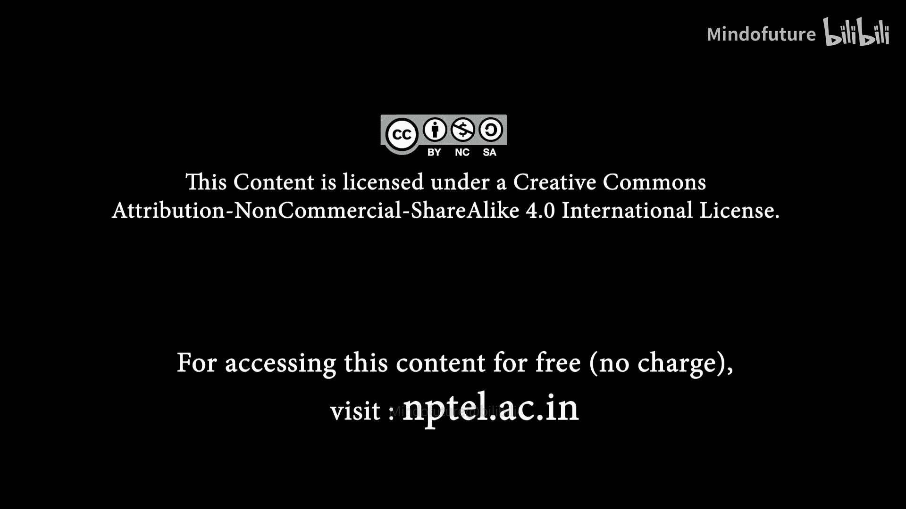
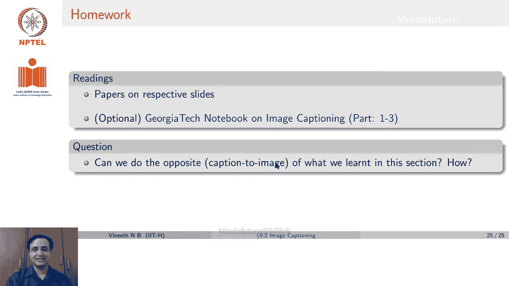

# 【NPTEL】计算机视觉的深度学习 p57 P57_视觉与语言 - 图像字幕 -BV1vNWkzpEua_p57-

We will now focus on one of the tasks。That we discussed in the previous lecture。

 which is image captioning。We left behind one question from the previous lecture。

Which was our auto encoders， which we understood as a dimensionality reduction technique。

Similar to PCA principle component analysis in some manner。The answer is yes。

Let's try to understand the connection。If you normalized your data。

To the auto encoder in a particular way where x hat。

 which is the normalized data is given by 1 by root m into x minus mean of that dimension under consideration。

So what is this normalization doing？It is making the mean of each dimension to be zero。

 its a standard normalization step。And when you do this kind of a normalization。

 the covariance matrix is given by x transpose x， which is the covariance is given by 1 by m into x hat transpose x hat。

 this is because of the1 by root m that you have here when you compute your x hat。

Given this preproces。Let's try to look at the auto encodecor loss。The auto encoder loss is。

 let's say the parameters of your autoencor are summarized as theta。

Is the mean squared error between your reconstruction and the original input？One can also write。

This loss， in terms of。X and can write it as x minus h W star Phrobiniusome whole square。

In this case， Fbinius nom is given by。Sumation along each of the dimensions。

 AIj holds square is a squared sum of all elements of a matrix。

Each here is the representation of the auto encoder in the middle layer。

 the bottleneck layer or the context vector。And W star are the weights of your decoder。

 so W star into edge is the reconstructed output from that intermediate representation。

X is the original input， so both of these are equivalent representations for the loss function。

Why did we write it this way， let's see a bit more。We know that for a loss function written this way。

HW star using SVD can be written as。U sigma v transpose where you consider only the k columns of U and v transpose where。

You have a nonze rank。A nonzero single value。So that is what we are writing this HW star as this comes from the SVD decomposition of x。

So if this was indeed the solution， then one factoring could be。It could be the first two terms here。

 so that would be。You。Sigma and W could be v here。This is one possible factoring and let's consider this to be。

One of the outcomes of the neural network and move forward with this outcome。

So if you consider H to be you。Sigma considering only the K columns。Then you have h。

 which can be written now as lets multiply by。X x transpose into xx transpose inverse。

 which we know is identity， which are just taking the expansion of h and multiplying by identity。

 which is given by xx transpose xx transpose inverse。Now we know from SP PD of x。

 we can write x transpose as。V， so remember， if we have x is equal to u sigma v transpose。

 then x transpose is given by v。Sigma transpose u transpose that is what we are writing here and x is written as u sigma v transpose and x transpose is written as v sigma transpose u transpose whole inverse。

Now， by looking at this， you can make out that again from definition of sVD we transpose v is。

would be identity because in sVD v is an orthonormal matrix orthogonal matrix where v transpose will be the same as v inverse hence v transpose v will be v inverse v which means it should be I so when this term here。

Is v inverse v， which is I because v is an orthogonal matrix。

 so that collapses and you are left width。U sigma， sigma transpose， U transpose。Now。

You can also write this as the first u comes out here and you have sigma sigma transpose。

 hole inverse， u transpose， how did this happen？This comes from the inverse of this matrix here。

 remember if you have AB C3 matrices whole inverse that is given by。Seeing verse， Be verse。Inverse。

Now， u transpose inverse will be U itself。Sigma sigma transpose inverse stays that way and u inverse is u transpose once again you can。

Interchange inverse and transpose because U is an orthogonal matrix when you do SVVDcomposition。Now。

 this can be collapsed as u transpose U because it orthogonal would be the same as you inverse U。

Which is identity matrix， so that collapses and you are left with the rest of the terms。

And once again here。😊，Sigma sigma transpose whole inverse is sigma transpose hole inverse into sigma inverse and that is what we are writing here now you have a sigma transpose sigma transpose inverse which would be identity and collapse so you will be left with x v。

Sigma inverse u transpose u once again， u transpose u where u is constrained by the first k columns would be given by I constrained to the first k columns。

Which is what we write here。So， with that， we go on to the last step where sigma inverse I。

Constrained to the first k columns would be sigma inverse constrained to the first k columns and sigma inverse into sigma Kk would be。

I constrained to the first k columns， this can be written as x into v constrained to the first k columns。

Why is this derivation important？This now tells us that h is a linear transformation of x and w。

 which is in this case v constrained to the first k columns。What does this mean？From SD。

We know that given a matrix x and its sVD U sigma v transpose。

 we know that v is a matrix of eigenvectors of x transpose x。

Go back and see the assignment0 in the course and refresh the basics if you are not aware of this。So。

 which means our encoder weights which are given by v are the eigenvectors of the covariance matrix。

😊，What does this tell you？It should remind you of PCA where the projection matrix are the eigenvectors of the covariance matrix。

So， are auto encoders always a variant of PC or are they？Do they become PCA once you learn the model？

Not really this happens when your encoder and decoder are linear remember in this entire example we did not talk about having any activation functions in your encoder or decoder。

And you have to normalize it， the inputs the way we saw and you have to use mean square error or loss function。

Under these conditions。😊，The mapping led by the encoder of an auto encoders is indeed the projection matrix of principal component analysis。

Having answered this question？Let's come back to the topic of this lecture。

 which is image captioning。Let's say we wanted to describe an image such as what you see here。

Or what you see here。Or what you see here。As humans， we are able to describe these images in words。😊。

How can we ensure a computer or a machine learning model can do the same？How do we go about this？

Ideally， we obviously need some method which can work on the images and give us this output so given some images and given some captions which describe those images。

😊，We give them as input to some method。Which now takes a new image and gives the output。

Dog is looking outside the window。Now， how do we go about coming up with this method？

We look at the images and use vision based deep learning models。

We look at the text and use NLP based deep learning models which would be RNNs in this case。

 so in this case the computer vision part would be replaced by CNNs。

The NLP part would be replaced by rronance and you combine them to get your final output as they cap。

Let's see each of these components in detail。Let's say we have the training phase of such a model。

 so you have an image。And you know， the corresponding caption is straw hat。

How do we train a relevant model？You take the image。And give this image as input to a CNN。

And you take the text and you use that to train an RN。However， it is important here。😊。

To be able to learn the interactions between your CNN and RNN between the image and the text。

 how do we do that， we briefly mentioned this in the previous lecture。

You discard the last classification layers of your CNN。

You take a representation that you have as the output of the CNN。

And you give that also as input to the RnM。So what happens to the RNN now？

Earlier your RnN was something like this where the hidden state H n was given by。

 say if you use the Llu， then it would have a max of0 comma。

 some weight matrix w x into your input say x n。But now youre going to have it not to be max of0 that comes from a re activation function。

A weight matrix W xh into x n。Plus a new weight matrix Wih into V where this v vector comes from the CNN's output。

What happens at test time？Given a different image。This image as is given as input to the CNN。

And the CNN's Fc7 representation is given as input to an RNN along with a start token。

 remember for an RNN to start the output process you have to give some starting token。

 there is no word there you would just consider in your vocabulary that in addition to all of the words in your vocabulary you also have two words known as start token and end token。

The start token is the input that you would give to the first time step of the Rnn。So。

 the RNN receives the start token as well as the Fc7 representation of the input image。And together。

 these result in a certain output， why not？And that y not is then used as x1。2。

To generate a new word y1 and y1 is given as input x2 and that generates a new word and if that final word is the end token you know you have completed your generation of words which in this case is straw hat。

What does it mean to generate words， how does the RNN generate words in practice in implementation。

 it actually does not generate words。You have a vocabulary。

It could be a set of thousand words or even more。The RNN predicts a softmax over your vocabulary and you pick the word with the highest probability。

There are a few things that you can change when you pick that word from the vocabulary based on the softmax。

 but the most standard way of doing it is to pick the word which has the highest probability in your softmax vector。

So in that sense， all of these are treated as classification problems。😊，In this case。

 it's not image classes， but you have a vocabulary and the RNN predicts a softmax over each word in your vocabulary。

What is the start token then？If you had thousand words in your vocabulary。

 the start token and end token would be two additional words， so you would now have thousand2 words。

And when you give the start token， you would set a1 at that particular location and a 0 everywhere else in 102 dimensional vector。

😊，This is also known as a one hot vector where。The word which is active currently is given a 1 and every other word is set a0。

 that is how such an rronant is implemented in practice。But coming back to captioning。

 given the image， you get an Fc7 representation， obviously you could also take a representation in an earlier layer。

😊，That's given us input to the RnN and the RnN generates the phrase straw hat。

So here are a few results of such an approach you can see here for this image this approach predicts a group of people standing around a room with remotes thats a fairly good caption。

 a young boy is holding a baseball bat again a fairly good caption。

 a cow is standing in the middle of a street a fairly good caption again。

 the log probability in a sense shows the loss that you get for this particular test instance。

On the other hand， here are some failure cases of such a model。In this particular case。

 for this image， the model predicts a man standing next to a clock on a wall。For this image。

 the model predicts a young boy is holding a baseball bat。And for this model， for this image。

 the model predicts a cat is sitting on a couch with remote control。😊。

All of these are wrong captions， but one can possibly understand why the method failed。

It was reasonably close to the output， but was perhaps misled by a few elements and the interactions between the elements in the images。

There are also other failure cases which are more blatant。

 so you see here an image and the caption as a woman holding a teddy bear in front of a mirror or for this image you have a horse standing in the middle of a road。

For these cases， it's difficult to justify why the method failed。So how can we do better。

 how can we go beyond just CNNNs and RnNs to improve image captioning performance？

We already know the theme， we already know the answer。

 we want to use attention to help improve the performance。

Let's now try to see in more detail how attention could have been used to improve the performance with this kind of an approach。

So this method is based on a paper known as show Atend and tell， which was published in ICML of 2015。

 a very popular image captioning approach。In this approach。You have an input image。

You extract a certain feature map remember here we mentioned this in the last lecture too you don't consider FC7 layers because if you need attention you have to retain the spatial properties of the representation so you extract a certain convolutional layers output in this case say a 14 cross 14 feature map。

Then you have an RNM with attention on this feature map。

And you finally get the word by word generation。A bird flying over a body of water。

Let's now try to see how the RNN with attention is performed in this particular method。

Given an input image。Whose dimensions are h cross W cross 3？

You give that as input to a CNN and the feature map after a particular convolutional layer。

 let us assume is L cross D where L is w cross H。Now， as we said。

 we give this as input to an RNN's first hidden state etn。So， Edgent。

 in addition to let' us assume say a start token receives this feature map as input and Edgent gives this time a distribution over locations。

Recall we just said that an RNN outputs a distribution over a vocabulary。

This time we are going to ask the RnN to generate a distribution over L possible locations。

What are these locations？These are the locations of each of these grids in the feature map。

So we' are going to ask the RnN。Can you give me a softmax vector。

Which distributes attention over each of these grid locations。

What do we do with this a1 a1 is a softmax vector whose length would be the number of grid locations that you have that would be h cross w which we are going to denote as one single value L here。

Now we are going to use that a1 to weight each of these locations in the feature map and that becomes a weighted combination of features which we denote as Z1 Z 1 is given by。

AI， VI VI， remember， are the features inside each of these grid locations that come as the output of the feature map。

And that Z1 now becomes input to the RnN along with the first word or the start token。Now， h1。

 which is the next hidden state of the next time step in the R&M。Gives us two outputs；

 it gives us a2， which is once again a distribution over L locations。As well as D1。

 which is a distribution over vocabulary， which tells us what is the predicted word。

What do we do with these two？A2 is once again multiplied with the feature map to give us a new weighted。

Representation of the image feature map Z 2 and D1 which is the word generated。

Could be the input Y2 or you could when youre training。

 you could just have the second word of the caption as input Y2 to the next step of the RnM。So。

 Z2 and y2 are the inputs to the hidden state of the next step in the Rnn。Once again。

 this generates a3 and d2。A3 is the distribution over L locations。

D2 is the distribution or the vocabulary which tells you what is the word a3 tells you which part of the image to focus on。

This is repeated again and again and the caption is generated。As we said in the previous lecture。

There are two ways of going about this attention model。Soft attention。And hard attention。

In soft attention。The weight vector a1 is a softmax vector。

And you use that as weights to multiply each of these grid locations in the feature map so you have。

The z 1 to be a1 into v， v1， depending on which entry you are looking at a1 i into VI for instance。

And this gives you a soft attention over the feature map of the entire image。

What is then hard attention？Hard attention is when you look at that particular a1 softmax vector。

Pick one winning entry and only use that grid location as the input to the next time step。

This is known as hard attention。😊，Because you' are not using a soft distribution of the weights across all parts of the image。

You are going to choose a winning entry and pick only one part of the image。

 maybe one particular grid location here， maybe this location alone as input Z1 to the next image。

Are there advantages and disadvantages， yes indeed？

Hard attention requires an arc max at this particular step。Because you want to consider the location。

Which was the winning entry of the softm vector。And an a max is non differentiable。

 so you may not be able to use back propagation to solve the hard attention approach。

So how is that implemented？It is implemented using reinforcement learning methods。

 which we will not focus on at this time。But the soft attention method at the same time is a weighted combination of all locations of the grid which is deterministic and can be back propagated through and hence can be learned through back propagation。

😊，So how do you learn such a network using back propagation？

Remember you have a distribution over locations， you have a distribution over vocabulary。

 the distribution over vocabulary， you know the word to be predicted so you would have a cross entropy error there similarly for each step of the RNN you would have a cross entropy error and using that you can learn all the weights in the RNN and if required you can also backproagate that error back to the CNN to also fine tune the CNN's weights。

But the loss here would be the sum of cross entropy losses of each time step。

Here is a visualization of soft attention versus hard attention。

So you can see here that in soft attention。You focus your attention on different parts of the image and when the method generates a bird flying over a body of water you can see that initially when it looks at bird that's where its attention is when it generates the word bird thats where its attention is and gradually as it starts generating body of water it looks at everything other than the bird if you see this part of it。

The bird is black and the rest of the image is white。

 which means the attention was suggesting the model to look at everything outside the bird to generate the words the body of water。

In case of hard attention， remember， the model focuses only on one patch and when it comes to bird it does focus on one part of the image which corresponds to the bird。

And when it comes to the body of water。It does focus on one part of the image with correspond to the body of the water。

But the localization may not be as evident because we are choosing only one single part that is the winner of that softm of a1 vector。

Here are some results of this approach by using image captioning with attention based on this paper code called show attendend and tell so in this case you can see that for this image the caption generated by the model was a woman is throwing a frisbee in a park。

And you can see that when the word Frisbee was generated。

 the attention was completely on the Frisbee。Here are a few more examples。

 a dog is standing on a hardwood floor。And when the model generated dog。

 the attention was completely on the dog。A stop sign is on a road with a mountain in the background。

 the attention on stop sign when it generated the word stop sign and so on and so forth。

The last image here is a challenging image where the generated caption says giraffe standing in a forest with trees in the background and when it generated the word trees it looked at everything other than the giraffe which substantiates the choice in this particular context。

In terms of more recent efforts， so show attendendant tell was a paper published in 2015。

 more recent efforts have explored image captioning from a few different ways and let's see a couple of different examples。

In one work in 2017。The idea was to see if the performance of image captioning could be boosted with attributes in LSTMs。

So if you had an image I。And a set of words that form the caption W。

So x at minus1 is some transformation applied on the image by transformation TV that could just be a set of weights and x T which is the input at every time step is a transformation of each word in the caption。

So， this is the vanilla image captioning approach that we have seen so far where the image is processed and then given to the first step of the LSTM。

And each word of the caption is given as input at each time step of the unrolled LSTM。And H T。

 which is the hidden state， processes using some function F the input at each time step。

 this is the vanilla。Version of using an image。Representation and the caption words to train the model。

So， this particular work tried a few different variants， lets see each of these variants。😊。

In one of these variants。Which is the first one， which we could denote as a1。They considered。

Transforming the images into attributes。So， given an image。

 you could use an image classifier or you could use attributes that may be provided as metadata with the image。

The attributes associated with this image is boat is one water， man， riding， dog。

 small person and river with different probabilities。Now， these become a set of attribute。

 an attribute vector， which comes from a set of attributes。And in this approach， the X set minus1。

 which is the input that you give to the first hidden state， was the attributes and not the image。

So the image is not given as input to your captioning model。

It is only these attributes that you get out of these image why are we doing this because anyway the output is a caption so you may as well give textual version of an image as input。

😊，The rest of it stays the same。This was。A1， a variant。In a second variant， a2。

Both the image and the attributes were given as input to the image captioning model。

 so the image is first given to the one step of the LSTM or the RNN and in the subsequent time step the attributes are given to the LSTM。

So， you have an x minus2 which is based on the image and an x minus1 which is based on the attributes once again TV and T at transformations which are given by learned weights so you could imagine that TV would be a set of weights here。

And T would be a set of baits here， which are learned when you back propagate from the output。どうさ。

Other weights that you learn。So this was a variant known as A2。

A3 was a variant where the attributes were given first and the image was given next it is a variant of a2 where the inputs are swapped first attributes then image。

Then came a variant a 4 where。At x -1。Only the attributes were given。But at each time step。

So at each time step， you give both the words in the caption。

And the image as input at each time step。So， the attributes initially and the image at each time step。

This was variant a4。And a P was a variant where the image was given at。As input at x minus-1。

And the attribute was given along with the caption。In each time step。This was variant a5。

So this particular work， which was by Yaoweal published in ICCV 2017。😊，Concluded that。A1。

 the variant a1 was better than LSTM。This indicated the advantage of using high level attributes instead of image representations。

Vant a2。Where the image representations were also integrated with attributes。

Held further improve performance。And similarly， by feeding the attributes first and the image later。

 a3 performed better than a2。Then came a surprise that a4 did not perform as well as A3。

Recall if you go back and see what a4 was a4 was where you provided attributes at x minus1 and the image as input at every time step。

Unfortunately， this did not perform as well。And a possible hypothesis for why it did not perform as well is that。

Any noise in the image could now be accumulated in each time step of the RNN and hence the model could be suffering from some overfitting and not learning the relationship between the image and the text well。

However。When this was swapbbed in a5， where you have。

The image given at x minus 1 and the attributes given at each time step。Now。

 this model performed better than a3 and that gave the final conclusion that。

Image representations as well as attributes could be complementary。

And both could help improve image captioning performance depending on how you use them in the model。

Another interesting approach for image captioning was known as stylenet。

Which try to change the tone in the caption。So if you had an image and the original caption was a man on a rocky hillside next to a stone wall。

One could now give a romantic version of this which says a man uses rock climbing to conquer the hyp。

Or one could give a humorous version of this， which is a man is climbing the rock like a lizard。😊。

How do you change this tone in the captionule？To do this。

Re our standard LSTM where we had our input gate， fergate gate and output gate that was our LSTM。So。

 this particular approach suggests a change in the weight matrix of LSTMs。

Where it suggests that a weight matrixwx especially can be written as UX， Sx， Vx。

 this would be similar to an SVD decomposition， so they call this a factored SVM。😊。

How does this help？No。Given an input image。And a caption。You send the image through a CNN。

And then you use a factored SVM now where the weights Wx are now given by US E S FV。

For the factual caption。For the romantic caption。That way， W X would be US RV。

And for the humous caption， that would be given by USHV。Each of these matrices， U SF， S， R。

 S H and V are learn while training while training the model， but now。At test time。

 we can swap the Sx accordingly to get the desired effect on the caption。So at test time。

 given an image such as this。You could have a factual caption which states a snowboard in the air。

Or a romantic caption which says a man is doing a trick on a  skateboard to show his courage。

Or a humorous caption， which is a man is jumping on a snowboard to reach outer space。

The tone may not be completely condensing， but it gives an idea of how you can vary what you need by factoring the LSTM and then trying to change the S matrix in the middle to get different tones in the caption。

😊，This was stylenet。Another recent work was known as neuralural baby Talk。

 which is from CVPR of 2018， which again provides a different spin on how the image captioning is performed。

So in a more traditional computer vision sense before deep neural networks came。😊。

To be able to caption would have needed two specific kinds of approaches known as deformable part models。

In conditional random fields， we will not get into these details now。😊。

But one could assume that using these methods which are based on graphical models。😊。

You could say that this is the photograph of one dog and one cake and maybe the caption continues after that。

In a more natural sense at this time， based on deep neural networks。😊，Give it an image。

You provide that to a CNN， then an RNN， and you then have a dog sitting on a couch with a toy。Now。

 can we go somewhere in between？That's what this this method tries to do is neural baby talk says lets try to use detection models to be able to give better caption generation performance。

So given an image， you have a detector。You get your region features。

And you give these region features to an RNN to get your final generation which states a box with a particular box is sitting at a box with a box where each of these boxes are different bounding boxes or region proposals。

The first yellow box is a puppy， second one is a tie。Green one is a cake and the blue one is a table。

So a puppy with a tie is sitting at a table with a cake。

That is what would would be done if you use detection here lets see this model in more detail so in the training phase one would see that given an image。

Using an object detector such as a faster RCNN model or a mask RRCNN model。

 you would get a set of region proposals。On which if you use ROI Align， which comes from mask RCN。

 you would get a set of aligned region proposals。Similarly。

 you also have a caption in the training phase given in your training data。You transform that。

 get a certain embedding of that caption by embedding。

 we mean a representation of that caption which is learnt。

How do we learn it using some weights which are obtained through back propagation that is what we refer to as an embedding here。

Those embeddings are given to an RNN with attention along with each of these region proposals so then you have two parts one you have the bottom part here which contains a softmax and gives you the textual output that is the caption part of it which you would use for inference or test time。

The second part of it is using the RNN with attention。😊。

You decide which word in the caption that you are currently focusing on and you take all these region proposals。

Together， you construct a vector。Which is then given to a model which predicts the label of that particular region in the image。

So by combining the regions。And the textual prediction。

 one can predict the word and one can also say which part of the image was predicting the word。So。

 the homework for this lecture would be to read the papers on respective slides its all right if you didn't understand every paper this lecture was meant to give you an idea of different image captioning methods。

And if you would like to get some hands on in addition to the assignment that we have here is in。😊。

Nice notebook on image captioning released by Georgiagia Tech。The question for this lecture。

Can we now do the opposite？Can we go from caption to image？

Compared to what we learned in this lecture。How do we do this？

Think about it and we'll discuss the next time。