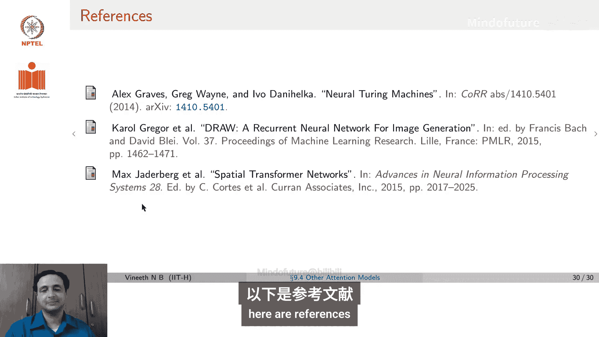

# 【NPTEL】计算机视觉的深度学习 p59 P59_其他注意力模型 -BV1vNWkzpEua_p59-

Moving on from。Visual Q& A and visual dialogue。We will now look at how attention has been modeled and used in various different ways。

In particular， we look at three specific models。Neural tuuring machines。

Draw which stands for deep recurrent attentive writer and special Transers。

Each of these have had a significant impact on the field of deep learning and computer vision。

 and they either use or implement attention in very different ways。Let's see each of them。

 this lecture。Let's start with neural cururing machines。Neural tuuring machines as the name states。

Deote a class of neural networks that are intended to perform tasks analogous to a curing machine。

Just like a tuuring machine， an NTM or a neural tuuring machine has a memory and rewrite operations to access to and from memory to perform subsequent tasks。

However， unlike a tuuring machine， you need to have fixed memory to be able to treat this as a neural network and learn operations。

😊，So here is a high level visualization of a neural tuuring machine where you have a controller。

 you have a memory。And the controller this accesses the memory using read and write heads to read from and write into the memory。

So， the controller is a neural network， certain layers which executes operations on memory。

Read and write and the memory by itself is an r cross C matrix with r rows each of C dimensions。Now。

 let's ask a question。Like a tuuring machine， if we do rewrite operations on an NTM by specifying a row and a column index。

 let's say we want to read the third row and the 10th column。

Can we train such an NTM end to end using back propagation？The answer is， unfortunately， no。

Because you cannot take the gradient of an index since it would be a hard choice similar to hard attention。

Just like how instead of a matrix you had a feature map and let's assume that in a CNN you wanted to focus only on one patch in a particular feature map。

And that patch could be decided differently for different inputs and only that should be processed through the rest of the network that would be equivalent to hard attention where you are focusing only on one part and that cannot be back propagated through。

Instead。What can we do。Very similar to what we talked about as soft attention。

You could now assume that you have a soft weighting function over different parts of a matrix in an image it was called soft attention here we are looking at the memory matrix which is R cross C and we have a soft attention over。

All the locations in the memory which can be used to read and write from the memory。So。

 this makes the neural tuuring machine into en trainable using back propagation and gradient descent so we use a very similar idea as soft attention。

Now let us look at these components in more detail。

 so you have a memory matrix at time T given as empty which has our rows and C columns as we already saw。

The normalized attention vector， which is used to read from memory is given by a set of weights W T of I。

And the weights add up to one and each of those weights lie between0 and 1。

And the read head is a sum of the matrix rows weighted by the attention vector。

So if each row of the memory was empty of I I throw of the memory at time T。

Then you have a corresponding weight for each row in the memory given by an attention mechanism。

And awaited sum of all your memory rows becomes what the read head gets from memory。Similarly。

 for writing。A part of memory at time t minus1 is erased using an eras vector so if you have an eras vector  E01 minus the eras vector is what is retained so if you had mt minus1 which is the memory at t minus1 into 1 minus wt of y which are the weights into the arrays vector  E0 would give you the memory at the new time step and now you add a weighted combination of any external input lets call that input and add vector 80。

You have a weighted combination of that add vector。

 which is added to the memory and that particular eh row。How do you obtain this attention vector WT？

So to do that， N Tms use。Both what is known as。Content based addressing and location based addressing similar to how you do it in a computer。

What does this mean in terms of learning a neural network？

Each head be the right head or the red head has a key vector kt at time step t。

Which is compared with each row in the memory matrix empty。How is it compared？

So you take the vector kt， the key kt， take the cosine distance between kt and the I row of the matrix empty so that gives you how similar that key is with respect to one specific location in your memory so this is like content base addressing where you are trying to compare the content that you have with the content in one particular row in the memory。

And the final attention is obtained similar to a softm over the alignment of the current key vector with every row divided with a particular row divided by the sum of the alignment with all rows。

You do have a constant beta T here， which is you could consider a weighting factor or also what the neural tuuring machines work calls key strength which decides how concentrated the content vector weight vector should be you could consider that a scaling factor at this time。

This is the first step which is largely content based addressing。Now。

 once you finish the content based addressing， you combine this with the attention vector in the previous time step。

So， your final attention now is given by your current attention。

Into the previous attention w t minus1 the previous time step。

 so you interpolate those two using some scalar parameter Gt。

And that is what you get as the attention vector that you are going to use in this time step。

Are we done no， we still have the location based addressing to do to address this。

NTms perform a circular convolution of the resultant vector with a kernel so if you have an attention vector wT。

 remember which is a vector over all possible memory rows。Now， you perform a。

A convolution operation with a kernel Ste this is done in case you have to swap say locations in memory based on this content。

 so this is a kernel that would be decided based on what the controller needs to achieve。So。

 if locations of different content have moved for some reason。

 those kinds of changes can be addressed by convolving this attention vector with a suitable kernel to get the final attention vector。

And this attention vector or distribution is then sharpened using a scalar by raising each attention value to a particular gammay value to get a sharpened attention vector。

 so sharpened here would mean that the value increases for a high attention scalar value for in a particular position and decreases for another attention value for a particular row where the original value may have been low。

One can summarize all these steps as you have the attention vector from the previous time step wt minus1。

 you have the memory matrix at time T empty。And you have your controller outputs， Katie。

 that is your key。Bta T， thats your key strength。GT that is a scalar to control the interpolation between the previous step attention and the step attention。

 similarly ST and gaATti， which is to sharpen。So you have you first perform content addressing。

Then you perform interpolation between your current attention weights and your previous time steps attention weights。

Then you perform a convolutional shift with respect to a kernel。

 this addresses location based issues that the controller may want to achieve。And finally。

 a sharpening of the weights to decide which part of the memory to to be attending to at a particular time step。

So， that is the working of the neural tuuring machine as you saw a different use of what we saw as attention。

Now we will move on to the second method that we said well talk about in this lecture which is known as draw or deep recurrent attentive writer this work was published in 2015。

And this work is based on the intuition that when humans generate images。

s as say drawings and sketches， humans learn to draw in a sequential manner one first draws the outlines。

 then keeps adding details iteratively。Draw is uses what is known as a variational auto encodecor。

It is a variant of an auto encoder that is used for generative models to generate images。

Which we will see very soon in the coming weeks lectures。

 it uses a VA to mimic this kind of an approach to generate images。

Why are we talking about this here？Although we have not covered generative models yet。

It uses a unique attention mechanism which may be of interest in this lecture。

So here is an example of how the draw method actually works an image is generated sequentially。

Instead of being generated at once， what you see here are。

10 different generations where each row is a generation of an image done iteratively so in the initial steps so if you look at the last row here in the initial step you have a blank canvas。

The model then attends to a particular region which is given by this red block here。

Then it draws something in that block， then the canvas gets updated。

 the model focuses on another block， draws something there。Then in the next time step。

 the model focuses on a third area of an image， draw something there。

 and iteratively over time the model ends up generating this particular image at the end。Clearly。

 this is an MNist image， this is a model trained on the MNIS image dataset set。

As we already mentioned。Daw uses a variational autoencoder， which is a variant of an auto encoder。

 which we will see soon。This auto encoder has encoders and decoders。Both of which are orinants。

An attention mechanism is used to focus on specific parts to generate parts of an image iteratively。

Let's see each of these components in more detail。So， the encoder and decoder are RnN。

 which means your overall architecture diagram is going to be like an autoencoder。

 which is one column of this diagram here。So， you have an x input， you have a read module。

 which is an attention module， then you have an encoder Rnn。

Then you have an intermediate step which you can ignore now。

 we will talk about this in more detail when we go to variational auto encoders。

Then from that intermediate layer。You then go to the decoder Rnn。

And then you finally have a right head that writes onto a canvas to generate some content。

And both the encoder and the decoders are RNNs， which means they share weights and you have that particular block repeated over multiple time steps。

So， the image now is drawn on a canvas matrix C， which is what you see on top here in T time steps。

And draw has both read and write heads， you could say it' is inspired by NTMs to focus on specific parts of the image for reading as well as writing。

So the encoder RnM takes four inputs。The input image X。A residual image x hat。

 we will see what X hat is is in a moment。The encoder hidden state in the previous time step。

The decoder hidden state at the previous time step。

 you can see that the decoder hidden state at the previous time step is passed。😊。

To the encoder in the next time step。So notationally speaking。

X hat is given by x minus sigma of ct minus1 ct minus1 is the canvas that has been drawn at time step t minus1。

Sigmoid of that。Gives you values between0 and1。X minus that gives us x hat。

 which is the portion of the image which the canvas so far has not focused on so we are looking at the residual image。

 which is what we call as x hat。Rt is the output of the read module， which takes in xt。

X hat and H t minus1 from the decoder， the hidden state at time step t minus1 from the decoder。

Using these， it decides which part of the image to read at this time step。

And Ht of encoder is an RnN that receives the hidden state from the previous time step Ht minus 1。

It receives the output of the read module R and as we just mentioned it also receives the hidden state in the previous time step from the decode。

So， here sigma is a sigmoid function and when we write something in square brackets we mean a concatenation of those values。

So。When you for the decoder， when you use the decoder。

 you have a sampling step here which we will talk about when we come to various lot of encoders。

 so you sample a certain vector which is passed to the decoder RNN and the decoder RNN uses the hidden state of the decoder at the previous time step。

And the sample that came from for now what we will call as the bottleneck layer of this variational auto encoder。

And the canvas finally at time step T is updated as the canvas at the previous time step plus the output of the right module at that particular time step。

This is the overall functioning of the draw framework。

Now let us try to understand how the read and write modules work here which are our attention mechanism in this particular framework。

So， the goal of the read and write modules are to focus on specific parts of an image。

The way draw goes about this is because we cannot focus just on one region。

 then you would end up having a problem because you cannot differentiate through that one region which could change for every input so you have to somehow distribute the weights across the full image。

So， this is done in two steps in the draw framework。1。

It predicts certain filter parameters that we talk about。And using those filter parameters。

 it places Gaussians over a grid of locations in the image whose coordinates are also learned and that becomes your attention mechanism to explain this image。

Given a particular image， the attention mechanism has to focus on a certain region。

 This region is given by a grid of locations and。The center of that grid。

 which is given by Gx and Gy， is learnt as well as delta。

 which is the stride between different points in that grid is also learnt。So。

 by deciding a three cross  three grid。And learning a Gx， GY and Dlta。

 the grid is completely specified。We still have some more details to add but at this time the grid is specified。

 you can see here that if you had the grid at a particular location in the image you see that it focuses on a certain part and as the grid locations are moved the model focuses on a different part of the image。

So， what are。What are these grid locations and what is done to get the attention so at each of these grid locations lets say it is 3 cross 3 or n cross n in general a Gaussian filter is placed at each of these grid locations。

So， if you have a Gaussian filter， you have to specify a variance for that Gaussian。

So in addition to the grid center coordinates GxGY。And the stride delta。

The model also learns the variance of the Gaussian sigma square。

 which is going to be placed at each of these grid locations。And also an intensity value gamma。

Which we will see。Very soon on how it's used， how it's used。

How do you learn all of these parameters these are all learnt as part of the read or write module so in case of the decoder or the right module given the hidden state of the decoder at a particular time step you have a set of weights which outputs all of these values that we want Gx GY。

 sigma square delta and gamma。Why is it delta tilde Gx tilde and gy tilde we will see that very soon just it only to get。

Go from absolute locations to relative locations。Well see that now。So， given a Gx hat and a Gy hat。

 which is the center of this grid。Which could be a value lying between0 and 1 if we want to translate this to a particular position on the image。

let's assume the image is an A across B input image。

Then Gx would be given by a plus 1 by 2 into g tilde x plus 1 and gy will be given by b plus 1 by 2 into gy tilde plus 1。

We are converting the predicted values Gx tilde and Gy tilde into specific positions on an a across B image given by Gx and GY。

Similarly。Delta tilde could be the stride。In the in the same dimensions that you are looking at for G tilde now you are converting that to a stride on a given a cross B image by saying that delta is equal to max of aB minus1 divided by n minus1 into delta tlde n are the number of grid locations that you have as we said a3 cross3 grid or a 5 cross35 cross 5 grids on and so forth。

 what you see in the figure here is a 3 cross 3 grid attention map in that case n would be 3。

So you are considering the max of a B if a and B were 100 cross 80 for instance。

 if that was your side size of the image， this would be 100 minus1，99 by。3 minus1。

2 so you would get you would be multiplying delta tilde by a factor 49 to be able to separate out the act。

The grid by the stride that is required for that image and get a delta。Now， to find out。

The grid point locations of this say3 cross 3 grid。

 you have the final equations here which are given by。M X I and muxj。

 which gives us the location for the IJth coordinate of that three cross 3 grid。

 so let's say the one cross 1 the one cross 2 the one cross 3， so on and so forth。

IsSo the mu X I is given by Gx plus i minus n by 2 minus 0。5 into delta。Similarly。

 muxj is gy plus j minus n by 2 minus。5 delta these would give you the locations if Gx gy was the location of a particular of the center of the grid let's assume that that was at 50 comma 40 for instance then I minus n by 2 would give you so if you're looking at the first location n by 2 would be 3 by2 so that would be minus0。

5 minus。5 that would get a minus1 and you would say Gx minus1 delta and if delta was 10 pixels then you would go 10 times to the left 10 pixels to the left similarly for j you would get 10 pixels to the top and that would give you the top left location of the grid point and so on and so forth。

What do you do once you have these grid locations， as we said at each of these grid locations。

 you place a Gaussian filter。😊，Given by variance sigma square fx and fy denote those Gaussian filters here。

 so the Gaussian filter placed at a specific grid location which could be at a particular part of the image gives you different portions of the image。

So， what you see here are。The bottom most and the second from bottom。

Are perhaps positioned at the same central grid location。

 but they have different Gaussian variances which you can see in the output of the attended region。

And on top the center grid location and perhaps the delta is small。

 so you are focusing on a narrower location with its own variances for the Gaussian。

To complete this discussion， the read function is finally implemented as a concatenation of a Gaussian filtered input image。

And the residual image。So， you have x， you have x hat， which is your residual image。

 then fy and fx are your Gaussian filters so you cancatennate them。You apply gamma。

 which was an intensity factor， if you recall， so you can now vary the intensity and that gamma is also learned。

Why do we have the intensity factor you could assume that when you draw you may initially draw a light shade and then make it darker so in a specific time step gamma controls how much intensity that you want to put into generating that part of the image。

In this case read but gamma is also used for the right。

 even in read you can read only a certain intensity of a part of the image。

And the right operation follows a complement。Where the right operation is given by1 by gamma into Fy transpose WT Fx transpose。

So you can see here that for the right patch the order of the transposition is reversed here you have Fyx fx transpose here you have Fy transpose w into fx transpose。

So， the order of the trans transposition is reversed to maintain the dimensions and also to maintain complementarity。

 but otherwise the attention mechanism is implemented in a very similar manner for the read and the write。

And to recall once you have this attention mechanism at each time step。

 so each of these rows are different generations。So at each time step。

The grid location and the Gasians tell you the grid locations。

 the stride and the Gaussians tell you which region in the image you are focusing on and。😊。

In each time step the region that you are focusing on can actually change in this case what you are seeing here is the the output of the right head and you can see that you are seeing different regions and in each region of the canvas you are drawing something which is。

Obtained as the output of the decoder and you repeat this over time steps to get your final generated image。

The third method that you are going to talk about in this lecture is known as spatial transformer networks。

Which is， again， a very different approach。To use attention， and。

Benefit from the value attention brings to CNNs。So， the broad idea here is that CNNns on their own。

Can lack spatial invariance。So， if a certain object was rotated in different ways。

 was located at different corners， it may not really work in practice。To a certain extent。

 max pooling operations help。But they only help with variations or invaris within a small neighborhood。

 especially in deeper parts of the networks。😊，Sppatial transformers are a set of are comprises is a module。

That is fully differentiable and hence can be inserted in any CNN to bring a certain attention module to solve a particular problem。

Let's see special transformers in more detail。So here is an example of how spatial transformer networks work。

So， in the first column you have three different images as you can see in the first image7 is slightly modified from how a 7 would look like in an N data set。

Similarly， a phi is reduced in size and rotated a little bit。😊。

And a 6 is moved from the central patch and there are a few noise patches that are included to confuse a model that may want to look at this and classify it as digit6。

😊，What spatial transformer does is shown in column B。

Its job is to find out which part of the image to focus on that's where in a sense the attention mechanism comes in so you can see here that in the top image it focuses on this part which is the7 similarly in the middle image it focuses on5 but the rotated box shows the orientation in which the model needs to look at the content and similarly for the third image which is6。

In column C， spatial transformer applies this transformation and converts this this original image。

To an untransformed uncorrupted version where you can find each digit to occupy the full image and be centered。

And with the kind of images that you get in column C。😊，In column D。

 we show how a CNN can now give good classification performance if you attend to the specific part of the image rather than be confused with the full image which could have other artifactacts。

The spatial transformer network architecture。Consists of three modules。A location network。

 a localization network， a grid generator。And a sampler。As you can see here。

The spatial transformer network module is something that you can insert between any two convolutional layers in a CNN。

So if this was con 4。You could insert a special transformer module in between con 4 and con 5。

What do you expect to happen？If this was an image where the6 was rotated。

 taken to a corner there were other noisy artifacts in the image。

We expect the spatial transformer to focus on only the region6 and pass it on to the next step we for further processing。

Why is this challenging， Why is this required？Remember now that in a sense we are doing hard attention。

We are now trying to focus on a specific part in the image。Which could vary for each input。

How do we manage to do this in a differentiable manner？

Is the core contribution of the spatial transformer networks。

The three modules are localization network， grid generator and a sampler。So。

 the idea is to take an input feature map U and transform it into an output feature map view。

 which can then be given for further processing such as to perform classification。So。

 lets see each of these modules which are differentiably which are differentiable and designed in a way to be differentiable so that they can be included in any CNN。

😊，The localization network。Takes an input feature map。 U， which let's assume is。

Of dimension h cross W cross C， and it outputs。A set of parameters theta。

 which we are going to say are the parameters of the transformation。What does this mean？

A localization network could have multiple hidden layers。

 but the output layer of the localization network。😊，Contains the number of。

Transformation transformation parameters that may be required to model the problem。For example。

 if we wanted spatial transformer networks to deal with only a fine transformations。

Then you would have to output six different values that would be the localization network。

The next step in the pipeline as we saw was a grid generator and the final step was a sampler。So。

 in the grid generator。We want to now take the transformation values and find out the actual grid。

So if we assume that the output v has dimensions H prime cross w prime cross C。

For a particular point， XIS， YIS in the input grid。

And a point X I YI in the output grid the transformation would be given by XIS YIS would be given by an a transformation of the point X I YI。

Remember， a fine can include rotation， scaling and translation for the moment。

So now we have an equivalence between the coordinates in the output feature map V and the coordinates in the input feature map U。

So then now the next step is to find out how do you actually sample the points in U in a differentiable manner？

Before we go there， let us see an example of the grid generator。So here you see。

That in figure a here you have an identity transformation where you have an original image and the transformation learned retains the same positions for every pixel from U to B。

And here is another example B where U has a rotated9 and we learns a transformation that takes a particular set of pixels in you and maps them。

To all four corners of we。Now we need to find out how do you sample these pixels which would form the output pixels inside V。

 so you can see that in this case。😊，A distorted9 has got transformed to a canonical9 which a CNN is aware of and can classify。

This leads us to the final and important step sampler which draws this equivalence between v and U。

 how do we do this？VIC denotes the target feature value at the8h location in channel C。

UNMC denotes the input feature value at location Nm in channel C。

 and then you have iterators that go to H and W， which are the entire dimensions for each channel in U。

And then you have a sampling kernel， which。Which tells you at which location XIS and X and YIS you need to sample to get a particular output in the output feature map。

V。So， what kind of a kernel do we can we use one example that you can use is a bilinear sampling kernel which states that the kernel k can be given by max of 0 comma 1 minus XIS minus M。

 similarly max of 0 comma 1 minus YIS minus n。What does this do if you observe carefully。

 let us assume that for a particular pixel location in V。

 the corresponding XIS and YIS given by the transformation was say 45 and 34 for some reason。

So 45 minus m is an iterator that would go from 1 to capital W and n is an iterator that would go from 1 to h so you can see here that if XIS was 45 and m was 50 for instance you would then have 51 minus5 would be minus4 the max would be 0 and you would not sample the value at 50。

So where would you sample？This would get activated only when m is equal to XIS。

 so you would only sample the pixel at XIS to get the corresponding location at VIC。So。

 this becomes a differentiable way of sampling and focusing on one specific region of view to get the subsequent feature map V。

How do you back propagate through such a kernel， we obviously know how to back propagate through rest of the operations。

 but how do you back propagate through such a sampling kernel？

It is not hard the max 0 of 1 minus X minus m is similar to many other operations that we have seen so far for differentiation。

 so do v by do u would simply be both these max terms themselves so that is what you would get because you would have a U here。

And do v by do XIS would similarly be UCNM and max into 01 minus YIS minus n。

 so this first term which depends on x goes away。And you would have that this term would become 0 if m minus XIS is greater than equal to 1。

 it will be1 if m is greater than XIS and minus1 if m is less than XIS。

That's how you can compute the partial derivative of this transformation。

And this completes each of the modules， the localization network。

 the grid generator and the sampler to be able to go to one specific part of the input image。

For to use that for further processing。Your homework readings for this lecture are once again the nice blog of Lillian Wang on attention。

A nice introduction and overview of Dr by Jonathan Hui and a nice review of spatial transformer networks by Sikhosang。

Here are references。

