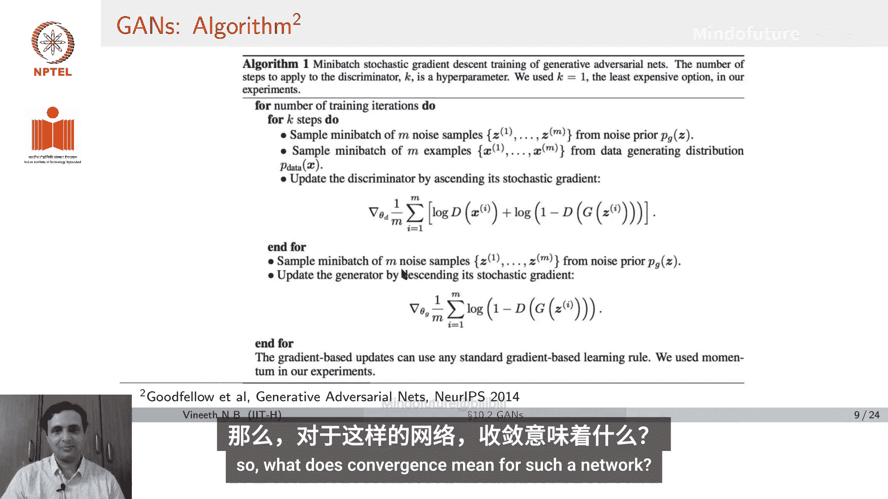

# 【NPTEL】计算机视觉的深度学习 p62 P62_生成对抗网络 - 第一部分 -BV1vNWkzpEua_p62-

We'll now talk about。The first kind of deep generator models。

Which are perhaps arguably the most popular deep generator model2。

 which is generative adversarial networks organs。The question that we left behind from the last lecture was why does using K divergence in finding the generative model simplify to maximum likelihood estimation？

If you recall the problem， the problem was。Theta star is argument over all thetas from a family of distributions m some distance function of P theta from PDd。

And if this distance is scale divergence， remember。😊。

The definition of scale divergence is if you had two probability distributions。

P and Q for simplicity。 this is given by P log。p byq that is the formal definition of kl divergence to we call so in this case you would have the kl divergence of pd and P theta so the first term pd does not depend on theta so it doesn't matter for our optimization so you are left with log pd by p theta which can be written out as log pd minus log p theta once again here log pd。

I the distribution of data and does not depend on theta so you are left with argument over theta expectation over all the data samples from your distribution PDd minus log p theta of x and this is maximum likelihood estimation or minimizing negative log likelihood。

So a fairly trivial thing to show， as we mentioned the last time。

Let's recap some of the concepts that we spoke about in the last lecture。

We said that generative models。Try to learn a probability density function P of x over a given set of images training data X。

And if you knew the distribution， if that was parameterized as a Gaussian。

 p of x assigns a positive number to each possible image depending on its probability of being generated by that distribution。

 it tells us how likely that image x is under that distribution p of x。

And we said that applications of generator models include sampling and generating new data likelihood estimation。

 which could help you in outlier detection because you have。

A certain distribution and you have a certain likelihood of a data point belonging to a distribution if that likelihood is very low。

😊，It's likely that the point was an outlier。Similarly， you can also do feature learning。

 which we will talk about more in this lecture。We also talked about last lecture on density estimation of the probability distribution from an implicit perspective and an explicit perspective。

 these also define the different approaches for deep generative models。

In explicit density estimation methods。You try to write an explicit function for the probability distribution。

 for example， you may say p of x is equal to f of x theta where f could be a Gaussian function in the case in which you assumed a Gaussian distribution for the density。

In this case， the input would be image X， the output p of x would be the likelihood value for image X。

 and the parameters would be the weights theta which defines that function that you assign for the density。

So， in this case， an explicit likelihood is assigned for each image。

And with explicit density estimation approaches。One thing that you will realize as you see different methods is they are very good at outlier detection。

For the same reason that we just said， so if a point likelihood of belonging to a distribution is very low。

 it is perhaps an outlier。But explicit density estimation approaches do struggle to generate images of very high quality sometimes can also be slow in generating images。

On the other hand。Implicit density estimation approaches。

Do not try to assign a functional form to P of x instead。They only aim to ensure that given a model。

 you can sample images from that model without worrying about an explicit likelihood assignment for each such sample。

 so that is not part of the model。And it happens that such methods end up providing avenues for better sample generation and faster sampling speed。

With that recall， recap， let's move on to the focus of this lecture。

 which is generative adversarial networks。These networks were developed in 2014 by Goodfell Eal。

The goal of Gs。Is to build a good sampler。That allows to draw high quality samples from P model of x where model P model of x。

Deines samples that are drawn from a model which is learned through this algorithm。

As we just mentioned， there is no explicit computation of a certain functional form for P of x。

The only objective we have is to ensure that whatever images we sample from the model。

The distribution of those samples which we call P model of x。

 remember we are not going to assign any likelihood value for P model of x。

 all we want to ensure that if you collected a set of samples from that model。

That distribution of samples should look similar to your original data distribution there is no likelihood assignment for each sample。

So we ideally want the output samples to be similar， but not exactly the same as your training data。

Why do we say that？Because if we have the same samples as training data， firstly。

The neural network is perhaps memorizing and not really learning much。Secondly。

 you perhaps then don't need such a model。You only need a model which can then generate diverse samples beyond what you already have。

So how do you achieve this goal？So， the key idea in generative adversarial networks organs is to introduce a latent variable z。

So， this is the latent variable with a simple prior， for example， a Gassian prior。

And once you sample from that random variable from that Gaussian。

You pass it through a module called a generator in our case a generator could be a neural network。

And you give an input to that generator neural network and the network outputs an image。So。

 this module is known to us from whatever we have seen so far。

 we have seen semantic segmentation methods where the output layer is the size of an image itself。

Similarly here also， the output of the generator would be the an image itself and that is what we define as the distribution coming out of the generator。

Let us call that X hat， those are the samples coming from PG Pg denotes the distribution of images generated by the generator G。

Now， what do we want？We want to ensure that if we had a distribution of training data given by P data。

We want to ensure that the distribution Pg must be close to P data。

Observe that we are not trying to assign a likelihood to every data point Xat or even X for that matter。

We want that distribution Pg to be close to the distribution P data。

The challenge on implementing this we are not imposing。

Any particular parameterization on PG or P data， so we have to find a way to find the equivalence or to ensure that Pg becomes close to P data without knowing what kind of distribution it is。

Remember here， the Gaussian is only an input vector；

 we are not assuming any Gaussian or any parameterization on your P data and PG distributions。So。

 how do we go about ensuring that PG is more or less close to P of data？To do this。

The originators of this particular method Good Fetal had an interesting idea。

 they introduced a classifier。Called a discriminator， which we denote as D in this lecture。

To differentiate between real samples and generated samples。So， if data came from P data。

 it would be given class 1。And if data came from the generated distribution that is exact coming from PG。

 then it would give a class 0 for that image。How does this benefit？

Our goal is to now train the generator。To ensure that the discriminator misclassifies the generated sample X into class 1。

And can no more differentiate between。The original distribution P data and the new distribution Pg。

So， the way we are going to equate Pg and P data is through this discriminator。

Which the generator will seek to confuse the job of the discriminator is to separate the fake or the generated samples by fake samples we mean the generated samples。

From the real samples。And the job of the generator is to fool the discriminator。So。

 you can also consider this like a cop and thief game where discriminator is like a cop that can separate real and fake。

And the job of the generator is to fool the discriminator。That's the overall idea。

How do you train such a generator or a discriminator？So the training objective for GNS is given by。

It is a min Max optimization problem， you minimize over G。

 which are the parameters of your generator network。You maximize over D。

 which are the parameters of your discriminator or the classifier network。

Expectation of data coming from the real distribution log of d of x Y is this correct？

We are saying that for points that come from your original training distribution。

 wed like the discriminator to maximize the log likelihood of those data points。

And the second part states。If you now take a sample from the Gaussian。And give that gossipian。

To your generator。G。And the output of the generator is given to the discriminator。😊。

We want to ensure that the output of that is 0， at least the discriminator must aim to make this value0。

And that would happen when this entire quantity is maximized but on the other hand。

The generator's job is to ensure that this last quantity goes to1 which would minimize this entire quantity and that's why you minimize over G and maximize over d。

This also is intuitive because generator and discriminator are playing a cop and thief game and each would like to outfit the other。

So， while the discriminator wants to maximize terms in the objective。

 the generator wants to minimize corresponding terms in the objective。So。

 such a Min Max problem is also known as a zero sum game。

 this has origins in game theory which we will not get into now。

And we assume that the discriminator has a sigmoid activation at its output layer remember the discriminator at least in this particular example that we are talking about is a binary classifier it only has to say real or fake。

😊，So， the best activation function that you can have in the output layer of a binary classifier is the sigmoid activation。

 we now assume that a discriminator has a sigmoid activation function in its output layer。

So lets try to parse this objective function a bit differently。If you look at the first term here。

If you look at this part of the term， lets write that and call it objective1。So。

 objective1 states that wed like to train the discriminator。Such that if sample belongs to P data。

 which is the true training data distribution。We maximize the log probability of it being a real sample。

And the second part is objective 2 which talks about minimizing the generator with respect to the second term。

 remember that the first term has does not have anything to do with G and hence in the minimization of G the first term does not matter and can be excluded。

So， while minimizing G， what are we looking for？We are looking to train the generator G such that if sample belongs to Pg。

 that is its output of the generator G。Wed like to maximize the log probability of it being a real sample；

 that is what the generator would like to do， although the discriminator would also like to maximize this quantity。

What do we mean by expectation in these two terms in practical implementation parlance。

 the expectation simply means that the losses are averaged over a batch of samples。

What does a batch of samples mean here， youll see that in a moment when we see the algorithm。

Now coming to the training strategy。So， the first thing that you can think of is now you have two networks to train D and G so far we have seen several other approaches where we have two networks to train。

We had detection with two heads， we talked about a Siamese network with two branches。

 we talked about a two stream CNN with two branches。But in all of those examples。😊。

Both branches were trained with the same loss or the same objective largely speaking we had examples like triplet loss where things slightly changed but otherwise it was the same loss you minimize the same quantity across the complete network to a large extent。

So what can we do here？One option is we can train D completely first。

 so we have a good discriminator。And that can be done by optimizing only the first part of the objective01。

And once we have that， we can train G to optimize O2。Does that work， does that have any problems？

Let's try to think this through。If D is initially very confident。

 which means you have trained an excellent discriminator or a classifier。

Then it would be able to say that any sample that comes from G is a fake。So。

 which means if you get an x that is obtained from G or corresponding to the distribution Pg。

 which is what the samples would correspond to。Then d of x or sigma of x。

 which is sigmoid activation function in D would be equal to 0。

Which means log of 1 minus d of g of x in this case would be log of 1 minus sigmoid of x would be equal to 0。

And if you see the graph of log 1 minus sigma of x and the gradient of log 1 minus sigma of x。

 when log 1 minus sigma of x is 0， obviously the gradient is also0。

 so which means you will get a0 gradient。Which means G will not get any gradients to train and will never learn。

So， training discriminator completely well in the beginning。😊。

Is not going to help us get a good generator。Which is the main objective of a ga。So what do we do？

We want to alternate between training the discriminator and training the generator using objectives01 and42 respectively。

Let's try to see how this is done in the algorithm for Gs。

So the original paper by Goodfellow recommends that we first sample so for case steps。

You first sample a mini batch of M noise samples from the noise prior Pg of Z。

 so remember we had a Gaussian from which we get a few vectors which we call noise samples。Similarly。

 we also sample a mini batch of M examples from the original data distribution P data。

 which is your training data。Now， remember your overall objective is log of d of x plus log of 1 minus d of G of Z。

And remember that the discriminator wants to maximize both of these， that's what we said so far。😊。

And a maximization problem is solved by gradient ascent。

 just like how a minimization problem is solved by gradient descent。

A maximization problem is solved by gradient ascent where in each iteration you go in the direction of the positive gradient。

 not the negative gradient the way you did with gradient descent。So。

 we update the discriminator by ascending its stochastic gradient which is obtained by taking this loss function and differentiating with respect to each weight in the discriminator network。

😊，And you do this for case steps so for case steps you update the discriminator it is not yet completely trained once you have done it for case steps now switch over and train the generator。

So you sample a mini batch of M noise samples from the noise prior。

Update the generator now by descending its to ingredient because for the generator we wanted to minimize over the second term in the objective。

 the first term in the objective anyway did not depend on G only the second term dependent so we now like to minimize log of 1 minus d of g of Z。

With respect to the parameters in the generator network G。

Now this is repeated over training iterations and this is used to finally design finally come up with a model for the generator。

At test time， what do you do？Once you have trained the full model。You can discard the discriminator。

 you take a sample from your Gaussian， send it through the generator network and the image that you get is what you are going to assume belongs to your original data distribution。

One point here is。What does it mean for such a network to converge？So far。

We spoke about whenever we had a loss function， we always wanted to minimize the loss function and wanted to ensure that the loss goes to  zero。

To avoid overfitting， we perhaps may not let it go to 0。

 but we at least wanted to see the loss reducing over iterations。😊。

However here we have two components where one is perhaps trying to increase the objective function value。

 the other is trying to reduce the objective function value。

So what does convergence mean for such a network？

Let's see that in more detail。