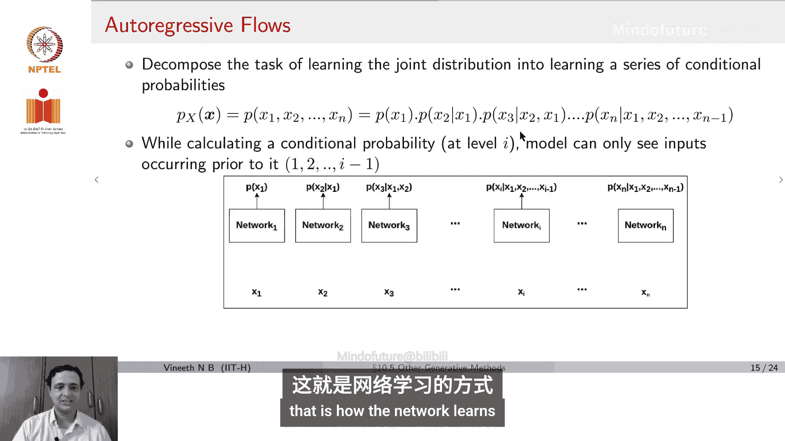

# 【NPTEL】计算机视觉的深度学习 p66 P66_超越VAE和GAN - 其他深度生成模型 - 01 -BV1vNWkzpEua_p66-

Although Vs and GNs are the most popular kinds of deep generative models。

There have been other methods that have also been successful over the last few years。

Let's see a few of them in the last lecture for this week。

These models are generally known broadly as flow base models。How do they differ from GNs and Vs？

There is a very important difference between them and Gs and VAs。

Both GNs and VAEs do not explicitly learn the probability density function of the real data。

In case of GNs， we already saw that the density estimation is implicit。

You don't explicitly assign a probability density function and try to estimate it in agan。

In case of VAEes， we get an approximate density estimation by optimizing your evidence lower bound using variational inference in both cases you don't get the exact density function。

😊，However， the exact PDF p of x of your real data may be useful for many tasks such as missing values。

 sampling data or even identifying bias in data distributions。

 knowing the density function could be handy for these kinds of tasks。So。

 the kind of methods that we will discuss in this lecture are methods that estimate the real density of the provided training data。

Broadly speaking， these can be categorized into two different kinds。

 normalizing flows and autoregressive methods or autoregressive flows。

Let's start with normalizing flows。Recall that in the first lecture for this week。

We tried to ask this question that if we had a data set of n data points。

Coming from an underlying distribution， P of x。We wanted to find a theta belonging to a family of distributions M。

In such a way that the distance between P Theta and Pd is minimized by that choice of parameterization in M。

And we also noted at that time that if the distance here was replaced by k divergence。

 this turns out to become a maximum likelihood estimation problem or by minimizing the negative log likelihood。

Why is this important？All methods that we covered so far while training neural networks can be looked at as a way of minimizing negative log likelihood。

Being a weather be it training a neural network using mean squared error。

Or with whether training a neural network or an LSTM using cross entropy loss for a classification problem。

One can show that both of these。Finally amount to minimizing the negative log likelihood。

So we are now saying that we could use a similar approach， even in an unsupervised learning setting。

Where do we go from here？So what Fbo models try to do here is。If you could look at G as。

AA discriminator and a generator where the discriminator。

I the one that distinguishes between real and fake data and the generator takes you from a latent to a generated image X prime which is then provided as input to the discriminator along with the real data X Similarlyly VAE is an encoder decoder model。

Where the encoder。Captures the approximate posterior Q parameterized by parameters 5。

 which are the weights of the encodeder， Similarlyly the decoder captures P theta of x given Z。

 which is where theta are the parameters of the decoder。So in this case。

 it's an approximate density estimation， as we just mentioned。😊，And in flow based generative models。

 we do what should have been obvious to do， which is but not very simple。

 which is given x find the function F。To get us a latent representation。Which， if we invert。

We get back X prime or the reconstruction。So the challenge here is how do you find these functions F。

 which are exactly invertible to get back your original data？Clearly， that's the challenge。

So in the first class of methods。In normalizing flows。The main goal here。

Is to identify a transformation F。Which takes you from Z to x。

If you recall Z is once again the latent very similar to VA。

 the main difference between VA and flow base models is in VA。😊。

The encoder captures an approximate posterior with a different parameterization。

 and the decoder captures P theta itself。So， we know that。

Q phi is an approximation of the true posterior P theta of Z given x， whereas in flow base models。

 the functions are an exact inverse。So here we identify a transformation F that goes from Z to x where the transformation F。

Is a series of differentiable byjective functions， F1 to Fk。

In such a way that x can be written as f of z。Which in turn can be written as F sub K composition。

 F sub k minus1 composition so on and so forth until F1 of Z。

And conversely z can be written as f inverse of x， which in turn can be written as f inverse composition f2 inverse so on and so forth till the final composition fk inverse of x。

Diagrammatically， given a latent variable z which could be a Gasian very similar to GNs。

You pass this vector input vector that is sampled from Z。

Through a neural network f1 at this point we will just call it a function which outputs Z1 which goes through F2 and so on and so forth till fk。

 which we finally expect to output the original data distribution that x comes from。

Let's see this in more detail。Before going to the implementation。

For any invertible function F from z to x。Using change of variables of probability density functions we can write。

P x of x is P of Z。 P Z of Z。Into the determinant of do f inverse of x by do x。喂？

It's not difficult to show it。If z belongs to a distribution pi of z is a random variable and x is equal to f of z such that f is invertible。

 so z would be given as f inverse of x then。From definition of the probability distribution， we have。

Integral。P of X D X， which would be1。Would also be integral pi of Z D z， both of them would be1。

So from this equality， we can say that p of x can be given as。Pi of said。In2。

The gradient of dz by dx， the absolute value。But we already know that z is f inverse of x。

 so we are going to put that here， we would have pi of f inverse of x。Into。

The gradient of fnverse of x by dx， which we are writing it as pi of fnverse of x into fnverse prime x where prime here stands for the gradient。

In vector form， this would be。P of x is equaled to pi of Z into determinant of D z by Dx or pi of f inverse x into determinant。

D F 1， D F inverse by D X， which is what we wrote here in the first place。

 If we took the same expression here。And if we expanded it and applied log on both sides。

 we would then get。Log p of x， which is the log likelihood of the density that we are looking for px of x would now become the log likelihood of Z。

Plus， summation going from I to 1 to k log determinant of do F inverse by do Z I。

How did this come this came by substituting f with a composition of functions F1 through F capital K。

So that composition while taking log becomes a summation。That's how we got this expression here。So。

 the intuition of these two terms。InIn estimating the log likelihood of the probability density function is。

The first term here。Can be looked at as the transformation molds the density P of x into px of x。

 that is what it would like to do。And the second term here quantifies the relative change of volume of a small neighborhood。

😊，These said around the。Remember that is what gradient measures。

 that is what determinant would also measure determinant you can look at as capturing the volume of the space that you are trying to measure。

Here is an illustration to understand how normalizing flows work。

Assuming that you sample from a Gassian initially which is Z n， you apply a function F1 get Z1。

 then you would apply another function so on and so forth till you get z I minus1 Z I and finally you keep applying many functions until you get Z k when the probability density function transforms this way which is the density function of x that we are looking for。

Why did we say we want a differentiable byjective function。

 why should each of the f's be a differentiable byjective function。

 it should be fairly straightforward， we already saw how the inverse was being used but lets define it more formally。

Such a bijective function the way we are using it。Is called a difumorphism。

Diffmorphic functions are composable。Which means。Given to transformations， F1 and F 2。

The composition is also invertible and differentiable。

Which is very important when we are working with neural networks。So。

 any complex transformation from a Gasian to a complex probability density function of the real world data。

Can be modeled by composing multiple instances of simple transformations。

So what do we need for normalizing flows？We want the transformation function， each of them。

To be differentiable。So that should give us the answer if each of those functions that take you from Z to x is a layer of a neural network or an LSTM or a set of layers of a neural network。

They are differentiable， and we have met the first prerequisite。

The second is that the function must be easily invertible。😊，How do we do this。

 We will see in a moment。And the last is the determinant of the Jacobian should be easy to compute why。

 because that is one of the terms in your loss function and you want that to be easy to compute so that you can train the entire network using gradient descent。

Let's see one of the earliest efforts in implementing normalizing flows。

This is known as nice non linear independent components estimation。

 This work was published in 2015 by Lauren De Mial。

The idea here is to introduce what are known as reversible。Coupling layers。

Let's see what those transformations are。So the coupling layer operation used was。

Y1 was the same as x1， so if you add x1 x1 s x2 are the different dimensions of the data x y 1 y 2。

 so on and so forth are the different dimensions of what you are trying to generate。

 which is which you would like to match。X in in the principle。So y1 is equal to x1。

Y 2 is given by some function G of。X2 and M of x1。So you can see here pictorially y 2 is given by。

G function G， which is applied on x2 as well as M of x1。Note that in this particular formulation。

Y1 does not depend on x2， but y2 depends on x1。In this case。

 it is clear that the Jacobian will be a lower triangular matrix。Why do you say so？

Because y1 does not depend on x2。So all these upper triangular elements of the Jacobian matrix would become zeros。

 let's take a moment to recall what a Jacobian matrix is。😊，A Jacobian matrix。😊。

Is the matrix of all partial derivatives so if you had an output vector y which contains y1 to yk and if you had an input vector x which was x1 to xd。

All the pairwise gradients， do y 1 by do x1 do y 2 by do x 1 do y 3 by do x1 so on and so forth till do Y K by do x 1。

 And similarly， do y1 by do x 2， do y 1 by do x 3， so on and so forth will form the raw rows and the columns of the Jacobian matrix。

 So it's a matrix of。😊，First， partial derivatives between a vector and a vector。So。

 in this case you can see that all the upper triangular elements because of the construction of the operation y2 would would depend on x1。

 but y1 would not depend on x2， x3 or anything till xd。😊，Similarly， y2 would depend on x1 and x2。

 but not on x3 to x d。Which means all those upper triangle elements here would become0。

 you will be left with a lower triangular matrix and the determinant of a lower triangular matrix is simply the product of the diagonal elements so the determinant becomes easy to compute in this construction。

😊，What would the inverse mappings be？The inverse mappings would be x1 would be y1， of course。

X2 would be geneverse of y2 and M of y1。That would be the inverse operation in this particular case。

In case you would like all data to be considered， so in the previous construction。😊。

We consider that y 2 can depend on x1， but y1 cannot depend on x2。If we instead want all the output。

 all the elements of the output to depend on all the elements of the input， it can be done。

 but you may have to flip the inputs after each layer。 so that way in the next iteration。

 next function， remember its a series of。Layers or composition of functions。

You can have y1 depend on x2 and you can continue this process to ensure that all the output variables depend on all the input variables so you can now write this as additive coupling operations also。

In additive coupling operations， you can say that y1 is equal to x1。

And y 2 is equal 2 x2 plus m of x1。So， in this particular case， it is not a function。

 but you just have y2 is equal to x2 plus m of x1 the inverse operation here would be x1 would be y1 itself。

X2 would be y2 minus m of y1 in such a construction in an additive coupling layer。

In the previous case， you had a G function here， but in the additive coupling layer。

 the Jacobian determinant will always be1。😊，Why do you say so？

You can look at these two equations and give the answer because its additive coupling。😊。

You would have do y1 pi do x1 will be 1。D y2 by do x2 will also be 1。

Because the second term here is additive and dot does not depend on x2。So。

 all those diagonal elements of your Jacobin， what are the diagonal elements of your Jacobin in your Jacobian matrix？

😊，You would have do y 1 by do x1， do y 2 by do x2 so on and so forth till do y k by for the moment。

 let's say do xk assuming both are the same dimensions。All these values。

 if you look at these equations。😊，Will be one。Product of the diagonal elements will be 1 the Jacobbian determinant will be one this is called a volume preserving operation。

Remember we said。The determinant Jacobian determinant is an estimate of how much the volume changes for example。

 if you have a random variable x which has a certain density。

 say between 0 and 1 in this case a uniform density。If you had another random variable。Same Z。

Which has。Goes from， say，0 to 3。If its volume was like this。

 then you can see that the gradient would give you an answer to be 3 so for every one unit that you move in x you will move three units in Z。

😊，So， this tells you that the volume between x and the P of Z triples。

And the determinant of the gradient do it by dox also gives you that answer 3。

 which in a sense intuitively tells you how much is the volume changing in the new PDF。So。

 when the Jacobian determinant is always one as in when you have an additive coupling layer。

 it is a volume preserving operation。So， in this case the log likelihood becomes very simple；

 you simply have the determinant of Jacobian term is always1 so that term would disappear and you would have the log likelihood of px be the log likelihood of y itself。

😊，An improvement over Nice was。Another normalizing flow method， a popular one known as real NVP。

 real valued nonvol preserving normalizing flow as the name states it is nonvole preserving。

 so we definitely have to do something beyond additive coupling。What do we do？

We do we have an a coupling operation。What does the a coupling operation do we say y1 is equal to x1 and y2 is equal to x2 in 2 This is the Hadamard product which says it's an element vice product so x2 is a vector and the second term here is also a vector and it's an elementwise product into xonent of s of x1 plus p of x1 so there is a translation component and there is a scale component which together becomes an a fine transformation the Jacobian of such a transformation would be it would still be a low triangular matrix because y1 does not depend on x2 x3 so on and so forth similar y2 does not depend on x3 x4 and so forth So the Jacobian will have the upper triangular entries to be0。

And you would then have in the lower triangle entries do y 2 by do x 1 and the diagonal entry in this case would be di。

Of exponent of s of x1 because that is what the differentiation of do y2 with respect to x2 will be。

In this case the Jacobcobin need not be one and hence the transformation may not be volume preserving which perhaps is more likely in real world data。

 for example if we gave Z the random variable that be considered for normalizing flow to be a unit Gaussian expecting that any real world data distribution will also have the same volume as that unit Gaussian may not be a very correct assumption。

 so in that sense real NVP is more realistic。The inverse operation， what would it be here？

X 1 would be y1 equality x2 would be y2 minus t of y1 into exponent of minus S of y 1。

 Remember this exponential function。 When you go the other side。

 it becomes an inverse exponential function。 and that's what this term denotes。Figuratively speaking。

 this is how a real NVP a fine coupling would look like so you have your x1 x2 y2 depends on x1 and x2 y1 depends only on x1。

 how does y2 depend on x1 and x2 a translation and a scale component。The inverse as you can see here。

 would look something like this where x2 would depend on a scale component from y1 and a translation component in addition to contribute from y2 So however all of these network trained。

 So the rest of it should work like any other neural network。

 So it's about maximizing the likelihood you can use standard error functions like means where cross entropy will learn the networks depending on what you're trying to reconstruct whats the output of each of these networks and each layer corresponds to one of these functions that you're trying to model for example。

 y1 is equal to x1 would be one of the layers of the neural network。

 the second layer would be this where the scale and the translation are learned by the neural network so on and so forth。

 That's how the network learns。

