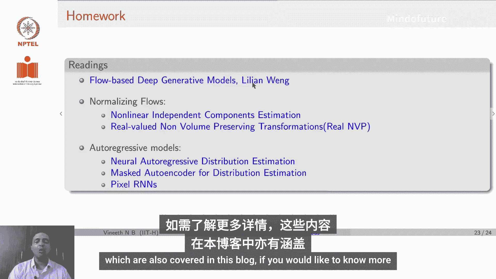

# 【NPTEL】计算机视觉的深度学习 p67 P67_超越VAE和GAN - 其他深度生成模型 - 02 -BV1vNWkzpEua_p67-

A second kind of deep generator models that we will discuss in this lecture are auto regressive flows。

Autoregressive flows。Come as their name suggests from auto regressiongress。

 autoregressive models are used in time series data in standard machine learning to look at the past n steps of a time series data and predict the next value for example if you looked at the stock price for the last 10 days can you predict the stock price on the 11th day。

Can be。Solved by using auto regressive models， such as。Arma， Arima， Narima， so on and so forth。

 these are popular time series models for this scenario。

What we are talking about here is an extension of that thought process。

 however now we want to generate data and not just predict an outcome once again this is a transition from supervised learning to unsupervised learning。

So let's see how to use auto regression for generation。So。

 we decompose the task of trying to find the PDF of the real world data as p of x1 to xn。

 which is the probability density function of the real data given to us。Is written as。

P of x1 into conditional p of x2 given x1 and so on and so forth till p of x n into x1 x2 till x n minus1。

 So while calculating a conditional probability at certain level。

 the model can only see inputs occurring prior to it。Let us see how this would work。

 so if you had x1 to xn as different dimensions of an input。

X1 is used as input to a second network x2 which can predict the probability of x2 given x1。

 remember that probability depending on the values then x2 x2 can take。Can be learnt using。

A mean square error or cross entropy or any other loss that we've seen so far。

X1 and x2 contribute to the third network to learn the probability of x3 given x1 x2。

So on and so forth。For a later X I given X1 to X -1 and finally xn given x1 to xn -1。

 so you could consider that autoregressive flows are a special case of normalizing flows where each intermediate transformation masks certain inputs you are not going to look at all inputs in every step。

But in each， if you assume that network1 through network n were different functions。

Similar to normal normalizable flows， normalizing flows and each of these networks looks at only a certain part of the input and not the complete input。

 you could look at it that way， although that's not exactly the way it's implemented。

 So one of the popular methods for autoregressive models is called ND。

ND stands for neural Autoregressive distribution estimationation。

Here is how N works you have inputs x1 to xN and dimensions of every input vector。Similarly。

 you have p of x1 p of x2 given all the random variables x less than 2 p of x3 given all the random variables x less than 3 so on and so forth will p of x n given all the random variables P of x less than or equal to n so we are trying to understand the probability density function of the real world data which is a product of all of these So what we do is。

Provide all of these inputs to a shared neural network can have as many layers as you choose to。

That the output of that neural network is then passed on to a layer of hidden representations which are obtained over masked inputs that is H n which is one of the nodes here。

 depends on all the x's which is less than n。So here is how it's done。 So x1 would。

Will only be considered to get H2。X1 and x2 would be considered to get h 3。X1， x2。

 x3 and so on and so forth， all the weight x n minus 1 will be considered to get a chain。So。

 one would have to mask the inputs to ensure that the corresponding inputs reach the corresponding nodes in the hidden layer。

What happens after this？Then each of these he ones to hes are provided through a different network to get P of x1。

P of x2 given x less than 2， so on and so forth。What happens at inference time at generation how do you actually generate So once you have trained such a network remember in Gs we knew how you can generate an image after training again you would just sample a vector from a Gasian。

 send it through a generator and get an image。How do you do this with NA。

It is similar you are going to assume now that H1 is equivalent to z in sample generation。

 you could now assume that H1 comes from a Gasian， you sample a value from there。

Send it through the first network。 you would get a certain x1。That x1 is now fed to get H2。

That is used to get p of x2， then x2 x1 and x2 together is fed in to get h3 that is used to get p of x3 that is then fed in to get x4 and so on and so for x3 and you continue this process until the last network to predict p of x n given xn minus1。

X minus1 you you can keep repeating this until the complete data sample is generated。A variant of NA。

 which is an improvement over NA， is called MA。😊，Made stands for masked auto encodeder for distribution estimation。

Which improves upon the idea of need in a different way。In this case。We use an auto encoder。

To achieve the same effect as na， so you have x1， x2， x 3， x4， you have p of x1。

P of x2 given all the random variables x less than 2 p of x3 given all the random variables x less than 3。

 so on and so forth till the last random variable。So how do we adapt need to this kind of an architecture？

There' is an interesting methodology for this。Firstly。

 you give an ordering to each of your input nodes and your output nodes in this case will keep it simple and say1。

2，3，4。And 1，2，3，4。Once you do this， you also give an ordering for each hidden layers nodes， however。

Each hidden layerss nodes should get an ordering less than n。So， for example， in this hidden layer。

N is 4。So which means each node should get a number one， two or3， it has to be less than four。

Similarly， the next hidden layer also each node gets a random number between one。

2 and 3 has to be less than4。Why do we do why do we do this， what do we do with this。

 lets see that now。😊，So now what we do is to retain weights that connect node number I to J such that i is less than or equal to J for all hidden layers。

 what do we mean here if you have a hidden node 1 it should be connected to a input node less than or equal to1 which means only one will connect to one。

So， the second node is 3， it would be connected by1，2， and 3。

 Similarlyly the hidden node labeled with2 will be connected with1。And。1 and 2。So on and so forth。

So we retain only those weights and discard all other weights of those layers。

We also do this for the last layer where we only retain weights that connect node i in output p of X xj less than equal J。

Such that I is less than J， so if you have two you only connect that with one。

 similarly3 is connected with one， all ones and twos， so on and so forth。

 and once again you eliminate all other weights。What did we achieve through this process。

We ensured that if you had p of Xi given x less than I all the other random variables less than that value I。

 that depends only on inputs less than x1。So this procedure ensured that if you had p of x2 given x less than 2。

 you notice these blue arrows that。It's connected to only nodes labeled 1。

It's not connected to even a node label2 at all， which as our goal in the first place。

 which ensures that only input x1 influences P of x2 given all the other random variables less than2。

Similarly， you can say it for px3， which depends only on all nodes labeled 1 and 2。And for P X 4。

 which depends on nodes labeled 1，2 and 3。So at the end。

The auto encodecor has only a few weights saved and it appears when you implement that you have a full autoencor。

 but you use a mask to only retain a certain set of weights and discard the other set of weights while forward propagating or doing back propagation。

That gives you made and through this process while you train this network youre automatically learning each of these these functions here。

 probability of x1 probability of x2 given x less than 2 and so on which together gives us the real density function of the given data another class of models for auto regression are known as pixel CNnNs these were developed in neuronss of 2016 the idea here is given an image。

Our overall idea would be。To send it through a CNN。Without disturbing the shape。

And get a pixelix wise Somax distribution to generate the same data。

But the way we are going to do it。😊，Is to introduce a pixel masking filter to say which pixels should be used to predict the value at a specific pixel in the output。

For example， to predict this specific pixel here， you may not need all the pixels to predict the pixel value at one specific location。

😊，You may only need a certain set of pixels in that neighborhood around the pixel that you are predicting。

That is the idea for pixel CNNs， it is very fast to compute as you can see。

 it is not a very complex procedure。😊，However。Pixel CNNs may not make use of the full context。

 for example， the way the pixel masking is done to predict a particular pixel it may look at a set of attributes set of pixel values that occurred before its presence。

So in this case， if you are trying to predict this red pixel here。

You may be using all these blue pixels。Whi is a sense of a local context。

 but it is also missing the other pixels in this region which also form a local context。

So it could lose some information while generation。

 although it' is extremely fast to compute a variant of this by the same authors。

 which came in ICL 2016， is known as pixel rnaance。And pixel RNNs have a very similar idea。😊。

Where however， the generation is done using Lsteems instead of CNN。Once again， here。

It is an autoregressive model where images are generated pixel by pixel。

Each pixel depends on previous pixels。Based on a directed graph。

 So you have the overall join distribution P of x given by I is equal to 1 to n square。

 assuming an n by n image。P of X given all the other pixels until that particular pixel。

 so you can see here that any specific pixel。You look at all the other pixels that came before it to be able to influence the generation of the value at that pixel。

So these dependencies between pixels are modeled using Lesttems， that's why the name pixel RnN。

And the learning very similar to all the models that we have seen in this lecture is once again maximizing the likelihood using gradient descent。

😊，The likelihood is tractable because we are using an LSTM， we know how it works。

 we just have to structure it accordingly but otherwise an LSTM is trained the same way that we saw LSTMs earlier。

😊，The image generation in pixel orance can be slow。

Because you have to use an LSTM to generate each pixel's value rather than something like GNs where the entire image is generated at one shot。

Pixel orininance can also be considered as an example of a fully visible model。

Your own there are no latent variablesables， pixel CNN is also an example of that。😊，For that matter。

Most autoregressive models turn out to be fully visible models where you don't model any latent per se as part of the method。

Let's look at how the method works。There are two variants that Pel Aronin has；

 one variant is known as a row LSTM。Where each Elesium generates an entire row of pixels at a time。

So， when you have to generate a specific row t， let us say you have to generate one specific value in that row T。

 which would be the output of one time step of the LSTM to generate that particular row。

What is what should the LSTM look at， how should the LSTM operate to generate this particular pixel I that is given by？

If we consider the set of pixels before that pixel in that row to be KIS。

And the pixels just above that row in the immediate neighborhood of I to be KS S， they both become。

Hidden state contexts very similar to LSTM to generate the current pixel。

 so you would have the hidden states and cell states to be given by some weight。

KS S into H -1 plus K is into。X I， a sigmoid of that will give you all your different gates。

 and the rest of it is very similar to how an LSTM operates。

 So your inputs are based on your K I and K S S。 that's those are the values。 That's what you get。

To generate I。So， one could look at this as so if you are generating a particular pixel。

 say this red pixel。😊，You are getting the context from the previous pixel in the same row as well as these top three pixels here in the previous row。

 however those top three pixels received inputs from these five pixels in the previous row and hence you could look at this red pixel that you are generating to have a triangular context in its generation。

And clearly， when you look at this model， it is going to be far slower than pixel CNNnns because of its approach to generation Another variant that was proposed in pixel orninance is known as the diagonal bio SDTM。

In diagonal biolistteium。The approach is similar to what is known as a bidirectional Rn。

A bidirectional RM。Is an R， where。If you had your traditional RN to be this way。

 let's assume three time steps。 a bidirectional RN is one where。If you had your inputs x0， x1， x2。

Y 0， y 1， y2 are the outputs we know from a standard vanilla rnn that x0 influences y0。

 x0 and x1 influence y 1 x 0 x1 and x2 influence y 2 that is your standard Rn。

In a bidirectional Rn N， you also go the reverse way。

 All these arrows here can also operate this way， which means。You can reverse the entire Rnn。

 you can now say y2 is generated based only on x2， y1 is generated based on x1 and x2 and y not is based on x x1 and x2 altogether together。

So how do you learn such an RNAN， you learn the weights in both directions。

You would get two different sets of outputs y0 y1 y2。

 you can average those outputs which may give you a better sense of what your output should be。

 especially when the direction in the sequence may not matter when there could be context from both directions。

So， that is the idea that is used in the diagonal biolesium variant of pixel orance in this case the image is filled diagonal wise so you can see here that each diagonal is filled at a time and when you fill any one pixel。

😊，At that particular location， those are the values that are given as context to be able to fill that eye in in turn。

 these two pixels that are denoted in blue squares depended on the previous pixels。

 so all of them would eventually。Influence the generation of the value at this pixel I。

We now repeat this process also for the diagonal from the other side。

Very similar to a bidirectional Rn。So now let us see if you had to generate this particular pixel I here。

 what are the pixels we would consider。You would say the immediate neighbors。

 which means the pixel on top and the pixel to the right。Unfortunately。

 you cannot use this pixel to the right， because that has not been generated yet。

 according to a rasterization of the image。 When we say asterization。

 we mean this exact pattern that' is involved in generating an image first row， then second row。

 third row， so on and so forth。 so you cannot use this pixel。So。

 how do we overcome this so in a diagonal bioestteem approach when you come from the other diagonal you use these top two pixels as the context to generate this particular pixel I。

That's the only change that occurs。But now you now try to combine the context that you get from both of these and then get your generation at the value I。

 which is what we talked about for a bidirectional Rnn。

So now you can look at this pixel red pixel in the middle using the complete context from both directions。

 so to generate a pixel， this red pixel here you consider all these dark blue pixels that come when you populate it from one diagonal and these light blue pixels that you populate from the other direction which gives us the complete context。

😊，Once again here， you can see that these would be slower than pixel CMs。

 so your homework for this lecture。Is a very nice blog on flow based deep generator models by Lillian Wang。

 please do read through it。And if you are interested on knowing each of these methods。

 please do read the respective papers linked here， and there are also newer methods such as G for normalizing flows。

 which are also covered in this blog if you'd like to know more。

And here are references。