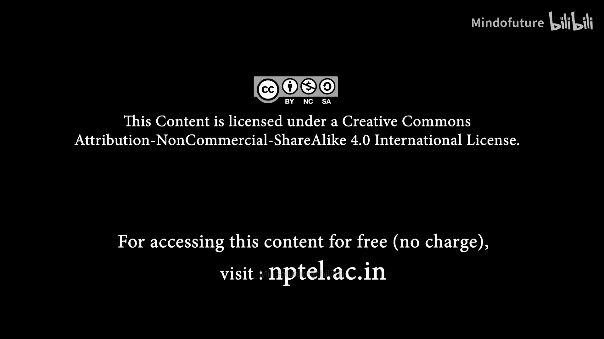
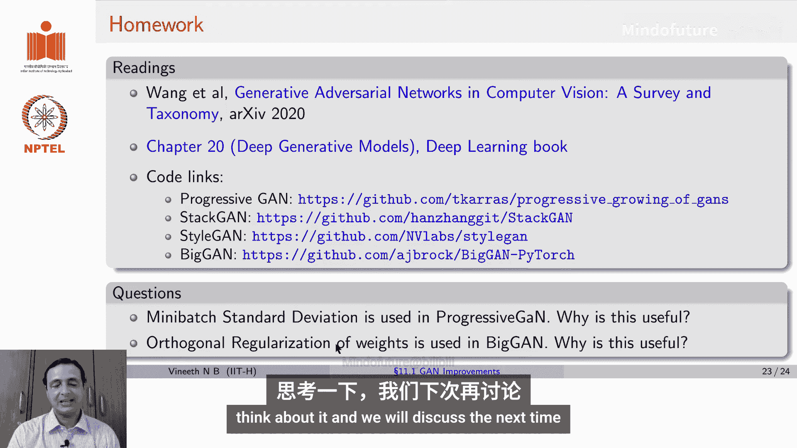

# 【NPTEL】计算机视觉的深度学习 p68 P68_GAN改进 -BV1vNWkzpEua_p68-

Having seen various kinds of deep generator models like GNs， VAs， normalizing flows。

 autoregressive flows last week。We will now move on to the various ways in which Gs have been improvised over the last few years。

Talk a little bit about disentangling of Vs。And then move on to applications of GNs to images and videos。

Let's start with a few improvements over vanillagans。

The first method that we will talk about is known as Staggan。This was published in ICCV of 2017。

And the goal of this work was to generate。Reasonably good resolution to 56 cross 256。

Photo realistic images that are conditioned on text descriptions。So here is a high level flow。

The entire G model is conditioned on a text description； it could be a caption， for instance。

And standard NLP methods such as Wetube， glove， bird， so on and so forth。

 are used to get an embedding of this text description。Which is provided as input to the GN。

With that input in the first stage。The G generates 64 across 64 images， with perhaps a few。

High highigh level details or low frequency details。

These images are then provided as input to the next stage of the staggan。😊。

Which generates 256 cross 256。Reasonably high detail photoreistic images。😊。

And both these stages are conditioned on the same text input。Let's see the entire architecture now。

So you have the text description， which is given as input to the entire staggan。

In this particular example， the text description reads。😊。

This bird is gray with white on its chest and has a very short beak。

So you obtain an embedding of this text， as I just mentioned using say Wordwork or glove or bird or any other embedding of your choice。

And this embedding is then added to the standard Gaussian noise that is given to agan so you can see that you get a mean and standard deviation from this embedding。

And mean this mean and standard deviation is used to obtain a sample and that sample is concatenated with a sample from the standard normal。

 so that becomes the entire input to the generator to the first stage generator。So。

 the first day generator then goes through an up sampling generator module which generates a 64 cross 64 image that you see here。

Now， the generated image and a set of real images in a given mini batch。

Are provided to the discriminator， which。Downamp these images。

And before the final step of classifying this input as real or fake。

You also include the embedding Py again here， so you see here that there is an arrow that comes all the way and gets combined to this output of the down samplingling module and the job of this discriminator now is to classify this couple of generated image。

Whose representation we are considering， which is this blue block here。

And the text embedding together to be real or fake。This is the first stage。The second stage。

The results of the first stage is given as input。😊，Along with the embedding of the text again。

Both of these then are go through the second generator stage。

 so you can see here that the image goes through a down sampling。

Then the text embedding is then concateninated to the down sample representation。

This then goes through a set of residual blocks which is then up sampleled to get the final output to56 to cross 56 image。

 which is what you see here。Now， that goes now to the second discriminator where you give the generated to 56 cross to 56 image。

😊，And one of the real 56 cross 56 images。Once again。

 the output of the down sample representation is concatenated with the text embedding and the discriminator has to classify each such tuple as real or fake。

😊，Now， let us understand how how the discriminator can look at the topple and classify wheel of fake。

So， in this case， there are three kinds of scores the discriminator has to obtain has to provide。So。

 the first one is when the real image is provided with the correct text。😊，Obviously。

 the discriminator would want the score of such an input to be one because both are correct。

 there is a real image and the corresponding correct text。😊。

There is also another setting where you have a real image and an incorrect text in this case the discriminator should ideally give a low score similarly you have a fake image with a correct text which the discriminator should give a low score but the generator should try to increase this particular score。

😊，These are denoted as S sub R， S sub w and S sub F。

Now let us try to understand how the optimization actually works。

 so the staggan alternately maximizes the discriminator loss and minimizes the generator loss。😊。

Similar to what we saw with again。In this case， the discriminator as we just saw。

 would try to maximize the log likelihood of the first score。😊。

And minimize the log likelihood of the second and third course。

 which is what is given by the second and third terms here。

 we just saw that when we understood these course。Similarly。

The generator tries to maximize log of 1 minus Sf because that is the job of the generator。

It also tries to minimize the care divergence between the output of the muse and sigmas that you see in the initial layer at the end of the text embedding with the standard normal distribution。

😊，Here are some results that are obtained from Staggan what you see on the top row is a baseline method called Gan int CLS that was published in 2016 and the bottom row shows the results of the Stagganm。

So you can see here in the first column， the caption says this flower has petals that are white and has pink shading。

You can see here that the quality obtained by the Staggan is far more photorealistic than of earlier methods and this holds for all these images that you see at the bottom row another popular method that came in 2018 is known as the progressive G。

The progressive G is。Design for generating high resolution images up to 1024 cross 1024。

And the key idea。Is in the name of the method itself？

Is the method progressively grows the generator and the discriminator。😊。

We will soon try to decipher what this means this work was published in ICLR of 2018。

It also had a few other design decisions such as using a standard deviation in a given mini batch。😊。

A concept of an equalized learning rate and a pixel voice feature vector normalization in the generator。

 which we will also see soon。So the progressive G has an overall idea。

As what is shown in these image in this image on the left here。

So the generator first produces a four cross4 image which is what is shown in the leftmost part of this image here。

 so you have the latent vector that comes from a standard normal。

 a very simple network which generates a four cross4 image and this is provided to a discriminator D along with a real sample to be able to judge whether it is real or fake。

This then increases to8 cross 8 in the next。Iterations of training you can see here that compared to the image generated in the for cross4 setting the eight cross 8 setting is still blurry but has some more details when compared to the for cross 4 setting you can also notice here that there are some layers added in the generator as well as the discriminator when the next higher resolution is generated。

And this is repeated over and over again until we get a final generation of 024 cross 1024 image。😊。

The key idea that this allows is for stable training of GNs for generating high resolution images。

Whenever the progressive G goes from generating a certain resolution to the next higher resolution。

As I just mentioned， there are new layers introduced。

How are these layers introduced this procedure is very similar to restnets so you can see that in。

The subfigu B here in the image。You see now that。While you had an initial resolution 16 cross 16。

 when you step out when you step out， when you step up to 32 cross 32。

The nearest neighbor interpolated version of the 16 cross 16 layers output。When you interpolate。

 you get a 32 cross 32 output。That is added to the 32 cross 32 layer through a skip connection。

How is that added you can see an alpha and 1 minus alpha here so the new output layer is the final output is given by alpha into the new output layer plus 1 minus alpha into the projected layer by projected layer we mean the output of the nearest neighbor interpolation。

This allows progressive GN to fade in new layers in a organic manner to be able to generate better images。

As I mentioned。Progressive GAM also introduces a few other design decisions。

One such contribution is known as mini batch standard deviation。In this step。

The standard deviation for each feature in each spatial location over a mini batch is computed and averaged。

 so you can imagine now that when the generator generates a particular feature map。

 you take every spatial location which is every pixel。

You compute its average across the entire mini batch。

 you will get a certain standard deviation for that value across the mini batch。That is concatenated。

To all spatial locations at a later layer of a discriminator。Why do you think this is done？

Think about it， it will be your homework for this lecture。

Another contribution that Pro GAN brings to the table is known as equalized learning rate。😊。

In this case， the weights in each layer of the generator network are normalized by a constant C which is specified per layer。

 so this constant C is a per layer normalization constant。Why is this done。

 this allows us to very see in every layer and then and thus help keep the weights at a similar scale during training。

😊，So why is this called equalized learning Gr？Because the value of the weight effectively affects the gradient and hence the learning rate。

😊，While methods such as Adam， undergrad， so on and so forth adapt the learning rate。

 they may end up having low values where the weights themselves are very low or very high。

Normalizing by a constant allows these weights to be of a similar scale during training across all of the layers this allows better learning。

Another contribution that progressiveganN makes is a pixel wise feature vector normalization in the generator where for each convolutional layer the generator。

😊，The normalization is defined as a X Y， which is the X Y pixel in the8 feature map divided by 1 by n where n is the number of feature maps。

 summation j going from 0 to n minus 1 thats across the feature maps。A X， Y， superscript J。

 whole square plus epsilon。The denominator here considers。

The pixel value at the same location across all of the feature maps and normalizes the value of the eighth feature map with this denominator。

😊，The epsilon here is for numerical stability to avoid a divide by zero error。

And the output is denoted as b Xy， which is the normalized value。😊，With these contributions。

 Pro GAN reports impressive results。The results are compared with earlier work such as Mao etal and Gja etal and one can see that with the progressive G approach。

The result is fairly photorealistic and high resolution with more details when compared to earlier methods。

😊，A third more recent improvement of GN is known as style G published in CVPR of 2019。

This looks at progressive G， which is also known as progan， which generates high quality images。

But does not give the capability to control specific features in the generation， for example。

It is difficult to use a progressive G and say that you would like to take an image and add a certain color or change a particular attribute in the image。

Style G's objective is to be able to control the generation of an image using a particular predefined style。

How does this do it？It automatically learns unsupervised separation of high level attributes。

Could be like could be examples could be pose and identity for face images。

 stochastic variation such as hair， which could have a lot of randomness and scale specific control of attributes。

The intuition for stylegan is that a coarse resolution in an image if we consider face images。

Could affect attributes such as pose， a general hairstyle， face shape， etca。

If you go to the next level of resolution anywhere between 162 and 322， this resolution。😊。

Thros in finer attributes such as facial features， more specific hairstyle， eyes being open closed。

 so on and so forth。And at the highest resolution， a fine resolution anywhere between 642 and 10 to 42 affects the color scheme。

😊，Both for eye， hair and skin， as well as introduces micro features on the face。

Style G tries to address and introduce some style specific components at each of these resolutions to attain its desired effect。

How does it do this？😊，Given an input random vector。The same as in the vanillagan。

Style can first normalizes this vector and then sends this through eight fully connected layers without changing the dimension of the input and obtains a 512 cross1 vector remember the input latent was also 512 cross 1 so these 8 fully connected layers do not change the dimension of the input。

And this transformed vector， which we call w， is given as input to the generator or the synthesis network。

Now， let's see how this vector W。Affects different resolutions in the generation。This is achieved。

By introducing a matrix a。Which learns an a transformation at different resolutions。

 So you can see here。That the synthesis network or the generator in style G has an up samplingling module and then has something called as adaptive instance normalization。

 which we will see in a minute。Wwhich is followed by a convolutional layer and then another adaptive instance normalization layer and then this is then repeated over multiple blocks。

😊，Let's take a look at one of these combinations of convolutional and adaptive instance normalization layer。

So if you have a convolutional layer here as what you see on the top here。

A specific channel of the feature maps in that convolutional layer is normalized by its mean and variance to get an adaptive instance normalization。

Before that's concluded。The weight vector W， which was obtained here。

 which is given as input to each of these blocks。Is transformed by an a map。

Whi gives us a set of values YSI and YbiI which is used to change the scale and bias of the output of the convolutional layer this is where the adaptive normalization comes into play。

So you can see here that this now becomes X minus mu of Xi。

Which is normalization with respect to mean andvari， so this quantity here in the inside。

Corresponds to subtraction by mean and division by variance。It is multiplied then by Ysi。

 which is a scaling value obtained as an output of the a transformation a。😊，And then biased by YBI。

 which is also the output of the aine transformation。Note that these values。

 YSI and YbiI could be different in different blocks of the synthesis network。

And each such transformation thus defines the visual expression of features in that level。

And that allows the input latent to have a different influence at different resolutions of generation。

Another method， recent one， which was published in CVPR of 2019 again， is known as Spde。

 we see the expansion soon。And the key idea of spade is that previous methods。😊。

Directly feed the semantic layout as input to the network。

 you have a certain image and the entire semantic layout is known with the pixel configuration of the image。

And in spade， which is given by spatially adaptive normalization。😊，The input layout。

For modulating activations in normalization layers happens through this spatially adaptive learned transformation。

😊，Let's see how this happens。In the standard batch normalization layer。

You could look at the output as going through an a transformation。

You scale up the value and you add a constant， which is an a transformation。

 which is the standard batch operation where you have a value， you multiply by gamma and add a beta。

 which together defines an a transformation。However， in spade what is done is。😊。

A semantic segmentation map is given as input。And this semantic segmentation map goes through a convolutional layer。

😊，And the convolutional layer outputs a gamma。😊，And a beta， which is used to normalize。

The previous layer of the generator。So as you can see here。

Unlike blindly normalizing the output feature map in a specific layer。In this case。

 the normalization is done in a spatially adaptive manner where the gamma and beta come from the spatial relationships in this semantic segmentation map。

What is the semantic segmentation map recall that a semantic segmentation map has a pixel vice association of a class label so you can see here in this sample you have a tree。

 you have a sky， you have a mountain， you have grass and you have a road perhaps。

That is used to define the gamma and beta for normalization。

A random latent vector can also be used to manipulate the style of generated images。

But the semantic segmentation map gives a way of normalizing using spatial content at each pixel so you can notice here that the normalization now is defined at each pixel。

😊，These gammas and betas are defined at the pixel vice level。

 which is what is denoted by the crossier and plusier。

 which are done element vice which can allow each pixel to have to be normalized in a different way based on the semantic segmentation mask。

Here are some interesting results。So you can see here that the semantic segmentation output is given as the input to spade so these are masks of semantic segmentation pixelwise class labeling and this is the actual ground truth image corresponding to these semantic segmentation masks you can see here while the third and fourth columns corresponding to other methods spade gives a fairly photorealistic output close to the ground。

And what you see here is the architecture of the generator in spade。

 which is similar to many other G architectures， but for the input of the semantic segmentation mask coming in at each layer。

Finally， the last method we'll discuss in this lecture。

Is a very popularly used one these days known as Big G， which was published in ICLR of 2019。

The focus of big GAN was to scale upganNs for better high resolution generation。

It was designed for class conditional image generation。

 which means the input is both a noise vector similar to a vanillagan。😊，And some class information。

 it could be a one heart vector， for instance， which together are given to the G to generate an image corresponding to that class。

BigG also introduces a few different design decisions， as we will see in the next few slides。

An important design decision in Big GN is to use the idea of a selfattention G or a SaganN。

 which is actually an earlier work that was introduced in late 2018 and published in ICML of 2019。

Which introduces the idea of self attention， we already saw self attention in transformers a week ago。

It is the same idea here where you have a set of convolutional maps in as the output of a particular layer in the generator。

This goes through multiple one cross 1 convolutions。

Certain one cross one convolutions undergo transformations and are transposedse to obtain an attention map。

 these three branches are very similar to the query key and value of the transformer architecture。

You could consider them to be similar， at least。So two of those branches generate an attention map which is used to focus on a specific part of the convolutional map to then generate that component of the image in the next layer。

Why is this required？Selfatgans were introduced because oftengans， while they generated crisp images。

 they would miss out finer details， for example， in a dog's image they may generate the fur on the dog but miss out the legs of a dog。

So， the idea of using self attention is to focus on specific parts of the image and generate every local detail more properly。

In big。Along with self attention G， the loss that is used is hinge loss。

This hinge loss is similar to the hinge loss that's used in support vector machines。

 which is given by Microsoft。0 comma 1 minus ty where t is the target output and y is the predicted output。

This is because thegan is class conditional， so you also want。

The output image to belong to a particular class which is then used at the discriminator stage because the discriminator now。

No more only says real or fake but can give a class label whose loss in are in this case is given by hinge loss。

In addition。Biggan also introduces class conditional latents in a slightly different way。

Instead of a class conditional latent， which could be a  one heart vector。

Instead of giving that directly to the input of the generator。The class conditional lant。😊。

Is given as a separate input at multiple stages of generation。Where it's concatenated with。

Certain input and then given to each of thesereinal blocks。😊。

What is done inside each of thesereial blocks？The concateninated class label。Vectctor。

Passes through a linear transformation。Two different linear transformations in fact。

 which is given to the two batch layers in inside each of these residual blocks Big G also had other design decisions which helped its performance。

One such was spectral normalization。Where the weight matrix in each layer was normalized to ensure that its spectral norm was maintained and it also satisfied the leapshifts constraint sigma of w is equal to 1。

You can see this paper。Called spectral normalization for GNs， ICL 2018 for more details。

The broad idea of such a step is similar to batch normalization to constrain the weights which which certain properties that ensure that learning can be better and faster in this case we try to constrain the highest singular value of the weight matrix。

A second idea is orthogonal weight initialization， which is a well known weight initialization method where each layer's weights are initialized to ensure that w transpose w is equal to I or the weights the weight matrix is orthogonal。

It also introduced skip Z connections， which we already saw where the input latent Z is connected to specific layers deep in the network。

😊，It also introduces another method known as orthogonal regularization。

Which encourages the weights to be orthogonal in each iteration of training。

How is this done using a regularizer or sub by beta that beta is a coefficient？

where the regularizer tries to ensure that the Frrobinius norm between w transpose w and identity is minimized。

 so this would be a way to ensure the w transpose w is close to identity and hence the matrix is orthogonal。

Why， why would we want orthogonal regularization？Think about it。

 this is another homework for you for this lecture。

Other hacks that were employed in Biggan where the discriminator model was updated twice before updating the generator model in each iteration。

The model weights were finally averaged across a few training iterations using a moving average approach which was used finally this was also done in Pro GAN。

Biggan also observed that using very large batch sizes such as 256，5121024 and 2048。

 when we say batch sizes we mean mini batch sizes while performing mini batch SGD。

 in fact they observed best performance with the highest mini batch size of 2048。

They also doubled the model parameters or the number of channels in each layer。

And they employed a trick known as the truncation trick。Where。

While the generator initially receives a latent vector from a Gaussian during training time。

At test time， you sample a latent from a Gaussian。And if that value is less than a threshold。

 you discard it and sample another value。😊，So this is called a truncated Gaussian you could now imagine that thisussian this truncated Gaussian is something like this where you are ensuring that something sampled below a threshold is not considered as input to the G。

 so that way all inputs to the G come from this part of the PDF。Which。

The main idea being is that you would not get anomalous generations using these latent vectors。

 but you get generations that belong to the core part of the PDF of that Gaussian your homework for this lecture is go through this excellent survey of GNS that was recently released。

Chapter 20 of the deep learning book。And here are the code links for most of the GNs discussed in this lecture if you'd like to see them and try them out。

The questions that we left behind are。Why is mini batch standard deviation used in progressive GAN？

And why is orthoal regularization used in Big gameA？Think about it and we'll discuss the next time。

