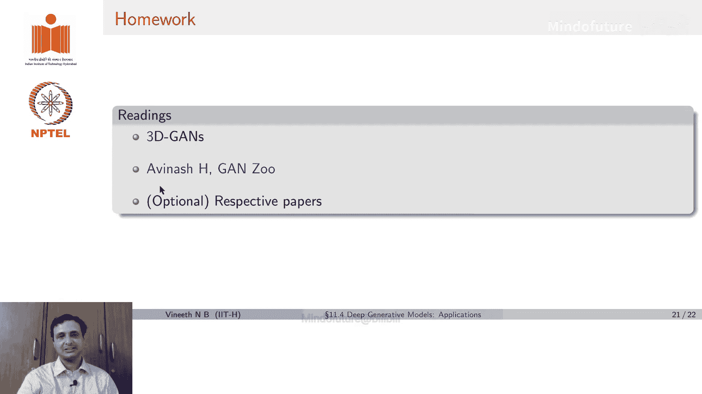

# 【NPTEL】计算机视觉的深度学习 p71 P71_深度生成模型 - 图像应用 -BV1vNWkzpEua_p71-

In the remaining lectures of this week。We'll see a few applications of。

GAans and Genrative models to images and videos。We will try to cover simple applications of GNs to different domains。

As well as a few adaptations of these generative models。Before we go there。

 the question that we left behind from the last lecture。Which was。

Why is mutual information gap used and not just the mutual information in the metric that we discussed for disentanglement。

 hope you had a chance to try finding this out。The mutual information gap tries to penalize unaligned latent variables。

Because we are looking at the gap between two latent variables which have the highest mutual information with a generative factor。

So， if there is a latent if there is a certain generative factor。

 which is a combination of two latent variables that would be penalized in a mutual information gap。

 we would then get a0 or a lower value which indicates poorer disentanglement。

The other answer is if one latent variable models a generative factor。

 we do not need any other latent variable to model the same generative factor and if that happens wed like to say that we have poorer disentanglement。

This， also。Necessitates the definition of a gap rather than just using the mutual information of the top latent variable with respect to the generative factor。

More on this is there in the isolating sources of disentanglement in VA's paper。

 do read it if you're interested and need more information。

Let's now come to a few applications of GNS。The first application that we will talk about is for image editing。

Simple image edits such as making an image grayscale or adjusting the brightness or contrast don't require an understanding of the semantics inside the image。

However。If we want to take a face image。And make the hair black or add bangs or add a smile。

 make the image male。Then you need to understand the semantic content in the image。Can Gs help here？

Possibly。However， GNs dont have an inherent mechanism to map an image to its latent representation。

We saw ways can do it。But VAAs sometimes can suffer from reconstruction issues as we discussed in the VA again lecture。

How do you use GNs to be able to achieve something like this？

This was proposed in a variant ofganN called invertable conditionalganNs。

In Europe's workshop 2016 called IC Gan。And the way I see again。

Achievees this objective is using this architecture。

It is a conditional Gm that is used very similar to what we saw earlier this week of GNs across domains。

 a similar idea。But now there is also an encoder in the architecture which can encode an image to its latent attributes。

So， what is the overall architecture here， you have two encoders。

One encoder gives a latent of an image。One encoder gives the attributes of an image。

Now to be able to generate a new image with different attributes。

You pass the image through the encoder。Get an attribute vector y。Change its attributes。

 change black hair from 0 to 1， change brown hair from 1 to0。

 and now you get the same image with black hair。So， how does this actually work。

 the generator G samples an image from a latent representation Z。And some conditional information y。

 so G is defined on Z y and gives us a generated image x prime。The encoder performs the inverse。

Given an image X， it outputs Z y。How do you train such a model？The broad objective。

Is similar to what we saw with conditional Gs。This is what we saw with the earlier lecture on Gs across domainings。

So， you have a log likelihood of X Y， the image and the attribute。

 which wed like to maximize as given in an input training data。

And wed also like to look at the second objective in the G as discriminator of G of Z ka y hat。

 which gives you an X hat。The discriminator now looks at the topple X hat Y hat and says whether it is real or fake。

 this is similar to conditional G where we try to generate images from text。

The encoder here has two parts。E Z and E Y， one for the latent and one for the attributes。

To train the EZ encoder， the generator is first trained。

And the generator is used to generate a data set of images。

Now we have pairs of images and they are corresponding latent representations as a data set through the generator's performance。

That is now used to train the encoder。So you have G of Z Kama Y hat， which was the generated image。

And the corresponding Z that was used to generate the image for the generator。Now。

 trying to minimize the L2 norm between these two or the mean square error between these two is used to train the encoder Z。

The encoder y the other one is now trained using the data itself。

We assume that the training data has data and attributes。

That so you now consider why to be the attributes that are provided in the data set。

Ey of x to be the predicted attributes and you do a mean square error between these two to be able to train your Ey。

Here are some results on a popular data set known as ceb a， so you have an original image。

And by varying several attributes， you see that you get several reconstructions that are fairly realistic。

 several generations that are fairly realistic， where you see a balding person。

 the same image with bangs， same image with black hair， blonde， glasses， more makeup， gender change。

 pale skin， smiling， so on and so forth。Another application of GNS is for a task known as super resolution。

We also talked about this in the context of CNs， let's revisit it now。Image super resolution。

Is the task of obtaining a high resolution image？From a low resolution image。

 which can be a challenging task because you have to fill in information that was not available in the first place。

SR G or super resolution G aims to generate photorealistic images with up to 4 x upscal factors。

Y SR again。Even CNNNs can be used for super resolution by doing deconvolution or up samplingling through the second stage of a network through an encoder decoder architecture。

In those architectures， the loss minimizes the mean square error between a generated output。

And the true ground truth， high resolution image。Mean square error can tend to overly smoothen output images because of the averaging effect that you get across all pixels。

So， because you try to take the mean squared error， it may not try to make specific pixels sharper。

 which may be important for super resolution。Gans by using adversarial loss drives outputs closer to the natural image manifold。

 so if this was the natural image manifold given by these red boxes。

Gans try to push the generated image onto that manifold。

 which helps in getting high quality super resolved images。How is SRgan trained？

SRgan has a couple of components。One of the losses is known as a content loss。

The content clause minimizes the mean square error between。The output of the generator。

 which is given by G theta G and the true high resolution image。

But instead of measuring the mean square error between the images themselves。😊。

It minimizes the mean square error between the feature representations of these two images。

What features？😮，Both these images are sent through a VGG19 network。And。

An output of a certain convolutional layer in the VGG190 network that feature representation is taken and the mean square error between those representations are considered to minimize as a loss function for training the SRgan in this particular case PhiIj corresponds to the feature map obtained by the J convolution before the8th max pullinging layer。

And WIJ and HIJ are the width and height of the feature map respectively that' is used for normalization。

And the second loss that is used to train SRganN is the standard adversarial loss which looks at fooling the discriminator similar to every other G that we have seen so far。

The final laws used to train Srgan is a weighted sum of the content loss and the adversarial loss。

In this particular case， it was shown that the adversarial loss can be weighted by a smaller quantity than par minus 3 in their case to get good performance on super resolution。

With this loss， here are some sample results。You can see that bi cuubic interpretationpolation of this image。

Gives us this。Super resolved image。Using a super resolution CNN。

 a Renet gives this image and using agan gives a far sharper generation of the image when compared to the original。

More images on natural scenes。By cuubic interpolation。

SR CNNN with the Snet and SRgan and the final original picture in high resolution。

You can see that SRgan gets local details fairly more clearly than super resolutionution CNN and much better than bicuubic interpoition。

A third application is Gs for。3D object generation。So far， we have seen GNs generate 2D images。

Can Gs also generate 3D objects？Fairly， fairly straightforward recent advances with 3D CNNns and volumetric convolutional networks have made it possible to learn 3D object representations。

So， the layers in the generator have to now generate a volume。

 so as long as you can replace those layers， you can generate any object through a GN framework。

In this particular example， this work was published in Europes。Europes of 2016。So， the 3Dgan。

 the way it works is the generator G maps a 200 length latent vector to a 64 cross 64 cross 64 cube which represents an object G of Z in 3D voxel space。

The discriminator classifies whether the object now is real or synthetic so only the architecture in the generator now is different from a standardgan what is the loss standardgan loss This is a straightforward application ofgans to 3D objects by changing the architecture of the generator to handle 3D volumes。

And with that loss。When a G is trained to generate 3D objects。You get fairly good generations。

Of different kinds of 3D objects， as you see on this slide。

The last application that we will see is Gs for image in painting。

Image in painting is a task where a part of an image is missing。

And the job of a G is to fill in that missing part in the image。

Can a again be trained to perform image in painting？You know the answer the answer is yes。

 one of the methods proposed for this is known as PG GN which uses a standard GN framework where the generator is a residual network。

 which takes an image as input， the one which has parts missing。

Generates an image of the same resolution。And the discriminator is divided into two parts。

 a global discriminator。😊，And a Patgan discriminator。The global discriminator。😊。

Reasons at a global or an image level to decide whether their image is real or fake。😊。

And the patch gun discriminator reasons at a local level。

 at a patch level to decide whether an image is real or fake。

So the patch again discriminator helps capture local texture details and fill in those missing gaps in the image。

What's the loss？So， there is a reconstruction loss which measures a pixel wise L1 distance between the generated image and ground truth。

And an adversarial loss where the adversarial loss is divided into two parts。

 one for the global G and one for the patch can。And the overall objective is a combination of the reconstruction loss。

😊，The adversarial loss for the global G and the adversarial loss for the patch Gm。

With this kind of a training procedure and architecture。

Here are some results of image in painting where when a patch is taken out from the image thegan gets a fairly true reconstruction of those parts you can see many examples here where you can see some artifacts where the G generates content but it is still fairly realistic in its generation。

Here are more results of building facades where once again the G fills in information fairly in a photorealistic manner。

For more information on these applications。Please see this link for 3D GNs and a very nice link called Ganzu。

 which presents an overview of various kinds of GNs which you can use for different applications。

🎼Here are references。