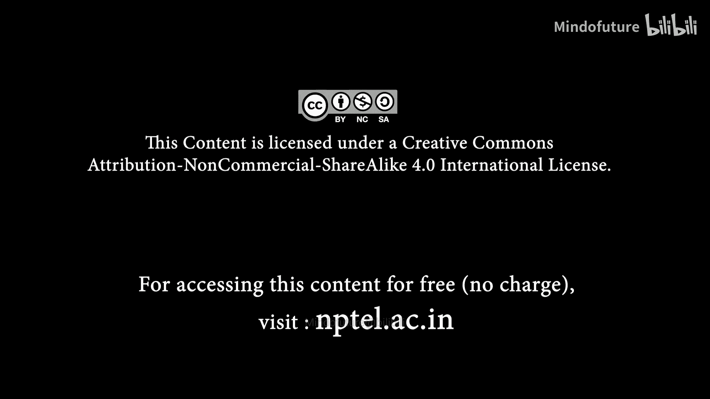
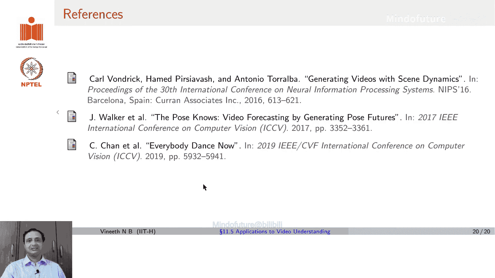

# 【NPTEL】计算机视觉的深度学习 p72 P72_深度生成模型 - 视频应用 -BV1vNWkzpEua_p72-

For the last lecture of this week。We will talk about applications of generatorative models in video understanding。

In particular， we will talk about three different methods which have done different things in the scope of video understanding and generator modeling。

😊，Let's start by asking。Can we use Gs to generate videos？

We already answered the question partly in the previous lecture when we talked about using GNs for 3D object generation。

In a sense， videos are volumes too。More generally speaking。If you looked at the GA objective。

Your Min Maxax objective。Where your discriminator D is parameterized by weights WD。

And your generator is parameterized by weights Wg。G and D。Can take any form appropriate for a task。

As long as they are differentiable with respect to the parameters under consideration and this minmax objective can be solved using this objective function。

😊，Let's now see one method that extends GNs for video generation， however， with one unique change。

That unique change is this method called generating videos with scene dynamics published in New Europes of 2016。

Considers the output of the generator to be given by。M Z。

Haramard product or elementwise multiplication f of Z plus 1 minus n Z Hadard product b of Z where Z is the latent vector which is the input to thegan to the generator。

😊，Here F is foreground。B is background。And M is a mask， which is also learned。

Which indicates whether to use foreground or background for a pixel。

Let's see how this is used in G architecture to generate videos。

So we have this function here that we just wrote and we have an input noise vector to the generator of agan。

 which is 100 dimensional。Now， the noise is given as input to two branches。One branch。

Which is a foreground stream which generates a volume， a 3 d volume。This volume generator。

 this foreground stream forks into two parts at the end where one part generates the video foreground。

And the other part generates a mask for every pixel in every frame of that video。

 so the mask also has the same volume， same dimensions as the foreground。

And the input noise also goes through another stream which generates a static background。

When we talk about generating short videos。The background is not expected to change。

And it's most likely that it' is the foreground that changes on a static background。So in this case。

 the second branch of the generator generates a static image background。And now。

The foreground and the background are combined using this mask as。

This mask what values is output by the layer here， the layer shown in blue here。

 hardmark product the foreground plus 1 minus n hard mark product the background。That。

Is what leads to the generated output as you can see。

 the foreground stream captures the moving features。

The background stream captures the static features。

And the background is replicated over time at every step in the frame it's the same background that' is used all over again and that leads to the final generated video。

 which is a spacetime cuboid。All of this corresponds to the generator of this model。

What about the discriminator？The discriminator is the standard discriminator in a G where this generated video is downsampled over a series of layers and the last layer has a binary classifier which says whether the video was real or fake。

And the loss function remains the same as a standardgan and now we are able to generate videos with scene dynamics here you see snapshot examples of videos on top you can see a background scene that is generated。

A foreground that is generated。A mask that is generated along with the foreground and together we see the final generation to be a combination of the background and the foreground using the mask。

You see below another example where if you observe carefully you can see here that the waves at the bottom here seem to be receding which shows the movement across the frames generated in the seam。

😊，If youd like to see more video examples， please go to the website of this paper right here and you should be able to see many more examples of videos generated through this method。

Another interesting method for generating videos， in fact。

 a different task by itself is video forecasting。We'll talk about one such method which was published in ICCV 2017 called the Post Nose。

This work argues that when GNs and VAs are used directly for video generation。

They generate video directly in the pixel space， each pixel is generated in every frame。Which means？

The the structure and the scene dynamics are captured at the same time。

And this could often lead to uninterpreable results。To avoid this problem， this method proposes。

That one needs to forecast first at a higher abstraction。

And then build the video based on that high level abstraction。

What is that high level abstraction in this method？

This method uses human posts as a high level abstraction。

And it exploits human pose detectors as a free source of supervision and thus breaks the video forecasting problem into two steps one。

 it uses a VA to predict the possible movements of humans in post space。

And these predicted or generated human pose。Are used as conditional information to help the G predict future frames in pixel space。

The task here。Is given a set of frames in a video。The model needs to predict the next frame or the next set of frames。

You could imagine multiple kinds of applications， you could think of a sports application if somebody gave you a certain configuration of football players on a football field and you saw the last 10 seconds video。

 what would happen next， whom would the person pass the ball to could be one way of looking at it？

It could also have applications from a security perspective if you try to take it to a different context。

So in this method， as we just mentioned。😊，There is a first stage where the pose of a human involved in the video is first predicted。

And the predicted pose or the skeleton， human skeleton is then passed as conditional information to agan to actually generate the frames of the video。

😊，Let's first see the post prediction part which is done using a VAE。So。

 in this post prediction encoder decoder model， which is a variational auto encodeder in their implementation。

😊，In the encoder there are image features written from Xt， which is a particular frame at time T。

Corresponding past pose， which could be p1 till P， those were the pose until now。

And also the velocities of the poses at different joint positions。In each of these times， one to2。

What is velocity， it is how much is each joint location likely to move by between one frame and the next frame。

You could consider these velocities as optical flow of joint locations in poses in or the skeleton postkeletons that we get to represent human pose。

So， once the encoder reads in these image features corresponding past pose which in our case these pass poses p1 to PT are what you see here。

P1 to p and corresponding velocities y1 to yt give how the velocity each of the joint locations in each pose at a time T is moving towards the next time step。

And the output here。Is the decoder which replace the post velocities in reverse order。So given。

The output of the encoder， which is Ht， which goes to the decoder。

The decoder now tries to predict yt to y1， which are the post velocities in the reverses order。

What do we do with this？Once such a model is trained。The decoder is taken away。

Only the encoder is used to get these hidden states H1 to Ht。What do we do with that？

We now use that to go to a future encoder and a future decoder。In a future encoder。

Ht is given as input。Ht is what we got out of the past encoder， the output of the past encoder。

That is given as input to the future encoder。So the future encoder receives past Ht。

Future post information， Yt plus 1 to capital t， which are your velocities。

And PT plus 1 to capital T， which are the post skeletons that you see here by postkeletons。

 you have to recall methods like deep posts which give us an Xy coordinate location for certain joint locations of a human skeleton。

Since this is a variational auto encoder。😊，The encoder outputs an approximate posterior cube which which is shown here。

And what does the decoder do？The decoder samples from Q， not exactly Q。

 but from a prior that is close to the approximate posterior queue， which is how the VA learns。

To reconstruct the motions yt plus 1 to yt， which are your post velocities given past ht and poses t plus 1 to t。

This is shown in the input of the future decoder。So。

 you get a sample from your approximate from your prior sorry from your prior along with that you also get so those samples here are given by Z T plus 1 Z t plus 2 Z T1 and so forth。

 each of these red elements here are samples from a Gassian。Along with that。

 you also have Ht which comes from the encoder。And sorry not the encoder from the past encoder。

And along with that， you also have PT plus 1， PT plus 2 to PT。Given these。

 the decoder of the VA predicts Yt plus 1 to yt， which are the velocities of each joint location for times p plus 1 to t。

Now， what happens once you train such a VA？Like any other VA， the encoder is not used at inference。

You only sample from the prior and then let the future decoder predict how the posts will look given until a particular time H T small t。

 which is given by Ht here。The decoder tries to predict what the pose will look like from t plus 1 to capital t using these velocities。

 remember given a pose and given the velocities one can construct the pose in all of those time steps in t plus 1 to t just by adding the velocity to the current pose location。

Now coming to the second stage， once the post information is obtained。Remember。

 we said that the post information is given as a conditional input to the generator。

which finally generates the videos let us see that part now so this is the generator which given a set of frames which we denote as input i at this time。

And the post information。Which comes from the previous module that we just discussed？

The generator generates the next few frames， which is the goal of video forecasting。

Now this is a generator module， this is similar to agan module so it has a loss for the discriminator and a loss for the generator lets see each of them so the discriminator loss has。

Loss of D of V I L R。 What is V I V I is the ground truth video。What is Lr real label。

 so wed like the discriminator to assign the real label to the ground truth video。

And on the other hand wed like the discriminator to consider the generation of the input and ST denotes the postkeleton。

 I denotes the input， this is input and this is ST the postkeleton， given these two。

 the generator generates the future frames and the discriminator's job is to give that a fake label。

What are these summations here？These submissions are over a mini batch whose size is M。

So one half of the mini batch are real videos， ground truth videos and the other half of the mini batch are generated videos which are given by this。

This is what the discriminator tries to do。Let us try to see what the generator tries to do。

 the generator which has a counter objective。W the discriminator to look at the generator's output and give it a real label。

In addition to this generator objective。We also try to minimize the L1 distance between the generated future frames and the future frames that are provided to us in the ground truth V and the L1 term is weighted by a coefficient alpha。

This together helps train a model that can generate videos where in the first stage。

Pos are predicted and the postss are then passed on for the G to generate videos。So。

 the final end to end architecture looks like this， there is a past encoder that would generate Ht。

That Ht is given as input to the future decoder。Along with poses PT1 to PT。

Now this generates yt1 to yt， which are the predictions of the posts which are given as input。

To the GN which finally uses that and the input to and the input so far to be able to generate the future frames。

With this approach。This method shows interesting results。Here is an example。

Of a person skiing on a snow slope， snowy slope， you can see the postkeleton here。

And the predicted movement here so these blue lines represent optical flow or the velocities at each of those joint locations which also tells us if you see this red skeleton。

 that is the skeleton。Where the person moves to from this green skeleton in the current location。Now。

 using that skeleton。To condition the generation of the next frame。

 thegan generates this image where the person moves to that location。Clearly， it's not。

Veryry sharp in terms of the generation considering the real world situation。

 but it gets a fairly good estimate of where the person is likely to be in future of the video that is provided to us。

😊，A third method in video understanding that we will discuss is an interesting one called Everybody D now a recent work published in ICCV of 2019。

😊，Where the objective is given a professionals dancing video and an amateurs dancing video。😊。

Can we generate a video of an amateur dancing professionally？

And one of the basic modules of this framework tries to have a generator which captures the temporal coherence between frames using。

The ground truth information and the generated information。So。

 once we have this generated information， so you have Gxt and Gxt plus 1 xt and xt plus 1 are the poses in two successive frames。

GXt and GXt plus 1 are the generations corresponding to those poses。

And yt and Yt plus1 are the actual ground roots for that person's pose。

Corresponding to the skeleton xt plus 1。The job of the discriminator in this module of the framework is to look at the generated frames。

GXT and GXT plus 1。And see whether they are temporal incoherent。Which is equivalent to fake here。

And for real data。The label given is temporarily coherent or real， so it is no more real versus fake。

 the discriminator tries to say temporarily coherent or temporarily incoherent。

So your standardgan loss looks like you have the log likelihood of discriminator looking at。

Xt xt plus 1， which are the post information of a frame at time T and the post information at time t plus 1。

Yt and yt plus 1 are the expected frames， the ground truth frames for the same pose locations and GXt and GXt plus 1 are the generated frames。

So， this GN module of this framework tries to ensure that consequent frames or successive frames of the video being generated is temporal coherent like a given input video。

This is one module of this work。Another module that is part of this work is to ensure that when you have a source person's dance moves。

 so in this case you have y1 prime to YT prime which are the video frames of a source person a professional dancer。

So， the pose of the professional dancer is obtained to get x1 prime to xt prime。

Since this has to be overlaid on the target person's pose。

This is normalized to get the post information in the dimensions of the person that is being considered so different people may have different limb proportions so this normalization step moves the skeleton of the source person。

That is the professional dancer to the skeleton of the amateur dancer in terms of sizes and distances between the joints。

Given this x1 to xt， the generator module in the previous step we had trained a generator that could take post information and generate frames now the post information is obtained using this architecture of coming from a professional skeleton normalized into the dimensions of the target person and the generator now generates the generator trained as in the previous step。

Now generates videos of the target person with the same post moves of the professional person。

Finally。Because in the process of。Transposing someone else's moves on to a target person。

 there could be distortions and loss of detail on the face of the target person。

This method also introduces one module to refine the generated phase。So this in this module。😊。

This is anothergan within the overall framework。😊，In this module。

The face portion of the generated image so this Gx that was generated in the previous step。

 a certain region around the face around the nose of the person is cropped out which is given by GxF and XF is also the pose cropped around the same area。

These two are given to a new generator module which outputs a residual that needs to be added to the original face to add more detail this residual is then added to the original generated face to give the final outcome which is then transposed onto the final generation。

This is a separategan by itself。Where。The discriminator tries to maximize the likelihood of xfyF where xF is the postkeleton around the face YF is the actual face region in the target image and GxF plus the residual is the generated phase through this generator where the residual is the output of the generator and this helps thisgan helps refine the face。

Putting these together in stage one。In this particular framework。

 the first G is trained and this G has a few components， it has an L smooth GK。

 which is the standardgan loss that we already saw。

This is your standardgan loss that ensured temporal coherence。

LFM gives a discriminator feature feature matching loss very similar to ps to picks between the generated image and the real image that comes from a discriminator。

😊，And there is also an LP loss which gives a perceptual reconstruction loss once again comes from ps to pixels。

 and this is for GXT minus1 matching to yt minus1 and Gxt matching to yt remember the perceptual loss also tries to measure loss at an intermediate feature space feature space level。

And this is stage one once this gam is trained。The stage1 weights are frozen。

And then comes stage2 where the phasegan is trained based on the L phase。

 which is the standardgan loss for the face region and a perceptual loss also defined for the phase region。

One stage two is trained。Stage1 is again retrained and this goes on in iterations to be able to get the final generations。

Now here are some interesting results。Here is a source subject and the source subjects corresponding pose and these pose are now translated to a target subject。

Who now show the same posts in different scales， in different backgrounds with different body structures。

 including male and female。A similar example is also seen on the right side here。

The paper also shows interesting results of multi subjectject synchronized dancing where the so subjects poses are transposed onto multiple different subjects of different backgrounds。

 different sizes， different genders and the same pose is now shown by all of those people to give a sense of synchronized dancing。

Your homework for this lecture。Is to check out this demo video from everybody dance now paper。

 which is fairly interesting。And also a very nice article on open questions on GNS to wrap up discussions so far on generative models and of course。

 if you are interested please do read the papers on the respective slides。

Let's end this lecture with one question。Through this lecture。

We saw methods that used videos as input where the discriminator looked at the real video and a generated video and said whether it was real or fake or temporarily coherent or incoherent。

Can you generate a video from a single image。Think about it and we'll discuss soon。

Here are differences。

