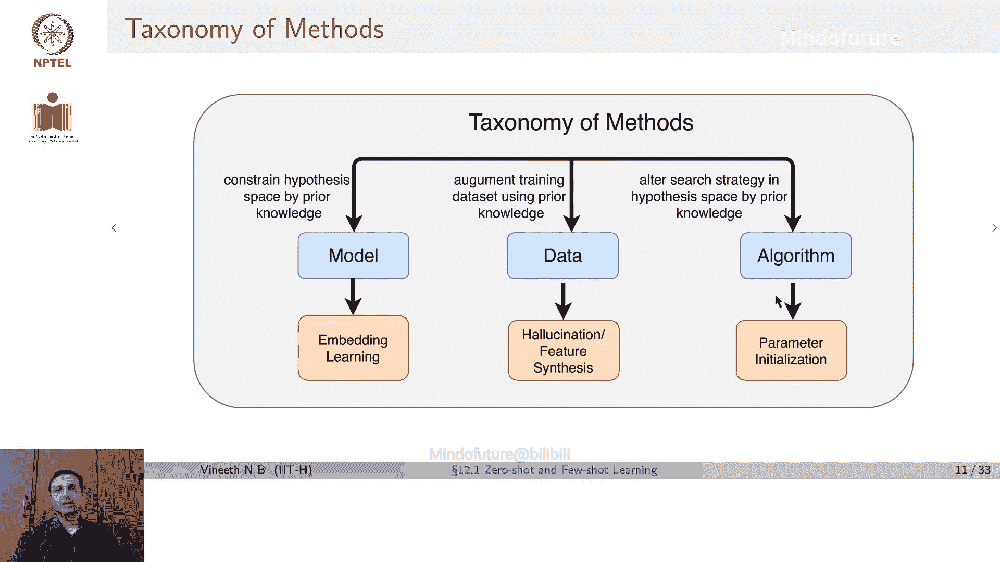

# 【NPTEL】计算机视觉的深度学习 p73 P73_少样本和零样本学习 - 第一部分 -BV1vNWkzpEua_p73-

In this last week of lectures。We will discuss a few advanced topics related to deep learning for computer vision。

We will start with a contemporary topic， zero short and few short learning。Before we move forward。

A question that we left behind。In the last lecture。

On applications for deep generative models to video understanding。

We saw methods that use videos as input for generating videos。The question that we left behind was。

Can we generate a video from a single image？You may have guessed the answer， the answer is yes。

We are not going to discuss the specific method now。

 but you can see the article linked on this slide and the corresponding paper relevant to the article。

The core idea of doing this is through a method known as single shot learning。

We using a single instance， which in our case is an image。

The network generates or learns to generate a complete video。Interestingly。

 single short learning is one specific setting of few short learning and is the focus of this lecture so this becomes a nice segue into what we' are going to discuss in this lecture。

But for more details， please come back and visit this article to understand how a video can be generated from a single image。

😊，Deep learning models are known to be heavily reliant on large amounts of label data during training that's one of the reasons they work so well。

 but that's also one of their major limitations。If you had only a few samples to learn from。

Deep learning models may not be that effective in giving you a good model and a good prediction performance。

To a certain extent。😊，Regularization methods are used to avoid overfitting in low data regimes。

But they don't really give you a good performance on low data chips。So what do we do？The solution。

Is to be able to train models。Explicitly that are capable to rapidly generalize to new tasks with only a few samples or perhaps no samples at all。

And that's the focus of this lecture。The objective。

Is to enable models to perform under practical settings where data annotation could be infeasible。

 could be expensive。Or new classes get added over time。So， illustratively speaking。

 you have a few what are known as base classes where you may have many examples。

The goal is to use them and learn a classifier in such a way that if you have other classes。

For which you may have very few samples or no samples at all。

Then the classifier can still work and be able to give you a good prediction。

Let's see how this can be done。Over the rest of this lecture。So， this problem setting is。

Called few short learning or zero short learning。 Let's review the formulation first for both of these。

If x was an image or a feature， you could assume that the input to these models need not be an image per se。

Could just be say a VGG feature or a restNe feature which is obtained by passing the image through a VGG network or a ReNe network for that matter。

And y denotes the class label for that data point？Then few short learning is formalized as。

You have training data detrain given by your X YYI tus。

 let us assume there are a total of capital I tuples where for some of the classes there are only a few training samples。

Few short learning is also characterized as an en K shot setting。

where for n of your total number of classes， if you had total number of classes to be say capital C for n of those n less than c。

You have only case samples while for the rest of the classes， you have a lot of samples。

The rest of the classes are also called base classes， as you saw on the slide in the earlier。

On the earliest slide。That is few short learning。What is zero short learning？

Zero short learning is when few becomes zero， what does that mean？You have training data。X， Y。

 but now because you want to be able to classify。A data point that was never in your training set。

 that's the zero short setting where you don't have for some of your classes。

 you have reasonable amounts of data for some of the classes which are also called zero shot classes。

 there is absolutely no label data at all。In such a setting， your training data consists of X。

 y and a of a of y， which are some attributes related to each class y。

It could be some textual description for instance， so if you had images of all animals。😊。

Let's say you've seen a lion tiger a zebra。But you have never seen a horse。

 lets see that image was never available to you， but you know how the description of a horse looks like in text or as a set of attributes。

When we say a set of attributes， we mean whether。The animal has a tail for legs。

 What colors can it assume， Does it have a maine， so on and so forth。

 So those are what we refer to as attributes a of x Y。

 You can look at them as met datata that are provided， even if the data is not available。

So that is the zero short setting where x belongs to XS， which is known as scene classes。

 y belong to YS， which are again the labels of the scene classes and a of y are a set of attributes for all classes。

And the test time here in0 shot is a setting where you have x， y a of y。

Where x comes from an unseen class x U， y is the corresponding label and a of y is the corresponding attribute。

Importantly。Y U intersection YS。Is the nuet？So the scene classes and unseen classes have no intersection。

Within few short， zero shot。There are two further ways of categorizing them。

One of them is what is known as conventional few shot or zero shot。

Where in the problem setting the goal is to learn a classifier F。

Such that the image or feature xs to be recognized at test time comes only from the unseen or few short classes。

 not from the base classes or the scene classes。Thats what is known as a conventional few shot or zero shot。

 that's how the initial methods in this space were developed about four or five years ago。

The other setting， which is the more challenging and more practical setting。

 is generalized zero shot and few short learning。Where the goal is to still learn a classifier。

Going from x to both seen and unseen classes or base and few short classes。

Where the image or feature x to be recognized at test time may belong to either seen or unseen or base or few shot。

Clearly， the generalized zero short or few short learning setting is the more challenging and more useful one。

Because in the real world， you cannot predict whether your image at test time will come only from an unseen class or only from a few short class。

It could come from any class in your universe of classes。At this juncture。

Lets recall one of the fundamental tenets of supervised machine learning。

 which is empirical risk minimization。If P of x， Y。

Is a ground truth joint probability distribution of input x and output y。

The goal of supervised learning is given a hypothesis edge or a model edge。

The goal is to minimize the expected risk or loss measured with respect to the joint probability distribution。

Wwhich is then given by R of H is integration of the loss the loss is has two inputs， H of x。

The prediction of the model and y which is the expected output， so the loss is computed。

Between these two quantities。And you integrate this over the entire joint probability distribution。

 which is also denoted as the expectation over the distribution of the loss。Unfortunately。

 in the real world。😊，We cannot estimate the joint probability distribution。

 so this expectation is approximated as the empirical risk。

With respect to the training data that' is provided to us。So。

 the empirical risk is given by 1 by I sumation i going to 1 from 1 to capital I。

 the losses over each of these i input data。Now lets assume that we have a family of models。

 you could assume we are solving a linear problem， so you could assume that if it was a linear SVM。

 your family of models belong to lines so thats what we doote by H depends on what algorithm what choice you' are making but lets now assume that the family of models that you are trying to search for to address this problem is given by capital H。

And lets one of the hypothesisses or the models be small edge。Then we have three kinds of functions。

 one is Hcap， which is the original function that minimizes expected risk that we are really looking for。

 that' is the ground truth function。Then we have Head star。Which is the function？

Belonging to the family that we are searching for within this family capital edge。

That minimizes the expected risk。And finally， we have H subi。

 which is the function in H that maximizes the empirical risk。

Which is the risk of the loss with respect to your training data。Given these three terms。

One could now define。The gap or the generalization gap between what our model with respect to the training data has learned。

 which is H with respect to the original ground truth model， H gap。

The loss between them can be decomposed into two parts。1。R of H star minus R of H gap。

If you chose this family of models in Capital E。And the best model in that to be Head start。

How close would that be to the actual model that could belong to any family of models。

 it need not be a linear model， it not be a quadratic model， it could be any model。

So HCap is any model， H star is the best model in this family of models that we have chosen。

 hypothesis and model here mean the same thing。And the second term。😊，Here is how close HI。

 which is the model that we obtain from our training data， is close to Headstar。

 which is the ideal function which in the family of functions。So， the first component。

Is denoted as approximation error。Which measures how closely functions in this family edge can approximate your optimal hypothesis Hcap。

And the second term here。Is the estimation error？Which measures the effect of minimizing the empirical risk。

With respect to the expected risk within the family of functions it。

Why are we talking about all of this now？Well come to that in the context of few short and zero short learning。

The second term。😊，In the previous slide。Can be reduced if you had large amounts of data。

Then your empirical risk minimizer becomes close to your expected risk minimizer because the training data when you have large amounts resembles the overall joint probability distribution more closely。

So if you had sufficient labeled data to train with。

Then your empirical risk minimizer gives a good approximation。To the best possible Edstar。

Unfortunately， with few short learning and zero short learning。

We don't have the sufficient amount of training data， especially for a certain set of classes。So。

 what is the problem let us look at this illustration so on the left what you have now is when you have a large number of data samples。

You have Hcap， which is your optimal hypothesis denoted by the star here。😊。

Then you have this ellipse which represents the family of models capital edge that you are focusing on to ask your machine learning algorithm to learn or pick one of them so the best solution there。

Would be the projection of Hitchcap onto this family of models， which we do not as at star。

And finally， you now start your machine learning algorithm somewhere here where the triangle is shown and over the learning procedure you converge to a model which is given by H which is fairly close to a Head start。

So if you have large number of samples， you get an H that is close to its star。On the other hand。

When you don't have a large number of samples， you may not be able to get very close to hit start。

 which is。At least the best model that you can get in this family。So which means？

The resultant R of H。Whi is the empirical risk that you have from this particular model is going to be far from being a good approximation of the expected risk。

😊，And the resultant model H may overfit to your training data。How do you address this problem？So。

 we can look at addressing this problem from three different perspectives， from a data perspective。

From a model perspective。And from an algorithm perspective。Let's now see each of them。

From a data perspective。One could simply augment the training data。

Simply increase the number of samples to an i tilde which is far far greater than I and that should help you get a better estimate of the empirical disc minimizeizer so you can see here that by increasing the number of samples which we call prior knowledge here we now push the H model closer to headstar which is our ideal goal and that would be by leveraging data。

The second option is to do this by constraining the space of models to a smaller space which is less likely。

To push hit eye far away from Head start。So， you can see here that using some kind of a prior knowledge or domain understanding。

We try to ensure that the space of hypothesis or models capital edge is now restricted to only this non shaded region in the center。

And any model here is perhaps better than most of the models that are outside this non shaded space。

This is another way of addressing the setting where you may have only few samples from certain classes what are we doing here we are constraining the complexity of edge to a much smaller hypothesis space。

Then you are hoping that even a small amount of training data would be sufficient to train a reliable H。

 which is once again close to Estar a third approach。

Is to address this from an algorithmic perspective。We aim to search for parameters theta。

Of the best hypothesis at star in capital E。One way this can be achieved is by using some kind of prior knowledge。

 we will see examples of methods later in this lecture。Which alters the search strategy。

and can also help provide a good initialization so you can see here that using some kind of a prior knowledge you now have a stack point which is much better than the stack point that you had in this figure A。

 which helps you converge to a better H。Each of these three approaches are valid approaches to address this problem。

Let's see methods belonging to each of these kinds in this lecture。

So from an overall taxonomy perspective。One could look at constraining the hypothesis space by prior knowledge。

 which is the model approach to solving few short zero short learning。

Examples of methods here are known as embedding learning methods。

The second category of methods that are based on augmenting training data， the data approach。

Are broadly grouped as hallucination or feature synthesis methods。

And the third case of altering the search strategy in hypothesis space by using some prior knowledge。

The algorithmic approach are also sometimes categorized as parameter initialization methods。

Let's see each of them in detail now。

