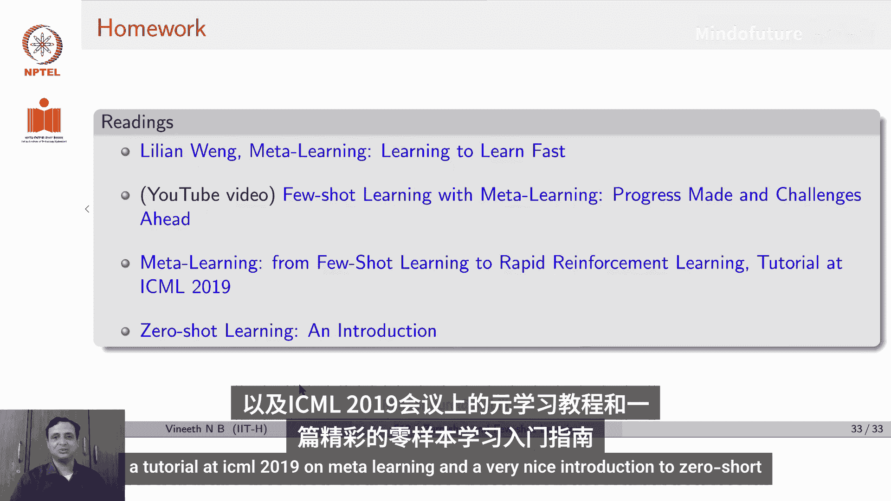

# 【NPTEL】计算机视觉的深度学习 p74 P74_少样本和零样本学习 - 第二部分 -BV1vNWkzpEua_p74-

The first kind of methods that well talk about are embedding learning methods or model based methods。

 as we just said。The key intuition of these methods is to address the few short learning problem by learning to compare。

If a model can determine similarity between two images。😊。

Or the similarity between the semantics of the class labels。

 which is required for zero short learning。One can classify unseen input in comparison or relation to labeled instances seen during training。

What's the overall idea？One learns separate embedding functions。

 embedding functions are the output representations of a neural network in this context for training samples。

 detrain and test samples detest。And these comparison models are trained end to end using an approach known as meta learning。

 which we will describe soon。At test time the prediction is based based on is made。

 based on comparing distances between the X test feature and the training set features from each class。

So here is the overall schematic， so you have a few short training set Dtrain and a test sample P test。

 you have an embedding for the train set G and embedding for the test sample F。

 a similarities is computed to make the final prediction on the class label of interest。

What is meta learning here？Meta learning is known as learning to Learn and will describe that in more detail。

If we consider the N K shot setting of few short learning where n of the total number of classes have only k examples。

In meta learning。In each episode。You have a different set of training classes。

And a set of test examples。And these set of training classes may not be exhaustive and complete the full training data these are loosely sampled as some of the classes from your data。

And the goal in this episode is to train a learner which can make a prediction on this test set based on this train set。

That would complete one episode of meta learning in which you get one learner as the output。Now。

 in the second episode of meta learning。A different set of classes is again sampled to form your training dataset。

You have a test set and once again the meta learner refines the learner to be able to solve the problem in this episode。

This is repeated over multiple episodes where in each episode a different set of training classes may be sampled。

😊，And at meta test， you finally have your setting of your training classes and your test samples where you would like to deploy your final model。

The goal here is metatrain and D meta test， which are these episodes have disjoint classes。

 which means the five classes here that you have in metatrain may be different from the five classes here but in meta test but the goal is you have learned to learn a model。

So， another way of differentiating in a classical machine learning algorithm setting。

 you have a training set。😊，You will learn a model with certain number of parameters with an objective to get a good performance on a test set。

In meta learning。😊，You have a meta training set。Which has its own train and test split。

 which corresponds to one episode of your mental learning。You learn a set of meta parameters theta。

Which is used to train learners on a new meta test set。Here is another way of understanding this。😊。

You have your training set in each episode of meta learning。

That is used to learn a meta learner which teaches a learner to learn a model and there is a loss induced because of learning across these episodes in each round of meta learning。

If you see here between the meta train and the meta test settings the problem setup matches so that once you have trained a meta learner。

 the meta learner knows how to provide a model for a new set of classes that may come in the training part of the meta test episode remember that in meta learning each episode can have a training and test so in the meta test you have a set of training classes the learned meta learner knows how to produce a model for these set of classes to be able to solve these test samples。

Let's see a concrete example of this idea of mental learning。😊。

This is known as matchingching Networks， a method that was developed and published in Newips of 2016。

And matching networks is premised on bringing together。😊，Parametric models and non parametric models。

Recall that parametric models learn model parameters from training samples slowly。

You ideally require large data sets。To avoid overfitting。Unfortunately。

 in this setting we are talking about few short and zero short， you may not have large data sets。

On the other hand， non parametric models like Can nearest as neighbors。😊。

Allow novel examples to be assimilated quickly。And they are robust to a phenomenon called catastrophic forgetting。

Catastrophic forgetting refers to a phenomenon where if you have a set of classes for which a model is trained。

If you took MLIST and you traineded a model on the classes0 to6。

Let's assume that the classes7 and8 occur a bit later。

And when you train your model or refine your model on the classes7 and eight。

The model forgets what a0 or a1 looked like。This is known as catastrophic forgetting and neural network models are known to be prone to this phenomenon。

😊，If you don't retrain on the complete data set， which may not be possible in all settings。

 non parametric models automatically are robust to such a phenomenon。As an example， as I said。

 could be Kenier as neighbors。So in this method called matching networks。The the propose。

Proposed to combine the best of both worlds so you have a training phase where you learn cosine similarity based embedding models so you see here that you have a set of samples S and a query sample Q so S is like your train set in a meta learning episode and Q is like your test set in that meta learning episode。

You learn embedding function F， which gives you corresponding embeddings for the train set and the test set。

😊，And the test and then you use cosine distance to measure the similarity that is what happens in the train phase to learn the F's。

And at test time， once you get these embeddings， a nearest neighbor's approach based on the cosine distance is is used to classify the test sample。

😊，Here is the architecture that was used in matching networks。😊。

So you can see here that you have this is one meta learning episode。

 you have a set of samples from a given set of training classes。

 you have a test sample in that meta learning episode。

 remember that you repeat these meta learning episodes with a different set of training classes and test sample in each meta learning episode。

These training samples as are given as a sequential set of inputs to an LSDM。

And the LSTM outputs a representation for each of these input training samples。

And you also get a representation of the test sample。

And then there is a comparison module that looks at the similarity between the test sample and each of these training samples。

And that comparison is given in the equation here as a of X hat and X where Xs are the different training samples。

How do you measure how do you compute this a function in this approach it's a very simple computation it gets a softmax over the cosine distances between h of X hat and G of Xhi so you take a cosine similarity between the testa image and each of the training images and then do a softm over these cosine similarities to show to get a distribution over which of these training samples this test sample is closest to and multiplying that with the class label gives us the final class label prediction for this test sample。

One detail here is if you notice the LSTM here is a bidirectional LSTM。😊，Why is that so？

We don't want this LSTM to actually depend on the sequence of these training samples that are given as input。

And by going bi directionional by doing a forward and a reverse direction in the LSTM。

 you are trying to counter that dependence on the sequence。😊。

An improved idea was called relationlation Networks， which was published in CVPR of 2018。

In this approach。😊，The authors question the use of a cosine embedding。Instead。

The method proposes to train and learn a data driven nonlinear metric instead of using the cosine distance metric。

This enables the model to extract complex nonlinear relationships among the data samples and thus generalize better to novel classes。

And in fact， relation networks are also extensible easily to the more challenging zero short setting where you have no samples for the unseen classes。

So here is the overall schematic so if you see here you still have S and Q。

 your train samples and your query sample they go through a learn embedding which is given by F subtta theta the parameters of that network and now you take the class mean mu for a set of samples belonging to a class and you compare the query sample to that mean representation of a class how do you compare。

That comparison is also learned by the model instead of using a cosine distance。So。

 in the training phase， you meta learn both the embedding module， which is F。And the relation module。

 which is the one that learns the relationship or the distance metric between the representations。😊。

And a test phase， given a query sample you use the relations course in the embedding space to the mean of each of your training classes to finally predict the class for the query sample。

Here is the overall architecture。You have your set of training set in a given meta learning episode。

 you have a query sample here that comes in as a separate test sample。

All of these go through the same embedding module f sub phi。

 you get feature maps corresponding to this。Xj and all the Xs from S。And now。

Different from matching networks， relation networks concatenate these feature maps。😊。

The yellow bar here corresponds to the features of xj。

And each of these other colored bars are features from each of the other excise in your train set of that meta learning episode。

😊，What happens after you can cut it？This is then fed to a relation module G。

 whose parameters are again learned， which finally produces a scalar score for。

The similarity between the Xj and each of the Xs which is given as a vector of relations scores and finally by doing a softm or an arc maxax over the relations course a final 1 hot vector can be predicted。

How is this network trained？The relations course RIJ are critical for training the network。

The loss function is given by。Arment over the set of parameters。RI J minus1 Yi is equal to yj。Rather。

 this says that whenever Yi is equal to Yj or the query samples label matches one of the train samples label。

We want RIj to be1。 remember this is squared， so this overall quantity has to be positive。

We want RIJ to be one in that scenario。Because similarity is high and whenever the labels don't match。

 RIG will be forced to go lesser than one。How is this used for few short or zero short learning？

In the few short learning scenario what we described is exactly what is done you have an element wise sum over the embedding module which gets your class feature map。

😊，We combine the class feature map with the query feature map。

 we just talked about the concatetnation and then we get the relation scores to finally get the predicted label。

For zero shot。Because you may not have any samples at all for some of your classes。

You need what are known as semantic class embeddings so you get some meta information about a class could be a set of attributes。

 could be any other textual description of a class label or simply take a word to representation of the class label itself or any representation。

 word level representation of the class label itself。Now。

 the concatednation and the embedding operator compares the embedding of the class label with the embedding of each of those train samples and that is used to get a similarity and be able to give the final outcome。

That's about embedding learning methods， let's move now to the second kind of methods database methods。

 which are hallucination or feature synthesis methods。😊。

The intuition with these methods is learning to augment。😊。

We saw learning to compare now we talk about learning to augment。

Here we learn a generative model to hallucinate new novel class data for data augmentation。

And by generating more data。We reduce few or the zero short learning problem to a standard supervised learning problem。

How do we do this？😊，A standard approach is to learn a generator that is conditioned on some meta information。

Using the data in the base classes。And then we generate novel class features conditioned on unseen class meta information。

And finally we train a classifier on the base class samples and the generated novel class samples so just to show this you have a set of training samples in your meta learning episode。

 a test sample so using some meta information。And using the train samples themselves。

 you train a generative model which is then finally given to a classifier to be able to say。

 of course you have since it's generated model you may have an adversarial component there to decide whether the generated features are real or fake but you also have a classification component which tells how to classify these final generated features。

 let's see a more concrete example。A popular method in this space is FclLS Wgan。

Here the goal is given a train set of scene classes。

We learn a conditional generator G which receives as input Z。

 the random standard noise that you give to a again and a class embedding corresponding to each class。

Using these， the generator learns to generate image features。

We don't need to generate images here because our goal is not really to generate pretty looking images。

Our goal is to generate image representations which can be classified and this makes it a more feasible problem。

😊，To ensure that the features generated by this approach are good。

 there is also a discrimination module which minimizes classification loss over the generated features so you see here that FclLS Wgan。

Tries to take some conditional。Some attributes of belonging to different classes which are conditioned on to generate image features and what kind of image features are generated these are image features that are outputs of CNN models on standard images so if you used a VGG or a resnet as a CNN。

You would get a certain representation of the image。

And we are now asking the G to generate similar vector features instead of generating images。

How do you extend this to few short learning so this would be the approach for zero short learning where there are no samples for certain classes which is why we need the class embedding。

 however， in few short learning you already have samples from some of the classes and they can also be used to help with generation。

So， you may not need the class embeddings for few shot。

 you may instead use a generator with just noise itself as the input also when you extend such an approach to few shot learning。

How is such a GA trained so this method uses two components CLS and WganN and thats the reason for its name the WganAN component uses a standard GA loss but uses a variant of a GAN known as Wgan or wasstein G which is a variant that tries to mitigate the mode collapse issue in GNs that is the GAN loss that is used here and there is a classification loss that is used to classify the generated features so you can see here that you have some images in your dataset。

You have a CNN whose output gives you some real features x on the other hand you have your generator which takes in a noise vector and some class information and also generates some image features xtilda。

A discriminator then takes in x and x tilde and the conditional information class and says whether these x and x tilde or are real or fake。

😊，But there is also an other loss which takes the generated features and tries to classify them into one of the classes in your class universe。

The final loss is a combination of the GN loss and a classification loss which is weighted suitably using a coefficient beta。

So just to repeat to train the classifier。😊，You use a pretrained generator to generate samples of novel and unseen classes conditioned on class embeddings and the classifier is often a softmax classifier that' is trained on the train set which gives you X and the generated unseen class image features so both X and x tilda together used to train this classifier module in this framework。

Hope that gave you an understanding of hallucination or feature synthesis methods。😊，Now。

 let's move to the third category， which are。Parameter initialization methods which try to use prior knowledge to alter the search strategy。

The key intuition here。😊，Is learning to fine tune。We saw learning to compare。

We saw learning to augment and now we talk about addressing few shots using learning to find tune。

What does that mean？We learn a set of meta model parameters which are common to all classes in this context we say classes。

Our tasks， each class is a task。So we learn a set of meta parameters that can be applied to all classes or tasks in such a way that with very few samples for a given class。

 you can fine tune those metamod parameters to learn the parameters for that class or task。

So here is an overall intuition or method of how this works。😊，For each meta learning episode。

 you have detrain and detest。You update some task specific parameters Phi I to minimize。

The loss of the overall parameters for that class remember you have theta。

 which is an overall set of model parameters which you initialize your model with。

Then you fine tune that to solve only one particular class in your current meta learning episode。

Then。Across all of their tasks in a given meta learning episode you now update the meta parametermeter theta to minimize the loss across all of those classes so you see here PhiI is also here you can see that PhiI is also here in this diagram which is the model parameter for a specific task。

Phi 3 is the model parameter for another specific task phi2 is the model parameter for another specific task we want to learn a theta which is here which can easily be fine tuned to get phi1 phi2 or phi 3 once you learn phi1 phi 2 phi 3 in a given meta learning episode you now update theta as a weighted sum。

Of each of these losses corresponding to each of those tasks。

What happens at test time if you have a few samples from one of those few short classes。

 youve already learned theta which are your metamodal parameters。

 you can now fine tune theta using those few samples to get the model for that particular few short class at test time。

Let's see this in more detail。The most popular approach in this category is called Mammal。

 which stands for model agnostic Me learning。There have been several improvements of mammal over these years。

 but we will talk about the basic method。😊，Where the idea is very similar。😊。

The task specific parameters sayII are obtained through optimization。

The overall formulation goes like this。😊，Remember the goal of this category of methods is to learn a prior such that the model can easily adapt to new tasks remember we are talking about this in the context of few short learning where we expect a few samples to be there for those few short classes。

😊，And by prior here we mean a good parameter initialization。

 which is what theta or the metamod parameters try to achieve。😊。

So your task specific update is you start by initializing theta which with any initialization and in each meta learning episode you update the task specific parameters which are theta I prime which are given by theta minus your loss over theta with respect to the parameters theta and the training set with respect to that particular class I so that gives you the parameters for that specific class in that meta learning episode。

Once this is done， the theta is then updated using theta minus beta gradient。

The loss over all of your tasks in that particular episode in that， of course。

 now you're getting your images from the test set。Visually you can look at it as as we just explained on the previous slide。

 you are trying to learn a theta which if fine tuned can easily get you theta 1 star。

 Theta2 star and theta 3 star， which are the ideal model parameters for class 1， class 2 and class 3。

😊，So， by meta model parameters， we mean the theta which can be easily fine tiltd。So。

 if you observe the task specific update and the meta update。

 you would notice that you can now replace theta I prime which is inside this loss as theta minus alpha gradient of loss with respect to theta。

And when you substitute it that way， you now see that you have theta is equal to theta minus。😊。

Graadient with respect to theta loss of theta minus another gradient with respect to theta。So。

 in a sense， this becomes equivalent to almost doing second order derivatives on theta。 however。

 this gives a。An efficient and effective way to be able to compute the updates to theta using this meta learning approach。

😊，Here is an algorithmic view of the same methodology。You randomly initialize theta。

You sample a set of tasks in a given meta learning episode。

For the tasks in that meta learning episode you sample a set of data points from each of those classes in that remember classes and tasks here mean the same thing；

 you sample a set of data points from each of those classes in that meta learning episode。

You evaluate the gradient of the loss with respect to each of those classes and update the task specific parameters theta I prime。

😊，And then you sample a set of data points from the same classes for the meta update。

And then you do the meta update based on these samples。

By combining the gradients for all of the task specific losses。

Remember each task is a class here and that gives you your meta model parameter update that completes one meta learning episode and then you again repeat and take your。

Next set of tasks， sorry not here here， next set of tasks， and then you repeat this process。

We said that mammal was for few short learning。Can this be used for zero short learning？

A more recent approach shows how this can be done this is called meta Zl or meta learning for generalized zero shot learning here。

The idea is to learn again condition on class attributes and then train using the same meta learning framework like mammal and then facilitate the generalization to novel classes。

😊，So， the key idea here is you use the meta learning framework where in each episode you have a set of trained classes and test classes。

 but in each episode they are going to simulate a zero short learning kind of a setup。

Let's see how this is done。😊，So there is a GN coupled with a classifier module which leads to three meta learners you have a generator G which is a meta learner learns metamodal parameters。

 you have a discriminator D which again learns a metamod parameter and then you have a classifier which checks the goodness of the generated features so you can look at this as a combination of feature synthesis methods to do zero short learning and mammal for the。

Metal learning based approach to achieve this， achieve this approach。So。

 let the parameters for each of these modules， Dg and C be theta d， theta G and theta C。

 and we doote theta Gc as the set of parameters combined for theta G and theta C。Now。

 how is this learning done？You have。Given image and attributes for scene classes。

 you get x and a by passing the image through a CNN， you would get a set of image features x。

 you have the corresponding attributes A。Then given noise and attributes you ask the generator to generate features Xtilder。

 given Xtilda and a the discriminator tries to say whether this is0 or 1 real or fake and then you have a classifier which then says whether the generated features belong to a particular class so this is similar to the features feature synthesis framework but there is a key component here which is the meta learning framework which differentiates this an FclLS Wgan。

This is done by。The objective now is to for the discriminator to maximize the log likelihood of generating x and AC。

 which are the true image features and the corresponding attributes。😊，And minimize。

The generated image features and the corresponding attributes。On the other hand。

 the generator tries to fool the discriminator by taking the attributes and noise and generating an exder and we want the discriminator to call this real and you have the classification loss。

😊，Beyond this objective， you have the meta learning episodes now。

The basic updates now given a meta model parameter theta D。

 you now get theta D prime for each of your tasks or classes in a meta learning episode very similar to Mammal。

And then you perform a meta update at the end of that meta learning episode which combines the losses for all of the tasks in that meta learning episode and updates Theta D。

 Theta GC and so on。So， you have you put the FclLS Wgan in a meta learning framework and you get meta Z SM。

Once this is done， the way inference is done is to generate unseen class samples using the learned generator。

 you get Xhaps assuming that you can give the attributes of the unseen class as input to condition the generator。

And once the unseen class samples or the features of the unseen class samples are generated。

 you can use the classifier， you can also train any other classifier to predict the class label for a zero short class or any other class in that problem being considered。

😊，Hope that gave you an overview of different kinds of methods for few short and zero short learning。

 although there are far more if you would like to know more and understand more。

 please go through this excellent。😊，A tutorial， a blog article on meta learning。

 learning to Learn fast by Lillian Wang。A nice YouTube video on few short learning with metal learning。

A tutorial at ICmL 2019 on Me learning and a very nice introduction to zero shot learning。😊。

