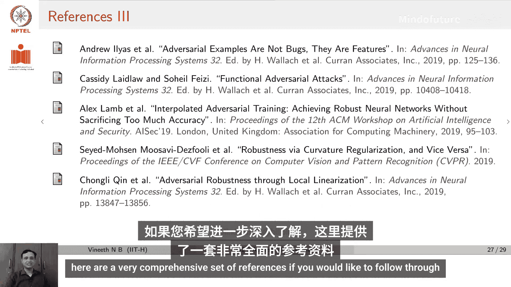

# 【NPTEL】计算机视觉的深度学习 p76 P76_对抗鲁棒性 -BV1vNWkzpEua_p76-

The next topic that we discuss again， a contemporary one is adversarial robustness。

In supervised machine learning。Often the distributions that we deploy machine learning models on that is the test distribution are often not the distributions that you train the models on。

 unfortunately。Whenever there is such a distribution shift。Then machine learning models。

 especially deep learning models， suffer and tend to perform poorly。😊。

One such scenario where this distinction becomes even more prominent are what are known as adversarial examples。

Adversarial examples， this is different from the adversarial word in Gs。

 this has a different notion here。😊，Adversarial examples are data points which are indistinguishable from your data set。

But lead to wrong predictions。Here you see an example where an image of a pig pig。

 which a deep learning model said was a pig with 91% confidence。

 If you add a little bit of random noise， just 0005 of random noise to this pig。

The same deep learning model now calls this an airliner with 99% confidence。

This is a serious problem。Especially considering that humans don't seem to suffer from this problem and for few humans。

 the output image is still a pig quite clearly。So why do deep neural network suffer from this problem unfortunately it is still not well known but this question has led to a body of work over the last few years on what are known as adversarial attacks which try to hack the model and disturb the model and adversarial defenses which try to protect the model against adversarial attacks lets see both these kinds over the rest of this lecture。

In general， it has been studied and understood now that supervised frameworks are vulnerable to adversarial attacks in any domain。

Here is an example where you see a detection and segmentation task。Give it an image。The first。

Detection image that you see here calls these dogs and you also get a segmentation mask around them as dogs。

But when a small adversarial perturbation is added to air to this image。

 now this pink po or magenta box that you see here is now a train with fair good amount of confidence。

 and the masks too now reveal a different label for the same image。Similarly， for text。

 if there was an original input which has a certain sentence and the prediction is that the tone is positive with a 77% confidence。

😊，If an adversarial example is。😊，I a small change is made to the sentence as you can see the change here is very very small but now the prediction is that the tone is negative with the 52% confidence and if the wordfil is changed to footage which is perhaps semantically similar。

😊，Even then， the prediction becomes negative with 54%。

This is worrisome again considering that humans don't suffer from such problems， Similarlyly。

 here is an example for an audio based network where given an audio signal。

 the neural network translates this as it was the best of times， it was the worst of times。

And when a noisy signal multiplied by a small scalealar constant is added to the signal。

 the same neural network now classifies this as it is a truth universally acknowledged that a signal。

😊，The meaning completely changes。So now coming to what are adversarial attacks？Over the years。

 there have been methods that have been developed of different kinds。

And there are a few different ways of categorizing these methods。😊，If one looked at the threat model。

These attacks can be called white box or black box attacks。In white box attacks。

 the attacker assumes access to the model's parameters。Whereas in black box attacks。

 the attacker does not have access to the models's parameters。

 so it' is perhaps coming from a different model or no model at all to generate these adversarial images。

 remember adversarial attacks are intended to cause problems with the model。

 so you could look at that as equivalent into ethical hacking。Similarly， on the basis of objective。

 adversarial attacks are differentiated as targeted attacks or untargeted attacks in untargeted attacks the aim of the attacker is to enforce the model to misclassify。

Whereas in a targeted attack， the aim is to ensure that the model classifies it as a particular target label。

So， in an untargeted attack， if you had an image of a cat or generally called a cat。

You want to add a perturbation that ensures that the model no longer calls it a cat。

In a targeted attack。The attacker now wants to add a perturbation to ensure that the cat is now called a dog。

 for instance could be any other target label， but you want a specific target label targeted attack could be a big problem in biometrics where one person may want to add some noise to an image to impersonate as somebody else to a deep learning model trained for face recognition。

A third categorization is based on distance metrics used。😊，So。

 in all of these adversarial perturbations， a constraint is that the perturbation should not have a very high norm because you don't want the perturbation to be too large because it is then always easy to add a very large number and change the outcome of a model。

😊，The challenge here is to ensure that the perturbation is as minimal as possible and when you say as minimal you have to measure a distance and that is done using different kinds of LP norms such as L0 norm。

 L2 norm or L infinity norm。😊，So in L0 norm， the total number of pixels。

That differ between clean and adversarial images is used in L2 norm。

 it is the squared difference between the clean image and the adversarial adversararily perurbed image and in L infinity norm it is the maximum pixel difference between the clean and adversarial images。

😊，LInfin de norm is often used in many of the methods。

Let' us now see a few methods that do what is known as white box adversarial attacks。

 which means they assume that they have access to the model's parameters to be able to attack the model。

One of the prominent methods in this context is known as FgSM or fast gradient sign method。

Where the model computes an adversarial image。By adding a pixel vice perturbation of magnitude in the direction of the gradient。

So in this single step method。You add a perturbation x is the original image。

You take the gradient of the loss with respect to x find the sign and add an epsilon in the direction of that sign remember that the gradient would actually be a vector with respect to each input dimension so for each of them you would have a sign so for each dimension you add an epsilon times its corresponding sign。

What are you doing， you are now trying to add a perturbation which would increase the loss and hence resulting in an adversarial perturbation。

😊，So， this is known as a single step method， just one update to get an adversarial perturbation and hence very efficient in terms of computation time to implement。

😊，If this had to be done for a targeted attack。It is the same method。

 the only difference now is you now go in the direction of the negative of the gradient of x。

Assuming that the gradient is computed with respect to the target label。

Remember that when you do a negative you are trying to reduce the loss with respect to the target label so you are now trying to make the model think that that sample is a different label。

So x here is the image。X add is the adversarly perturrb sample。L is the classification loss。

 y through is the actual label， y target is the target label for a targeted attack and epsilon is the budget or L infinity budget or any non budget that you have which you allow for the perturbation。

A more popular and a complete method is。😊，Known as projected gradient descent。

 this was introduced in 2017。This is considered one of the most popular methods today widely used and it is considered a complete method because it does not impose any constraints on amount of time or effort。

😊，So it is an iterative process unlike FGSM which is a single step method。

 PGD is an iterative method which keeps improving the adversarial perturbation unless until it succeeds。

😊，How do you do this？😊，You start your first iteration adversarial sample with X。

 which is your given sample。Then in each itration。You add gradient corresponding to that iteration adversarial sample and corresponding to the true label remember you are trying to increase the loss for the true label and you know project this sample back into the epsilon neighborhood so you try to find out what is that sample that takes me to a higher loss。

Projected back to the epsilon ball that you are allowed your perturbation in。

 remember that epsilon imposes a certain constraint on the size or the norm of the perturbation。😊。

This gives you a new adversarial perturbation now you repeat this over multiple iterations until the sign or the classification output changes。

😊，So， in case of L2 norm， the update becomes。Epsilon times you have the gradient of the loss divided by the2 norm of the gradient of the loss；

 the sign simply becomes the gradient by the two norm of the gradient which is in other words the sign。

The visualization here shows a loss surface， the loss surface here is that the sample is initially in a region of a very low loss。

😊，And by taking a series of iterative steps。The sample is now moved to a position where the loss is very high。

 remember， yellow here is high loss and。In two different runs。

 you now take the sample to two different locations where the loss is very high。

Another popular method which was developed in CVPR of 2016 is known as deep fool。😊，In deep fold。

 the idea is。Considering the decision boundary while coming up with the adversarial perturbation。

Given any a fine classifier， a linear classifier， which is given by f of x is equal to w transpose x plus b。

The minimum perturbation。😊，To change the class of an example， xn。

Is the distance to the hyperplane to the decision boundary which is given by w transpose x plus b is equal to 0 and this distance between a point and the hyperplane is given by minus f of x n where x n is the point into w by 2 norm of w。

This is a known quantity and this takes us from any point to the decision boundary。

When the class label changes when that point goes beyond that decision boundary。In general。

 for a more general differentiable classifier。This method assumes that f or the decision boundary is linear around that particular point and hence。

😊，It tries to compute a perturbation。Which minimizes the two norm of the perturbation。

Subject to assuming that the perturbation is on a linear neighborhood local neighborhood of that point xt with respect to the decision boundary。

 but now you keep running this iteratively until the decision on xt prime changes from xn。So。

 you find a delta such that it lies on a linear approximation of the decision boundary around that point in such a way that the two norm of that perturbation is as low as possible remember you want your perturbation to be a very small quantity。

And you run this iteratively until the decision boundary or the class label changes。

What happens if you have a multi class classifier？Then the distance is computed to the surface of a convex polyhedron formed by the decision boundaries between all classes。

 So the distance from x n to any direction， which is。

On the surface of a convex polyhedron is the minimum distance that you need to add or the minimum perturbation that you need to add to Xn to change the class label into something else。

😊，Another white box adversarial attack， which has also been used over the years。

 is known as the CW attack or the Carlinni and Wagner attack。

Which is an optimization based adversarial attack again。😊。

But the problem now is formulated as minimum over deelta。D of x commma x delta， such that。

F of x plus delta is a particular target label or a label different from the true label。

Subject to the constraint that x plus delta also lies between 0 and 1。The D here can be L0。

 L2 or L infinity distance measures。To ensure that x plus delta yields a valid image that is x plus delta should lie between0 and 1 this method introduces a new variable kappa which is used within this formulation for delta delta is written as half 10hch of kappa plus 1 minus x y is this done because if we write delta this way we get that x plus delta will be half of10hch of kappa plus 1 we know that 10h has a range minus1 to plus 1 so hence10 h plus 1 has a range0 to 2 and dividing by half ensures that this value always lies between0 and1 one more white box adversarial attack is a Jacobian based salency map attack。

In this case， to fool the D with small L0 perturbations。

The method computes the Jacobian matrix of the logicits。Before the softm layer， remember logicits。

the outputs of the neural network before the softmax layer and the Jacobbin is computed between every output in that layer in the logicits with respect to every input that gives you a matrix of different gradients。

😊，Once you get the Jacobb matrix， you get an understanding of which input pixels affect which of the logicits in particular。

😊，Using this， the method suggests the creation of an adversarial saliency map which is given by。😊。

This adversarial salency map is given by 0， if。The true gradient that is f with respect to that xj that you want to consider that input dimension if that is less than or equal to0 or the gradient with respect to non-true labels nonground truth labels is greater than 0 What does this mean this means that if the gradient becomes less than 0 which means we are further improving the output on the true label this also means that we are going further away from the non-true labels we don't want that direction so in those directions the salency map is set to0 in every other case where the gradient of the true label with respect to xj is greater than 0 or the gradient of the other labels the logics corresponding to the other labels with respect to the input is less than0 wed like to encourage those directions。

To change the label so this method proposes the adversarial saency map to be。

The gradient of the true label into the absolute value of the sum of the gradients for the other classes。

 why absolute value because in the second case we know that the other gradients will all be less than 0 so wed like to use the absolute value。

Once you get these adversarial salency maps， we then perttu the element with the highest value of the adversarial salency map to increase or decrease the logic outputs based on what you like of the target or the other class significantly。

😊，The last white box adversarial attack we will see is known as the universal adversarial attack。

The goal here is to find one perturbation for all your examples。If you observe carefully。

 so far all the methods for adversarial attack。😊，Try to find a perturbation for a given sample that will fool the deep neural network model。

But that can be laborious。So the aim here is to see if we can find one perturbation that will fool them all。

How do you do this？This is now done by if you consider this illustration here， x1。

 x2 and x3 are juxtaposed， they are not located。 They don't have the same vector value。

 This is just for convenience。R1 here denotes the boundary corresponding to x1 rather thats the minimal perturbation。

 thats the ball or the set of values with the minimal perturbation after which the class label for x1 will change similarly you see an r2 for x2 and an r3 for x3 which are the regions where the label stays the same beyond which the label changes。

With this knowledge， how do you learn the universal perturbation？

The method initializes the perturbation v to 0 and for every sample Xi finds a delta V that adds an R such that the decision changes。

And then now projects v on to some ball， you try to ensure that if you found a delta V。

 then you try to ensure that the final。Perturbation for this sample is a v which satisfies the epsilon constraint on the LP norm。

 so if you started with x1 you would get this particular point as the point at which the label changes now when the next point comes you realize that at that point x2s label doesnt change so you further add a delta for x2。

Then a delta for the next point， so on and so forth。

 and your V now is the sum of all of these delta Vs。

 which is the total perturbation that you need to add for any of these points to change the class label。

Now let's look at a couple of non LP based white box adversarial attacks。

Where you don't necessarily use the norms to create the attack， but use other kinds of methods。

One of them is called the spatially transformed adversarial attack。In this method。

Given a benign input image， a clean image。The goal is to find a flow that means all pixels are moved by a certain quantity。

In such a way when that flow is added and you perform a bilinear interpolation to ensure that you dont get positions that lie between two pixel locations。

You get a final adversarial image。Now， to learn this flow。

 the final objective function is given by argument over all possible flows。

 L adversarial xf and some tau times L flow times xf here。

L aarial encourages the generated samples to be misclassified。😊。

An L flow tries to ensure that the flow perturbation is as minimal as possible。

Another method in this category are known as functional adversarial attacks。😊，So far。

 we looked at all attacks or perturbations which are additive in nature where you add a percent perturbation to a sample。

In this case， we now try to transform the sample using a function。

Those are known as functional adversarial attacks and then you can combine the additive and the functional attack to get a combined attack an example here is you could now apply an attack to change all red pixels in an image to light red pixels remember this is not additive but an intensity scaling operation which would be considered a functional attack。

Moving on from white box attacks， we will now talk about a few black box attacks for adversarial perturbations。

One of such examples， remember in a black box attack。

 you do not have access to the model's parameters。But remember， from what we have seen so far。

 we need to be able to estimate the gradients of the target neural network to produce an adversarial image because that tells you a sense of the direction in which the loss or the output of the neural network will change。

😊，But in this case， in black box， we don't have access to the model's parameters。

 we only have access to the outputs of the model。We assume that we have the axis to the logics of the target model。

We still have to come up with an adversarial perturbation which changes the output of the true label to some other class label by at least a certain distance。

So， this method called z0 order optimization suggests that you can now approximate the gradient by doing multiple forward passes on the model。

You do a forward pass of x plus H EI where EI is a small perturbation。

 minus f of x minus H EI divide by 2 h， we know from first principles that this is an approximation of the gradient and I could now use this as an estimate of the gradient and then do any other any method similar to one of the white box attacks。

Another approach in this direction is called an optt attack。

where the target model here can only be queried to get the hard label not even the logics remember in this approach in the zoo approach we said you could get the probability scores or the logics of the model now we say even that is not available you can only get the winning label so the perturbation that we need here G theta is the minimum lambda such that F of x plus lambda into theta by normm theta is not the true label。

But how do we do this when we don't have access to the gradients and we only have access to the final prediction of the model？

So one has to rely on a brute force kind of an approach where a coarse grained search is finally performed is initially performed。

To find a decision boundary and then this is fine tuned using binary search so you try to see how much do I add。

To cross the decision boundary and if you cross it by a lot now within that perturbation do a binary search to find the exact perturbation that makes you cross the decision boundary and you do have the output of the target model to check whether you cross the decision boundary or not。

Another black box adversarial attack， which is a gradient free attack where there is absolutely no gradients is you create a neighborhood consisting of all images that are different from the previous rounds image by just one pixel。

😊，You initially pick a random pixel and add a perturbation。

You can now calculate the importance of that pixel by observing the change in classification accuracy after adding noise。

Now you choose the next pixel location among pixels lying within a square whose side length is2y。

 you stay in that neighborhood。You again， find the importance of。

Each of those pixels in that neighborhood and this can give you an approximation of the loss functions gradient which you then use to attack the model。

😊，We now come to the other side of the story so far。

We have seen several methods that perform adversarial attacks。

Now we will talk about a few methods that try to defend deep neural networks against adversarial attacks。

Why do we need this？Adversarial attacks pose a serious security threat to services that use modern deep learning models。

Here is an example which was performed using a Tensorflow camera demo app to classify clean and adversarial images。

Given an image from the data set。Initially， the model calls this a washer。

And when an adversarial attack or a perturbation is added to image。

 now the model thinks this is a safe， which it is clearly not。😊，So， in the physical world。

 like applications in autonomous navigation， an adversarial attack can cause lives and it becomes important to defend against them。

😊，One method to perform an adversarial defense is called as random input transformation。So。

 in this case。😊，Given an input image a test time。The approach is to firstly randomly resize the layer。

And then randomly pad the image in different ways。😊。

And pick one of these outputs to give to the CNN model and classify。Why are we doing this？

We expect that irrespective of where the object is in an image。

 the CNN will be able to classify it that is the first part。

The second part is we are hoping that by choosing this image randomly。😊。

The model or the adversarial attack may not pick a pixel in this part of the image。

Where the image is actually located in this part of the canvas。

 where the actual image is actually located。Another approach is called random noing where a noise layer is added before each convolutional layer in both training and testing phases you can see here that a convolutional layer block which has a convolutional layer。

 a batchum layer and an activation layer now you also have a noise layer added to each of your convolutional blocks。

What's the purpose？Both at training and testing， you add multiple random noises and ensemble your prediction results across all of these randomly perturbed inputs and this gives you robustness against adversarial attacks at least to an extent。

Another defense method is known as defense G。Where a generator is trained first to model the distribution of clean images so you have your training data。

 you don't consider any adversarial perturbations you only train a again to generate more images such as your training dataset。

At test time。You now cleanse an adversarial input by finding the nearest generated image。

 how do you do that？You then you have a random number generator。

 you then try to find out different images obtained through different random noise vectors to the generator。

You try to see which of them of which of those generated images is closest to the current input which could be adversarial and now use that as a classifier。

😊，To finally use that as input to your classifier to get the output。Why do we do this？

We hope now that。Any adversarial perturbation may now get。

Hidden by considering the closest image and that pixel value that have been that may have been added to a specific pixel is now offset by considering a different image。

😊，There are other methods in the same space that operate with a similar principle called pixel Def。

 magnet， apegan， so on， and so forth。Another defense is based on an approach called network distillation。

😊，We will see the idea of distillation more closely in the next lecture。

 but we will give a high level idea here。😊，The high level idea here is you have an initial neural network which is trained given training data and training labels。

And this network outputs a set of a vector of logicites or a softmax probability distribution as its output。

😊，Now， the Dis network learns using these probability vector predictions instead of the original one hot training labels。

😊，So if your initial network。Had a distribution over say 10 labels instead of recognizing a digit S3。

 it would have a probability distribution over all labels。

The second network is asked to predict that probability distribution rather than predict the digit 3。

😊，How does this help？Using a very high temperature softm， remember。

 if you use a high temperature softm， you get a more smoother distribution in your softm values。

 the probability values that reduces。The model sensitivity to small perturbations so you dont easily assign another label because you have smoothened out your probability distribution across all labels。

But the most important and most widely used adversarial defense is known as adversarial training。

In adversarial training， which is a computationally intensive process。😊。

You simply add a PGD or an FGSM attack as part of your original training loop。

This is considered the ultimate data augmentation step。

So in each step of your training of the original deep neural network model。You add an inner。

Maximization step， which tries to find the delta that maximizes the loss。

And then you find a theta that minimizes the loss for this adversarial perturbation。So。

 within each loop or iteration of training， you have to solve for each data point a maximization problem it says。

Given an input sample in one mini batch iteration of SGD。

 how much should I perturb this to cause maximum damage？You find that perturbation called that delta。

Now you add Delta to that input and then minimize the loss over the overall network。This is。

Obviously， the most powerful adversarial defense it widely opted and the current state of the art for adversarial training。

😊，There have been a few variations of adversarial training based on similar ideas。😊。

One of them is known as adversarial logic pairing where you have a clean sample which is given by this green vector。

You put up it and you get this red vector。😊，You pass both of them through the neural network。

You try to ensure that the logics of the clean sample and the adversarial sample are close to each other using something like L2 loss。

This also helps as a form of adversarial training。A more recent method called trades。

 which was published in IL of 2019。Uses a similar idea， but a different method。😊。

It decomposes the prediction error as the sum of natural error。And boundary error。So。

 you have a natural error here， which is the error that you typically deal with when you train any neural network model and then you have a boundary error here which is trying to find the delta that will push the decision function to give a different label that is the second part here which has another maximization here。

 which is why it is an adversarial training step。While ALP， which is adversarial logic pairing。

 uses PgD adversarial samples。Traadedes computes adversarial samples as maximum of delta where the decision between F ofx and F ofx plus delta is maximized。

So you want that loss to be as high as possible。Not necessarily a PGD attack。

 so you can look at ALP as enforcing L2 loss while trades uses a classification calibrated loss。

An important takeaway from the entire studies around adversarial robustness is that one has to deal with a tradeoff between robust and clean accuracy。

😊，Unfortunately， adversarial robustness comes at a cost of decreased clean or standard accuracy。😊。

Here is an example where as you see here that on the y axis you see the difference between adversarial error and the standard error。

 you can see that when the attack increases 4 by 255 is a very powerful attack because you are allowing the perturbation to be larger than 3 by 255 or 2 by 55 or 1 by 255。

 you can see here that when the attack is higher the difference between adversarial error and standard error goes up。

However， this graph also gives us。😊，Some consolation that as the number of labeled samples increases。

These differences seem to get reduced over time。So。

 as you keep increasing the number of training samples。

 it looks like even if you had a stronger adversarial attack。

 the adversarial error and the standard error the difference is not too much。😊，So。

 more recent methods such as interpolated adversarial training or。Adversarial vertex mix up。

Try to reduce this trade off by increasing the train set size using interpolations between your standard data and an adversarial sample。

You could consider now taking using adversarial training to find take your data point and input data point。

 find its adversarial perturbation in the inner maximization loop of adversarial training now take interpolations of all the points that lie on the line between the clean point and the adversarial perturbation。

All of these when added to training help improve the train set size and thus mitigate this trade off problem between adversarial error and standard error。

😊，Over the last year。There have also been other notions of robustness that have surfaced。

 such as attrial robustness。Where methods attack explanations and saency maps instead of attacking predictions。

So， you have an image， you perturb it in such a way that the class label output is the same。

 but the explanation significantly changes。There is also the notion of robustness to natural corruptions such as say fog。

 a blur or snow， so on and so forth， which again an example could be autonomous navigation where when you train a model to drive on a normal road。

 you should be able to drive in the same scene even if there is rain or snow in the same setting。

Robustness against natural corruptions also becomes important in such scenarios。

Your homework for this lecture。I to go through these excellent tutorials on adversial machine learning tutorial 1。

2 part 1， part2 and part 3 and if you are interested you can read further on these links here。

This space of adversarial robustness is quite vast today but these links give you a fair picture of an understanding and the links to a few code bases to try to understand how these work in practice are also provided here for your experimentation。

😊，Here are a very comprehensive set of references if you would like to follow through further。

