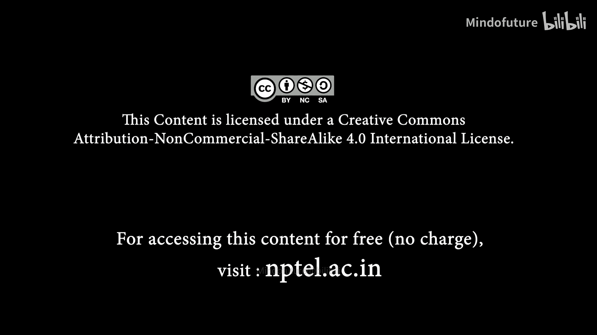
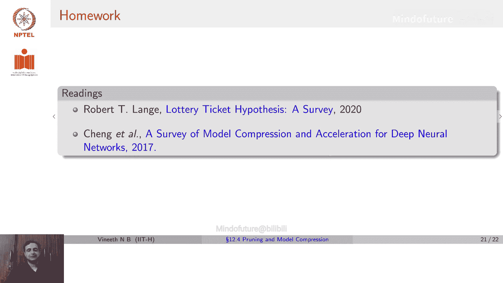

# 【NPTEL】计算机视觉的深度学习 p77 P77_剪枝和模型压缩 -BV1vNWkzpEua_p77-

Moving on from adversarial robustness。We will now talk about pruning and model compression。

Another important component in taking deep learning models to in the wild real world applications。

Neural networks in general are optimized to improve predictive accuracy。

Be it accuracy for classification models， mean average precision for detection models or pixel Vi classification accuracy for segmentation。

😊，Trying to chase accuracy alone makes neural networks very large as a result。

The models that are state of the art today have very large number of parameters。

 often of the order of millions。Recall that we said that Alexnet has over 60 million parameters occupying about 200 M of space in the memory。

VGG occupies up to 500 MB MB of space just to the weights in the model in your memory。

Is this really a problem？😊，When you train your models。

 it is al right to have very high storage footprint， memory footprint。

 and one can use powerful GPUs to train these models。However， expecting the availability of。

Heavy compute at test time or inference may be limiting。

If one considers the deployment of deep learning models in low compute applications such as mobile phones。

Drones or unmanned aerial vehicles。Or Io devices， which could be deployed in any edge at the corner of the world。

 even in harsh conditions。Having bulky neural network models becomes a limiting factor in taking their success to these kinds of compute platforms。

Another way of viewing this is from the viewpoint of the energy expended for carrying out such operations in memory。

An interesting analysis was done by Songhan， who came up with one of the most popular papers for deep model compression。

And the analysis here shows on the stable。That a 32 bit 32 bit integer addition consumes about 01 picojouleles picojouleles is 10 per minus 12 of energy。

A 32 bit float addition operation consumes 09 picojouleles。And if you keep going further and further。

 a 32 bin SRAM cache access operation consumes 5 picojouleles and when you go to the DM you significantly go up in orders of magnitude and now things go up to 640 picojoules。

Accessing DM or dynamic Ram is significantly more costly than accessing your SM。😊。

Why are we talking about this？Which means when we talk about low compute devices。

 we ideally would like these deep learning models to be housed in the SM and not have to go to the DM because accessing them could cause a lot of energy requirements。

 especially in environments like drones or edge devices IoT devices where battery also becomes a concern to deploy these models。

 so one key requirement that emerges now is the need。

To be able to prune these bulky neural network models into smaller memory footprints that can be deployed in low compute environments。

This category of methods are broadly called model compression methods where a trained model is compressed into a smaller memory footprint for deployment in low compute devices。

Over the last few years， several efforts have been。

Taken have been taken by different researchers and a broad categorization of these methods can be given as parameter pruning and quantization that is one family of methods which focuses on reducing redundant parameters that do not affect performance。

😊，A second family of methods is based on low rank factorization where matrix and tensor decomposition methods are used to estimate only the informative parameters and discard the rest。

Transfer or compact convolutional filters。Are a family of methods where special structural convolutional filters are designed to save parameters。

And finally， an interesting family of methods called knowledge distillation methods that use an idea of distilling knowledge from a large neural network model into a small student neural network model。

😊，We won't see all of them in this lecture， but see a few。😊。

Once briefly and point to other resources for more reading。Specifically。

 we will see a very popular pruning based approach。😊。

A knowledge distillation approach and a more recent approach called Lotery ticket hypothesis。

One of the most。Popular and reasonably early methods for model compression is called deep compression developed by Songhan in IclLR of 2016。

😊，It was a game changing method which also took the method forward to hardware design。

And this uses a three stage pipeline to reduce storage requirement of neural nets。

The first step being pruning of a trained model。Then quantization of the weights and finally and Huffman encoding step。

 which provides a model that reduces the size by 35 to 50 x with very minimal loss in accuracy。

Let's see each of these steps。 The first step was to prune the model。What did pruning mean here。

Once you train the full model， which is the first step。

Weights with values below a certain threshold are removed from the network。

 so if any weight is lower then say 10 power minus 5 that weight is removed from the network。😊。

And the remaining sparse network with only the other connections is。

Retrained to get a better network。Once again this is an iterative process once again in that new retrained sparse network if any weights are below a certain threshold they are removed and once again the remaining sparse network is retrained and this step is done iteratively。

😊，And just with this simple step alone， the authors showed that many of the popular networks。😊。

Could be reduced in size significantly， for example you see here Alexnet while the original size is 61 million using the simple pruning step。

 the size comes down to 6。7 million which is a 9x compression and when one looks at the top 1 error or top 5 error on on imagenet you notice that there is no significant drop in performance because of this reduction in parameters in case of Vg pruning alone reduced number of parameters by 30x。

This was also observed for smaller network networks such as Leite。

The second step after pruning is a step known as weight sharing。Where in each layer。

The weights in that layer are partitioned into k clusters using simple k means clustering and each weight is replaced by the centroid of the cluster that it belongs to。

So here you see an example of a 4 by 4 matrix of weights。😊。

And the cluster assignment in the subsequent matrix here。And the cluster centroid value。

 which is shown for each of these clusters。At the end。

Each of these blue weights are replaced by the clusterentroid of the blue color here and so on and so forth for each of the colors。

 how does it help we need to store fewer values to represent this layer's weights。

A subsequent question is if the weights change and are clustered like this。

 what happens to the gradients？😊，The gradients also follow a similar process。So。

 if you have a certain values of gradients for each of these locations in that particular layer。

 the gradients are also clustered and the cluster centroid value for the gradient is then used to subtract from the original weight to get the new weight。

 so even the gradients participate in this weight sharing exercise in the same way。

Having done pruning and weight sharing。The next step that the authors used was quantization。

This was based on an empirical observation。That instead of using 32 bit float values。

 if we used just 8 bits， the performance really did not reduce much。😊。

So this is the quantization step that was then used to still further reduce the storage footprint。

And the final step was to use Hfman coding。Huffman coding is a popular。

Coding compression method in computer science。where a frequently occurring pattern is stored with lesser number of bits and a rarely occurring pattern is stored with more number of bits to capture its additional information。

Hfman coding is a long standing compression method which is used here to once again reduce the storage footprint。

😊，With these methods sequentially one after the other。

The overall approach showed a 35 to 49x reduction in parameters with minimal loss of accuracy。

 as you can see here。Alexnet went from being 240 MB to 6。9 MB in this particular case。

 and VGG went from 552 MB to 11。3 MB which was a 49x reduction in storage parameters with if you see the error rates here。

 there is no significant loss in error because of this compression which is the main objective。

So once you get to 6。9 mmb or 10 M， these models now become amenable to deploy on low compute devices。

A second method that we will talk about is that of knowledge distillation。

The key intuition of this family of methods is to transfer knowledge from a cumbersome large model。😊。

To a small model， which we call a student model whose size is more optimized for deployment。

The question obviously here is what do we mean by knowledge in a deep neural network？

And the first idea that was used here was that knowledge can be viewed as the mapping between inputs and the softmax probabilities。

😊，Instead of while you are looking if a cat， if there was an image of a cat and you would like the class for the cat to be 1 and everything else to be 0。

 a neural network may not necessarily give you that output it may say the probability for a cat is 0。

8， and the probability for other class labels could be 0。01。05 so on and so forth。Now。

 these outputs represent the knowledge that the neural network has gained over the process of training。

So in knowledge this distillation， the idea now is to take a small shallow student network and instead of training this network with hard labels or one hot labels。

😊，We we ask the student to target and predict the softmax probabilities or even the logics of the teacher network。

😊，You can see here you have the cumbersome model and through distillation the distilled model objective。

😊，Is to match the soft outputs or targets of the teacher model in this sense the knowledge gained by the teacher model is distilled into the student model which performs as well with a smaller storage footprint。

Here is a simple experimental example。😊，So， given a cumbersome model。

 this is on a list of two layers with 1200 re nodes and dropout and a small model of two layers and 800 re nodes smaller model at least with no regularization。

 it is simple to observe。😊，That the number of errors on MNIST with the cumusor model is 67。😊。

If you train the small model using standard training。

 it makes 146 errors on the test set of MminNist and the small model with distillation makes only 74 errors which is close to the bulky model。

Over the years， knowledge distillation has resulted in several variants where instead of matching only the logics or only the outputs。

 probabilistic outputs of the teacher model， you can also match intermediate representations of hidden layers。

 you can add some noise and try to ensemble multiple teachers， so on and so forth。

 which are provided in the references for further reading。

A third approach that we will talk about here is a recent one published in ICLR 2019 called Lotery ticket Hypothesis。

As the name says。This was based on an observation that when you train a full bulky deep neural network。

😊，Often， a very sparse subnet obtained after pruning produces accuracy close to the full model。So。

 you randomly initialize weights and train a full network you get 90% accuracy and you prune you get a sparse subnet with 90% accuracy。

 but you took the same。😊，Kind of a sub network randomly racialized it and trained。

 you get only 60% accuracy。😊，So， there seems to be something about training the full network and then pruning。

😊，So， this work made a hypothesis that a randomly initialized dense neural network。😊。

Contains a sub network。That is initialized such that when it is trained in isolation。

 it can match the test accuracy of the original network after training for utmost the same number of hydrrationations。

😊，The obvious question now for us is how do you find the subnet？To do this。

This approach proposed a simple idea which is called one shot pruning。

Where you first train a full network with random initialization。

You prune a certain P percentage of the smallest weights of the full network。

You reset the remaining weights to their previous initialization to create the winning ticket。

They showed that following this procedure helps us find the lottery ticket。

 which is that one random sparse subnetwork which seems to match the accuracy of the complete network。

One could also repeatedly prune the network over multiple rounds similar to the iter of pruning that we spoke about for deep compression。

 this does get better results but of course requires more computation。

Here are some results that were shown in this work on the left。

What you see are percentage of weights remaining versus early stop iterations for MNS and sfain you see here that for if you look at these two curves。

 one of them the dotted lines is a randomly sampled sparse network and the bowl line is the one obtained by lottery ticket hypothesis。

You see that even when the number of early stop iterations is very low the percentage of weights remaining for the lotterate ticket hypothesis remains high using this kind of an approach a similar pattern is also observed for sar 10。

On the other hand， more importantly a plot of the percentage of weights remaining versus accuracy is again favorable favorable for the lottery ticket hypothesis you can see that the dotted line here and the bold line here dotted line is a randomly sampled sparse subnet and the bold line is the one obtained using lottery ticket hypothesis。

 you see that as the percentage of weights remaining。😊。

Decreases you can see here it goes from 100 to 0。2 the dotted network sub network the random 1 has a quicker fall in accuracy while the alternate ticket hypothesis maintains a higher accuracy for a longer period of time a similar result is also seen on spha1 with different kinds of layers shown for the percentage of weights remaining。

So， is that always a good strategy， not really while iterative pruning produces better results？😊。

It requires training the network perhaps about 15 times per round of pruning。

 on the other hand finding lottery ticket hypothesis while can be done sometimes may not give you as good a performance as the original network。

😊，If you did iterative pruning， it is going to be harder to study large data sets such as Inet。So。

 over the last few years there have been improvements over the vanilla Lotery ticket hypothesisth work where researchers have studied if these winning lottery tickets can be found early on in training rather than wait for too many iterations can such winning tickets generalize to newer data sets and optimizers and does this hypothesis hold in other domains such as text processing or MLLP。

😊，These methods have also been extended in several different ways。😊。

XNRnet is a popular compression method where binary weights are used the understanding here is you don't need the precision of representing each weight using too many bits just using binary weights and replacing convolution with XNR operations can make neural networks。

 attain reasonable amount of accuracy with a very small memory footprint。

Tinnet compresses CNNs with filter pruning。Knowledge installation methods have used noisy teachers where the teacher logics are perurbed to get the effect of multiple teachers to train a student。

Relational knowledge distillation adapts metric learning in destination in distillation and there have also been specific architectures。

 we discussed a few of them when we discussed CNNs， mobile nets， shuffle net， SNe。

 S deck for detection and SCP net， so on and so forth， which have been used for model compression。😊。

As we said earlier， the space is fairly large， there are also low rank factorization methods。

 there are also methods that design convolutional filters in a particular way to save parameters。

 so on and so forth， which we leave it for reading in this lecture。😊。

So the homework for you is to read a very nice survey of the lottery ticket hypothesis and this。

Comprehensive survey of different model compression and acceleration methods for deep neural networks。

Hereアラソムレフレッズ。