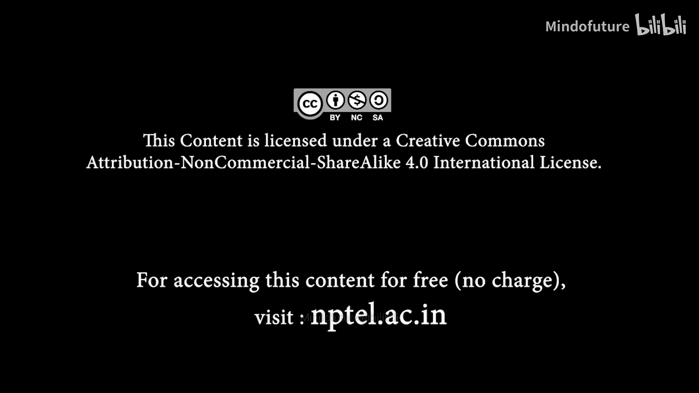
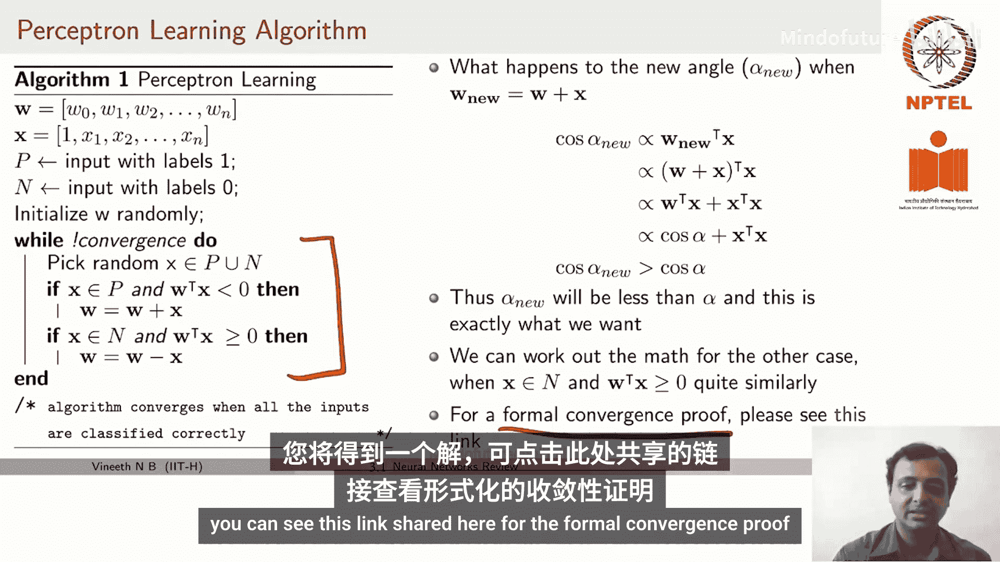

# 【NPTEL】计算机视觉的深度学习 p80 P80_神经网络回顾 - 第一部分 -BV1vNWkzpEua_p80-

🎼Yeah。

嗯。In the lecture so far。We focused on computer vision as it was studied and practiced。

Before the advent of deep learning。Deep learning。Has completely revolutionalized how computer vision is done today him。

While there have been several dimensions to the efforts in computer vision before this advent of deep learning。

Hopefully the few lectures that we've had so far give you a peek。Into all those efforts。

Some of which continue to be relevant today when combined with deep learning especially。

Moving forward， well focus our lectures on deep learning and its use in computer vision。

We'll start with the first lecture as a review on neural networks for those of you that may have done a deep learning or a neural network course before。

This may be a review， but even if you have not done such a course before。

All the inductory material will be covered in these lectures。

I'd like to acknowledge that most content of this lecture are based on the excellent lectures of Mentesh Kara on deep learning IT Mes。

To start with the history of neural networks。The history of neural networks is perhaps older than the history of computing itself。

It started in the early 1940s when two researchers Meallog and pits。

Work on developing a computational model of the human brain。

And being able to use that model to simulate simple functions such as logic gates。Later in the 1940s。

was a psychologist named Donald Hem。Who came up with what is known as He and learning。

 which is used to this day？Hebe learning states that in the human brain。

Two neurons that are wired together。法院不结准。Two neurons that are out of sync。Fate to link。other。

If two neurons keep getting fired together。The strength of the connection between these two neurons gets。

Better and better over time。While if there are two neurons that rarely get fired together。

The strength of their connection becomes weaker and weaker over time。

This is a principle that is used to this day。Later in the 1950s。Frank Rosenbl came up with the first。

Model of the neural network known as the perceptron。

The perceptron is the simplest neural network one could have。Which has a set of neurons。

 which is known as a layer of neurons， which receives a set of inputs。

Acts on them through a set of weights and then gives them output。

 which is threshold to get the final decision。The Russiansan La also proposed a learning algorithm to obtain the weights in this simple neural network。

In the early 1960s， this learning rule was improved by Wi and Hf。

 which is known as the Wirow Hf learninging Rule or the Delta learning Rule。

This was the foundation of algorithms that we used to this day， which we will talk about soon。

However， Rosenbl claimed that this perceptron。Could classify any kind of a data setting。

 a binary classification setting。Minky and pepper。Two researchers at that time disproved this using the example of the exorgate。

 which clearly cannot be separated by a simple percept law。

This led to a downfall of neural networks in the 1970s because。

All the hype of the perceptron has simply been crashed because of its inability to handle the ZR scenario as well as similar complex functions in the 1980s the interest once again revived with the development of neocogniron in 1980。

 which is largely considered as the first version of a convolutional neural network。And in 1986。

Was the development of groundbreaking algorithm that propagation。

 which we used to this day by Robel Hart， Hinton and Williams。Later in the 1980s and the mid 1990s。

Versions of neural networks such as convolutional neural networks， were developed at that time。

And these neural networks were adopted in various different applications。

One popular application at that time was the handwritten digit recognition problem。

 which is today known as the MN dataset set。The reason for the popularity of this data was。

The application setting at that time， which was a requirement of the United States Postal Service where they wanted the handwritten digits on postal mail to be automatically sorted。

By an analysis of the digits on the postal account。

Convolution neural networks was one of the forerunners at that time of performance on the USPS or the MNS dataset set。

In the midnight piece。Also came the support vector machines of SMs。

 which was backed by an elegant theory and also started performing very well on these applications and for a large part between the mid-90s and perhaps the first decade of the 21st century。

Machine learning applications were dominated by。What today are known as traditional machine learning algorithms such as support pet machines。

 boosting， bagging， and many other variants of these decision trees。

 many other variants of these algorithms。In the mid 2000s。

Jeffrey Hinton and Russellyn Sanakinov came up with a hierarchical featured learning algorithm。

 also known as unsupvised retraining。Using which they could initialize the weights of a deep neural network。

 and they assured that this could give distinct advantages of neural networks to outperform other methods。

That was the seed of the deep learning revolution in the years following there were further efforts to improve the training of deep neural networks until then neural networks could not be trained with many layers which seemed to be a major limitation。

This culminated in the development of the Alexnet developed by Alex Kzevsky in 2012 to win the Iate challenge。

The Iment challenge。Is a data set。Consisting of about thousand0 categories。

 images consisting objects of thousand categories with over a million images at that time。

And Alex Smith outperformed all competitors by a significant margin in 2012。

 taking the entire attention of the computer community。Since then。

 every year's winner of the imaginative challengege has been a deep neural network。

Not only they mentioned a challenge， but even other benchmark challenges in vision have largely been dominated by deep neural networks。

 and that has led。To the golden Age for deep neural networks。

 which we hope to see over the rest of the schools。Starting with the Meelop Ps neuron。

 Meelop was a neuroscientist， and Pis， who was a large issue。

 proposed a simple computational model of the neuron in 1943。And the way this model worked was。

You have a function G。Which aggregates a bunch of inputs， which were all binary inputs at the time。

And a function， F。That took a decision based on the aggregation。So the inputs。At that time。

 were considered to be excitatory or one or inhibitory a0 or a minus1。

 depending on what mutation you choose for binary numbers。

So your G function was denoted as summation over each of your excise。

And your final output y was given as F of G of x， where the vector x denotes in different dimensions input in the input space。

Which was given by one if。G ofX was greater than the threshold theta。And0。

 if G of x was less than that same threshold theta， this is what is illustrated here on the right。

 So we have a set of n inputs。They all come in into the function G， which aggregates them。

 and F is the function that acts on G based on a prespec threshold theta。

And that designs the final output， which also is a binary value。

Here are a few examples of how the mecallopis model of the neuron can be used to simulate different logic。

Here is the basic simple melos neuron。Here is the meoppis neuron as an n function。So you have x1。

 x2 x3， which are aggregated and a threshold which is chosen to be three。

 so the theta on the previous slide is chosen to be three here， which means this。Neuron。

 meoppis neuron would given output one only if all the three inputs were one。

 because that's when it would exceed the threshold three。A simple example of an end gate。Similarly。

 you could use a similar approach to simulate an r function， where the threshold would be1。

 if either of x1 x2 or x3 is a 1， this condition， this threshold would be satisfied and you would get a1 as the output and for the nor function。

You have。The meops you out to be something like this where if you notice there is a slight change in notation and these inputs now designate that these are inhibitory inputs and not exactly three inputs。

 which means if one of them is on， it's definitely going to give an output as a zero。

And you can clearly see that。As long as the threshold is greater than zero here， you would get M up。

Similarly， the not function is another setting where you have a single input and it's an inhibitory input and if you keep the threshold at zero。

 you get your output to be one to dissim the NoK。As you can see， you can totally simulate。😊。

Most logicite functions using the macroops neurons， in fact。It's possible to show that。

Not a single meoptris neuron， but the network of meops feed forward neurons。

 which means you keep take input and feed forward the input through a set of meopics neurons。

 you can compute any boolean function。F that goes from a boolean input in n dimensions to an output that's boan in one language or another。

 which means if you had from a machine learning parance。

 if you had an n dimensional input and the output is a binary classification problem you could solve it as long as your inputs and outputs were all binary earlier work has shown that recursive meop networks can actually simulate any deterministic finite automator。

 we're not going to describe that here， but if you're interested。

 you can look at this work to understand this connection between neural networks and automator in computer science。

As I just mentioned a few minutes ago， Frank Orosembl was a psychologist。

Proposed the perceptron model in 1958。This was much later in the later part of 60s。

 very carefully analyzed by Minsky and Pe who concluded that this cannot work in certain settings。

 but before we go there， let's introduce what a person promise。

A perceptron was the generalization of the mecallo pits neuron。

 and now the inputs were no longer limited to boolean values。

 you could have any real value as input to a perceptron。In addition。

 each of these inputs were weighted by a set of values which are denoted as W1 to WN。

Which means mathematically， your perceptron is going to look like。You have your G function。

 which was what we had with the meop neuron， which takes an input vector x of n dimensions。

Once again， this could be any and dimensions in any data you could be looking at a patient record and you may want to say whether the patient is at a risk for cancer。

 so each of these attributes could be say the patient blood grewru， the patient's age。

 so forth any real value， not just binary values anymore。

And the output of the G function is WY X an inner product between a vector W and the input vector x。

And the final output is， again， f of G of x。Which is going to be one if Gx is greater than the threshold。

Or zero， if G of x is less than a threshold， as you can see。

 it's a generalization of the melo bits neuro where the inputs could be beyond bullet and there are weights which multiply the inputs。

啊，我前就。way of writing a perceptron is where the index starts at0 instead of1。

 and the zero is simply to subsum the threshold on as the part of the equation itself rather you're now going to have I is equal to 0 to n where x0 is going to be1。

It's a constant input one all the time。Today， this is also known as bias。

So if you look at a perceptron as modeling a line， remember。

 the equation of a line can be written as W is equal to say w。X plus B。

Where each of W and x can be a vector of certain dimensions， safety dimensions。

So B is the weight w not that we're talking about， which is multiplied by the value1。

That is now subsumed into a common sum， which goes from i is equal to 0 to n。

 where w n is going to be denoted as minus theta。And the x corresponding to W n， which is x。

 will always be one。Why do we do it？The reason we do it is now， your output y， which is f of g of x。

Will be one when G of x is simply greater than or equal to0 and zero if G of x is less than zero。

Earlier we had instead of0， we had theta which was the threshold。

 we are now subsuming that on the left hand side of that equation inside the G of x。

 we are bringing the theta， which means now G of x will be the old G of x。

 let's call that G hat of x minus theta so that minus theta is now written as。W n。

 which is minus theta into x n。So this is minus theta。Xn as1。

 which is what contributes to this minus theta。So this is a more accepted convention of writing out a per。

😊，Let's now look at how the weights of the perceptron are。So you have a set of weights， W not to W1。

Use have a set of inputs one and then x1 to x， remember one corresponds to the input for the weight W not。

You have an input with， say certain labels with label 1。

 let's call that set of inputs to be the positive class or P and you have another set of inputs with a label zero。

 which let's call that class as the negative class or the set n。

We start by initializing the vector W randomly。And then we loop over a set of steps。

 let's see what they are。The first step is。Randomly pick a point。And input data from P or N， rather。

 you select x coming from P union n。If x belongs to P， which means it's a positive class。

And if your output was less than zero， remember， for a past positive class。

 you would have wanted your output to be greater than zero。But if it is less than zero。

You simply add x to W。Why is this so well see in a moment？And if x belongs to the negative class。

And your output turned out to be。Positive or non negative could be equal 0。 You once again do。

Subtract X from W。Now you could ask the question， what about the scenario where x belongs to P and Wy X the summation is greater than equal zero。

 you simply don't do anything in that particular scenario。

Same case with x belonging to n and the summation being less than zero。

You assume things are good and don't worry about the weights in those scenarios。

Now we have a termination criteria here which says until convergence keep doing this。

 So how do you converge？You converge when all of your inputs are classified correctly by the Ws that you have。

 what does classified correctly mean for all your data points P。

 the output of your perron was greater than the equal to0 and for all your inputs kind from the set m。

The output of the per prong is less than zero。That's the overall idea of the puzzleron learning algorithm。

But now let's ask the question， why would this work， why should we add x to W。

 why does that constitute a learning procedure and why would that improve the quality of W？

Let's see that a bit more carefully。And remember， as we said on the previous slide。

 that a perron is a model of a line。Because it's effectively Wx plus b。

 whether the B gets assumedd as w0， so it's the equation of a line and the lines' equation is given by summation i going from0 to n。

WY X is equal to zero。This line divides your input space into two hourss。

The half of inputs where WYxiI will be less than  zero and the half of inputs where WY XI。

 the summation over WYII will be greater than or equal to zero。

Every point on that line satisfies the equation。W transpo x is equal to0。 Remember。

 whether we say w transpose x is equal to 0， this is equivalent to saying。

And the product of Wx is equal to zero， which is equivalent to saying summation over I W X is equal to0 this is something that we keep interchangeably using for the rest of the course。

 please keep in mind that by way AW transpose X or W dotx or summation WI Xi all of them mean the same thing。

We don't know that every point x on that line has to satisfy the equation of that sign。

 which means w transpose x has to be zero。Now， what can you tell about the angle between W？

And any point X， which lies on that line。This comes from geometry。

The angle will always be 90 degrees rather for the equation of any line。

 let's say you take the equation of any line which is given by w transpose x。

Remember once again that the intercept B is going to get subsumed into WOt。

The vector w will always be perpenicular to the line。Why is that the case？Because you have cos alpha。

 so if you take a point x here， let's take a particular point x on this line。

The angle between x and W， which is， say given by alpha。

 is given by w transpose x by non w norm x by simple expansion of the dot product。

And that angle has to be zero because w copo x has to satisfy zero for all points on the line and hence the angle has to be 90 degrees。

 rather the vector w is perpendicular to points on the line。Why does this matter？

Now let's look at a point belonging to class P， remember this point does not lie on the line。

 it lies on this you want it to lie on the side of the line where w times equal x is greater than equal to0 because it belongs to the positive class you want your perceptron to classify this point correctly。

 which means the perceptron should give you a value greater than or equal to0。

Let's see what it would be。If you want。The perceptron to classify this point correctly。

 the angle between the vectors。X， P and w has to be less than 90 degrees why so let's again write on that line。

 this is the line which is given by w transpose x。Remember， this is。W， this is the set， P。

 this is the set。Okay， so all the input points which have。

A negative class are on one side of the time， all the input points。

Which are on the positive side of the line， belong to the positive class。

So now any point in the Boston plus lies somewhere here。

 which means its angle is now going to be less than 90 degrees。Similarly。

 what about the angle between the vector x belonging to a negative say and W？

This should be straightforward， it has to be greater than 90 degrees for the same way visualize the post class a minute ago。

YouIf you don't get it， you can spend a couple of minutes do it and youll see that is this mess work。

Now if you have a point x belonging to P for which w transpose x becomes less than0。

 it means that the angle alpha between this x and the current w is greater than 90 degrees。

 which you do not want it to， you want to change w to ensure this doesn't happen。

 but currently it's greater than 90 degrees， so what do we do we want it to be less than 90 degrees。

So we are saying that we are going to add x to W to achieve this purpose and make the an between W and this x belonging to P less than 90 degrees。

Why do you think that helps， let's understand that。Let's consider this w new to be w plus x。

 which means we have added that x， which belonged to P to W and got a new W in the next it。

Let's try to understand what the new animal will be， we just found out that。

When w transpose x is less than zero for a point belonging to P。

The angle turns out to be greater than 90 which we don't want， we want it to be less than 90。

 now let's see what happens for W and new。We know that co alpha nu is equal to w nu transpose x divided by the norm of each of those two vectors。

 w mu 1 x， so we are going to ignore the denominator and simply say it's proportional to w new transpose x。

Wwhich can be said is proportional to w plus x transpose x because w mu is equal tow plus x。

 which can be written as w transpose x plus x transpose x。Which can be written mess？Cost alpha。

 because we know that w transpose x is proportional to cos alpha plus x transpose x。Which means。

Because x transpose x has to be a positive quantity because it's a topproduct of a vector with itself so all valuess will get squared and you'll add up all of those values。

 you know that co alpha nu has to be greater than co alpha rather this tells us that alpha nu which is the angle will be less than alpha and hence we're going to get the right way better which will ensure that points belonging to p have the output of the perceptron to be greater than or equal to zero but you can work out a similar scenario for points belonging to the negative class and youll get a negative class where the output of the perceptron is greater than an equal to0 you can work out a very similar scenario the only thing is you would have a negative sign here and you will find that the new angle will be greater than the old angle which is what we would want for a negative class。

That should convince you that this perceptron learning algorithm will keep improving in each iteration。

Now， when would it converge， we only know that it would keep improving the w that you get through this algorithm will keep improving each ittration。

But whether it will get us to that final solution， we still have not shown。

And we're probably not going to work out that detail here。

 but if you want a formal convergence proof to show that as the number of data points increase as the number of iterations increase。

 you are going to get a solution as long as you can separate points originally into two classes P&N using a。

You can see this link shared here for the formal convergence proof。

