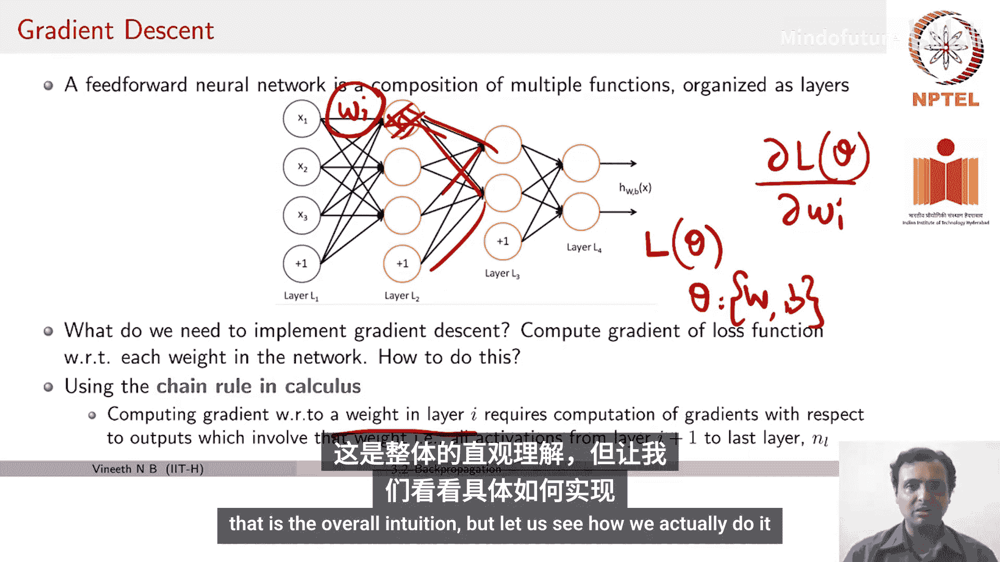

# 【NPTEL】计算机视觉的深度学习 p82 P82_前馈神经网络和反向传播 - 第一部分 -BV1vNWkzpEua_p82-

🎼Yeah。

Our next lecture。Will be on continuing the discussion on multilayer perceptrons。

And knowing how we can train them。For the person process。

We talked about the perceptron learning algorithm。Then for multilay Poitrons， how do you train them？

With the same method work is what we'd like to find out now。

Multilate peritrons are also known as feed forward neural networks because the information is fed forward from the input all the way through the layers to the output。

And all neurons are organized in bears。While we saw examples of my perron with one hidden layer in the previous lecture。

You could have as many hidden layers as you need between the input layer and the output layer。

Obviously。At the end of the day， a neural network， a feet forward neural network。

 or molecular perceptionceptron is approximating a function that takes you from input to output。

So whatever function youre approximating？Can be better approximated。

 perhaps if you have more hidden layers if that function is complex。This is not a necessity。

 but having more hidden players could help you。Well see later how adding too many layers can also cause problems。

 but at this point let's move forward with this discussion of training a forward neural。

So as I just mentioned， a neural network is typically used to approximate some function F star。

 F star is the ideal function that in machine learning given an input can assign the correct label for that particular input。

 so F star could just be a classifier also。And through the neural network， we'd like to approximate。

This function have stuck。The neurons are arranged in the form of a directed。

 a cyclic graph directed because all of these edges。

From one layer to the next layer are directed edges。

 you cannot information doesn't flow the other way。Although for training you use them。

 we'll see that in a moment， but when you propagate information。

 you propagate them in the forward direction that's the directed nature of this graph and it's acyclic because there are no cycles in this particular graph。

The information flows only one direction from the input all the way to the output。

 and that's why they're also known as feed forward networks。

The number of layers in the neural network is typically known as depth。

Each neuron can be seen as a vector vector to scalar function。

 which takes a vector of inputs from the previous layer and computes the scalar value。 Remember。

 even a single perceptron is a vector to scalar function because it has。

And different dimensions of x as input and gave us one output。

 each neuron is similar to a perceptron in that sense。

And when you have multiple layers stacked one after the other in a neural network。

You could look at the entire network as being a composition of several functions。

Each layer is a certain function， which takes you， so let's assume that you have layer one which。

Is denoted by a function。F1， this function takes you from R。Of the dimension of the input layer。

To R of the dimension of the first hidden layer。That's what the function F1 does， similarly。

 function F2。Is a function that goes from R R denotes the set of real numbers。You have odd way from。

Dimenssion of H1。To R going to dimension of H2， similarly。

 F3 goes from RDH2 to the R dimension of the output layer。So each layer is a function by itself。

And the overall neural network can be envisioned as a composition of functions that achieves the purpose you're looking for。

So。In machine learning， we all know that we are given training data to train an algorithm。

And if you consider the supervised learning settings。

Then you have data as well as labels provided to you in your training data now to approximate some function F star。

We are generally given noisy estimates of h star of x at different points in the form of a data。X I。

 Yi， x is a vector that could have several dimensions。

Yi is the output label corresponding to that particular input data point excite。

 and there are a total of M such examples in your data。 You could assume that these。

Examples in your training dataset are instances of the overall function F star that takes you from F from x to y from that setting。

So our neural network defines a function， why？Which is f of x comma theta x is the input by theta。

 we're going to refer to all the weights and biases that we have in the neural network。

We're going to henceforth call theta the parameters or the weights and biases of the neural network。

These are the theta are the values that parameterize your neural network。

 that's what defines the function output that you're going to get when you propagate a value through your neural network。

Our goal is to somehow find a way that F can best approximate at time。Once again。

 let me clarify what F star is， F star is a hypothetical function which takes you from input to labels。

So each of your training data points are instances of that function。

And our goal now is and we do not know what F star actually is in machine learning typically if you knew what F star was。

If that was given to you， you actually don't need machine learning when a new data point comes in。

 you simply apply a star on it and you will get the label that you need。In machine learning。

 we're only given those noisy instances of step star， but we do not know what F star is。

 that's what defines the field of machine learning itself。

And our goal is to use the neural network to best approximate F star。

Now the question that we have is， how do you find the values of the parameters theta。

 the weights of the biases to train this network， so you're given a training data。

Let's assume you're given a neural network of a certain architecture， you're given。

 say two hidden layers， the first hidden layer has 10 neuronss。

 the second hidden layer has 100 neuronss， whatever will that be， that is user defined。

That is given to you and the training dataset set has given to you。

 your goal is to find what should be the weights。Of the neural network。

 which will do well on the training data。So that's the process of creating a neural network。

And to do that， we introduce a very well knownn method in optimization known as gradient descent。

 a gradient descent is a very simple but a very well studied method in optimization which is used to minimize objective functions in general。

 and that's what we're going to use to train our feet forward neural networks。

Let's take a simple example and then take it forward to neural networks。

Neural networks are usually traineded。By minimizing a loss function， such as mean squared error。

The neural network， when you give an input to a neural network， it gives us a set of output。

What is that output F of x commma theta once again， if we took that patient example。

 if you gave a set of patient attributes to the neural network？

Assuming that you initialize this datata to some random values。

 some random values to start the neural network with。If you know past one patient information。

 patient's information such as blood group， age， whether the person smokes or not so on and so forth。

 all of that information， let's say you pass it to a neural network。

 you get a set an output on the output layer。Based on the weight that you have initialized neural network。

That value that you get is defined by f of x theta。

But in your training data you already know what X should give you。

 because that's why it's called training data， you have the correct labels given to you。

 so you have at least F star of x defined for that particular value of x。

 you may not know what F star is at other places， but you know what F star is at that particular location。

And you sum this error up over all of your input data points， M is the total number of data points。

 and you average the error across all of your data points。

This is typically known as the mean square arrow。Is the mean of the squared errors for all your training data samples？

Let's take a simple 1D example and then try to study this a bit further。

Let's say we'd like to minimize the function F of x is equal to x squared。Specifically。

 let's assume that we know the value x star， which gives you the smallest value for F of x。

Let's assume that's f of x star of course， so we know that x star is equal to our min over x f of x。

 some of you are new to this。R min mint of f ofx gives you the minimum value of f ofx across all possible values that you can choose for x R min is the value of x that gives you the minimum f ofx that's the difference we mean min and R min so x star is that x that gives you the minimum volume value of F ofx so to summarize this slide so you have a mean square error which we typically use to train neural networks。

 but before we deal with with that mean square error loss。

 let's just consider any function F ofx which we want to minimize let's try to see how we will we co。

So what gradient decent suggests to us is given that function f of x。

We can obtain the slope of the function f of x and x by taking its derivative。

 let's let f prime of x。They don't。That slope of f at x。Now， if you give a very small push to X。

In the direction of the slope。The function will increase。What we mean is。You have X。

You have p dot sine of f prime of x， which means we take the sine of the gradient。

And whatever will the direction be in that direction， you take a small P step forward。

So that's going to give you a function value， which would be greater than f of x。

You could now ask me the question， what if the signine itself was negative。

 would this be would f of x plus p dot signine of f of f prime of x be greater than f of x of course yes。

 because that's how the gradient is defined so if your signine is negative the reverse is also true which means if you take one step in the negative direction of the gradient your function value will become lesser than the function value that you had at x。

That should give us a clue。Which means。If I take the gradient at a particular point， X。

And I go one step in the negative direction of the gradient。I'm going to find another point X。

Where the function value will be lower。Which means if I keep repeating this over and over and over again。

 Ill finally reach a point where the function value is the least。

This is the basic idea of gradient descent。We start off at a random x and keep taking small steps in the direction of the negative gradient。

 and we iteratively reach a point at which f of x is the least。

Here is an illustration of what we just spoke about。

 let's assume that f was indeed a convex function， that's your F。

And the minimum is attained at x is equal to0。Since the minimum is attain here。

 we all know that which means that that that particular point is a critical point。

 which means f prime of0 or the gradient is zero at that particular point。

So let's consider a certain x， say it's minus1， which is this particular point。

We can see that at that particular point， the gradient is going to be negative。

If the gradient is negative。We take one step in the direction of the negative gradientig。

Which means we go one step towards the positive side or the right word。

And you will take one step in the right right direction。

 which will definitely take you to a function value， which is lower。On the other hand。

 if your current text was here at one， let's say at this particular point。Your gradient is。

Your gradient of the tangent is positive。You're still going to take a step in the negative direction of the gradientator。

Which means you will go left when you implement this algorithm。

 which again will take you to a point which is where the function value is lesser。As you can see。

 it's a fairly simple method， but given it a function。

 this is a simple method that can help you reach the minimum of that function and find the x at which you can reach that minimum。

How is this connected to neural networks， we will come to that。

Let's consider now a slightly more complex city。A multivariate setting。

 so in the previous slides we considered F of x， which is January。

 let's consider a multivariate setting。Where while retain neural networks the loss function we minimize is parameterized by many weights in the neural network。

 let's subsume all of them into a quantity known as theta。

 all the weights in the biases were to subsume into one quantity known as theta let's now demoote this loss function as L of theta and our aim is to find the weight vector theta which minimizes L of theta very similar to what we saw on the earliest slide。

Now， let you be a unit vector。Which is the direction that takes us the minimum of this loss function。

Rather， we are saying now that we have the gradient。Grad Theta， Gr subtheta of El of Theta。

 and we know that some component of the gradient may help us。

Go to the minimum of this loss function that we want to minimize mean square error was one such loss function there could be at this point we are saying that mean square error may not be the only loss function for a global network there could be other loss functions that you minimize the parameters with respect to let's just call that L of theta and the gradient to be gra sub theta L of theta。

And let you be that vector， which is the component of the gradient that you take you to the minimum。

 and for simplicity we're going to assume that you is a unit vector。

 so you want to minimize U over all personal unit vectors so you transpose u is equal to one。

You transpose the gradient of the loss function。Now this can be written as min this is simply a darkt product。

 so it can be written as to norm of u into the true norm of gradient co beta where beta is the angle between the U vector and the gradient gradient of the loss with the respective theta vector。

Clearly， we know that two norm is a positive quantity， this quantity here is a positive。

Quantity because number do now in standard definition is simply square root off。L1 theta square。

Plus L2， theta squared， so on and so forth， depending on how many components L had。

 whatever components it has。This is your standard to norm definition and that quantity to norm is a positive a non negative quantity。

So which means。We ideally want to minimize this dot product。Because you is a unit vector。

The only way we can minimize this quantity is to make cause beta to be minus1。你怎么不。To norm of U。

 the value is one because U is a unit vector， we already know that。

So the only way to minimize this entire quantity is to make co beta to be as low as possible。

 and the least value that cos beta can take is minus1。Which means？Since U is one。

Europe has to be the direction of the negative gradient。

So that's the vector that will actually minimize this particular point。

 remember for beta to be 180 degrees。You has to be because data is simply the angle between you and the gradient。

U simply has to be the opposite direction of the gradient， which will minimize this quantity。Rather。

 if we want to use the gradient in some way to reach the minimum of the function of a function。

 we have to go in the opposite direction of the gradient to reach that。

Keep in mind that this is the gradient Disscent algorithm。

 keep in mind that it has a complement known as gradient ascent。

Where if you go in the positive direction of the Canadian， you'll reach a maximum。

That algorithm can also exist， but in this context we are interested in minimizing a loss function。

 and hence we're going to focus on gradient descent。

Let's not try to see how do you actually use gradient descent in practice to train neural networks or to create any other function for that matter。

For neural networks in particular， we start with a random wave vector theta。

You compute the loss function over the data， so you have a training data。

You take L of Theta with a parent network using a suitable loss function such as mean square error。

 you could have other loss functions and you'll see many of them over this course。But at this point。

 let's take one of the simplest， which is the mean square error。

We compute the gradients of the loss function with respect to each parameter in the network。

So it could be the weight， it could be the bias， it could be any other parameter。

 every parameter that's involved in getting that output of the neural network。

 you compute the gradient of the loss function， every parameter that you need to learn， of course。

You compute the gradient of the loss function with respect to each of those great values。

 and we denote that as do L by do theta I。So now， based on radiant descent。

 which is an iterative procedure， you define this actual step to be。Given your theta I current。

 which is one of your weight's current value。You take do L by do theta。

 which is the gradient the partial derivative of the loss with respect to that particular parameter theta high。

 there are many weights and biases in the neural network。

 you have to compute the derivative of the loss function with respect to every weight or every bias in the neural network。

And theta next is simply theta I current minus eta times this gradient。

Where EA is simply known as a learning rate or a step size。

It tells us how large a step do we want to take in the direction of the negative。

We'll talk about ways in which this can be chosen a little later this week。

And we keep repeating this process until the gradient is zero。😊，Why。

 because when the gradient is zero， we have reached a critical point。

 which is perhaps the minimum of that foot。Let's look at a neural network again， as we just said。

 some time ago， a feed forward neural network is a composition of multiple functions organized as layers。

Now， how do we implement gradient descent in this kind of neural network？

We know we have to compute the gradient of the loss function。

 let's assume the loss function is given to us， let's assume it' mean square error。

They have to compute the gradient of the loss function with respect to every weight in the neural network。

How do we do this？We do this by taking advantage of the chain rule in calculus。

Computing gradient with respect to any one weight in a layer eye。

Requires the combination of the gradient with respect to outputs which involve that weight in every layer。

From that layer to the output， So for example， if you are a certain rate， WY here。Remember。

 the loss function is defined at this particular point of。

Let's say Theta where Theta is nothing but a set with all Ws and Bs。That's your last option。

So we want to find do L of Theta by doWI， where I is one of the weights in the neural network。

So to do that， remember， we said we able to change do。

 which means we have to now find out DoL by do theta by computing partial derivatives of all the steps in which to which WY contributed across all of the layers。

 for example WY coordinate contributed to every value because this neuron contributeds to every other neuron in that next layer。

and so on and so forth， so we now have to sum all of those contributions up and then find the gradient of the loss function with respect to this WA。

That's the overall intuition， buts let's see how we actually do it as an algorithm。

