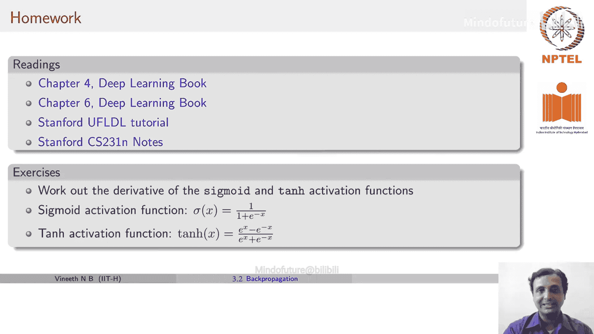

# 【NPTEL】计算机视觉的深度学习 p83 P83_前馈神经网络和反向传播 - 第二部分 -BV1vNWkzpEua_p83-

This leads us to the popular methodology which we talked about in the history of neural networks too。

 which is known as back propagation， back propagation is a procedure that combines gradient computation using chain rule and parameter a using gradient descenter。

Remember， we said we want to minimize a loss function。

We said gradient descent is the way to do minimize the loss function。

 but then gradient descent means competition of derivatives for which we need the chain rule。

That's going to be the overall strategy for us to play the neural network and let's see more details。

Let's consider once again the simple feed for neural network or what is the other name for multilay perceptron？

Let's consider once again a set of M training examples given by Xi。W I。

 let Tita can constitute all the weights and biases in the neural network。

That the mean square cost function。For a single example being given by。

 let's assume that H theta of x corresponds to your neural network at this time。That's your。

Youre a network。And y is the expected output because we know that that's the output for the corresponding ratingd sample。

 so given one particular sample X and its correct label y your loss function is given by H theta of x minus y whole squared we said mean squared error。

 we are not doing the mean here because it's a single sample。

We're going to introduce the Howard multi by half。Purely for mathematical simplicity。

 you'll see why a bit later but。The reason why it doesn't matter is because we are interested in the theta that minimizes the loss function and not the loss function value itself。

 so whether we minimize half of the loss function or the full loss function。

 it's the same theta that will give you the minimum in both these cases so it doesn't matter to us and we introduce that purely for mathematical simplicity。

Now the overall cost function across all examples， we saw the cost function for a single example。

 the overall cost function across all of these examples is going to be given by。

1 by m summation over all x L theta X Yi， so the same L L function。

 sum up over all rating samples and then averaged an L theta of X Yi can be replaced by your mean square error definition。

That's the overall cost function that we're going to go with， you still have to compute the Canadian。

 but that's the overall cost function。Let's now define the notations to be able to define the backdrop procedure back pro procedure completely。

 let's assume that there are NL layers in the neural network。Nl layers in the neural network。

Going from1 to n sub L。Let's denote the activation of a node I。Layer them as a sub pipe。

Lt layer rather remember every layer has a set of neurons。

 we are now looking at the IT neuron which is the known eye that we're talking about and we are looking at the Lt layer of neural network。

And the activation is simply the output of that particular neuron remote。

 every neuron is now individually like a perceptron， and we already said that for a perceptron。

 instead of having the threshold function， we can have activation functions such as sigmoid hydrobolic tangent so on and so forth。

 the output of that function is what we doote as an activation on that particular node remember again to repeat that node is like a perceptron。

And in the L layer， we call it a sub I superscript L。

We dooteva connecting node I in layer L and node J in L plus1 as WIj in the L layer。

And the entire wave matrix between。Layer L and layer L plus 1 is denoted as W。

For a three layer network that we saw earlier。A compact vectorized form of a forward bus can actually be written like this。

 and hopefully this will give you clarity of that entire procedure。Given an input X。

 you take the first layers， weights and biases， and you get the output on the next layer。

 that's Z superscript to second layer。You take Z and apply an activation function F。

 and the output of that becomes a superscript2 in the second layer。

 which is going to assume one neuron in each layer just to make the notations simpler。

 but you can extrapolate this when x is a vector， z is a vector， a is a vector， so on and so forth。

Now you take the activation， take the next layer's weight， which is given by W2 and V2。

 and you do W2， A2 plus B2， you get Z3， that's the Z in the third layer。

 you apply an activation function on that to get A3， which is the output in the third layer。

 which is also the output of the neural network。In this case。

 the function F denotes an activation function。Such as sigmoid， relevant identity。

 so on and so forth。Let's now try to see what back propag actually does while training a neural network。

During the forward pass of a neural network， so every neural network can now be divided into a forward pass and a backward pass。

 forward pass is when you give an input to a neural network and you propagate that input through the weights of various layers and you get an output at the output layer out at the output layer。

 you call that the forward pass。Now based on the output at that output layer。

 you would get a certain loss based on the loss function that you chose。

 you expected a certain output because it's training data。

 you know what the expected output should be， you know what the neural network is to out。

 the difference between the two or whatever loss function it need not reach is difference you could use other loss function。

 that loss function of the output is what we now have at the last layer。

And we now have to use that loss to compute the gradient for each of the weights linear on network。

That's the backward bus。So during the forward pass。

 we simply compute each layer's outputs and move from left to right。During the backward pass。

 we compute the loss in the last layer and move from the rightmost layer to the leftmost layer。

 starting from NL all the way going to the first layer。

We compute gradients going from the rightmost layer to the leftmost layer and once we have all the gradients computed we can use gradient descent to update the parameters how do we do current new parameter is equal to old parameter minus Eta which is the learning gradient of step size times the gradient。

With respect to that pid。Now let's also try to see how this specific propag of gradient happens from the last layer till the first layer。

The first thing is we devote。For each note， an error term that denotes how much that node was responsible for the for the loss at the output here。

Let's imagine now that the error term at the output layer is given by。

erroreroom at the I node in the output layer， remember even the output layer would have multiple output nodes。

 the output need not be a single value， you you could be giving a vector as an output to for example you may want to predict at what location an event may occur next so let's say you want to use some logic you want to predict using machine learning to predict where the next FiIFA World Cup will happen so you may want to predict that in longitude and latitude for instance so that could be the two outputs that you may want to predict so your output layer could have many values in。

订订订单。That'。So Delta I Nl Nl is the last layer， deelta I is the delta or the error for the height node in that layer。

And the error term and that of be clear is given by。Minus Y I minus AI and L。Into F prime zdi。

How did we get that this is simply the gradient of the mean squared remember we said we are taking mean squared error as the loss function。

 we simply take the derivative of the mean square error so in our case it's going to be。早い？

Why I minus？你个。Let's assume that's your final layerss output after applying the activation function。

Fuold square And remember we said we'll have a half for convenience。 I mean。

 when you take a gradient of this with respect to AI。

You're going to have minus two and2 would get cancer and you would have YI minus AI。

That will be a gradient of the mean square。But remember that AI itself is a function of Zeedda。

 the way we defined it， Zedi， you apply an activation function F， and then you get AI。Which means。

The chain， you would then have。F dash of F prime of Zdi N M， so where AI is given by。F of。

Does it like。So that's going to be the error term at the output。

Now we're going to claim that the error term of the hidden layer is going to be given by this quantity。

 and let's try to find how for the hidden layer。We have to rely on the error terms from the subsequent layers。

So once again， let's assume that the error at the output layer。Yess。Given by this。

Now the error term at the hidden layer is given by some of the error termss in the next layer。

 which means。Delta I in the L layer is going to be given by。Delta J is the L plus con。

Multiplied by WIJs in that layer that goes from L to the L plus1 layer sum them up over all the number of neurons like s S sub L plus1 you know the number of neurons in L plus1 layer so you add all of them up into F prime of zL for that particular node remember that's again。

 f prime of ZL is simply the derivative over the activation function at that particular node remember this is the reason why we said it's nice that the sigmoid function is continuous and differential。

Because we need this derivative。Across the activation function to be able to compute your chain to be able to compute your chain。

Now you could ask me why am I multiplying it by the weights because that's the contribution that this node had to the error on that particular node in the next layer。

 the height node contributed by WIj times。To the error， the J node in the next layer。

 that's what we are denoting it by the sum of errors。As we just mentioned。

 F prime denotes the derivative of the activation function for a linear neuron f of x is equal to x derivative is1。

 simply that term won't matter for the rest of the computations。But for a sigmaoid neuro。

 f of x is equal to sigma of x is equal to 1 by1 plus epar minus x。

 the derivative turns out to be sigma of x into minus1 minus sigma of x itself。

ISuppose you already know it for those of you who did assignment zero in this course。

 you should have seen it， but you can also work it out as homework。

So the way we go to train the full network now is we perform a feet forward pass computing the activations for all layers for each output unit I in the set of neurons in the last layer denoted by NL。

We compute the error， which is do Nl， which is the derivative of the loss function with respect to the final activation。

Into the derivative of the final activation with respect to0L。

 which is before applying the activation function。And then on for the previous layers。

 each delta L can be written as wl times force times delta l plus1 number now we have written this is a matrix and that's why the summation disappeared and this。

WL transpose matrix times this delta l+1 vector would ideally give you the summation that you're looking for that we talked about on the earlier slide。

Having computed these deltas for different layers， remember。

 Delta is the contribution of every node to the error。

We are now going to use those data to find out the partial derivatives of the loss with respect to every weight in the neuraln network。

 how do we do it very simple now it's going to be defined as。

The loss or the gradient of the loss with respect to every weight in any layer L。Is simply given by。

Take the delta L plus1， the contribution of the error term in the next layer and multiply it by activation of the L layer。

 let's try to understand why this is correct。Let's consider a neural network。

That say that says these are some layers of a neural network， and these are nodes。

Let's assume that there are many more layers before this。But this is the last layer， which is Nl。

 this is the penult 1 nl minus1， this is one before that nl minus 2。Now。

 in the last node in the output layer， remember， let's draw that a little bit bigger。

 so this site is going to be。This W is what we want to compute it with respect to the gradient Z and when you apply the activation on Z it becomes a。

 so the way z and a are related is f of z is equal to a where f is the activation function of your choice and this a is finally used to compute your final loss function remember we said is y minus a equal squared where a is the output and y is the expected。

So the compute。The gradient with respect to W。There is unnecessary information here。So the compute。

Doel。With respect to doW for the moment let's consider this weight。

 that's what we're computing with respect to， we apply chain rule。

 chain rule tells us this is do L by do A into do A by do Z。Intodo that。By DoW。Now， do L by do a。It。

Exactly this term here。That's the derivative of the loss with respect to pain。

Do A by do Z is exactly this term here。Which is the gradient of the activation function F prime。

Do Z by doW is not what we have to compute， but we know now that do Z by doW is nothing but the activation in the previous layer and so let's probably write it this way the activation is right here。

The previous layers Zed would be here。And activation is applied and is what would come here。Remember。

 for WL。Well go from A to Z L plus1。So if you want to complete the derivative with respect to WL。

Those said by noWL will simply be。A the previous layer， y because A into WL will be say Z L plus 1。

we simified talking in terms of c， but you could now expand this to all the other nodes in that layer and also write it as a vector but that's the broad idea so once again if you instead had a delta that was let's assume now that you want to compute the gradient with respect to a previous layer。

Let's call that W。NL minus2 right so one of these one of these weights once again it's going to be the same。

 you just have to keep computing the chain rule over and over again and you'll find that the chain rule will give you。

Delta at this node as the contribution of that node to the error。

 now you simply have to differentiate that with respect to w。

 which will give you the activation in the previous layer as that additional。

That gives you your gradient。Work it out a bit carefully and you'll follow that this is fairly straightforward。

Now this gives you the gradient with respect to W， similarly if you noted the second equation patient here。

 that has the gradient with respect to the bias， it is exactly the same thing where the activation is1 remember because the activation that goes into the bias in any layer is going to be one。

 one once again that a bias could be there for every day， not just the first layer。

Could be there for every layer， but that value will turn out to be one。

So what have we done to summarize， we have computed those deltas that are the errors of how each node contribute to the output。

And simply use that to make a chain rule computation simpler。

We could have instead not written out Delta and worked out the chain rule。

 but you would have got exactly the same value Delta gives us a placeholder to hold how a particular node did any layer contribute to the error and now it's very easy to compute the gradient using that error for a previous layers weight。

That gives us our final algorithm for training a neural network， let's go over it。

So let's assume that deelta W and delta B are set to zero， just a minor clarification here。

To differentiate delta and grid。Delta defines the change in a value。

Grad defines the gradient of a function with respect to a value okay so please keep this in mind in the notations so delta w and Dlta B are the change that you're going to make to W in a given iteration of gradient descent let's initialize that to zero。

Then for each data point that you have in your creating data。You forward， propagate that data point。

 you compute the error。Compute the loss， compute the gradient。

 and use vector propagation to compute the gradient with respect to every weight in the neural network。

That gives you grad L with respect to theta now your Dlta theta compute that composed of Dlta W and Delta B。

You increase that by this much gradient now and you would keep going this or formula loop for every data point in your data。

And that gives you the total。Delta Theta that you have， Delta W and Delta B。

 that's the total change that you want to make P OW and B。

Now to update the parameters using gradient descent， you're going to say。WL in the current step。

I's going to beat up。WL in the next step is going WL in the current step minus Eta which was your learning rate step size into1 by m times change of w1 by m is simply to average the gradient across all of your data points remember here we were summing up the gradients for all of the data points now we simply want to divide by m to average the gradient across all of your data points and that tells you how your current weights had an impact on the loss across all of your training data points。

That's the gradient that you going use to update W。

 then you'll get WL at the next time step and similarly B at the next time step and you keep repeating this until convergence。

Robert convergence is when。Grad loss with respect to W and beta becomes zero， or you get all points。

 right？In practice， this may be difficult， how do we handle it in practice。

 we'll talk about it in a later lecture。For further readings。

 please read Cha4 and Cha6 of deep Learn book， not all sections in these two chapters may be relevant。

 so I advise you to read what is relevant to the sections that we've covered so far。

 also go through the Stanford your tutorial and the CS231 end notes。

 the links are right on this slide if you're interested。

