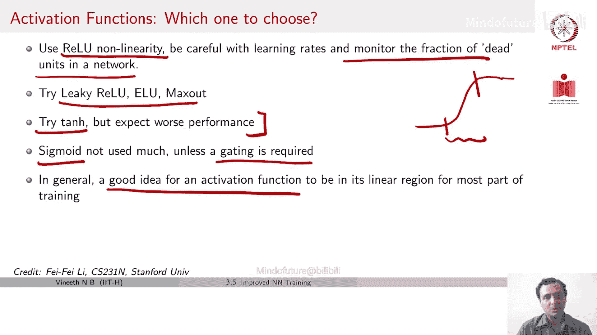

# 【NPTEL】计算机视觉的深度学习 p88 P88_改进神经网络训练 - 第一部分 -BV1vNWkzpEua_p88-

In the last lecture。We spoke about how regularization is an important component。

To improve the generalization performance of neural networks。

 we also spoke about a few different ways of performing regularization。In this lecture。

 we will talk about other components that can help improve the training of neural networks。

Before we go forward， we left one question behind。Your exercise was show that adding Gassian noise with zero mean to input this equivalent to L2 weight decay when your loss function is means quite error。

Hope you had a chance to work it out。Let's try to understand why this is the case。

So when you add glossssian noise to inputs。The variance of the noise is amplified by the squared weight as you go to the next layer of the neural network。

So which means if you simply had one a simple neural network where the output layer was directly connected to inputs。

The amplified noise would directly get added to the output。

And that added output makes a contribution to the loss function term， the squared error term。

 and that's what makes it look like an L2 weight decay in the loss function。

So you have Gaussian noise， say sampled from a distribution with zero mean and variance sigma squared。

 and when you send it through a layer， it's amplified by w and it goes through on the output layer with a new variance which is amplified by Wi square。

That's the intuition， let's work it out mathematically also。So mathematically。

 if you consider one input with added noise。Which means you would have。

Your output y noisy to now be summation over I W， X I。Plus summation over I， WY， Epsilon I。

Remember here that originally your output would have been only WY summation， WY Xi。

So this is a component that got added to the output because you added noise to the input and what is the noise Eppsilon I。

 which is sampled from a Gaussian with mean0 and variance sigma squared。

Now let's try to look at what happens to the mean square element。

So your expected mean square error now， so your new mean square error is going to be y noisy minus t whole square where t is your ground root or target。

So that's the correct value。So mean square error expected means square error will be given this way。

 let's expand it out， we know that y noisy is given by what was originally y。Plus。

 you have the additional summation over I Wyippsilon a term that comes here。

 and then you have the minus t squared that comes this way。

Now by grouping terms this can be written as y minus d plus summation I wy epsilon I squared。

 now we use your standard expansion of a plus behavior square and you get the terms on the next equation。

 keep in mind that the first term here does not have an expectation because there is no random variable there there's no epsilon I in that so you can remove the expectation in that first term and the expansion follows the linearity of the expectation。

So now if you see the middle term here， we assume now that all weights have a mean one。

And all apsilonize。Are going to be mean zero by the very definition of how Epsilonni is sampling。

Which means the expectation of this some overi WY， H or I will go to  zero。

 so you are left only with the first term and the third term。

Now this tells you that this third term can now be written as。The expectation can be pulled in。

 and this can be written an estimation over I W i squared， sigma i squared。

 because that is the varianceliance of epsilonic。This， as you can see。

 clearly looks like a penalty on your。L2 norm of the weights where the coefficient of your penalty is given by Sigma I whole squared。

Rather， when we add a noise to the input， your expected mean square errors， the new loss function。

 rather is going to look like your old loss function plus an L2 paid week。

Let's move on now to this lecture's focus， which， as I said。

 is going to talk about a few different components on how you can improve the training of neural networks。

The first component that you're going to talk about is activation functions。

In the very first lecture of this week， we gave an introduction to activation functions。

 we're going to spend some more time now to understand each activation function and its pros and cons。

We know now that an activation function is a nonlinear function that's applied to the output of every neuron in your neural network。

Traditionally， people use the same activation function for the entire neural network or at least a layer。

Why do you do this？Why cannot you change the activation function for every neuron in the neural network？

The simple reason for this is to keep things less complex。

If you have the same activation for all neurons in a layer。

 you can use mat vector operations directly to make your computations rather make rather than have to compute values for each neuron separately and mat vector operations are already optimized using linear algebra subroutines and we'd like to take advantage of those fast subroutines to make computations in a neural network。

Let's know try to ask。What characteristics must activation functions possess？What do you think？

By now you must know that they must be differentiable because otherwise you cannot backproagate gradients。

 but what else should they process as what kind of functions can become activation functions we've seen a few so far。

 we've seen the sigmoid， we've seen the tanh， we've seen the relu， so on and so forth。

 do you see any commonality in the shape of these functions in the nature of these functions。

There are a few important aspects， the functions must be continuous so that you don't have discontinuinities where the gradient is not defined。

It must be differentiable because we need to perform back propagation， it must be non decreasing too。

You do not want a function， an activation function， which is something like this。

 at least ideally speaking， because as the input increases。

 you do not want the output of the activation to be fluctuating between high and low values。

 so you ideally want it to be monotonic or non-deecreing。And obviously。

 you also want it to be easy to compute。Remember， anything hard to compute is going to make your neural network slow。

Common activation functions that we have seen are sigmoid， hyperbolic tangent。

 rectified linear unit and so on， which one do you choose？

Does any of these activation functions have a specific effect on training？

We're going to see that over the next few slides。Here are some of the activation functions that we visited earlier too。

 let's quickly review them before we look at each of them in more detail。

The sigmoid activation function was one of the earliest activation functions used to overcome the threshold problem in perceptrons。

And it's a logistic function given by this shape。The hyperbolic tangent is also a logistic function。

 looks very similar in shape to sigmoid， but for its range being between minus1 and1。

 whereas sigmoid's range is between zero and1。The rectified Line unit developed in 2012 as part of the LNe contributions。

还是。A form given by this。The equation for this graph is max of0 comma x， if the input is negative。

 the output is going to be zero， if the input is positive。

 the output remains as it is the input itself。A variant of Relu is known as leaky Relu。Where。

 when the input is negative。Your output is going to be 0。1 x， 0。1 is just an example。

 this could be any value alpha which is reasonably close to0， it's not zero。

 but it's somewhat close to zero。There's a particular reason why leaky yellow was proposed and we'll see that in some time。

Let's see Llu before coming to maxO Llu is exponential linear unit and Llu was developed because the Llu activation function。

Actually seems non continuous。It has a discontinuity at zero where it's not different。In practice。

 people get around this by assuming that the derivative at that particular location is zero。

 which is valid because for those of you who are aware of the concept of sub gradientds zero is a valid sub gradientdient for reello at that particular point so zero is a valid choice but there are other gradients possible at that particular location nevertheless it's a point of discontinuity and people get around this by assuming the gradient of reello at zero to be0。

If you did want to make that assumption。L is an option which is a smooth contous function which is given by for any value greater than0。

 it is x just like what we saw for Llu， but for values the input values less than0。

 we assume it to be alpha times e power x minus1， which has a shape as you can see here。

 as you can see here， this now becomes a smooth cont function with no discontinutities。

Another activation function that was proposed is known as max sound。

 it is used occasionally these days but not as popular maxSo is you can look at max out as a generalization of Relu because of the max function there。

 but it does not take a max on a single activation on a single neurons output。

It takes a group of neurons and takes the max value of that group of neurons as the output of all of those neurons。

In this mathematical definition you see it written in terms of two neurons。

 remember here that this would be the output of two of these neurons。

 let's assume that these were two neurons in some network some layer of the network so depending assuming that the weights coming in to this neuron was w1 vector the weights coming into the second neuron where W2 vector。

So the output of this neuron would be w1 transpose x。

Plus B1 and the output of this neuron will be W2 transpose x plus b2。

So now the activation of both of these neurons is given by the maths of these two values。

It's not a very traditional activation function， the activation function is not defined on a single neuron。

 but on a group of neurons。Now let's try to visit some of these at least in more detail and try to understand how they can affect the training of neural networks。

Let's consider the earliest one sigmoid， which is given by 1 by 1 plus e minus x。

 clearly it compressrises all inputs to range 01。The gradient of the sigmite function。

 hope you've worked this out， this was a homework。Which is do sigma beta of x is given by sigma of x into1 minus sigma of x。

 it should follow very easily from this definition of sigmoid or sigma of x。

But while sigmoid activation functions were very popular in the 80s and 90s。

 they are not used as often today。Do you know why？Of course。

 one reason is today you have other activation functions such as Reello。

 which was not available in the 80s， 90s and 2000s。

 but there are specific reasons why sigoid neurons can create certain problems。

The one important problem is if you look at the shape of the sigmine， which is somewhat like this。

 you see here that when the input is very small or even very large。

 remember that your input is along the x axis is here， the y axis is your sigm of x。

When your input is small or large。Even a very large change in the input。

May result only in a very small change。Let's drop it again。

May result only in a very small change in the output here because this function is almost flat after a certain point。

This is the case whether the input is small or whether the input is large。

 this could create some problems for us while trading because even as you keep increasing an input you would find that it has no impact on the gradient for certain weights in the neural network where you have a sigmoid this can slow down trading。

Sigmoid is not zero centered because its output is in the range between 0 and1。

 which means if you want your activation to consider negative values and positive values differently。

 Sigmoid won't be able to do that for you。Let's also see now another reason why soid could have certain problems let's look at this。

Neural network here， a very simple neural network where you have your inputs or rather a part of a neural network。

 your inputs in a particular layer for a particular neuron are H1 and H2。

 the weights are at W1 and W2。The weights are combined to become a。

 you apply a seat point and then get a Y。One simple perceptron or one simple part of a neural network。

Let's analyze how the gradients flow in this part of the network。Using back prop and chain Do。

 you perhaps know now that if I had to find out the gradient of the loss function L。

 whatever the loss function was for this neural network is do L by doW1 is going to be given by DoL by do Y into do y by do sigma into do sigma by do A where a was the preactivation of that neural node before applying the sigma activation。

And then into H1 by H1 because H1 is going to be do a。By do w1， do a by do w1 will be H1。Similarly。

 for W2。If H1 and H2 were also outputs of some sigoid neurons from a previous layer。

They would both be positive。Which means。You can see now that H1 and H2 would be positive。

Dose sigma by do a by the definition of the gradient of the sigmaoid function would also be positive。

Which means？Both these gradients will assume the sign of this quantity。

 which is common for both the gradients。Dl by do by into do by by do sigma is common for the gradient of W1 and W2。

Which means if that gradient turned out to be negative。Both W1 and W2 will have negative gradients。

 if that turned out to be positive， both W1 and W2 will end up high positive gradients。Rather。

 this may not just be for one specific neuron， it could hold for an entire layer where you use a sigmoid activation function because all of those activations。

Because their outputs of sigmoid will be positive。This may slow down learning。Also。

 seebo is inherently computationally expensive。Why。

 because you have to compute an exponential function。

 remember an exponential function always takes time to compute an exponential function is an infinite expansion in terms of a polynomial series。

 and it always takes time to compute at the most basic level。What about hyperbolic da？

Hyperbolic tangent is given by。This equation and this visual form。

It compresses all inputs to arrange minus one and1。

And the gradient of the1h function is given by 1 minus10h squared。

 which you may have worked out as homework again。What advantage do you think this has over a sigmoid activation function。

 it is zero centered。Which means the outputs of a tanhe activation function can be both negative and positive。

 which could help in learning better。However， very similar to sigmoid。

 it also suffers from some disadvantages， it also has saturation at lower inputs and higher inputs。

 as you can see from the shape here， any logistic activation function may suffer from the same issues。

It is also computationally expensive。Because of the presence of the exponential functions。

Moving on to the rectified Line unit， which， as I mentioned。

 was proposed as part of the AlexNe in 2012。It's the most often used activation function today。

Its equation is max of 0 x and here is the graph form of the activation function The gradient is defined by0 if x is less than or equal to0 to be honest because at0 which is defined it to be0 and if x is greater than zero。

 the gradient is1 because f of x is x itself。For positive inputs。

 the re activation function is nonsaturated， which means if your input keeps increasing or if you give a higher input to a particular neuron。

 the re will ensure that that input also gets a higher gradient based on how it contributed to the final to the final loss。

 which is considered desirable you do want。A weight to get its reasonable share of the gradient。

 depending upon how it contributed to the output。In the AlexX network in 2012。

 this was found to accelerate convergence of SGD compared to sigmma or tanage functions by a factor of six。

 in other words。Convergence happened six times faster using a re accurate function。

As compared to using a sigmoid or a tanhi activation function。It's computationally very cheap。

All that you need to do in an implementation is threshold。And just more。If it is greater than zero。

 just take the value and move on， if it is less than zero， set it to zero and move on。

But Relu has one problem， which is known as the dying neuron or a dead neuron problem。

If the input to a relevant neuron is negative。The output would be zero。

Now let's try to understand how the gradients would flow in this kind of a situation。

Let's assume now that a previous layer's inputs were given this way with inputs x1， x2， weights W1。

W2。A is the pre activationivation of that neuron， you then apply relevant activation and you get the output y。

If you want to now compute do L by 2W1 by chain rule。

 you have doL by do y into do y by doL into doL by do A into x1。Because the input a is negative。

Do R by do a would straight away become。0。And none of these weights would get any contribution through the re activation。

Which means those weights， W1W2 may never get updated。

They stay the same and this cycle could continue， for example， if W1 and W2 were negative。

Which means in every cycle， it's very likely that a will keep getting a negative value。

And because of Relu， there will be no gradient that comes in。

 W1 and W2 will stay negative and the cycle keeps on going and the neuron never participates in the neural networks's output。

This is known as the dead neuron problem， and it has been observed to empirical studies that for a neural network that has a relevant activation in all its layers。

 many neurons end up suffering from the dying neuron problem。How do you overcome this？

A couple of ways， one is you could initialize your bias weight to a positive value。

 How does this help。In case w1 x1 plus w1 W2 x2 turns out to be negative。

 having a positive value here may push a towards the non negative side and this could help re。

Get activated and the gradient start flowing through this particular in Europe。

Other options are use leaky reello now you should be able to appreciate why leaky re was useful if you go back and see the shape of leaky yellow。

 we say that。It's very similar to Re on the positive side from the negative side。

 instead of making it0， just let let a small value go through。 And that's why it was max of。Alpha x。

 x， where alpha could be。A small value such as 01。This legs。The output of the L not become zero。

 which may kill the gradient， but let a small gradient at least pass through the neuron。

 so it doesn't stop contributing to the neural network， at least contributes marginally。

Exponential linear unit or EU also has the same effect。Now you could ask， having seen these。

 which one do I choose when I design a neural network？😔，In practice。Most often people use Reello。

 it just seems to work very well， very cheap， very fast， so people often use this。

 but it may be handy to keep monitoring the fraction of dead units in a neural network。

 neurons that are not contributing and see if that requires you to change something in your design。

In case rail does not work， could consider using leaky yellow or yellow or max out。

Tan H can be tried， but you may have to expect。Performance， which is not as good as R。

 depends on certain circumstances。Syoite is not used much today unless a gating kind of。

A response is required we will see such networks later in this course where you want a neuron to have a gating effect rather have an output line between0 and1 in those cases including an output neuron for example in a binary classification problem in those scenarios sigmoid neuron is the default choice tanh is also used in certain such settings where you want the output of the neuron to be bound by in a certain drain。

In general， a takeaway here is you would want an activation function to be in its linear region for as much part of the cleaning as possible。

 what does that mean so if you take the sigmoid，Actation function。

 you would want to ensure the activation function is most often。

Used when the inputs are lying in this range， so you could modify your Soid activation function。

 you could modify certain coefficients as a soid activation function to make this linear region a little wider instead of lying between specific values you could make it lie between a larger range。

 if you knew that is how the inputs are going to be in your neural network。

You can do such things to improve the performance， in fact。

Some of these suggestions here are given in a very nice reference called efficienticient Brop。

 which I will point you to at the end of this lecture。

