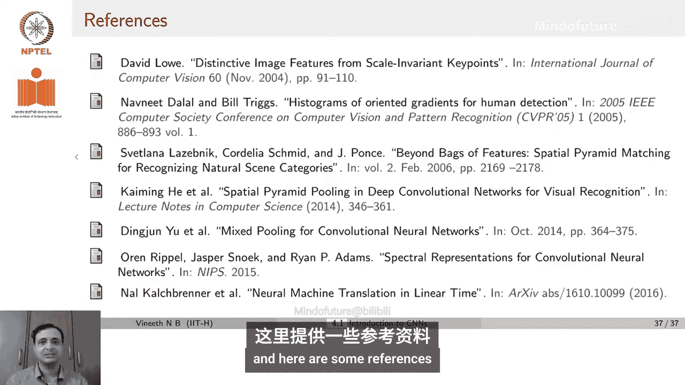

# 【NPTEL】计算机视觉的深度学习 p91 P91_02_卷积神经网络介绍 - 第二部分 -BV1vNWkzpEua_p91-

Having reviewed convolution so far。Let's try to ask the question。

What is the connection between convolution and neural networks？If we want to use it on images。

Can't we use feet forward neural networks？We will try to understand this more carefully by taking the example of image classification。

Let's try to understand how traditional machine learning was done earlier on computer vision given an image。

Traditional ML based computer vision solutions for image classification would extract some what are known as handcrafted features from images。

 examples being sift LBP HOG so on and so forth Why are they called handcrafted。

Because we came up with a procedure to extract those features using some thought processes and heuristics。

These were effective for quite a while。But it was a bottleneck of scaling these solutions to more data sets and scaling these solutions to more real world images。

One would， given an image。You say the raw pixels or extract edges or extract features such as sift and HOG。

 it could be many others。This was known as static feature engineering。

 where there was no machine learning or learning involved at all。

These features were then provided to a classifier such as a neural network to finally give the output as same monument in this case。

The question that we try to ask now is instead of those handcrafted kernels for edge detection for Saft or any other method。

Can we learn meaningful kernels or filters？To solve the problem in addition to learning the weights or the parameters of the classifiedifier。

Rather， if you have an H detector， which is a lapplian of Gaussian。

 which has certain weights in its kernel or any other kernel for that matter。

Can we automatically learn these weights as part of the learning algorithm rather than separate these two as the first step being a hand engineered step and the second step being a learning step？

That's one of the first questions we ask。We want to go even better and ask can we learn multiple meaningful filters or kernels in addition to learning the weights of the classifier why just learn one if we are learning we may as well learn many of them。

And。In addition to that， can we also learn multiple layers of meaningful kernels and filters？

We now know that convolution has some nice mathematical properties and you can。

Compose have a composition of convolution operations across different layers of a neural network。

So can we do that in can we use that in some way to learn multiple layers of meaningful kernels or filters before we learn the weights of the classifier or along with learning the weights of the classifier。

This is possible and this is possible by simply treating the kernels。

Weights are the kernel coefficients as parameters and learning them in addition to learning the weights of the final classifier。

So you how you would have an input。You would have a convolution kernel that gives you a certain output map。

 which becomes a second layer。You could have another convolution kernel which would give you an output which would give you the feature map at the third layer and this can now be used as input to a final layer of fully connected neurons which give us the final output。

And we can use back propagation to update these filter coefficients at each intermediate step。

This network is called a convolutional neural network， Why is that so Because in each step？

Instead of。Taking a fully connected bipartite graph to connect the first layer on the next layer。

 we are going to define a set of weights which convolve on the input image and given an output feature map。

 and we are going to learn those weights using back propagation。

Let's try to pause here and ask one or two questions again。So learning filters seems interesting。

But why not use flattened images with fully connected neural networks Why do we want to complicate our life and learn the filters why can't we just take the raw pixels of the input image。

Anyway， the neural network is going to learn the weights it should。

Why should we why should that be a convolution operation in between。

 why can't the neural network simply take the pixels of the images as flatten them out and give them as the input to a neural network and let the layers learn whatever they should。

Why can we do this？There are a few reasons， let's try to evaluate them。

If you take even a simple data set such as what is known as the MN dataset。

 so this is an example of the MN dataset， the MN dataset as we mentioned earlier。

 is a data set for handwritten digits which was used which was used by the United States Postal service in the 90s to automatically classify mail based on zip code recognition from images。

So if you used a feed forward neural network without convolution or without learning the filters on a data set such as MNT。

 you get fairly good performance close to about 98%。

 99% performance with a simple fit forward network。

But there are certain limitations and let's try to analyze them。The first limitation is。

This method ignores spatial correlations for the structures in images。

By taking pixels and flattening all of them into a single vector。

 we have removed the spatial relationships that exist in different parts of the image or in different corners of the image。

Pixels that are specially separate are treated the same way as pixels that are adjacent we seem to be losing some important information that characterizes images by doing this that is the first concern。

The second concern here is there is no obvious way for networks to learn the same features at different places in the input image。

Unlike a few other machine learning problems in images。

 one is expected to recognize a cat on the image。Whether the cap was located on the left top or the bottom right。

If we simply flattened an image into a vector。A cat on the left top would have a very different vector representation。

 the dimensions in which the cat exists would be very different than a flattened vector when the cat was on the bottom right。

We are really not enforcing the network to learn that a cat is a cat irrespective of where it is in the image。

And lastly， it can get computationally very expensive if you took an image。

 flattened it and only used a fully connected feet forward neural network。Why is that so。

 let's take an example。If you hide a one megapixel color image with 20 neurons in the first hidden layer。

How many weights？Would you have in the first layer？Think about it。And the answer is 60 million。

One megapixel is 10 plus6 pixels。Color image， three channels。 So that's 3 million pixels。

Into 20 neurons， a fully connected。Guff。Is going to end up with 60 million weights in only the first layer。

You now have to add layers probably for getting better performance and that is going to lead to an explosion in the number of weights。

So how do we overcome this， we overcome this by using the idea of convolution where we know that a filter only operates on a local neighborhood in the original image。

We call these as local receptive fields。Rather， the region of the input which is used for convolution。

 is typically known as the receptive field， so that receptive field is a local part of the image。

So each hidden unit of the next layer is connected to only one local part of the input image。

This serves a few purposes。Firstly， it captures spatial relationships because if you do convolution of a filter with a patch。

 you are capturing the 2D spatial relationships in that region。

And such relationships may not be captured by feed forward neural networks effectively。

It greatly reduces the number of parameters in the model。

Because now you only need to connect to a local region rather than have to have a fully connected graph where every neuron in the first layer is connected to every neuron in the second layer。

So now if we take the same example， if youve had a one megapixel color image。

And let's assume now that you have a filter size of K1 cross K2 that you want to learn in that first hidden layer。

 how many weights would you have now？The number of weights would simply be the size of the filter itself。

As we said。When you use convolution in a neural network。

The filter coefficients themselves become the weights。

 so in this case the number of weights would be k1 across k2。

Compare this with 60 million that we talked about for feed forward networks on the previous slide。

Secondly。Convolutionional neural networks introduce a concept of what is known as weight sharing。

W sharing。Is。You take a filter， whether you convulve it with the top right or the bottom left。

You use the same values in the filter， you don't change the filter weights when you convol with the top left and when you convol with the bottom right。

Which is what you would have done if you flattened out an image and used a fully connected layer to estimate the weights in that particular layer。

This has two purposes to， firstly， as we just mentioned。

 it enables translation invaris of the neural network to objects in images so as I said。

Whether the cat was on the left top or the bottom right。

 it's the same weights that are operating on them so it would recognize a cat be it in whichever part of the image。

Secondly， it reduces the number of parameters in the model， as we just said。

A third thing that CNs also do is known as pooling。

Pouling serves to condense information from the previous layer。This also serves two purposes。1，8。

By condensing information， it aggregates information。

 especially minor variations are kind of averaged out to get a common output in the next layer。

Secondly。Poulling ends up sub samplingampling an original image into a smaller image in the next layer。

And by doing that， the next layer， when convolution is applied on that next layer。

 the number of convolutions you have to do reduces。

 which reduces the number of computations in later layers of the CM。

Let's look at each of these in more detail now let's start with local receptorceptive fields so to recap CNNs have local receptorceptive fields weight sharing and pooling let's review each of them in sequence let's start with the local receptorceptive field so if we used a regular feet forward neural network it would look something like this so your input are these red neurons here your input is a handwritten digit image let's assume that you have because there are 16 pixels here you have 16 input neurons and then the blue squares here are the neurons in intermediate layers and finally on the output layer you have 10 green neurons which correspond to the 10 digits that you have。

You can see here that every input neuron is connected to each hidden layer neuron here in the first hidden layer。

So thats a dense connection so and if you now connect it to all the input pixels in the first hidden layer and so on and so forth。

 this becomes a very dense collection of weights as we just mentioned。

 lets contrast this with what happens if we do convolution。So if you observe here in this figure。

 once again， the input is 16 input neurons because that's the size of the input image。But now。

 only pixels， one，2。5 and6 so these four neurons here are the ones that contribute to the first convolution。

 pixels 3 and 4 and 7 and8 do not contribute to that first convolution。

 so only pixels125 and6 contribute to the computation of H11 which is the first pixel in the hidden layer。

Similarly， as you move forward， you have a similar number of operations for each of your pixels in the hidden layer。

How does this help？The connections now are much sparse。

This past connectivity automatically reduces the number of weights you have to learn。

 as we just mentioned。Importantly， we are also taking advantage of the structure of the image as you can see here。

 it is 1，2，5 and6 that is part that participate in the H11 output and 1，2。

56 are spatially correlated as compared to 1，2，3，47，8 for instance。

That's another advantage of the local receptive field。One question you could ask here is。

 but is past connectivity really a good thing？Wouldn't it be better？to have full connections。

 assuming we have infinite compute bandwidth and storage bandwidth and let the neural network learn what it should by having sparse connections。

 are we not disallowing certain pixels to interact and contribute to the next layers output？

The answer is not really， we don't lose information through this process。Because。

As we go through the depth of such a neural network。

 if you look at the two highlighted neurons x1 and x5 here。

 they may not interact when we consider the first hidden layer。

 but they may start interacting to later hidden layers indirectly because x1 contributes to h2 x1 x2 x3 contribute to h2。

And H2 and H4 where h4 gets an input from x5hi contributed in the successive layer and indirectly x1 and x5hi interact over the depth of the neural network so we really are not losing out this information as long as we have a few layers in the neural network。

The second is weight sharing。Let's try to understand this with an example again。

Let's say that pixels 1，2，5，6 are connected through a set of weights to that first pixel。

hidden neuron in the first hidden layer。And similarly， the last four pixels。

 they have certain numbers， 15， 16， 11 and 12， they are connected to the last pixel of that hidden neuron。

We'd like to ask the question。Do we want these kernel weights to be different。

 do we want them to be a different set of weights here and a different set of weights here？

The answer is no。We would want that filter to respond to an object or an artifact in the image in the same way irrespective of where it is present in the image。

 so this is known as translation invariance。So we want our neural network to be invariant to translation of an object in an image from one position to another position。

Secondly， we can also have different kernels to capture different kind of artifacts。

So it is not required that you must have one kernel for the first half first top left part and another kernel for the bottom right part。

 you have the same kernel and you have another kernel to capture another kind of an artifact。

 maybe one of them will capture the eye of a person。

 another of them will capture the nose of a person。

This idea of having the same weights for all parts of your input。

Whi is comes as a default from convolution， is known as weight sharing。Clearly。

 this also reduces the number of parameters。Let's now try to see how a CNN looks in completion。

Here is a sample CNN convolutional neural network， given an input you have a convolutional layer 1 which can have many filters sub stride as one size of the filter f is 5 cross 5。

K is equal to 6 that's the number of filters so the number of feature maps so the depth of the output in that first layer P is equal to 0 padding is equal to 0 and the total number of parameters what you see here is 150。

Pim is 150 here。Then you have something called a pooling layer and then a convolutional layer。

 then a pooling layer， and then you have what are known as F layers or fully connected layers。

Lets now try to understand what these pooling layers in between are。

So you can see here that most CNNs have alternate convolution and pooling layers。

 at least the initial CNNs that were designed had it this way these days there are other options more layers that you can fit in into an architecture of a CNN which we revisit later in this week's lectures let's now try to understand what a pooling layer does。

A pooling layer is a parameter free down sampling operation。

It's a subsampling or a down samplingling operation and it's parameter free， no weights in world。

 you don't need to learn any weights in this particular layer。

Let's see an example of one such pooling operation。

 So you can see here that this could be a feature map or。It could be an output of a convolution step。

 which is a feature map in one of the hidden layers， which is of size say 4 cross4。

If we now try to do what is known as max pooling with stride2， here is how it would look。

You see here that you get 1，4，5 and8， you do what is known as max pooling which means you take the maximum value from that which is 8 and you put that here。

 then you do a strip2 which means you skip one pixel in between and then go to the next one once again you take this two cross to window the max value there' is four and you put the four here。

If you see down we have the same max operation， same two cross to filters。

 but now with a stride of one， so when you stride one you go to the immediate neighbor and you do not skip a step and go to pixels later。

So in this case， youre going to have eight as the max pool pixel here and similarly when you go the next step。

 the maximum value here again is 8 and you put8 in the corresponding output in that layer。

Lets complete this operation so similarly you go to the next step and you have stride two。

 you have to go to the next row， you stride one， you now have to still complete that row and you keep repeating this over every step。

All that you have to do is in that two by two window that you are looking， no weights involved。

 simply take the max element and put it in that position in the next layer。As you can see。

 this turns out to become a sub samplingampling operation。

Which means it would reduce the size of whatever image or feature map that you had here to a smaller size based on your choice of filters and choice of stride。

In this example， we saw what is known as max pooling where you take the max value in a two cross to window。

But you have other kinds of pooling operations too where you can take you can do what is known as average pooling or L2 pooling average pooling is where you take the average of values in a given to across to window。

 L2 pooling is where you take the L2 norm of all the weights in a given to across the window and so on and so forth。

There are many more cousins of pooling such as mixed pooling which combines max and average pooling。

 there is spatial pyramid pooling， there is spectral pooling， so on and so forth。

 and we will visit some of these as we go forward to later lectures in this course。

In addition to these three operations， that is local receptor fields， weight sharing and pooling。

There are also variants that one can introduce in these layers that we discussed specifically in the convolutional layer of a convolutional neural network。

 Let's see a few of these variants before we close this lecture。

A popular variant is known as dilated convolution。Where there is a new parameter introduced known as dilation rate。

 which as the name says。Controled spacing between values in a kernel。

So when you apply a kernel on an input image， you change the spacing in how the values are applied or convoled。

Of the kernel， with respect to the input。So let's see an example here of a three cross3 kernel which is green in color。

 the blue is the input image with a dilation rate of 2。Let's see how it works。You can see no。

Thepen you canvol。You are taking not， you're not placing a three cross 3 kernel directly on the three cross 3 window of the input。

 but you're spacing things out and taking you're placing the three cross 3 kernel on that spaced out image。

One could also say this is equivalent to sub samplingampling your original image and then applying by a dilation rate and then applying the same standard convolution。

 both of them turn out to be equivalent， but we are doing it in one step now remember we already said。

Sampling an interpolation can be interpreted as convolutional operations。

 we are just taking advantage of that now using a dilated convolution。

So that's the animation of how dilated convolution looks。

You can notice now that when dilation rate is 1， it becomes standard convolution。

There is a subtle difference between dilated convolution and standard convolution which says right 2。

What is it？When you do standard convolution with say Str 2。

 the convolution is still with the original neighbors neighboring pixels in the image。

Just that the next conversion goes to pixels further。But in dilated convolution。

 each convolution itself is dilated and sees a larger neighborhood in the input image。

Another popular variant of convolution that's used while terrain neural networks or CNns is known as transpose convolution。

As the name suggests， transpose convolution allows to ups sampleample an input。

What do we mean in traditional convolution， you have an input image。

 you take a filter and if you do not pack， you are going to get an output which is smaller in size。

We're going to transpose that map。 We're going to see if。Given an input image。 and if you convol。

 can you get a bigger image。Without doing anything else and that process is what is known as transpose convolution。

 it is sometimes also called deconvolution or up convolution。

 although it is not technically deconvolution， deconvolution means a different thing in a signal processing context。

 although certain articles call such an operation as deconvolution。

Traditionally we would achieve up samplingling using interpolation or similar rules we saw this in the first week of lectures that one could take something like a tent kernel and convulve that with an image to get a higher resolution image or upsample the image。

We try to now ask。Why should we use a tent kernel， Why cannot we learn the weights of that interpolation kernel？

Let's try to see how this transpose convolution is done using an example。So you have an input。

 let's see a one day example just to keep things simple and be able to easily explain。

 let's consider a one day example which has which has a dimension of 42301 or 230 minus1 are the values in this input。

Let's consider the kernel to also be 1 d， which is 1，2 minus 1。

Now we want to find out how do we get an input which is larger than the an output which is larger than the input。

 let's see how we do it。We take the 12 minus1。And convol with the first value of the input。

And that gives you2，4 minus 2。Then we slide 12 minus1 to the second value of the input。

And we now get3， six minus3。We further slide 1，2 minus1 to the next location in the input get 000。

 and finally we get minus1 minus21。Now in each of these locations。

We add up the values that we get as we converge this filter with each location of the input。

So your final output would look like。读。4 plus 3，7。-2 plus 6 plus 0，4。-3，-1，-4。0-2，-2， and1。

This gives you the output， which is now larger than the input。

 and you could do the same thing even in two dimensions to make an image larger。

We will see examples of where this is used a little later in this course。

Let's understand this with a visual illustration， So you can see two examples here。

 one of up sampling a two cross 2 input to a four cross 4 output and another of up sampling a two cross2 input to a5 cross 5 output。

In these images。The blue image in the middle is the2 cross the input and the green image is the output the shaded regions show the filter and how they are applied so you can see here that you first apply the three cross 3 filter on just one pixel of your input and that gives you one of the values in the output。

Similarly， you move the filter on locations and in this case the last two values of the filter get multiplied with two locations in the two cross 2 input and that gives you the value in the second location at the4 cross 4 output。

In the Phi cross Phi output scenario， you leave gaps in the two cross 2 image。

And so your values are going to be slightly different here。

 but you see this sliding over and as you move the three cross3 filter。

Over different parts of the two cross two image。You get different values for each pixel in your output image。

There are other kinds of convolution that are also possible。

Some of these are something that we will see in detail when we talk about their applications in different contexts。

 but let's briefly review them now。3D convolution， as we already mentioned。

Is where you do 3D convolution and you get the output also to be a 3 d volume。

In the scenario that we talked about in this lecture。We did have our filter to be 3D。

 but our output feature map was 2D and we made it 3D by taking many filters or many feature maps。

But what if we ensure that the output is a 3D volume by the nature of convolution itself。

 that's 3D convolution。We also will talk about a one cross one convolution where you only convolve along the depth of a volume and that becomes one single value in the output so an input of w cross h cross D becomes w cross h because you convolve the entire depth。

Along one particular pixel with a depth kernel and you get one scalar in that particular location。

You can also have grouped convolution where different filters convol with different depths in your input。

So if you had about， say，100 channels in your input。

One set of filters could interact with the first1 channels， then another with the next1 channels。

 so on and so forth， that is grouped convolution。We can also have separable convolution。

 the way we saw it in the first week， the way we could separate out convolution in two dimensions as convolution along one dimension followed by convolution along the second dimension recall that we said that this could help reduce computations。

Is what we talk about here， so given an input。If you originally had a three cross3 kernel to get us a three cross3 output。

 you first have a column kernel， get an intermediate output。

 then have a row kernel and then you get your final output This is just a visualization of separable convolutions that we saw earlier in this course。

We could also have what are known as depth twice separable convolution where。Given an input volume。

 you have filters in three different channel for three different channels and you convolve each of them individually to get three different feature maps。

And then you run a depth convolution to compress all of them into a single feature map now this can be repeated for different filters to get multiple filters feature maps in this next layer。

We can also look at what are known as flattened convolutions。

 which is very similar to separ con convolutions where you first have a filter。

 which is along one of the dimensions。tThen have a filter which is along another dimension and then have a third filter along a third dimension in some sense this is a combination of separable convolution and depth twice convolution this is just the general paradigm for that。

And finally， we can also have spatial and cross channel convolutions where we can do convolutions in parallel and then concatenate them to get an output。

We will see examples of several of these types of convolutions in later lectures in this week in the context of how they are used。

In conclusion of this lecture， here are your recommended readings for an interactive illustration of convolution。

 please see this link。For a very nice discussion of the deconvolution operation。

Please see this link at distilled。pub。Other good resources are Cha 9 of the deep learning book and certain notes for the CS231 N course。

A couple of questions for you to take away。Given a 32 cross 32 cross 3 image。

And six filters of size5 cross 5 cross 3。What is the dimension of the output with a stride of 1 and a padding of  zero。

 work it up。Another question here is， is the max pooling layer differentiable？

How do you back propagate across it？Think about these questions at the end of this lecture。

And here are some references。

