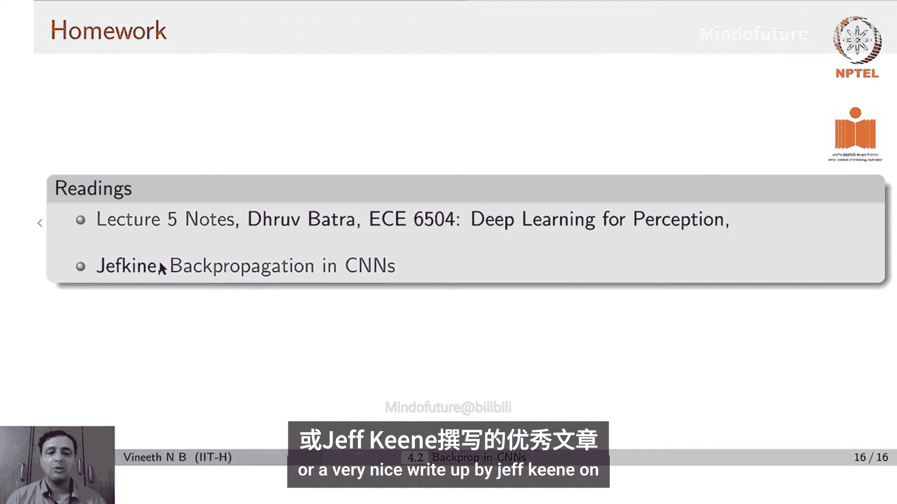

# 【NPTEL】计算机视觉的深度学习 p92 P92_03_CNN中的反向传播 -BV1vNWkzpEua_p92-

Having seen an introduction to convolutional neural networks。

We saw a couple of new layers that you can have in a neural network。A convolutional layer。

 a pooling layer。Now we ask the question with these new layers。How does this affect back propagation。

 the way we saw it earlier？Before we go there， let's revisit our exercise from last class。

 which was given a 32 cross 32 cross 3 image。And six filters of size5 cross5 cross3。

What is the dimension of the output volume with a stride of 1 and padding of  zero？

The answer is straightforward。W 2 is equal to w1 minus f plus 2 p by s plus 1 a similar formula for h2。

 you simply plug in the values and you get 28 cross 28 across 6， which is the depth of the output。

Because of the number of filters。We did leave behind another question。

Wwhich was it the max pooling layer differentiable and how do you back propagate across it and this is something that we will visit at the end of this lecture。

Let's now start and try to do back propagation across a convolutional layer first。

A large part of this lecture's content is adapted from Dr Bartrara's excellent lectures at Georgia Tech。

To begin， let's assume a gray scale image。We assume that the number of input channels C is equal to one。

 You should see that this one affect the derivation per se。 It just makes it simpler for explaining。

Also， we are going to assume the number of convolutional filters to be one。

 which means the size of your output map will or the depth of your output map will also be one。

But each convolution will follow the same procedure to be able to compute its gradients。To start。

Let's consider a single convolutional filter。Let's assume the size of that filter to be K1 cross K2。

This is applied to an image which is of size n1 cross n2 and you get an output y。

 which is of size m1 cross M2。Visually speaking， this is your space。

 you have an input X filter W and output y。From definition of convolution。

 we know that an element of the output y， y at yj， y at Ij can be written as。

Sumation a going from 0 to k1 minus1。B going from 0 to k2 minus1 x of I minus a。

 J minus B into W A B。Note here that we are not placing the filter at the center of the input pixel but at a corner。

 this doesn' not matter this is only to make this expression a little simpler to see so we would make it the rest of the derivation a little simpler to understand。

We now are given a loss function L which is used to train a CNN。

 so for our convolutional layer there are two quantities that we have to compute。1 is dol by dow。

 the gradient of the loss with respect to every weight in every filter and dol by do x。

 which is the loss with respect to every pixel of the input because that is necessary to back propagate further to an earlier layer。

We are going to try to derive。The gradient for each of these quantities using chain rule。

Let's start with。Do L by do W， the gradient with respect to the weights in the filter。To do this。

 let's consider one particular weight in the convolutional filter。Let's say that you have W。

 a prime B prime as one location on your filter， so if you have your filter to be W。Which is K1。

Across K2 dimensions， you have one of those values inside them to be W a prime b prime we now want to compute the gradient of the loss with respect to that particular weight and then this can be generalized to all weight in that filter。

To do this， let's ask the question。If you used a filter in a convolutional layer， which is W。

How many pixels and which pixels in the output or the next layer Y？

Does that particular weight value affect？Because remember， the way back propagation is done。

All the values that a particular pixel impacts in the next layer。

 we have to accumulate all those gradients back into the gradient at that particular pixel。

This is what we saw with feet forward neural networks。So in this case。

 the question is if we took the weight at a prime b prime。What all pixels in the next layers。Map。

Does that particular weight affect？The answer is every pixel in y。

Because every pixel in y is obtained by a convolution of the filter with a certain location in x。

While a certain pixel in y depends only on a few pixels in x， it does depend on every value in w。

Which is the freedom。So each pixel in the output corresponds to one position of the filter overlapping the input。

And every pixel in the output is a weighted sum of a part of the input image。

 but the weight in the filter affects every pixel in the output。Now， let's move forward。We now write。

Do L by do W at a prime prime given by。Sumation of the entire dimension of y remember y we said has a dimension of M1 cross M2。

 so we have to sum over all of these gradients where。You have Dol by Doyj。

 which is going to be the gradient of the loss until one particular pixel in that next layer map。

Into Do Y Ij by doW， A prime， B prime。庆祝。Do L by do y。

 we assume is already known through back propagation until that particular step。

Our challenge now for the convolutional layer is to compute do y by dow。In particular。

 do y at Ij by doW at a prime B prime。That's the quantity that we now have to compute to compute this overall gradient of loss with respect to w at a prime B prime。

Let's consider that particular quantity now， which is doy at Ij。

With respect to doW at a prime P prime。By definition of convolution， once again。

 we have y at Ij is this follows from the standard definition of convolution。

This K1 K2 other the filter sizes， and this is your first principles definition of convolution。

Using this， we can now say do Y Ij by doW A prime B prime can be written as。

D Y Ij by doW a prime B prime， which is you now expand Yj in terms of the entire output that you have from the first equation。

 so you have the entire RHs of the first equation you put that in there。Now in all these sums。

 there is only one sum one term here that is going to depend on W a prime b prime。

 remember in one convolution。One particular filter value is convolveed with only one pixel in the input in in that single convolution operation when you move the filter to the next location。

 it may contribute something else in the other location， but in one single convolution operation one。

Value in the filter is multiplied by only one input pixel。

And that term now is going to be W a prime b prime into X i minus a prime j minus b prime。

Every other term in this double summation， when you differentiate with respect to W A prime B prime will become  zero because it does not depend on W a prime B prime。

This quantity trivial becomes x at i minus a prime y minus b prime。Let's see how to use this。

 Let's plug this back in。 We now have。Do L with respect to W A prime B prime equal to summation over all the pixels in y。

Do L by do y for every pixel at y into the second term which we just computed on the previous slide。

 which turns out to be。X at I minus a prime， y minus B prime。Look carefully。

 this is now the convolution of x and dol by doy。Which is beautiful。

Do L by do y remember is also going to have the dimensions of y it also that gradient that set of gradients will also look like an image because you have a gradient of the loss with respect to every pixel in y。

So， that is going to form one matrix and x is a matrix by itself。

 the convolution of x and do l by do y is do l by do w at a prime b prime so you can compute this as a convolution in the back propagation step。

Let' us now move on to the next quantity， which is do L by do x。

 which is the gradient with respect to inputs of that layer of that convolutional layer。

Let's once again consider a single input pixel x at i prime J prime。Let's again ask the question。

 which pixels in y would be affected by this particular pixel in x？If you see it visually。

 we can say that given an x and let's say there's one pixel given by this red square。

 which is at i prime J prime。When it's convoled with W。

You would now have this it would affect this entire range of pixels that go from i prime by J prime to i prime plus k1 minus1 and j prime plus k2 minus1 why is it like this why is it not centered at I prime J prime because that is the way we defined convolution in this context for simplicity if we had defined convolution as going from minus k1 by 2 to plus k1 by 2 it would have been centered but because this is the way we defined convolution the indices went from0 to k1 minus1 and b to k2 minus1 you would now have。

These pixels here represented by this dotted square。

 which are the pixels that would be affected by i prime J prime。

Now we call this region P and we now know that the gradients of the loss with respect to these pixels。

Will be influencing the gradient of the loss with respect to this pixel， all other pixels in y。

Do not have a contribution from this pixel and hence those gradients of L with respect to y do not matter to us。

Let's now say do well by do x at i prime J prime is summation over all pixels in that region P。

Do L by do Yp into do Yp by do x at I prime J prime。From the figure in the previous slide。

 we can now define that region P as going a going from 0 to k 1 minus1。B going from0 to k to minus1。

Do L at a particular pixel Y I prime plus AJ prime plus B。

And the derivative of I y at i prime plus a J prime by b plus b with respect to x at i prime J prime。

 rather if you see the previous slide， we are taking each pixel here and adding them all up and saying that we want the gradient of a particular pixel in this region P with respect to this pixel at in x。

That's what we are writing in the summation。The left quantity here is known because we assume that all the doy until dos are known until that time we are only worried about how to compute the backdrop across a single convolutional layer if there were more convolutional layers the same procedure would be applied iteratively。

But the second quantity here is currently not known to us。

D y of i prime plus a and J prime plus B with respect to x at I prime J prime。

Let's try to compute this on the next slide。From the definition of convolution， once again。

 we have y at I prime J prime given by this equation。

 this once again comes from the basic definition of convolution。So if this was the definition of。

Of why at I prime J prime？Then the definition of y at i prime plus a J prime plus B。

 which is going to be another pixel location will be replace wherever i prime is there by i prime plus a replace wherever J prime is there y j prime plus B。

 so i prime plus a minus a becomes i prime。J prime plus b minus b becomes J prime and WAB stays as this。

Now， the derivative of。I prime plus a J prime plus B with respect to i prime J prime will be that one single term WAB for a particular choice of A and B for a different choice of A and B。

 it would be that term in the summation as we said the last for the previous derivative DoL by doW also all the other terms in the summation would not affect。

The derivative with respect to one particular AB。So this is the quantity that we have for do y at a particular pixel location with respect to do x at i prime J prime。

Let's now plug this back。We have。Do L by do x at I prime J prime to B。

For all the pixels in the region， P do L by do y at one of those pixels into WAB for this choice of A and B。

Once again， this becomes interesting。 This looks like the definition of cross correlation。

It's the cross correlation of。Do L by do Y with W the filter。Rather。

 we can say it's the convolution of the filter flipped。With Do L by doil， we know that。

Cross correlation and convolution differ by that flip of the filter and that becomes by a flip by 180 degrees which is a flip in two directions and that's what now we have here。

Do L by do y into a double convolution with a double flipped filter。This is interesting again。

 because even now the chain rule across the convolutional layer to compute do L by do x can be computed as a convolution。

Why does this matter？Recall our discussion of image frequencies in the first week。

 we said the convolution。Can be evaluated through very efficient methods such as fastphoria transform。

You could use all that to efficiently compute these gradients during back propag in this step。

Now we are left with one question， so that defined that concludes how back propagation is done across a convolutional layer。

 there are only two quantities W and x， we now still are left with how do you back propagate across a pooling layer。

As we said before。A pooling layer is parameter free。It does not have any weights。

 there are no weights to update no gradients。The only gradients we have to compute are the gradients with respect to x in the previous layer to allow the gradients to propagate through to earlier layers。

How do we do this？If we have max pooling， let's take this visual example on the right so you can see here that these red。

 green， yellow and blue regions are max pooled in the forward pass 1156， the max value is 6。2，4，7，8。

 the max value is 8。3，2， one，2， the max value is 3，1，0，3，4， max value is 4。

So this in the forward propagation for every two cross2 region。

 you take the max element and put it here and then you take it further through later layers。

The backdrop。Step in the same in the same layer。You keep track of what was the winning position in each two cross two window。

For example， we know that six came from this position of the first two across to window。

So whatever gradient we have at6 when we back propagate goes to that location in the previous layer remember back propagation is drawn the other way here。

 but this is the previous layer what you see on the right here is the previous layer the full gradient at6。

 remember we assume that when we back propagate the gradients until this step for each of these pixel is known to us。

We only have to see how to propagate those gradients across the pooling layer。

All this gradient goes to this location， all this gradient goes to this location。

 all this gradient goes to this location because that was the position of the winning neuron and similarly for this to this。

😊，What happens if we did not use max pullinging if we used， say， average pullinging？

If you used average pooling you would take whatever gradient came into one particular location。

 say the position of 6 distribute the gradient equally to each of these four locations in case of two cross2 pullinging if you did three cross 3 pullinging you would divide that among nine pixels。

In this case we have two cross to pooling， so whatever gradient you have at6 will be divided into four and that gradient would be given to each of these pixels in the two cross to neighborhood that led to6。

And that's how back propagation is done across pooling layers。

That concludes our discussion of back propagation in CNNs for more details。

 please read the lecture notes of Drruatra on the same topic or a very nice write up by Jeff King on back propagation in CNNs。

