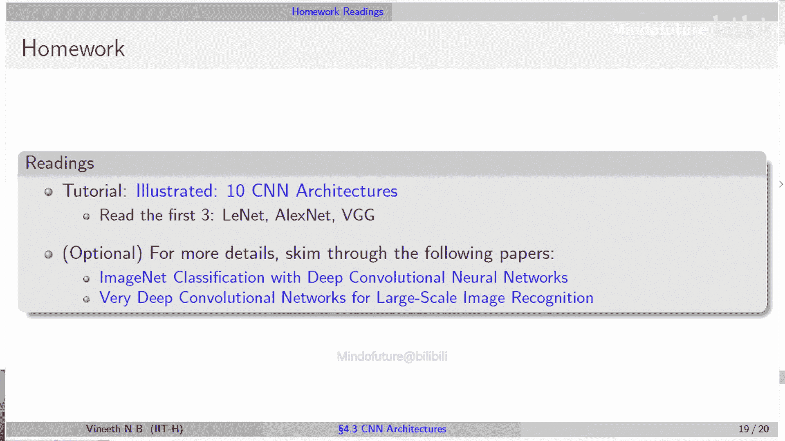

# 【NPTEL】计算机视觉的深度学习 p93 P93_04_图像分类CNN架构的演变 - 第一部分 -BV1vNWkzpEua_p93-

Having seen an introduction to convolutional neural networks。

And how back propagation works in convolutional and pooling layers。

Let's now move forward and see how CNN architectures have evolved over the years。Today。

 depending on what task you have at hand and what constraints you have for a particular task。

 there are a wide variety of architectures that are available。

Well try to cover a significant number of them over the next couple of lectures。

 let's start with the like earliest architectures， the history of CNs dates back to the neocogniron in 1980。

 which was perhaps the earliest precursor of CNs。The concept of feature extraction。

The concept of pooling layers as well as using convolution in a neural network and finally having recognition of classification at the end was proposed in the neocogniron。

But the name convolutional neural networks。Came with the design of the Leette by Y Leun An。

 which was largely developed between 1989 and 1998 for the handwritten digit recognition task。

The Leette convolutional neural network architecture looks like what you see here。

It starts with a convolutional layer。Then goes for a polling layer。Then again， a convolutional layer。

Then a pulling layer， then to fully connected layers， and then finally the output layer。

The convolutional filters were of the size5 cross phi applied at stride 1。

The pooling layers where two cross2 applied at Str 2 you can see the overall architecture written this way。

 this is a common way of writing out architectures of neural networks where you say con pool con pool F F it denotes a convolutional layer followed by a pooling layer followed by a convolutional layer followed by a pooling layer。

 F layer and F layer。Even architectures until today follow similar principles in their design of CNN architectures。

A major effort in development of newer architectures for CNNs and newer designs of architectures was thanks to the Inet classification challenge。

 which started in 2010， ImNe is a dataset and they organized the challenge called the large scale visualual recognitiontion challenge in 2010。

the image database in INe is organized according to the wordNe hierarchy。

 it currently has images corresponding to various nouns in the wordNe hierarchy。

 it has millions of images at this time and currently about 500 images per node in the wordNe hierarchy。

This led to a significant effort across researchers to benchmark their machine learning models。

 computer vision models in particular for image classification。

On a common data set in which everybody could check how their models performed。

The performance measure on this dataset was known as the top one error。

 which is the error when you look at the highest the best prediction of the neural network against the ground truth。

 which is known as the top1 error。And the top five error where you try to check if the ground truth was in the top five of the labels in the output layer of the neural network。

Which is still a good measure because the imnet data set has about has thousand objects。

 which means your output layer in the neural network has thousand neurons。

As long as your ground truth label is in the top five。Of the values。

 the scores that you get in the output layer， you consider this a correct match。

And not doing so would give a top five error。For more details on the Iary data set。

 which is very popularly followed by computer vision researchers today， please see this link。

Before we move forward and discuss CNN architectures。Let's take a step back。

And see how neural networks in general can be used for the classification problem。

When we discussed feet forward neural networks。We took the loss function as the mean squared error。

Which was fine for that time。But when you are working on a classification problem means square error may not be the right choice of a loss function。

Mean square error works better for regression problems。In classification problems。

The most common loss function is known as the cross entropy loss function。Which measures the entropy？

Between。The probability distribution on the output labels in the ground truth。Versus。

The probability distribution on the output labels as output by the neural network。

This gives you a sense of。Error committed by the neural network， let's see the formal definition。

 so the cross entropy loss function is given by。Minus1 by c， where C is the total number of classes。

Sum up why I log why I hat。Where Yi hat is the prediction for a particular class I of the neural network or the score of the last layer of the neural network for the I class and Yi is the correct label for that particular class。

Rather， you can say that Y I。Is， if you had。A certain number of classes let's say1 to c let's assume the second class was the correct class then you would have your y vector expected y vector to be010000 until the see class this would be the probability distributions on the label space in the ground route because this is the correct class so this would be y2 this would be y1 and so on and so forth that's the Yi that we are talking about here and y I had a the score in the output layer of the neural network。

In the binary case， this simplifies to minus Yi log Yi hat plus1 minus yi。

 which is going to be the score， for example， when you use a sigmoid。

You will have only one score that comes out of a neural network and one minus Yi will be the score for the negative class。

So this is how cross En people simplify for a binary setting， binary classification setting。

Now if we introduce a use loss function the first thing to check is it is differentiable by looking at it one can say that cross into B is definitely differentiable and then what are its gradients with respect to a say a weight in the last layer because once we get that we can propagate it further through earlier layers through whatever we have discussed so far。

So if we consider the activation function to be sigmoid， which is。

 let's assume a binary classification problem。The derivative of the cross entropy loss function with respect to weight in the last layer Wj is given by。

 let's work it out。Do L by do Wj will be minus 1 by n y by sigma of z。

 how did we get sigma of Z sigma of Z is the same as y hat。

Thats the prediction of the neural network Z was the pre activationivation value we applied a sma sigmoid on that and got Y hat so that's why were replacing Y hat by sigma of Z so y log Yi hat when we differentiate you get you end up getting a doL by Do Y hat into a do sigma by doWj because that's what you would get when you do a chain rule。

So this would give you a y by sigma of Z minus the second term here。

Well give you the second term in the gradient here。Now with these two。You can write your next term。

 as。You can now say。Those sigma by dowj can be written a written as sigma ash of z into xj because this you would write it in two ways you would have。

Do sigma of Z。In by do Z into do Z by do WJ。We know the gradient of sigmoid is sigma prime and do Z by dowj is xj。

Now， when you expand this term here， you can simplify it to by multiplying by cross multiplying。

 you will find that this entire term here absorbing the negative sign。

 the numerator would become sigma of z minus y and the sigma prime of Z xj goes here。Now。

 sigma prime of Z and sigma into 1 minus sigma are the same because that we know is the derivative of the sigmaoid function that would get canceled and youll be left with summation over xxj into sigma of Z minus y。

What is interesting here is that this term here is very similar to the gradient of the mean square remember sigma of Z is Y hat。

So even in mean square error。When you have y hat minus y whole square half， if you differentiate。

 you would get y hat minus y in the loss。So that。Graadient of the cross entropy looks very similar to how the gradient of the mean square error looks。

One more point before we move to CNN architectures is when you are doing classification while we talked about different kinds of activation functions such as sigmoid。

 tanh， Relu， leaky， Re， L， so on and so forth。We typically use what is known as the softmax activation function in the output layer alone。

 what is the softmax activation function。Given Z1 to Z K or Z C in the last layer。

 let's say they are all the outputs of the C neurons in the last layer。

The final output of the network is given by e power Zj divided by summation over all the output neurons。

 e power Zk。What does this do， Remember， in this case。

 the summation of all the e power Z case in the last layer will always be greater than E power Z K。

 which means these values are definitely going to lie between 0 and 1。Also。

 because the denominator is the summation of all those exponential term exponential values of those neurons in the last layer。

Doing this for every single neuron will also add up to one because you would then have e power Z J。

Plus， E power Z。P， let's say， by the same sum。And you would repeat this for every neuron in that last layer。

 and this sum would add up to one。In a way now we have converted whatever scores the neural network outputs into a vector of probability values where each is lying between 0 and 1 and they all add up to 1。

This allows us。To interpret the output of a neural network as a probability distribution over your output legal space。

So softftmax a very is a default activation function that is used in the output layer of neural networks used for classification。

A small notation or nomenclature here， the values before the probability score are typically called the logicits of a neural network。

So the neural network outputs logics， you apply a softmax activation function and convert it into probabilities scores here is an example on the right you see that the output layer gave a set of real values as output。

By doing the softmax activation function， this became 0020。90。050。01 and 0。

02 this is because of the exponential scaling of the values and these add up to one allowing us to interpret that vector as a distribution over your output labels。

Let's now come back to the Iate classification challenge。

So all these Cns that we will talk about now， all of them use cross entropy loss as the loss and more or less use the softmax activation function in the last layer as a common。

Choice of activation function and loss across these CNN architectures。As we said a few minutes ago。

 the Inet data was created and launched in 2010 and researchers around the world participated in the ILSRVC challengege。

And in 2010， the winning error rate was 28。2， this was done without neural networks。

 and in 2011 researchers improved the score。From 28。2 to 25。8 error rate。And in 2012。

Alex Kzevski and Jeffrey Hinton came up with an CNN architecture。Popular to this day， as Alexni。

Which reduced the error from 25。8 to 16。4， which was a significant improvement at that time。

So this was the first winner of。The imary challenge， which was based on a CNN。And since 2012。

 every year's challenge has been won by a CNN significantly outperforming other shallow machine learning methods。

 so the traditional machine learning methods are often called shallow learning because you don't have deep learning over many。

 many layers， but this will become clearer to us in the next week's lectures when we try to understand what value the depth of the neural network brings to the architecture。

Let's now start with the Alexnets architecture and try to understand it。

Here was the architecture of Alexnet。We actually looked at the first layer of Alexnet as an example when we worked out the sizes。

In the first lecture on CNNs。The input is a volume which is given by 224 cross 224 cross 3。

 which is the RGB channel。And the filter size was 11 cross 11。Of course， a depth of three。

 which follows in all of these scenarios。And with a stride of four。This led to a 55 cross 55 cross。

Totally 96 filters were chosen of which 48 filters went to one of the processing units and the remaining 55 cross 55 across 48 went to another processing unit。

We'll try to describe this in more detail over the next few slides。

 but this was the overall architecture that won the ILSVRC in 2012。嗯。

Had design principles similar to Leette but also had many features which were different and it was also deeper than Leette and there were also a few other important improvements which we talk about。

It was trained over 1。2 million images using SGD with regularization。

Let's try to look at this architecture more carefully。

 so it has the input image which was 224 cross 224 cross 3。

 which is the size of images in the Ied data set。The first layer had a con plus pool which you see the output together here。

 so this output of 55 cross 55 cross 48 was after doing the convolution part and then you do a max pooling which reduces the size further。

Then once again they had a con plus pool， then only a conv， then only a conv。

 then again a con plus pool， then a fully connected layer， then a fully connected layer。

 and then finally the output layer。Let's look at at least the first layers numbers once more and you can perhaps work out the remaining layers based on the principles that we talked about the first lecture this week。

So 224 cross 224， cross 3，11 cross 11 was the size of the filter。

And then you have a stride of four so you would get your output to be。

 they also had a certain level of padding so you would have 227 across 227 was the final input given to the network so to 227 minus 11 that's 216 by 4 which gives you 54 plus1 which gives you 55 that's what we talked about even earlier。

Similarly， you can work out the parameters in each of these layers。

By by knowing the number of filters and the kernel size that you see in each layer。

 which is shown on the figure。It had eight layers in total five convolutional layers and three fully connected layers here here and here the last three layers were fully connected。

 it was trained on the Inet data set as we mentioned。

The Alexnet designers also introduced a normalization layer called the Re normalization layer。

So we so far saw a batch normalization layer， similarly the response normalization layer。

Normalized all the values in a particular location across the channels in a given in a given layer。

 for example， if you had a certain depth。You would then take a particular pixel location and go along the depth and normalize all the values along the depth at that particular spatial position this was known as response normalization and the authors argued that this would give an effect of what is known as lateral inhibition so it would allow one of those to win over the other by getting a higher value in terms of the output after normalization and so on。

In addition to this。This particular architecture also introduced the rectified linear unit or ReLlu as an activation function that was one of the contributions that made this architecture a success。

 of course Relu is now a default component or a default choice for an activation function in many other cements。

As you can see in the architecture， max pooling follows the first second and the fifth convolutional layer。

 the third and fourth did not have a pooling。And the re non nonlinear narrativeity was applied to the output of every layer here in the entire architecture。

Why was such a design chosen at that time？Perhaps that was the best。

 that was the architecture that led to the best empirical performance。

Let's try to analyze the complexity of this architecture in terms of parameters and neurons。

You see here the parameters in the first layer would be given by。There are 11 cross。

11 cross 3 is the size of the filter。Plus， one for a bias。

And into 96 are the total number of filters chosen for the first layer， 48。

 which went to one processing unit and 48， which went to another processing unit。

So the designers of this architecture。Ted to take advantage of two processes that they had in particular two GPUs that they had into which they simultaneously forked out these volumes into two different GPUs and then combine them in later layers where you see these cross inputs as dotted lines is when the output of one GPU was also fed to the other GPU and so on and so forth。

 these cross links in the architecture should help you point understand in which layers that was done。

Coming back to the parameters， so the total number of parameters in the first layer was 11 into 11 into 3 size of the filter plus1 bias into 96。

 the total number of filters which roughly comes to about 35，000。On the other hand。

 the number of neurons are given by the size of the image itself， which is 55 cross 55 into 9 to6。

 and that turns out to something like 253，00440。Similarly。

 you can compute the numbers for the other layers， the second layer。

 the parameters turn out to be about 300 k and the neurons turn out to be about 186。

000 and odd third layer new parameters are 884 k number of neurons are 64。

000 so you can see that the number of neurons is reducing because the size is reducing after applying pooling。

By a neuron we mean each pixel in a feature map in the next layer。

 that is what constitutes a neuron here and because we do pooling the size of the image becomes from 224 cross 224 to 55 cross 55 to 27 cross 27 to 13 cross 13 and because of the reducing size the neurons reduce。

But the number of parameters keep increasing because the number of filters taken are significant initially it was 96 the next layer had 128 plus 128 filters or totally 256 filters。

Then 192 plus 192， that's about 384 filters and so on and so forth。You can see that as you go deeper。

 the number of parameters keeps increasing， the number of neurons decreases until you go to the fully connected layers where the number of parameters。

Simply takes off and goes to the order of millions。So about of the total 60 million parameters。

 about 57 million parameters are located only in the fully connected region and that should again go back and explain to you how。

Efficient， the convolutional and pulling layers are in terms of number of parameters。

So and the number of neurons comes to totally about 0。63 million。

Another way of looking at it is just visualizing this from a different perspective。

 you can see here that go the parameters go from 35k to millions in the last three layers while the neurons start with2253k and reduce towards the last layers。

1。Interesting observation of this architecture is the convolutional layers。

May contain only 5% of the parameters， remember they contain only 3 million of the total 60 million parameters that Alexnet has。

But they account for 95% of the computation。Why is that so？

Although they have only 5% of the par parameters， remember， in convolution。

 you have to take the same weight and keep placing it on every location in the original image and get the output。

Although the weights of you， the number of computations is high in a convolutional layer。

So 90 to 95% of computation sits in the convolutional layers whereas 90 to 95% of the parameters lies in the fully connected layers。

The AlexNe was trained with SGD as I mentioned on two NVDdia GDX 583 GPp GPUs and that's what allowed them to fork the feature maps into two different GPUs and it took them about a week to train this architecture。

Today， it can be done in much lesser time thanks to improvement of GPUs。

 but at that time it took them a week to train this architecture。In the following year， 2013。

 the winner of the imageNe。LSRBC was a network known as the ZedFNe。

It came from the names of Ziller and Fergus who came up with this design of a CNN。

 the main contribution of the ZF net in 2013 over Alexnet was the architecture was fairly the same the overall conpo conpo con con conpo fully connected fully connected but there were a few changes in the hyperparameters what were the changes in the hyperparameters in con 1 the filter size was changed from11 cross 11 Stride 4 to 7 cross 7 strideide 2。

In con 3，4 and 5， the number of filters was increased from 384，384256 to 512。10，24 and 5，12。

And this careful choosing of hyperparmeters。LED to a significant decrease in the top five error from 16。

4% to 11。7%。One term I should clarify at this stage is the notion of hyperpar。

 why do we call these values 11 cross 11，7 cross 7，384 as hyperparmeter？

Because the parameters that we learn are the weights of the neural network。

All the other values are user defined， they are not learned， so we call them hyperpar。

 the parameters are the weights， which is what we actually learn。

But this was the main contribution of Zalph Knight in 2013。Moving on to 2014。

One of the major contributions in 2014 was a new architecture known as the VGG net。

The VGGNe stands for an architecture developed by the VGG group Stan at Oxford。

 which is also stands for Visual Ge Group。And they came up with an architecture with a certain philosophy in their design。

They came up with multiple depths in their architecture， they argued that。

While Alexnet took Let from a certain depth to the next level and ZFnet maintained the same depth as Alexnet。

They argued that by making a CNN deeper， you could solve problems better and you could get a lower error rate on the imate classification challenge。

So the way they went about doing it is to take multiple architectures of different depths so you can see here that the input is on top。

 the output is at the bottom in all of these architectures。You can see con layersers。

 max pool layers， con layersers， max pool layers， on and so forth。And these 64。

 128 denote the sizes that you have in these architectures。

The interesting design philosophy that they had， so this architecture won the runner up in the imageary challenge in 2014。

And their philosophy was that by increasing the depth。

 you can model more nonlinearities in your function。

And the key contribution was that depth is a critical component。

They maintained a homogeneous architecture from beginning to the end。

 what does that mean they used only a three by3 convolution。Across all of the layers。

We saw with Alexnet that it had 11 by 11 filter the first layer and ZF net changed that to7 cross7 filter in the next year。

But Vggg argued that they would just maintain instead of struggling to find the filter size while designing the architecture。

They decided to fix it at three cross three。How does that help？

We will come to that in a moment and they had a two cross two max pool across all of their pooling layers in the network。

Their main idea was that a smaller receptive field means lesser parameters。

 which means if you have a three cross 3 filter， there are lesser parameters to learn more importantly。

Two，3 cross3 convolutions done in sequence have the same effect as 15 cross5 convolution when you do 13 cross 3 convolution。

 you get an output。If you do a three cross  three convolution in the output of that first one。

You would have the effect of a neighborhood of P cross5 pixels in the original image having an effect on the latter later output。

Rather， two3 cross  three convolutions have the same receptor field as a single5 cross 5。

 similarly three，3 cross3 convolutions have the same receptorcept field as a7 cross 7 convolution and so on and so forth。

Rather， instead of trying to keep filter sizes like 11 cross 11 or7 cross 7。

They argued that they could always keep the filter size as three cross3 importantly as we said it would have fewer parameters if you took a single seven cross 7 convolution you would have seven square C square parameters。

7 square is 49 c square whereas if you had three3 cross 3 convolutions arranged in sequence you would have three into three square c square parameters which would be 27 versus 49 so this would have a fewer parameters then doing a single seven cross7 convolution。

They found in this architecture that VGG 19 was only marginally better than VGC16。

 so until VGG16 the performance kept improving with depth but it seemed to saturate after a certain depth and this issue was addressed later as we will see in the next few slides。

And they also tried using ensembles of different networks to get improved performance on the same task。

In terms of parameters， VGG however had a significant memory overhead and a parameter overhead。

 so you can see here a comparison of Alexnet versus VGG16 in terms of memory memory would simply be the number of neurons across all of your layers in the VGG versus number of neurons across all of the layers in your Alexnet remember again when we say number of neurons。

 we mean the size of the feature maps because every pixel in every feature map is a neuron for us in a CN。

So you can work this out carefully and find that Alexnet has a total of 1。9 M versus Vggg16。

 which has a 48。6 M memory。In terms of parameters。While the first few convolution layers are。

Reasonably small for Alexnet and VG in the fully connected layers。

 VGG has a significant increase in parameters。And while Alexnet had a total of about 60 to 61 million parameters。

 Vggg 16 ended up having about 1，38 million parameters。

 so that while Vggg works well in many settings， that is a limitation of Vggg because of its increased parameter count and memory while。

Each the choice of three cross3 by itself reduces the parameters。

 the parameters added up for them because of later layers， the depth， the fully connected layer。

 so on and so forth。It uses a lot of lot more memory and parameters and as we saw。

 most of these parameters are in the first fully connected layer。Most of the memory。

 as they saw earlier， is in the early convolution layer because that's when you need the maximum number of neurons to contain all of those feature maps。

