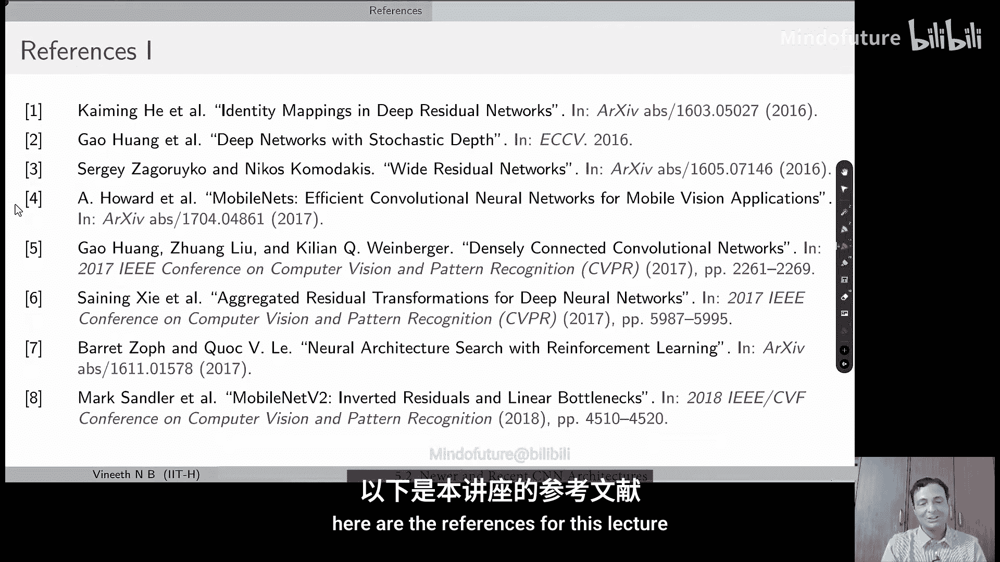

# 【NPTEL】计算机视觉的深度学习 p95 P95_更新和近期CNN架构 -BV1vNWkzpEua_p95-

In the architectures that we have discussed so far。

You will notice that whatever components were added be it the inception module。

 the bottleneck layer or the residual block。None of them affect back propagation in any way。

They are all different ways of connecting inputs out to outputs。

 and as long as one computes the chain rule carefully and accounts for the gradient through all possible parts that reach a particular node。

 back propagation can be implemented as this。In this lecture。

 we will move on to talk about a few more recent CNN architectures that have been developed since residual nexts。

ReestNes won the Inet challengege in 2015 and have continued to be a popular choice for several applications。

Well talk about ways in which they have been extended。In this lecture。

 we will begin by discussing a few variants of SNes such as wide residual dual networks。

Rsn and residual networks with stochastic depth。We will then discuss densely connected convolutional networks or dense nets。

Followed by mobile Ne。Efficient net， squeeze an excitation net。And towards the end of this lecture。

We will describe con next。Which is a recent CNN architecture。

Inspired by the family of transformer models that have become very popular these days。

 one of the earliest works that followed ReNes was a work that tried to understand the importance of the identity mapping in residual networks。

As we discussed， last plus。The identity mapping between residual blocks。

Allow the gradient to flow through a highway during back propagation。

TheThe creators of ResNe improved their design here with this effort。

Where if you notice the original residual unit here。At the end of residual block。

There was a re that was applied on the output of the residualo block。

The creators of Resnet noticed that that could。Affect the flow of information through that direct。

 direct path and hence。Chaanged the design to bring Relu into the residual block。

 and this they found。Created a more direct path for propagating information because now this identity map connection is does is not succeeded by RElu and the information passes as this。

And it was also found to give better performance in their empirical studies。

A popular variant of renets， which is used a lot today， is known as wide renets。As the name suggests。

 it was an improvement of residualnesss。But。The objective in this design。

Was a hypothesis that residual networks work because of the residual block and not because of increasing the depth。

In residual networks， remember。On one hand， the residual blocks were introduced to mitigate the vanishing gradient problem on the other hand。

The authors argued that that allowed us to create deeper and deeper networks。

 which gave better performance。But in wide dress nets， the authors argued that you don't need depth。

As long as you have strong residual blocks， that can give you good performance。

So to show that and to study that hypothesis， they increased the width of。Each residual block。

By multiplying the number of filters kfold。In the basic residual block。If you had two。

3 by three convolutions with F filters each or F feature maps each， that's again。

 if you recall the depth of the output of each layer。

They increased each of them kfold and made it fK and FK。

And they assured that with this increase of width in each residual block。

 a 50 layer wide re neck could outperform a 152 layer original re neck。

This increasing the width instead of depth， can also make computation efficient。

Through techniques like parallelization。If things are done one after the other。

 which is what happens when you increase the depth， it' is not possible to parallellyse。

 but when you increase the width， you could potentially send each filter to a different computing unit and then retrieve the results and take it forward so increasing the width instead of depth has a computational benefit to。

Another work that was again by the creators of Resne was known as aggregated residual transformations。

 which was also called Res next。As the visual shows if the left block is the original residual block。

 the right block， which is what was proposed in rest next was a multiple branch。

Multiple branches in each residual block。So you can see here that you have a one by one con with four filters and a three by three con with four filters。

 then a one by one con with two to six filters。So this reduces the depth to4 and then increases it 256。

Keeping in mind the same idea of the bottleneck layer。

So they did this along 32 different path and showed that this could improve performance。In a sense。

This tried to bring the idea from inception module into residual networks。

Another interesting extension of residual networks was the idea of deep networks with stochastic depth。

The way to think of this approach is to think of dropout in terms of residual blocks。

Because now residual blocks are connected through identity connections。

 this now gives you an interesting direction of dropping layers。

You could not have done this with simple feet forward networks or CNN straightforward forward CNNs。

Because if you remove the layer， the network would get disconnected。But now。

 because of the presence of the identity connections through residual blocks。

 you could now randomly drop a few of the residual blocks in every mini batch itration。

And that could be done in a stochastic way by randomly sampling from a uniform distribution or any other probability distribution and accordingly deciding which blocks should be dropped。

So the motivation is this reduces vanishing gradient further and it can also reduce training time because the forward propagation is perhaps shorter now and it can also act as an added regularizer some noise just like how dropout serves as a regularizer。

And at test time， very similar to dropout again， you use the full network as it is。

Very similar to how it's done in drop up。Moving on from these methods。

Came a method known as densenets， which is perhaps after renets and a version of renets known as inception renets。

 densenets are perhaps the most popular choice for computer vision tasks。As the name suggests。

 denseNe stands for densely connected convolutional networks。In this case。

You have a dense block similar to a residualce block。

 but a dense block where each layer is connected to every other layer。Remember， in restNe。

 you had identity connections only periodically after every residual block。But in a dense net。

Within a dense block， you have identity connections from every layer to every other layer。

 you also call them skip connections， these connections that take you from one layer to another layer are called identity connections because the weight on that connection is identity。

 they are also called skip connections because you're skipping a few layers in between and going straight away to a later layer。

Similar to。Restnets， this also alleviates the vanishing gradient because of those identity connections that give keep giving a stronger gradient through these densenet blocks。

And they showed that using this approach， a shallow 50 layer network can outperform a deeper 152 layer restNe。

Of course， you have to keep in mind that the word shallow here is a relative term with respect to 152 layers。

This is popularly in use today for image classification you can see the overall architecture of this network on the far right here where you see that you have an input you have a con layerer and then comes one entire dense block of all of these dense connections so you can see again that within each dense block you have a con layerer。

Then you concatenate using the input， then you have a conveyor。

You again concatenate using the input from the previous coner as well as the original input。

Then you again have a con layerer。And then concatenate and then you can have a conveyer before you come out of that dense block。

After the dense block， you have a con pool conv， once again dense block， con pool conf。

 a dense block pool fully connected and then finally a softm layer for classification。

As architectures started evolving through interesting use of skip connections。

All the variants of renet and densenets were different ways of using skip connections。

To avoid the vanishing gradient problem， as well as make computations more efficient。

There was another need emanating as CNNs became popular for vision applications， which was。

Can we use vision applications on low power devices， embedded devices or what are known as。

Edge devices， devices that sit at the edge at the cusp of interaction with users or an environment for that matter。

Mobile Nes was one such effort which refers to a class of efficient models for mobile and embedded vision applications it was developed in 2017 for the first time。

And before we describe mobile Nes， what are the desirable properties of a CNNn for use in small devices？

You need low latency， which means the forward prop of a neural network should be real time。

 should be should not have latency， low power consumption。

Running a neural network should not consume too much power。

Often in these edge devices there is very little the power sources are very little and they may have even other components to run so you do not want too much power to go into the running of a neural network。

You want the model size to be small， we saw that from AlexNe to BGG， there was a model size increase。

 but then with restNes， the model size started decreasing while being able to achieve a similar performance。

And you still want at least a sufficiently high accuracy。

 You may be fine to drop one or two percentage points in accuracy。

But at a significantly smaller model size and a low power footprint。Mobile nexts are。

Aimed in that direction， they are small， low latency networks， which are trained directly。

A complementary approach to this problem， which has also been popular over the last few years。

Is the idea of compressing neural networks。Compressing while in compression of neural networks。

 you try to prune out weights or there are other methods in which you can try to remove the weights that you think do not matter for the outcome。

But mobile nets try to do this by design。The key ingredient of mobile Nes is one of the variants of convolution that we talked about in the first lecture this week。

 which is depthwise separable convolutions。In your standard way of convolving it would be to do a Dk across Dk across M convolution and M such filters。

But now in depthwise convolutional separable convolutions。

 what you do is you first convolve only on each channel。

 so which means this is dk across d cross 1 M different times so if there are M channels。

 you do dk across d cross 1， Dk across d across 1 on the second channel dk across d across 1 on the third channel and so on and so forth until m channels。

This is going to give you a certain set of outputs。Now on these outputs。

 you concatenate and then run a one cross one cross M convolution along the depth。Remember。

 each decay cross， D cross one will give you。An output which is the same size as the input。

 for instance， if you pad。And you would have M such outputs。

Now you do a one cross one cross1 mmic convolution across all of those channels。

 you will have n such one cross one cross M filters to finally give you the same output that you would have got with standard convolution。

Let's see this in a some more detail， so BSc， which is depth twice separable convolutions。

Replaces standard convolutions with depth twice convolution followed by one cross  one convolution as you can see。

 one cross one convolution is a very popular choice to reduce computations in CNNN。

And DC applies a single filter to each input channel。So how do you think this helps？

Over standard convolution。Let's try to take a few dimensions and analyze this carefully。

Assume that input is。Df cross Df cross M。An output feature map after a conveyor is Bf cross Bf cross n。

Assuming that the size did not reduce。Now， if you assume pan convolution to ensure the size that not does not reduce。

Now let the square convolution kernel be K， rather K cross K。Now， in a standard convolutional layer。

 this would have。K cross K cross M cross N parameters。

 because you would have K cross K cross M K cross K 4。

The the filter size and m for the depth and n such filters so that would lead to k cross k cross m cross n and a computational cost would be k to k to m n to n into Df into Df because that is the width and height of the input。

Let's see what happens if you use a depth twice separable convolution。

If you do depthwise separable convolution， this factorizes the above computations into two parts first。

Deep price convolutions。Then pointwise convolutions， which is the one cross one cross impact。

The depthwise convolutions， which operates channel voice has K cross K cross M parameters。

 each filter being K cross K。And you have M such for each channel。

The total cost there would be ke to ke to M into Df into Df。

And the point why convolutions become one cross one cross m。

 which is the size of each filter and n such filters。

 which means one cross one cross m cross n parameters。

The total cost will be m into n into Df into Df。So if you now see what was multiplicative in terms of these parameters now becomes an addition of k into K into M into Df into Df。

Plus， M into N into Df， into Df。By what fraction is computation reduced？

You can try computing it yourself， but clearly you can see that this would become additive。

 this would become multiplicative and that should tell you by what fraction the computations reduce this is very similar in principle to separable convolutions that we saw way back in the first week remember even in separable convolutions instead of using a three cross 3 filter which may have nine computations if you do a three cross  one filter followed by a three cross  one filter along the other dimension you' are going to have three plus3 which is6 computations。

It's a very simple， similar principle here， and you can work this out。

As to what fraction of computation is reduced。To summarize。

Deepthwise convolutions filter feature maps， channel wise and pointwise convolutions combine the feature maps across channels standard convolution try to do both at the same in the same step。

The mobile Ne architecture also had a couple of other components to help improve the performance。So。

 they had after the rep twice convolution they had a batch norm and a relu layer and after the point twice convolution or other one cross one convolution they also had a batch norm and a relu layer that is what they found to give good empirical performance。

And to also obtain faster and smaller models。They had two hyperparmeters。A width multiplier。

That controls the number of channels。Based on a multiplier。

 so if you had an M and an n for the input number of channels and the next layers output number of channels。

 Al is a constant that scales M and n based on the constraints under which you are operating these models。

Mobile Nes was intended to be a family of models which can be designed for certain constraints rather than a single model until now whatever model we saw RNe。

 VGG， GoogleNe， R next， any of those variants were one specific model with a specific architecture。

But mobile Nes is about developing a family of architectures where the architecture can be fine tuned based on certain constraints and these multipliers are width multiplier alpha and a resolution multiplier row。

Try to cater to that need of changing constraints could be hardware constraints。

 it could be power constraints， so based on a particular constraint you could use the width multiplier to automatically adjust the architecture the M and the end in the architecture would get scaled down or scaled up based on some constraints or what what additional resources you may have in that case it could get scaled up。

Similarly， resolution multiplier scales an input image to fraction of its size based on constraints that you may have in a particular setting。

So that allows you to use the same idea to develop a family of models that cater to different constraints in the setting of where this model is used。

A similar approach。Was proposed last year in 2019， known as efficient net。

This had a defined different premise to the way it went about the same idea。

 but the objective was similar， which is to develop a family of modelss that cater to some constraints that you may have in terms of computational resources。

And the way they approach this problem is to say that。

We generally understand through conventional wisdom that if you scale up CNN architectures in terms of width。

 in terms of depth， in terms of input resolution， the moral should work better。

But when they made when they ran studies to observe the trend of increasing depth。

 increasing width and increasing resolution， they found that it did increase but plateaued after a certain time。

And they tried in this method。To explore a principle way in which a CNN can be scaled based on resource constraints。

As we just said。Scaling up any dimension independently improves accuracy but return diminishes for bigger models。

 which is what you see in these graphs the first graph points out flops on the x axis and the imate accuracy in the y axis you can see that as w the width of the model keeps increasing。

Flops keep increasing， but the accuracy also keep increasing， but at a certain point。

 the accuracy saturates even as you keep increasing the width of the model。

You see a similar behavior for depth。You see a similar behavior even for the resolution of the input image。

So the inference that they made was it may be critical to balance all of these dimensions while scaling up or scaling down a model。

It is not about only increasing width like widenets。

 it is not about only increasing depth like in restNe itself。

 but one should consider changing the width， changing the depth and changing the input resolution carefully in a balanced manner to get maximum throughput with your resource constraints。

So how do you go about doing this？They proposed a new scaling method known as a compound scaling method。

The idea was you could scale your architecture given a particular baseline architecture。

You could scale the depth width and address input resolution of the image through your current model design。

Using a single scaling coefficient co。And that's why it's known as compound scaling。

 it's based on one single coefficient， but all your dimensions， your depth。

 your width and your resolution all get changed based on that single coefficient。

Through a lot of empirical studies， they came up with this specific formulation that you see on the right。

 which says that depth is equal to alpha。Time alpha power 5hi。W， the width is beta power 5。

 resolution R is gamma power5。Such that alpha into beta square into gamma square should be about 2 and each of alpha beta and gamma must be greater than or equal to 1。

 and they are all constants。You may wonder how this came firstly let's try to understand each of these y alpha into beta square into gamma square and not alpha square into beta square and gamma square for instance。

The reason for this is that。Convolutions are the costlies operation in a CNN。

And when you increase depth。Convolution or the number of operations increases linearly。

 but when you increase the width or the resolution， width is the number of filters or the resolution。

The computations increase in a squared manner， and that's the reason this relationship is in place and this was found by them in an empirical manner。

 Now why， why should it be equal to2。And one can explain this through an example。

 let's assume phi was equal to1。And in their context。

 this means that you are now you are now provided with double your current resources。

 you had a certain computational resource so far， for example。

 you had a certain GPU and now today you bought a new one and your resources doubled。

In that scenario， p would be set to one in their framework and if p is set to one。

 you can make out that。You would solve for alpha into beta square into gamma square is equal to2 with alpha beta gamma greater than equal to 1 they solved is using a grid search and you would get values such as alpha to be 1。

1 beta to be 1。15 gamma to be 1。3 or one of those variants that would give you the solution。

Now when you do that， you will notice that D would become 1。1 times the old D W will become 1。

2 times the old W and r would become， say 1。3 times the old gamma。

So now when you multiply all these Dwr， you would have Dwr will be alpha into D into beta into old W。

Into gamma， into old R。Now， because Dw and R were old ones。

 the new factor which gets added will be alpha into beta square into gamma square because that's how things will increase now。

 which will now be2。So when phi is equal to one。And you have doubled your resource availability。

Solving this problem， solving this。Equation here， al to beta squared into gamma squared is equal to 2 allows you to scale your depth width and resolution in a manner in which you will maximum go up to2 times your current number of computations。

That's the way you go about doing it。And once you design your alpha beta gamma for a given problem。

 you then change phi and you can get a family of models。

One question here for any compound efficient phi。The total flops will approximately increase by2 power5。

Why is that so？I think I partially gave you the answer already if you go back and look at what I just said。

Remember if p is equal to1？We saw that d will become alpha times the old depth and remember these are multipliers these are scaling coefficients so when we say d is equal to alpha of phi we mean if alpha is 1。

2 then d will become 1。2 times the old depth it is a scaling coefficient。

So if the total number of computations is d into w into R。

 your new number of computations after doing the scaling would be alpha into D if you get alpha is equal to 1。

2 beta is equal to 1。1 and gamma is equal to 1。3， then d would be。Alpha。Alpha times the oldD。

W will be beta times beta square times the old w R will be gamma squared times the old r。

 remember for width and resolution things get increased in a squared banner so now you know that it will be the new depth would be alpha into old D into a new total number of computations would be alpha into old D into beta square into old w into gamma square into old r which would effectively become two times your earlier computations This was for a choice of phi to B1。

If you chose Phi to be2， you can work this out in a similar manner and show that the number of computations will increase by two power phi。

Using this approach， you can fix first fix5 equal to1。You do a grid search on alpha beta gamma。

 solve this equation that you see here。Alpha into beta square into gamma square is equal to 2 and that would give you a certain value of alpha beta gamma now for that choice of alpha beta gamma vary your phi based on whatever your computational budget is。

 as I said。If your computational budget double set p is equal to 1 and now if your computational budget reduced accordingly change your phi and using this you will get a family of models。

Where each model has scaled red depth， scaled width and scaled input resolution。

 and with this they show that they can outperform mobile nets。

And achieve significantly high accuracy even under resource constraints。

The baseline model in this approach。Is obtained through a method known as neural architecture search so the baseline model was not a SNe it's not like they took a reNe and then scaled the width resolution and the depth。

 it's not like they took an LNe the baseline model which is then scaled based on different constraints is found using a method called neural architecture search。

This is a topic that we'll cover much later in this course since it's an advanced topic and needs a few more concepts before talking about it。

A last architecture that we will talk about in this lecture is again a fairly recent one that was introduced in 2018。

 and this is known as the Sze and Exitation Network。

It was once again a network that helped improve efficiency of the model by reducing computations in a certain way。

Let's see how they went about it， the main motivation of this approach。

Was to improve the quality of the representations， which means representations of a CNN are the outputs of the certain feature maps of certain layers in the in the CNN they wanted to improve those feature maps。

By modeling interdependencies between channels in each convolutional layer。

 this was achieved by the introduction of a new architectural unit known as a squeeze and excitation block or an Se block。

Which consisted of two operations。A squeeze operation which embeds global information。

And an excitation operation which recalibrates feature maps channel channel Vi。

 let's see how this happens。To understand it。Let's consider an input x。

 which has H prime cross W prime cross C prime dimensions。

 and FtR is a transformation that takes you from x to U， which has dimensions H cross W cross C。

The SE block works on you。And the way it works is what is shown in this visual here。

So you have an X block， it could be an input to a convolutional layer。F transform could be FtR。

 which is denoted by F subtr， is a convolutional layer that probably took x to U with the dimensions h cross W cross C。

So the output of U is where the squeeze excitation block is squeezed in。

And what it does is to do two things， as we just said。Firstly， you have a squeeze function， which。

Is denoted by F squeeze in this visual here where you take each of these C channels in you and do global average pooling。

Once again， as we talked about this earlier in global average pooling。

 you take the average of all the pixels in each of these channels。

 so you have C channels here in you for each channel you take the average。

That gives you by doing global average pooling， you would get one scalar。But。Each channel。

 so this channel would give you one scalealr。The next channel here。

 let's assume that the next channel was something like this averaging all of those values will give you one scalr。

Then similarly and for each of those channels here。

 and that would form this one cross one cross one c vector， that's the squeezing part。

Then they have an excitation function， which is denoted by F sub x here。

Wwhich learns a set of weights squeezing is only global average pooling remember pooling layers are parameter free。

 there are no weights they only squeeze， they only subs sampleample。

But then they have an excitation function here， which is parameterized by some weights W。

 which reweightates each of these scalarrs here by certain numbers based on weights。

What are we trying to do， we are trying to learn the relationships between the channels and weight each of these channels outputs accordingly。

These learned outputs of the excitation function are then used to multiply。😊。

Each of the channels in you by these values to get the new output Xtilder。

 you can see that Xtilder has the same dimensions as U H cross W cross C。

 but now the values in each of these channels are scaled by the values that were learned through the excitation function。

The Se block can also be placed inside a Snet the way you see in this visual。

 so you have a residual block。And then you take it through a new Se block that's embedded inside the Snet。

In this case， the first step。The output of a residual block is H cross W cross C the first step is global average pooling and the size becomes one cross one cross C now using a fully connected layer you reduce the size to one cross one cross C by R remember bottleneck layer you try to reduce the number of computations it's the same idea here where r is a hyperparameter that controls the size of that hidden layer then you perform a relu then you again increase the size back to C。

And then do a sigmoid and then send it back to scale and improve the original volume that you got in the residual block。

So this is known as the Se Resnet where the squeeze and excitation block is embedded into the Renet module。

Just to explain this， the output of Fx is a set of c numbers between 01 each detailing how much attention each channel receives。

 we talked about it as the scaling for each channel and this becomes a simple way to increase model depth artificially to scale up each channel is one way to increase the effect of model depth。

And this could be added to a wide variety of convolutional architectures， not just renets。

 but it could be added to many architectures and can help improve performance with very little added cost as mentioned in the beginning of this lecture。

We will now move on to come next。Which is a recent development in the family of CNN architectures developed in 2022。

 2023。The elements of which are largely inspired by design choices from transformer models that have become immensely populated。

We will discuss the transformer model architecture a little later in this course。

But to complete the sequence of CNN architectures， we will talk about the improvements in context over earlier CNN architectures。

 especially the residual networks。The con architecture was developed by researchers from Meta or Facebook AI。

Through a very engineered series of ablation studies on resnet architectures。

I would highly encourage you to go through this paper to understand how each component that they added to K next was carefully studied and decided。

The overall goal was to enhance the performance。Of CNNns。By integrating key ideas from transformers。

As you can see here on the left。The con next architecture。

 which has been developed in the last two years。Shows improved performance of Inet 1k accuracy。

Over state of the art transformer models。Here are some of the key changes in architectures。

Elements of context。One of the key elements of any convolutional neural network architecture。

 including Renets， is a convolutional kernel that is applied with overlapping windows on an image。

Generally， the stride used is lesser than the width of the kernel。Which means？

That when each kernel is placed on a particular location on an image。

There is overlap between successive placements of the kernel。

What connects does is to remove this overlap by choosing a stride of4 with a four cross 4 kernel。

Which means the overlapping。Convolutional。Image regions now become non overlapping patches which resembles tokens in transformers。

They in fact show that just this change in the architecture improves performance of resonnetates by 1%。

They also take the inverted bottleneck。Element of transformers and bring it into CNN architectures。

You may recall that in reNe as well as Re next。The architecture includes block elements where。

Initially， there is a down sampling of 384 to 9 to6 using one cross one bottleneck convolution。

This is subsequently。Absorbed using a  three cross 3 convolutional layer。

 which is then subsequently assembled sampleled before going to the subsequent block。So。

 at conn they use the same broad idea leveraging grouped convolutions， however。

 they now invert the bottleneck by starting。With an up samplingling layer。

And the convolution is done now on the upsample layer。And finally。

 there's down samplingling done to bring it back to the dimension that it was started with。

This is not the only change。They also swap the first two steps of what we spoke about in B by first bringing the depth twice convolutional layer。

 the depth twice separable convolutional layer that we saw recently with efficient nets。

After this there is up sampling done using one cross one bottleneck convolutional layers and then there is down sampling again done to bring back the overall output of that block to the same 9 to6 dimensions。

They show that this inverted bottleneck layer that forms the block of a cong improves performance of this architecture。

They also opt for fewer activation functions in a block of the con architecture。

We know that residual networks and many other CNN architectures favor the Relu activation function as the one of choice。

Instead， the con architecture picks up upon the transformer series of architectures。

 most of which use an activation function called GELU， which stands for Gaussian error Linear unit。

As you can see on the graphs here。The Galu or the Gaussian error linear unit is a smooth approximation of the re low activation function。

And the and the GL activation function is given by this expression here where x is the input phi of x is the Gaussian cumulative distribution function。

 one could also view this as x into the percentile of any other x being lesser than this value。

 the probability and the percentile of values below this particular value of x。

Which can be expanded in terms of the Gaussian error function。

 which is a standard formula that is well known。If you are not aware of the Gaussian error function。

 I recommend you to look up Wikipedia or any other online link to understand the ERF function。

But this smooth approximation of Relu yields improvements over the use of a relu activation function by itself。

Beyond this， they also change the normalization layers in the con architecture。

Instead of using the popular batch normalization layer where you typically normalize the elements in a mini batch of n samples。

They instead go back to the layer normalization， which you could say was similar to the real layer response normalization proposed in AlexNe。

And this normalizes across the feature dimension， across the channels see here and enhances stability。

They not only change the normalization layer。They also reduce the number of times they have the normalization layer in the architecture。

In terms of the down samplingamping layer itself once again。This is a sample of a block in ResNe。

Where you see that a 25 phase6 dimensional vector。Is first down sample to 64。

 then we have convolution after batch normalization and re and then we again ups sampleled2 56 dimensions before producing the output of that block。

Instead， con next， assimilating whatever we spoke so far。

Begins with a depthwise separable convolution starting with 9 to six dimensions。

 staying with the same dimension then uses。Layer wise is normalization。

Then up samplesles to 384 dimensions using one cross one bottleneck convolution。

Then applies the GELU activation， then down samples to 96 dimensions before producing the output of that block。

Note here that the batch normalization is replaced by layer normalization。

And two batch normalizations are replaced by just one layer normalization and two re are replaced just by one GL。

So， they show that all of these changes together add up to the significant improve improvements provided by conn。

This is one of the results from their paper。I will highly again recommend you to go through the paper where they show how they take the Resnet 50 architecture to the con architecture and how every element that they design in the modified architecture adds a certain percentage to the accuracy。

So， here the accuracy study is the imate top1 accuracy。

The blue bars correspond to improvements over the resnet 50 architecture and the gray bars correspond to improvements over the resnet 200 architecture。

To conclude。The readings recommended for this lecture are lecture9 of the CS231 end course。

A very nice Google AI blog that explains the mobile net architecture。

A Kung fu AI blog that details the differences in the con architecture over traditional resonnet or similar architectures。

If possible， I will also recommend you to read through the connect paper itself。

 which goes into a lot of detail about how engineered each element of this new architecture is。

And also lecture4 of Swatna La Zek's CS 598 course。As exercises to take away from this lecture。

By what fraction is computation reduced when depth twice separable convolution is used over standard convolution。

 use slide 10 as a reference to answer this question。And for a compound coefficient phi。

The total flops will approximately increase by 2 power5。To pur fight， why do you think so？For this。

 you can look at slide 14 for reference and working out the answer。

Here are the references for this lecture。

