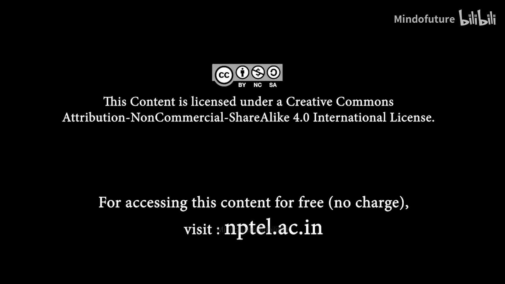
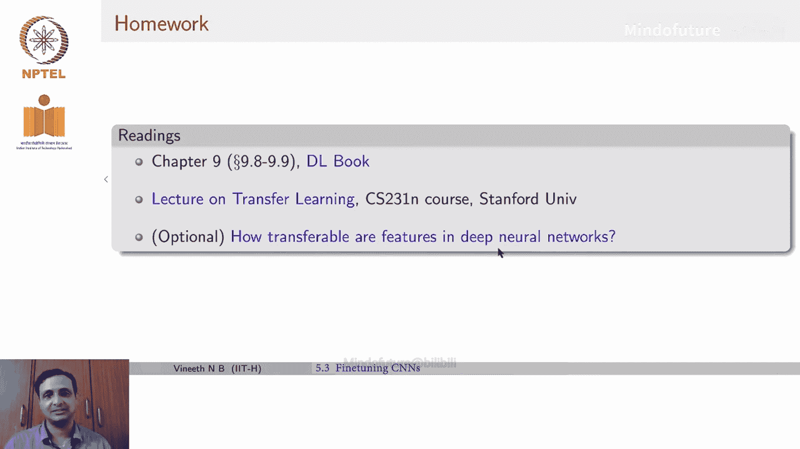

# 【NPTEL】计算机视觉的深度学习 p96 P96_微调CNN -BV1vNWkzpEua_p96-

So far， we have seen several variants of CNN architectures。

Which firstly tried to increase the depth to improve performance。

Then tried to make computations more efficient while not sacrificing performance and then finally variants in which it was okay to sacrifice performance。

 But you needed to bring the CNN under a lower regime of computations。 We saw all of these variants。

 And in all of these variants， including the the squeeze excitation network。

 The back propag of the CNN by itself， was not affected。 which let us。😊。

Play with these architectures。In this lecture， well talk about an important aspect of CNs that allows us with。

Designing architectures for newer tasks or newer domains。

 given an architecture that works on a particular domain， For example。

 if we know Alexnet works on the imary dataset set， how can we leverage that knowledge。

To develop a model for another domain for another task also。To discuss this。

 let's start with limitations of CNNs themselves。CNNs have a few fundamental problems。Firstly。

 optimization of the weights or parameters in these deep models， CNNnns are typically deep models。

Is generally hard， it requires proper weight initialization。

 it requires a lot of hyperparameter tuning various kinds of hyperparameter that's one of the fundamental limitations。

Secondly， it can suffer from overfitting because data samples used for training are generally much lesser in number to the parameters being trained。

He already saw that Alexnet has 60 million parameters。 Vji G has 1，38 million inception V1。

 which is the first version of Google net， had 5 million parameters。

 an improved version of it called Inception V 3 had 23 million parameters， ResNe 50。

 had 25 million parameters and so on。So。Cs fundamentally require a long time。

 long time and a lot of computational power to train these networks Alexnet， as we said。

 took about a week to train on two Nvidia Gt X 580 GPUus VG G took2 to three weeks on4 Nvidia Titan black GPUus an inception v1 or Google net version 1 took about a week on hardware that was not shared。

So all this can become even more difficult when you have to design an architecture for a new domain。

 in which case you have to design an architecture， run it for about a week or several days。

 see how it works， go back and change a hyperparameter， again run it for one more week。

 see how it works。And this kind of an approach to designing new architectures or CNN architectures will not scale。

So how do we manage doing this for newer tasks and newer domains？

Some things you can try is perhaps try good weight initializations。

 so that way you become independent of the design of the architecture we've seen Gra or he initialization that's one possibility you can also initialize your CNNs with handdes filters you could use an edge filter or one of those filters to initialize the filters in convolutional layers and then asked the CNNn to fine tune in them。

 or we've already seen unsupervised greedy layerwise pretrain as another approach that could provide an initialization which the neural network can then capitalize on as we said earlier。

 this approach of unsupervised greedy layerwise pretrain is not use these days due to the increased computational power and also data set sizes it takes a long time to do the greedy layerwise pretrain as only an initialization method。

The other thing that we talked about to improve training of neural networks。

Is to use regularization methods， be it L two weight decay， El1 weight decay， dropout， batch norm。

 adding input noise， adding gradient noise， data augmentation， so on and so forth。

This may alleviate overfitting， but may not really lead to faster training of CNnls。So what do we do？

An interesting property of CNNs， which has been observed。

 which is something that we'll focus on in the next week of lectures。

Is that if you visualize the filters that are learned by layers in the convolutional network after training the CNN。

One happens to observe that the earlier layers have filters that probably represent filters that could capture oriented edges of different kinds。

 color blobs， so on and so forth。In other words， these are what we call low level features。

 simple low level features that we get out of images。

Filters that are learned by intermediate layers in a CNN seem to capture some mid level features where which could be considered as combinations of low level features。

 a certain texture that's a combination of two edges or a certain。

Congregation of colors and edges in colors， and so on and so forth。And finally。

 the filters at later layers learn high level features such as impressions of objects， for instance。

 which are high level abstractions when you compare to only edges in the initial layers。

The question we ask now is what can we do with this can we use this in some way can we use this understanding of how CNNN filters are learning to be able to design architectures better for newer tasks and newer domains。

The answer there is a setting in machine learning known as transfer learning。In transfer learning。

Before we go to transfer learning and traditional machine learning， if one had different tasks。

You would have a data set for each of these tasks and using a data set for each task。

 you would have a different model through a learning system that you learn。In transfer learning。

You have a set of source tasks that are given to you。

And a target task on which you want to perform well， that's the new domain。

 a new task that you want to solve the problem on。So when we say source and target， for example。

 you could imagine now that you have trained Alexnet on the Inet data set and tomorrow you have data coming from a different domain。

 for example， let's say you want to build a recognition of objects for selfd cars in India。

These objects may be different from the objects in Inet。

So how do you now transfer the model that you learned on INe？

To a model that you want to develop on in a new domain。In this case。

 you try to use the data in the target domain as well as the model or the knowledge that you got from the source domain to be able to learn a model for the target domain。

So this， we call as。Transfer learning to be able to transfer knowledge from an earlier source task to a target task that we are currently interested in。

How does this relate to the hierarchical learning of abstractions of features in CN。

 we'll see that in a moment。So we know now that using knowledge learned over a different task to aid the training of current task is transfer learning。

We now also know that we do have pretrain models with good results available to us， for example。

 an AlexNe on ImNe is pretrained and that model is already given to us。

Can we leverage this in some way to improve performance on a target task。

We can do this in a couple of ways。We can do this because we know that the Alexnets filters or any other models filters。

 any other CN models filters for that matter has some general features in the first few layers and the features slowly start getting specialized as you go to deeper layers why do we say that if you go back to an earlier slide you see that the earlier layers filters seem to capture general information like edges and color blobs and so on。

Whereas the later filters seem to capture some object specific information。

 which could be specialized for that task。So what we can do now is。You could。

Take a pretrain neural network such as an Alexnet to a newer domain and keep all of those weights of Alexnet exactly the same。

 Don't update them for this new task Instead， take only the last layer。

 which we call as the classification layer and train only those parameters for the newer task。

We call this to be fine tuning。Where you are initializing the weights of a network for a new task。

Based on some pretrain weights of another model， and you only fine tune certain layers in the new network for the new task。

You could now we talked about the first setting here， which only trains the classification layer。

You could also use the pretrained weights as an initialization and then fine tune the entire network or certain layers in the at the end of the CNN。

 not just the classification layer you could take the last three layers or last four layers anything of your choice to fine tune to better model the target task Which one do you choose depends on your dataset size and how similar is your target task to the source task。

Let's see a few possibilities here and see what we can do。If your data set was fundamentally small。

And your target and source data sets are fairly similar to each other。

What you can do now is because this target and source data sets are similar to each other。

 you could say that the specialized features are likely to remain the same in both these data sets for models trained on both these dataset sets。

So what you can do now is you take the source tasks generic layers。

 you take the source tasks special layers， so this entire block that you see in the middle could be an entire pretrain network such as an AlexNe or ReNe that you trained on another dataset。

 which we call as a source task。We leave that as it is。

 and we only train you randomly initialize the classification layer alone and train only that one for the outputs in your new task。

This is because your data set is small， you feel you may not have enough data to retrain or fine tune all these feature extraction layers。

 let's as well focus only on training the classification layer properly。 So in this case。

We are initializing the new network with a pretraining weights and we are fine tuning only the classification layer。

Another setting is where the data set is small and also the target and the source dataset sets are dissimilar this time。

 which means the specialized features， the general features could still be common the edge detectors and those kinds of filters could be common for the source and target task。

 but the specialized features may not really be common between the two tasks。 What can we do here。

We now consider the entire pretrain CNN because we know that the feature maps of the generic layers which are by general layers。

 we mean the early layers of the CNN。You can consider that from your pretrain network。

Take those feature maps as。Output。And then train another classifier， such as support vector machine。

 or could also be a neural network。To give you the output for the target task。

Why are we doing this Because the dataset is small and the target and source dataset sets are dissimilar。

 we cannot use the specialized features of your pretrain network on the source task。

 We now assume that the generic features that we get from the first few layers by features by representations we mean those feature maps for each input。

Those generic representations we assume will help us improve performance on a classifier although the data set is small。

A third setting now is when your data is fundamentally large。When your dataset is large。

 you have some luxury， you can now use the pretrain network as a good initialization to fine tune in the entire network now of the target dataset。

But you can do a couple of things also inly to improve performance。

While fine tuning you can keep the learning rate to be quite low remember learning rate is the coefficient of your gradient in your gradient descent method。

You can keep your learning rate to be quite low so that your pretrain parameters are not changed significantly。

 you are saying that I still want my overall network weights to be similar to the weights that I learned from my source task。

But I have the data， I am going to update it， but let me keep the learning rate low so that I don't make too many updates to my weights from what they were from a source task。

On the other hand， if dataset is very different and the data is large。

 there are explicit methods for this such as what is known as transitive transfer learning or things like that where you can either train from scratch。

You don't need to fine tune at all， you can randomly initialize using Clops initialization and train from scratch on the new target task because you have a large data set。

 youre saying that the target task and a source task are not similar to each other so you may as well train from scratch or use methods such as transitive transfer learning which is a known method in traditional machine learning and that can help you improve performance。

The main idea of this discussion is to tell you that the design of architectures for CNNs。

 while we saw a few different designs， it not trivial to design newer and newer architectures for a given problem。

 There are many hyperparameter， number of layers width resolution number of filters or also learning hyperparameters。

To try to come up with the appropriate combination for a domain and a task by itself can be a very difficult task。

 and using the idea of transfer learning and fine tuning could help you take an existing architecture that has solved a different problem and adapt it to a new problem。

This is a very common procedure that people follow to take CNNs to newer domains and newer tasks。

For more reading。You can read chapter9 of the deep learning book。

And the lecture on transfer learning in CS231N and if you are interested one of the earliest articles that try to study how transfer transferable are features of CNNNs in in the context that we just discussed。

