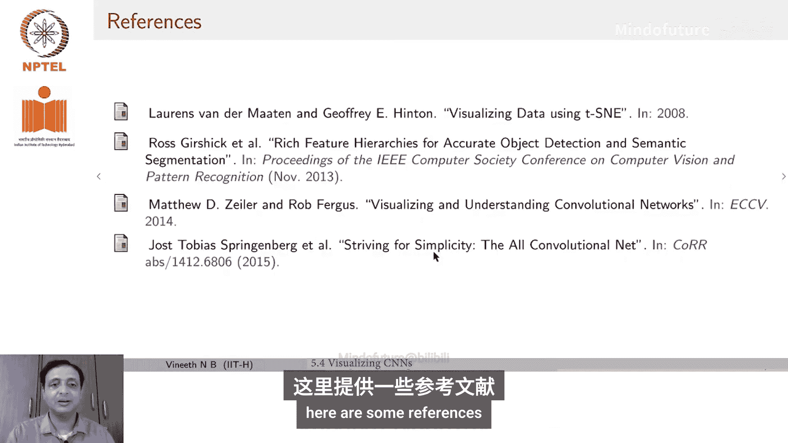

# 【NPTEL】计算机视觉的深度学习 p97 P97_可视化CNN -BV1vNWkzpEua_p97-

We will begin this lecture on visualization methods of。

Different kernels or filters in a CNN or perhaps even activations in a particular layer of a CNN or even other methods that we will see later in this lecture。

 most of this lecture slides are based on lecture 13 of CS 231 n at Stanford。

And some of the content is borrowed from。The excellent lectures of Mish Kara at IT Mes。

 lets start by the simplest form of visualization which is visualizing the filters or kernels themselves。

Remember that when you have a CNN。In every convolutional layer。You have a certain number of filters。

 for example， if you recall。In the Alexnet the first convolutional layer had 11 crossle1 filters。

 it actually had 9 to6 of them 48 going to one GPu and 48 going through the other GPU if you recall Alexnet architecture in this particular slide that you see here we are looking at a variant of Alexnet which was developed by Alex Kresevsky a little later in 2014 when he came up with a method to parallellyze CNs。

 this is just an example to be able to visualize this more easily。So in this variant of AlexNe。

The architecture had 64 filters in the first convolutional layer。

So what you see on the left top here is。64 filters each there are each 1 cross 11 in size and each of them have three channels。

 the R channel， G channel and B channel the three colors。

 so that's what we have as the total number of filters。So， if we visualize。

Each of them on a grid such as this， remember that a filter is an image in its own right。

Just like how convolution is commutative， you can always choose to look at an image as a filter or a filter as an image。

 it does not matter。Any matrix of the size of the filter can also be plotted as an image。

So when you do it that way。You get something like what you see on the top right here。So。

 let us try to look at some of them more carefully。

 so if you visualized some of these filters more carefully。😊。

You see that there are filters that try to capture oriented edges so you can see this one here on the bottom row the fourth from left which captures it looks like a Gasian edge detector which is smoothen out along a certain orientation。

Similarly， you have another edge detector here， another edge detector here on top。

 you also have some which capture slightly higher order variations such as a checkerboard kind of a pattern or a series of striations so on and so forth。

You also have。Color based edge detectors so in the last filter here on the bottom right you see an edge detector that goes from green to pinkish or red color so you see a similar color based filters even on the top left here。

So does is this a characteristic of alnet alone？Not really if you took even the filters of ResNe 18 ResNe 101 or densenet 121 in each of these the filters in the first convolutional layer have a very similar structure。

All of them detect edges of different orientations。

Certain higher order interactions such as checkable patterns， striations and different orientations。

 color blobs， certain color。Gradations as in edges in different colors， so on and so forth。

You will see this as part of the assignment in this week where you try out some of these experiments。

So， this tells us that the first layer seems to be acting like low level image processing。

 edge detection， blob detection， maybe a checkupboard detection， so on and so forth。

Remember here that these are filters that are completely learned by a neural network which we did not prime in any way。

You can also visualize the kernels of higher layers。

 just like how we did it for the first convolutional layer。

 you could also take all the filters of the second convolutional layer。

 the third convolutional layer， so on and so forth。

But it happens that if you had to generalize them across applications， they are not that interesting。

We did see an earlier example last week where we took face images and showed that filters in the first layer correspond to low level image features then we talked about middle layers extracting noses and eyes and so on。

 and then we talked about the later layers extracting face level information。

It does happen in certain applications， but in general if you had a wider range of objects。

 if you only focused on faces or a smaller group of objects maybe you could make sense of the higher layers filters。

 but in a more general context such as Inet which has thousand classes in the dataset。

 these kinds of visualizations of filters of higher layers are not that interesting。So。

 here are some examples here， so you can see that the weights remember in a c the weights are the filters themselves。

 so if you look at weights in a later layer you see that it may not be that interesting for。

For understanding what a CNN is actually learning， that's because of the variety of classes that may result in various abstractions across the data set。

So， the input to the higher layers is no more the images that we understand at the input layer we know what we are providing as input。

 but when you go to higher layers you really don't know what you are providing as input so it becomes a little bit more difficult to understand what is happening。

However， if you take the filters of the first layer alone across various models and data sets。

 hope by now you are familiar with the various CNN models such as Alexnet， Renet， Densnet。

 VGG so on and so forth， so if you have to look at the filters of the first layer first convolutional layer across all of these models you get very similar kinds of filters and it is generally called the Gebar like filters fatigue。

Why is that so recall the Geor filters discussion that we had earlier in the course where we said a Gebar filter is like a combination of a Gaussian and a sinusoid。

So and you can change the scale and you can change the orientation of the Gebar filter。

And you end up detecting edges in different orientations。

 you perhaps end up detecting different striations， checkboard patterns， so on and so forth。

 which is exactly what we see as the CNN learning on its own too。So。

 that is the reason why we call this entire visualization of the filters of the first convolutional layer。

 a gebar like filter fatigue by fatigue here we just mean it is exactly the same across all of these models and data sets。

Another option， other than visualizing the filters in different layers。

 when we talk about visualizing the filters， remember its 11 cross 11 or a 7 cross 7 or whatever be the size of the filter。

 you simply have to plot it as an image。😊，Another thing that you can do is to visualize the representation space learned by the CNNM。

What do we mean？If you took the Alex net， remember that the output of F 7 or the fully connected layer after the seventh in the seventh position of the depth of the network。

Which we denote as Fc7 is a 496 dimensional vector。

That's the layer immediately before the classifier。So。

 what we can do is take all the images in your test set or validation set for that matter。

And you forward propagate those images until this particular layer and collect all these 4096 dimensional vectors。

What do we do with them？You can now visualize the space of these Fc7 feature vectors。

By reducing the dimensionality from 4096 to any dimension of your choice， but for simplicity。

 lets say two dimensions。How do we do this？Once again。

 hopefully you have done a basic machine learning course and you know that you can use any dimensionality reduction method to be able to do this a simple example could be principal component analysis so you take all of those 49 to six dimensional vectors of several input images and you do a PC on top of them to bring all of them into two dimensional space。

A more popular approach which is considered to be a very strong dimensionality de reduction method is also TSNE which stands for T stochastic Ne embedding this was a method once again developed by Hinton along with Wander Martin in 2008 we also have a link for this towards the end of this lecture so you can play around with TSNE if you like to understand it more。

So， when you apply TsE on the representations that you get。

As output of the c in the penalty made layer you end up getting a result such as this this is in specific for the MN dataset set where you have 10 classes this is the handwritten digit dataset set。

So you see here that each class invariably goes to its own cluster。

This seems to tell us while we cannot in reality visualize a 409 to6 dimensional space by bringing it out to two dimensions。

 we understand that the classes， the representations belonging to different classes are fairly well separated into different clusters。

And why is that important now developing a classification algorithm on these representations becomes an easy task。

😊，And that's why having a classification layer right after that penultimate layer of representations makes the entire CNN work well to classify。

So here is an example of the same for imageNe。So， where this is a plot。

 a two dimensional plot of various images in the imed dataset。

Taken to 496 dimensional space by Alexnet and then brought down to two dimensional space and plotted on a two dimensional map。

 the only thing we are doing here is we are putting the respective image on each location just for understanding what is really happening。

So， this is just a huge map and if you had to look at one particular part of it。

 let us try to zoom in into one particular part of it。You see。

That all the images corresponding to say， a field。sem to be coming together in this space of representations for this matter。

 if you scroll around and see other parts of it you will see that similar objects you can see at many points of these embeddings here that at many points you see very similar objects being grouped together。

You see all cars somewhere here， so on and so forth。

 this tells us that these embeddings or representations that you get out of the penultimate layer actually capture semantic nature of these images and similar objects of objects of similar semantics are grouped together while objects of different semantics are far apart from each each other so this gives us an understanding。

The CNN's representations seem to be capturing the semantics。

Keep this in mind when we talked about handcrafted features and learned representations。

 this is what we were talking about in handcrafted features such as SiIft or HOG or LBP。

 you have to decide what may be useful for a given application and then hand design that filter that you want to use as a representation of the image after which you may apply a machine learning algorithm。

 but now we are letting the neural network， the CNN in particular automatically learn these representations that it needs to solve a particular task。

Here is a visualization of the confi feature maps in AlexNe the confi feature map is 128 cross 13 cross 13 so there are 128 feature maps each 13 by 13 if you now visualize them as grayscale images you can see something interesting here so when this specific image with two people is given as input you see that one of the filters or actually there are quite a few of them in fact seem to be capturing the fact that there are two entities in the image。

So， this could give you a hint that the later layers in the CNN are able to capture these higher level semantics of the objects in the images。

Another way of visualizing and understanding CNNs is you could extend the same thought and consider a trained CNN。

Remember that all of this analysis is for a trained CNN after training the CNN you want to understand what it has learnedt remember that is the context in which we are talking about this。

😊，So， you can consider a CNN and consider any single neuron in its intermediate layers let us consider that particular one in green。

😊，Now you can try to visualize。Which images cause that particular neuron to fire the most so you can give different images as input to the CNN and keep monitoring that particular neuron and see which image is making it fire the most。

What can we do with that？Now， we can work backwards and understand that this particular pixel here will have a certain receptive field in the previous convolutional layer。

 which means that is the region that led to this pixel being formed in this particular convolutional layer。

Similarly， you can take the pixels in the previous layer。

And look at the receptorive field of each of them and find the receptor field in the earlier layer in this case。

 the first convolutional layer。😊，You can go further again and find out the receptorive field in the original image which was responsible for this pixel in the third convolutional layer remember we were also discussing this when we talked about back propagation through cs where we try to understand the receptor field that leads to a particular pixel getting affected in a particular layer it is the same principle here。

Now， if we took images and tried to understand which of them caused a particular neuron to fire。

 you end up seeing several patterns。So， in this set of images。

 each row corresponds to one particular neuron that was fired and the set of images and the region inside the set of images which is shown as a white bounding box。

 which caused that neuron to fire。So here is the first row。Interestinglyly。

 all of those images correspond to people， especially busts of people。

 it looks like that particular neuron was capturing people until their a bust until their chest。

The second neuron here seems to be capturing different dogs， maybe some honeycomb kind of a pattern。

 maybe even a US flag where thought that honeycomb kind of a pattern is present。

A third neuron captures a certain red blob across all of the images， fourth neuron captures。Bigits。

In images and if you look at the last neuron here， the sixth row。

 you see that it seems to be capturing spec reflection in all of the images。😊，So over time。

 as you train these CNNs， each neuron is。Getting fired for certain artifacts in the images and this should probably go back and help you connect to dropout where we tried to ensure that no particular neuron or weight overfix to a training data and we allow all neurons to learn a diverse set of artifacts in images so thats this should help you connect to dropout in that sense。

Here are further examples of the same idea where you take different neurons in CNN and try to see which images or patches of images。

Fired that neuron the most once again you see a fairly consistent trend here that there are some of them that seem to fire for I think this is an eye of an animal there is again some textin images。

 there is vertical textin images， there is faces， there is dog faces again and so on and so forth。

And the last method that we will talk about in this lecture are what are known as occlusion experiments。

Whi attempt to leverage our objective that we finally want to understand which pixels in an image corresponded to the object recognized by the CNN。

Why does this matter？Wed like to know if the CNN looked at the cat in the image while giving the label as cat for the image or did it look at a building in the background or a grass on the ground。

Remember， a neural network learns correlations between various pixels that are present in your data set to be able to give good classification performance。

So if all of your cats in your data set were found only on grass。

A neural network could assume that the presence of grass means a presence of a cat。Obviously。

 if you have a test set where a cat is found in a different background。

The neural network may now not be able to predict that as a cat。So。

 to be able to understand get that kind of a trust in the model the model was indeed looking at the cat while calling it a cat。

The occlusion experiments。Do this using a specific methodology。

So given these images that you see here。We acclude out different patches in the image centered on each pixel。

And you see the effect on the predicted probability of the correct class。

Let's take an example so you can see a gray patch here on the image。So。

 you occlude that part of the image fill it with gray and send the whole image as input to the CNN and you would get a particular probability for the correct label in this case which is pomonanium so that is plotted as a probability in that particular location。

😊，Similarly， you would gray out a patch here， send the full image as input to a CNNn。

 get a probability for a pomeinian， how do you get the probability as the output of the softmax activation function and that probability value is plotted here in this image。

So， by doing this， by moving your gray patch across the image。

You will have an entire heat map of probabilities of whether a pixel or a patch around a pixel reduces the probability of a pomeranium or does it keep it the same way。

So， in this particular heat map， red is the highest value and blue is a lower value。So。

 you notice here that。When the patch is actually placed on the dog's face。

 the probability of the image being a poinian drops to a low value。So。

 this tells us that the image for the CNNn model was in fact。

 looking at the dogs face to call this a pomeranium。So， in fact。

This entire discussion came out of Zeiller and Fergus's work on visualizing and understanding convolutional neural networks。

 it is a good read for you to look at at the end of this lecture。They in fact。

 observe that when you place a gray patch on the dog's face。

The class label predicted by the CNN is a tennis ball。

 which is perhaps the object that takes precedence when you cover the dogs face。Similarly。

 in the second image you see that the true label is car wheel and as you keep using this gray patch all over the image you see that the probability drops the lowest。

To the lowest， when the wheel is actually covered。And the third image more challenging is where you have two humans and a dog in between them。

 which is an Afghan hound， which is the true label。

You once again see that when the pixels corresponding to the dog are occluded by the gray patch。

 the probability drops for the Afghan hound drops low。

This is eventricicular because there are humans and the model could have been biased or affected by the presence of those humans that the model does well in this particular case。

 so occlud the face of the dog causes a maximum drop in the prediction probability。

To summarize the methods that we covered in this lecture。Given a CNN。

 we are going to call all of these methods as don't disturb the model methods。

 which means we are not going to touch anything in the model。

 we are only going to use the model as it is and be able to leverage various。

variarious kinds of understanding from the from the model so you can take the convolutional layer and then visualize your filters and kernels that is one of the first methods that we spoke about。

Unfortunately， this is only interpretable at the first layer and may not be interesting enough at higher layers and we also talked about the gbbbar like filter fatigue here。

You could also take any other neuron， for example， in a pool layer and visualize the patches that maximally activate that neuron。

 you can get some understanding of what the CNN is learning using this kind of an approach。

The third thing that we talked about is you can take the fully connected layer。

 the representations that you get at the fully connected layer and visualize the representation and then do a dimension st reduction method such as TNE on these representations and you get an entire set of embeddings for INe。

And lastly， we spoke about occlusion experiment where you take an input and。

Perturb the input and then see what happens at the final classification layer and that gives you a set of a heat map that tells you which part of the image the model was looking at while making a prediction。

Recommended readings， lecture notes of CS 231M as well as a nice deep visualization toolkit demo video on web page by Jason Uinski。

 I would advise you to look at that you can also get to know more about TSNE and TSNE visualizations as a dimensionality reduction technique on these links provided here。

Here are some references。

