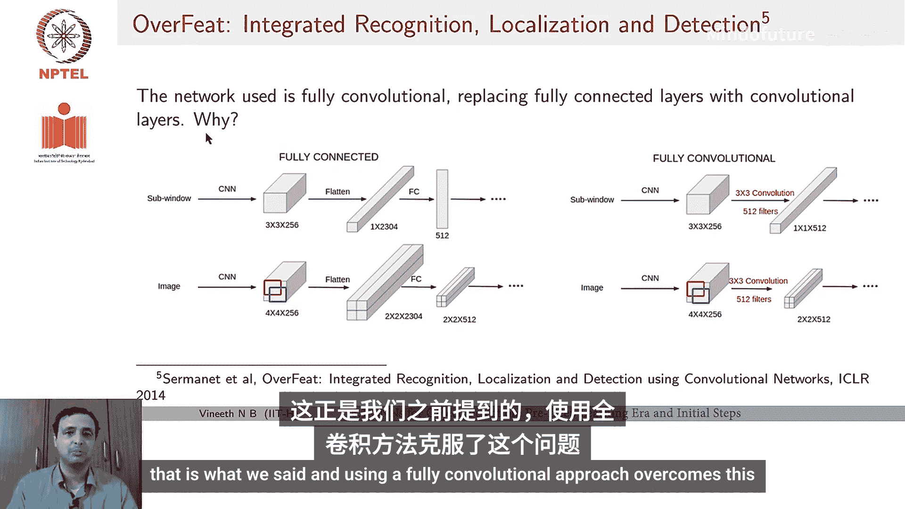

# 【NPTEL】计算机视觉的深度学习 p98 P98_用于目标检测的CNN - 深度学习时代前和初始步骤 -BV1vNWkzpEua_p98-

We have so far seen neural networks in its most simplest form feed forward neural networks。

 learn back propagation， seen how different variants of gradient descent can be used。

Learned a few practical tricks while training neural networks。

We then moved on to convolutional neural networks， the building blocks of computer vision。

We saw how they can be trained using back propagation， we saw various kinds of architectures in CNNs。

And then we also saw last week on how one can visualize and understand what CNNns are learning。

 as well as explain their predictions。But in all these lectures so far。

We focused on the task being classification。Given an image。

Our objective was to classify what object was in the image。

You could extend that to regression where you predict real value by changing the cross entropy loss to mean square error。

However， there are many other kinds of vision tasks that are possible。

 and we will now move on to those tasks in this week。

We will start with one of the most used tasks today， which is object detection。

 so the difference between classification localization and detection is as follows。In classification。

😊，Given a cat in an image。The objective is to say that there is a cat that corresponds to the image。

In localization。In addition to saying that there is a cat。

You also have a bounding box around the cat to say where in the image the cat was located。

In object detection。You go one step further。And you detect。

All possible occurrences of the objects in your set of classes in a given image。

As well as localize them。In the localization task， there is only one object which you localize whereas in object detection。

There could be multiple objects， multiple instances of the same object。

 you could have a cat and a dog or two dogs and one cat， all of these possibilities。😊。

The objective here is to recognize each of these objects as well as localize them using these kinds of bonding boxes。

Finally， the task of segmentation where the job is to label each pixel as belonging to one of say C classes。

 depending on the number of classes we have。So， we will start this lecture with detection and then move on to segmentation as well as other tasks later this week。

Before deep learning came into the picture。There were other methods that were used to deploy computer vision for object detection on various devices。

So object detection and phase detection was even available in say pointed shoot cameras 15 years ago when。

Deep learning methods had still not mature。Most of those methods used。

A variant of what is known as the Viola Jones algorithm this was developed by Viola and Jonesnes and that's the reason for the name and this work was published in CVPR of 21 2001 and this is a framework to perform object detection in real time it was primarily used for detecting frontal up faces although it was adapted to be able to detect other kinds of objects or even detect parts of objects such as say eye detection on a face。

The main contributions of this work was they performed weak classification using what are known as hard like features we will see what these are in the next slide and they also introduced a very powerful idea known as integral images。

Which helps make computations of such hard like features significantly faster， as we will see。

Then they used add a boost as the classifier of choice。

But how they used at a boost was slightly different from the traditional formulation in machine learning。

And they also used this as a cascade of classifiers， as we will see over the next few slides。

Ha features are rectangular features based on ha wavelets so these are this is how the ha features look like so you can see here that there are generally a region of black and a region of white but there could be different combinations of those you could have just two regions white and black horizontally aligned vertically arranged。

Or you could have a black sandwiched between a white。

verticalertically or horizontally or you could have checkboard patterns and you can keep going forward you will at various kinds of patterns as you use the same idea。

So， the idea behind the heart filter is the feature value is given by the sum of the pixels in the white rectangles subtracted from some of the pixels in black rectangles remember this is convolution so things would get flipped。

😊，which is why you have the output of convolving with a ha filter would be the sum of the pixels inside the black rectangle minus the sum of the pixels inside the white rectangle remember black is0 white is 1 but because of the flipping this is what the output could turn out to be。

And to normalize for images of different scales， these features could be scaled through height through width or even different kinds of patterns as we will see。

 so while you could have 6 cross4 filter， a 10 cross 6 filter， you could have a 10 cross 24 filter。

 so on and so forth， you could have them of various sizes depending on what you are applying these hard wavelets for。

So， the intuition of using ha features for object detection or face detection in particular is that a lot of the features of the human face are about contrast between a certain region and the adjacent region。

😊，So， for example if you looked at the eye region as you can also see here it is likely to have a black area below and a reasonably brighter intensity area right above that so ha feature such as this would capture that difference you could also look at eyes the other way and represent them and capture eyes using a white block sandwiched by two black blocks in a ha wavelet。

So these are likely to be good feature detectors of parts of the face。As I just mentioned。😊。

This work also introduced the idea of what is known as an integral image。

 this is a fundamental concept not necessarily anything to do with phase detection。

 its a way of making computations faster especially when you use hardlike features but this was introduced in this particular work by Veola and Jones for doing object detection。

So， lets see what an integral image is so the idea is to reduce computational complexity when you are adding pixel in intensities for whatever option and the integral image is defined as。

😊，U for any pixel in the integral image。You sum up all the pixel values up till that point starting from the origin on the top left and the summation of all the pixel intensities is what is filled at a particular location。

😊，So mathematically， you could write it as integral image at Xcomma Y location would be the summation over。

X prime less than or equal to x where x is the current location， y prime less than or equal to y。

 y being the current y location。I of x prime， y prime。

So you add up all the pixel values until that particular pixel that you are looking at and the sum of all of those intensities is what you fill in at that pixel in the integral image so given this kind of an image the integral image would look like this you can see that for example the two cross to window 290 is the value given and 290 is given by 38 plus 66 plus 89 plus 97。

And so on and so forth。So， the recurrent definition for an integral image would be given by s of x y is equal to s of x y minus 1。

 the above column。Plus I of xy， which is the current pixel location and the integral image at xy would be s of xy plus the integral image at x minus 1 y。

You can work this out and see that this is correct。

And s of x y is the cumulative roos sum and to make this recurrent definition work。

 you have to define s of x at minus1 x comma minus1 is equal to 0 and the integral image at minus1 comma y is equal to 0。

Let's actually now see how the integral image can be used in particular for Ha filters。

Let' us assume now that we want to find the sum of the pixel intensities inside this rectangle defined by 1。

2，3，4。A is this top left rectangle， B is this entire rectangle， including a and。

including a part of it is a C is this entire rectangle and d is this full rectangle so the sum of the pixels within the rectangle 1。

2 3，4 would be given by d plus a minus b minus c。You can work this out and see that it would be quite true。

So， more formally， you can say that some of pixels inside a rectangle with an upper left pixel as x1 y1 and bottom right pixel as x2 y2 could be given by。

The integral image at x2 y2 plus the integral image at x1 minus1 y1 minus1。

 which is remember x1 y1 is the top left you will have to go one pixel before that minus integral image of x1 minus 1 y2 plus integral image of x2 y1 minus y1。

Y 1 minus1 so you can work this out to see that this is actually true。So。

 you would notice now that in this particular case。

 lets say you wanted to find out the sum of pixel intensities in this particular square block。

So then what you could do is you could you already have the integral image computed。

 so you only have to look up a certain value certain set of values here and say 1492 plus 532 minus798 minus 1827。

Why is this useful？When you want to use a convolution such as a ha filter for these kinds of images。

If you had a two rectangle feature， what we mean by a two rectangle feature is lets assume that you have。

A ha filter which is given by just a black region followed by a white region remember we said that this is the sum of pixel intensities in the black region minus the sum of pixel intensities in the white region such a convolution of a filter would only need six lookups in your integral image why so you would need one lookup for all of these corners so there are six corners here including the middle ones you will need those six lookups and you will be able to compute what would be the output of the ha filter without actually doing any kind of a convolution you can just look up the integral image and be able to get these values。

As an exercise try to think how many lookups you would need for a three rectangle feature what do we mean by a three rectangle feature？

Consider a ha filter with say black in the center and white on both sides so this would be a three rectangle feature How many lookups would this need it is simple but work it out later Similarlyly what if you had a four rectangle feature something like a checkerboard。

Something like this。 So then how many lookups do you need？Think about it as homework。

So once you have the outputs of these ha filters。The algorithm of viola and Joness suggested that each feature can be now considered as a weak classifier。

So given a feature fj， which is one of those hard waveletths could be a two rectangle feature。

 three rectangle feature， four rectangle feature， one of those， you can have all possible variants。

A threshold theta j and a parity Pj， which is only indicates the sign。

The classifier is defined defined as the weak classifier is defined as head subj of x is equal to 1 if pj fj of x is less than pj theta j so you are saying that if that feature of value is less than a threshold you are going to call it10 otherwise of course you could define the parity to use this otherwise if you like。

So now using this， you're going to get one classifier for every ha feature。

We know that a combination of weak classifiers can give strong classifiers。

 but do you see a problem with this approach so far？If you thought carefully。

Even if you had a simple sliding window of 24 cross 24 and let's see that's the window you're going to slide across the image。

And then inside each of those sliding windows， you are going to compute various ha features and use this thresholdholding to be able to detect whether ha features says there is a face or not a face。

But the problem is if you had even just a 24 cross 24 window。

There are over 160000 features possible by that we mean， so within a 24 cross 24th。

Window you could have a very large checkerboard， then you could imagine all possible combinations of arranging black blocks and white blocks adjacent to each other inside a 24 cross 24 window you have a huge number of features。

Now to be able to compute 160，000 weak classifiers inside each sliding window seems tedious。

What do we do？That's where Adamda boost comes into the picture。

So the way abut was used in the vilogens algorithm is the algorithm given here this is from the paper we only walk over the salient parts of this。

 this is the standard abut algorithm where given example images x1 y1 to X and yn use initially start with uniformly weighting all your training samples and you normalize those weights across all of your training samples now for each feature J which is one of your ha features among the all possible combinations that you could have。

You train a classifier J， which is a head J， which is a weak classifier。

 which is restricted to using a single feature。😊，And the error with respect to this weak classifier is given by。

Epsilon J， which is given by W into head J of X minus Yi rather。

Head G of Xi is the output of this weak classifier。

Yi was the expected output so how close this weak classifier was to the expected output multiplied by the weight of that sample that we are evaluating that' is the standard abu approach to weight more erroneous samples a little higher and less erroneous samples a little lower。

But now the Vilogens approach to using adabu says among all those possible features。

 which would have given you several different classifiers。Choose the classifier Ht。

 which with the lowest error epsilontic is among all your possible classifiers。

 choose the one that gives you the least error。Based on the error of this classifier。

 you reweightate all your samples as you see here， this is again the standard reweighting step in Alda boost。

And you repeat this over and over again and your final strong classifier after a certain number of iterations。

 remember now you would not be using all features you are only using then t number of features where capital is a parameter that you can give in each iteration you pick one of the features that is really strongest and at the end you only use a weighted combination of。

Capital different features and once again this final strong classifier rule is the standard at a boost algorithm。

A third component of the Vila Jones algorithm was known as a classifier cascade。

So this came from the motivation that very few subwin of an image actually have objects or faces right remember you could have。

Hundreds of thousands of subwin in a given image。But you are not going to have that many faces in a given image。

 so there it is very likely that the false positive rate may be very high if you evaluate every possible window。

So how do we overcome this issue？So， what this classifier cascade idea suggests is eliminate negative windows earlier。

Therefore reducing computation time spent on them so if there is a subwindow that is negative。

 ignore it and never include any further subwindows inside that subwindow for any further processing。

Very speaking at a very high level so you have all possible subwindows that goes to the first stage and you rule out a certain number of them and assume that they will never have a face at all then only those subwindows where a face is likely it goes to a next stage in the classifier which again checks for faces again and if there are subwindows rejected at that stage that again comes out only the remaining subwindows go through the next stage so on and so forth and in each of these stages you have a set of weak classifiers you can constrain that using the number in capital t。

But now you can ensure that you can use a stage of different classifiers to keep refining your performance over time。

Why does this classifier cascade matter we just mentioned that for a problem like phase detection or object detection false positive rate is very important so if you had a 1 megapixel image remember you are dealing with 10 parts6 pixels。

And at least a comparable number of candidate phase locations。

 even as if you assumed that a phase could be at each of these locations。

 you are at least looking at 10 par6 probabilities。

 once again you could have different sized phases which would even further expand the possible candidate phase regions but for the moment let's assume that you have at least 10 part6 candidate locations。

So， your ideal false positive rate has to be less than 10 part minus6。

Assuming there is only one phase or of the order of a few phases。

 so you want your false positive rate to be about  n pair minus6。

If you took these basic ha filters that we spoke about a few slides ago。

 this combination would yield  100% detection rate but would give you a 50% false positive rate and it gives you a lot of possibilities of faces。

 not all of them would actually turn out to be faces。

If you went a little further and included 200 features remember the above example we had only two kinds of ha filters。

 if you included 200 kinds of ha filters when we say 200 kinds you arrange those black rectangles and white rectangles in several ways you could have them as a checkerboard two cross to checkerboard a5 cross5 checkerboard you could have three rectangles you could have five rectangles7 rectangles all those possibilities are open。

You have 200 features that yields a 95% detection rate。

And a false positive rate of one in roughly about 14000。It is better。

 but it's still not enough to what we want， which is 10 part minus 6 false positive rate。

What do we do？The classifier cascade comes to our rescue。So remember that when you have a cascade。

 the final detection rate and the false positive rate are found by multiplying。

The false post rate reduction rate of each of these stages。So if each of these stages was。

 say a 200 feature classifier， which means your capital t was 200。

Then you may have a detection rate of， say， approximately 0。9。

You could then achieve a false positive rate of 10 power minus6 across a 10 stage cascade if。

Each stage had a detection rate of 0。99 and a false positive rate of 03。

Because if you had a false positive rate of 0。3 in each stage of the cascade， you would then have 0。

3 power 10 because you are talking about 10 stage cascades， so 0。3 into 0。3 into 0。3 and so on。

 you will have 0。3 power 10， which is roughly about the order of 10 power minus 6。So。

 the idea of classifier caskecades allows us for each stage in the cascade to have a reasonable detection rate of 0。

99 and a false positive rate of 0。3 which as we saw is possible with just a few features and we just keep refining these over stages of the cascade and obtain the false positive rate we ideally wanted。

Another aspect of this method， for that matter， any detection method is the notion of non maximum suppression。

So it's likely that many windows around an object may be classified as containing an object。

So how do you choose which one of them is the right object？So。

 we have to use some kind of bounding box similarity measures and the most popular one is known as intersection over union。

Intersection over reunion states that if you have two bounding boxes， B1 and B2。

 you take their intersection。And you take their union。

 the ratio of the intersection to the union gives you a sense of how close these bounding boxes are。

If the ratio is 1， which means the bounding boxes B1 and B2 are exactly the same。

Or as they get close to one。You are going to have that these bounding boxes are fairly overlapping with each other。

How do we use this IOU？We can now use it for non maximum suppression。

So if you had a set of possible bounding boxes which contain an object。

You can select a random box from them。Then you compare that box with the rest of the boxes。

If IOU is greater than 0。5， you remove that box from the list。

So you are ensuring there is there are multiple boxes that have。A 50% to overlap with each other。

 you retain only one of them。We will see a little later that we won't just follow this。

 we will also follow trying to find which of these boxes has the highest confidence on the object being in the box。

 we will see that in a few slides from now so this process is known as non maximal suppression NMS which is extensively used in detection today as we will see。

That was the Vi Joness algorithm for phase detection very popular was used in several technologies。

AnotherAnother popular approach at that time was known as the histogram of oriented gradients。

 we have seen this when we talked about extracting handcrafted features from images but we will now talk about it as to how they are used for the task of pedestrian detection。

So if you have， say， a pedestrian given an an image。

You have a detection window that slides over an image and gets all your gradients could be a sobel filter and alloy filter。

 so on， so you have all of your gradients。😊，Now you divide the entire image into cells and in each cell you draw out a histogram of orientations of gradients。

We have done this before with sift， so you perhaps know how to do it。

Once you get these histograms of oriented gradients in each of these cells。Then， you consider。

Overlappping two cross two blocks of cells。 So you see here that you have four different。

2 cross2 cells so they could be overlapping， but you take a set of two cross2 cells。

 normalize the histograms in all of those four blocks and that is what you define as the final histogram for the center pixel。

When you do this for all the cells in your image， you would get a final descriptor which looks like this where you have a set of histograms of oriented gradients across different locations in the image。

How do you use this？😮，Once you get this final descriptor。😊。

You then train a support vector machine to say whether this is a pedestrian or not a pedestrian。

 so this was introduced in this work in 2005 by the Laland Trigs。

So you can also visualize as to how the weights of the support vectors look in this particular scenario。

😊，So if you took the average gradient image over all your training examples。

You can visualize what are the positive and negative SPVM weights remember these are your different dimensions here because the cells are your dimensions of your entire descriptor vector so you can now imagine positive and negative SPVM weights after you learn a support vector machine。

Given a test image and its corresponding histogram of orient gradient descriptor。

You can multiply these descriptors by the positive and negative weights and you would get something like this and you notice here that looking at the positive weights it would be easy to classify for the SVM to classify this as a pedestrian being in an image。

This was also extended to do it to be done at a multires level where you have an image pyramid and you perform the same approach at each stage of the pyramid so for example at the lowest resolution you have one specific block and you would get a score using a support vector machine for that particular window in the in the lowest resolution image you would get a certain score for a pedestrian being that there。

You would do this similarly for the highest resolution and the highest resolution images and then you can use various techniques to integrate the scores。

 you could integrate the scores the way we did it for pyramid matching by giving a highest score for the highest resolution and the a lowest score for the lowest resolution or you could take a vote or you could use other kinds of heuristics to combine these scores to find out whether a person was an image。

These will do the different approaches that were used for detection before deep learning came into the picture。

😊，Now， let's try to see how one would。Do object detection using CNNs in the simplest possible manner。

If you had say images of cars during training， you would train a CNN on various images of cars to learn a car classifier。

 so you would use a standard cross entropy loss， CNN， a simple CNN。

At test time when you get an image where a car could be located anywhere in the image。

You take different sliding windows of multiple scales so you may have to take say 100。

000 sliding windows potentially from this image and each of those sliding windows you give as input to the cM assuming that they all are of the same size or you can bring them to the same size。

You give that as input to the CNN。And that CNN now classifies each window in the original image as belonging to a car or not a car。

So， based on that， you would detect a car here and here。Once again， in this approach。

 you can include non maximum suppression to improve the performance。But here， as we said before。

 once you get the list of all possible bounding boxes where a car could be present。

You consider a bounding box with the highest class signal。So in this case。

 the red box would be the box with the highest class signal0。93。 Now you take the。

IOU of all the other bounding boxes with respect to this bounding box， this red bounding box。

 if any of them have a high overlap or a high IOU with this red bounding box。

 you eliminate them and retain only the red bounding box because it had the highest confidence of a car present in that bounding box。

Do you see problems with this approach？This is the simplest way of adapting CNNs for object detection。

Do you see any issues？There are actually a few of them。

Firstly the bounding boxes may not be tightly around the object；

 you can see here that some of these bounding boxes are fairly loose。

 we ideally want a tight bounding box so that we exactly focus on only those that part of the object that part of the image that contains the object。

That could happen in this kind of an approach。The other problem here is obviously that you have to evaluate thousands of sliding windows through the CNN to be able to find which of them contain your object of choice。

We are going to talk about methods that overcome this issue。But before we go there。

We will talk about object localization， which as we said was a precursor to detection。

 so object localization can be achieved by if you had only a single object in an image。

You can then give that as input to a CNN， you get your feature maps。

You get your fully connected network now you branch out your CNN into two parts。

 one part that gives you a classification score which can be learned using cross entropy loss。

 that is the standard CNN for classification that youve spoken about so far。

But we could also do a bounding box regression。So you could now try to see what are the exact coordinates of the bounding box。

 say with respect to the entire image or with respect to any other box in the image。

 you could see what is the offset。And you also learn that as part of your learning procedure。So。

 your fully connected network at the end would have two heads， a classification head。

And a regression head。The classification head would require cross entropy loss。The regression head。

 which will learn in X， Y， the top left corner of the box， a height and the width。4our coordinates。

 four values。And these values can be learned using a normal L2 or mean square loss。

 so the entire network would be trained by the sum of these two losses to not only classify the image but also localize the image。

One of the first successes of a good localizer in CNN was overfeat。

Overfe was the winner of the Iate localization Challenge every year。

Imagine it in addition to having the classification challenge。Also had a localization challenge。

And overfeat was the winner of this challenge in 2013。And the way overfi did localization was。

To ensure that your entire network is convolutional instead of having fully connected layers。

 so this avoids computation time or sub windows by applying filter directly to the image。

 lets see how。So， given an input which is say 14 cross 14 or you pad and make it 16 cross 16 you perform5 cross 5 convolution。

 this is only an example for visualization you get a 10 cross 10 output as if you did not do padding and if you do to two pixel padding it becomes 12 cross 12 and a2 cross 2 pooling makes it5 cross 5 a5 cross 5 convolution makes it one cross1。

And now using multiple one cross 1 convolutions， you can get an output directly。

Without having to perform any fully connected layer operations。So。

 this idea of over feet made computations significantly faster， as you can see now。

 instead of using a fully connected layer。😊，Overfeet replaces it with a fully convolutional layer。

 which finally has one cross one convolution similar to what we saw with inception net if you recall a Google net。

And this overfeat approach uses that to get your final performance。

Why is this useful because we remember we said that fully connected layers use up a lot of parameters that is what we said and using a fully convolutional approach overcomes this and hence can speed up performance。

