# 【Sebastian Raschka】深度学习和生成式模型 Intro to Deep Learning and Generative Models 2021 p103 P103_L13.5_互相关与卷积的区别 -BV16EC5BUEi7_p103-

Yeah， so this video is not going to be terribly important。

 It's just a little bit of nit picking in case one of you has been wondering。

 maybe one or more have been taking a signal processing class in previous semesters and we're wondering。

 why do we call the procedure convolution， not cross correlation。 So in fact， actually。

 convolution networks are performing something called a cross correlation。 So what's the。

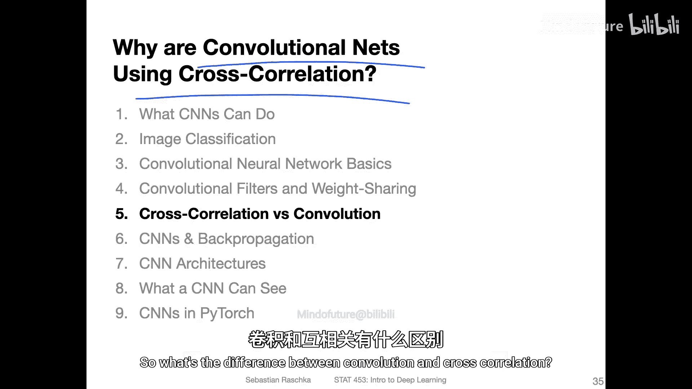

Difference between convolution and cross correlation。So yeah。

 cross correlation or convolution is another one of these jargon terms。

 So in deep learning we sometimes use words from other fields that have a different meaning。

 and convolution would be one of those。 So the convolution and deep learning is actually what is more commonly known as cross correlation。

 So the cross correlation is essentially the sliding of the dot product over the image。

 So when we have。This one here。 So this region， and we multiply。

The pixels in that region with the weight， the filter， right， So this is essentially a dot product。

 right， So we， we brought it as。As follows， right， when we do this calculation。

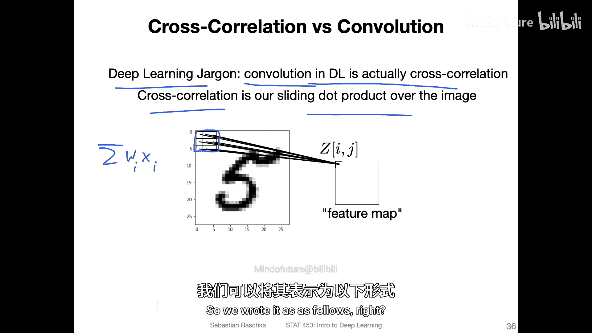

But now， so when we yeah write it down more concretely so we can write this procedure down as a cross correlation。

 So in in。In essence， it's computed like this when we have these two sums。

So we could actually so the dot product is if we would actually reshape that into two vectors。

 right so if we have this one。Let's write it like this。 And let's say my first row is green。

My second row is blue， and my。R， last one is red。 This is for， let's say， the weight matrix W。

 And I have the same one for the inputs。So， let's do。Yellow， maybe。Purple。😔，And。😔，Lick here。😔，So。

In order to do the dot product， I could just reshape them as。AVctor like this right。Then。

 the other one。This， and then maybe taking the transpose and then compute on the dot product between the two。

 But I could also， of course， instead of doing it like this， I could do it the other way around。

 right， I could do it。 I could。Have the vector。Like this。It's just vice versa。

 And then if I multiply this vector。With the same。X， it gives me。In different。Result， right。

 also mean。Ex this， so。This one and this one， they will give me different results。

 So that is mainly the difference between。Cross correlation and convolution， the way we。

 we do the multiplication in which order。 So here， this is like the way we do the cross correlation。

 It's maybe hard to stay at this formula。 So let me illustrate how this works。 So essentially。

 think of the index。

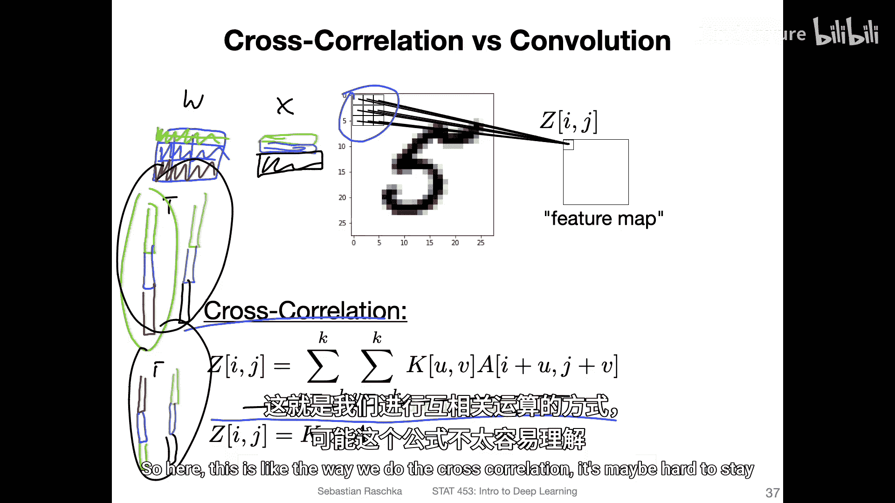

0 as the one in their center。 So if this is your， let's say。

 your weight matrix and you multiply each one with a corresponding value in the image。So。

How you do that is you consider index I as the center point and then the negative in these Cs。

 So the1 minus-1 would be the left upper left corner and one one would be the lower right corner and then。

You multiply this weight。With the first soul。Say we have for a while。Let's say this is W。

 and this is x here where。This whole thing is。W， so we multiply。This one with this one。

This one with this one， this one with this one。 So these indices correspond to yeah the position in the input essentially。

So that's how we do the cross correlation。 And this is essentially how how we did that in the previous videos。

 But you can also do it the other way around。 So this is known as convolution。

 Not the only difference that I'm flipping here some signs。 But again。

 it's probably hard to stare at this equation or formula。

 So it's probably easier to see it here in this image。 So again。

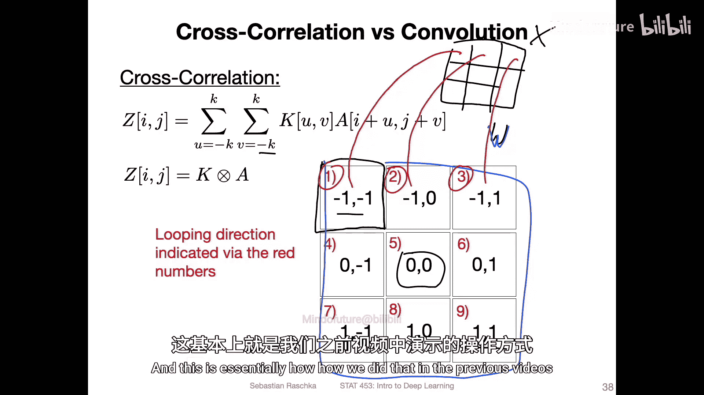

This is a。W here。 and then we multiply it with the values in x So x， we have。Still， the same。

The same。Order， but now， so let's say 1，2。th3。6。7，8。

But now we multiply this one with the first position and then this one with a second one。

And so forth。 So really， the difference is， you can see that it's inverted。

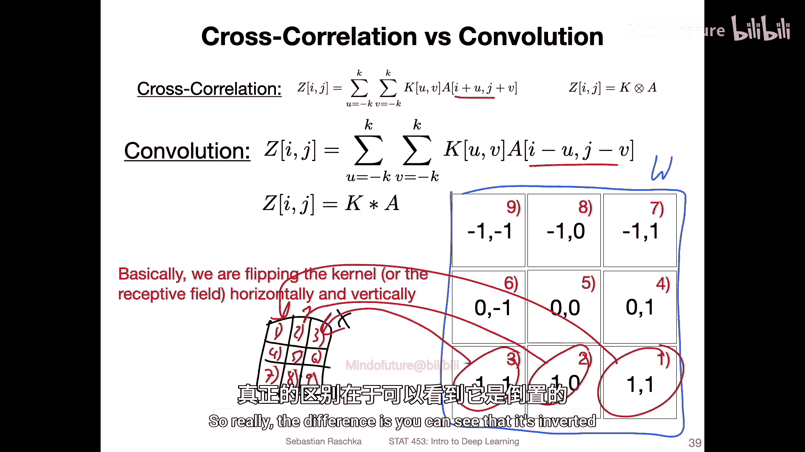

So here in cross correlation， we go like this。

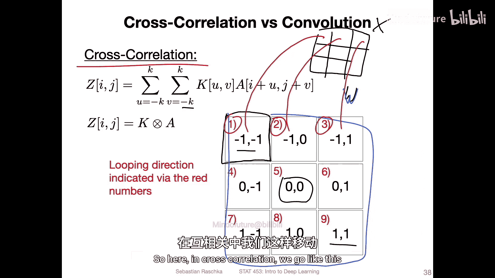

And in。Convolution， we would go like this。That's the main difference。

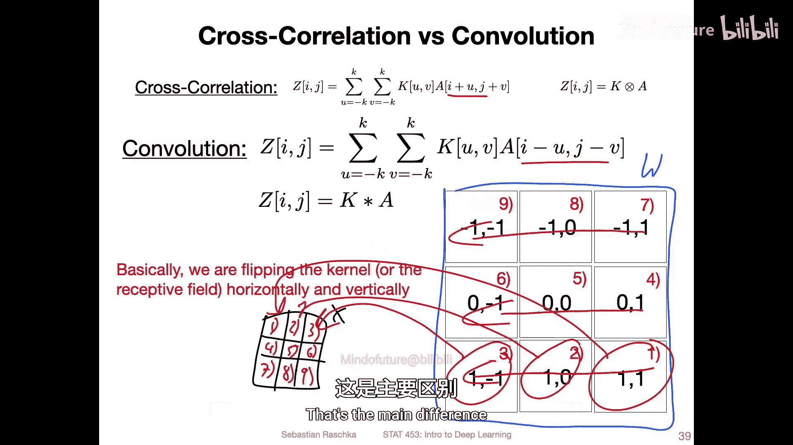

If you don't believe me， I just also have an example here just using code to just in a practical way show you that this is indeed the case。

 so here to demonstrate this I'm initializing a torch tensor。

 just some arbitrary values and then I'm initializing the convolution。

 I'm setting the bias to zero because it's not worry about the bias here it's just distracting。

Here is the weight matrix corresponding to the convolution， the3 by 3， we have a 3 by three kernel。

 And when I then apply。This， so first of all， I have to， what I'm doing here is I'm。嗯。

Converting it to Nmpy， so I can use。The cross correlation function and the convolution functions implemented in si because it expects nu arrays。

 So here I'm just creating a Ny placeholder that I'm going to use， and you can see。

This is just yellow p watch。Weight inside the convolutional operator。

 And here this is the Ny version。 It's exactly the same values。

 It's just a little bit more precision because I think this is a 30 bit precision。

 and this is 64 bit precision。 But you can see the values are exactly the same。Now， when I。

Call this con Pytorch。 the conpyytch。 again， this is my conf to the operation。

It's a 3 by three kernel applied to a 3 by3 input。 So what I will get is a single value。

 the single value from applying Piwach。Convolution。This is-1。1027。So what is this。

 I'm just reshaping it because usually in a neural network。

 what we have is we have the number of batches and the number of channels here doesn't matter。

 We are just looking at it matrix， So I am setting them to one because otherwise this function will complain。

In any case， so the value I get is minus-1。1027。 Now。

 if I use the cross correlation function here from。Sippi， you can see I get exactly the same value。

 Of course， okay， we have 64 bit precision here， so there are a few more digits。

 but you can see overall it's also minus-1。102。 So it's exactly the same value。

 So the convolution in Pythtorch is the same as the cross correlation in sippi。And vice versa。

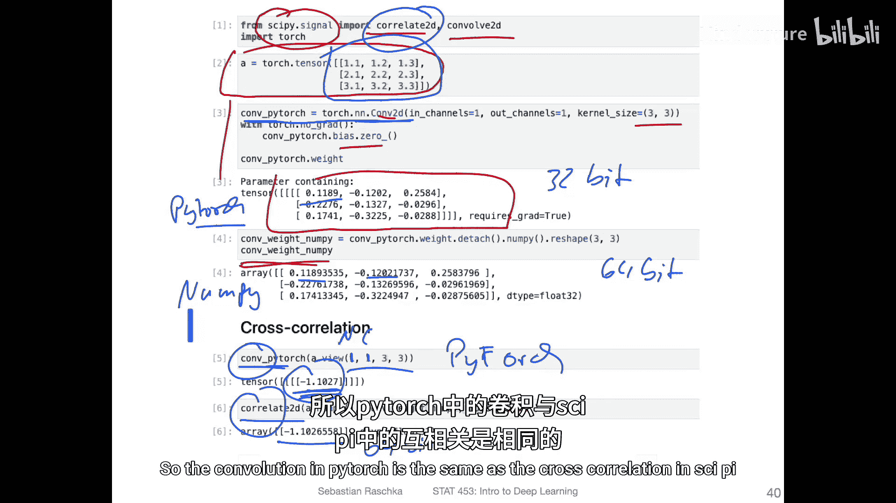

So this is the same as above。 If we look at the real convolution。

 if we use the convolution implemented in sippi， you can see what we would get is minus 0。26。

And if I want to get that result in。Pytorch。 What I would have to do is I have to either invert or not invert。

 but rearrange the weights or the input it doesn't really matter。 So here you see I'm。

Rearranging it here。 I have the 3。3。 So I'm I'm kind of creating the matrix backward。

 You can see the 3。3。 So you know， at the top，3。2 in the 3。0 here。

 So I'm just putting in a different order。 And then I also get the same result as with this convolution。

 So， in fact， the convolution and Pytch is a cross correlation。 So why does it even matter。 I mean。

 I was just highlighting the difference between the two operations。 Yeah。

 in practice it does not really matter， at least not in deep learning。 So。

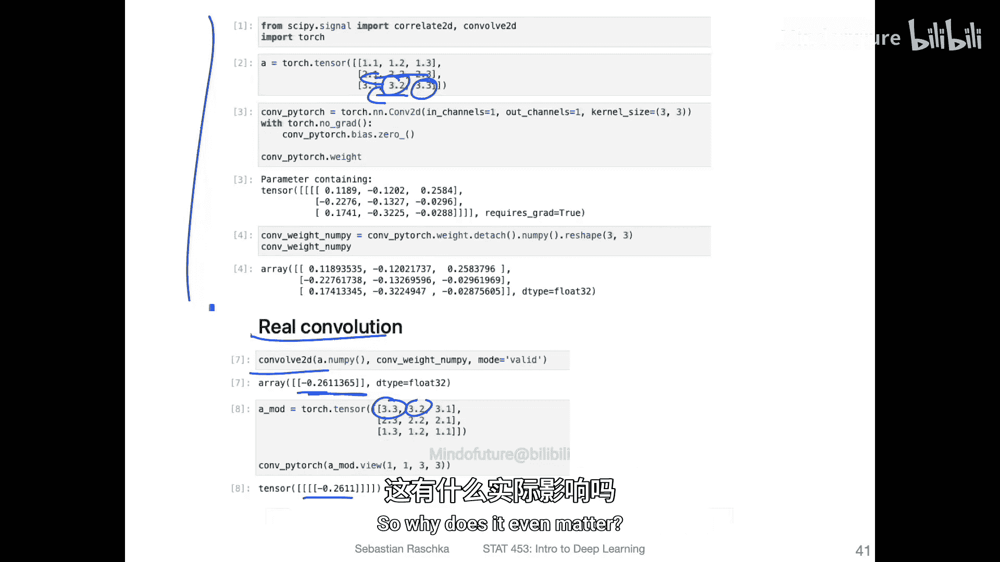

Maybe in traditional or in other fields of computer vision and signal processing。

It's actually useful to have this associative property of the real convolution， but in deep learning。

 to be honest， that doesn't really matter。 And I think cross correlation is easier to implement。

 especially for the backward pass， but we don't worry about the backward pass I will show you explain a little bit about the back propagation in the next video。

 but that is usually automatically handled in Pythtor。 It's maybe like a small efficiency reason。

Yeah， but then when we or if we implement cross correlation for these networks。

 why do we call them convolutional networks， Why don't we call them cross correlationreal networks Yeah。

 my theory is just that cross correlationreal network sounds a little bit weird and convolutional network sounds slightly cooler so that's maybe also one aspect about the whole thing anyways。

 so this video was not really important。 I was just highlighting the difference in case someone was wondering in the next video I want to briefly go over CNNNs and back propagation。

 but we won't go into any mathematical details so don't be afraid。

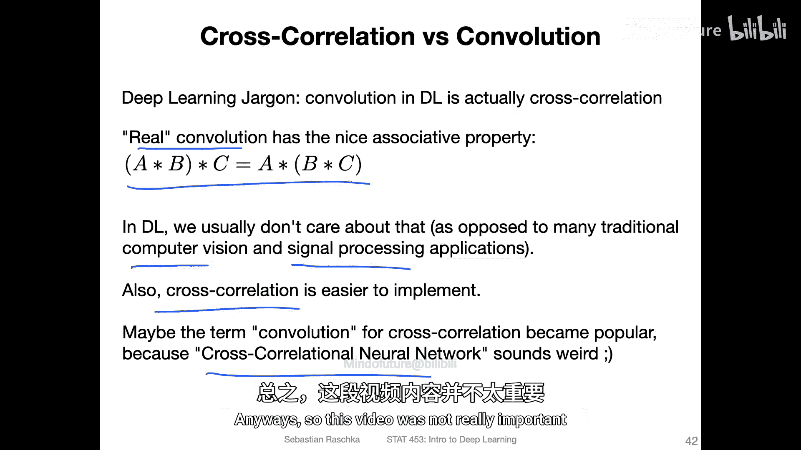

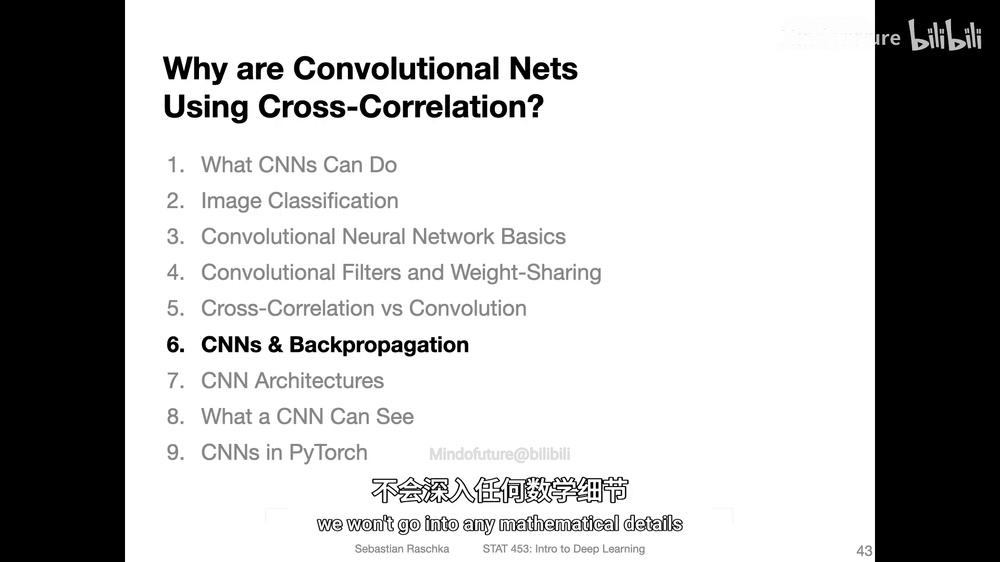