# 【Sebastian Raschka】深度学习和生成式模型 Intro to Deep Learning and Generative Models 2021 p104 P104_深度学习新闻_#8_2021年3月20日 -BV16EC5BUEi7_p104-

Yeah， hi everyone， I'm not sure if you have noticed。

 but we are already in week8 of the semester which means that more than half of the semester is already over。

 but week8 means also deep learning news round number8 and today I have again a very diverse set of topics talking about generative adversary networks。

 mathematical data and also introducing a new little speech tool for Pytorch if you are interested in working with speech data so with that let's get started then。

Yeah， do you like math， actually， I don't or at least not very much。

 so I'm actually delighted to see that people come up with new solutions to automate this tedious task。

 So in the past， there were some yeah works and data sets related to metam theorem proving and yeah another mathematics dataset set。

😊，So here， essentially。People trained mostly transformer models like GT here to generate mathematical proofs。

 So given some input here， the task was to generate the proof or here。In this case， performing， yeah。

 simple algebraic computations， for instance， yeah。The problem is given like this。

 divideivide a certain number by another number， and then the network has to return the answer。

 So these were some relatively simple data sets that were used to。

Train G models to also kind of assess what is a G model that is a special kind of transfer model。

 What is it capable of These were actually pretty easy to solve for these yeah language models。

 So now researchers developed a more， I would say， sophisticated mathematics dataset。

 It's just called creatively the math dataset。 And yeah。

 so here you can see that problems are now a little bit more challenging。

 So it's more like these text problems that you often see and yeah yeah high school competitions and so forth or yeah。

 just the work problems also sometimes on exams and stuff like that。

And the network has to create now a slightly more sophisticated answer。

 and MI researchers now try to use this data to train natural language processing models to see how strong or capable they are and how much these language models can really do。

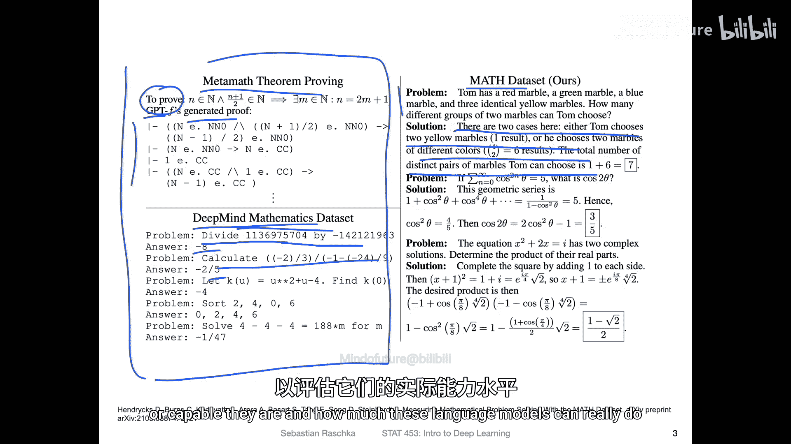

So this math data comes from the corresponds to this paper here。

 so if you're interested you are welcome to check out the whole paper the link is here and they also provide the data set and PyToch do on Gitthub so if you want to play around with that Overall it consists of 12500 problems from high school math competitions。

And 100000 Kanaut Academy solutions with step by step solutions。And on top of that。

 there are 5 million problems generated via Mathematica。

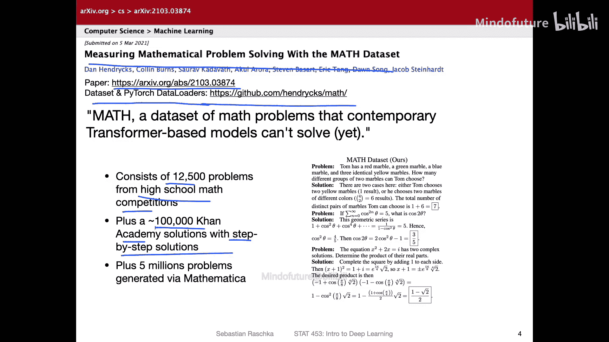

So here are the results。These are。Yeah， results based on the previous data sets that people developed for mathematics。

 these were relatively simple。 You can see that the models reach like 70 to maybe 90。

 almost 100% accuracy here， however。If you know， look at this new data set， yeah。

 the accuracy is very low。 I think it's maybe around 7，7% or something。

 So this is a way more challenging data set。 I'm actually wondering， though。

 how much of it is due to the fact that the answers are very long and that they are maybe a little bit picky in terms of how to evaluate the model。

 I honestly， I haven't read the paper in much detail， but based on， yeah， just skimming over it。

 I couldn't really。

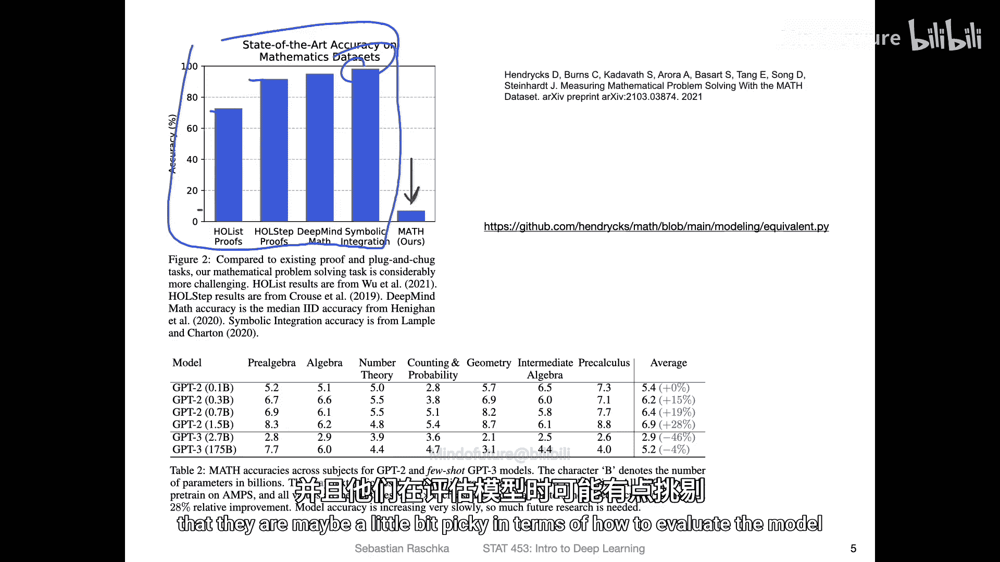

Under understandstand exactly how they evaluate the solution。

 If the solution is generated with a model， how do they compared with the ground truth。

 So I looked briefly also at the code。 It's a little bit complicated。 It looks more like。

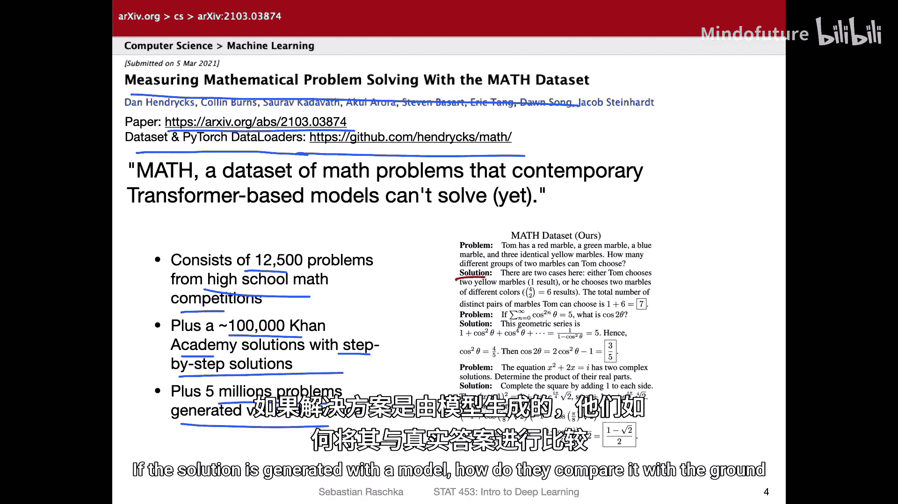

That it is passing all certain types of special notation and things like that。

 But it does seem like the answer has to be given in an exact order。

 which I think makes this problem。 Yeah， just challenging because it's maybe a little bit picky in terms of。

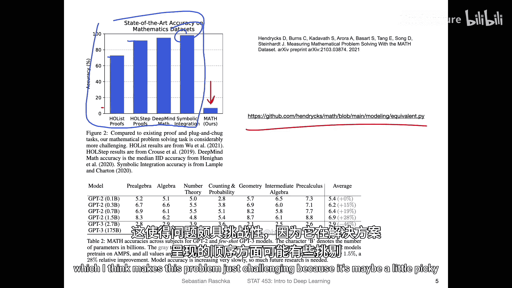

How in which order the solution is presented。 And， but if you then force a model to really produce the solution in certain order。

 how much of it is really understanding and how much of it is just memorizing。 So honestly。

 I don't want to criticize anything here because I haven't read it in too much detail， but。

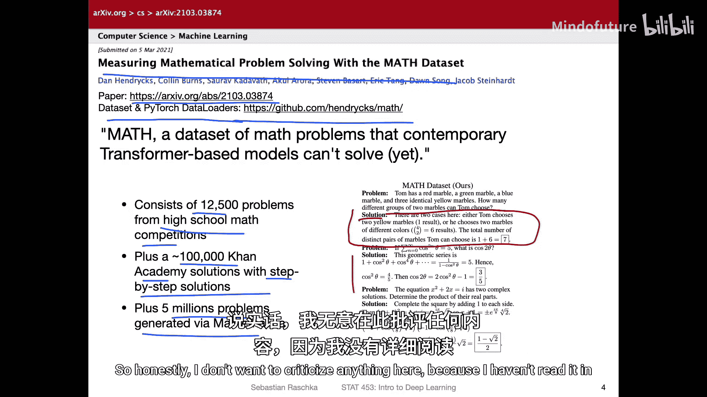

It's just an interesting question to ask。 Interesting insight here is also that if you look at this table here at the bottom。

 what you can see is， I mean， first of all， they。Have different columns for different tasks or subtasks related to mathematics。

 But you can see the accuracy is approximately the same in all the columns。

 So it doesn't matter that much per task。 What is interesting， though， is here。

They are scaling up the size of these language models。 You can see there's a 0。

1 billion parameter model that's a very small one。 And here，1。5。 it's yeah much bigger1。

 It's 15 times larger。 And you can see even though the model size is 15 times larger。

 the accuracy only increases very slightly。 So the same thing can be seen here with G3 So you can see 2。

7 and 1 75 billion parameters。 So you can see making the model much larger doesn't really solve the problem of getting a better accuracy。

 I mean， it improves the accuracy slightly。 but I mean。

 where does it and do you have to make the model 1 million times larger to get good accuracy。

 I don't think so so maybe yeah， right now these language models are really not that capable of solving yeah more complicated things like these math problem。

 So maybe just making the model bigger doesn't help here。 but of course。

 this is just a hypothesis It's just。Speculating maybe making it much bigger。

 like 1 thousand a million times better does improve it。

 we will see in the future because I'm sure people are already working on it。So yeah one more thing。

 they also evaluated the human performance just as a reference。

 So they asked also yeah a computer science speech student who also doesn't especially like mathematics and the student yeah got 40% accuracy so much better than these models and a gold medalist would for instance。

 get 90% accuracy just to have a reference that this is a data set even by person who is maybe not a fan of math like me could。

Get approximately 40% whereas these models are all around like 8，6，5% and so forth。Yeah。

 since we talked about data augment in class not too long ago。

 there was actually an interesting paper I just saw that might be yeah interesting in the context of your class project if you want to improve。

 let's say the performance of your model and have a relatively small data set。

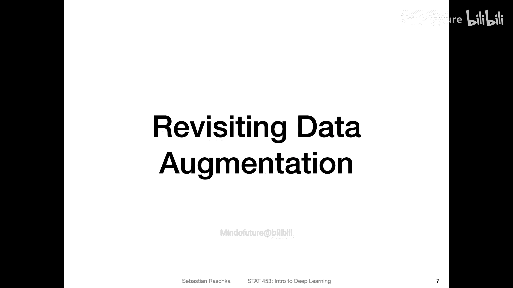

However， I should also say data augment does not always help if the data set is small。

 kind of counter intuitively。 Sometimes it only helps if the data set is relatively large。

 at least on my experience。 So in practice， it's yeah always like another thing to try and to see whether it works or not。

 But yeah regarding。This paper here， is' called thumbnail novel data Aation for convol neural networks。

So here， what is interesting is that something very simple like generating a thumbnail might potentially improve the performance。

 So what they are doing is they are essentially creating a smaller version of the image and then pasting it into the image itself。

 Yeah， interestingly， there's a lot of related work。 Actually。

 there's something called cut out where people just cut out a region of the image。

Mix up where people overlay the image with another image like shown here。

And then there's cut mix where they paste something from a different image here。

 So this was originally a do and they just paste a cat picture of it。

 and then this thumbnail approach that they used where they have the same image like this original one make it small and then paste it back inside the image。

And then of this thumbnail， they also have different versions。 There is self thumbnail。

 There's a mixed single thumbnail of a different image， multiple mixed thumbnails and。

They call it other strategy， where there's this original one， and。Another picture。

 And when they compare this。Based on this result table here， Actually， I'm quite surprised。

 It got a pretty good performance。 Of course， it's still a relatively small performance boost。

 So if you look at。😊，The baseline here，73。7% using these data augmentation techniques。

 they reach a higher one and with this MSD， which is， I think， the mixed single thumbnail。

 they get actually a better performance。 But， of course， this is only a very slight improvement。

 you can see this is almost identical。Might even be within a confidence interval。

 So this is not a confidence interval。 I think it's just the standard deviation。 but yeah。

 so might be an interesting thing to try in the class project because I think that's a very simple thing to do if you want to see whether you can boost the accuracy of your model by a few percent points。

 And it's just like maybe an interesting thing to try if many people try that we can maybe see if we can yeah reproduce these results。

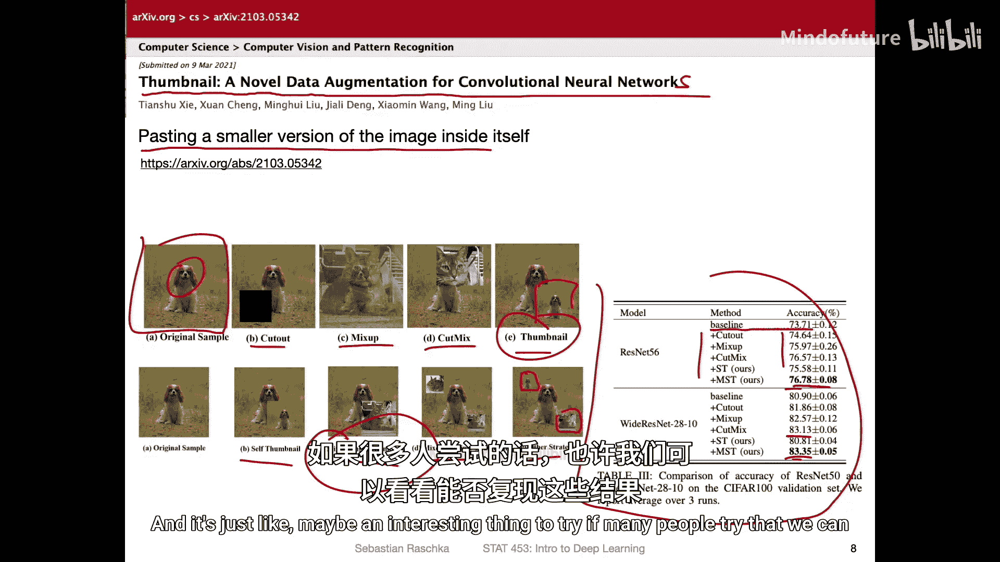

Yeah another interesting research topic evolves around the topic of generative adversarial networks We haven't really talked about those in class yet。

 but we will talk about them very soon， I only briefly I think explained them in last week's stuff in the news section so here the research I'm going to show you revolves around the question or tries to answer the question whether Gs learn meaningful structural parts of objects during the attempt to reproduce those objects。

So the paper I'm referring to is called repurposing GNs for one shot semantic part segmentation。

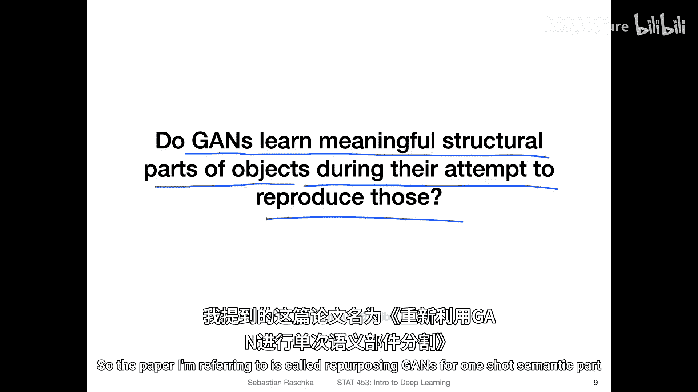

So the paper link can be found here and here's another set of interesting demos。

 looks like they applied it to videos which is actually pretty impressive。

 so the quality of the results， especially given that they only use a very small data set。

So on a big picture view how or what they try to do is they try to see what information the again knows about the image。

 So， so they do that in a context of。Semantic part segmentation。 imagine you have an image like that。

 the segmentation part would be essentially learning the different parts of the object， for instance。

 having these masks for the windows， the tires， the lights。

 the license plate and the main body of the car。 So whether network。

Or they're essentially asking the question whether the G learns about these different parts of an image or whether it just memorizes pixel locations。

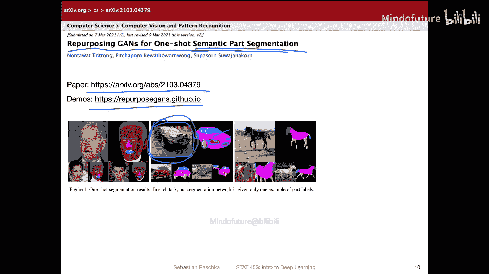

So let's take a brief look at how they do that。 So on the left hand side。

 on that is the representation extraction。I would say approach or step on the right hand side。

 I will then show you how they actually train it and how they use it for inference。

 but just let zoom in onto the representation extraction part。

 So what they have for this part is they have the input image。They have a latent optimizer。

 You can think of the latent optimizer。As a let's say a fully connected layer or something。

 or maybe a PCA， if you're familiar with PCA， it's essentially taking the image and mapping it into a smaller dimensional space。

 So let's say if you have an input image that is 200 by 200。

 You're mapping it into a smaller dimensional vector like let's say 100 dimensional。

 So here you can use a neural network for that。 You could for example， use a hidden layer for that。

 a fully connected layer。 but you can also use something else So here。

 they use a neural network module for that。 And then they have this vector。

Z that they pass to the generator and the generator is they are generating an image from that。

 it supposed to generate the input image。They are here now。

 except for training the generator not interested in that input image。

 they're more interested here in these maps， the setic maps。So what they do is they have。

Like these connections to essentially。What they are doing here is they extract the activations from the different convolutional layers here。

And then they app samplele these activations because they are smaller dimensional than the output。

 So the output here should have the output from that should have the same dimension as the input image。

Because eventually， they want to create the mask for the inputment image。

 so they want to essentially have an output representation that has the same dimension as the image。

 It will be the mask that overlays with that image。 So they take these activations。

 ups samplele them， and then they combine them。To get this output representation。

 and that is essentially the mask。 So this is the when I go back one slide。

 this is the the mask that they get or here for the face image。 they get the corresponding mask here。

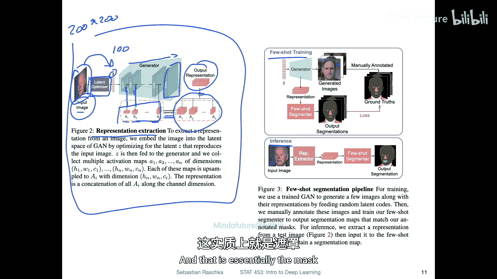

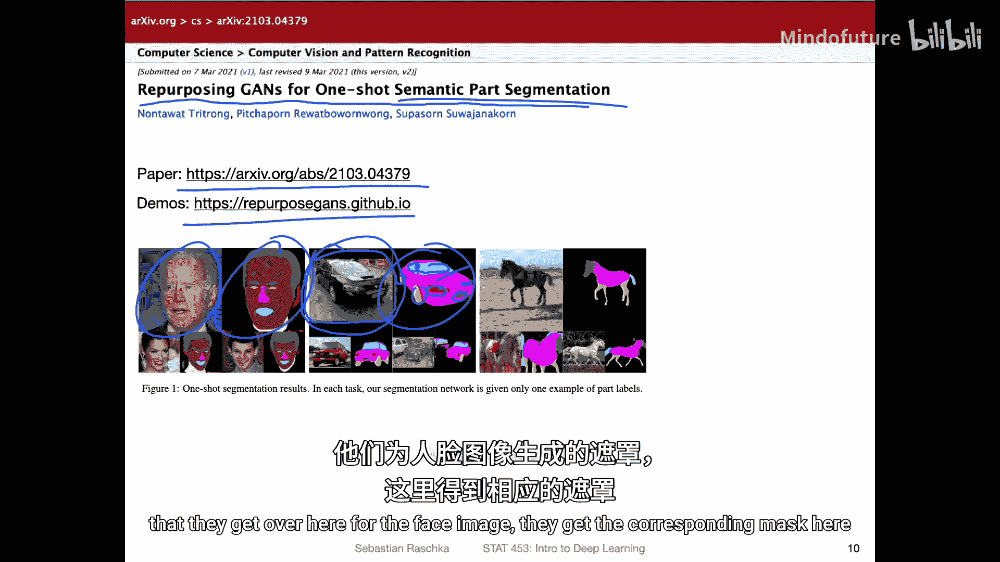

So the output representation is this yeah mask that they generate。

 so how does the training look like？So they use few short training I don't want to go into too much detail if you're interested。

 Jngju is actually an expert in that， if you are interested in chatting about this topic I think he might be happy to talk more about it。

Any case。So future training is essentially working with small data sets where you only have a few examples per class。

Here。I would say it doesn't really matter whether it's few short training or not。

 I mean it's making it more impressive the fact that they only have few examples。

 but you can for simplicity also think of a regular supervised training workflow。So here。

 during training， they don't provide the input image。 They provide a noise vector。

From that noise vector， this goes into the generator。And the generator generates these。

Face images or other objects。And as a far as I understand。

 because this is created from a noise vector， like from a。Yeah， random noise cycles。

 it will generate something that is not in the training set。 So for that， you don't have any labels。

 So what they do is they then manually annotate this image。 so they manually。Yeah， create this mask。

 So they're actually tools for that。 If you're interested。

 I think I shared that with some students when I was reviewing their class projects and the class project was related to object segmentation。

 I shared two tools for creating these masks。 They are open source tools easy to use。

 So here the humans manually annotated these images。And。

Then they also had this representation extraction step。

 the representation extraction step is essentially this step here。And using a few short segmenter。

 created these output segmentations and then learned whether， yeah。

 the output segmentations match the ground truth labels that were manually annotated or not。

 and when I recall correctly in the paper they said they used sometimes only one labeled image and it was able to learn these maps really well。

 which is very impressive。 but then it also shows that because the representation is drawn from these intermediate activations from the generator。

 that the G essentially learns these different regions of that image or it kind of understands。

Things about that image， instead of just memorizing pixels locations it kind of understands maybe what these different parts are in the nose and the eyes and things like that。

Yeah， and then during inference， you can take a given input image。

 run it through the representation extractor。And then run this future short segmenter to get the output segmentation map。

 So in that way， what you， yeah， what you can do is you can essentially run。

 run this part for inference to get the segmentation map for any new image。

 I think that's actually a pretty cool project。😊。

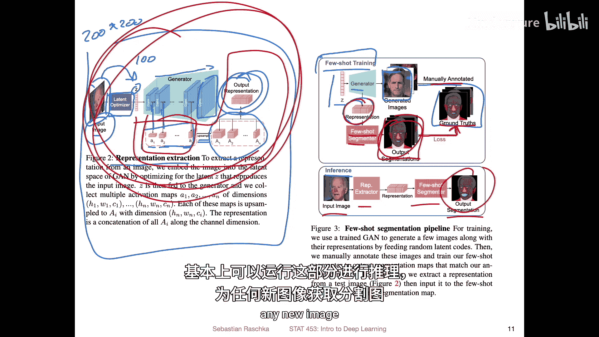

Yeah， this is not research but the story behind deep learning research so here was a very interesting article it's called the Secr Auction that set off the Ra for AI supremacy。

 which is recapping the story back in 2012 when Jo Hinton and his students had a very well working at deep learning model or deep learning approach and yeah they wanted what they formed a small startup in 2012 consisting of three people。

And then eventually sold it for 44 million to Google。

 was quite an yeah interesting look behind the curtain of the early days of deep learning。

 So if you're interested， it's a very entertaining article。

Yeah and lastly to end this video for this week， there was another cool tool for Pythtorch so on the company Huging face this is a company mostly famous for their transformal implementations in Pytorch and TensorF so they usually take current transformer models from research papers and implement them in open source。

 compatible ways and share them with the community。

So this company is very famous for their transformer models。

 they now also have a speech toolkit for Pytorch， so in case you are interested in speech research that might be also something worthwhile checking out All right so that's it for this week then and next week we will continue with a lecture on convolutional neural networks。

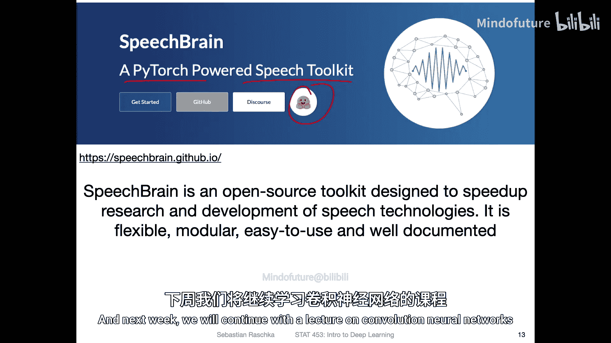