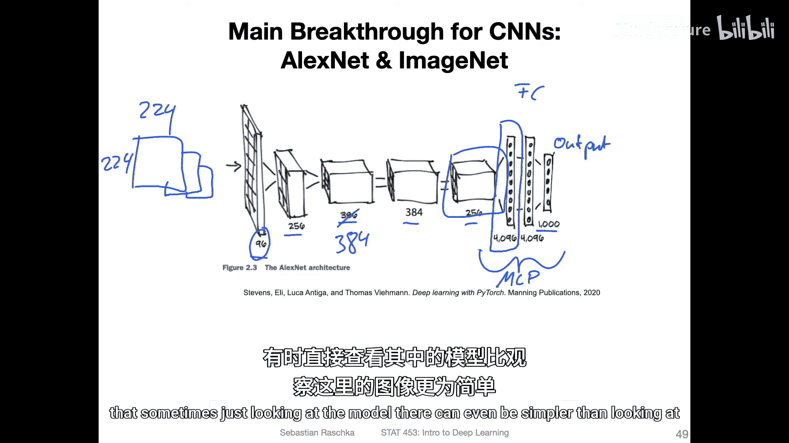
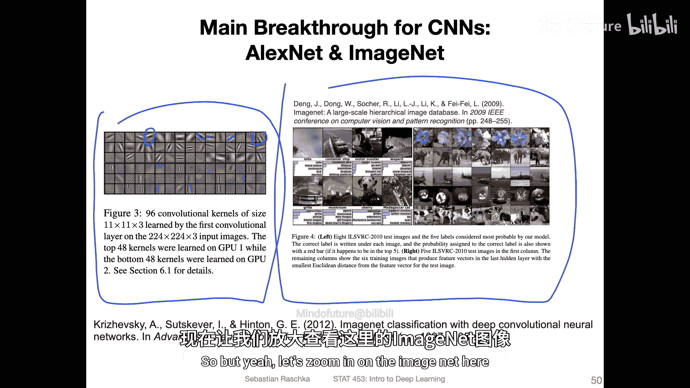
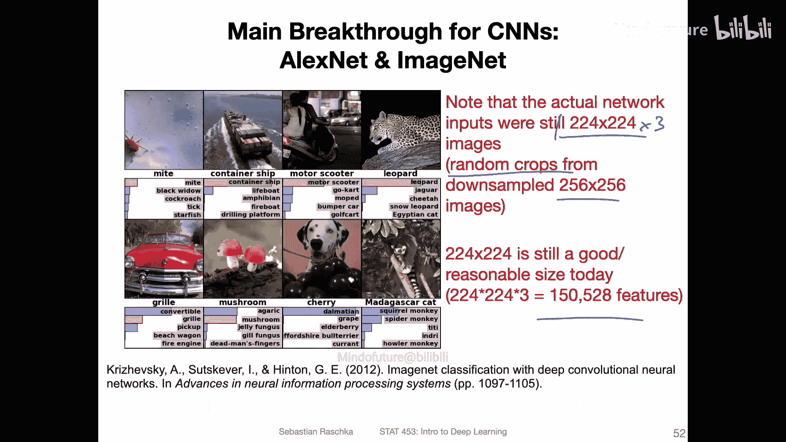
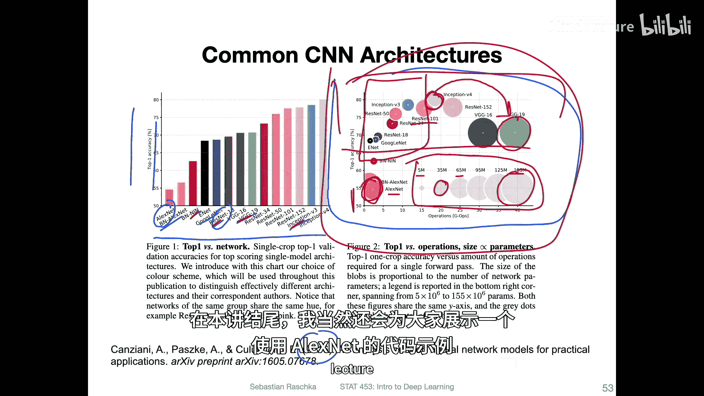
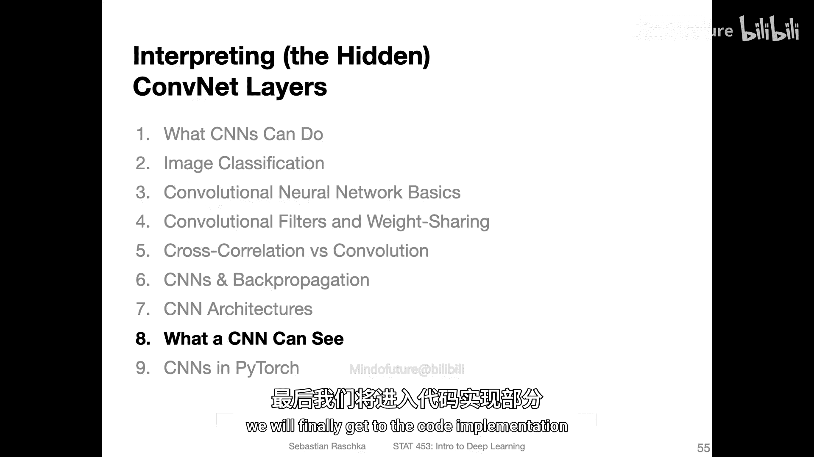

# 【Sebastian Raschka】深度学习和生成式模型 Intro to Deep Learning and Generative Models 2021 p106 P106_L13.7_CNN架构__AlexNet -BV16EC5BUEi7_p106-

Yeah， next to the data set to having good quality data。

 one of the aspects that determines the success of applying convolional networks to computer vision problems is choosing the right architecture。

 So in this video I want to briefly go over some of the most popular architectures out there。

 but it will be only a very brief overview because the next lecture will be wholly dedicated to seeing an architecture。

 So here this will be the big picture in the next lecture we will dive in。

 and I will explain some of these architectures in more detail。 And also here in this video。

 I want to add one more thing that we haven't talked about yet。

 And that is how we work with multiple color channels。

 So so far we only worked with black and white images。Emnesist images。

 where we used the Lette architecture。 Now we are also going to look at other architectures that can work with color。

 and I will explain you how that works。So， but let's start with this traditional。Architecture here。

 So one traditional architecture you already saw was the lineette。5 architecture。

 which was applied to hand written digit recognition， or， in general， handwriting recognition and。

Sne ends have been used then since then a couple of times。

 but they were not they were not really that popular。 I mean。

 traditional computer vision approaches were usually faster and gave better accuracy results and there was a so called imagenet competition。

I think I'm not sure if it was in recent years， but it has been a very popular competition once where people tried out different computer vision approaches to classify images in this data。

 it's a very large dataset consisting of millions of images。

And usually traditional computer vision outperformed these con networks or other neural networks。

 and what was now big here in 2012 is that for the first time conversion network really outperformed anything else。

 So any other type of computer vision approach was really outperformed in this year by a large margin。

 and that is really when people paid or started to pay more attention to deep neural networks and convol networks。

 So essentially this Alexnet architecture which is shown here was the main breakthrough for CNNnns and also maybe for deep learning in general。

So in particular， this Alexnet achieved a 15。4% error。

 the top5 error I will explain on the next slide either the top five error or top5 accuracy。

 how that is defined again， but yet in any case。Focus now on the number 15。

4 as the error here and in comparison the best or second best method。

 the second best was not even close so the second best method was I think a traditional computer vision method and it was like around 26。

2% error so you can see it was almost twice as good as anything else out there and that is really when people yeah pay attention to deep learning and con network and that is really when it started to take off。

But yeah also nowadays， I mean， 15。4% that would be actually pretty bad nowadays you can using the right architecture。

 achieve even a top five error of only 3%。So。Besides having many layers here in this architecture。

 I will also actually show you a better， well not better。

 but a simpler illustration on the next slide。 But instead of having multiple layers。

 one of the novelties here was also that the authors。Alexander Khushevsky。

 Soskar and Hinton that they used GPSus in a very effective way。 So I think back then。

 GPSus were pretty small。Still regarding the memory。

 So here what they did is they split the work into like a two parallel processing steps。

 So you can see this is here the input image。 It's I think 20224 times 224。

 and they split it into two parts。 So one is this upper part。

And one is the lower part where they kind of process things separately。

 Sometimes there was some communication between those。But yeah。

 these were largely run parallel to really make things faster。 And then in the end。

 the results were concatenated into a fully connected layer。 and that one was then。

 yeah attached to that one was then the output layer。

 I think this might actually be the output layer。 sorry， So here this is the last。

That is the last layer before the output layer。 So the output layer is essentially。

This whole thing here， from。4096 to 1000， where the 1000 are the number of classes here。So yeah。

 here is a simpler visualization of the same architecture， except that it is now on a single GPU。

 It's usually how we would nowadays trainer Alexnet， and we will also do that later in this lecture。

 I'll have a implementation of that that I will show you。

 So what we can see here see here is the first。Feature map so the input image would be actually here。

The 224 times 224 input image。 and we have three colour channels。

 and I will also explain to you at the end of this video how we work with different colour channels。

So the first feature map has then。96 channels， then 256 channels， then 386。Then thread 84。 actually。

 I think this is a typo here。 I think this should be also thread 84。

If we look back on the previous slide， they had 192 plus 192 from the two GPUs， which would be 384。

 so in that way， I think it was a minor type of， but honestly in practice it would not matter much whether it's more or to fewer channels。

 it doesn't really matter。Yeah， then 256 channels， and then they reshape。

This one into a long vector with 4096 activations。 I will also show you in the code how that works。

 It's actually pretty simple to do using reshape， and then。This is a fully connected layer here。

 And this is the。Output layer。So we have 1000 classes and here this is essentially like a multilayer perceptron again。

 if this looks a little bit abstract we will see in the code example how that looks like in Pytage and sometimes I think it's easier to look at it actually in Pytch because Pytch is such a yeah easy to use library in terms of the multilayer perceptron and convol network implementations that sometimes just looking at the model there can even be simpler than looking at the images here。

Yeah， so here is the snapshot of the INe data set。To which the Alexnet was applied to。

 And I will actually zoom in into that on the next slide。 Another interesting aspect here。

 I just wanted to highlight。 It's also from the same paper is that they looked at these different。

Yeah kernels of the network at different stages during training。

 And also what was interesting is yeah， the types of kernels that were learned。

 So some are essentially edge detectors。 So these are essentially。

Tings for detecting vertical or diagonal edges， I will actually zoom into that or discuss this in the next video。

 but that actually means and how this can be interpreted。So but yeah。

 let's zoom in on the imagenet here。

So Imnet that was is still a very popular dataset consisting of 1。2 million images and 1000 classes。

 And if you recall， I'm not sure if you actually watch those。

 but the stuff in the news videos that I optionally make you don't have to watch those but in these videos I had an example a recent research effort where people yeah started to clean up Inet because sometimes there can be multiple objects。

 I just see there is such a case here， for instance， we have a motor scooter here。

But there's also a car。 So yeah， predicting car wouldn't be wrong either， but this label here。

 the only correct label for this image is motor scooter because each image has only one label here。

So in this case， yeah， some people try to yeah clean up image network here。 for instance。

 we have cherries and a dog so。It's actually not so simple to make a prediction， sometimes because。

Yeah， there are multiple possibilities but if you are only given one class label。

 your network might be predicting the right thing， but it's different from what the label says。

 So let me see so yeah， for example， another yeah one example would be actually this cherry example so how this accuracy stepping a step back how this accuracy is measured it's the so-called top five performance or top five accuracy and it is essentially if the correct prediction is in。

So the label is among the top five predictions of the model。

 So if you recall how the softm function works， it's essentially class membership probabilities。

 So we have a softm activation vector consisting of 1000。Class membership probabilities。

 So here people look at the five largest。Probabilities and get the class able for those。

 And these are listed here。 So， and these。Bars represents the confidence for each of the classes。

So here let's focus in on this image again， so the five classes that the network returns is Dalmatation。

 grape， elderberry， forshire Bter and current。So we can see， though， that。

So this would be actually counted as a misclassification because the most confident label is dalmatation。

 although in truth it's a cherry so you can see it actually might be even impossible to get 100% accuracy in the first place there are some images that are a little bit tricky。

Let's take a look at another one， this year， this car。

 so here the true label is grill and the network predicts are the five most confident。

 confident predictions are convertible， grill， pickup， beach wagon and fire engine。I would say。

 actually， so the most confident prediction is convertible for this network。 I would say this is。

This is correct， right， so we this is indeed convertible。But yeah。

 Gr is another prediction by the I and here。This is counted as a correct classification because even though it's only the second most confident predictions。

 it's among the top five and the top five matches this image here。So yeah。

 it's a little tricky to evaluate on this image data set。

 but just wanted to explain to you how the accuracy is computed。In any case。

So this is how the imagenet dataset set looks like， and。Yeah。

 Alexnet at that time was really a breakthrough for image classification measured on the data set。

Yeah it's also worth pointing out what the input size is again。

 so they took original images downs sampleled them to 256 to 256 and then produced random crops and the input images to the network were then essentially 224 times 224。

 even if it sounds like 224 times 224 is not much。Like in common standards。

 if you think of your cell phone where you have millions of pixels。

 So 224 times 224 plus or times the three color channels， it's actually pretty small。

 But in the grand scheme of things if you think of a neural network for instance。

 a multilay perceptioncept that takes all these inputs and you have a fully connected layer this is still。

 I mean，150528 features that we have here as input。

 So this is something that wouldn't be really manageable by any other machine learning technique。

 for instance， a multilay perceptionceptron would really choke on such large inputs and also other methods。

Like gradient boosting or random forests or yeah， anything basically。 So it's actually。

 even though it doesn't look like it 24，224 times 224， it's actually a pretty large input。

Alright， so talking about the scene and architectures。

 I will like a promised dive into more detail in the next lecture， but he has just a brief overview。

 so here are different architectures from a paper that goes back to 2016 there are nowadays more architectures。

 new architectures that are not included here， for example， mobilenet and Dennet and others。

 but still it's a very nice summary of the most popular ones here and I also like this visualization。

So maybes let's take a look at the left one here first the top one accuracy that's on imagenet so we discussed before top1 accuracy may be a little bit problematic but yeah that's what we have here what's interesting really is like just having a reference to all these architectures in one slide essentially so there's the LXnet there's a I think theN means with batch norm any NIN is a networking network I will also talk about this next。

Lecture， the Google net， Resnet， Resnet， I would say is maybe still the most popular architecture。

 It's a certain type of architecture using residual connections。

 It's a very important concept that we will talk about next week。 VG G and so forth。

 inception network and planning to talk about some of them， not all of them。 But yeah。

 let's maybe take。N I N， resnet， PG G and inception as the ones。 So to keep it manageable， these are。

 yeah among the most popular ones。So， here。They are showing just the accuracy here on the right hand side this is slightly more interesting。

 it's also looking at the parameter size， So here is like the legend for the parameter size。

 the number of parameters like from 5 million to 155 million。

 So you can see AlexNe is approximately I would say somewhere maybe around 65 million。

And then we have something like a VG G， which is 155 million parameters approximately。

 And you can see there are other networks， for example。Think this is inception version 4。

Which has only maybe 35 million。 And even though it doesn't have more parameterss than VG G。

 it has a better accuracy。 So more parameters doesn't mean necessarily better accuracy。

 You can see Alexnet has actually more peri than any one of these。 still， the accuracy is much lower。

So resonnet， for instance， with a residual connections。

 yeah can actually boost the accuracy or inception has an auxiliary loss， for instance。

 that can also be helpful。In case， this is yeah the brief overview。 So you know。

 there are many different types of architectures。 and Alex that is only one of them。

 It's actually here also at the low end in terms of the top one accuracy。

 so we will talk about much better。Models in the next lecture。

 But I think AlexXnet is still a nice introduction to the topic of convolal networks。

 and I will also of course， show you a code example using Alexnet at the end of this lecture。

Oh yeah， one more important aspect to talk about is how we work with color channels in the beginning of this lecture。

 we introduced yeah the Lnette architecture which was just working with black and white images which only have one color channel。

 but yeah Alexnet for instance， works works with imagenet which has in color we have color images so how do we deal with that。

So， yeah， let me explain it maybe step by step。 So maybe focus now only on the。

Thing I'm framing here right now。 That is one color channel。It's called it R， and。Previously。

 what we did is we used a kernel for that。 that was just like a matrix and。By a matrix。Like this。

 And then here， we applied the convolution。 So we were sliding this over the image and then computing。

The feature map here。 So one。Or the kernel applied to one receptive field yields。

 one pixel in the feature map。Here。Okay， no。What we have is we have multiple color images， so。

For instance， let's say we have RG， the RGB format， red， green， blue。 So we have also now。Agr。

Coor channel。And a blue color channel。So this is our input image here。The whole thing。Here。😔，So。

Input image。And then corresponding to this input image。

 we also have a kernel that has the same number of channels。 So notice now we also， our kernel has3。

Channels。And we apply each kernel layer or each kernel channel only to the corresponding channel in the input image。

 So red goes with red， green goes with green and blue goes with blue。It's a regular convolution。

 And then。Once we computed that， we sum over these channels。 So the kernel and the input is a matrix。

 sorry， element wise multiplication and the sum。Right， so it's just like the regular。Convolution。

 but then we are summing。 After that， we are summing over。

The channels C in so that's the input channels。 we are summing over them。And this whole thing here。

 everything that's going on here。😔，This will give us one。Feature map。

So this whole thing results in one feature map。So how do we get multiple feature maps。

 that's essentially an extension of what we talked about earlier。We would just use multiple kernels。

 So we have here kernel。K1， kernel K2， Cor K3。Okay45 in each kernel。Willll produce one feature map。

 so here。And I don't have really many colours left here。 So this one will， for instance， and produce。

This feature map， and。This one will produce。This feature map and so forth。

 So that's how we get the different feature maps。And yeah。

 this is essentially it So here at the bottom， just highlighting again the input images n times n times C N and in Pywa。

 usually we have another dimension， so we have。And as the number of images in the batch C as the channels。

 W is the width and H as the height， sometimes people use this format where you have the number of images。

 the width height in the channel last， but that's just a minor detail you don't really have to worry about this here in this slide and in the yeah。

 the next video we will briefly talk about what is seen and can see and then we will finally get to the code implementation。

