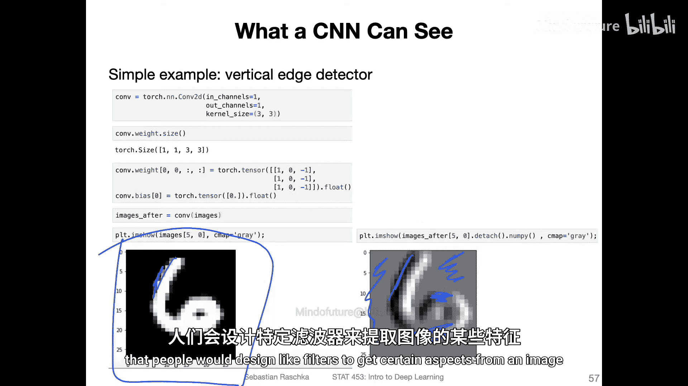
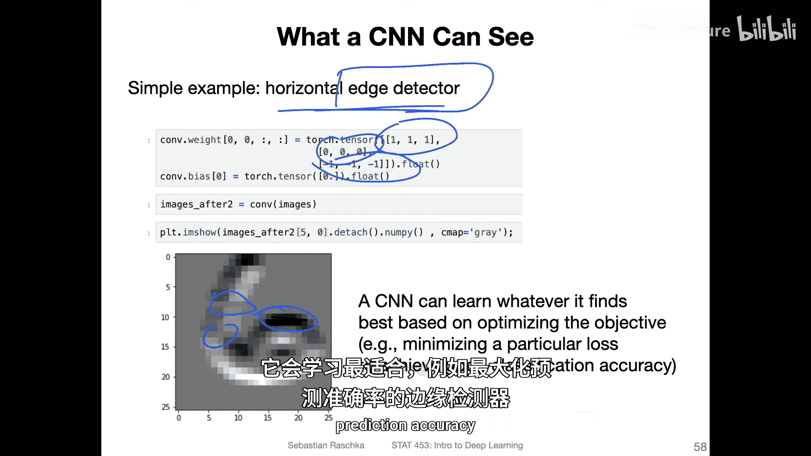
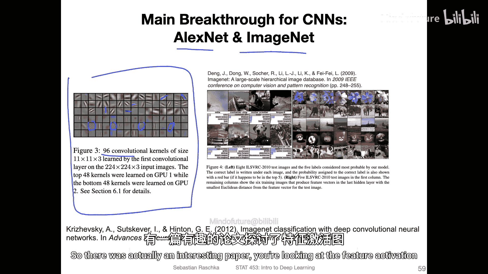
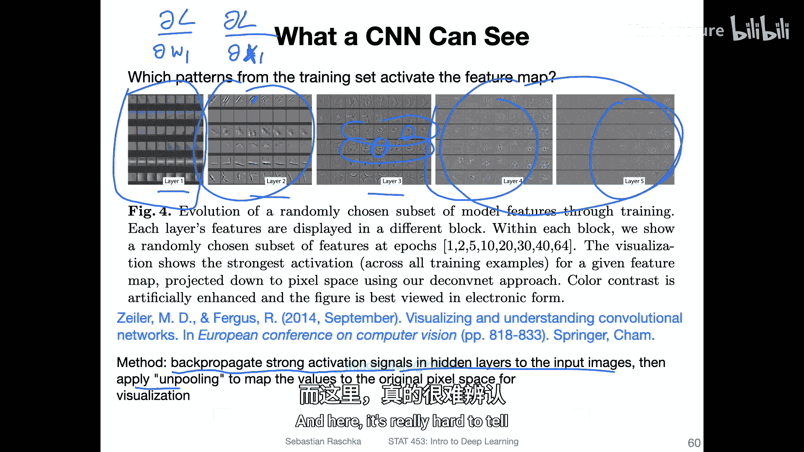
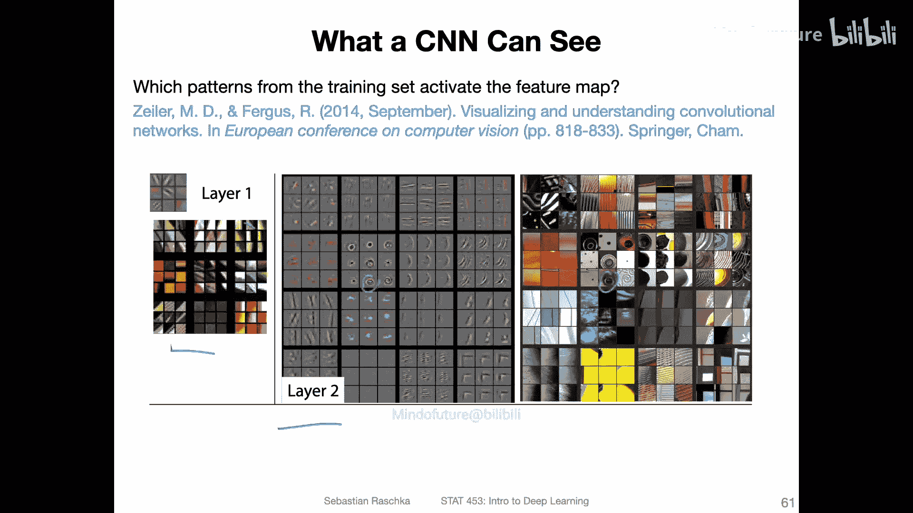
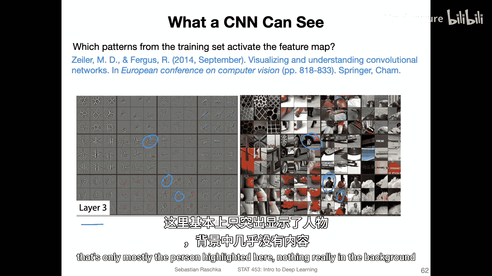
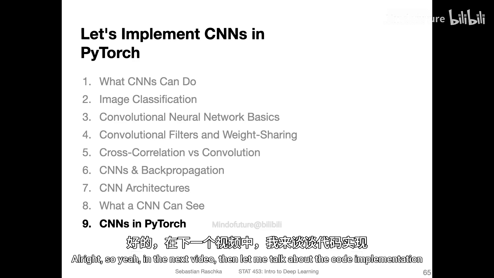

# 【Sebastian Raschka】深度学习和生成式模型 Intro to Deep Learning and Generative Models 2021 p107 P107_L13.8_CNN能看见什么 -BV16EC5BUEi7_p107-

Yeah， now that we talked about convolutional networks and the convolution operation and so forth。

We might wonder what is actually going on in a convolutional network。

 what is the convolututional neural network actually learning there？So， yeah。

 we can take a brief look at that from a traditional computer vision perspective。

 So before convolutional networks were invented， people were designing so called yeah edge detectors among others。

 so people。We're designing filters by hand by thinking about them like applying， let's say。

 logical thinking that were like soble filters like vertical edge and horizontal edge detectors and so forth and how these work is essentially that someone would define a filter thinking about what it is doing and then。

You can extract certain features from an image using that filter。

 So here's an example of what I mean。 So here that's an example of a vertical edge detector。

And Im implementing it。I'm using an existing con neural network filter here。

Or layer so here you don't have to really worry about the code implementation。

 I'm just using the code implementation to create these figures and also in a way to prove that this is actually real that it's not something I just make up here so。

Here。Let's say we have this vertical edge detector's。Mattrix that consists of。

A column containing ones。Zeros and a minus1。 And then let's say I have an image like that。

This is my image where I have these zeros， half zeros and half ones。And。

My goal is to design a vertical edge detector that can detect that there is an edge here。

 a transition between dark and bright。Now when I apply my edge detector here to this image。

That's what I'm doing here on the right hand side。 I can see the output is this one here。

 So it has detected that there was an edge。 so it detected essentially。This edge here。

 the transition。The transition between dark and bright。So before convol networks。

 people were using these edge detectors yet to detect transitions in an image。So for instance， here。

 this is the vertical edge detector applied to an image in the Amnes data set。 and you can see here。

 for instance。When we have the endless data set。So I'm just okay。

 so here we have then these detected edges。 you can see， I mean。

 they are not perfectly horizontal vertical because it's like a curve。 it's maybe not an ideal image。

 I should have maybe taken the number one or something like that from Mnes。

 but you can see everywhere else。 it's not detecting anything And here where there's something horizontal whilst you can see these parts are missing。

 Of course， in an image like that。 it's like a yeah real worldl image。

 which is pretty rounded here and the shapes。 it's not perfect。

 but you can see the bigger picture here that people would design like filters to get certain aspects from an image。

For instance， here I have the same edgeject detectoror except that is horizontal instead of vertical。

 so I have a row of ones， zeros and then minus ones。

 and here you can see now that it is detecting these these horizontal。Edges here。

 whereas then for some vertical ones here。 So these， these regions are missing。

 So this is just like a bigger picture context of it's a traditional computer vision designing different filters。

 Of course， these are just very， very， very simple edge detectors。 They are more sophisticated ones。

But yeah， now going back to the scene N， so how is that related to the C N？

In the beginning of this course， I talked about traditional methods and deep learning and one major difference between deep learning and let's say traditional machine learning and other methods is that in deep learning。

 we have this automatic feature extraction in that sense。

 you can also think of the CN as an automatic feature extractionor that can actually learn something like an edge detector。

 Of course， it will not learn exactly that edge detector it will just learn the edge detector that is best for。

 let's say， maximizing prediction accuracy。

Yeah， I already showed you this。Slide in the last video， this is again Alexnet trained on Inet。

 and in the previous slides I showed you these manual filters like vertical in horizontal edge detectors。

 And if you look here at figure3 where they plot the 96 convolutional kernels after the first layer。

 you can see it's actually quite similar。 So it's also somehow learning like these diagonal ones diagonal filters。

 horizontal filters。Vertical filters and so forth。 But then also these filters， like。

This one and this one， which are some checkboard patterns。 Some are only focused on colour。

 So you can see really， the CNN N is learning a kind of complex set of filters here。

That yeah together can help it with maximizing prediction accuracy so in that way also typically the early layers learn very simple feature extractors and then the farther you go in the network these basically assemble to more complex shapes in the feature maps。

 so the feature maps in the early layers they usually detect something like edges and later in later layers usually they detect more complex objects。

So there was actually an interesting paper yeah， looking at the feature activation maps。

 and I also should say。

As a general method， so。If you want to look at what input pixel maximize the loss function。

 So previously when we talked about。partialial derivatives of the loss。

 We looked at the partial derivatives of the loss with respect to， let's say， the weight input。

 And we used that to update the model， right， So update the weights。 So in that way。

 we wanted to know。嗯。How do I have to change my weight So to minimize the loss。

 You can actually do the same thing by。Looking at。Hidden layer activations or maybe even the inputs right So let's say you can do that with the activation。

 you can see okay which activation basically has a high impact on the loss So what are the gradients here basically So in that way you can also study the activations and even in the input you can find in the input if this is like the input pixels you can find out which have the highest loss gradients or partial the root of the loss with respect to the input and then you can find out which pixels。

Is the loss most sensitive towards2。 I will at the end of this video also show you or give you an article that highlights or explains some of these techniques。

 In any case， so in this paper here。They also back propagated the activation signal。

 so they looked at one of the strong activations and back propagated them back to the input images and then they applied a so called unpooling to map。

The activations back to the original input dimension。 So in a sense。

 it sounds maybe a little bit yeah convoluted。 but in a sense。

 they were actually looking at what activations。What are the large activations in each feature map and how do they correspond to the input image？

そう。For instance， they had different layers。 on the first layer。

 there were mostly abstract features here。In the second there you could see there are。

 I would say more complex shapes， hard to tell what they are， but they're a little bit more complex。

 But then you can see the third layer of the network。

There are more like concrete things emerging like a face。 suddenly， right from these simple patterns。

 suddenly the combination of them emerge that emerge as a face。

 or that's maybe an eye and things like that。 And these shapes become more and more complex。

 the later。The， the deeper the network goes。So in that way these feature maps are mainly face detectors。

 these are eye detectors and here it's really hard to tell， but yeah， in that sense。

 the more or the deeper we go in the network， the more complex these shapes that the network can recognize become。

So， yeah， just。Another example heres from the same paper。

 So here can the first layer as mostly colour and simple edges that it get it detects。

 And then here in the layer two tasks like these different。More abstract shapes。

 On the right hand side， these are the original objects。

 You can see there's an eye here kind of detects that。

Well here。They are three。For instance， if we focus here on， it's a car， it can detect this wheel。

 it's kind of interesting that the network really learns here yeah。

These important parts of an image while ignoring also the background。 So of course。

 it depends on what the classification task here is。 But if the classification task is， let's say。

 predict what object it is。Say predict that this is a person you can see。 It focuses on the person。

 not on the background here。Well here， for instance。

 that's only mostly the person highlighted here nothing really in the background。

Yeah， he has some more okay。Yeah， so here's an article that has a nice summary figure of different approaches for interpreting。

What the network pays attention to in the input。 So in the previous slides。

 I showed you essentially the feature map activations here。

This is a set of methods for looking at what pixels in the input are most important for making a certain prediction。

 for instance so you can ask maybe the question if I have a I don't know。

Cats versus the stocks classifier， what is the most important part in the image to classify？

A cat versus a dog and you want to see that it pays maybe attention to the anatomy like the legs or the shape of the animal rather than the backgrounds and that way using these methods is actually a good sanity check to make sure the network pays attention to salient parts in that image。

So yeah， I would say the most， the most traditional methods on the left hand side have been used for a long while。

 And here are also some more recent ones。 I would say actually grad chists still among the most popular ones。

 but there are also some modern， more modern ones， which are， I think， producing better results。So。

Looking at this one here， vanilla， gradient ascent。 So you can also just think of it as decentcent。

 It's maybe easier to think about。 So what that is， it's。

That what I mentioned in the beginning of this video， where I mentioned， instead of computing the。

Partial derivative of the loss with respect to the input weight to one of the input weights。

 We would compute it with respect to the input pixels in that image。

So that tells us really how important is a pixel for the loss if we have a network for classification。

So here now if we look at this we can see the network when it does a classification。

 I actually don't know what type of classification it is。

 I'm just assuming that so you can see it kind of pays attention to the do instead of the background which is kind of good you can see this one guided propagation It's a flavor of this vanilla vanilla gray and descent except that here there's a thresholding going on but yeah in any case what you can see here it highlights better that the network pays attention to the muzz or even the whole head area of the dock So maybe this is I'm speculating but maybe this is a network that is trained to predict or distinguish between different breeds of dogs。

So， for instance， being more specific than just saying doc， for instance。

 saying that this is a doba man。 So in that way。The network has to also maybe pay special attention to get the hat area because the general body that is something that looks very similar for different types of dogs or breeds of dogs。

 so in that way， maybe you have to really pay special attention to the head area here。

The muzzle and so forth。Again， there are other methods， for instance。

 a smooth grid method and blur integrated gradients。

And yeah you can see they are all somewhat similar。

 but they are all good methods for essentially looking at what parts of the image the network pays attention to。

 which I would recommend and practice if you work on a bigger project and your project is on let's say classification。

 it might be a good idea to utilize one of these methods to really look at what your network pays most attention to at least for a handful of images and so forth。

 can help sometimes to make sure the network does something that is actually sensible。Alright。

 so yeah， in the next video， then let me talk about the code implementation， finally。

