# 【Sebastian Raschka】深度学习和生成式模型 Intro to Deep Learning and Generative Models 2021 p132 P132_L15.6_用于分类的RNN-多对一词RNN -BV16EC5BUEi7_p132-

All right， so the plan is now to implement a recurrent neural network with an LSTM as a classifier to classify texts。

So this will be a many to one word R and N， because。

We are going to yeah read in texts and then we regard each word as a token in that sequence so in this video I'm going to outline the different steps that are necessary for that and then in the next video we will take a look at how that looks like in Pytorch so now these slides won't be pretty but I hope they will kind of convey the big picture that underlies yeah the Pytch implementation。

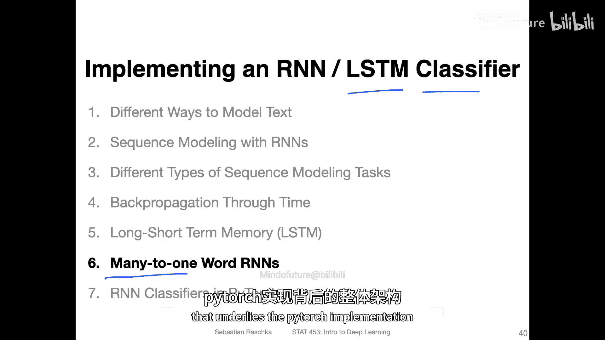

So because we are talking about a classification task。

 we are talking about a many to one network here。 So we have。Its input， for example。sentenceentence。

And then the output is a class。Label， so that will be a class label prediction。 For instance。

 we are going to take a look at a IMDB movie review data set。

 and then we are going to predict whether the reviewer thinks that the a movie is positive or negative。

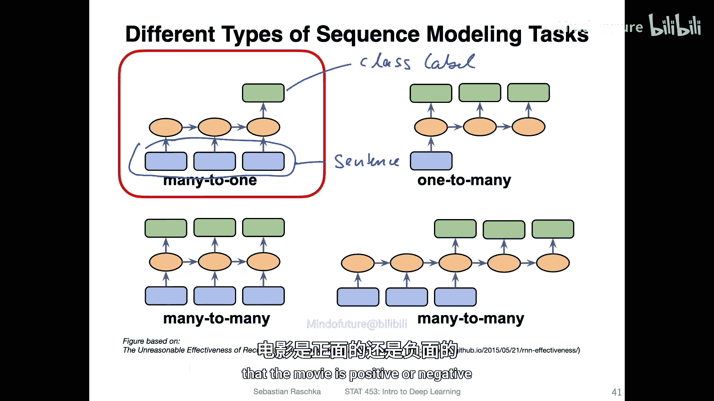

So just to recap， this is a slide Ive shown you in the very beginning of this lecture。

 so this is the classic approach for text classification using the so-called pe of words model。

 I don't want to yeah discuss this again because yeah I already discussed this in an earlier video。

 but I wanted to highlight again that we are using a so-called vocabulary here。For the R and N。

 we are also going to use a vocabulary that is similar to this one。 The only thing is that。

This part here will be different， so we won't have a design matrix as a。Yeah。

 input to the machine learning algorithm， we will have an embedding。So basically a word embedding。So。

This will be now in four different steps， So I'm trying to do it step by step because it it can be a little bit complicated so breaking it down into smaller steps might help yeah understanding the process。

 and these steps are also approximately how we would implement them in Pytorch。

 So this is for the recurrent neural network now。 So step1 would be also building a vocabulary similar to the classic approach。

 So you can see the vocabulary here is quite similar to the vocabulary I've shown you here。

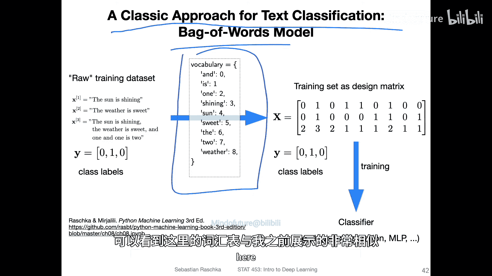

So， I added。Two things here。Unknown this for unknown words。

 and this is a padding for making sequences the same length。 This will become clear later。

 but essentially the vocabulary is also a vocabulary that consists of all the unique words that can be found in the training set。

 So if this is my training set here。The vocabulary contains all the unique words。

 It's a set of unique words， and it's mapping to intertegers here， so you can see。

The order doesn't really matter， you can do it alphabetically， but any order is really fine。

 it doesn't really matter which order the vocabulary is。just a mapping dictionary。And yeah。

 so we have the vocabulary here and then。

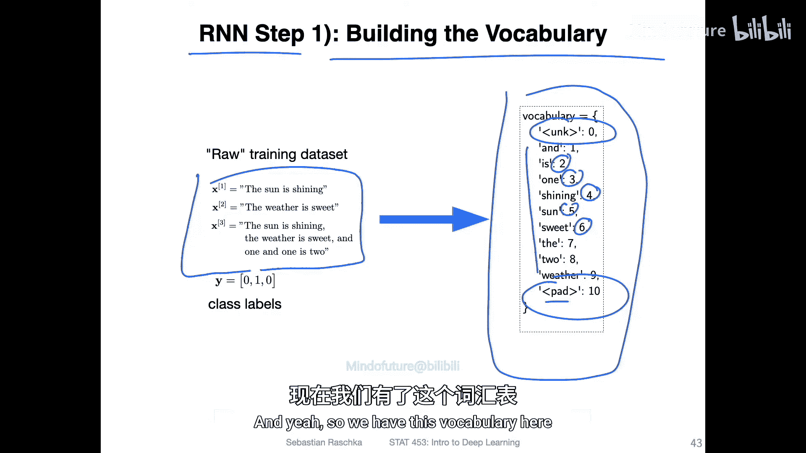

Step  two would be using this vocabulary to convert the training example texts。2 indices。So again。

 if on the left hand side， this is my training data set。

Let's now use the vocabulary to convert it into these integer inds。 Why are we doing this。

 by the way， in the first place， that is because yeah machine learning algorithms like to work with numbers right because we have matrix multiplications and so forth and we can't do a matrix multiplication with letters or words right so we have to somehow get the inputs into a representation that is yeahnumeric。

 something that we can do math with。So let's focus maybe on the first。Training example here x1。

 The first training example is the sentence the sun is shining。So using the vocabulary。

 we are not translating， so this is the first word， the the is index 7。So。

For the integer representation here。So this is on the right hand side well。

Interual representation of that sentence。😔，So we are now adding the7 here， right， because。

That's how it goes here。 Then for the second one， this is sun。 We have5。So this goes here， and then。

5 here。The next one is。This one， one more shining。This one goes here。 Allright。

 so now we have mapped everything to integ and compared to the back of words model。

 we keep the order here so。The order here in the sentence is the same as this order here。

Because yeah， the R& N is a sequence model， and like we talked about in an earlier video。

 the order matters when we work with text。So why are there dot dot dot and 10，1010 here？

Let's consider first the L sequences， so training example 2 and training example3 here。

So if we convert them to。You you see that example 2 has four words。 Exle  one has four words。

 So we have four words。F。Words。But sentence 3 has 1，2，3，4，5，6，7，8，9，10，11，123。14 words， actually。

It's a much longer sentence。 And because what we usually do is we arrange things in a batch。

 we would have to， yeah， well we want to make everything the same length。 So if I have。

 let's say a batch。This is really for efficiency purposes， and we have in our first。

One here four wordss。Let me do it like this。1，2，3。Well second one is four words。 We can't have。

Like nothing。 I mean， we can't have a matrix， but there is nothing that would not be a matrix anymore。

 Everything has to be in a matrix the same length。 So we have to put some values here。

And these are our padding values。 These are basically， yeah， placeholders， in a sense。

 So we are putting placeholders here。To make everything the same size as this last one here。

So this is really， yeah， it's not really necessary if we had an R andN where we only feed one training example at a time。

 but if we want to feed them as a batch， then it would be necessary because yeah there is a matrix multiplication。

At some point， and for that， we have to have everything the same length。Alright， but moving on。

 So let's now say we have our training set。Converted into these integers。 if I go back one more time。

 let's not consider these that we have converted。 So this was step2。

 Let's now go to step 3 that is converting these indices to a one hot representation。

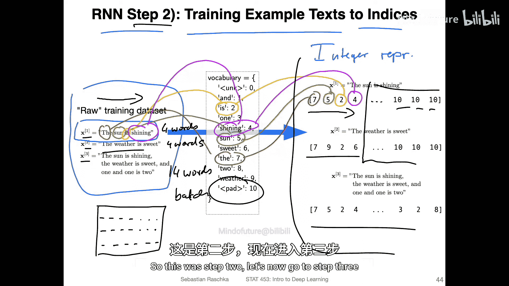

So。This one here， this is our sentence。 We are only taking a look at one sentence here。

 only one training example， just for yeah keeping things。Smaller here。 Otherwise。

 they won't fit onto the slide。 So let's only focus on this training example， the first one， so。

This goes then into the integer representation。 Why did I put it like 90 degree rotated。

 Just wanted to show you where we get these numbers from 7。five。😔，To。😔，And then let's say four。

 this is from the vocabulary。 This is exactly the same that I've shown you before。

 So these are these numbers here。

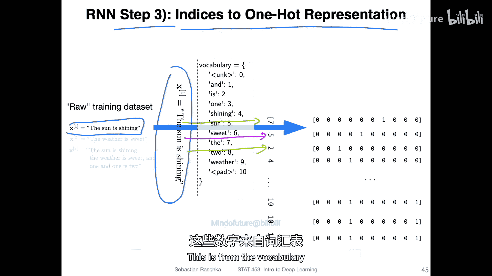

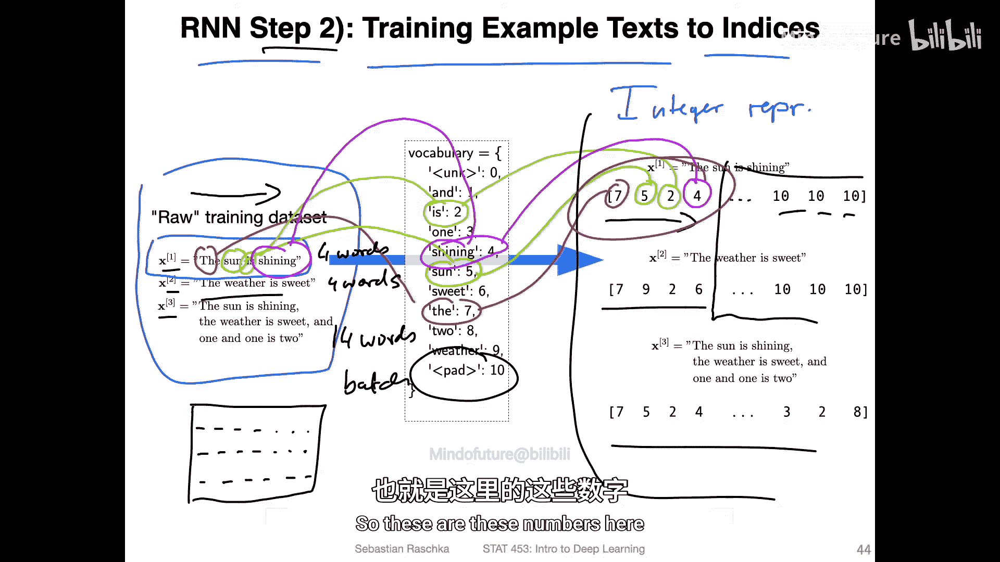

And then， he had the patting。So everything I'm showing you here， this， this is the。

Integer representation from the previous slide。Now。

 the new thing here is that we convert those to a one。What representation。So how does it look like。

 So we would essentially have。A matrix now。Where。This is for one training example。

 So this matrix has the dimension。Here are the columns。 so would be the dimension of vocabulary size。

And。😔，The rose would be the。Sentence。Li。😔，So， we have the。Sentence。It's a bit hard to write。😔。

This way， sentence length and then the vocabulary size and then for each。Word， so each row。

 this one would be essentially the first。Word we would then。

 yeah look up the create the one hot representation。

And our vocabulary size in this case is it should be 11。1，2，3，4，5，6，7，8。1011。

So we have a caabvalular size of 11。 This is our index 10。 This is index 0。

So the first one is a 7 here。 Let me use maybe a different color。 Let me use the green。 It a 7。

 So we got 1，2，3，4，5，6，7。Second one is。5， so we go 1，2，3，4，5。The third one is a two。 So we go。0，0，1。

2。And then。Oh。Let me see。 I think I've yeah， I've okay， this this。

Should have put this model to the right， But anyway，s the same concept applies。 Okay， so the fo here。

0，1，2，3，4。Alright， so this is how we create our one hot representation of that sentence。

 And then for， sorry， this is。No wrong。 think I just copied and pasted the last one。

 these should be zeros。The ones here are because of the pedding。 So these are ped at once。

So if you only focus on the input sentence， you can actually also ignore those。

 But these come from the fact that we did a padding。

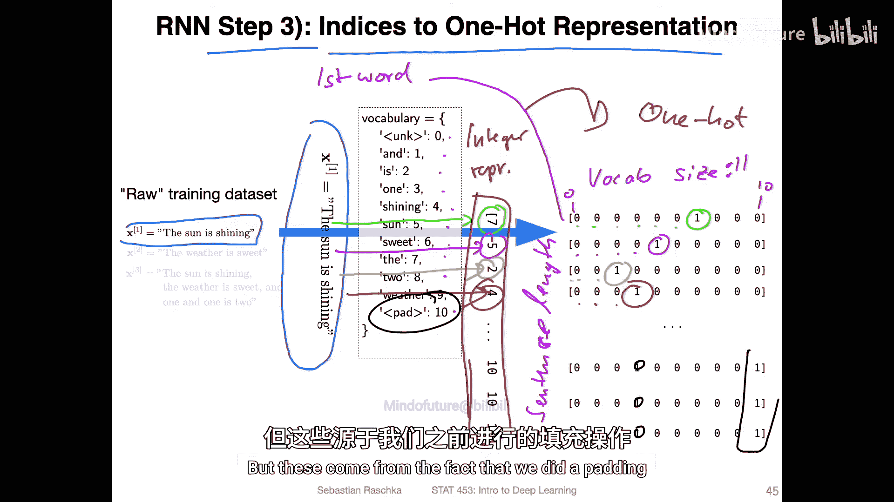

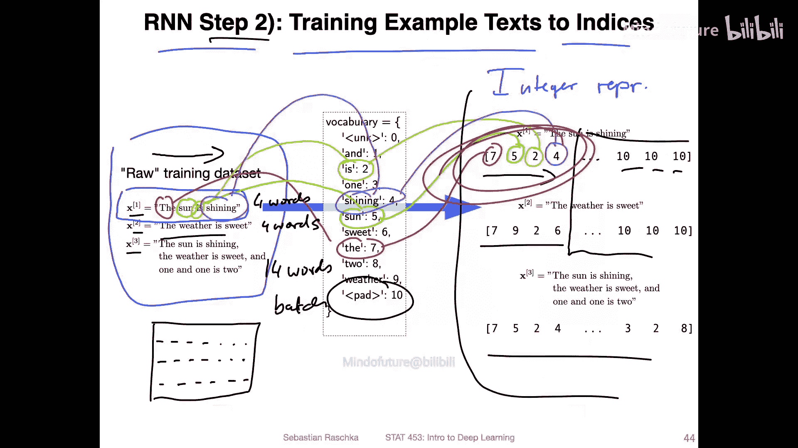

Earlier here， here to pet everything to the same size as sentence number 3。Okay。

 we have now our one hot representation。We have converted the text into integers。

 into integer representation， and then。Text then one hot。 So that's most was step 2。Step。😔，th3。And。

Creating this vocabulary was。Step one。

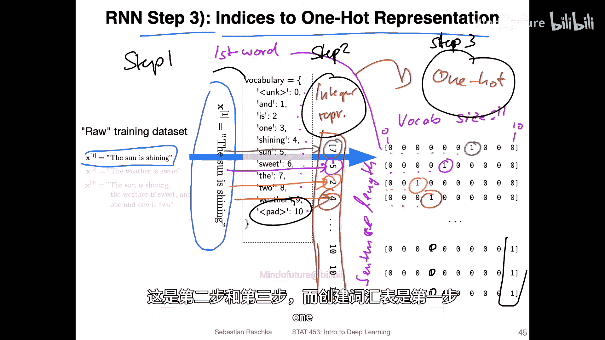

Alright， so the next step now is to go from the one hot representation into a representation that is containing real numbers like decimal numbers。

Using a embedding matrix， This is a weight matrix， a specific type of weight matrix。

 But let's do it one at a time。 So first here。I's a recap。Of what I explained in the previous slides。

 So this is a。Recap。And we are now going to focus only in this overview here on one particular word。

 so let's consider we have this training example x1 and for this training example x1。

 we only focus on the first word for simplicity。そう。We built already this vocabulary。 This was step 1。

Let me use black for this， we used。Will be both the vocabulary in step 1。In step 2。

 we learned how to convert the word together with a vocabulary into this integer representation so。

Step 3 was converting into the integer representation。Oh sorry。

 step  two was converting it into intoger presentation。

 so we have this seven step 3 was actually the other one hot encoding so。

Step 3 would be the one hot encoding。So this is what we had before。

We are focusing only on this word the no， only this the。This is for simplicity。

And I will show you on this slide how we convert this one hot encoding to a real。Number vector。So。

This one hot encoding here。I just copied this over。😔，To this position here， this is just copied over。

And now we have this embedding matrix。 This is a weight matrix that is initialized with random values。

 and this is updated during training， just like a hidden layer。And in fact， actually。

 the embedding can be implemented as let's say， torch dot n N dot linear， a fully connected。

 a linear or。Let me use a different colour。不林。😔，Connected layer。This is nothing new。

 it's just the regular weight layer。We don't need a bias for this one though。Okay， so。

Here at the bottom， I'm now showing you how we go from this one hot vector into this。

Embbedded vector。 So this is the hidden layer output， or we can also call it。Embbeded。Victor。word。

Or we can also call it the embedding。Actually， there are some dedicated methods for doing that。

 There's something called。For example， word2。Back， there's also something called glove。

 These are models just train to produce embeddings。

 So these are special models that can produce such embeddings like this one， a real value vector。

In this class we are not doing this。 This is an optional thing to do。

 So you could do this instead of learning the embedding， but here。

The embedding matrix is essentially a part of this R&N。Here I'm just showing you the R and N。

 the mini to1。1。Ororn in。And the bendtting matrix is just something that is used here。

It's just a weight matrix that is learned a matrix between the input and the hidden activations or hidden values。

And。Really， this is just like an irreg perceptron。 There's nothing really special about it。Alright。

 so how do we get from this one hot vector with embedding matrix to the hit layer output。

 it's a matrix multiplication。 So if you think of the one hot vector that we have from here。

 this is essentially， you can think of it as a one times。

V dimensional matrix where we V is the vocabulary。Sice。

So if you think about the matrix multiplication， it would be。0 times。1 plus 0 times1。

1 plus 0 times 2。1 and so forth。 There's only one value that is a one here， so。

The matrix modification between this vector here and this one， the first column would be 7。1。

 and for the second one， if we multiply this one with a second column， this would be 2。5。1。51。5。

 So the output would be 7。1，2。5，1。5，1。5。 So this would be the embedded vector corresponding to this word the。

So that's how we get from a word to actually a real vector that can then be used in the R and N。

So this word would be then the input to the hidden activation and。If that was a previous time step。

That two things as input here，1，1 input would be really this vector here。

 and the other input would be the hidden state from t minus oops。T-2， if it's the first。

If it's the first in the sequence， there is no input。 So in this case。

 it's the first word of our sentence。 So there won't won't be any t -1。

 It would be the first three time step。 So this would be actually the first time step。

 And this is how we input， let's say， a word。Into an R N as as a real value vector。

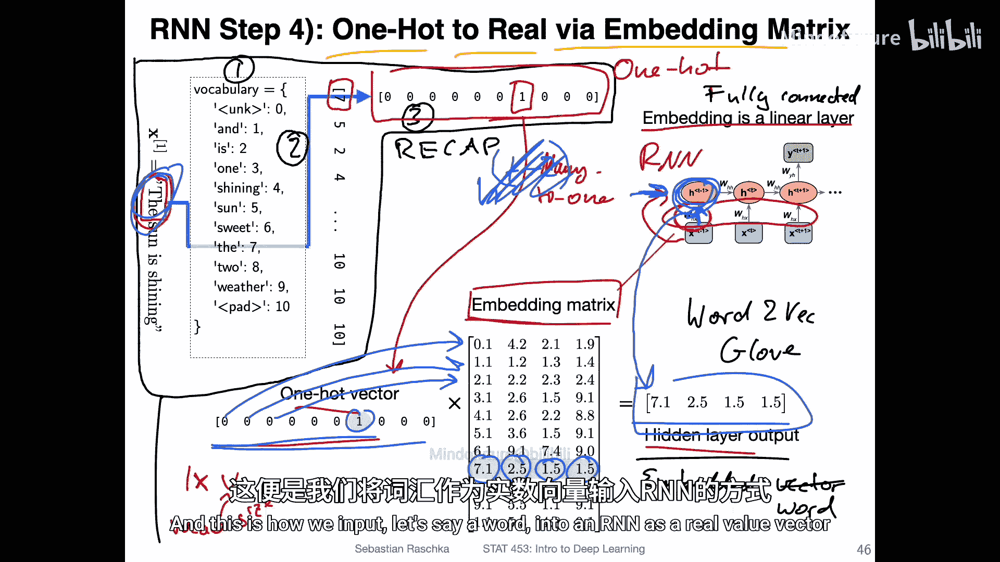

All right， this is only one word though。Now we have to do the same thing。

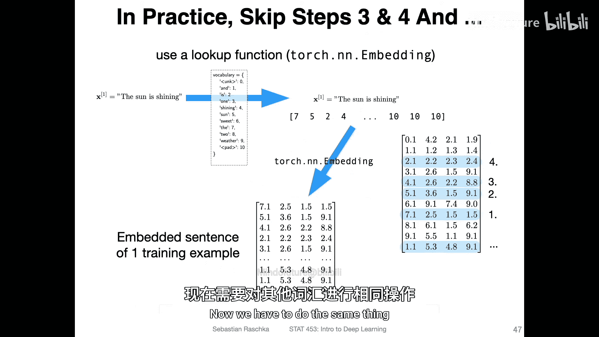

Let me go back one slide。 We would have to do the same thing for。Sun is en shining。

 So this would be then a 4 by4 matrix for the sentence。 By the way， this is the。Embbedding。Size。

 I just chose it to be4 because yeah， coincideally just fit well into this slide， but。

There's no correspondence between， let's say the embedding size here and the sentence length。

 This is really independent。 In fact， when you implement an R N， you can choose the embedding size。

 So typically embedding sizes are something like 128 or 156 and so forth。 but it really depends。

On how large the data set is and how difficult the classification task is has many different。

 It's just another hyperparmeter。Essential， it's similar to choosing a good batch size。

 It's also about choosing the embedding size。 The em bedding science is essentially a hidden layer。

 so。Like you， yeah， experienced in the homework 3， it's just a hyperparmeter to tune。

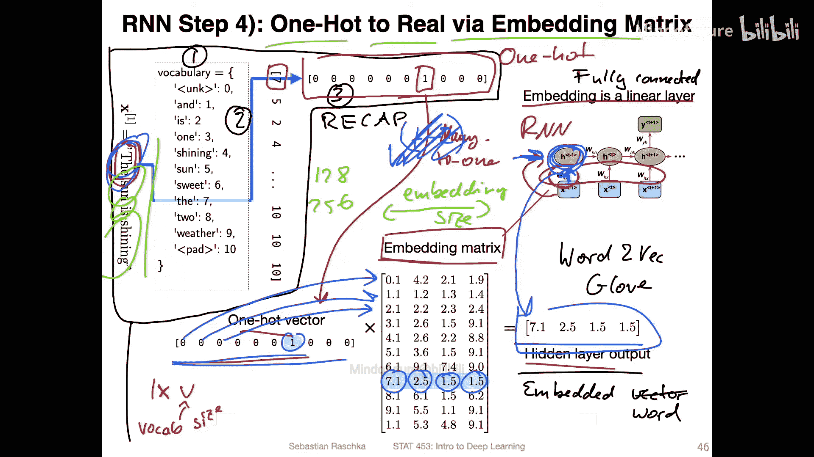

Okay， so one going one step further。 now I'm telling you something that maybe makes you hate me。

 So steps3 and 4 are actually not done in practice。 So everything I've showed you here。

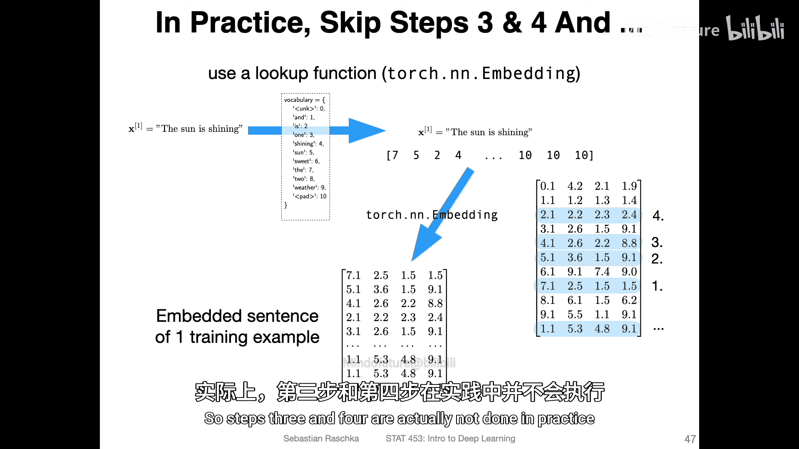

From converting everything to a one hot vector， and then。Getting this real value vector。

 This is not done in practice。 I just explained it to you。 So yeah。

 that you understand what's going on like conceptually。 This is how we would do it conceptually， but。

And practice， actually。So now it's， of course a very complicated setup here。 I understand。

 so you probably may have to watch this several times or think about it a little bit。

 It's not immediately obvious。 but so this thing here， we discussed this just before。

 this is kind of inefficient right， because we have。When we multiply this one with a false column。

 we have 0 times 。1 plus 0 times 1。1 plus 0 times 2。1。 If we have 11 values here。

 it's like 11 computations， but only only one。Metters， right， So we do like。

10 computations for nothing really here。 And this is also a small vocabulary。

 We only have 11 different things in our vocabulary。 If you have a real vocabulary， usually。

Based on the training set， they are usually around， let's say 200000 words。

 Usually we make them smaller。 let's say 20000。 but you have 20000。Words in the vocabulary。

 And then you have 19999 wasted computations in each matrix modificationification。

 So to make this efficient， there is actually a torch dot N N dot embedding layer that just does the look up。

 So instead of really doing the matrix modification between this one and this one。

 it just uses the index， the index。7even here and say， okay。

 just give me the value corresponding to inix 7。 look it up in the embedding matrix and put it here。

 So in this way， we don't have to do the whole matrix morification。 It's just a look up table。

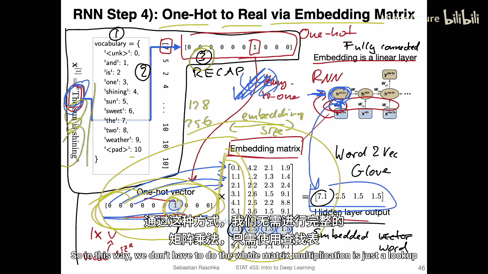

So this is what I have here on the next slide。 So there's actually this look up function or lookup approach called torch and end dot embedding this is。

Doing the same thing that we've done in steps 3 and 4。

 but it's more efficient because it's just looking up this value。

So now let's consider the whole sentence again。 So sentence number one， the sun is shining。

 So in step 1， we created the vocabulary。嗯。Step 2。We converted the sentence to this integer。

Representation。Or interteger vector。Then in step 3。

 we converted this inte jar vector into a one hot encoding， but we are not doing step 3 now。

 there's no step 3。Instead， we are taking this integer vector directly。

Together with our embedding matrix， this is the exact same embedding matrix that I've shown you。

 and then we are looking up these values now。So for word7。LetSa this one。So for the word。

 the which corresponds。To the 7 here， we are now looking up the。Rule corresponding to 7。

And this is then used。Here， this is someone。Embbedded sentence for the first training example。

Then for the second word， sum。Sun should be here，5。We look it up。Here， we put it。Here。Then。

Next one is。This is tomb。Looking it up。This one goes here。The last one， shining， shining is。four。On。

Here。And this one goes。And the remaining ones are petting because we had one sentence that was longer than four。

So these remaining ones would be the penning。But yeah， this is how。Actually， this shouldn't be here。

Acts so these。Paing if we have our sentences is longer than。For words。

 But you can see now the matrix we have here。Is。The embedding。Sinceence。Times。嗯。Sentence。

 sentence length。And this is for one training example。 if we have more than one training example。

 of course， we would have a batch size。 We would have a tensor。

 a 3D tensor for considering the batch size as well。

 This will become more clear in the code example that I will show you。Do have one more slide。 Yeah。

 so， okay， so now I was showing you。These different steps here from converting a sentence into this input to the hidden layers in the recurrent neural network。

In the code example， we are going to work with this setup。

 we are doing exactly that for a specific data， we will be working with this IMDB data set。

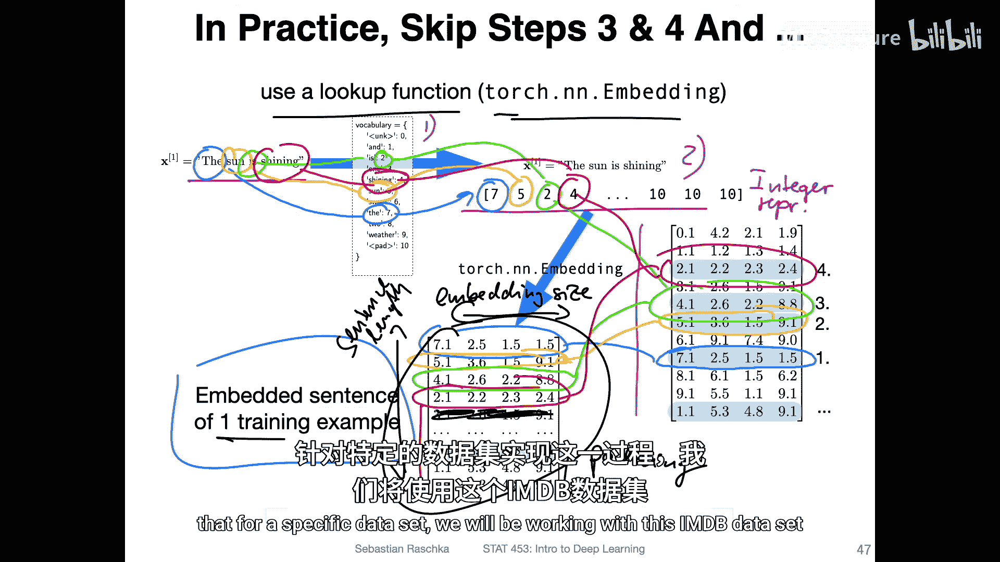

So this is just a， yeah， binary classification dataset。 It's a sentiment classification data。

 sentiment just means。Like the。The perception， like whether something is emotionally positive or negative。

 like what's the sentiment of something。 So this IMDB movie dataset comes from the Internet website。

 the Internet movie database。 And this contains yeah ratings for movies。

And the rating can be between， I think0 and 10 and the researchers here。

 I can find the data set here have。The researchers have prepared such that the I think maybe I kind of forgot its a long time ago since I took a look at the paper or the method where they proposed this data set。

 So I think。The movie reviews are from 0 to 10， but they only use  one to 4。So，0 to 4 for negative。

And。😔，7 to 10。4。Positive。They don't use5，6，5 and6 because it's ambiguous。

 they only use these and they refer to them as highly polar movie reviews。

 So anything with a rating between 0 and 4 is considered negative and anything between07 and 10 is considered positive。

And they have 25000。Reviews。For training and 25000 for testing。And here's just an example， CV file。

 how the dataset set looks like。 So there's some text。 And then there's a label 1。For positive。

I think and0 for negative could also be the other way around。

 I actually can't tell based on reading this year。Alright， so but yeah。

 you have two sentiment labeled 0 and 1。 and then there's review text。

 and we are going to build a classifier that can classify these reviews。

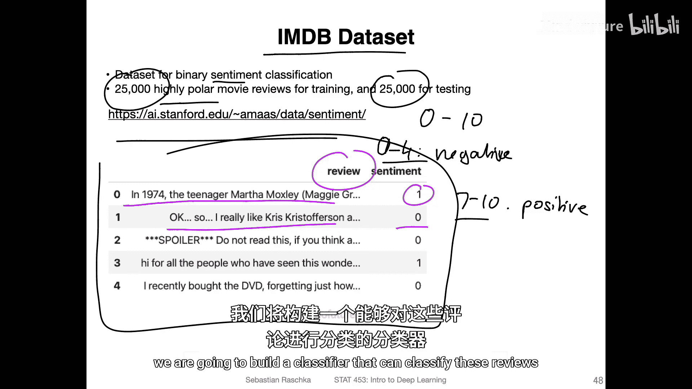

By the way， yeah， in the next video I will show you the code example for this MDB movie review classification dataset set。

 I just wanted to share this additional resource with you because yeah I will only show you one video with code implementations or an example I actually found this repository here which look super helpful it has more methods for yeah R andN SDM classification and also several tricks there are some nice written tutorials。

 So there are more than these two I just clip this screenshot。

 but if you are interested in building R andNs for classification I highly recommend this repository here。

So there's also some library we are going to use it's called torch text。

 so torch text is like torch vision， but for text， so there's Pytorrch and then there are libraries associated with that Torch vision is specifically for working with image data and torch text is specifically for working with text data。

There was recently a major update in torch text， so most or many things have changed a lot and this tutorial。

 when I looked at it， it seemed like it was built for the original torch text。So now in 。9。

 things have changed quite quite a bit。 The old codes still work， but they are now considered。Legacy。

So if you want to convert these codes here， I mean technically you can just use them like they are。

 it works fine， but in the future maybe in a few years they may not work anymore， I don't know。

 I don't know what the exact plain plan plans are by Toch text whether they want to remove the legacy code。

 but if you're interested there's also this migration tutorial， which。

Explain what have what what the things are that has changed between torch earlier version of torch text and to Torch text 0。

9。 So， but this is for this class entirely optional。

 It's just fine to use any of this if you are interested。 So and in the next code in the next video。

 I will show you one of my codes for implementing R and N and Pytorrch。

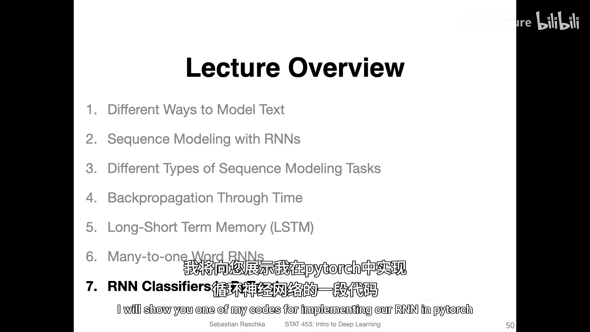