# 【Sebastian Raschka】深度学习和生成式模型 Intro to Deep Learning and Generative Models 2021 p166 P166_L19.5.2.3_BERT-来自Transformer的双向编码器表示 -BV16EC5BUEi7_p166-

Yeah so in the previous video we discussed GT version 1。

 which was a unidirectional transformer model where the pretraining task was the next word prediction。

 so it was processing the inputs in a left word fashion like from left to right and Bt is a transformer that is a bidirectional one so B stands for bidirectional encoder representations from transformers。

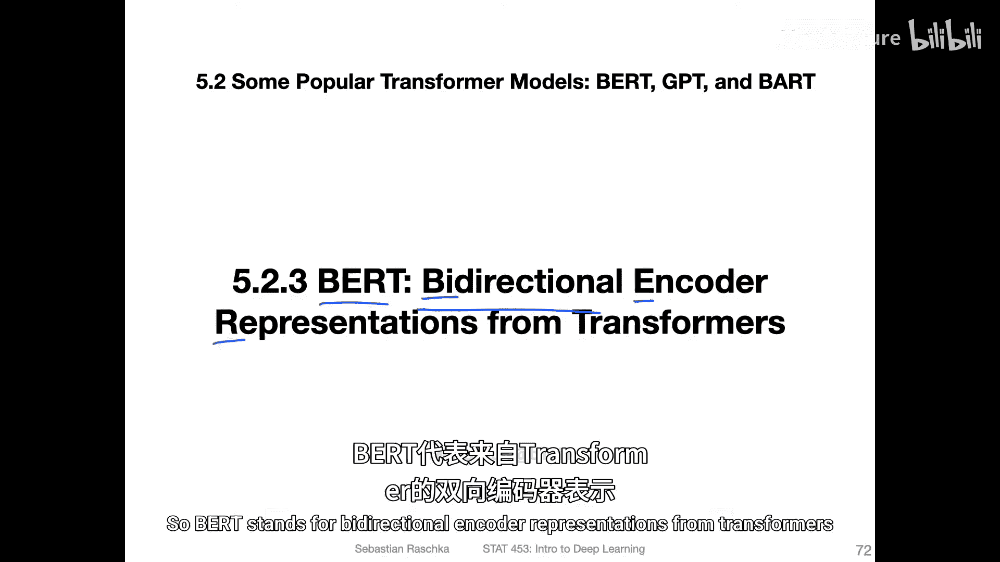

So BRT was developed around 2018 by Google research and like I said before。

 the main concept is this bidirectional nature， so the bidirectional pretraining using masking that is not going from left to right。

 but it's just randomly masking it's essentially a very simple concept I will have a slide on that illustrating how that works So the main architecture is essentially identical to the original transformer and GP so both both based on the original transformer paper with a multi head attention and so forth except。

Now that they have this spdirectional masking， which is also known as closed task。

 There is a paper on that that they reference， and they have two pre training approaches。

 One is the spdirectional masking and one is the next sentence prediction。 so they have。

A binary prediction task where they show the model two sentences。

 and the model has to predict whether sentence Bs， So if you have two sentences， A and B。

 the model has to predict whether B is indeed the next sentence in a document or whether it's a random sentence。

And I will also have a slide illustrating that。 So here this is just the overview。

 and we will talk a little bit more in detail in the following slides。

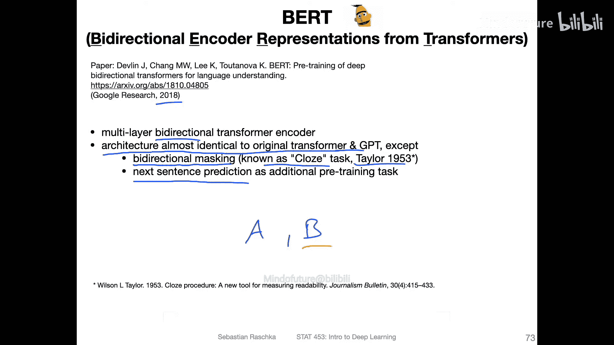

So let's take a look at bird in more detail now。 So starting at the bottom here， what are the inputs。

 How do the inputs to bird look like。So here's a figure from the original paper and at the top。

Are the tokens as input。 So， for instance， imagine you have a sentence。sentenceentence  one。

Called my doctor Ske。And then the second sentence is。He likes playing。 So this is a sentence。2。

And yeah， you can see there's already some tokenization going on。

 so each token is essentially one work。And you can also see that certain verbs like playing。

 they become play and then as a separate token IN G。

 So there's also some sort of preprocess or stemming going on。

These inputs are then augmented by a special classification token and a sentence separator。And then。

They are going through a process called a word peace model， basically。

 to yet to produce socalled word peace embeddings。 It's just a yeah particular way of creating embeddings。

 We won to discuss this in detail。 But if you're interested， this refers to this paper here。

 So it's just a different method of obtaining embeddings。 So now that you have。

 let's say these token embeddings like a real valued vectors like going from。

The words to the real valued vectors。Then there are also these segment embeddings。

 So they're also real valued。Or yeah， vector us， essentially， so。For。The first sentence。

 you have the same。Segment and bes for each position。 And then the same is true。

For the second sentence。 So if there's a sentence to here。 So we have something that denotes whether。

The word embedding or token embedding comes from the first or the second sentence。

You which segment essentially。Then there are also these position and biddings。

So you maybe recall from the original transformer paper that were like these snooidal embedding。

 So there is also a form of yeah， a position embedding here。 And these all like the token embedding。

 segment embedding and position embedding， they all get。Add it up together。 So they are summed。

 And these are then the inputs to the transformer block。Like the multi hat attention。

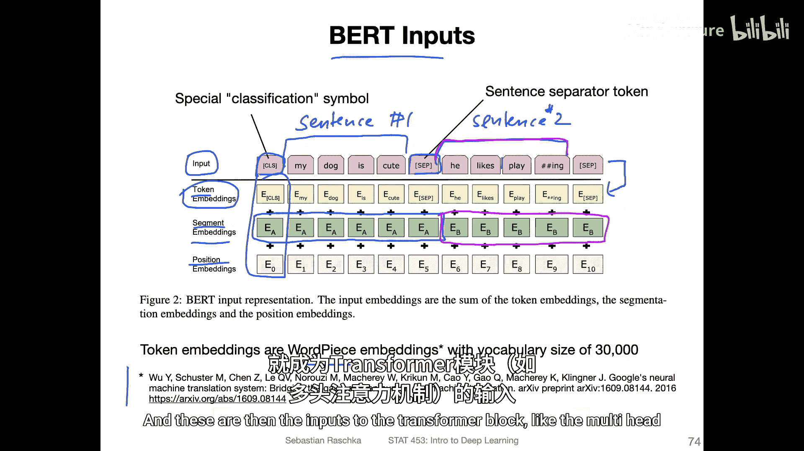

And yeah， in general， so using these inputs， there are pre training tasks and the pre training tasks are executed on two data sets。

 and so they have this book corpus dataset which consists of 800 million words。

And in addition to that。 So that was also used in G。 In addition to that， they also use in G。

 they said it was 7000 books。 if I recall correctly， corresponding to 800 million words。

 In addition to that， they also use a Wikipedia data set consisting of two。Thousand500 million words。

 So 2。5 billion words。Then on these pre training tasks。

 the math language model that I mentioned earlier， and the next sentence prediction。

 So they have two different training tasks here。 So let's take a look at these pre training tasks。

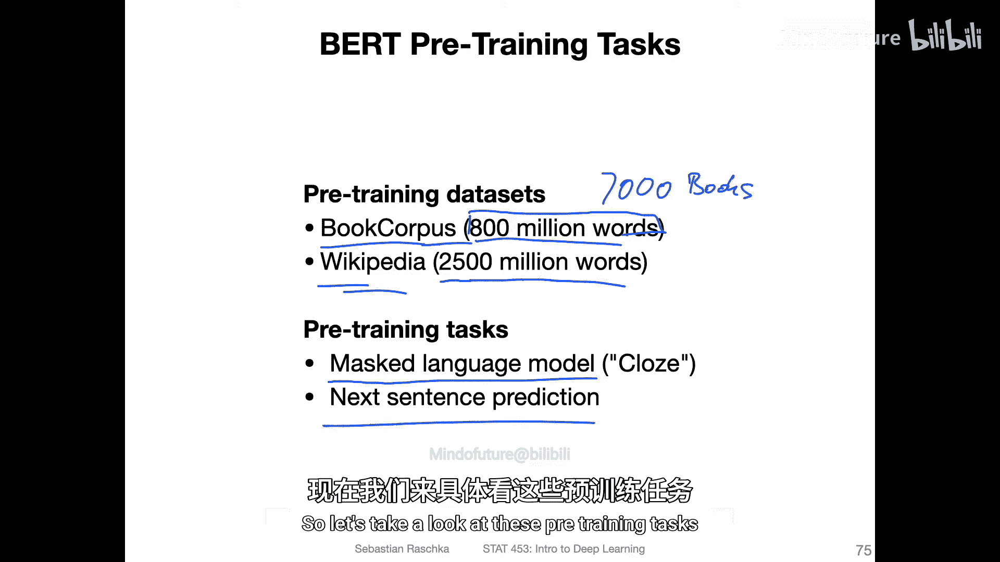

Starting with pretraining task number one， the masked language model。So how this works is。

That randomly，15 per of the words。In the input are marked。

 So sometimes you also see that people say they are masked， but I， I call them mark marked because。

Not all of them are actually masked。 So imagine you have an input sentence like this。

Let's say a quick brown fox jumps over the lazy dog。 So you would randomly select。

Words like 515% probability。 So 15% of the words are selected。 Let's say， in this case。

We select the word f。Then 80% of the time， the marked words are replaced with。A mask token。

10% cent of the time they are replaced with a random word。

And 10 per cent of the time they are left as they are。 So sometimes this one will become。Mask。

Sometimes， this will become。Coffee。Or any other word。 just a random word。

 And sometimes it will just stay f。 And the model， the task of the model is to predict the correct word。

 So which one goes in here。 So it has to predict if it's masked yeah。

 it has to predict the right word， but also if it's coffee， it has to predict the right word。

 it just sees this。 But it doesn't know whether it's correct or not because it could also be that it is already correct。

 So still the model has to kind of think in that way。

 whether it should be which which word should go in there。So this is one pre training task。

 and this is what makes the model in a sense also bidirectional because there is no left to right notion it's essentially just picking random tokens here or words that have to be predicted。

And in this way， it's also self- supervised right， because you don't really have a have to have a human labeling this。

 I mean， you know the work because you have the complete sentence so you just remove the work and let the model predict it back in a way。

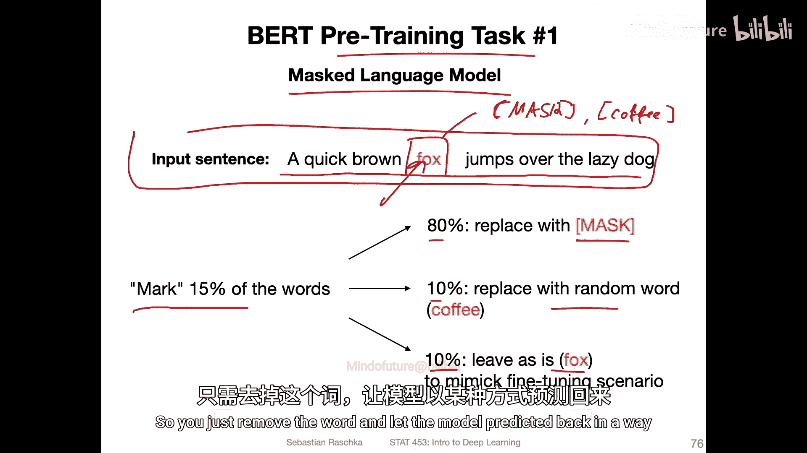

So here here's another example， so。Let's say we replace this word with the mask so this is。

This 80% scenario of the 15% marked words。 And then it goes through the bird model。

 and then it has to predict。The right word。 So there will be softm function， for example。

 And if we have a vocabulary size of 30000。That will be。30000。Probity values here。

 like summing up to one。 And you will then select the one with the highest。Predicted probability。

 for instance， a fox and this one would be then the one that the model predicts。

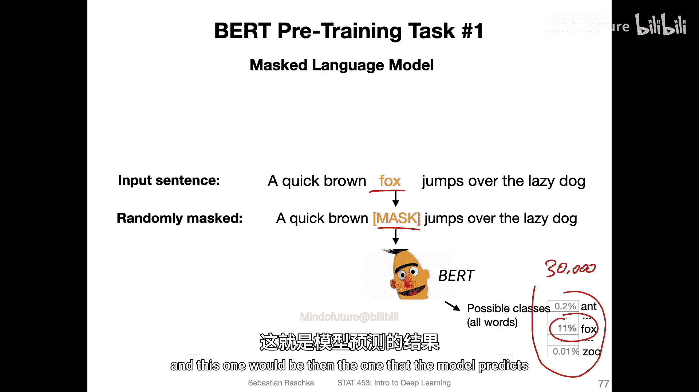

The second task is this next sentence prediction。 So this is a balanced binary classification task the labels are is next and is not next 50% of the time。

 So it's balanced。 So what they do is they take an input sentence。So， for instance。

 the man went to the store。That's actually an example they used in the paper and then。

The second sentence is， he bought a gallon。Mask， milk。

 So also notice that they combine both pretraining tasks。

 So the next sentence prediction also includes the masking。And then this is a case where these are。

A and B are actual sentences that follow each other in the original documents。

So here the true label is， is next。And at the bottom is a case， an example where。

The label is not next， so they have， again， the same the man。Walks into the store， went。To the store。

 it's masked here。 And then the second sentence is penguin flightless birds。So， yeah， here。

 this would be an example where。A是A。And be are。Sentence that follow each other in the original document。

 and here。That's。Not true。And the model has to， yeah。

 has to recognize whether these sentences follow each other or not。

 And it's another way that the model can learn how to understand text。

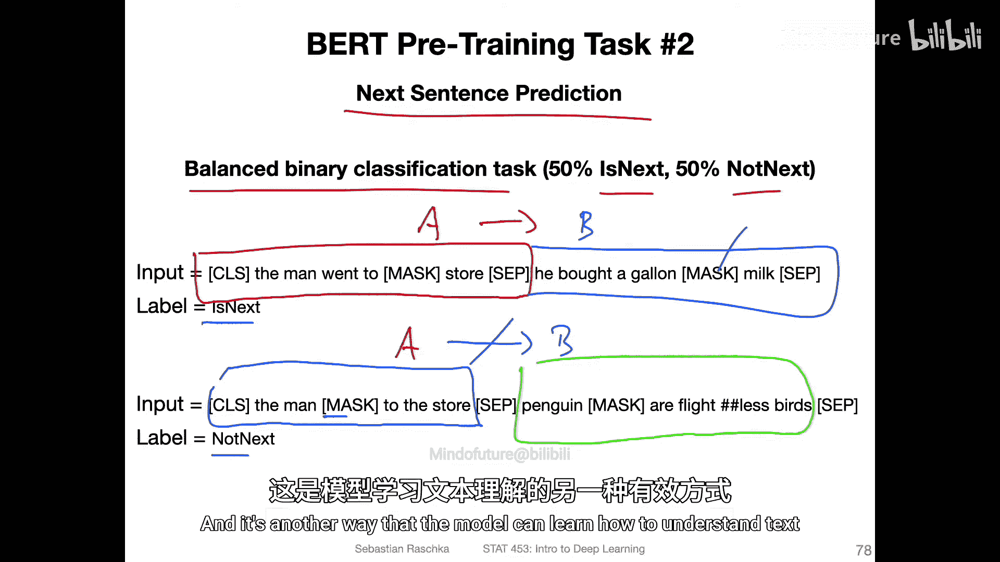

So here's an illustration of the pretraining procedure and the fine tuning to the downstream tasks from the original bird paper。

 so on the left hand side they illustrate the pretraining process where we have now these masked sentences。

 sentence A and sentence B。And the task is， are there two tasks， one is the next sentence prediction。

We have this classification token， right， and then it has to break whether it's the next sentence or not。

And then we also predict these masked words。 So if we had a masked， let's say， a masked。Token here。

 it's called an M。 It's also predicting which word goes in there。These marked or masked tokens。

So that's the pre training。 And then after pre training， we can fine tune in our models。

For other tasks， for instance here they have a question answer task as an example where they provide the the question here on the left hand side and then a paragraph to the right hand side。

 so the question is referring or asking something about that paragraph and then the model here generates an answer。

But you can also find unit for classification， for example。You could concatenate， let's say。

 two sentences here。 And then you have a classification。 let's say the the。Movie。Review。

Classification。

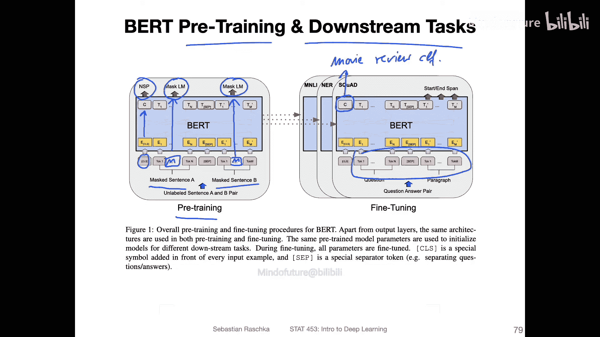

So this is just the illustration。And。Remember when we talked about the G。

 I mentioned that there are two different ways。For working with downstream tasks。So here's， again。

 the general training procedure for transformers as first as yeah。

Unsupervised or sub supervised pre training， the pre training on large unlabeled data sets。

 So like here on the left hand side， this is done on。

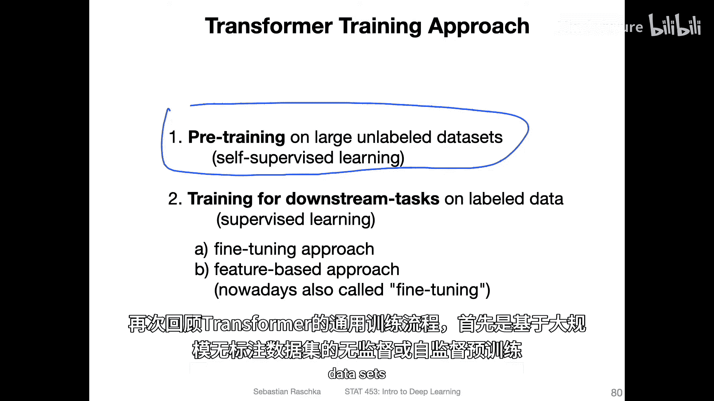

Unablebeled data， whereas this fine tuning here on downstream tasks is done on smaller labeled dataset sets。

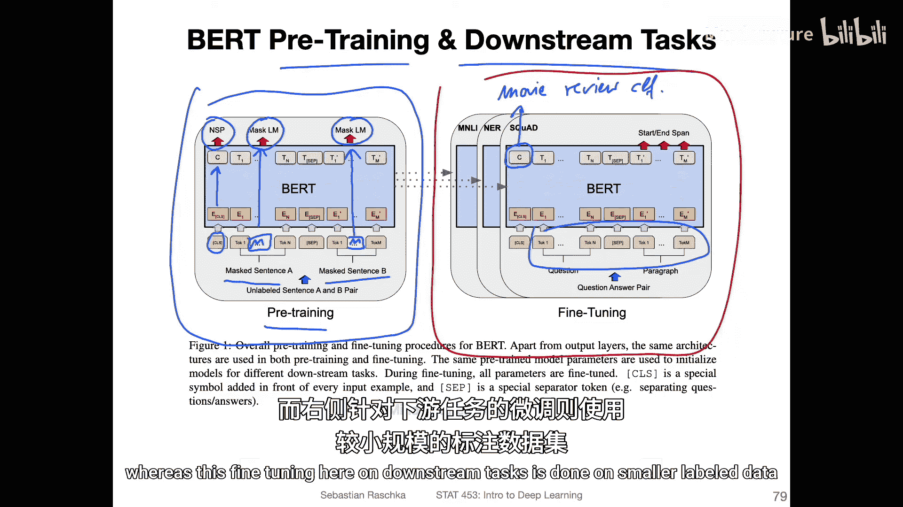

And for these downstream tasks， there are really two different approaches， though。

So fine tuning is what they mainly talk about in this work paper。

 This is the approach where they update the whole model。 So all the parameters。

But there's also this feature based approach that I mentioned earlier。

 and they also do some experiments experiments with that in the bird paper。

 So let's just go over these two also as an example。

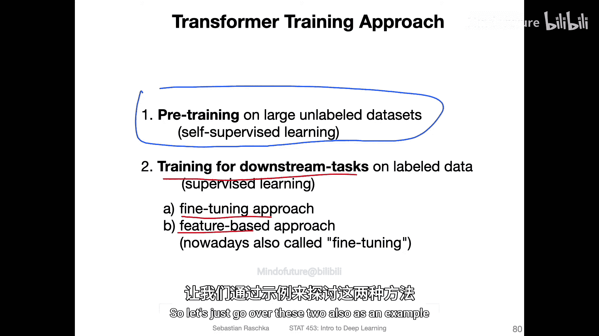

So the fine tuning is essentially by adding a classification layer。 So you have。For example。

 a classification layer， which could be if you have， let's say different words or different classes。

 you add that to to the model at the end。 So if， for instance， your model is， yeah。

 trained to do the next sentence prediction， the output layer would be just yeah。1，1 value。

 or it could be also two depends on how you implement binary classification。

 But let's say you want to train that for a different task where you have， let's say。

10 different classes or 100 different classes。 So you can add a fully connected layer to the end。

 and then。Have softm probabil， and。Using across entropys to train that model。And。When you do that。

 you would essentially update the whole model。 So here。

 this is just a screenshot of the original transformer encode just for illustration。

 But this would be essentially， the。Birt encode coda， which would look similar。

Where you have this bidirect training with a 15%。Marking whether than 80% are masked。

10% are replaced by random words and 10% are left as they are of these tokens。 and yeah。

 so the fine tuning really is updating the whole model。After pre training。

 and you find tune for classification， you update all the model parameters here。

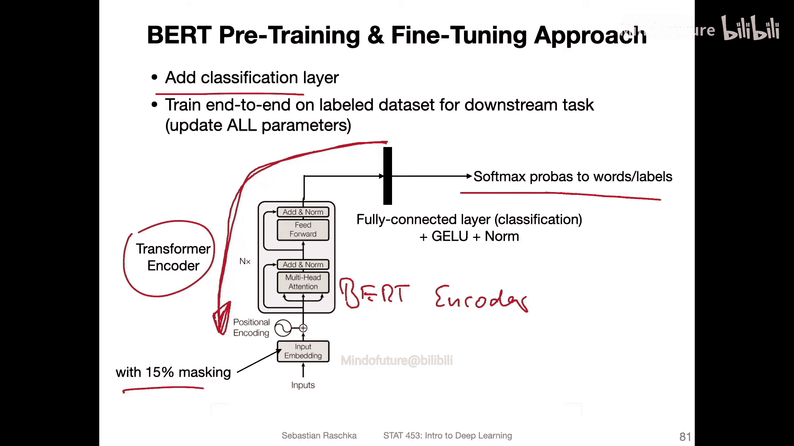

Second， training end to end。The other approach let me first illustrate so regarding this fine tuning approach are the results from the paper。

 so they compared their paper， for example， to other methods like Elmo。

 we haven't talked about ElLmo yet。But yeah there are too many things already to talk about in this lecture。

 so I didn't exhaustively cover all the models， but we talked about the open eye GT model here and you can see that both on the small and the large bird versions。

 So they have a base and the large version performing better than Bt on several tasks。

 actually on all tasks， you know if you consider the larger one， I think also。Also， the smaller one。

 So they outperform， for instance， the unidirectal。

GPT model here by their bidirectional training with these masked language models and。

The next sentence prediction。 And this is for the fine tuning then to these different tasks。

 So each of them is a different label data set。 You can see here the sizes of these dataset sets。

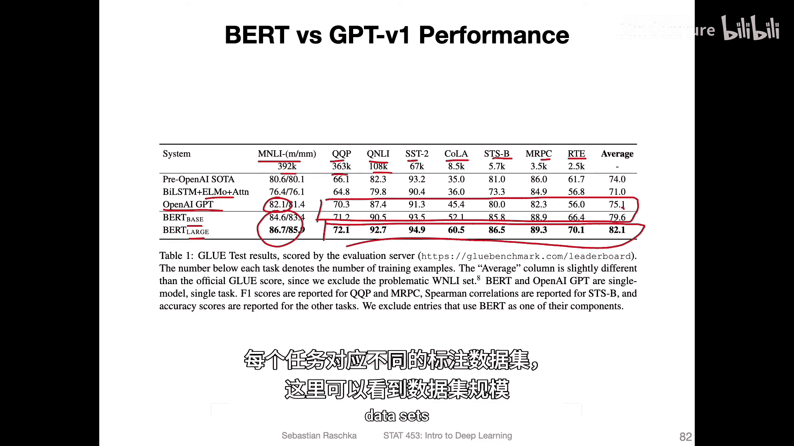

So this is all done by fine tuning， for instance， like adding fully connected layers and then fine tuning the whole model。

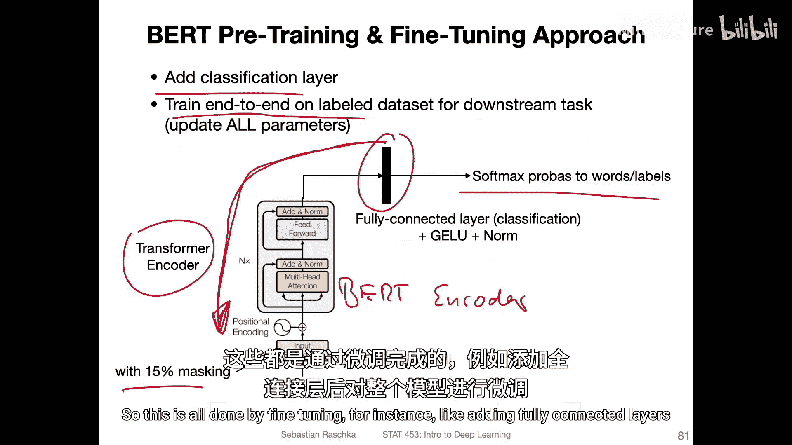

Now the other approach is the feature-based training and nowadays I think this is the way more popular approach。

 So when I look at yeah different people using bird， this is by far more popular。

 there's also for example， something called a pro bird where people yeah did something similar with proteins where they trained a bird model on amino acid sequences like sequences of proteins and then after training they only looked at the embeddings and then they looked at how the embeddings cluster and they trained classifiers on these embeddings and they found that these embeddings are very information rich。

 they contain a lot of information about proteins。So the idea behind this feature based training is after the pre training。

 you keep the bird model frozen so you don't update anything。And you， if you have a new data set。

 let's say your movie review data set， you just use that be model to create the embeddings。

 So you would， for instance， download a pretren。Bt model that has been trained on a large copperppus in this pre。

Training fashion like using self supervised learning。 And then you create all these embeddings。

For all your examples in your data set in your smaller training set， and then you train a new model。

Just on these embeddings。 So you treat these embeddings as the input features to your model。

 This model could be an R and N。 It could be logistic regression， It could be a multilay perceptron。

 It could be a one dimensional convolution network。 It can be anything you like。

 but most often these days I see people just training a simple multilay perceptron or logistic regression。

So it's a century supervised learning， just like the supervised learning you learned about in this class using now these embeddings as input。

 similar to how an R and N can use word embeddings。

 you can now use these embeddings from the bird model as input to any other model。

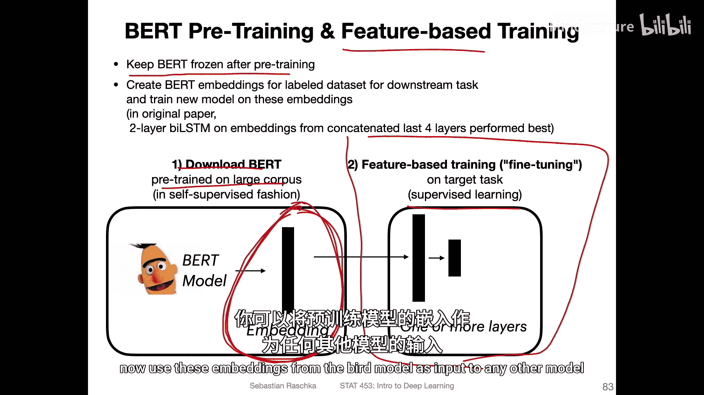

And also， they looked at that in the paper and they actually found that this can perform quite well too。

 so without any fine tuning， not quite as good as the fine tuning。

 so the fine tuning approach again is here。But quite good。

 So here these are these feature based approaches and you can see that when they concatenated the last four hidden layers。

 the outputs from the last four hidden layers of the bird model。

 and then they trained a bidirectional LSTM model on that。

They found that this performance is actually almost the same as the fine- tuned bird model。

 So fine tuning， I would say is more work because you have to load the whole model into memory and then update the whole model。

 and nowadays many language models can be quite large。 I think bird is like somewhat around 100。

 I mean， the small one is 100 million parameters already the larger one I think might be around 300 or something。

 So in that way it's kind of expensive to train the model。

 especially if you only have access let's say to a CPU or only one GPU。

 So in this way this feature based approach is way more attractive because you can just generate these embeddings running the model one time and you don't have to worry about training the bird model just working within embeddings。

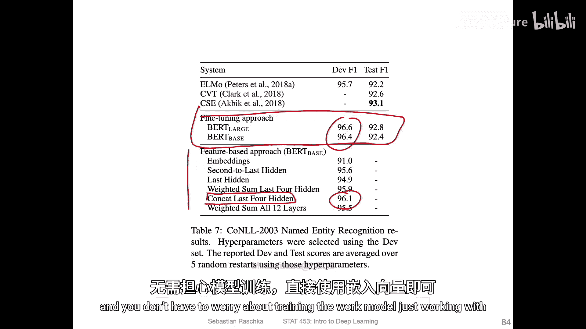

Alright so this was the bird model in a nutshell and in the next video we will come back to the GPT model because there was in 2019。

 one year after B an update to the GPT model。

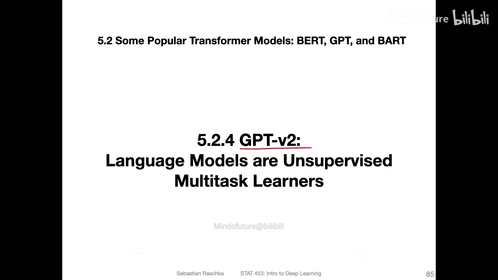