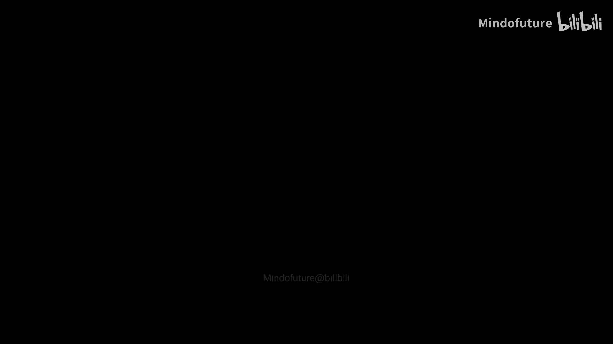
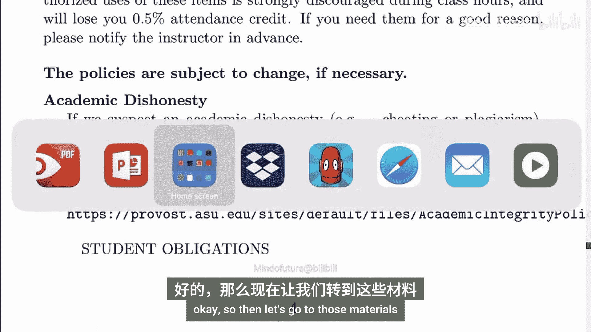
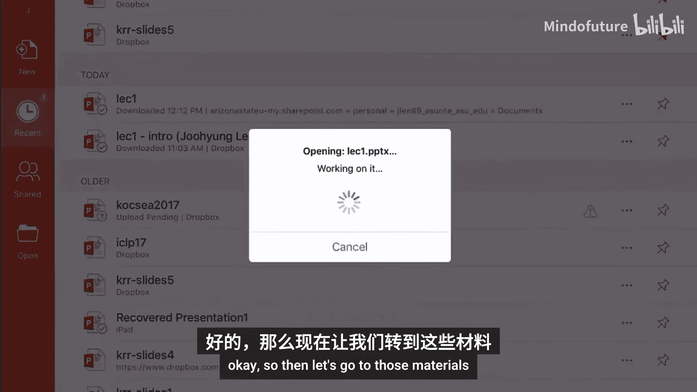
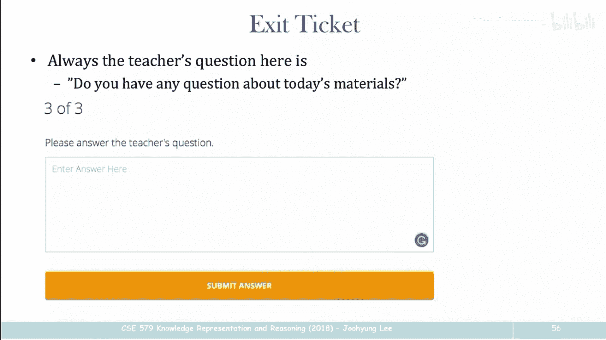

# 【亚利桑那州立大学】知识表征和推理 ｜ Asu Cse 579 Knowledge Representation 2018 p01 P01_Lec1 -BV1RTWyzfEQH_p1-

Yeah。Okay， so welcome to CSC 579 knowledge representation and reasoning。 My name is Zhu Hiong Li。

 I'm an associate professor of computer science。Before we start， we look at the syllableus。

 so if you log into Blackboard， the syllableus was already uploaded there。So， let's go there first。

So today we'll talk about logistics and brief introduction to the course。Okay。

 and feel free to ask questions if something is unclear。So this is just the logistics that we have。

 so my office hours are Monday and Wednesday nine to 10。And our TA is Ei Wang。

 I don't see her here yet， but I'll introduce when she comes in her office hours are Thursday and Friday at center point。

Okay。And。I presume that you already have read a description about this course。

 and I'm going to talk a bit about this later， so I'm going to skip the description part。Okay。

There is no dedicated textbook for this course， there is actually some textbook about KR but it's been outdated。

 we used to have this as a reference， but I don't put it here。Instead。

 we are going to read some papers and some monographs。嗯。

And so here are actually the kind of books that this course is Billton， okay？嗯。

So you may have seen some of these books before， we are not going to cover all the contents here。

 but we will try to organize in a way that we can learn in a coherent way。

So one thing that I want to emphasize here is course materials are not to be distributed or to be sold for online sites。

 I know where the students actually send their solutions and work out problems online anyhow we are going to change a lot this semester so that will not help you。

 but also one thing that I want to emphasize here is when you think about the problem for yourself or by yourself。

 you learn something， but if you just read somebody else's materials。

 that returns down solutions that doesn't help much。So。

So I'm emphasizing here that if you do this kind of thing， you will get the penalty。Okay。All right。

So the topics that we are going to cover are these。I'm going to talk actually more about this soon。

 but we are going to cover fight a lot of topics here。

I'm not going to go through all of them in details， so some of them deserve more attention。

 some are kind of rough， so that is based。How the field is matured in one area versus the other。

 there are some well established area and also there are some emerging areas。

 so I want to balance a bit among those things。Okay。

 so this is the most critical part that you're here for today。Okay， so grading， so attendance is 10%。

 there will be two mid， 15% for the first one， second one will be 20% homework is 25%。

 I'm going to talk about what will be the homework and there will be term project。Okay。

So roughly this is a cutoff probably well just go with this one， 87 over is a。

 which includes both plus and minus so if you want to be safe sized on the a0。

 then you should get like 90%。对。All right， any question about this part？ok。So what is attendance。

 so if you log into Socrative， that gives me who attended this course。

I want you to be engaged in this class， so I mean there are some things like if you have some distractions。

 then you may do some point。I mean you're a graduate student。

 so I don't have to emphasize these kind of things， okay， but read this carefully。Okay。All right。

 so if you have some problems， I heard that some student who is coming from East Coast they have some flight delay so they cannot make it today。

 I can understand when you have this kind of incident report to me immediately。

 they don't wait after the class is over。Okay。All right。And there's a bonus credit for you。

So here there will be some class discussion problems。

 I will announce it beforehand and if you have solutions for these problems you can come to the board and write your solutions and you can present and we use Piazza which I'm going to talk later writing the solution here is okay but also I want those presenters to post the solutions online on Piazza so other people can also think go over this carefully。

So these bonus credit consists of two parts， one successful presentation in class as well as posting the solution on PiazA。

Okay。And if you know already the solution， if you have seen these solutions somewhere before。

 then don't try to participate， there will be ample problems that you can do later。Okay。All right。

 any question up to this part？Okay。All right， so there will be homework。

 there could be some problem solving like some questions about the materials that we covered in class or some mini programming that you have to do that uses some KL tools。

So we are going to learn a couple of KL tools here。

 and you need to know how to use those tools to do some mini programming。Okay。

 and the homework is individual， so you are allowed to talk with other your friends。

 peers about the materials that is unclear we can post the pi to get help。

 all these kind of things are okay， but when you work on the problems when you write your solution that should be by yourself。

Okay， there's a critical difference between copying and collaboration。Okay。And。嗯。

This is actually required for all the instructorers if the instructorer sees that there is a plagiarism or copying solutions。

 then we are required to report to the dean's office。Okay。

 so there will be no exception to this policy。Okay， so just be cautious。

If you receive help from others， one safe way to avoid this kind of plagiarism is you write acknowledgement in the beginning of your homework。

 okay so I collaborate with these people and he helped me understanding this。So that is okay。

 that will not be penalized。Okay。Okay， and here yeah。

 so the first time violation will be reported to the dean's office。

 a homework grade will be zero and the letter grade will get lower by one。Okay。So。The TA， actually。

 let me introduce the TA here。 Ewa is a PhD student in computer science。

 She is an expert in knowledge presentation。So she will mostly do the grading your project and help you to do some further。

The homeworking project。So。Yeah， if we see that there are too many problems too great。

 then we may choose some subset of problems， okay so that will be random。

 so you are expected to solve all solutions。But at the end we are going to give you sample solutions to all problems so that you can compare。

All right， so they El Tom project and here you may choose your own topic or I can help you to find some topic。

Okay。嗯。So here I can allow maybe up to two people in a team。

 so if you think that's a better way to go， that's fine with me。Okay。

 so it'll be consisting of three part initial proposal will be due around mid semester。

And there will be some progress report in maybe a couple of weeks later。

 and then final report is due at the end of the semester。Okay。So project is 30%。

 so if you are coming here for meeting the MCS portfolio requirement， yes， that can be counted。

All right， so we have class PazA page and here if you have any questions about the class materials。

 some doubt， you can post questions there， TA and me will look at those questions。

 but you're welcome to respond to your peers questions if you happy to know the answer。Okay。

 so that's collaborative learning。And。And here， yeah， so anonymous posting is actually discouraged。

Okay， for many reasons。We are going to use Blackboard for the course materials and some important announcement。

Okay。But other than the discussions will be posted on the Piazza because it's easier to access those discussion page on the Piazza than the one in the blackboard。

Okay。All right， and as I said before， we are going to use Socrative。Yeah。Yeah。

 so you should be already logged into the Socrative。And if you have grading questions。

 don't wait until the end of the semester， we cannot remember what you did before。So the policy is。

 if there's a mistake in grading come to us， actually I would encourage to meet the TA first because she knows better。

 so come to her within one week when the graded work was returned to you。Okay。All right。

 I do encourage use laptop tablet during the class if there's a valid reason and also actually we are going to use Socrative so that's the time that you have to use those tools。

 but other than that I do see sometimes people。Do Facebook and social medias that not necessarily have to be happening here。

 okay so you should know better。Okay。And this is just academic dishonesty that you should be familiar with。

 okay， I'm not going to bother with you all this。Okay， any question up to this part？Yes。对江关系。

Projects。Yes， we are going to do that maybe before maybe during this first half of this semester。

 so once you notice some basic things about a representation。

Oh okay so what could be an example so some students who have a background in some particular area in computer science。

 they use some KL tools to enhance those areas so one thing that I saw was some students who was in security major he wanted to do policy analysis so formal verification of policy in case you don't know this policy this is actually declarative specification of system behavior and there is a lot of policy specification language but theres not many work on policy verification and also policybased planning。

 things like that so that's actually kind of combining both areas in security and knowledge representation that was one thing another people did knowledge representation in robotics so the robot has to do some highlel planning so he was working on some robotics in low。

But also can combine the high level knowledge on that。And there is also very。嗯。Of。

I would say frequent topics usually try to model some formal of specification of some system in knowledge representation tools。

 some people do QA system based on knowledge representation， knowledge based QA system。

Some people do some workflow specification。So actually。

 let me tell you those things in more detail when you go through some topics。Okay。Particular topics。

Not very much， I mean we can talk about the interest that you have。

there are some particular preference that I have in terms of research site。Okay so for instance。

 like the last topic here is actually neural networks and representation。

 which not many people have actually tried yet。That's actually very interesting research questions。

Let me actually go over the course structures and then that will give you some more idea about it。

Any other questions？Okay。えそう。好。Okay， so then let's go to。

Cose materials。

Okay， good。Okay， so。Lets。We just did still levels。And if you came late log into Socrative。

com room number youc579 and type your right ID and theres a keyword that you have to type in。

 which is taught， this keyword will change every lecture。Okay， so lecture one。

 so introduction to knowledge representation， so this is most non technical part of the course。

And could be fun。So AI 101， knowledge reation is an area of AI， and there are too many areas of AI。

 which is sometimes also machine learning， network learning processes。あ、 robotテ。

Constraint satisfaction， planning and forth， I don't have to have room to include everything here。

 but the AI is quite diverse。So what is the definition of intelligence？So this is dictionary。

 just up AI textbook。One dictionary definition that I found was saying that intelligence is the capacity for learning。

 reasoning， understanding and similar forms of mental activity， attitude in grasping truths。

 relationships， facts， meanings。Okay。So。Sounds reasonable。

Another definition is saying that the ability to apply knowledge to manipulate one's environment or to think abstractly as measured by objective criteria。

So as you see here， there's a keyword that is relevant to this course， which is reasoning。

 understanding， grasping the truths， facts， meanings， knowledge。

 okay to think abstract so these are actually a very relevant part of knowledge representation。

 one thing that this definition， tells us is we're not talking about animal intelligence here。

 so just recognizing some object， so gogito Egosome as a French word for I think FIM。

 so this is what distinguished humans from non-intelligent object。So。According to this definition。

 or following this definition， AI can be described as the study of intelligent behavior achieved through computational means。

And knowledge， representation and reasoning could then be viewed as a study of how to represent。

With knowledge in order to decide what to do， so here we are focused on knowledge rather than data。

And knowledge representation and reasoning often just denoted as KRR。

 or sometimes people just say KR， is at the heart of the great challengell of AI to understand the nature of intelligence and cognition so that computers can be made to exceed human like abilities。

Okay。So before we can start reason with knowledge， the first thing is actually to represent knowledge。

 but the interesting thing actually comes when you do the reason because that makes the system to decide what to do。

And so there's actually two side in AI， one is the learning side， there is a reasoning side。

 so what is the learning， roughly， very roughly speaking。

 learning is to learn the models or knowledge from the data。Okay， and what is the reasoning。

 reasoning is manipulateulate such models and knowledge to derive certain new information that is not explicitly from the data。

Now， however， we actually did。ideal situation is the machine learns from the data， the knowledge。

 and then manipulate his knowledge to do something new。Current status is actually not quite there。

 there is actually some gaps between the learning and reasoning， so learning can give some knowledge。

 but this knowledge is not very usable for the knowledge of representation。Okay。

So let's think about AI system without knowledge， so currently the vision is well very mature area so it can recognize some box region to represent certain objects so like image in a challenge you have the pixel diagram and then the system can detect the class or the identification of these objects of person or dog or chair。

 okay this is where the AI system is actually very good at。Now let's think about。

Questions to the assistant。 So which could you sit in？Okay， so from the picture its not immediate。

 which one is actually can be set on or see in。I don't know， maybe the person。We can sit on person。

 maybe。Or seat on the do or sit on the chair， okay？Maybe that can be answered in some ways。

 what is most likely to bite what？Maybe person can buy dog， this is not impossible。

 but usually dog bite person， dog by chair， but chair doesn't bite person， chair doesn't bite dog。

 okay？So this is actually not that easy。How do you know this from the picture？

That's something that you have， but the vision system doesn't have。

Which one is most likely to become a computer scientist someday？我庭显示。

So if you ask these questions to vision system， it's actually outside the questions that they are considering at this moment。

 there's actually visual QA which is a hot area these days which intersects between knowledge representation and computer vision and this is actually the kind of that area。

 but even in there the questions are much simpler than this。ACriical one。

 which one would you save if the house was on fire？Which。钱儿。我多。So。The question is。

 would you use a robot babysitter without knowing which of these three possibly able to choose？Okay。

 so AI system without knowledge is really dangerous。And surprisingly。

Not many systems can actually handle。This or maybe not surprisingly。

This was an article when TensorF came out。Here is the thing。

The neural network is actually the key technology these days， but here is one part。

 supposed we train an artificial neural network to recognize catS when it recognizes a previously unseen cat in an image it cannot explain to us why or how it did this and if the neural network fails to recognize a spotted cat it's hard for us to fix the problem we are not going to tell it something like change element blah。

 blah value from this value to that value and that value to value。

I mean currently that's what is going on in the neural network you don't know how to correct its mistake so there was some article that neural network recognized that image as a cat and that was correct and now somebody changed the dot there and suddenly it is saying it's a do okay you cannot explain why。

Okay。So when AI systems make a bad decision， we need to be able to understand why they made decision and communicate with them to fix the problems。

The problem here is without knowledge this task is actually very difficult to do。

Humans are very good at communicating through the knowledge。

 we don't actually communicate through the data。If you learn something new。

 the power is proportional to the distance。Okay， from some experiment， that's a law that we found。

 and you just tell others that this is their general behavior。

You don't necessarily tell them repeat all the experiments that I did again。比说是废的。哎。

And also something like this， this is actually the cooking scenario， so a bowls be， a slice B。

 a pill bee， a soute bee， a cook be， a hoppi。Okay。So。This is actually a bit of out of order。

 but this is actually what the system learned as a sequence。Okay。So I'm not a Cook expert。

 but there's something weird about this sequence if you look into this carefully。

We know that this cannot be happening on I mean you should peel first before you boil， okay。

 that's kind of common sense， but the machines doesn't have that kind of knowledge。Okay。All right。

 so we are going to talk about how these kinds of questions can be addressed by using knowledge representation and reasoning。

 so so far， I mean KL area has been there for a while。

 actually from the very beginning of AI knowledge representation was studied。

There are a lot of progress in the area， but also there is a lot of obstacles here。

So it's understandable because human knowledge is actually very complicated。

 you can all this within 60 or 70 years。Anyhow， this is the current advance。

 researchers have explored general method of knowledge duepreitation reasoning and we found some fundamental issues across application domains。

 so there are some common issues that people didn't think was difficult and turned out to be notoriously difficult。

So some of the questions， like frame problem took like。Maybe 40 years to solve。嗯。

We'll talk about those kind of problem later。Okay， and there are also specialized knowledge representation method that works on time。

 space， causation and actions。And also theres some applications in knowledge representation。

 including question answering， planning and the semantic web。So what is knowledge。

 so we understand knowledge by knowledge， all kinds of facts about the world， okay。

 the simplest knowledge is true or false， whether this is true or this is false。

Okay and we are going to focus on that in the first part of the course。So of course。

 knowledge is necessary for intelligent behavior。Okay， so what is knowledge。

 we are not going to go into this question for the time being because it's actually very difficult to answer instead we are going to consider representation of knowledge。

Okay。So here's an example。So there's a symbol that means something so if you see the symbols like this。

 this is first A， okay， John， this is a name， okay， but it actually means the person John。

So theres a difference between the symbol and the actual object。

Okay so this is something that we have to distinguish when we do the knowledge of representation when you talk about John here。

 it's just a string， it doesn't entail everything about the John yet。

 okay you know about Z Z's side or face， you know about that。

 but the symbol is not enough to represent this fact。Even John loves Mary。

 well this is actually true or false okay but again there's a lot of things if you go into the very careful which John did you talk about。

 what is the love， we are not going to talk about what is the meaning of love。

 in order to represent this kind of knowledge， we have to go into philosophy and those kind of things we don't have time for doing that okay but at least we don't know yet。

So we are going to pretend that these kinds of objects can be represented by some symbol and then we will manipulate those symbols。

Hopefully the mapping is not too mysterious and also the manipulation is not too far from the actual understanding。

So。So yeah， the reason that we are doing this is if a represent B， then act A。

It's actually easy to access than B because we actually abstract away all the nuances of B。

 So we'll focus on the symbol A。Okay， so we are going to look at the groups of symbols that stand for some proposition。

 and our representation is the field of study concerned with the representation of the propositions that are believed by some agent。

Okay， so that's the representation side and what is reasoning？So reasoning menu plates are symbols。

So that it can do something new， okay， so the analogy here is use arithmetic。So 1011。

 binary representation for 11 plus 2 is 13， so given the symbols， you can do some operations。

Same thing is for the reasoning， so difference is instead of numbers。

 we use propositions or knowledge fact。So if we know that John is Mary's father， okay。

 then you can infer， even though it was not said in the original sentence。

 you can say John is an adult male。There's an implicit knowledge that can be acquired from this assertion。

And we can actually do more on this， once we have the basic knowledge。

 we can compose knowledge to derive new information。So in that sense。

 reasoning is a form of calculation of the symbols which stand for propositions。对。

So the proposition represent abstract concept， but their representations itself are concrete so that we can easily manipulate。

Okay， so here is the。First， are fative quiz。Okay。All right， so here's a short sentence。

If the train arrives late and there are no taxis at the station， then John is late for his meeting。

John is not late for his meeting， the train did arrive late。True or false。

 there was a taxi at the station。Okay， this is too easy， So that's not going to waste time on that。

 It's true， right， How did you find out。他有对弄。Right。So weこ the reaction understand。Now。

How do we make computers to do the same reasoning as what you just say so theres actually multiple ways to solve this problem。

One is。Train arrive arrived late and if there are no taxis at this station。

 try to prove contradiction， suppose there was no taxi at this station。

 then according to the first sentence the train arrived late is true and there was no taxi at this station is also true so that you can say that Chinese late for his meeting but there is another fact that is not late for the beating so that's a contradiction。

So one way to go is proof contradiction if you negate this conclusion there was a taxi at station negate it then you get there was no tax at station and put it into the knowledge base。

 suddenly knowledge base is inconsistent so what is wrong assuming the knowledge base is correct。

 what is wrong is your ad hoc addition of this conclusion so that conclusion has to be negated。Okay。

 that's what you do actually you don't need AI system to do that。

 but if the symbols become more complicated and the story becomes more than this then humans suffer。

ok。So one way that this can be solved in AI is to use formal logic here we use propositional logic。

 which many of you may be familiar with。So these hypoes can be represented as three formulas。

 so train late is a symbol which denote the fact that train arrived late。Okay。

 this is either true or false。Okay。Taxi is a symbol to say that there was a taxi at the station。

Note here that I simplified a lot here。So when I say taxi， I meant there was a taxi at this station。

 I didn't mean that there will be taxi at this station and there are five taxis at this station。

 I don't mean that， I'm just saying that there was a taxi at this station。Okay。

 so these kind of fine grain details will be actually abstracted away。

 so by saying one symbol it represents a certain fact。And you see that this symbol negation。

 meaning that。There was。So if there was a taxi at this station。

 thelegation means there was no taxi at this station。哎。So if that is the case。

 this symbol is called implication， if this is true， then this is true。Okay。

 so if train is late and there was no taxi at the station， John is late for the meeting。

 so this is kind of knowledge representation。I you already know how to do。Okay。The next one is again。

 is simple， so John is not late for the meeting， so it's a negation of John late。Train late。Okay。

 so train arrive late， so you can write simple fact like this。

So the previous English statement can be written in three lines of the formulas。

And once we turn this into logic， there' is actually well built in meaning for this conjunction。

 implication and negation so you can use those operations to derive the knowledge Now the conclusion that we wanted to derive from the knowledge base was there was text attestation。

Okay， so you will learn soon how the computers can solve this problem。

 actually I already introduced one method。Now， let's actually look at。Something else。

So if it is raining and Jane does not have her umbrella with her， then she will get wet。

Jane is not wet。Reduce raining。True or false， Jane has her umbrella with her。That's true。

How do you know。So when you think about this， you imagine James。有没有证出来了？

And you imagine that somebody get we。Okay， which was different from the training example when you think about train。

 you think about train and John and meeting。嗯。In fact， these two examples have identical structure。

If you use the propositions to represent each of these facts。

 like here I use P to denote the train is late in the first example。

 while in example two it is raining， okay Q represents a attacks at theest station and example in the example two Q means Jane has a umbrella with her and R means that John is late for this meeting in the first example。

 Jane guess what in the second example。But once you have the symbols。

 then you write the same knowledge， so the knowledge base is exactly the same。That's strange。

 I think I had enough power for the。Things。嗯。Anyone has a charger for Mac。Thank you。Okay。

 hopefully I can。Do that on time。All right， so as you see from this example。

 it does not matter what PQR stand for here。All right。

 so here we have the representation side and the world。Thank you so much。一个。Okay， the problem is。

Okay。To。That's nice。Okay， hopefully this is charging。 Okay， thank you。All right。

 so on one side we see the actual word。And from the aspects of the real world。

 the aspect of some other aspect of real world follows。

 and what we are doing in knowledge and representation is we represent these aspect as a sentence in some。

Formal language， and this sentence can entail another sentence。Okay。

So why knowledge of representation and reasoning is useful？Okay。

So we can understand the behavior of system by the knowledge that it has。

 so if the system behaved in certain ways， it's because it has it knows in some ways so you can cur the knowledge so that why the system has made that decision。

Okay。And we can also generate the behavior of a system so for instance， in planning。

 you tell the system that what are the effects and precondition of actions。

 and then you tell the system how this robot can go from here to another。

So the robot can make a plan based on the knowledge that it has。And。

The declarative knowledge can be separated from the possible usage and that is in contrast with procedural knowledge。

 so in procedural knowledge you say if this condition is true， then do this。

So you write a bunch of if then statement， but in the case of knowledge based system。

 you can actually find a new way to solve the problem。诶。So in the procedural way。

 you have to predict all possible combinations and if the system is in the situation that is not in one of those possibilities。

 it fails， but in knowledge based system， it can infer something based on what it knows and you can still do some reasonable behavior。

So it is actually less brittle than a procedural systems。And when the system has knowledge。

 it's actually also easy to debug because if it fails。

 then you go to the knowledge base and update this knowledge。

And modification and extensions are also much easier to do。

So here's an example to illustrate this point， so there are two programs is they are prologue programs。

 the first one and the second one so you don't have to know the prologue。

 we are not going to go into the prologue in this course。

 although prologue was actually one of the influential language in knowledge representation。嗯。

So between， so let's see， even if I don't tell you much about the prolo。

Which program do you think has more knowledge？So in order to help you to understand。

 let me read this quote for you。In Prologue， it works as in an interpreter based way。

 so you ask the system some curly and then system tries to prove it， so you can actually say print。S。

 snow。Which means I want to know the color of this no。it feed into the first program。

The prologue will see the head that matches and then execute the body。

 so it goes from the head to body。So this one matches the curry here。

And this is so calledled Pro code operator， we don't have to know this。

 but basically it is committing to this close on me。So when they head matches here。

 it says it's white。Okay， so the system can answer the question， what these the colors know？Okay。

 so same way， or this color of grass， or this color of sky or this color of jam。

Or this color of desk？What happens to the color of desk？

It actually go to the last thing because it didn't match any of this。

 this x is a variable that match everything that is remaining， so it says beats me。Okay。

 so this is actually one thing。Does the system actually know the color of the snow？

Well if you actually want to enhance this system， what can you do？

Now let's contrast this with the second program in the second program。It's a bit more complicated。

So print C of x， so if x is， let's say， is a snow。Okay， the same curty。

And it matches here because x is available that can match anything。And it will find in the database。

 what is the color of x， which will be denoted by this y， and it will print whatever that y。Okay。

And in parallel there's also the database fact that you can state。

 and here when you say color of snow， then it'll try to match here， so it'll find y is white。

 so it'll print out is's white。If I ask color of sky， same thing。

 it will look for the color of sky matching with yellow， so why will be instantiate with yellow。

 it will print out is yellow so in terms of these two curries these two programs operate in the same I mean outputs the same thing。

Okay。However， this one is a bit more intelligent。So x。

 the color of x is y if x is made of z and z has a color Y。

So you can infer the color based on the component that it has。Okay。

 so you can say grass is made of vegetation and vegetation color screen so you can infer these things。

Now， obviously， the second program is more versatile and if you want to incorporate more objects into this scenario。

 it's easy to do。In the first program， if you want to add new objects。

 then basically you have to write another print C clause。Okay， now suppose you have， say。

 an object that consists of five elements。Then in the first program。

 you have to give all the five elements and their colors so that this one is also blue and red and so on。

You have to write five lines to say that these objects have five colors。And the second one。

 you don't have to do because this sentence is actually retrieving all colors that are associated。

So it's actually more easier to maintain。Of course， writing this is easier。For the Novice programmer。

 this way is more difficult and that's what we are going to learn in this semester。All right。

And this is actually what I said already。So why not use the first program？In the second program。

 we can add new tasks and make them depend on the previous knowledge。

 we can extend existing behavior by adding new facts， we can easily explain and justify the behavior。

Okay。So there was actually reasoning a small reasoning in that program。

 there was no explicit statement about the color of grass。Okay， if you go back to。The program。

There's no color of grass to be green unlike the first program。

 but you can infer that grass has a color green based on the knowledge that it has。Okay。

 so in general， many facts will be there only implicitly。

 and the fact is you can ask store all the relevant information in the knowledge base。

 there are so many things that you have to store。Think about this way。

 so if the robot goes to the new place and it has to do new operation。

 you don't know the environment so you cannot predict what will be there okay。

So if you write this in terms of the non knowledge based approach。

 basically you have to enumerate all possible scenarios。And that's actually very。

 you cannot even feed into the memory。Okay， so in that sense。

 you can store the behavior of knowledge in the memory。

 and then the robot can use that knowledge to do certain decision。Okay。

And here we use a concept of entaillement logical implications。That you already see in the example。

Okay， so。Yeah， this is what I just said， can we compute all implicit fact it's not feasible to do？So。

Okay， so the role of formal logic so we are going to use logic in the first part， in fact。

 the logic was actually the main vehicle for knowledge representation for a long time。

 there's a lot of work that is built upon logic。Okay。

How many of you know what is propositional logic。First of the logic。오니2？看不好看。Okay。So， if I say。

Is it new to you？This is called first of the logic or predcate logic。Have you seen these formulas。No。

Okay， all right， so if you are in that category， if you haven't seen this kind of formalism。

 I think you should speed up okay， so we will go over the review of this material。

 but thatll be very quick。😊，All right， so I'm going to post some material so that you can read and browse your memory okay if you don't know what is first of the logic come to our office hours。

 okay that's very necessary to do， we will actually go over some basic topics here。

Okay so all propositions are represented as formulas which have a semantics according to the logic in question。

 formal logics give us a framework to discuss different kinds of reasoning。

 so there is a lot of different kinds of reasoning so deductive reasoning， model finding。

 adaptive reasoning， default reasoning， epistemic reasoning so let's actually go over a bit of it so just to give get a flavor of what these reasoning。

 different kind of reasoning means。The one that you saw in the previous training example is actually the deductive reasoning。

 so you derive some conclusion from the knowledge base。

 so deriving implicit entail facts from a given collection of explicitly represented facts。

So this is actually logically sound。There is actually the proof theory that has been developed by mathematical logicians that say what information that you can derive from those propositions。

 so there is a sound and completeness that has been studied in the area of mathematical logic and that carry over to knowledge representation。

So so you can talk about。The logically sound deduction and also complete deduction。

So what that means is the reasoning can find all true fact， that's called completeness。

Sound this means all the information that is derived by the reasoning is actually true。ok。

So this is actually common topics in logic， I'm not going to go into the detail， but basically。

 as I said here。The sound reasoning means whatever the system derive should be meaningful。

And the completeness is actually opposite， all the meaningful facts should be derived by the system。

Okay。Now this is actually ideal situation， but its actually not the case for some part。

 sometimes we want logically unsound derivation， so theres some uncertainty in the world so you can never make the sound derivation。

 so sometimes we want to。scrifice some part of the soundis and also completeness is something that we also want to forget for efficiency reason okay so even for the very simple reasoning tests。

 if you want to do exact manner that's actually exponential in the worst case so you cannot actually wait forever to find answer。

 so you have to give up those completeness assumption。

And we'll see that kind of thing happening when we go into the co materials。

There's another thing called model finding and satisfiability so here this is a typical thing in the planning and configuration test so we are given a set of constraints and a goal specification and then we have to find a solution that satisfy all the constraint so this is not a derivation it' just that what are the solutions that makes sense to satisfy all these conditions so here's an example let's see who can solve this fast。

OkaySo I'm giving you some clues and you have to find the consistent model for this problem。

One is the object here is either round or square。Is eitherer red or blue？If it is red and round。

 or if it is blue and square， then it is good。If it's blue， then it's metallic。If it is square。

 then it's not mental。Okay。If red， then you square。Now what is this object。

 Well this is kind of puzzle that you already play when youre young right so there's a bunch of clue you have to find which one is actually the thing that makes sense。

Okay， let me give you some time to think。Okay， anyone has answer？Just one person。Yes。Red and。

Metallic and square。 So let's see。Red。Meolic square， is you good？So let's check it。You are too fast。

 so let's go slowly okay so either round or square so that's fine because that satisfied the first one red or blue okay red or blue correct okay if red and round。

 red and round。😊，Denny suit。 but it's red and。Square， so it does not actually apply here。

 This one doesn't matter because if condition is false。If blue then metallic， blue。

 but it's not blue， so this one doesn't mean anything， right？If square then non metallic， square。

 then not metallic。啊。Okay， so。That didn't work well。Anyone else。Yes。Round。Blue metallic。 Okay。

 so let's go round is fine。Blue is fine。Red and round。Were blue and square。

 so the third condition does not apply either。Blue and metallic， that is fine。

 so we say blue and metallic。That's fine， if square， then not metallic。But this round。

 so this one does not fire。If red， then square， if red then square， so no， I。If read。OhYeah， so that。

That't apply， right？Okay， so that is。何やせ？So in fact， there is also another answer that。

That is actually same as the solution that I have。And I don't know。

 maybe there could be another solution too。In general there could be multiple solutions that satisfies all the constraint right and this is different from the deductive reasoning when deductive reasoning。

 whether this follows from the previous sentences， this is only one conclusion either true or false。

 but here you may have multiple models that satisfy the constraint so this is not a sound reasoning。

 you cannot say that from these description， this object must be read metallic ohm sorry blue。Oh。

 actually actually okay， sorry， I found actually a different solution than what you mentioned Okay anyway。

 so there are two solutions that we found so far。So each solution is not actually entailed by the description because it could be another thing。

But each one makes sense if you plug in to this constraint。ok。

So these are possible assignment that satisfies all these questions。

 that is called model finding and satisfiability。And in case you didn' you're wondering this can be done also in propositional logic and satisfiability in professional logic is。

NP complete。So you just solve one MP complete kind of problem。

So the question why this was more difficult than the training example is because there are more symbols and as you know that as an MP complete problem。

 if the size of the problem become large， then in the worst case。

 you have to use exponential time to solve this problem。のえ。Megan。はい、いっぱそういうになりやく。

Another believe is what done。なで。没说这个那那没说里面那 necessary legal加的。

Don't go too serious about this example， just to give some idea about the different kind of reason that you're talking about。

Okay now what is abductive reasoning， so there's an inference to the best explanation。

 that's a short sentence to say， think about diagnostic task。

 so you know the possible system behavior and you want to find out the good explanation about what happened。

Okay， so。Let's see。 what does it。ok。Okay， so given a background theory and a set of possible explanations and what you observe。

 you want to find most likely set of explanations。So here's an example， earthquake implies a。

Burggel implies a。Now this is some technical terms adable。

 so we don't know whether this is true or false， O quake was there orburg was there。

 but in case it's necessary， we'll assume this to be true。

In order to make the explanation to be possible。Okay。And alarm is observed。Okay。

 so this is the let's say。So this is a background theory that you already know what is in the domain and this is the set of ausable which you don't know whether is true or false but you can tentatively assume to be true in order to make an explanation Now you observed that alarm。

Here， then what is the possible reason for this alarm， One possible reason is， of course。

 earthquake another possible reason could be a burgla。

This is what you already do okay with some system failed， if you have a system failure。

 then you want to see what is the reason for this failure， you don't know whether it's true false。

 but you can assume that and then try to see whether that makes a consistent story。Okay。Again。

There could be many possible explanations。But each of them is also a sound inference。

 it could be a different result。Then what do you think？Okay。

 there's another one called default reasoning。And this is called jumping to conclusions。

 often we do not have enough information， but nevertheless wants to reach a conclusion and what is likely to be true。

And if you don't have evidence to contrary， we just assume that's something to be true and we jump to conclusion。

 that's what actually humans are very good at。嗯。So typical example。

 to example is this tweety example， birds are usually able to fly。Okay， and Twey is a bird。

Then you jump to conclusion that treat T can fly。Right。However。T0 can be your pengu。

Does that make sense？They think name treaty is a penguin， so then you derived that treaty cannot fly。

O。呃。O。So this kind of reasoning is not actually checked in detail。

 so we said birds are usually able to fly， but we don't know whether treaty is a typical bird。Okay。

 but still， you assume based on the information， you assume that TT is able to fly。

A similar example in the history of AI was getting to the airport example byjaki many of you heard this？

So this is one of the oldest planning problems in AI where the problem is just this。

 so you are sitting on the desk at home and you wanted to get to the airport。

 how can you get to the airport？And another sentence was there was a caught in your garage。

What do you expect？I没 no要问题。So the difficult And so you get walk to the and drive from vehicle。

So people try to inject knowledge into computer so that computers can find the same answers。

And found there a lot trouble here。你说不道了。The company set。Yeah you verify what you're saying is。

Because what if when I walk to the car， the car disappear。

Because you didn't say that problem you made there。

You have a concept knowledge if you don't say anything about the how we stay in the same position。

来不说。将。别的是候你。Now let's say that， okay， and you know what the car will be there， don't worry。

The computer will to say。I still can verify your statement because what if the car is broken？

So then we cannot get to you。Oh that you can say， oh， yeah， don't worry。

And then the computer still says they can identify the statement。Why。

 because what if there's no gas in your time？保険の生いぞ系です。万个咁我。St say what if the airport disappear。

这个你这个生大家不有原件。So no matter what you do， the computer will always find the counter exempt to your plane。

And enumerating all this fat to avoid counterexle is very difficult。我们安排。

When you talk this is actually very natural， when you think about mathematics。

WellWhere is mathematical logic was。InMaematics， you don't usually say， we don't say actually。

 but I don't see anything of remember in mathematics saying that usually if P is2 then。アクセンリス色い誘でだ。

So usually or normally it' not something that you find to be the best textbook。However。

 humans make such a decision a lot because we cannot enumerate all possibilities。Okay。All right。

 so what default reasoning is about is you have to still jump to the conclusion based on the limited knowledge。

How do you make computers to jump like what humans do？That's what default reasoning is about。

And again， this is on some conclusion， there could be a wrong answer。

So if you want to stick to the soundness every time， then you will be in trouble。

 so this is another example that you want to retract soundness in your reasoning。Okay。

 this is also called nonmontonic reasoning， the technical term which I'm going to explain later。Okay。

 let's see。 We have about 10 minutes and。I think I can do。This is our epistemic reasoning。

It's a reason about knowledge。The typical example here is called Mo children puzzle。

 have you seen this puzzle before？How many of you have seen？One。

 okay two okay good so in case you haven't seen this， this is one statement。

 so10 children are playing together outside after playing they come inside and their father says to them。

 at least one of you has ma on your forehead。Now， each child can see mud on others。

 but he can see himself or herself。Right， okay。And the father then asked this question。

 do you know if you had mud on your forehead？The children answered no。

Then he ask the same question again， then now some children says they know whether they have mode on their forehead。

How many children answered， yes？How many。啊。結もす？嗯。At most。N children answered， yes， no。

 that's not correct。I heard of similar。嗯哈。And the number of children are minor。No，No。

Actually actually only minus one to10， so whatever that you say ultimately you' will get to the answer。

 so let me just tell you the answer， it's actually two。😊，W， well。

 imagine that there was only one children， what will happen， so you'll see。So suppose you have。

One children that has Mau on the forehead and let's say there are one， two， three，4，5，1， two， three。

45 okay， so suppose this was the situation then what would happen when the father first asked the question？

Now if one if those children here actually sees one of the sibling have or one of the children have more than the forehead。

 right？But she doesn't know whether or he or she doesn't know whether he or she has more on the forehead。

 right？These people cannot say yes。However， only this person can say yes because。The father said。

 at least one of you has more on the forehead， but from this child's point of view。

 none of the other children has more in the forehead。括号哎。好。The trip the child trip with the hand。

But it didn't happen that way， which means that this is not the situation。Now what you？

There was two people。Okay， so then in the first round， again， these guys cannot answer okay。

 because they do see two of them has mud， but he could have mud on the forehead too。Now。

 if you look at this person's point of view， he also cannot answer yes now， because he also sees one。

 there's another person， one person， actually at least one person。Has a mud on the forehead。

 but it could be also him that has forehead， but now if you look at from this person's point of view。

The other guy didn't say yes， which means that this guy， same reasoning。

 he actually sees that you have mouth on the forehead。Okay， so at the first round。

 they cannot say yes。However， in the second round， now they know that oh then。

He can infer that this guy actually saw my mouth in my forehead。

 so then in the second time both of them can say yes。And in general。

 you can prove this claim that if there are K children on the model on the forehead。

 then at the K round， those children that has model on the forehead can say yes。

Now I'm not going to go through this in detail now。

 and also we are not going to touch on this topic in this course。

 but this is actually one of the areas in knowledge representation。

It's very sophisticated because it's not only about the fact。

 but you have to talk about the knowledge that the other agent has。

It could be very interesting from the adversarial reasoning， so if your opponent wants to attack。

 then what is the knowledge that it has and so on and so forth？All right。Okay。

 so in the remaining few minutes， I'm going to。So here maybe I will not explain everything today。

 so I will continue next time， but here is a course structure。

 so we will have three foundations where the emphasis here is more on the blue part than the green part。

We will first talk about the classical logic。because this is not readily usable as knowledgey representation。

 but it actually influenced a lot in the knowledge representation。

 so most of many of the KL formalism are based on this one。

The first topic after this we're going to see is AnE programming。And then we will go to the ontology。

 okay？And then we will go into the probabilistic theory where the knowledge representation on the uncertainty is actually considered。

Here derive we are going to study a formalism called Marov logic that combines both logic and the probability。

Okay， and also we'll study the LPMNN language， which combines these two things。

And the green Party is actually a bit quite new， so we are not going to spend too much time on it。

 but I'm not going to- we don't have time to go over the basics of neural network。

 but assuming some basics， I will talk about some recent trends that goes between the neural network and knowledge representation。

Okay， so let me just browse this for now and I'm going to go through detail later。

So we are going to talk about classical logic，And then we'll jump into the knowledge based decative programming。

Where the idea is you want to model the problem as some representation forms。

 and you can apply the socal NS servers to find the solutions。Okay。

So this is what we are going to do。And the next topic is actually ontology。

 there's a lot of very large ontologies these days。

 some of them has been used in the QA system like Watson that one the Jeoparddi show。

 so we are going to study the formalism in that area， which is derived from the semantic web area。

 and we' will talk about RDF and Sple and Owl， which is on web ontology language and description logic which is basis of Owl。

After this， we go into the uncertainty part， they you saw in the picture。

 so probably geographical graphical models， there are actually two things BNe and MarkovNe。

 one is directed model and the other is undirected model。And I'm going to skip this。So。

 we are going to。Complete this part。Okay。All right。

 so sorry that I had to rush in the last part but basically I will go over each of these things more detail next time。

 but starting from next class we are going to go into the technical materials and for that we will cover propositional logic if you go to the Blackboard I put course schedule there and I put also the reading materials for this class so first thing that you have to read this classical logic handbook of knowledge representation chapter1。

 I think I put the link to that paper in the blackboard so look at that paper。And。

And the slides will be posted before the class that will be kind of alpha version。

 after the class I will post the final version on the blackboard。Okay， any question？All right。

 so then I will issue the exit ticket so if you log into。So there will be three questions。

And the first one is how much did you understand this course and the second one is。

I forgot what did you learn in today's class you can just write a brief sentence or keyword there the third one is do you have a I'm sorry the third one is please answer the teacher's question I cannot actually change this format but what I actually want to intend for the third one is do you have any question about today's material so whatever the questions that you have you can put there so I'll take a look at it and I will respond on the Piazza。

ok。All right。Yeah， so the South questions。Okay。Third question is here okay。

 so do you have any question about today's materials， so ignore the comment there， I mean。

 this is actually the paid application I already paid like 60。

It but I cannot actually modify this question。So say just pretend that do you have any question about today's materials as to last？

Okay。So I close this exit ticket maybe half an hour later so you can feel free to update if you need it。

All right， then if there's no question， thank you and see you next time。

