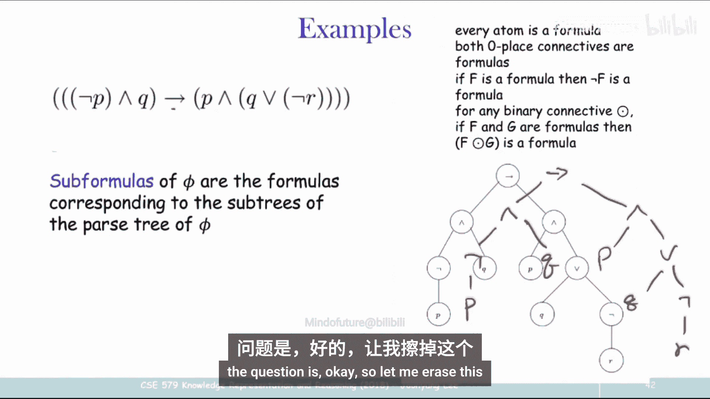
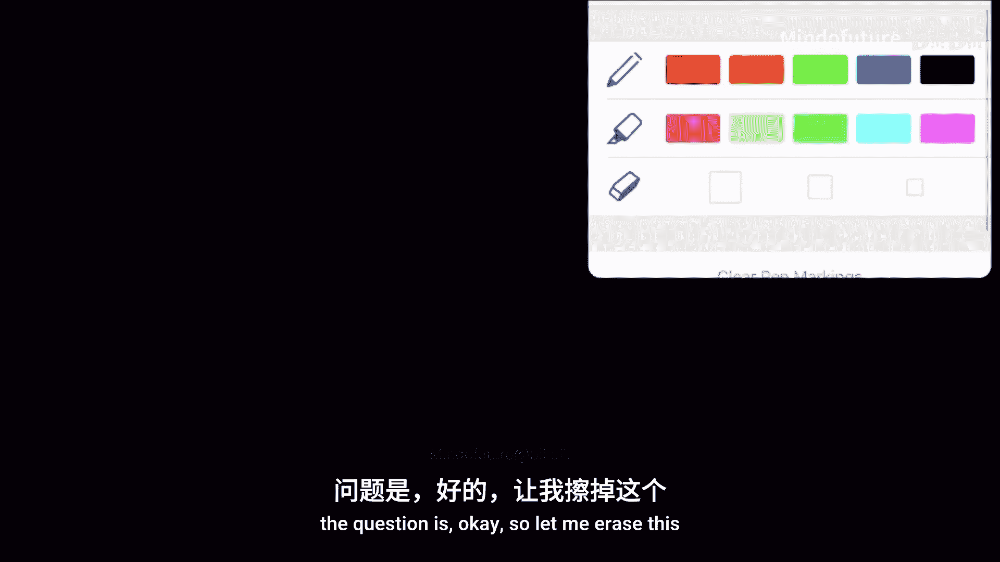
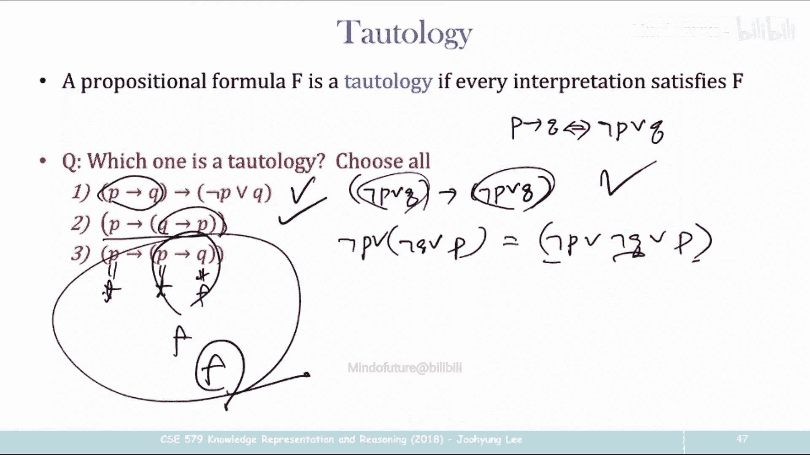

# 【亚利桑那州立大学】知识表征和推理 ｜ Asu Cse 579 Knowledge Representation 2018 p02 P02_Lec2 -BV1RTWyzfEQH_p2-

So today we will go over the overview of this course that we didn't have enough time to do that last time。

 and some of you ask about what are the possible projects that we can do。

 so I'm going to introduce some sample project and then we'll talk about Proal logic okay。

So this was the core structure， so classical logic is not the main thing that we are going to look at here。

 but this is so much a foundation for many of the KL formalisms。

 so we will study this for those of you who took a logic course before or some intro to AI course。

 this might be some overlap but in any case we want to make it more formal so that we can build our theories on these classical logic so it is a good idea to review the materials。

 or if you haven't encountered this material before and it's a good idea to learn now okay。

So we are going to。After that， actually we are going to go into logic programming in particular known as Anet programming。

 and then we'll talk aboutop。Ontology， okay？And then we'll go into the probabilistic foundation。

And after that we will talk about the combining the logical foundation and probabilistic foundation and also we' will talk about another integration of logic and probability that is derived from Markov logic and NSA program and if time permit we'll talk about actually the neural network per say。

 but how the neural network can be integrated with knowledge representation which is actually more up to date。

 was maybe last year it was not possible to introduce this topic。

 but just in recent months there are a lot of interesting ideas coming in here。

 so I hope I can introduce some of the interesting ideas and some of you may want to do some project on that too。

Okay， so here the blue parts are what we will focus and the green paths roughly we are going through that。

 but we don't have enough time to cover in very detail。

 but if you want to study in more in depth I can give you more reference and you can do project on those topics。

Okay， so what is classical logic， so classical logic is actually the foundation， as I said。

 and logic is known as calculus of computer science。

And there are actually a lot of logic that has been invented by mathematicians。

 philosophers and even computer scientists， we will not go over many of them。

 we will focus on the very basic classical logic known as propositional logic and first of logic okay。

U。There are other logics like second order logic， sometimes people do third order logic and model logic。

 they're all interesting ideas and some of the KL area heavily rely on those things in particular like the multi childrenild puzzle that you saw last time can be formalized in model logic。

But we'll not go over that in this course。Again， if you're interested。

 you can explore that area as your project。So the main idea of classical logic was to study the mathematics。

 so when people write a proof what is actually a valid argument。

 why some people say from this and this argument this argument follows。

How do we know that this is a sound reasoning， this is what logicians and mathematicians were interested in。

So it was not invented for AI but AI embraced logic from the very beginning because it is the kind of reasoning that people also make so very typical example known for many。

 many years is moredipons right so man is mortal socra is men what do you include I want to conclude from there socrates is mortal so that is actually known from the ancient Greeks and this is so much fundamental to human reasoning too。

 but we also talk about a few other examples last time that this kind of mathematical logic cannot be used for formalizing some human level of reasoning so like the nonmonattonic reasoning or default reasoning that we talked about they cannot I mean some of the problems that are very easy for humans are not easy to do in logic。

Okay。All right， the next part is， so in order to overcome these kind of difficulties。

 there are some proposals， one of them is knowledge based declarative programming method here we'll talk about an programming which is roughly。

 I don't know there is some similarity between this one and the prologue。

 but that is only in the syntax level， the semantic level is actually very， very different。

And this is a declarative logic program in paradigm that is suitable for knowledge。

 intensive and commun research problems。嗯。And one thing that you will probably have some challenge in here is you need to learn the new model semantics called stable Modelmantics。

 which is not the easy thing to learn if you're learning for the first time。

 so that's why I want to spend some time on classical logic so that when you migrate from the classical logic to the stable modelmantics。

 maybe that's easier to do okay。Now the problem with classical logic is it cannot express many useful ideas in human reasoning like defaults recursive definitions。

 aggregates and preference， so we prefer this over that， but in classical logic。

 every model is kind of similar， okay you cannot really distinguish between which logic one is better。

Okay， so。So this kind of thing can be overcome by tweaking the classical logic semantics。

 and that is known as stable model semantics。Okay， so origin is classical logic。

 but you have to know how this can be tweaked。Here the idea that you are going to explore is you want to solve some problem and basically you need to know how to represent problem in some formalism and then use the tool called NSSO to find the solutions and if you find the solution from the NSSO。

 this will be exactly the solution that you are looking for from the original problem。Okay。

So here is a diagram to explain this idea。So when you want to solve the problem。

 okay this is similar to the picture that you saw in the first class when we model the world in terms of symbols and manipulating the symbols to derive the information right。

 so same way if you want to solve the problem that is actually the problem that you are given now you have to feed this problem into computer。

And the computer outputs and that's the solution that you get okay so that's how you do now in traditional or declared procedural programming that you are familiar with this part turning the problem into program is called programming so you know how to do the program right how to write a program to encode the problem into some excecutable form now of course program to generate output is called execution so you execute program to generate output now this output you interpret to be the solutions。

So to solve this problem using computer， we go this way。Okay， good。

 now what is the difference in the declarative programming like what NSA programming is doing here？

It's similar， but problem will be modeled， and that will be the representation。

So we are going to represent the problem。Here the difference is we are not necessarily giving the algorithm to solve the problem。

 we just described the problem。Okay， so we represent problem into the format that computers can understand。

 but once we do that， the nice thing is even though you didn't give the algorithm to solve。

 there is a general purpose algorithm behind this solve that's find the solutions。

 so it produces the output and from the output you interpret the solutions。Okay。

 so this is something that you are going to learn first after classical logic。

 without giving the algorithm， how can I solve this problem？Okay。

 so if you can represent these problem in a correct manner that computers can understand。

 then you're done with that job。 The rest is done by the computer。Okay。

 of course you have here in class， we will see how that can be done in general。Okay。

And reasoning about actions is kind of put together with AnA programming section。

 although it does not have to be there is actually a separate maybe class that can be taught about reasoning about actions here we will use AnA programming to model the reasoning about actions so here is one of the typical application of AnA programming to model the dynamic world so if you want to model some changes in the system so some robot perform the action it changes to another state and from this state some other actions can happen and equals to another state and then you want to see how what are the sequence of actions that I can execute to reach to the goal okay that's called planning and planning is idea one problem in the area of reasoning about actions you can also talk about like what will happen if I do these actions what will be the result。

Okay， if I eat this and don't do exercise， will I be in trouble。

 you can do this kind of temporal projection problems。Okay。So we learn those kinds of aspects here。

 the idea is to develop the systems of formalism for describing actions and the effects。

And we will talk about action languages， which is built on AS NScept programming。

 but it' more high level， and it gives us concise and convenient ways to describe a transient system。

So we'll talk about changing system later in more detail。The next thing is ontology。

This is a bit different area so when I show you this picture。

 the areas are not actually subsuming each other， so here this is a kind of different part of knowledge of representation where people are interested in ontology。

 so ontology is very philosophical term but in computer science it's basically conceptualization of object we talk about this object belongs to this class or is a member of this class and if the class this property that is subclass also inherits the same property。

 so things like that。And。There has been a lot of work on developing very large ontologistologies。

 and it captures actually various areas of human knowledge。

And is this actually being used in applications， okay？嗯。

So there developed there has been many languages developed for this， but in recent years。

The building upon the old ideas， there came out more。

Practical language where people actually agree on the standard。

 so that actually boosts up those building onology effort。Okay。

 so you may have seen some systems like IBM Muslim system that actually be human champion in the jopardic crucial where does Wason gets the the knowledge is actually from some big corus of knowledge could be DBpedia or Wikipedia or whatever the unstructured andstructured knowledge base。

The idea here was。Close to the semantic web effort。

 Wason itself didn't use the semantic web language， they used their proprietary format。

 but later when people try to duplicate effort of Wason。

 they use actually the standard RDF or semantic web languages。

So this is actually not a traditional semantic web layer layer cake， is a kind of。Updated once。

So we are not going to touch on everything about se， this is not a semantic web course。

 but we will talk about RDF。Whi is a data interchange model in the semantic web and Sparle。

 which is a query language， a bit of LFS and how so this will be mentioned in this class。

So in case you haven't seen what is LDF is basically the graphical knowledge base and the node represents instance roughly。

 the objects and the edge you represent a relation between the object so here you can say and hasthway married to Shakespeare who lived in Stratford which is in England which is part of UK so this knowledge can be encoded in the graphical structure。

And you can see that Shakespeare。啊。So Shakespeare wrote King Lear， he wrote also Macbeth。

 whose study is in Scotland and Scotland is also in part of UK。So AlDF triple is basically this edge。

 so this subject， and also it' called predicate or also yeah it's predicate， so subject， predicate。

 an object。Okay。And Sparle is a query language for IDDF in case you are familiar with SQL。

 it's pretty similar to SQL， but there is also some differences。Okay。Yeah。然。It are just any object。

 so object can be also abstract things like love or it can be this particular instance。

 or it can be a class as well。Okay。嗯。In fact， the as you see from this layerK LDF was not supposed to be the very expressive language。

 it was more like the in data model， but the more concept of ontology was supposed to be represented in high level higher level language like O and rules。

 the problem was these standard effort got delayed and people somehow found out that LDF with slight update with LDFS was enough to represent lightweight ontologies and it was successful。

 it has been successful for many domains so that was。Yeah， kind of overused language in some sense。

Now this is the DPia which is written in LDF okay so this is of course you cannot represent this graph in computer easily right。

 you have to turn this into some format that computers can understand so it's basically kind of the database table so about here is the subject so this is Angela Joli and this is the property or the prettycate and this is the object。

So to answer your question， these are the possible things。

 but it could be actually more than that too。So as you see that I didn't know about this engineer Jo is actually younger than me and she her citizenship is in Cambodia。

 I didn't know about that。Anyhow， so there's a lot of knowledge that you can actually see from this what question answer can be made of okay？

So we have to talk about those things。Now， web ontology language is building upon the data model of IDDF。

 is supposed to do more expressive ontological reasoning。

Where RDF and RDFS basically do a bit of simple class membership。

 but it doesn't say about whether this class and that class are disjoint or whether this class is a subclass of another class。

 or there's a lot of limitation in RDF for ontological reasoning， and is。

Forat that is in a format in Au here particular example is about how to describe meaty margarita pizza so in English it is any pizza that has some tomato topping and some moella topping and some spicy beef topping can be represented in。

In this kind of weird format。but you learn why this makes sense？

And the basis of O is description logic which was actually invented long time before these semantic web languages。

 so what you will see is this is a logical notation in description logic。

Where you can define happy man to be a human， which is not male。

 a female and who is married to a doctor， and all his children should be the doctor or a professor。

I mean you don't have to agree with this definition。

 but this is how one can write the definition of happy man。

 the second line is saying that every doctor is a human， okay， things things like that。

 so the third one is this is class of object that is married to a human。And this one says。

 whoever has a child， which is a human， who is a human， must be a human。Okay。So as you see。

 this kind of knowledge has to be encoded in some ways so that computers can understand。

 and this is how it designed in our language。Okay。And surprisingly。

This one is basically just a shorthand notation for first of the logic formulas that you are going to learn soon。

Okay so the reason that we don't write firstso logic formula here directly is because it's too complex to look。

 but also it is undecidable so we cannot use it directly。

 I'm going to talk more about the complexity and computability issue later。

 but basically the message here is this is a restricted subset of firstso logic。

So one reason that we are going to go over the classical logic in the beginning of this semester。

All right， so after then， we'll turn our views into probabilistic foundation and here。

If you took intro to AI or some other courses， you may have seen BaseNet。

 which has been the driving force of AI before the deep learning time。

Basing that is basically a combination of graph theory and the probability probability idea so here there is a graph that represents kind of relation between those components so for this here tempering causes alarm fire causes alarm or fire causes smoke。

 alarm causes leaving， leaving causes report， so there is certain relationship that is known here and then there is also the probability table associated with each node to say that it' not only is that alarm causes leaving with some probability that alarm may cause leaving。

And I said actually close， but it's actually not the correct word to use。

 it's really not the causality that the baseNe is trying to represent。

 so the very inventor BNe JudyF Hall turned into another formalism called causal network。But anyway。

 we are not going to study that here。But this is actually the kind of。Well use formalism。

But in this class， we are going to talk more about the Markov net because we will use this as a foundation of Markov logic that it comes after。

Okay。So Markov net is similar to baseaseNe， except that the graph undirected。Okay。

 so there is no arrow direction in this graph， and also the differences， as you see in BNe。

 this was the probability。In the Markov net， these are just arbitrary between numbers。

 It's not necessarily probability。Okay。All right， so after that we will talk about Markov logic here。

 the idea is to combine the idea of first of the logic and probabilsic graphical models。

And throughout the semester you will see that each of the formalism has its own strengths and weakness。

 and this kind of effort has been continuous in the area。

 so how do we combine different formalism to overcome the deficiencies in each of them？Okay。嗯。

So what is the limitation of first logic it's too brittle。

 so we talk about the example last time that even if there is a single exception to the statement the exception fails so even if I walk to the car。

 normally the car does not disappear， but if there is a chance that the car can disappear。

 I cannot prove that the car will remain so that I cannot prove that my plan can be successful。

So even single exception can make the whole formulas to be invalid。That is actually the problem。

 So what Markov logic is trying to do is to overcome that so the formulas are being weighted so that some formula with higher weight is more likely to be true。

 but it's okay to get the formula to be false as that。Okay。

So this actually links between knowledge representation and machine learning area because the idea is where the weight comes from。

Okay， how do you know that this formula is more true than the other formula。In holidays in AI。

 people try to when people develop so-called expert system， they saw the very idea was there as well。

 so we want to say when you diagnose some patient and not all the patient who has some disease A shows the symptoms B。

 more likely to show symptoms B， but not always， so how do we kind of wait this kind of thing。

 if you have more evidence of these symptoms then you can say that the person has this disease。

 but not everyone is actually showing the same symptoms when they have this same disease。

So what they did was to use some sort of weight to these rules。

 the problem was when the domain becomes very large。

 it's very difficult to maintain this weight okay so somehow there is a new knowledge comes in then the human has to find what was my weight to this particular rule。

 if I change this rule weight and itll changes all other things as well as a consequence and it was so difficult to maintain the sound the sound。

Did reasoning that can be done in those systems。Okay。

So the difference here is now the idea of Markov logic is getting this weight from the data。

 so humans don't have to worry about what way to set is learned from the data。

 which is actually winwin situation。Okay。And here also the nice thing is the logical reasoning is very precise。

 is the disadvantage here if the complexity is too high。Okay， so even for propositional logic。

 you know that satisifiability problem is anticomplete。

 but if you relax this to go into probabilistic inference， although your answer may not be accurate。

 or 100% correct， but maybe 99% correct， but much， much faster。

Okay so that kind of sampling method or probabil reasoning has certain advantage there。Okay。Right。

 so LPMN is another language which actually derived from Archov logic and SSA programming。

 we're not going to spend too much time on this because if you learn already ASP and Archov logic。

 this will come natural， a certain limitation of aov logic which can be overcome by LPMN okay。

And I don't have slides for the neural network， but there's also some materials that we cover on that。

Okay。Well， I can mention that in particular what is going on these days is the knowledge graph。

 so people so knowledge graph like LDF graph that you see。

 people try to convert that into the neural network。Okay。

 so in the vector space and then do reasoning on that instead of this sparkle like query search。Okay。

All right， so that's all for the course overview， Any question up to this part。O。Okay。

Are we ready to start？The content， iss the。We have about 30 minutes。And far that enough。Okay。

So I know some people。Maybe both。But in any case。I hope we can have some uniform language so that we don't have to worry later。

Proportal logic。Is one of the actually simplest logic？And the idea was， of course。

 logic was there even before computer， right？嗯。What is relevant in computer science is satisfiability problem in professional logic is the first problem known to be NP complete。

If you don't know what is MP complete， talk to me later or you can Google or you can ask on the Piazza。

Basically， Ro's idea of empty complete problems is very difficult。 if you want to solve it。

 you will take most of。I mean， unless people NP key。

 you will take exponential of time to solve this problem。In the worst case， however。

That is actually not necessarily the bad news forR in KR many。Problems are actually starting for MP。

They' are actually more difficult problems than NP， like Sigma 2p， Sigma 3P， and so on and so forth。

 so MP is kind of right problem for KA。And there are actually many efficient assess solves that solve the satisfiability problem in Proal logic。

 and it has been used in many areas in computer science， not necessarily in AI。

 but also in hardware verification。Okay，So they use sovers to verify verify the properties of some hardware or or actually software system as well。

So what is Proal logic， it has very many different names， but we will just use Proal logics。

 you can see that like a boolean algebra or Boolean logic， so that's also the same thing。

In propositional logic， there is something called atom。

An atom is something that we assign to meaning true or false。

Okay so this is the basic unit in proportional logic。And here。

One requirement for being an atom is it has to be evaluate to true or false。So for instance。

 sum of the numbers three and five equals8。Can this be an atom。Yes。

 because it can be the true or false， is it true or false？Is supposed to be true， right okay。

 Jane reacted violently to Jack's accusations。Can你 be on那种。Yes， is it true or false？

It depends because we don't know who is Jane and Jack。

 but those people exist and if there's something about them。

 this is something that you can check true or false given the particular situation， right？

Every even number greater than two is the sum of two prime numbers。

 Can this be unat yes is it true false？Pse。Okay， so。Well here， let you， is it？

So every even number greater than two is the sum of the two prime numbers。

 and when you say false to be claim about every number。那个房子。我的是。そ么就是。那他那个。But it can be poor。

 may not be poor。你当成谁？这个。啊，我。So what even number cannot be represented by the sum of two prime numbers。

 six， six， okay， so six cannot be represented as sum of two prime numbers true or false？Oh。

 so that doesn't y6 is equal to three plus three。Three outlines， right？诶。

A this5 plus three five applying。嗯。原桥都。But does it mean we tried a few example that it didn't work。

 Does it mean that this is。出。嗯。So we agree that this is an atom， it can be either true or false。Okay。

 we simply don't know whether this is short false， right？Somebody else you know this answer right？

On the second example， I don't know who is Jane and Jack and the whether they。reactactive vi say。

 I don't know， but if I am given the particular thing I can answer， right？No。Here。

 I know what this even number。 I know what greater than means。 It I know what these two。

 I know what is some。 I know what is time。 I don't have to refer to anything else， right。

But I don't know whether this is true or false。So you're still saying this is an matter。我才在不。But。

Every doesn't change whether this is for false。If there is a single exception。

 then this whole sentence is actually false。Okay， should I give you the homework？嗯。

This is actually known as Gold box conjecture， nobody in the world knows answer yet。Okay， so。

It's fun， okay， so this is a simple sentence。😊，Okay， and we know what that means。

So we cannot really say yes or no yet。 Okay， but this can be either true or false。

 The The definition is saying it can be either true or false。 It cannot be both true and false。

So this will be assumed to be an atom。は。I don't know what is We can talk of flying。 Okay。

 maybe sorry there some。 Now this red sentence is atom。

 Could you please pass the Its not's not something that we can assign to or false Okay。

 ready this study go。 No， it's not。😊，Okay。May the first be with you。

 this is not something that you can assign to a false。Okay。So these breath sentences are not atoms。

 We are not going to look at these sentences in proposition logic， only the blue part。

Okay so the sentence that we can say either true or false will be called atom okay so that's half of professional logic。

 the other half is once you have this atom you can compose the meaning using some logical operators known as conjunction。

 distinctionjunction implication and neation。Okay。So here's a formal definition。

A professional formula come from the signature sigma， I didn't mention what this says sigma。

 but sigma is basically a set of atoms。Okay， so let me say sigma or signature。

He's simply set of atoms。Now， given this signature， you can build a formula in a recursive way。

Every atom in the signature is a formula。 If I say P， So suppose our。Sigma is PQI。Okay。

 each of the symbol P， Q and R is an atom。Okay。Now these besides these symbols。

 there's also called zero place connective I just copied from the reading materials so I didn't copy correctly。

 there are two designated symbols which are not in the signature but works like an atom and they are called bottom and top which basically represent false and true。

Okay。Okay， so that's the base case and the recursive case is if you know something is a formula you can pre the negation in front of it and that also becomes a formula。

 so if I know that P is a formula， I know p is a formula because the case1 says every atom is a formula then now I can put negation in front of it。

 so is a formula。Now， once I know that not piece of formula， I can also prepare on another negation。

 this is also a formula， and I can repeat this on and on。Okay， so that's the recursive case for the。

Third case， a third clause。The last one is saying for binary connective。

 so I just denoted this not to be the binary connective， but there are conjunction disjun。

 implication， and sometimes also equivalence and so on and so forth。

So if I know that this is a formula and notice know that Q is also a formula。

 then I can combine it with conjunction or disjunction or implication。

 so each of these are also formulas。Okay， now once you have that。

 you can also preend another negation or can combine is another one， okay so that's also formula。

Any question up to this part， yes？Zero place connect is like an atom， so far this is just a syntax。

 so there's no meaning yet roughly corresponds to false and true。

 but I can just write bottom and this is a formula。Okay， and I can put the negation in front of it。

 this is also formula。Okay， the meaning will be explained in the next slide。我该可。Oh。

 it's because these are the connectives。That so I mean this。他 no argument。他 이게现在是。

And the other in conjunction is something they have two。The binary。没啥。Yeah。

 it doesn't actually connect anything， but it's just a to。Okay。All right。By the way。

 this material coming from that Cha one of Handbook of KR， which is linked from the。The。Blackboard。

 okay。Alright， so we are are we clear here。 Okay， so then let's go to the example。Is this a formula。

That is a formula， okay。One thing that might help you to understand this formula is to pass this formula so you know how passing works right。

 what is the root note here？嗯。Implication， that's called implication。

 so this is actually the root node， so we'll do root and the left tree will represent na P and Q okay。

So not， okay，SoLet's do it together。Okay。Okay，In the left， you see La PNQ。

 so what will be the root node of that subre？Conjunction， yeah， and then。Negigation and P。Okay。

 and same here。Q。Okay， and here。It is conjunction， P Disn Q。And neation R。As you see。

 the lymph nodes are either atoms， and in this example it's not shown。

 but it can be also zero place connected like bottom and thumb。Okay。

The non leaf nodes can be the logical connective， like conjunction， implication in neigation。O。

Are we clear。Okay， so then。The question is， okay， so let me。

イ頼ス。

Yes。嗯。Okay。All right。So what is a soft formula？So once you have this formula。

 sub formulas are the formulas that are contained in a formula。And in terms of past tree。

 you can just relate to the subre。Okay。So question， is a formula or soft formula of itself？

The whole yeah， because。Is a sub tree right any formula is a sub tree of itself right。

 So this is yes， How many soft formulas are there。 Okay， so let's actually open the subative。

 This is for the first time that we do the input， please， how many soft formulas are there。

 Let me ask you。Thisqui。呃。So if you open it now， we'll probably see the。Part。

 you can type the short answer。So I'll give you one minute to think。How many soft formulas are there。

C S C 5，7，9。Yeah。No， I think you should be already in if you'd logged in before。O。Let me close。

原来 see。あ週か。嗯。好。嗯。I think I actually。Open in two place。 So we might cut。So， in my cell phone。

I do see many of you actually choose 11。And somebody says end to the pop， ends square。

 which is where end。Okay。Let's count this together，It's basically counting the sub treeses。Okay。

 how many subies are there， we can say。P。is a soft formula， Q is a soft formula， r is a soft formula。

Okay， knocks are a formula。Okay。And now PNQ is a sub formulaula。And。Now all this is a formula。Okay。

Q or not r is a formula。P and Q or R is also a formula。

N R P N Q implies P and Q or not R is also a formula。I think that's all I have。看两人答印。Okay，け。

Any soft three yeah。くな个。Not necessarily if there's a duplicate， then it doesn't count twice。

But for this example， there's none。Okay。All right。This will be actually useful later when you do the stable model semantics。

 you see a lot of sub formulas that you have to find Okay， let's talk about an interpretation。

 so what is an interpretation。It is。An assignment of truth values to atoms。

 so when I have signature like PQR is P true or Q true， R true。

 we don't know how many possibilities are there。If you have PQR and you can assign either true or false to each of them。

 eight possibilities， which means that there are actually eight interpretations。So。Okay actually。

 I should also say what is a truth value， but false and true are truth values is okay right the interpretation is a function that maths signature to truth values。

Okay I just ask you about how many truth assignments is possible。

 the same question can be phrasesd as how many interpretations are there for the signature PQR so there are eight interpretations。

 so interpretation is basically a function to truth value mapping function。

And if this signature is finite， you can actually draw truth table， which should be familiar， so PQR。

 so this is one particular function that map P to falses， Q to falses， and R to true。

You can also write in the more。Familiarial notion in diagram。

 so P isped P and Q are mapped to false and r is mapped through。And we just answered this question。

 there are eight interpretations。Now the atoms are something that is controlled by the interpretation in the truth table。

 but once you fix the atom's truth value， then there's no ambiguity in combining those things using the logical connectives。

 the logical connectives are fixed。Okay。They are well defined mapping。

 so if you have false and you give it to the negation， it will flip the value okay。

And if you have conjunction， when both of them are false。

 the conjunction of false and two falses will be the false。Conction of to true is actually true。

And that's actually same for the distribution。 But what distinguished from conjunction distribution is when。

One of them is true and one of them is false in the conjunction。

 in that case is false for the distinction it is true。Okay。

 so not surprising because N and or has natural meaning there is probably not。

Inruitive to you is implication。And this is something that I have to ask you to memorize for now。

 sometimes it works as expected， but sometimes it's not。for the implication， when x is false。

When the first argument is false， it's always true。Okay， and when the second argument is true。

 it's always true。The only time that the implication can be false is when true implies false。Okay。

 just remember that。Okay， and the last one is actually equivalentence when both of them are same of values then is true。

 otherwise is false。Okay。嗯。Now， evolution of formula can be recursively defined。

So here is actually the formal definition， if youre given an atom， okay。

 this notation f superscript I means the truth value of f under the interpretation。Okay。

Because when you see P as a formula， you cannot say whether this is true or false。

 but if you are given an interpretation that tells what P and Q P Q and R means。

 then you can say P to the P to the superscript I is true or false。

 basically by looking at the interpretation， the true table。And this particular symbols。

 bottom and tab actually has fixed meaning always bottom is always evaluated to false。

 tab is always evaluating to true。Okay。And the negation is going recursively。

So if you want to evaluate this formula of the form nu F。

 then evaluate F first under the same interpretation I， and then apply the deation。

 which means that this can either return true or false and flip that value。When you have negation。

And same thing can be said about the binary operators。Okay。Yeah。

 so that will be example in the next slide。Because the definition is actually a bit hard to understand。

 but this is actually easy to encode in computer。Okay。

But one important notation that I want to introduce here is satisfaction。

So when the formula evaluated to true under the interpretation also written as I satisfies F。

 so this is satisfaction， so interpretation satisfies a formula when the formula is evaluated under the interpretation resulting true。

Okay。So same formula can be either true or false， depending on which interpretation that you apply。

So let's actually look at example。嗯。So this is a formula that you saw before。Okay， so let me ask you。

The true value of this formula。 If P is through， Q is true， R is true， then what is this formula。

Is it true false？So recursive definition can be nicely- I mean， for human for our point of view。

 picture is much nicer than the definition there， right？So how do you do that。

 You just fix the lymph node first。 Okay， so P QR are true。 So let's fix this to be true， true， true。

Okay， and then let's evaluate this。 If you have started because of this and passing。

 this is pretty natural， right， So if you have P here， then deationation node will get the value。

False， because people true。 This is false， false and true。Is false。Okay， so I have to do this。Can I。

 yeah， I can stop here too， right， What is the value here？True， truerue。

 because when the first argument is false， then implication is always true。 So we are done， good。

It's actually hard to。Switch between this。 Okay， let's do the next example。 What if F is false。

 Q is true and r is false。Okay。So if peaces， then this is true。True and true is。True。

 and now we can skip， we have to go to the right sub3， so false neation。Is true。true true。

True or true is true， false and true is。False， true implies false is。False， so this is false。Okay。

 so same formula， just different interpretation can make either true or false。L 배터리。

What about the last one， hell I'll do this as an exercise？Okay。All right。

The next thing is now we are going to use this notion of satisfaction to。Build other notions。トtology。

So we say a proportion formulas or totalology， if this formula is true。

 no matter what interpretation that you apply。Okay， so for all interpretation， like PQR。

 there are eight interpretations and when you evaluate to each of these interpretation。

 this formula is always true then we say that formula is a totalology。So which one is a topology。

 let's do the case here。嗯。Okay， so we started。Let me come back。So which one？You a taology。

よろし お ねないです。You can say1，2 or 1，2，3， there are multiple of them。Okay。By the way。

 this in class space will not be counted to your brain， so don't worry about being right along。

I I want you to think。That also helped me how you're following the。So the， so if it is a topology。

 then no matter what interpretation that you apply should be true。Its actually。

We have to exhaust all possibilities here。So。One might be better is whether we trying to prove this is not a problem。

Can you find an interpretation that is。That makes it false， actually。Okay， are you none？Okay。

 let me close and。Let's see what was your answer looks like。Okay， so1，3，1，2，3。1，2，1，2，9。

Actually9 looks not。A part of that。O。So only 20 answers are there。 So I don't know why， but。

This will also give me who is paying attention。 All right， the correct answer is。1 and two。Okay。

 let's see why。In case you're familiar with some transformation in classical logic or professional logic。

 this is actually good， so I mentioned to you that in order to understand P implies Q， sorry。

P implies  Q。You can think about this as。This way， not P or Q when peace falls。Or Q is true。

 then this whole thing is true。 So this is actually equivalent。Okay。

 so with this transformation in mind， the first one is actually saying not P or Q。Implies not P or Q。

Okay， so I don't need to know what this not here or cure， whether it's true or false。

 but it's always saying either true， if implies true or false implies false， it's always true。

 so this is actually pathology。Okay。The next one。If you apply this transformation。

 this is not Q or P， and then you have another not P or。 and using some algebra。

 you can see that this is actually same as not P。Or not Q or P。Okay。

 so you don't have to worry about the precedents。And P1 RP P in the same course means that this is a topology。

I don't need to care about Q because P or not P， together with any dysfunction will always be true。

 so these two are actually toology。But the last one is not a toology。

 so I don't want to even write this。 I only need one interpretation to make this false。

 What is that interpretation。P is true and  Q is false if p is true and  Q is false okay now I don't want to draw the picture for you you should do thiss on your head okay so true implied false is false right so this is false and true implied false is again false so this is false so you found one interpretation that does not satisfy this formula so this formula is not a totalology。

There are two notions that I actually wanted to finish today。

 but maybe with other materials that I covered， I don't have time to do this。

 so let me resume from there any question of today's material。

If not that we are going to do exit ticket in case you were not in the first class exit ticket will consist of three questions。

 the first two will be obvious the third one。Is。What was teacher's question。

 but you can understand that question as what are the questions that you have for today's material？

Okay。Okay， it's open now。

