# 【亚利桑那州立大学】知识表征和推理 ｜ Asu Cse 579 Knowledge Representation 2018 p03 P03_Lec5 -BV1RTWyzfEQH_p3-

And then we'll come back to the thing， okay。So just give you a few more examples。

So we want to express this knowledge in first of the logic。So no books are gasous。

 dictionaries are books， therefore no dictionary is gassous。

Note here that we want to took just general picture here。From propositional logic。

 what we want to generalize here is we want to distinguish between individual and relations。

individuals， sometimes it's called objects， okay sometimes it's called members of the universe versus the relations。

 relations between the individuals or sometimes it's called predicate that holds for the individuals。

So how do we express this idea？Okay， so we have to introduce some symbols。

 which will be a part of the signature。So when you say B of x， this is so-called unary predicate。

 okay is a predicate that is evaluated true or false， and this is true when x is a book。

 so here x is variable， we don't know yet， but if you are given the particular individual x。

 then we can evaluate whether this is true or false。

GO x means that x is gaseius and G of x is x is dictionary so how to express this idea nos are gaseous well we are going to use quantifiers and I told you just using some intuition you can just write this English sentence in terms of this。

Forula， so here there is no x such that X belongs to B and X belongs to G。 or if you paraphrase。

 there is no object X such that X is a book and X is agaius。Or you can just say no books are yes yes。

So。The next one is dictionaries are books， so what it means is actually all dictionaries are books。

 so if for all X， if x belongs to a dictionary， then X is a book。Okay， so that's a knowledge。

 And what we want to derive is using these two sentences。 Can we derive a new knowledge out of it。

 Okay， so this is。This is actually entailment that you saw in the Pro logic。

 so how can we derive new knowledge from the existing knowledge？

So what we can say is using the deduction。 you can say there is no dictionary that is caseses。

How do we do that， Well， there is a calculus behind this。 Okay， we are going to look at those things。

Another example， every child is younger than his mother。So， here。

We represent that by CO of x x is a child and M of xy x is Ys mother。So how do we express this？

So we use this now for all quantification， for all x and for all y。 Okay。

 so it applies to all individuals X and y。 If x is a child and x is。

X is wise smaller than X is younger。I think X is younger than y。Something。

I think it's actually switched it， right？So， let's say。Let's say this way。 Why is access model。

 if X is a child and access。X。Is it right。Yeah， if I is a mother of X， then X is younger than y。Okay。

So this is what we do， but also， we can describe。嗯。The function。Where。

This looks similar to like C of x but so this function M applied to the individual and it returns another individual who is a model of x。

 so if you can use the first line that you see， but you can also write this way。

 so for all x if x is a child， then x is younger than a model of x。Okay。

 so sometimes you can express， actually you will see that these are interchangeable。

 You can represent in terms of predicate， but also， you can represent in terms of functions。

There' is some benefit of using function， as you see from this small example。

 function makes it easier to read and also makes the formula short term。Okay。

 so if you want to talk about model of model of mother。 Okay。

 so you can just nest function three times。 if you write this in terms of the pretty kid。

 you have to write conjunction of model of X， Y， model of Y， Z， model of Z， W。Okay。

 so that is a longer。Okay， now that's just introduction。

So let's talk about the syntax of the language。So， in。Professional logic。

 we only have a very simple fact， either true or false， and that was called atomy。

And we want to distinguish。These things。 so first， there's an object。Okay。

 so individual in the universe， so it could be the set of people， set of numbers。

 it could be some particular name， okay colors or games and so on。

 So this is an entity or individual or object， those are synonyms。Now， functions。

Can be applied to these objects。And it returns another object。

So you can talk about father of some people。F of some person that returns another person。Okay。

 so when function is applied， it receives the object or maybe also another function as an input and returns another individual。

Okay， that's what function is doing。Relationlation is。About true or false。

 So this relation is about the certain fact holes between those individuals。 So when you say red。

 red is probably unly pre， red of X。Okay， so this is a relation on particular。

OrProperty of particular objects。 So is this property of X is red。K true or false。Okay。

 it could be round or prime， and there are few many。 Now。

 something that you might confuse when you see this first time is the difference between function and relation。

Okay， so keep that in mind， it may be confusing， so when it comes to that， let me know okay。

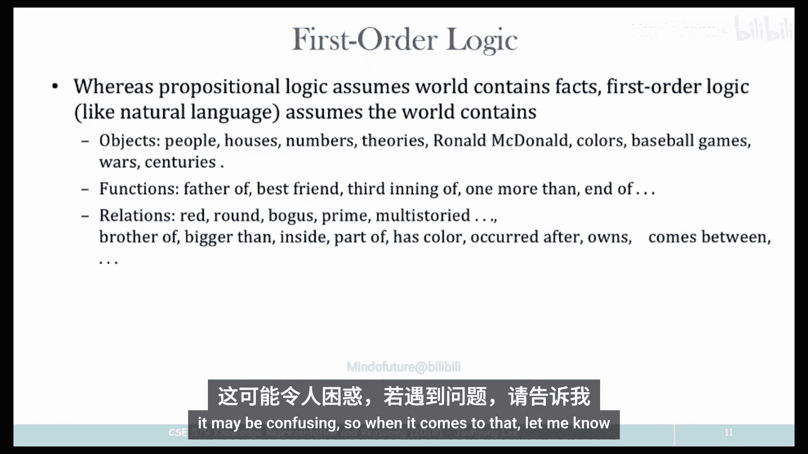

All right， so how do we express these kind of things in logic？In so in propositional logic。

 there's a very simple signature signature has a set of symbols called atoms。

 Now the signature becomes really， really complicated in first of the logic。Okay。

 but if you understand this part together with quantification， you are done。 There's nothing new。

Not not much new in the first of the logic。Okay。So let's see。

 what is the first what is the thing here， We will say there are two kind of thing called function constants。

And pretty constants。Okay， now I told you that there's an object。

 but object can be viewed as a function of zero pre argument。

So well consider object constants as a special case of function constant。Okay。そう。方向 constant。

Any number of arguments， but we have to fix it when you say I want to use plus。As a function。

 then I have to specify how many arguments that this plus will have。Okay， or if I say some a okay。

So here so a has a zero L means that a doesn't have any argument。Okay， so by itself。

 it returns that some individual。Fer。It needs one individual as an input。

 and returns other individual。Okay， are we together。

 So here function constants of the L T 0 are object constants。Now， critical constants。嗯。

It's about the property of individuals。 So whether the number that you are given is even。

 so even of x means x is an even number， you can have a relation between the two numbers。

 so greater than。Now， there's also a special predicate constant that has no argument。

 that's called propositional constant。Okay。Now， this one is actually almost。Actually。

 you can identify this as an atom in propositional logic。In professional logic。

 the atom didn't have any argument， but it can be evaluated through a false。

That's actually propositional constants in first logic。Okay。Okay， be clear about this signature。Now。

 what is， this is a convention that you have to set up before you write a formula。

 These are the symbols that I'm going to use in my problem description。Okay， so for instance。

 we will see these problems， solutions to the problems。嗯。

You're not allowed to use other symbols than the ones in the signature。Okay。We3年 true yet。So。Here。

In the problem， the signature was A P and Q。 Do we only see the AENQ in the solution？No。

 we see just X。Conjuction。Comma parent instanceesis， right。 However。

 those are not part of the signature because they already have fixed meaning。

 You don't have to include in the signature。Okay， so those are the other symbols that are not in the signature。

 but you can use freely in your formula。

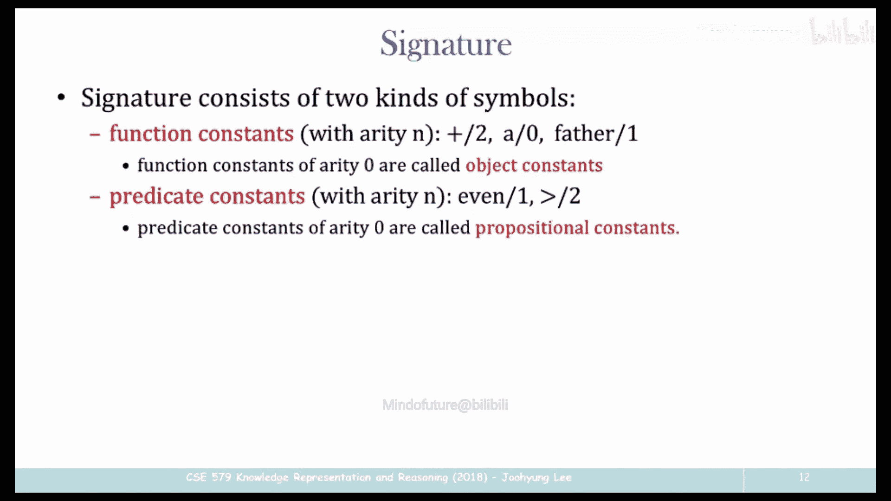

This is not， this is something that you don't have to make a convention before。What are they。

You have infinitely many。Numbers of object variables that you can use。

The convention is usually we write X， Y， Z to denote these variables。

 and if you need subscript then x1， y1 and so on so forth。

So you don't have to declare these symbols in the signature because you can just use any variables there。

You will see later when you assign the meaning to the formula。

 the particular symbol of the variable is not very important。

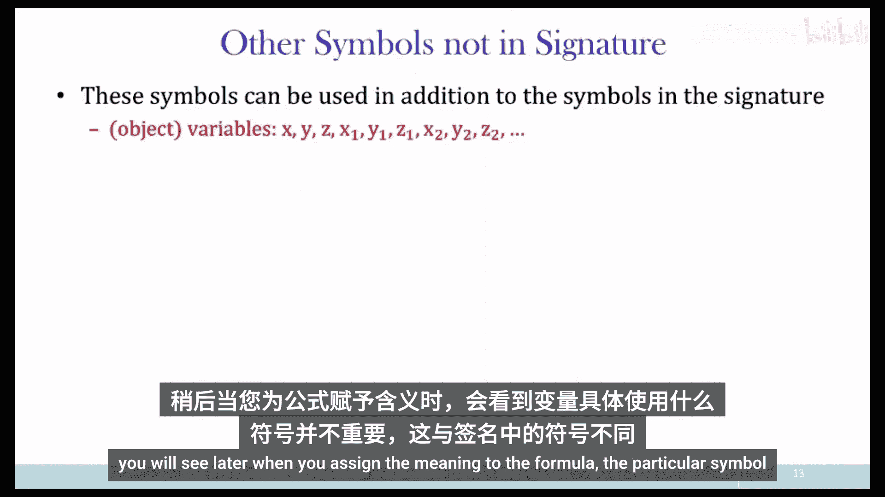

Unlike the ones in the signature。Okay，In the signature， if you say John and Mary。Okay。

 if you could just switch them， that make make a difference。However， when you have these。Symbols。

 are the variables in the formula， and when the formula can be evaluated to true or false。

The particular name of that variable is not important。So this is actually what you are familiar with。

 the Pro connectives， you can use all the connectives that you have used in Pro logic。Okay。And。

The other things that are new here is to quant。 There are two quantifierifies get for all or exist。

You can still use parentsesis。 now you can also use comma， Why do we need comma？

You have two distinguished arguments， right？Okay， so that's good。

So now you know the alphabet of the language， what symbols can you use。

 but if you just throw all this alphabet in a random order， it does not make any sense。

 so the syntax is to give the ordering of this alphabet so that it it makes some reasonable entity。

So the first thing is actually Tom， and this is where the first of logic becomes a bit complex。Okay。

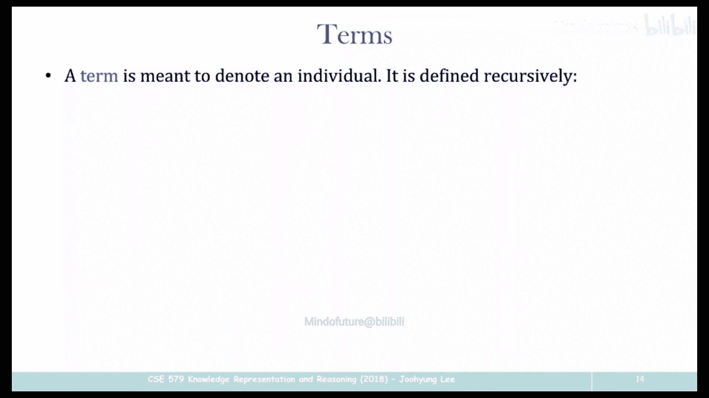

So， to。Is to this is syntactic object。 This is the kind of string that is formed in a specific way to represent。

Individual。So what could be a term is a recursive definition。 Any object constant can be a term。

So if you have any names like John andy Mary， they are Toms。An object variable is a to。ok。

So you may confuse sometimes object constants or object variable。

 when to use what and how they are different， that will become clear when we go on into the semantics。

 but for now this is just a syntax。

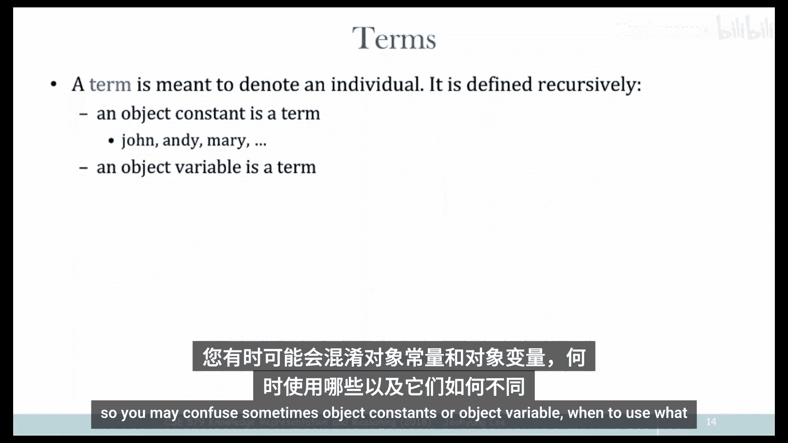

Okay， so what syntax means， what is the value string that we have to look we are going to look at。

We're not assigned the meaning yet， but we can use any variable， that's a term。Now。

 the recursion comes here。If you have a function constants of L T N。

And if T1 through TN are thumbs that you already built。

 then you can form a new term by applying F to each of these TR。Okay， so F of T1 through TN。

 this is a new term。Okay。Are we together。Okay， so here's an example。

 If you know John is an object constants and father is on function constants that has L T1。

 then father of John is。Tom。Okay。How about addition of A and x。This is also a term。

 assuming that A and X are the tos。Okay。Now， as I said， the function can be nested。Okay。

 so this is actually different from predicate that you are going to see。 Predicate cannot be nested。

 but function can be nested。 So you can say great grandfather father of Zhang as father father of father of John。

Okay。And it may not make sense to you now， but at least syntax is concerned。

 you can still write to this thing。嗯。Da dad， you don't know how to evaluate。

 but it is still a value thing， according to the syntax。Okay。Now， we have just Tom。

 which is already recursive definition。And then we are going to have an atomic formula that is also a complex recursive definition。

Okay， this is the part that you may get confused between。These two， okay。

 what do the function do and what to predict。So we define atomic formula。

Either as a propositional constant。我。Pretty good R that is applied to tons。 he won routine T N。嗯。

Or there is a special atomic formula called equalityqu。 If you have two terms。

 then you can write equality。Okay。Maybe I actually forgot to say equality is also a symbol that you can use。

 but it's not in the part of the signature。Okay。

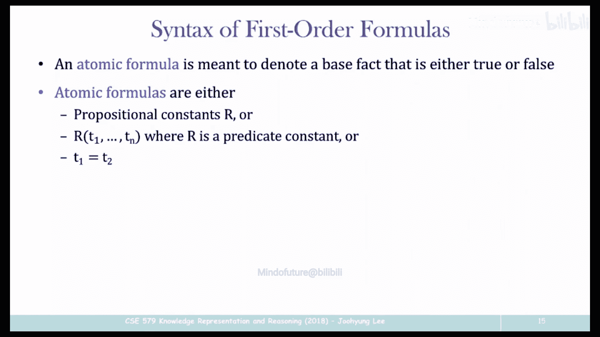

So what you might be confused is this part here looks very similar to the termss in the previous slide。

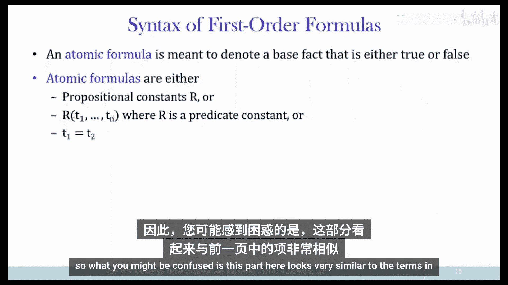

O， F of T1 through T N。So what is the difference between these two。Yes。And if it's a function。

 it's supposed to return what。Individual guess object， if it is a predicate。

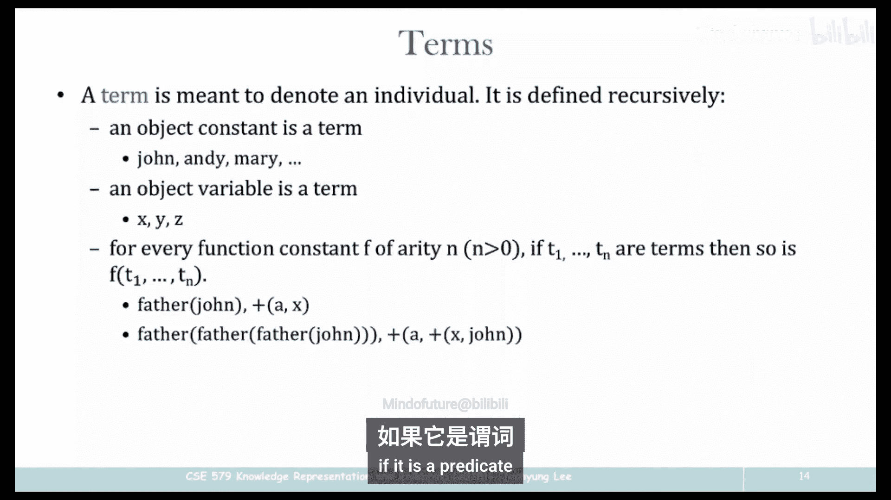

It's your false。So here's an example。 train late is an atom that we saw in the professional logic。

 This is。In fact， proposition are constant。Or you can say pretty constant that have0 L。Okay。

You can write these things， so note here that even and greater than symbol。

 they are all relations or precate symbols。Okay， you can。 so in logic， basically。

 you have only the prefix notation。But you can use this way to obbbreate this。Okay。

 so that's just abbreviations。 Now， you can also talk about equality。

 So father of John returns some individual。Whether he is equal to James。

 so that's what you can evaluate either true or false。

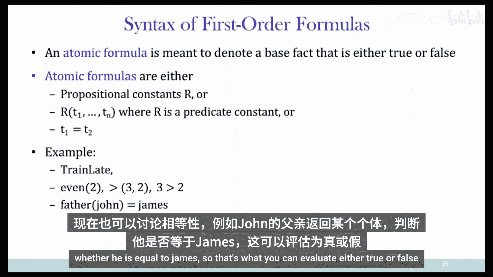

Okay， are we together。So what do you have to remember here。

The atomic formula works very much like atomomic proportion logic。

 This is a kind of smallest unit that we can assign either to or false。Okay。

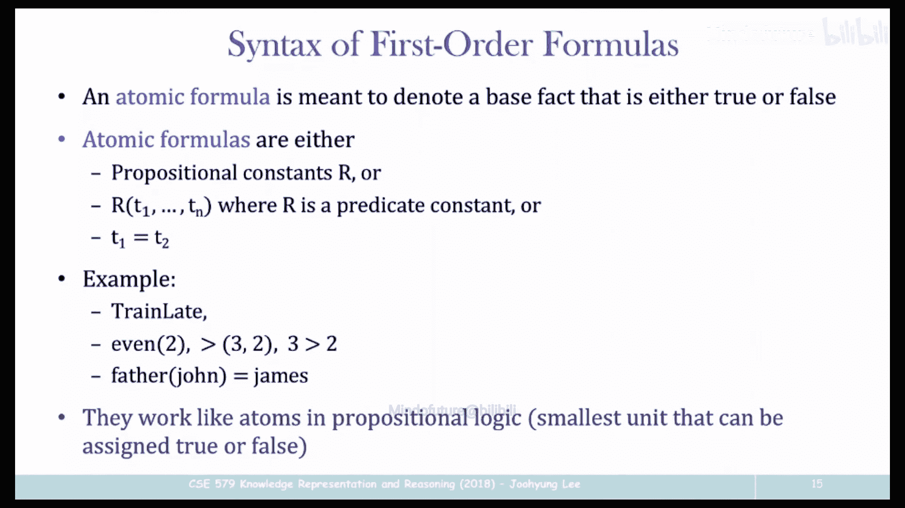

Okay， now then how do we define formula？For formula。Can be built from atomic formula。And connects。

And quantifiers。So every atomic formula in the previous slide could be said as a formula。

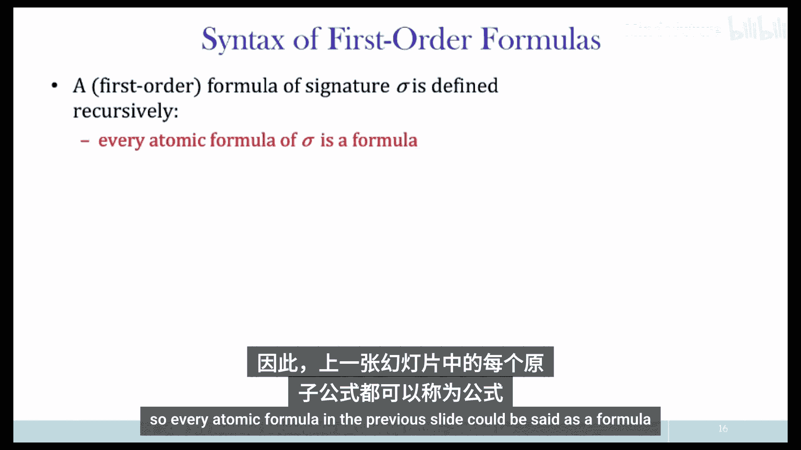

Now this part is actually same as in proportion logic， so bottom and top they are formulas。

If F is a formula， then not f is a formula， if FG are formulas。

 then their binary connection is also formula。The new part here is yet another red part that is new here is if F is a formula。

 then you can。Prepaent quantification here， fold x and exist X There's also formulas。O。

Any question up to this part？Allright。So then let's do these exercises， so we are given our APQ。

 so A' is an object constants， p is a unary and increase a binary pre constants。I this a formula。O。

 you lose your chance now。 Let me ask everybody else now， P， is this a formula。

Anyone just say I just want to see whether other people are also filming， this is a formula。

 okay the first one is not a formula because a is an object constant object constant is a term。

 in term is not an atomic formula。 so it's not a formula。

 P of A is a formula because P is a pretty constant and a is a tongue。QV。Q位。Q杯。

Q of A is not valid as formula because Q should be a binary for all X P of A。Yes。有个 formula。Yeah。

 it is a formula， it looks actually strange， you have4 x， but you don't use x in the formula。PO A。

 but this is still a formula。Because the last one is saying if you just append for X。

 that also make a formula。Is this a formula？Yeah， it looks complicated what it is formula。Okay。

 so far， so good。 Now， let's look at now the new part。

We are going to talk about some occurrences of variables， maybe let's just go back here。Okay， so。

Some variables are associated with the quantifiers， and some are not。 If you look at this one。

 for instance， this x。Okay， here here is actually in the scope of existential quantification。

 But why is not a part of it。

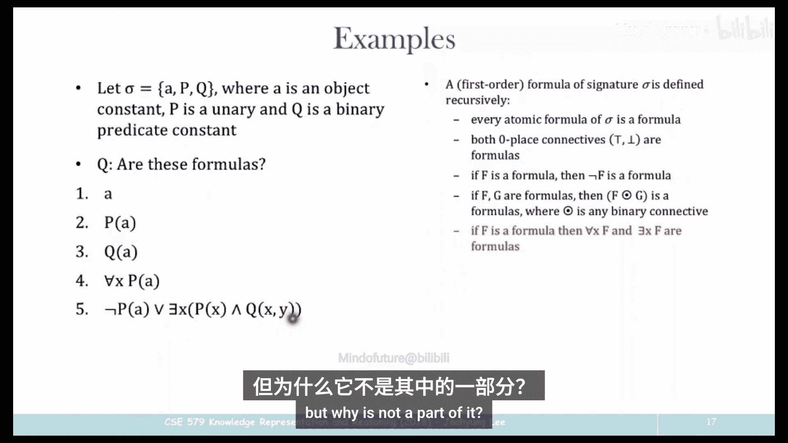

Right。so that's actually the basic idea of bounding three variables。

We first talk about occurrence of a variable to be bound or free。

So bound simply means that there is some bounding quantifiers for that occurrence so variable。

So actually， let's look at。嗯。Ex points。Okay， so let's do the。no。Okay。

 let's see whether you can understand the definition so here。

Ocurrence of variable is the particular place that the variable occurs， right？And self formula。

 You know what is a self formula。 We did that before。Okay。挺好我。Okay。

 let let's do it together instead of。So creativeative。So one way to do this。

 to understand this definition is to write a past。Okay， so let's do this together。

 What is the root note here for this formula。Constructtion。Right。And the left hand side。

 what is this。Sub blue here。This is why。And P XY。Okay， good。 And similarly， we have。

So we see six occurrences of variables。Okay。Question is， which occurrences are free。ど생。东山酒。

Which occurrences are free。ok。So。The first one， the y in the y， is it of free or bound。

It is bound because it is in the form of is a soft formula of the formula that has QVG。

So if as long as it is captured by the quantification。So， that's a bond。So， this why。Is found。

This is bound。What about this X。Xx here is free because there's nothing to bound this ex if you go up the tree。

Right， what about this lie。I found because it is bounded by this quantifier here。Right。Okay， good。

 Now all about this one should be found and same reason that this is found and this is free。Okay。

 now note here that why on the left substrate3 was bound， but why on the right sub is actually free。

 They cannot be the same variable。Okay， do they do not actually work in the same way。

And this is actually very important to assign the meaning of the formula。

 you will see that in first of the logic when you assign the meaning to the formula。

You cannot assign the meaning if you have any free occurrences available because you don't know how to interpret that variable。

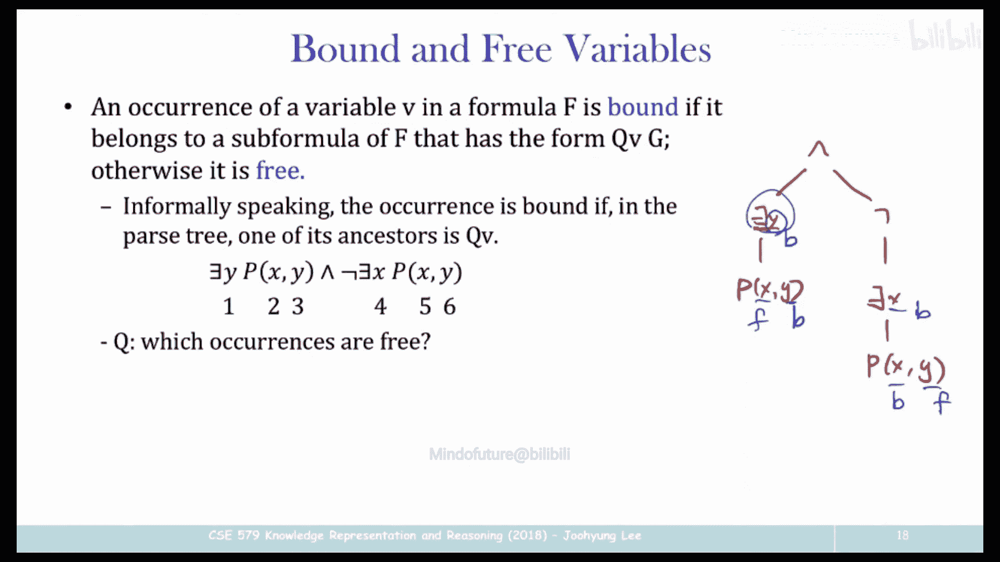

Okay。So we will gradient into the semantics， but this is actually why the reason that we are starting this。

Concept of bound and three is because we will limit our attention to the formulas that has no free occurrences or variables。

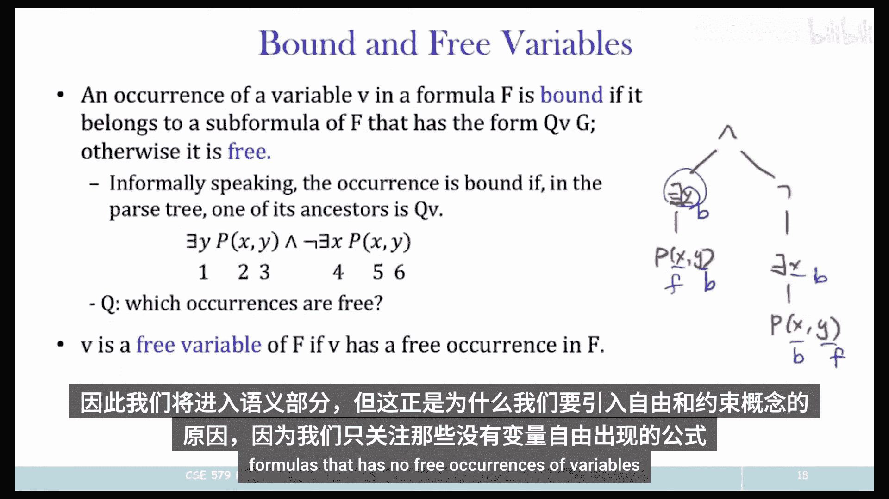

Now， one thing that you have to be careful is there is a notion of free occurrence versus free variable。

So v is a free variable of F if V has at least one three occurrences in F。So， the question。

So this one， let's do on the。So the question is， which variables are free。let's go back。

Let's go back here。AB，C D， you can just choose。Okay， let's see。Okay， so。Most of you。

wait so let's see。The answer actually varies。Okay。😊，So some of you have C， A，BC。What is ABC。

But you have to select only one。Okay， I don't know why you collect more。

Looks like cancers are varying。 There there are some。s seems to be many choice。

 but it's not necessarily as dominantmin， so let's see what is going on。嗯。So。

So I told you that variable means simply it has a free occurrence。

 and if you want to answer this question to say whether x is a free variable。

 check whether x has a free occurrence。Okay， so x has a free occurrence on the left sub brain， right。

 So x is x is a free variable。 What about Y， Y also has a free occurrence So Y is a free variable。

 So what are the free variables of the formula， X and y done。

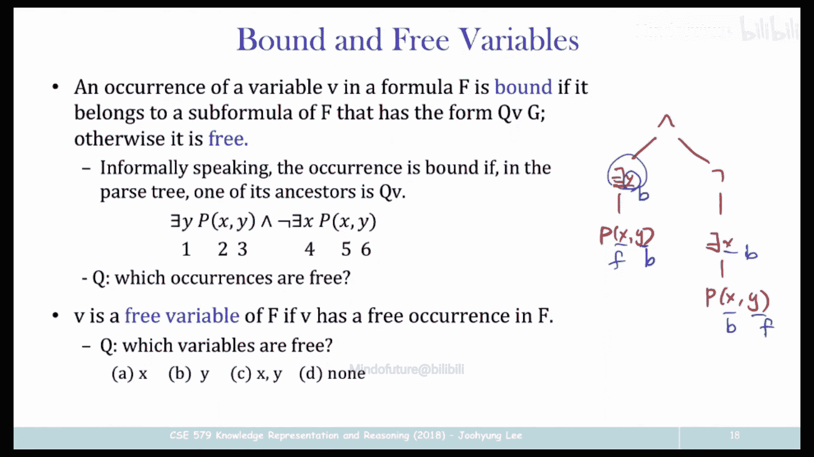

All right， here's another example。Okay， so here what are the three occurrences of a variable。

 So there are five occurrences。Okay， what are the three occurrences。4 and5， right。

 Because if you pass this， this quantification for allx is only applied to these things， right。

 It doesn't govern this。So four and five are free currencies there， then what are the free variables？

X and y， okay？Okay， good。Now。Boun variables。Can be renameed。And that does not change any meaning。

 if you say for all x P of x， everybody belongs to P。

 whether that everybody was en by x or y does not actually matter。

 so bound variables can be always renamed while free variables cannot be renamed。Okay。

 because you don't know what is that。Fe x and Y refer to。So this is a terminology。

 a sentence is a formula that has no free variables。Now。

 some people may just write a formula that has free occurrences or variable， but as we say。

 we can only assign the meaning to the formula that has no free variable。

 So convention here is you can say something called universal closer。

 which means that even though somebody wrote a formula that has free occurrences。

 you understand this as universally quantified those free variables are soon to be universally quantified。

Okay， so that is actually the convention in many KL languages。

 You don't want to say always these full quantifications。

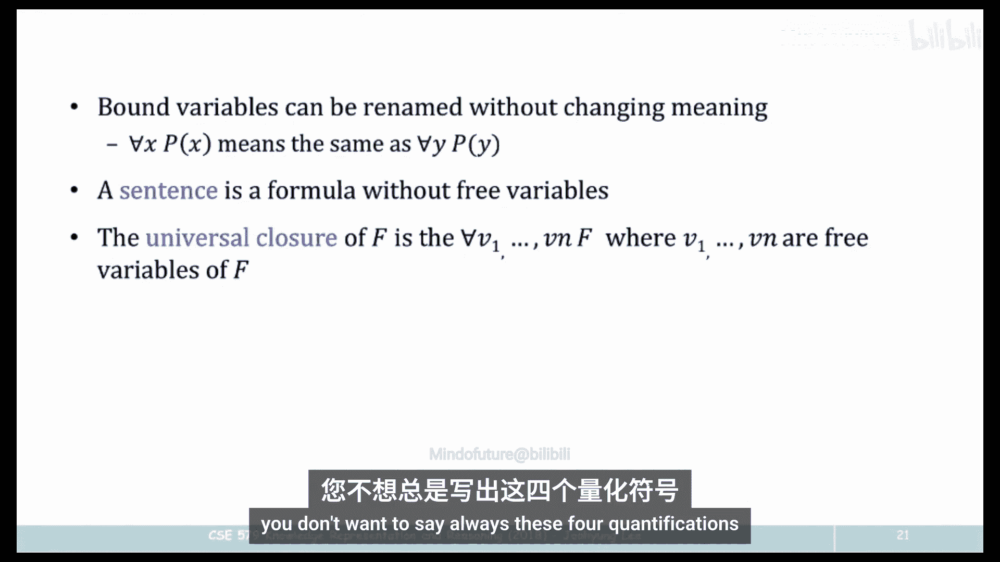

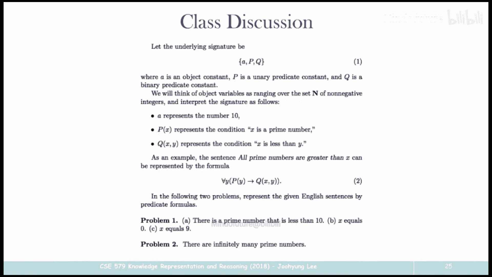

So now we look at the semantics。Of first o logic。啊，嗯。う。给我 sponsor。That。

So well probably just spend maybe five minutes。To talk about intro to statistics。Okay。

 so this is actually reflective of what we did in Proal logic。There we had an interpretation。

 which was a function that maps atoms to truth values。

 Now this becomes a bit more complicated because the signature now contains more complex objects。

 So basically what interpretation does is how to understand the symbols in the signature。

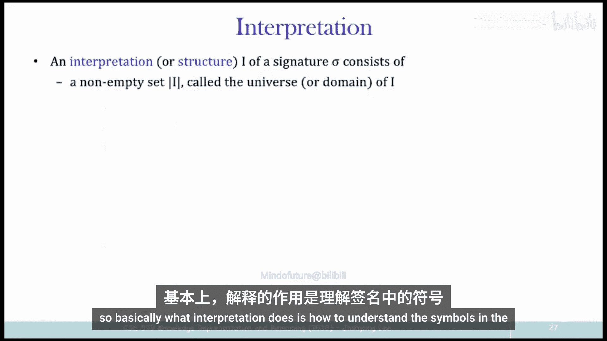

So as you see from this example in the exercise problem。

 there is something called the universe or the domain where the individuals can range over。

 so we are only looking at those particular set where the quantification can range over okay。

So in the previous case， it was the set of non negative integers was the universe。Now。

 for each object。We have this interpretation。Maps each object constant in the signature to a member in the universe。

Okay， so if you say John。Okay， or if you say a， okay。

 the interpretation could map this a into some member in the universe。So in the previous example。

 a was a symbol to represent 10。 What that means is。The interpretation will say AI equals 10。

 assuming that the universe， which is denoted by this symbol， is set of non negative ins。

 So any time that you evaluate object constants under the interpretation。

 it has to map into a member in the universe。Now， does the same thing happens for the function。

 The the function can take the。So this is function。 When you apply the interpretation to function。

 what it means is。You are given the set of individuals and you have to return to another individual。

For the proportional constant， it the same as proportional logic， it returns either true or false。

And for the predcate constant， it has to return also to false。

 but now the domain is the set of termss。Okay， so for this example， we as we saw， we have these two。

Now， this is a more formal way to say P represents that x is a prime number。

 or P of x represent x is a prime number can be represent formally in terms of this interpretation。

 so P is a function that makes us to understand what this symbol P means under the interpretation I。

And the argument here is actually the member of the universeus。

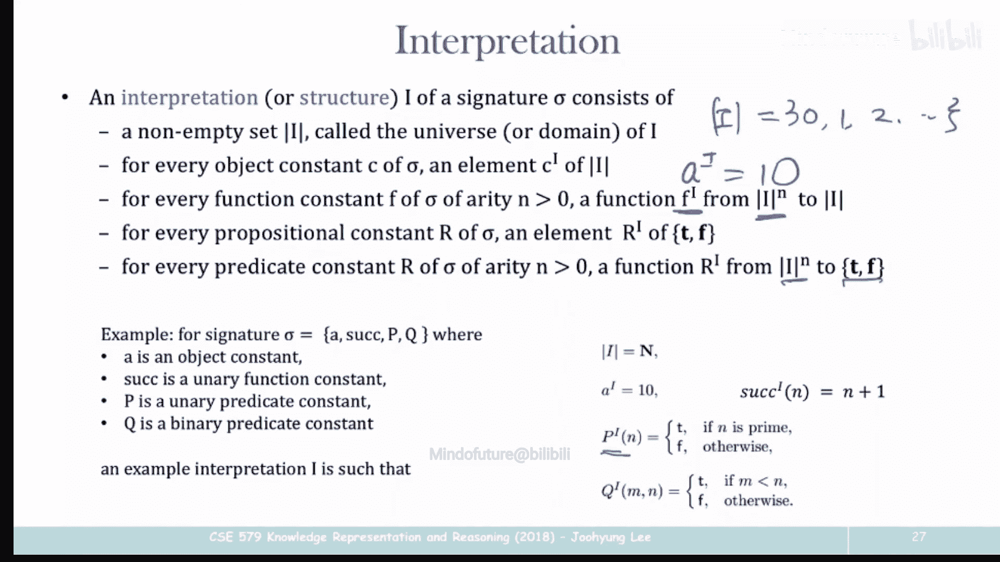

So if you give the sum number n。If n is a prime number， then it returns through。

And it's not the prime number。 it returns false。Similarly， for the pretty constant Q。

 so I write Q superscript I to represent the understanding about this predictive constants。

given the two tos， M and N， which are two numbers。If M is less than n， it returns true。

 Otherwise it returns false。So those are the pretty constants。

Success is actually the function constant that was not in the problem， but I just included here。This。

Its not a predicate， so it returns given a member， it returns another member in the universe。

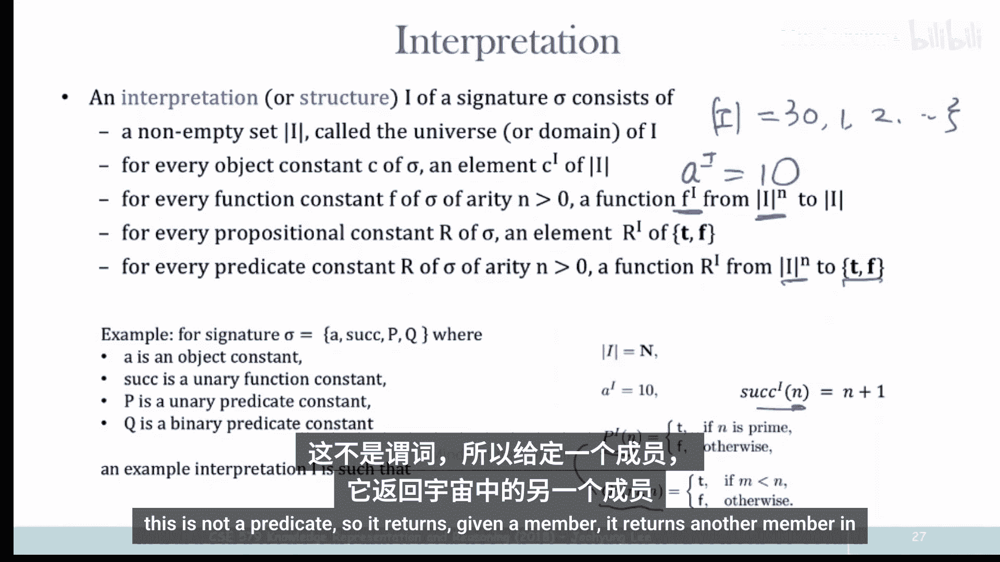

O。Okay this will be the last slide for today。So for a term。

 we constructed a term in this syntax pack。嗯。So given the interpretation。

 how do we understand the term for the simple case， like object constantsance A。

 then a superscript I returns to an individual。 So that's already what interpretation tells us。

 But now given the interpretation， how can we understand more complex terms。

 So given the F and T1 through TN。Okay。And as you can see。

 you just recursively evaluate the termss and then apply this function F。Okay， so here's an example。

So， success of a。you apply this interpretation to the success of a， it goes recursively inside。Okay。

 so AI is actually the 10 under this interpretation。 So you replace replace AI with 10。 Now。

 the success of I in the previous slide， you see that if youre given the number 10。

 it returns next to value， which is 11。 Now， here is something that you have to be careful。

 When I use a versus a superscript I。 They are totally different。Okay， A is a part of the syntax。

A superscript I is a meaning。He's a member of the universe。Similarly。

 when you have the successive function。So test of S youCC here is just a function constant。

When you apply the interpretation， this function gets the meaning。To return the next value。Okay。

All right， so I'm going to stop here and I'll put the exit ticket。

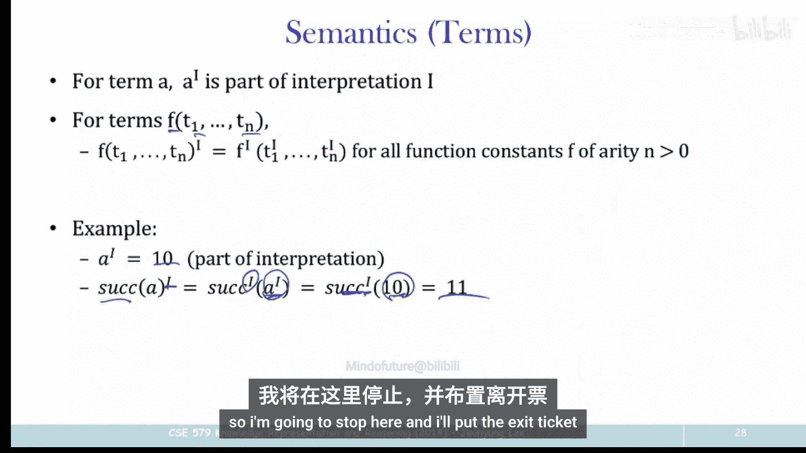