# 【亚利桑那州立大学】知识表征和推理 ｜ Asu Cse 579 Knowledge Representation 2018 p04 P04_Lec6 -BV1RTWyzfEQH_p4-

Okay， so today we'll finish semantics of first logic and try to start the next。topicic。

 which is AnE programming。So just recall what we have done last time。Unlike in propositional logic。

 the notion of interpretation become more complicated because the atomic formula is more sophisticated than before。

 so it contains。Objects， the individuals and also the relations between the individuals。

 So you have to express those kind of concepts in first logic。

So we had studied the syntax of formula， which is constructed from the terms and atomic formulas in a recursive way。

So here the interpretation is simply giving the meaning to unassigned constants。

So here we start with the universe， which is denoted by this symbol。

Okay so when you have I as an interpretation， this IB represents the universe or the domain of the interpretation so basically the domain means what are the individuals that can be found from so which is a set of the individuals that you want to consider it could be set of peoples set of numbers or a set of some other things okay so you have to specify what are the domain of your discourse otherwise when you use variables is ambiguous we don't know which what is the objects that these variable ranges over okay。

Now when you have object constant this is to denote a single individual so the interpretation gives us what is that particular individual so here we used the symbol C supersscript I C is an object constant when you apply the supersscript I that means this is now a function that maps constants into an individual so most of the time the constants and the elements in the universe can be the same but there are sometimes it could be different。

 so if you recall the classic expression problem。There was actually number 10 which was represented by a as an object constants so there the a was mapped into actually here is an example so a was mapped into10 note here that a is part of the syntax is an object constants 10 is not a part of the syntax is a part of the semantics is a element in the universe so something that you might get confused is when what is this where this symbol belongs to is it part of the syntax is a part of formula or is it a part of semantics。

Okay in first of the logic， a can mean many different things depending on which interpretation that you apply。

 so this particular interpretation that you saw had a maps to 10 but somebody else say for a I would map into 11 that doesn't matter okay there are actually many different ways that you can map those individuals so interpretation just give one particular way to understand these object constant。

Same way if you have a function constant okay so this now function constants works similar to the object constant except that it has argument。

 so it receives some terms as an input and outputs another individual okay so for instance if we have the successive function。

 it receives some element from the universe and it turns another element it could be actually the same element too for this particular one it was returning the next element successive function。

Okay。All right。Now that is about the term and what about the propositional and prediccate constants。

 so Proal constant is a special case of prediccate constants where there's no argument。

 so this works very similar to atom inproal logic， so it's either true or false so interpretation here will tell us whether this particularal propositional constants is either true or false。

Okay。Now what about predicate constant， so this is also doing the same thing as proportional constants in the sense that it maps in true or false。

 the difference is it may contain argument。Okay so here we have two predcate constants。

 one is unary another is binary， so the unary one was receiving one element from the universe and it was returning either true or false depending on whether this is a prime or not same for  Q if M is less than first argument is less than n then it returns true Now again here note that Q is an object constants。

I'm sorry， Q is a pretty constant， it's a part of the syntax， but when you apply Q superscript I。

 this is part of the semantics， this is the function that makes us to understand when given the arguments of M andN。

 whether this returns true or false。Okay， yes， so when we talk about a set of functions like gamma。

 that would map to the。Which of these cases Se function is still a function， right。

 I mean I'm sorry Se function is basically a function of these things， right Yeah okay。

So it could have many other functions。Maybe you were referring to maybe a function that has two argument。

Okay， so addition is another function that you can say。 So add。

This is not a part of the problem that we saw before。

 but you can actually define add function as something like this。Okay。

 assuming that ad is a part of the syntax。O。A we clear。Okay， so next one。

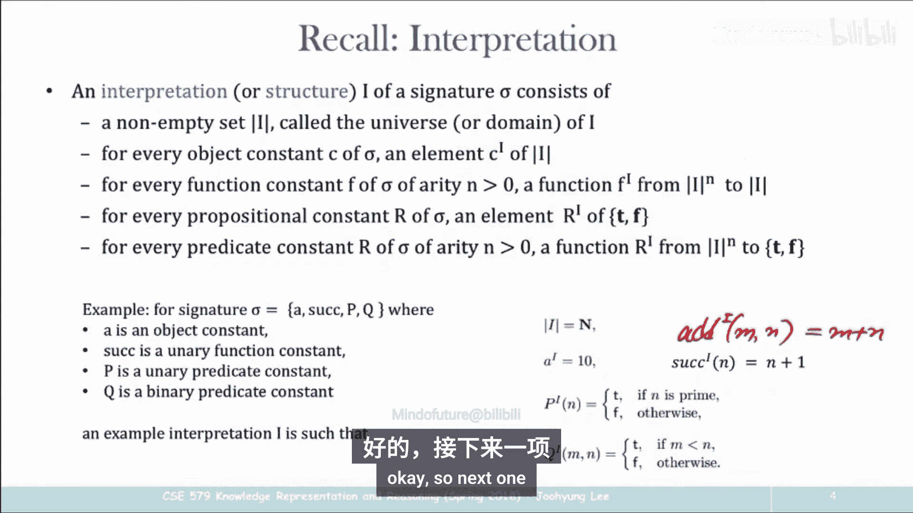

So again， this is what we left over last time now。When you have some term a if here a is an object constants。

 then of course a superscript I is already given in the interpretation in the previous slide。

 But now what about the function terms so when you evaluate。This， so in the previous slide。

 we were given how to understand F super speed I。 But what in the。

In the formula you have f of T1 through TN where t1 through TN are other terms right so how do you evaluate these complex terms in a recursive way so basically you do the evaluation for the inside so each of the TIs will be evaluated under this interpretation and when each of them are evaluated they will return individuals in the universe。

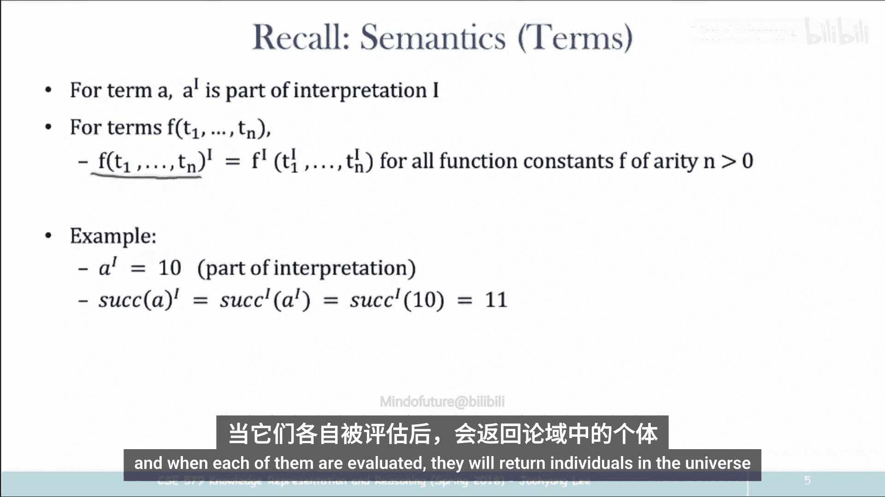

Now you have individuals in the universe as input， then this function F superscript I look at those individuals or set of individuals and returns another member。

Okay， so that's how you do and which member is returned is specified by F superscript I。Okay。

So this was the thing。Now that's fine， so we are given interpretation。

 we know how to understand interpretation， how to evaluate terms but now how do we evaluate formulas。

 so here is a way to go so truth value of F so formula here is a sentence actually is a formula that has no free variables let's assume that because if we have three variables we cannot actually define okay。

So we want to evaluate formula that has no free variables and we apply the interpretation I so how do we define it The first four clauses are very similar to proal logic actually the second third fourth are exactly the same things the first thing is also similar but because now we have the atomic formula to be more complex so here pretty constant followed by the T1 through TN so this is an atomic unit of the formula the evaluation is actually similar to the terms so you evaluate each of the terms and then apply the predicate function are superscript I。

Okay， so this will either it return true or false given this interpretationt。

So atomic unit will even return or to force and those bottom and top are evaluated the same if you're negation。

 then of course you flip the values inside of this F and binary connected are also the same。

Because eventually these formulas will return either true or false。

Now the new component is about the quantification， so for all W F of w。

 so here I use W as an insight which is to represent that W is free variable okay。

Okay now we have for all quantification， so then there is no free variable。Okay。是う。So basically。

 what it means is that we want to say this for all wF of w is true means for all object constancy。

 when you plug in this object constant， then this formula will always evaluate true。Similarly。

 for existential quantification， if you can find at least one object constants that makes F superscript I。

 the valuation of F under I is true， then we can say this existential sentence is true。

And give you a hint here that this is actually。Not exactly what we want。So let's think about that。

What would be。On issue here。So let's try to evaluate this formula now， exists xq X AI。

 so let's recall the same interpretation that we look at before so according to the definition。

That we are given。So here instead of w， we have x right。

 So x is actually the variable that we quantify over。 Okay， so if this is supposed to be true。

 according to the definition， that means there is some object constants or some object constants。C。

 so C。Such that F I equals true actually let me write F S Q C。AI equals true。Okay。

 so I'm just unfolding the definition。Are we together？ Okay， now what is the problem then。嗯。没也被我。

And for reason。Well， there is no for all a here A is an object constant。

 so we don't quantify over a A is object constant that maps to 10， so that's okay。

We need to apply the。Interpretational。I don't know if that's the right way to say it because our function is Q y。

isOh， okay， I meant。This one is actually recursively going inside as a first clause。

 so I wrote in the left hand notation， but as if you want to be fully writing it。

 I should write it as this way。So that's actually evaluation that is shown。

 but these are actually the same thing。O。So what is the problem here？开定费。嗯，I病。Eito x。我才记个没有一个。说你こ的方的。

都报多多。Not true for all。So。What is the intu about this formula， if this X QXA， this formula means what。

There is some x that is less than 10。Are there any longer that is less than10。

 and so this is supposed to be true， right？I it。How many other constants do we have？应该的。

Oject constant。いす。次よ。Okay。The signature。Whats A P Q。

Okay the interpretation is only about the signature。Okay， how many object concerns do we have？21。

 which is a。 So this sentence is same as。Q。AAi。喂。Q AI AI。Its true。Okay。

 the whole thing that we said about the existing sum object the constants that maps QC C comma A to be true。

 the same as。Q a comma a must be true under this interpretation。

 but it cannot be true because a cannot be smaller than8 10 is not smaller than 10。手机problem。

The problem is there are actually many numbers， but we have only limited set of object constants that can now name all the individuals in the universe。

And that is actually true for first of logic you don't necessarily have the infinite number of object constants。

You may， but not always。Are we together？Okay， so this is a buggy definition。

 if you want to say for some object constants， this must be true when you plug in。

 this does not work。不说。So x here belongs to00 be x is a variable x does not belong to。Unive know。

です not。X is a variable that can range over the elements in the universe， but x itself is a variable。

 you don't say x belongs to the universe， what belongs to the universe is exactly the set of non negative integers。

X is not for non negativetivity in teacher， synically， they are not the same。那边。This last part here。

 the very bottom line you wrote， is that saying if C is equal equal the A。

 because we can only choose one C。So here谁我是今年。name for any object constants。

 So if you can find some object constant when you plug it， then this formula as very true。三か三号す。Now。

 in this particular example， we have only one object constant which is eight。So I分别啊 a。

And so that's saying that it's actually false。It is supposed to be。True。

 the meaning of this original formula is supposed to be true by when right， this way。

 Q I and commma A， what does it mean means that。10 should be the10。

 according to this interpretation Q I returns true when the first argument is less than the second argument。

 However， for a comma a。You can never satisfy that condition， so it has to evaluate to false。

 which is actually wrong。Our intuitions say that this must be true。

 but the way that we define just now doesn't work that way， so this is buggy。P。

According to this buggy definitionThat's something that we are going to look at later。ok。

Are we together？Okay。This is the part that the form semantics become rigorous some of you already know this meaning as four numbers。

 blah， blah， but actually in the formal definition that is not very precise so let's look at this way。

So what the problem was we cannot actually plug in all the individuals into the formula。

 the variable was supposed to range over all individuals。

 but if you just use only the limited set of object constants。

 they cannot map to all members in the universe because object constants。

 once you specify the interpretation， it can map to only one individual。Right。Okay。

 so the second approach here is， let's say， instead of object constants。

 the change is actually here for all members of the universe。Okay。

So when you plug in all the members， then this must be true。Okay， so for instance。

If you have the same example as before。QXA。Here what I'm going to do is this is true。If and only if。

For some member。Q。C， comm AI question。没有。This sentence。It's actually true。Because you can find。

This is true because。You can find any member that is less than 10， let's take ss9。

Then Q9 comma A i is true。Right，9 is less than 10， so this must be true。Okay。Are we together？Okay。

 so the difference here was when we have object constant。Versus member of the universe。of units now。

 the member of the universe ranges over all the members in the set of non。O。

So is I always the set of learning， is it。I is an interpretation。

How many interpretations can you define？In2 many， I can actually map I to range over many different kinds。

 as well as a can map to 10 or 11 12。 I can do that。 It's actually three， According to the logic ses。

 I can do that。 So actually if have any interpretation I can define even with these three symbols in the signature。

Unlike in professional logic， if you have only n atoms in professional logic total power n。

Only numbers can be defined as an interpretation。喂。

To to any is a large number but still is a finite number， but in the case of first of the logic。

 the number of interpretation that you can associate with the formula is actually infinite。

This is still boggy。Is it better than before， but still body。 Anyone knows。

This is actually more tricky than the previous one。社保给。

This is where actually the undergraduate logic course stops。

 okay you don't have to know more than this， but since you're thegra level。So我 the 아이。

I is already fixed here。Right， so the question is， even with the particular eye that we are given like this。

 there's still something wrong。And when you're asking me。The7 of I was event。No。

 well instead of I okay here， I'm not changing I， I is the this one。Okay。

 you don't have to change eye。If you change the eye， then you also change everything here。

 so it's a totally different meaning that we're talking about。So that's not going to that yet。

short belong to the same。け健成 again。你板的啊。对这个。If you get it， nine is another part of the signature。

 what is wrong here？I wrote Q9 comma A， and I pretend this as a formula， this is not a formula。

 according to this signature。Why， because9 is not a part of the signature， I cannot use that。

No' hear that。Once you're given the signature， you can only use those symbols in the signature to form the formula。

 how many formulas that you can write using this signature？Again in fit many you can write， however。

 you are not supposed to use other symbols than in the signature。

 the only other symbols that you're allowed to use are the like object variables， quantifiers。

 comma and parenthses。equalityィ。Those are just a universal for first of logic you can use because they have very fixed meaning。

But the interpretations are only about those symbols that people may define it differently。

Now9 was another part of the signature， so writing this way from the beginning is actually wrong。

 iss almost correct in terms of syntax semantics， but it's wrong in terms of semantics。就这样。

It's almost right in terms of semantics， but synically this is not even a valid formula。😊，Okay。

The way that we fix。

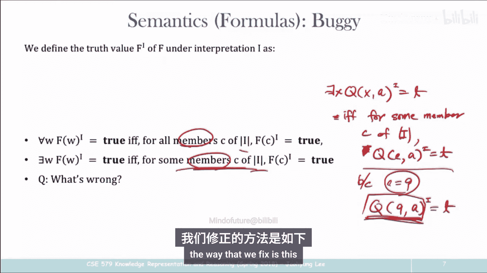

Is this， so only when you define the meaning of the formula we are going to extend the signature so that this signature may contain all the names of the individuals。

In the universe。Okay，Now note here that this is actually somewhat tricky。 this extended signature。

 which is not by Sigma Suscript I。 This is not available for domain xthematizer or knowledge engineer。

 they cannot use it。Okay， because that's not the given vocabulary。

Which means that they cannot write a formula using any symbols in this extended signature。

 they can still write the formulas according to the original signature。Okay。

 but they cannot write any symbols。Here what we are going to do is we will- the problem is the previous one。

 just the one before us。We don't have enough name for the individuals。

 so let's try to create name for all individuals。And these special names will be only used when you define thematics。

Okay。And these will be called object names， syntactically they are same as object constant。

 but we'll call it object names。So let's actually look at the examples。So what I mean by that is。And。

Instead of non negative integer， so it is actually like this。O。We cannot use。呃。

Numbers in the universe directly into the formula， but let's create named for that。

So this extended signature will contain all the symbols。인도 오리지널 쓰죠？Like let me。Right this way。

This contains all the original的。Plus。Named for all individuals。So instead of zero。

 I will now call zero star。Which is actually an object constant in the extended signature。Okay。

 and instead of Q 9 commma a， what I can do now is Q 9 star。Com么 a。

It's possible under this extended signature because nine star belongs to the extended signature。

Then the problem solved。Okay， now note here that there is certain redundancy because among these things are actually 10 star。

 right？10 some maps to 10。A a also maps to 10。 So there are actually two names for the same object。

 but that does not matter。As long as we have names for all the individuals in the universe。

 we are done。Yes死。If we do this。We didn't need to change the definition by replacing form on we'll see the definition in the next slide。

So just wait for one like that。Yeah， that's exactly the reason that we do this。

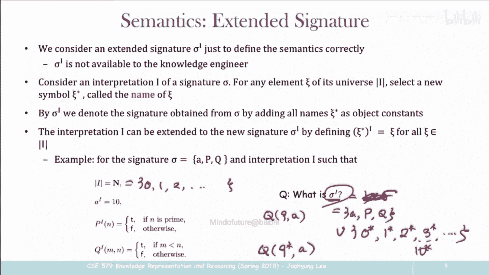

So yeah， so let's just go there directly。 So what we do is。

This is almost like the last failed attempt， but there we actually use the individuals directly。

 but now what we do is the names of the individual。Okay。

And this is okay now because this formula will thissi tab， which is the name for the cosi。

 will be only used to define the semantics。Okay， so going back to the previous one。

 this is not true according to this definition。If you're confused about all the boggy definition。

 you cant forget， but this is actually something that you have to remember。So note here that。

Our signature。When we define this when you define the semantics。

 now we are using this extended signature。Okay。All the names of the individuals here。Okay。

So this is now true。 if and only if。呃。Q， O。Q。Caai star。Ay。I is true。4。Some。Ai in the universe。

 Uni is a set of non negativeivity inches。Okay。嗯。Ex isスピ。Yeah。

 you can find anyone because its for some， right？But before we go into that。

 are we together here until I'm just copying to definition， okay？Sa个。

For this one is true instead of X， if you can find some individual in the universe and put the names of the individuals into the formula。

 and if that formula evaluate to true， then we can say this existential quantification or existentially quantified sentence is true。

And yes， you can find anything， this is actually true， you can easily check because I can take。

P I to be nine。And I can evaluate Q thesi star， I'm sorry Q9 star， let me write Q9 star。A。Its true。

 because。This is same asQI。나인스타。哎。AI。And this is QI。Nine star is always map to nine。So this is9。

And a is map to 10， according to this。Definition that we have， and we know that line is less than 10。

 so this is true。O。So this is a bit。To technical for you because humans use the intuition to do this。

 but if you just type the previous definition into the computer and the computer will just complain that this is a syntax cell and most of the time when you above the first thing that you encounter is the syntax error。

 right？Okay， problem solved， yes。So。そ。S that we had， which engineers L use while reading the formula。

So why don't we allow them to use？The formula， when you're given the formula。

 that's actually a really important thing。You are not necessarily having only one interpretation of socialciism。

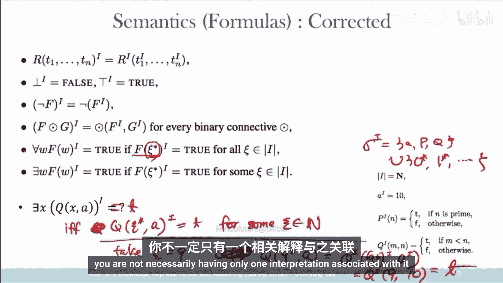

不用 see。We canhy we cannot do？Actually， let me just introduce。Comminology first。

 and we'll get back to that。嗯。So。The notion of satisfiability。And 토지。

Many equipments it exactly the same once you understand the truth value of the formula according to the previous slide。

 so we say that I satisfies a sentence F because to have a formula we don't want to talk about formulas with three variables。

So those are called sentence， so I satisfies a sentence F or also called I is a model of F if F is evaluated true under that interpretation。

Okay。Now， sentence is logically valid if all interpretation satisfies the formula。

And two sentences are equivalent if they are satisfied by the same interpretations。嗯。

If you have three variables， this is just a convention。

 then you will understand this as a universal closer where the old universal quantification is prepened to the formula。

 if that is logically valid， we say a formula with three variables is also logically valid。

And F and G are equivalent to each other if F is equivalent to G as a formula is logically very what you see is what exactly the same thing that you saw in the previous proportional logic。

 The difference is of course interpretations are much richer than before。

 but that's all hidden in this slide。嗯。So the question was why don't we use extended signature all the time。

 the problem is when you say this is a logically valid formal lab。

 how many extended signature that we have to apply？What is given to the knowledge engineer？

They can only work with one interpretation at a time。If I safe， four legs。

Let's actually use a simple one。This formula is a topology。It's a totalology。

 okay no matter what interpretation that you apply is not to be true。

Which extended fingers do we have to use？为ち望。Is it okay to use one extended signature to check this？

The question is， if this is logically valid or it is a topology。

 then it should be true for no matter what interpretation that you apply。

 the knowledge engineer are given only limited resource。

You have to specify what you mean by these names。Okay。But here。

 if you want to say this is a autonology， it actually ranges over all possible interpretation。

Something different here is slightly different instead of toology for some historic reason。

 when people talk about first of the logic to be toology， they use logically value。So this is。

Not really significant thing， but。The slightly different terminology that is being actually used in the literature。

O。So here， the interpretation satisfies the formula。It will also depend on the universe。

Which universe？So basically， suppose I want to say there existed room。Three。

 when you talk about the logical validity of satisfiability。

 the particular interpretation is not the point。If you can find at least one interpretation that satisfies the formula then the formula is satisfiable。

I don't care about which signature that you use or which interpretation that you use。

If you can find at least one interpretation that satisfies the formula that the formula is satisfyfi。

One of things are you want to say well that's why you quick。I want to say whether。

 so there exist a quite of two。And it won't bevol scale， it fall into invasive and， what sc。

How you size code。Again， in first of the logic， square root。Can be can have fixed meaning。

Sca is the方向。And you can assign any meaning to the function。So when you say scare root。

 you have a particular meaning of scar root in your mind， but that's not according to the first。Okay。

Actually， we will be heading to that particular argument what is actually。

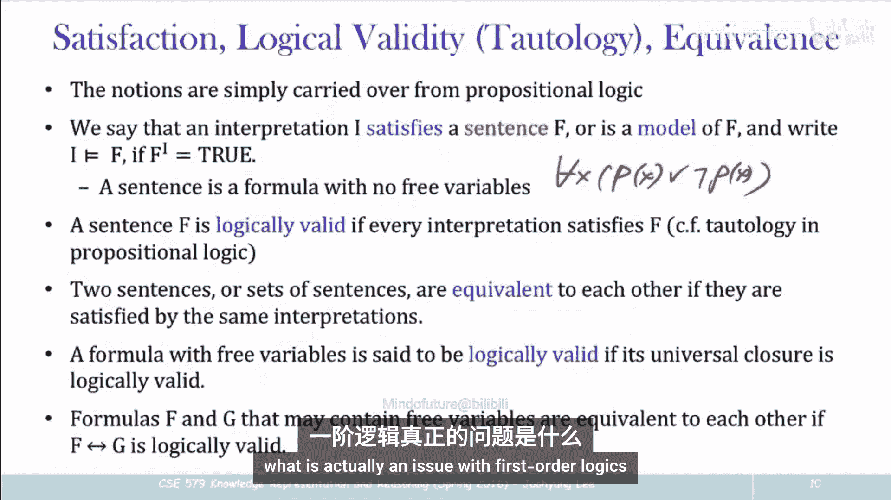

An issue with first logics。But before we do that， let me finish up some not。 So again， this is same。

 So a set of sentences is satisifiable。 okay， if there is an interpretation that satisfyisfi all sentences。

And set of sentences in tails of formula you recall the entailment， right。

 that's one of the homework problem。Gmma intelE， if every interpretation says is5。

 gamma satisfies the universal closeover。Okay。All right， so that's okay。

 but now since let's just do some exercise here。嗯。Actually， let's open this soative。

And let's do this。So the question is。Tru or false。So these are the two problems。Okay， so。Let me。

Come back。そ we toは。notT的定 c说你退了吧。All interpretation satfies the said gamma must satisfy the formula on the right。

In order to be in order for this inter to hold。Okay。Okay， are we done？Lets see。Okayケ。

 so almost okayそです。你啥都。Ss。False， true， true， true， Fall， through， true， false。Okay。

 do we see any combination that is not here。I guess at least， okay， good。O。So。And let's see。

So what is the。Meaning of this thing。 So in the first。Problem， you say。Basically。

 there is some X that belongs to P。And there's also some x that belongs to Q。

Then is there anything that is common for both P andQ？Which is。

F right we note here that I use the same variable x but don't be deceived by the variable names because bound variable can be always renamed so when you say it xpx okay then x so let's actually take very simple example。

 maybe the universe contains one and2。Okay。So， now， P。Is true for one。And。For two is false。Okay。

 and for Q。It's opposite。Okay， so the first sentence of this formula is saying there is some x that belongs to p。

 is it true， Yes， which one is that x？1 so one belongs so that's fine and exists that QX is also same because2 belongs to  Q to be a done。

So this is interpretation that satisfies left hand side， so for impairmentment to hold。

 then this same interpretation should satisfies the one on the right hand side。Right， is it？

T not to be wrong。There is no common element that belongs to both P andQ。

So this is actually not entailed。Okay， for now checking that is not entailed is easy if you can find one interpretation that satisfies the left hand side but not the right hand side Okay。

 what about the next one？嗯。How do you know。不社处。How对弄。Everything that belongs to P， what which P。

 which X， which is universal。You we take the same example here， so it's an awkward。

Most small he sacra？Okayケ I I dont want to。Threateened that。啊。So my thing I this。

And so if you do that， what happens to that defense cycle？啊。Is it false and， is it internal true？T。

Okay there are more steps， Okay， let's go through so take this particular interpretation that is satisfy left inside。

No noオケ it does not say this my。Does is so what what， what have been。

HowCan we say that determine talk now。Due to this thing。no喂。Why。

 because I did only one example and it happens to。Make the left hand side be false。

 so it does not contradict that this is not intail， but it does not conform yet。

 this is in because for the internal tool you have to go through all interpretation so let's choose other combinations so let's say true truth。

 false， false， false， true， false false。I mean， for all possible combination。

I did check and somehow this intern for all this interpretation that I tested， are we done。

Do you see what I'm saying so let's go back how many so you have interpretation。

 so universe one and2， let's fix the universe to be1 and two so that's fixed。

How many interpretations are possible？For p andq。4。没。How manyに。I。For P1 MP2。

 they can be true false or two times 2。It same time so so that interpretation patients。

So those people who said true may have computed 16 possibilities at one time。不同用。However。

 that is not fishing。That is not sufficient， why。Because you choose only one such universe。

How many universes that you can associate？And did you find many possibilities I don't think so。

For some reason， despite that， you think that this must be true。

 although you didn't actually verify according to the definition of internment。

 in order to use the definition for all interpretations， this inter should be true。

 right this checking must be true。But you didn't do that。Okay， that lies the problem。

That we encounter in first， undecidability。Let me just finish up with here and then I'll take the question。

So the validity problem is actually well known on this type of the problem。What is this problem。

 so you're given a first order sentence and the question is。

 can you design a general purpose algorithm or general algorithm。

 they saying given any such sentence F， if F is top or logically valid， the algorithms say yes。

 if not， algorithms say no。Okay， don' hear that this is not only about the validity problem。Okay。

 you remember how the totalology was related to unsatisfiability and also entertainment。

 this is also the part of the hormone problem， right。So it's not only this problem。

 but most of the interesting questions about FOL， like satisifiability problem and equivalence problem。

 theyre all going to undecidable problem。O。Okay， so if you have time。We can try to prove this。

 but let's keep the proof in the class for those who are interested in this。

 if we go to the computability textbook， there is actually the proof of this。

 PCP problem can be reduced to validity problem and PCP is already known to be undecidable。

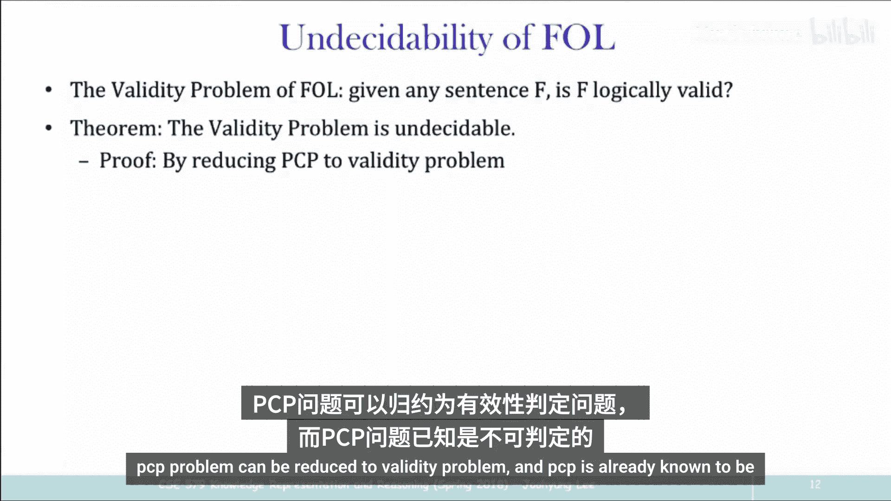

Okay。The corollary here， I told you that since the logical validityities related to other notions in for logic。

 satisfiability problem is also undecidable。Can you find at least one interpretation that satisfies this formula F。

 this is undecidable y because you can reduce the validity problem to it and the main lemma is actually this one。

Same as in proportion logic， E is logically valid or epi ortoology。

 if and only if not F is unsatisfiable。Okay， so if you can decide this， then you can decide this。

Okay， if you can decide unsatifiability means you can also decide satisfiability。 however。

 this is not decidable。You cannot decide satisfiability。Okay。

So this is actually the problem that we have。So the lesson here is we have to restrict first of logic in some meaningful way。

Okay， so in proportion logic， the problem was it involves exponential blowout in the search。

 right maybe that's what we cannot avoid for some problem。

 but when you go into the first of the logic，What we did was simply adding some terms and quantifiers that's all。

 and then somehow it becomes an undecidable problem。

 so how can you actually build a knowledge representation language if you have this undecidable property？

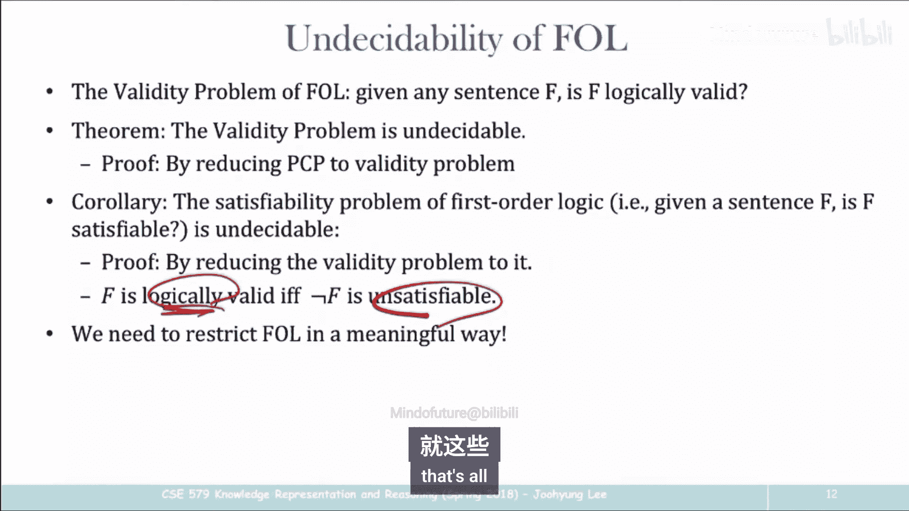

So youve asked the system。Okay， so you can formalize those examples。啊。

In the natural language problem that we did before， you can turn it into a formula， right？

The problem is。Even after you convert into a formal language。

 you cannot answer yes Lu no for the very basic questions。没。Okay， so question up to this。So actually。

 I was trying to say the exists problem， the one that we said false。你说。We have two options。

 two questions。The following in different question on the previous day。Okay。Yeah。

 the first one actually， three things the universe for the first one， if I can get only one。

 but this could have been true。Okay， but we are talking about interment。

 interment is about all right， So if you can find at least one that does not satisfy an inter does not all。

喂喂。Okay。So we never restrict interpretation that way。

 so let's consider I containing only one element in the universe， it's not that way。

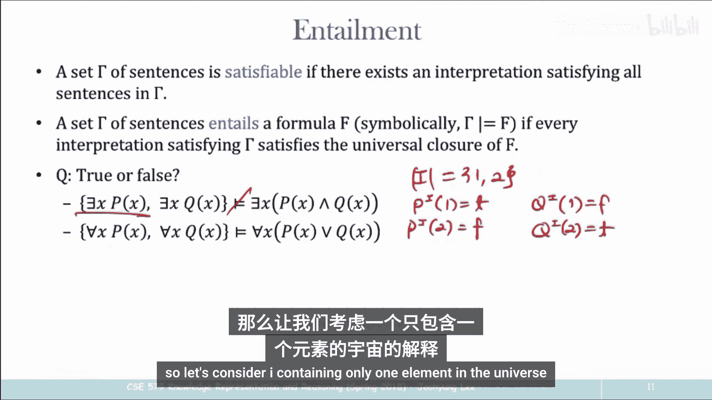

Okay， good， so here goqui。呵呵。😊，Okay， pull。QuQurantin and Robert went fishing。 each called one fish。

 There are two fish in total。Okay， what's going on。嗯。全感です。Two of them were called the same fish。

That was not intention here each core difference。😊，😀Yeah。😊，We would time to see。

Some of them are actually same person。So Paul and Kentin may be the same person。

Of course this is not the use way that you write okay but if you say Mr。

 Robinson and Robert and blah blah， sometimes one of this thing is actually your first name the other may be the last name so if you write this way maybe not but if you have whole corus then you will see that the same person can be referred to by different names so you have to do some entity resolution to see what is called okay now why I'm bringing up this iss because in firstzoology we have very general behavior for interpretation that's actually one of the problems for thisability。

W it undeciable because you have to consider infinite many interpretations？对。So this sentence。

Seems to be a bit weird， but until the first of the logic， it is actually possible。

 this is satisfiable because P and Q may map to the same person。Okay。So often the case。

 we don't want this behavior。So if you want to use first of the logic like a language。

 we want to restrict that these people are actually different。

 how do you say that these are all different people in first of the logic？So you have to write this。

Forula for each pair， you have to say they another the same person。

This inequality is actually just an abbreation。So when you say p is not equal to Q。

 this is just standing for neation of P equals  Q。 So this is a equality that you defined before and it's a neation in front of we。

So if you want to say these individuals also know different people， then you have to specify this。

 this is called unique name assumption。So first of the logic itself does not have unique name assumption。

Which means that some individuals can have to the same people。But in many applications。

 when you do the knowledgey representation you want to say that these are all different。

 so then under the first auto logic you have to write this lengthy formula the general formula is actually here。

 I'm not going to go into the things but if you have a terms that has an argument then the unique name assumption is actually this guy。

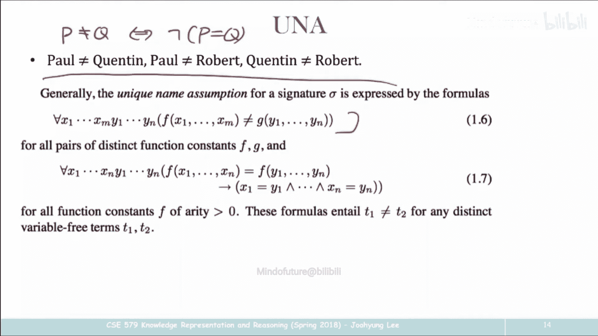

And actually， this， these two。Okay。There's another thing called domain closed assumption， DCA。

So I don't want to consider infinitely many objects I know， well let's say the class here。

 okay I know there are about 30 students in this class and I can name all of you and there's only a limited number of individuals here。

So how do you say that all the universe is？I'm going to consider a universe that contains only these individuals。

So that's the main closed assumption。 So how do you do that if I want to consider only this。

 I will write this one， This is probably probably very similar to the last question in right So for that X is meant to either form or a P or Q or R。

You cannot map to other than these。Okay。Are we together， So any formula that satisfy this？O。

Let me ask you。What is the size of the universe？Whose interpretation satisfies this formula？3。能。

Only this formula。 Okay， so take any interpretation that satisfies the formula。

 The interpretation must have。This number of individuals。What is this。Sp is one of the possibility。

Two is one of the possibility。我你时候是怕4频。ゼロ isなか。Why， because as I said before。

 these people can refer to the same individual， this name。

 P and Q and R may refer to the same individual。So most of the time。

 what you will do is I would have unique name assumption and also domain codes assumption at the same time。

So I can't know exactly how many people are in this room and all their names。Okay。All right。

 writing this in first of the logic is a bit tedious to do。

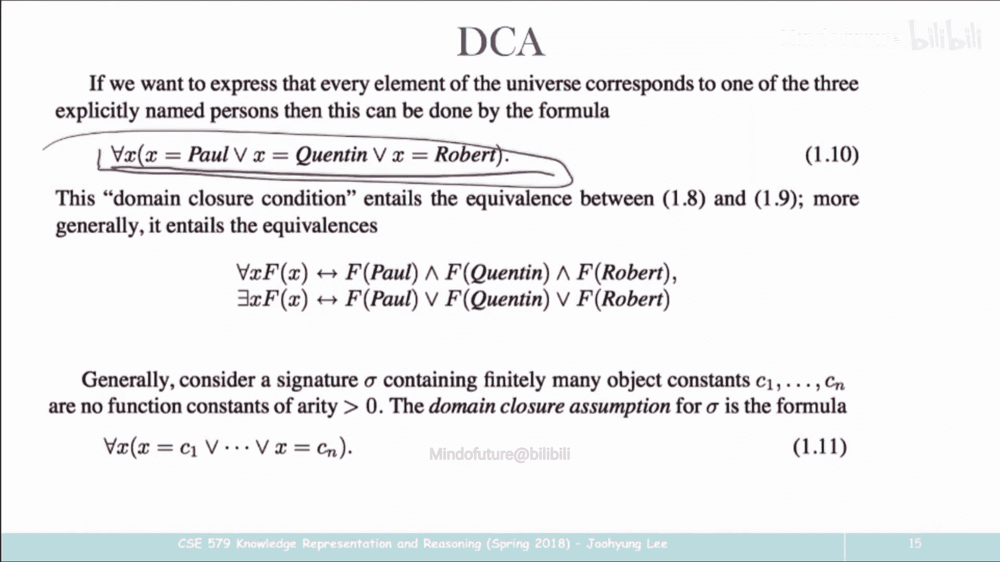

So many of the knowledge coefficient language has some built in way to express this。Okay。

 now we are done with this one and the problem with classical logic， actually。

 the root of many pair language is actually classical logic。

The problem is even for the simple professional logic， it blows up。

The the exponential time to compute and for the。And for the first of the logic。

 it becomes already undecidable， so we have to find a way to restrict this behavior so that it is decable。

 also can be computed in a reasonable time。And there are so much things that is un naturalt。

 sometimes it' a unique name assumption is not there， okay。So things like that。

 So what we are going to look at is some refined formal of prevailing。And in fact。

 this unique name assumption is actually built into many languages， not just answers to programming。

 but most of the time this guy， this guy， actually this guy， this guy， this guy。

 this guy all have something， actually I would not say this guy because the exception is actually ontology language。

If you go to ontology， it this actually possible， actually it is more desirable to avoid unique claim assumptions。

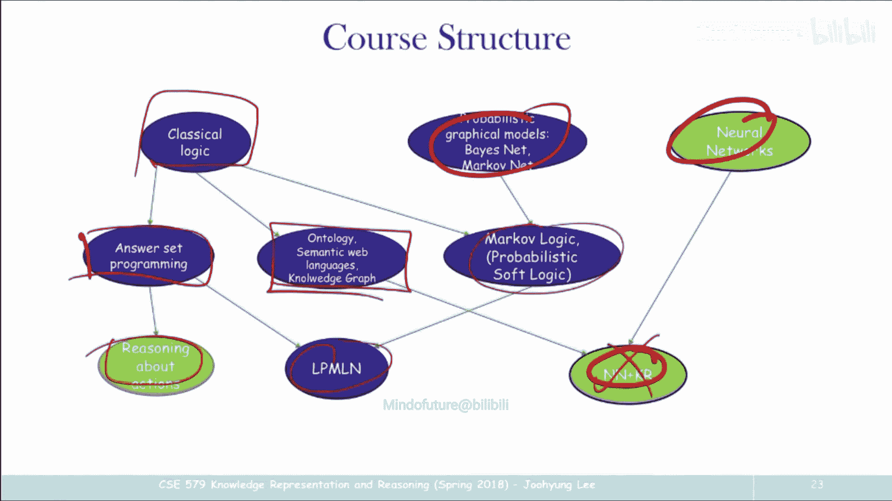

O。So let's do some introduction to this in。So you recall the problem solving method。

 okay so how do we solve the problem， so we use computer to model this problem and the output is returned and from there we get the solution。

Now， traditionally， the first part to turn the problem into program is called programming and you execute so you get the output and you interpret this output to get the solution。

In the declarative programming that we are going to see， slightly different。

 so we are going to write something like program， but we call representation。

 and this is called modeling。And for representation。

 we don't actually necessarily giving the algorithm to solve， it's not a step by step execution。

So we call it just solving okay， and it returns output and we interpret that output to the solution。

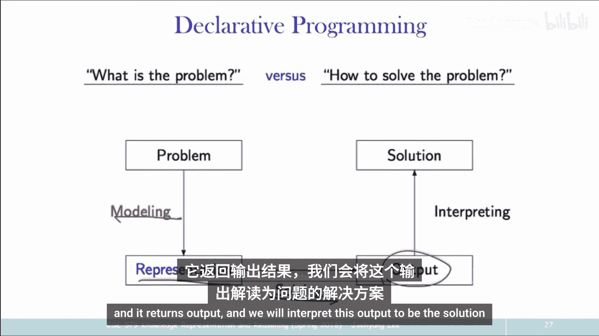

So what is the sensor of programming， this is one of the decative programming approach which is actually widely used these days。

The theoretical basis is actually called An setics by Ga in 1988。Now。

 one thing that I want to emphasize here is answer set and stable models that we are going to say they're interchangeable。

Okay， so some books may say answer says， some books may say stable model。

 they are just the same thing okay there's slight difference in New York。

 but that's not relevant for this class。Now what is missing in first of logic。

 except for this deability issue？The first of the learning can now express the idea of people。

AndNormally this is true， cannot be expressed in choice of the world。

Or you can say recurive definition。Can that be explained in。啊，说是这东。Theres aggregate and preference。

 I prefer this over that， this kind of thing is not expressable in first of the logic。Okay， well。

 at least it's hard to represent this。But these ideas。

 these kind of concept can be represented as a programming in a fairly natural way。

 there are actually many ASP solvers available these days and what we are going to use is actually Klinggo which is actually here this is the part of the system Klinggo is the software which is。

Greringgo class clasp。Okay you don't have to know this distinction。

 but gringo is kind of preparation preprocess to be class， so we'll just look at the package okay。

There' ASP core2 which is a standard language， so if you want to build a ASP solve these days you have to conform to this standard specification。

 there's an annual ASP computation that actually makes this solvever to be developed further。

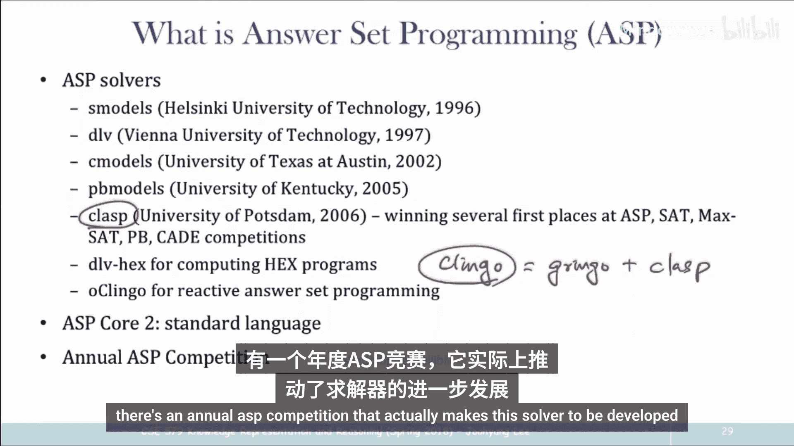

So in terms of SSF programming， what we are going to do。

 what you will learn most of the time is the modeling。Okay。

 so how do you represent problem in terms of some axiomons？And then this part becomes easy。

 you just call and successful you're done， so the basic idea is we want to represent given problem by a set of rules。

And then findense using an an over and extract the solution from the answer set or stable models。

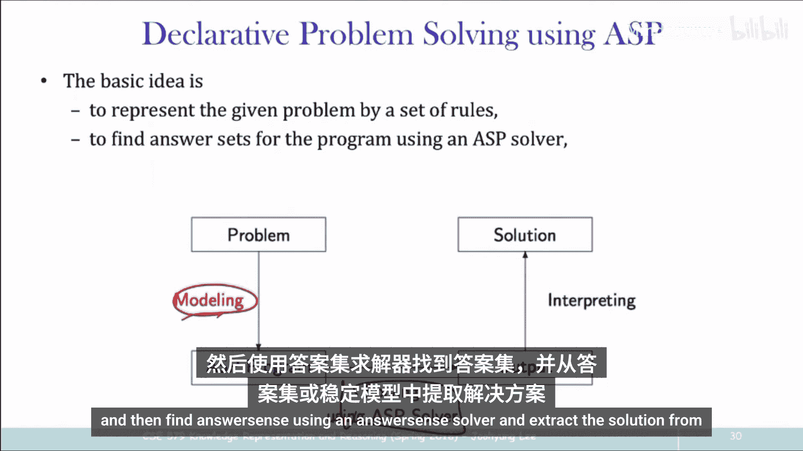

Okay， so probably this doesn't make sense to you now。

 but it will be soon probably next week Okay so there is a endques puzzle problem so the puzzle here is you have to place endques in empire and grid so the no two queens are on the same row same column or same diagonal so for instance。

 if you have。N equals two， okay， what is the solution for this。

 You have to place two ks so that no two kindss tag each other。There is no not possible。 Okay。

 what about  three by three。You have now played three pins so that no two pins attack each other。

那个什么。Okay， let me give you coordinate。 So 1，2，3， row，1，2，3 column。 Okay， where should I put？

三百三蚊 one one one。1，1。2，3。Threeトのディセスアドソルーション。Okay， I have to erase。Okay。可以。Okay， let me write again。

Okay， another try。我せ。No嗦录像。O。And equal goes four。No solution， right？关。

Thats one person raise hand if you want to try。没。1，2。嗯，wowo four。3，1，3，1。Those three。

 is this the only one？No， there's another one which you flip 90 degrees。

 so there' are actually two solutions。How about  five。How many solutions will be here if n equals5？

It turns out that there are。10 solution here。If any equals6， how many solutions will you be there？

It turns out actually， there are only four。And then equals7。No有。So you actually do this。

 okay you can easily try and find the all solutions。Next week。Okay。

So the coding for solving this problem， this is the entire program。Okay。

 if you forget about the comment， the actual program line is 1，2，3，4。

4 lines of the code that you have to write。 Now， in order to write these four lines。

We have to study what is a stable model。

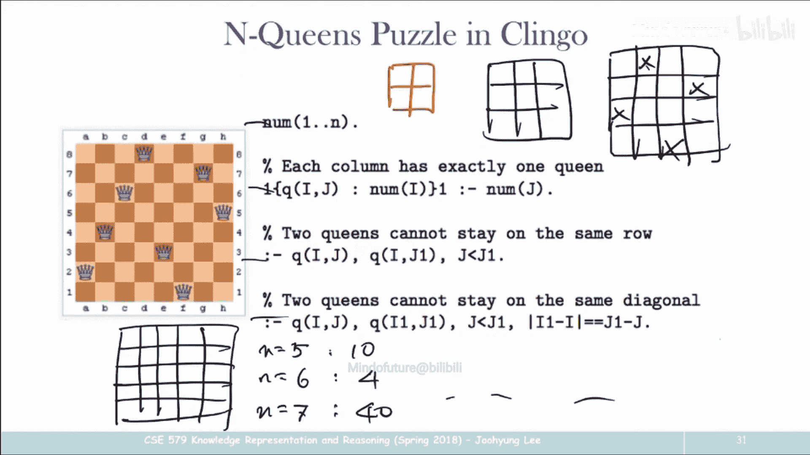

But once you know that you can write a program and execute this command so Klinggo is the name of the program you tied to queens which is the name of the file and minus c is actually a place order to say n equals8。

 so in the previous slide n was actually not fixed。So you can change it the parameter。

So if you just type in， you will see one solution here。

 So Q4 comma 1 means that there is a queen and 4 comma 1 and the similar for the other atoms。

It takes for a very reasonable amount of time to solve this problem。

So this is actually windowing situation for solving this problem。

 you don't have to write a lengthy code， you just write four lines and you can be solved by Clinggo very quickly so you don't have to waste your time for writing a lengthy program If you want to find all solutions what you can do is。

T put0 at the end， and it will return all solutions。 When n equals actually 8。

 which I didn't say before， there are 92 solutions。 So it will quickly return。I don't know。

 this amount of time will be spent for solving this problem。SoIt's quite efficient to do。All right。

 so I guess this is the right time to stop any question。

Okay so the next class we will look at the stable modelmantics。

 I linked the lecture note into class homepage， so it's called SM dopF so you can take a look at that so the materials that I'll present next class will be based on that lecture note okay。

Okay， thank you。 So let me open the exit ticket now。

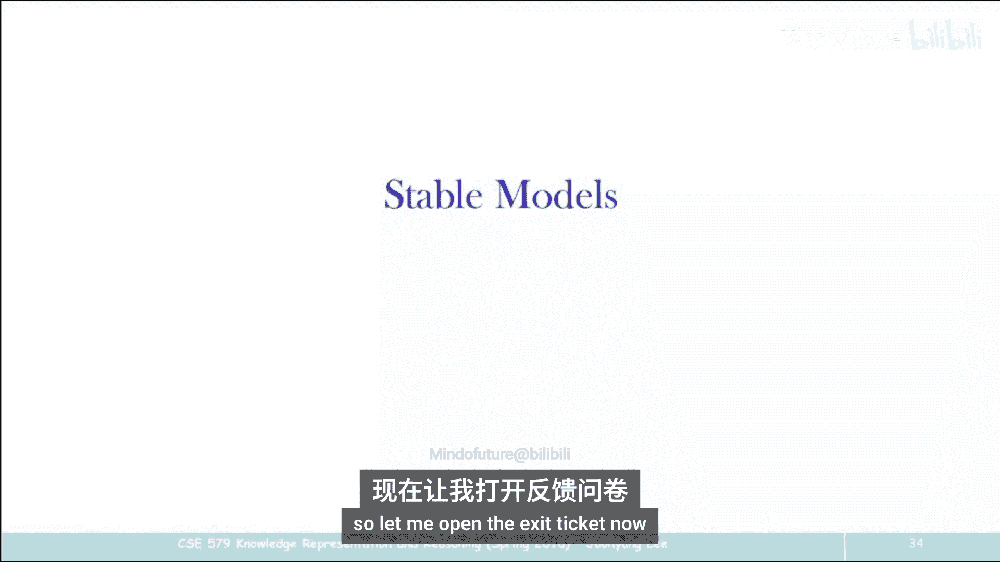