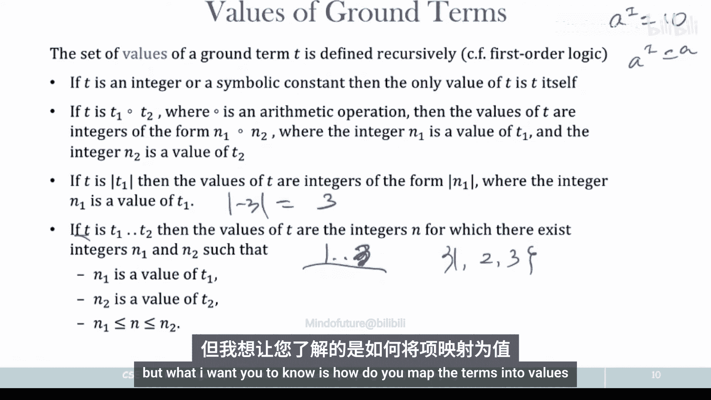
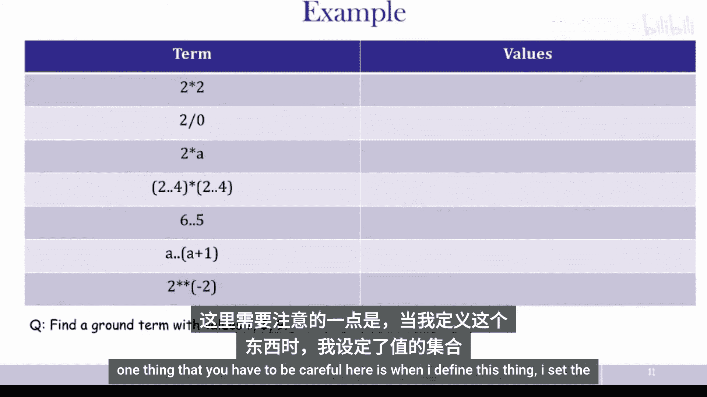
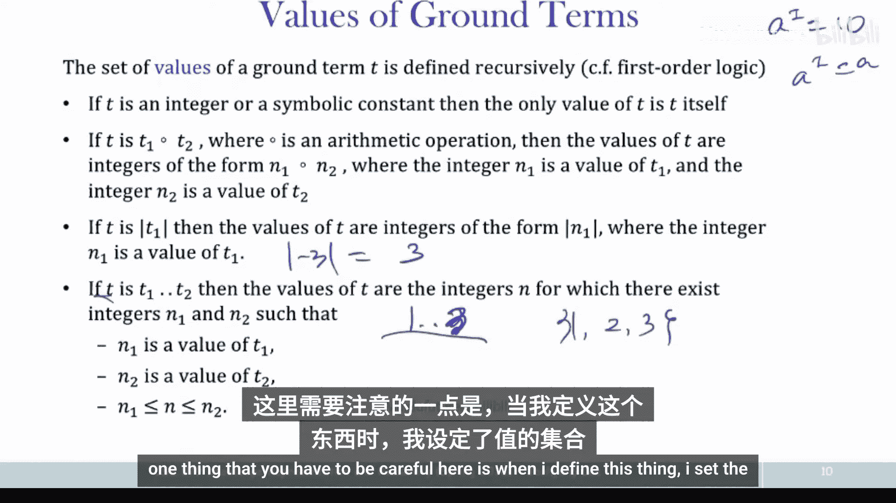
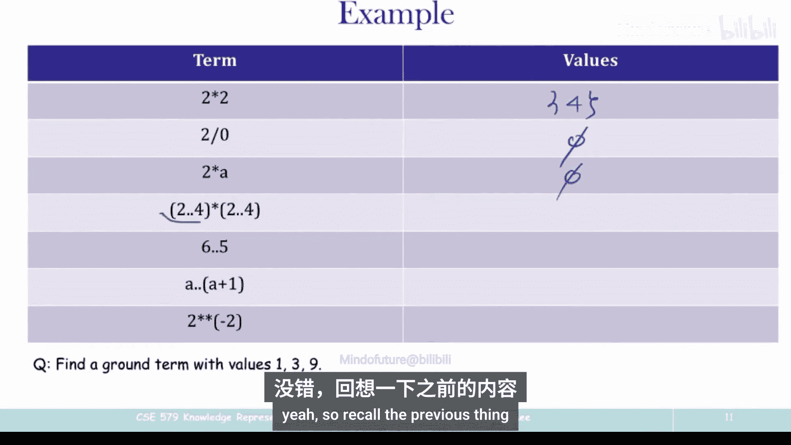
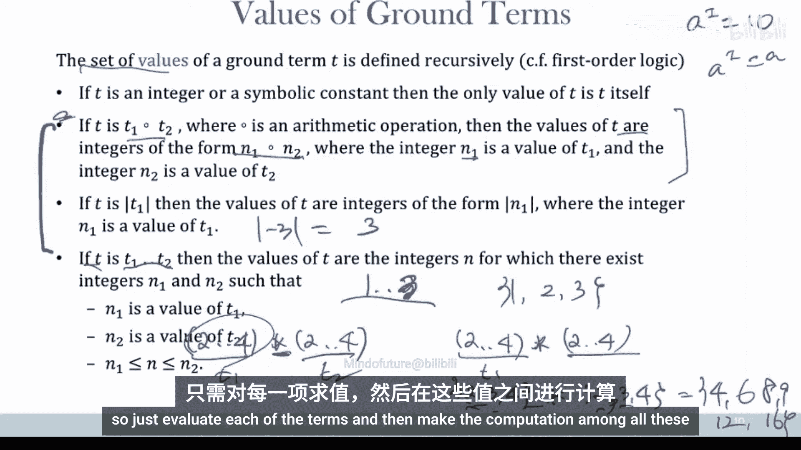
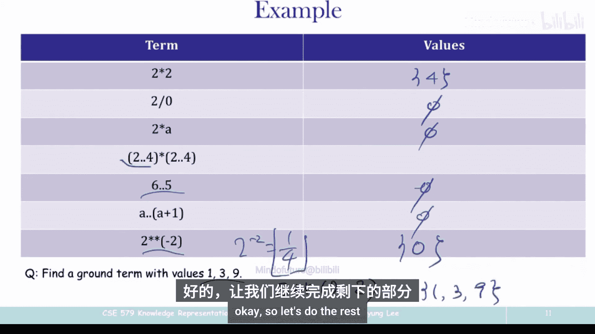
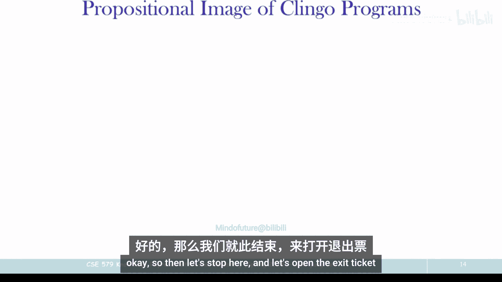

# 【亚利桑那州立大学】知识表征和推理 ｜ Asu Cse 579 Knowledge Representation 2018 p05 P05_Lec7 -BV1RTWyzfEQH_p5-

Okay let's start so today we'll talk about stable models so last time we look at the brief introduction cens of programming so for Enque's problem in order to write this full line code you need to know what is the meaning of stable model Now what we are going to do now we will be in some sense similar to classical logic that we studied last time so there are some adaptations of the idea from classical logic。

But it overcomes certain difficulties met by classical logic。

So those similarities and differences are something that I want you to be noticing。So。

We are going so any language when you define this formal language we have to define syntax and semantics so syntax wise you already know what this is。

 so syntactically this is a limited version of propositional logic so in proportional logic we have some arbitrary nesting of connects okay so what we are going to do is well call this as a rule instead of formula and so the rule first we will consider actually propositional rule only later we'll actually extend the propositional rule to be a bit more general like first of the logic terms that we did but for now let's just go back to our old phase of propositional logic okay。

So what is a propositional rule， just thinking about propositional formula。

 but without any implication？Okay， so that means actually you don't have any im symbol。

 but also this equivalence symbol， which is actually basically the conjunction of two way implications。

 so our formula will consist of atoms and neations， bottom and top and conjunction thisjunction。Okay。

 but we will not consider those other symbols like implications。Okay。

 so if the formula that you have happen to meet this requirement。

 that is a propositional rule as well， so for instance， if you have a very simple atom P。

 this is a propositional rule。Or if you say P or Q， this one doesn't have implication。

 okay it's a proportional formula without implication， this is a proportional rule。

Now with regard to implication， we will allow one occurrence of implication per rule and we are going to use implication in a backward direction。

 this is more natural for humans to read F is true ifG holes。

 so this is how you read the rules usually so basically this is just an implication so you can identify this F LG which I'm going to read as F ifg as same as G implies F okay so this is just a different notation but in actually just the same thing。

Now， what we require for F and G now is they do not contain implication。Okay。Are we together？Okay。

 so let's。So FNG do not contain implications like the first bulletlet。

 but FLOG has one implication there。Okay。The number of implication that occurs here is one。

Because this one is implication， and FNG do not contain implications。Okay。All right。

Let's do some example。Is this a rule？It is which bulletlet does it belong to second one right so second one has F if G。

 so this will be viewed as F， this will be viewed as G and those formulas do not contain implication That's good what about this guy。

This is not， we can actually view this as G implies F， then this F contains an implication。

 so which violates the condition in the second clause。What about this？Yes， okay。

 so this is a rule because it belongs to the first clause， right？Now you might think。

 why do we care about this implication because when we do the CF conversion。

 we know that implication can be eliminated using negation and disjunction。

 so there's not really critical thing there。Now it turns out that semantics that we are going to define in terms of stable model semantics。

 the CF conversion does not preserve equivalentvalence。

Because we are going to talk about different semantics， different models。So in terms of equivalence。

 equivalence means that these formulas have the same models。

Now what happens when you do the CF conversion with these formulas。

 you will see that their stable models are no longer the same。Okay。

 so even if you do the equivalent transformation in propositional logic。

 they do not preserve equivalentence under the stable model setics。Okay。

So so far you see that this is basically just a restriction on the syntax of proportional formula okay and that's it so here you are done with the syntax now when you go into the semantics this becomes a bit more complicated because what you know about the model theory in pro logic does not really hold in stable model semantics。

Okay。Now， something that I actually have to say here is as a binding precedentnce。

 deation bind more tightly than conjunction in this jun and implication symbols are find lowest。

 this is actually just a convention in propositional logic。Okay， so now we will call Proal program。

 what is a propositional program， this is just a set of propositional rules。That' it。Okay。

 so you're done with the syntax of propositional rule。Before we define stable model semantics。

 we will talk about a simpler approximation of that concept called minimal model semantics。So。

Here we introduce one convention。How to identify the interpretation in propositional logic with a set of atoms。

The convention is this。So when you have interpretation。

 say p is false and  Q is true for the signature PQ。Okay。Since each atom is either false or true。

 let's just enumerate true atoms。And put it into the set so what we are going to do is for this interpretation where p is mapped to false and Q is mapped to true。

 we are identify with a singleton set Q because Q is true and all the atoms that are not mentioned in the set are assumed to be false。

Okay。So for instance， if I say。Empty set。Now I will call the set as an interpretation now because now with this convention。

 the set theoretical ratingtic nots and the interpretations are interchangeable so if I say empty set。

 what does this interpretation mean？Both atoms are false， so there's no atoms that's true。Okay， good。

All right， so。Once we define this convention， it is easy to define what is a minimum model。

So it's a model。But。There is no other model that is a subset of model。Okay， so let me say again。

 so when you say I is a minimal model， if first I is a model of the formula and there is no subset of I that is a model of the formula。

Are we together。So we have to make it true in a minimum possible way。And still satisfy the program。

Okay。Let's actually look at example， so it's the same signature of PQ， the formalized P or Q。Okay。

 now how many models are there， three， okay now instead of P true crystals。

 I will say that just set P。Okay， singleingleton said P means P is true peaceful false。

So that' satisfy P or Q right what about Q， yeah， Q is true， peaceful， that still sat PO or Q。

 and if it was a true， then they also satisfy P or Q。Yes， she didn't give me a photo。Con by。

MmpT set is not a model of the formula because empty set means P and Q are false。

RightSo then P or Q cannot be true under that interpretation。

So note here that we distinguish between the term interpretation and the model。

Model is of interpretation that satisfies the formula。Okay。

So then what are the minimum models of this PRQ， so we found all models， okay。

 so what are the minimum models？The first two are the minimum models， right， y？Well。

 let's check the first one as P is true right， now what is a smaller model than the single trans set P？

DoesS satisfy the program no？So P singleton set P is the minimum model of the formula。

 the same reason Q is it。However， P or Q。It's not。PQ is not because for PQ， this is too much。

We could have only make P2 be true and that would still satisfy， so PQ is a model。

But this is not minimal because there is an example。There is another interpretation P。

 which is smaller than PQ， and that still satisfyis the program。Okay。Are we together。Okay。

 so just find the minimum models Okay so thatスク。Now。

 what you can prove is if two formulas are equivalent on the propositional logic。

 they have the same minimum models。Consider all the。I mean， there are two formulas。

 so you can imagine something。Like。Let's say P or Q。Okay。那批。Implies Q。Okay。

 these two formal laws are actually equivalent， you can work it out okay。And。

And their minimum models are also the same。However， the compas is actually natural。Okay。

 so the two formulas may have the same minimum models， but they do not have same models。

If you look at the minimum models， they happen to have the same minimum models。But in general。

 all the models of。These formula are not exactly same as all the models of that formula。

 Can you find such an example？Can you find an example？Q。I'm sorry。 What is a formula。

 So we have to have two formulas。 One is P or Q。Other is Q。Okay， just start。

 so these are the two formulas。That you select that， right？As an example。喂， ok。コメントです。It is not。Why。

Do they have the same minimum models， No No， So we saw the minimum models are P and Q。 But this one。

 what is the minimum model of Q Q itself， right， so it doesn't have P right。

 so they do not have same minimum models Okay， so this does not。Okay。

 so I'm looking for example where the two formulas have the same minimum models。

 but they have different models。对吗嗯，他。嗯。Okay， so let's see。 not the。Or。Not cute。我儿。N2。Okay。So。

So these are the two formulas， FNG， let's move。Think about it Okay。

 so obviously the small list set here is what are right。

What are the minimal models of the left hand side？啊。

Were in trouble empty set where all of them are false still satisfied the left hand side。

 and this is a definitely minimum model because there's no smaller set than empty set。

 so again this does not count as the example。Yes。B or Q and Bs orQ。Okay， so P。4 Q andQ。

Im sorry P X X， We don't have x O So。P or notq and。Not P orQ， not P orQ。啊。还 you需要的对啊。SoLet's see。

 let's market it， okay。So the first one still have the same minimal model， P and Q， right？Okay。Okay。

 so that' that's it。 so do we have so what are the minimum models of this？第二组。嗯。これは大て。Oh。

 I already different。So what about empty starts out there because you deceive others。😊，Okay yeah。

 but before we go into that， let's see what the others are also following here。

 so what the minimum models of Q and upQ and not Q or Q。Mmpty set。If PMQable is false。

Are we together here。 so if both of us false that this is false or true。

 the first one is false or true， the true or false。

 okay each of the conjunctionjunctive terms is true， Tru and true is true。

 So empty set is actually the minimum model。So this does not count okay。So I'm left out of space now。

 so Le'slie， P or Q， okay， can you now repeat。😊，P andq。let me erase this。PP， N Naq。不。Okay我。Not be。

Not PM and Q。Okay， so now let's look at the minimum model here Okay， so in order to have a model。

 it's a conjunction， so each of them must be true。I'm sorry， I'm sorry， this is a disjunction。

 so one of them need to be true。Okay， so the models of the first is actually P things on that P。

And we don't care about the other disjunctive tongue， right？What about Q？审判对。Okay， can we find。

 so these are two other models。Are they minimal， so if we take empty set， do they satisfy wolf？No。

 because emptyS makes p to be false in the first and Q to be false in the second。

 false or false is false， so they have the same minimal models。Now， the question is。

 do they have the same models？Okay。So let me ask somebody else。What？

It个 model of one form form but押啊 not抵押 one。So Arinam's claim here is this one have the same minimum models。

 but their models are different。There may be some common models。

 but they do not have exactly identical set of models。

So can you find such a model that distinguish between these two formats？Anyone。Yes。PQ。

 so PQ satisfies the first one， but it does not satisfy the second one。不。All right。

 question up to this part。Yes。I'm still kind of curious on how are you getting the empty step from something of？

And then in the same the example that she gave with so the question is。Okay， so the。

Why empty set is a model of this formula。Is it okay， so empty set。

 just understand this as an interpretation that makes p to be false Q to be false r to be false every atom is false。

 there's no true atom so that's why it's empty when this is false then neation of false is true so true or anything is true。

Okay， so empty set is actually the model of this。So we can say that empty sand is also a minimal model of this。

 which is not the case with the right hand side。Okay。All right。对。So then。Let's go to。The next one。

Okay， so we are going to define stable model semantics for propositional rule。

 but we will start with very simple proportional rule first， which well call a definite rule。😊，Okay。

So。Remember， now we further restrict the definition of proportional rule。

And here I have to actually introduce the convention。So recall that in the， actually， that's right。

Here。We will actually call this guy head and this guy to be the body。Okay。

So this is actually the hormone computer head if body。

 and this one you can still call it help with no body。Okay， so this is just a convention。Now。

 definite rule has some special structures for the restriction on the head and the body。

Actually only in the hat， actually。No I'm a headbody。So in this case。

 the head is either a simple atom or just a conjunction of atoms。Okay。

And the body do not contain negation symbol。So for this restriction。

 well call the proposition rule to be definite， so here's an example。

This is definitely because first is head here。so this is head， there' is no body in this rule。

 and this is just a simple atom， so it satisfies the first bullet and the second bullet also is satisfied because if there is a body then it should not have negation。

 but P does not have body at all， so this second clause is already true。

remember if there is nothing to check， then this is allvol vacuously true。Okay。

The second rule is also the case， so the head and body。The head is a simple atom。

 and the body does not contain negation。Okay， so this rule is called definite。

It's a provisional rule， and furthermore， this is also definite。Are we together？Is this definite？

Let's open the Soative， and see。We are following。Let me actually close the。Okay。

 I'll come back to the laptop。Okay， so the question is， the second program that you see。

 is this a definite or not？No right on the Soative， please。嗯。你言有是那。以及。P and Q。被个公司。P conjunction Q。

 the minimum model， What is minimum models of P and Q， What that the question。Okay。Let's see。嗯。Okay。

 maybe this was easy，96% say true， 4% says false。O。Okay， so yeah， this is definite。

 now what is special about Definite？You can now define stable models。

 mantics for the definite rule now first before we do that。

 theres a theor that you can actually prove if the program is definite。

 it must have a unique minimum model。Okay， so there is a minimum model， but it's also unique。

There's only one minimum model。Okay， so find a counter example if this definite is dropped from this statement of the prohibition。

Okay。😊，So here is the Pro game， so that the program has a unique minimum model。Okay， the question is。

 find your counter example。If the definite。I is dropped from the statement。Which means that。

If I say a program。A professional program has a unique minimal model， always。

 that's a wrong statement。Can you find the counter example？We actually saw one before。PQ。

 so PQ is not definite because PQ。The head contains this junction。

 the head must contain only conjunctions in order to be definite， but if it contains thisjunction。

 it's not definite。And because of that， there was actually two minimum models， set P and set Q。Okay。

Now let's actually check this claim with respect to this example。

 so what is the minimum model of the first program？P and R if P and Q what are the minimum model。

 actually what is the minimum model here because now we know that there must always a single minimum model。

 there cannot be two different minimum models if the program is definite。

So what is the minimum model this？啊。啊， okay。So one claim is R is the minimum model。第几个。Is it true？

Both of them has to be true， and the model has to be minimal。In other words。

 you can understand this as prop formula， P and P conjunction Q。Implies I。Okay。

 I'm asking about the minimum model of this proportion formula life。这是别的。The one claim was R， PNR。

 okay？So not he want to modify his answer to be PR。And ondo。

That cannot be true because we just said we didn't prove， but。

I happen to know that if program is definite， it must have the single minimum model。

You cannot have two minimum models， so that's not possible。そう。

So we don't need to consider other minimum models if PR is a minimal model， right。

 So let's check this claim。 Is PR really a minimum model。It's not who said no rate， if you say no。

Get电哪记得。G now okay， so can you answer why。提醒了。呃。So this is not minimal because。第有。P。

P is a minimal model。But PR is not minimum model。 Okay。

 so if this to dispute that this is not a minimum model。

 you can find another model that is smaller than this， right， So his claim is now， let's consider。

阿王屁。Okay， if P， the single sense of P satisfi those rules， then this one cannot be a minimum model。

 it may be a model， but it may not be a minimum model， right？Okay。

 so if P is true to and R are false， okay， what happens， Is this true， obviously， Okay， is this true？

Yes， right， because p is true， but Q is false， so P and Q is false， false implies anything is。就。

So this one actually satisfies it， and I said， if you find the minimum model， okay。

 is this really minimal？What about empty set？WellM set does not satisfy the first P， right。

 so it be a M set cannot not be a model， so we found the minimum model of P。Okay。Are we together。

オロバ 시작한の。So here， this is also definite， 96% of you said this is definite。Okay。

 so there must be a minimum model。So what is the minimum model here？Let's do the piece。Okay。

 let me close。Okay。Okay， so the question。Yes。What is the minimum model of this。Of the second program。

Okay， sotyping。对。Type it in the software here。For the second program。What is the minimum model。

And some of you may。Identify some algorithm to find general model。When you do this thing。

 try to find the minimal model， maybe there's some algorithms。In fact， it comes out to be。翻 the面。

Its much better than proposition logic。Right。In professional logic finding model is complete。

Actually， the existence of model。反译。Thatてて个。However违。For the Deaf program。

Even it's more than just a model， it's a minimal model。

 you have to also worry about the minimality of the model。

 but somehow finding this minimal model can be much quicker than finding models of general。Okay。

 let's see。So， let me show you。What answers did I get。Okay， so P Q PRPPT。Okay， what this module。

PQR seems to be some。PR is also there， PT is there。Looks like PQR and PR are more than the others。

 right？Okay。Let's check that。So let's check actually two things， so PQR and PRR。

 now which one is a better thing to check first。If you have PQR and PR。

 which one do you want to check first PR， Because if PRR is minimum model。

 you don't need to worry about PQR right， So let's say whether PR is a minimum model。Now。First。

 check whether this is a model， well， this one sat the first rule。Okay， second rule。の。这玩是不能比你们好的。

This is not the model at all。 right， so then this is not the minimum model。 So should we go to PQR。

Okay。So let's do this again。First one， is it true。Yes。

 second one now is true okay third one is it true is P or T T is now false under this current interpretation because T does not occur in the set but P or T is true because P was true right and r is true so this is also true R and T or T is false so the body is false then the whole rule is still true。

So this seems to be a model， it is a minimum model。

So obviously we cannot remove P because we have to satisfy the first one， right？Can we remove Q？

Actually， so suppose we have peni。What happens。The third rule。Says P or true implies r to be true。

 so this one cannot be a minimum model， so peak itself is not。

 but in order to find a model that is smaller than PQR that means we have to have P and we have to find another thing like Q orR we try the PRR but it didn't work so maybe PQ is our last resort。

 does PQ satisfy this turns out to be no。Because EQ again， does not satisfy the so。Okay。

 so let's actually go back to this slowly， so let's try to now find an algorithm to do this。Okay。

So now seems to be the answer is PQR。Okay。So first one， so let's scan the first rule。

 we know that P must be true， right？Because of the existence of first rule。Now。

 if you look at the third rule， if one p is true。No matter what you have as for T， this body is true。

 which means that you have to include。2。So you cannot avoid this， you have to have R。

 but now once you have P and R， then now the second rule says the body is true。

 so you must include Q。喂。Now let's go further。 Now with this column set P QR。

 should we add more atom。No不だ。So this is actually iterative algorithm， okay。

 let me actually write the algorithm。To see what we are doing So let's assume that this is a minimum model Okay。

 so let's initialize this empty set and what we are going to do is to repeat the process okay。

For each rule。In the program。Let's say our proven is pie。Okay。So this is a very simple algorithm。

What you do， go each of the rule and if the body is true under the current F。

Then include the head into this and repeat this process over and over until you reach a fixed point。

 you cannot add more。Okay so let's try to do this algorithm， so let's go back。Let me。这个分开了。Next this。

See。So initially， S is empty set。Okay。Now。The algorithm goes rule by rule。 So the first one is P。

 Now， the body is actually。住。Okay， so body is not there。

 but you you can say that this is already true。In that case， you have to include P into S。说。

When you look at the first rule。P has to be included in S， so now S will include P。Okay。

 because of the first one。Okay。啊。And go to the next one。So currently P is the only element in the S。

 go to the next one， that's this s， which is single trans set P， does this satisfy P and R。No。

 because PNR。To be true， Who PR must be true。But here we have only P to be true and R is false。

 so this guy does not satisfy the body right， so the body is false and what do you do？

You just skip nothing to add。Next one。P or T， is it true on the current S？Yes。

 this S satisfies P or T， right， so what do you need to do？

Now S will include P and R because we are now adding R there， right？Are we together Okay。

 So then we go to the next one。 Now does this PR satisfy R and T。Okay， this one。😊。

Does he satisfy R&T？No， this one says P and r are true and all other atoms are false。

 so since t is false R and T is false。So the body is not true， so what do you do， you just skip。

So after the first iteration， ROSs is PR。Okay。But we have to go again until we cannot further change S。

Let's go again， P， but it's already true。Okay， so you don't actually add anything。Q PRR is true now。

So current S is PR and this PR satisfies the body， which means now you have to include Q。

 so now S is becoming PR and then Q okay so S is added。Now with contents now go to the next one。

Well art is already there， so we don't need to care， okay？Here， R and T is still false under this。

Okay。So we don't need to。Okay， so we got PRQ， but we have to do one more iteration。

 so we currently are done with the second iteration。

 let's go one more iteration and do this one by one and you will see that after this third iteration S does not change。

So now we reach your fixed point。And this is the unique minimum model， done。Okay。

Now why this is polyno metime algorithm？W。you。In terms of size of the program， of course。

There somebody who haven't spoken yet。Iant to say something here？W那太个生。冇 year。Yes。

'mKin of guessing here， but in a worst case scenario， on the border of。证据发表。

So theoretically if each one。You don't add anything。Yes。Okay， and on the next run。

 you don't add anything to that n minus one through， okay， but it could be a way to sort。Yeah。

 how many iterations do we have to do？So's not really factorial thing here about each about each intervention will。

啊。You will have at least one rule to be considered。Once the removal is considered。

 that rule doest actually affect in the next thing because you already added head there so the next thing。

So the next time this rule is no global effect。So every time that you do this iteration。

Some of the rules will contribute to adding to S。And once you have used that rule。

 this move is actually no longer useful for data。Okay， and there are only so many books， angle。

Which means if you eaterate and times。Maybe actually n plus one is actually the maximum number of iteration that you have to do。

Okay。Its not related。那你920。Well， PQR is coming from the head and each head contains。On atom， right。

 here you relate to like the minimum value of the numbers of the。到哋家不。You'll ci later。

I think if you consider the hat versus rules， they want to learn and so on。

 at least for these examples。I看。ok。a new。And it's the number of blues。Each iteration。

 some of the rules， at least one rule has to be used to derive new atoms。Okay。

 and you cannot do more than the number of rules。OkaySo you can say that the algorithm terminates on if。

On a run， it doesn't add it。Yeah， the algorithm will stop when there is no as is added in iterations。

And that iteration can go up to n plus one where I uses a number of rules。Okay。All right。

 the slightly simplified thing that I said here， in fact。

 the deficit professional rule may contain conjunction of atoms。Okay。

 so I assume here there's an atom to be in the head， if it is conjunction of atoms， when you add hat。

 this head will contain all atoms in the head。Okay。All right， that's it。

 so the good news here is now this is the first stable model semantics that you got。

A stable model of a definite program is a minimum model of the program。嗯。

So you happen to have definite propositional program just look for the minimum model you can do by doing applying the definition。

 or you can do by this algorithm because doesn't matter， if you can find the minimum model。

 you can claim that as a stable model， that's how the definition of stable model goes。

And this is actually a simple case。Question here。Is every stable model of pi。

 also a model of the pie？O。I need a new。Volunteer， anyone， if it's true or false。It's true， why。

Because stable model is a minimum model， minimal model is a model， so it's true， okay。All right。

Now what is the informal reading of this rule， why do we care about the rules？

Okay why do we massage this into some specific things。

 so we already see one reason that this becomes more easy to compute。But in terms of reading。

 there's something called rationalality principle， so we can view the program as a specification of stable model and what is a stable model。

 one idea is to view this as a set of beliefs that the agent should have associated with the program so the program。

It is something that derives the belief for this agent。Okay。So。The principle here is this。

The one way to read this rule is believe P。Okay， and believe so， okay， let's say it this way。

Suppose in general we have this healthy body， what it means is if agent believes B is true。

 then the agent must believe H is true。But we don't want to believe more than that。

That's the kind of rational。Okay。说。The rational Court says believes nothing which you are not forced to believe。

 Now let's apply this idea to the example here， so that might be easier to do。

So P here should P believed， no matter what circumstances， there's no condition on believing P。

 P must be believed， so the agent must believe P to be true。Now， the agent has to。

Believe the minimal information is possible， which can be justified。

So now if you look at the second rule， A must believe R if it believes both P and Q are true。Right。

Now， currently， agents believe only P， but it doesn't need to believe Q on the death assumption。

Aent doesn't have to。Add Q into the belief set。Hence， a agent doesn't have to believe are either。

Okay， well think about this as something that you have to check to be true， so P must be true。

 but the program here does not say whether Q is true。Then you cannot use that belief。

You can E assume Q is false。So under that condition， you don't need to believe R because p is true。

 but you don't know Q is true or false， so I don't believe Q。Under that condition。

 I don't need to be。Okay。So here you will probably identify something different from the semantics of prop logic in terms of implication。

In terms of implication， when the body was false， then when you have B implies H， when this is false。

 H can be either true or false。However， in terms of this minimum model semantics。

 also stable model semantics， if P is false， then you don't have to believe H。

 there's a difference here。O。Any question up to this part。

 because we are now moving to the next level of stable model program？Okay， good。嗯。

So we just covered the stable model semantics for definite program。

We'll look at a superet of that class， which will be called positive program。

 so what is a positive program？Simple。If it does not contain any litigationation。

 this is called positive。Okay。So P if Q is positive， but P if not Q is not positive because。

내서 neation symbol。Here。Okay， so this is not positive。PfQ， is it definite？Is it definite P if not Q。

 is it definite？No， it's not definitelyite。Okay。Every deinite program is positive， through or false。

Yes， this is true， okay， because。So basically， if you consider this thing。

 this is Stephanie programs and this is policy programs。Okay， every definite program is positive。嗯。

But not whole the posted program is definite， right？Right。Can you find an element here。

Which is positive， but not defin。那谁。You can't have or， yes。

Because as long as it doesn't contain negation， then this is positive。 So all does not matter。

 So what is class。Example that belongs to the positivestate， but not definite。

 So there may be many others， but。Maybe you are doing this all over。

 P Q is a positive program because it does not contain negation。

 but it is not def because it contains a dis junction in the head。Okay。Okay， so okay。

 now weve defined stable models， same as a Step program。So single models are still minimal models。

But。Does every post program have a unique minimum model？So I didn that has the answer。

 So let me not ask him。Anyone else。Does every post program have a unique minimum model bar？No。

 so can you give an example？P or Q， so here right P or Q is a positive program。

 but it has two minimal models， P and Q， single concept set P， single concept set Q。Now。

 the definition is same in both cases or programs， so minimal models are all we need， okay。

But once you go into the positive program in general。

 they may not necessarily have unique and minimum model。Okay。

And this is what we saw before a stable model of deinite program is actually the minimal model。

 but for the positive program there may be multiple minimal models。

 so this is very minor things for the deinite program you can say themin model。

 stable model of the deinite program is themin model。

 but when you say stable model of a positive program。

You should say it is a minimum model because there can be more than one minimum model。Okay。All right。

Good， so let's see。O。Now。So that's why don't we define your stable model as a minimum model now the big part is once you start to include neation。

And that makes all things complex。Okay， for that， we will need to do something。Okay。

 so from that point， which will be the next level。Where there is a program。Con테ingリゲーョ。Okay。

So for this class of programs。Stable model are different from minimal models。But before we do that。

Let's go into the Klingal language。Okay。So so far， we look at the。プポジションアと。

Which means that the atom has a very simple structure it either just one unit that can be assigned true or false in terms of knowledge representation that's a bit limited。

So we are going to use Plinggo as a main SS folder here。

 and it allows actually the syntax that is more general than just the preal program。

 it's actually very similar to first so logic in certain sense。Okay， so we'll talk about that now。

So one of the things that first of the logic is good is it has some complex structure for writing the tongue。

Okay， so we can talk about individuals， relations and those kind of things。

And Klingo language actually support that， so here is that definition of the terms in Klinggo。Okay。

 so this is very similar to Toms in the first or the logic。But there's also slight difference。

 So yeah， pay attention to this difference。So the definitionple is the terms are either integers。

 so if you have any integers， then they are terms and any symbolic constants like object constants that you did in first of the logic。

 they are terms and variables， they are also terms。Okay。And if you have two terms。

 you can use arithmetic operations on them， theres some specific set of arithmetic operation that is defined。

So if you have two terms and you can apply the arithmetic operations like multiplication or exon and division。

 things like that。Okay， yes。There are some precedents， but it's useful as in the use arithmetic。

 so multiplication has more precedentnce than so that's actually。The same convention。

Another thing that you might find useful is absolute value function，So you have term。

 and then you put the absolute value。Okay。And。So that that is actually fine。

Something that is unusual is actually this guy， so T1 Dta T2。

 so T1 T2 are the termss and they actually be intervals， so you have1 to 10。

 so1 Dta 10 is actually 1 to10， 1235。Okay， now if you look at these。Re vision。

What is special about Klingal language is it has some designated signature already。

In first of the logic， the signature is arbitrary， you can choose any signature。In听个。

The signature is already fixed to be this。Which means you have three defined set of integers。Okay。啊。

And you have some predefined functions。Aismme functions， we don't have arbitrary functions here。嗯。

And theres some special thing which is called termss Now， if you forget about the last one。

You can view this as some special cases of firstologic pumps。

The last one is actually a bit different。Okay。Any question up to this part？Right。Okay。

 so termss can of course， contain variables。And the variables are typically represented as upper case letter。

Okay， a small case is actually the constants， upper case。 low case is constants and uppercase is。

Are variable。Now， the terms that do not contain variables are called groundton。And for the groundom。

 you can define values。Okay。Now， in first of the logic， how do you find the values of the term？

What do you need。You need an interpretation， universe and how to map each constant into members of the universe and how to map predicate into the relations and so on and so forth。

 right？And there are actually many different ways that you can associate a constant to the members of the universe。

In the case of pling language， theres a fixed way to do。

 and that actually is helpful for the computation。So I mean most of the cases is actually very simple。

 if T is an integer or symbolic constants， then the value of T is T itself。

What that means is in first of the logic， we could have done something like this， a map to 10。

 this is not possible in Klinggo， in Klinggo a should be map to a。Nothing else。

One should be map to one， one should be up to two， which is natural， right。

 you don't want to mix up all these things， right？Similarly， if you have T1 and T2。

 then how do you define that values well evaluate each of T1 and T2 and apply the usual standard meaning of arithmetic operation you're done？

Same for this， if so value， if you have minus3， what is the value of this is's actually three。Okay。

So which means that you don't have to specify the interpretation separately。

 you already know what is a value。Because it has fixed meaning。The third one。

 the last one actually here is T1 Dta T2， what is the value， the values here？Are the integers。

 which is bounded by T1 and T2， so evaluate each T1 and T2。

 they will evaluate to some integers and1 and N2。And this T will represent all the numbers in that interval。

Okay， so for instance， if I say one do2， three。Okay， the value of this is， of course， one two， three。

Are we together？Because the next slide you have to exercise。Okay。

 so before we move to the next slide， any question to this part。Prenheesis。

 I think where I was going forward。Are there any parentheses to organize？Poes yes。

 there parentheses too。Try think。You can use parentheses when you do the arithmetic operation。

 it's not explicit written in that。that's actually okay。哦。

So termss can be variable and also the constant。Okay， Tom is a general concept。

 How do you compose those object constants to make another。呃，好 so。

So there's some symbolic constant like John and Mary， those are the names of certain things。

You can say father of John， there's also the term， right？

So you can have those kind of symbolic constants。Variables are just a variable。

 you can range over different values， it doesn't have fixed meaning。Okay。

 we'll actually look at the meaning of variables later。Okay。

 so that's actually some difference from forology， and let's not worry about the meaning yet。Okay。

But what I want you to know is how do you map the terms into values？Okay。

So let's do the practice one thing that you have to be careful here is you when I define this。

 I thing， I set the set of values， I didn't say just a single value。

AndThere's a reason for that。 So let's do exercise here。 Let's do it together。Okay， so two times two。

 what is the value？4our， okay。Now I'm going to use the set because I said set of values。

 what about two divide by zero？This is undefined， right？

OkayAnd in terms of clinicaling this is actually empty there's no value for that Now note here that P was suppose only integer arithmetic。

 so the result of this arithmetic equation must result in integers if it is not integer。

 then that's not a value。Okay。All right， two times a。The arime is not defined。

Between intejo and non intejo。So this is so。And。What about the next one， two to four and two to four？

This is actually a bit more complicated than the other thing， so in other case it's either that atom。

 the evaluation of the value according to the user understanding or maybe sometimes it's undefined that its actually empty set but here the first term ranges over two to4 so yeah so recall the previous thing。

When you have this guy， okay， you have to evaluate。I'm sorry， we are looking at these two clauses。

Okay， so the question was two。2，4。Times 224 right so almost1 is actually the arithmetic operation。

 so we belong to this category right now each this is now T1 and this is T2。Am I right。

 so according to the definition？We have to evaluate T1。 What is the value。

 What is the set of values for T1。Now we have to go to the last bullet。Right， so that is actually。

Let me write this two two four。Al。So this is now T1， right？So T1 ranges over。2， three， four。

 according to this definition。And same four，2，3，4。So let's go back here。

If the first term value is 23，4， and the second value。The second set of variance before。

 then what is their multiplication？The values of T are the integers of the form where n1 is one of the values of T1 and n2 is one of the values of T2。

 which means you have to make all the combination so from2 and2 you get。For2 and 3。6。2 and four。

 eight， three and2，6， three and three。9， three and4。12。4 and2， a，4 and 3，12，4 and 4，16。SDS。

Do you get it。Okay， so just evaluate each of the terms and then make the computation among all these values。

Okay， what about the。This one， six to five。Yesす。So based on that combination multi that you just did。

 so is that in case the elimination of？Re to do。TOh yeah， this is a set。

 so reputation does not count multiple times。 Yes， you're right okay。Good。Okay， anything Okay。

 so what about six to five？Empty set because there's no integers between six and five in that order。

 a to8 plus one。Empty because you cannot evaluate a a's map to a is not an integer。

 so this interval does not make any sense if it is not between integers。What about this？

This double symbol double star is actually the exponent right， and what is this？No。

 it's not actually empty。 I told you that this is integer is。

 so it's actually the flow of that number， which is0。So this is a two to the power of negative tool。

 which is one force， but if you take the floor that is little， so this is what clinging returns。Okay。

All right。 so I mean， this kind of thing is a bit complicated， but once you。

Get to know is's actually quite convenient to use for the programming。Now question。

 find a ground term， so single ground term to represent value 1，3，9。Can you write it。

 So instead of  one，3，9， can you write a single term that has this value？Okay， let me write here。

So if you do this。Okay， the values will be3 to the power0，3 to the path 1，3 to the PA2。

 so that will the values of this will be1，3，9。Okay。不说。Yes。这费。

6 to four also you cannot find integers that is larger than six and less than four。 So yeah。

 the first one should be smaller than the second one in order to have any meaningful integers in between。

饿。O。Okay， so less do the rest。So now we can write a clling of program okay。

 so anatomomy Kling of program is a symbolic constant followed by some termsMS that's actually the same as in。

First of the logic。Okay， now we also have comparison。

So we can write some comparison between the tons， and are these as preloaded comparison operators。

How do you writelingal rules you can write？If this is just a conjunction of atoms。

Or conjunction of atoms and comparison。Okay， so each of these symbols。

 H and B represent either atoms or comparison。So you can write just a comma separated list of the atoms and comparisons。

 or you can write it as a head if body。Okay。So instead of conjunction symbol， we write just comma。

Okay so here's an example rule that you can see， so this rule is the agent has to believe that C is a warm city。

 if this city has temperature T1 and the Austin temperature is T2 and T1 is greater than T2。

 then this is called warm。In other words， a simply way。W do I see T1 P2 other variables。

 so it can range over all the symbols in the domain。

What it means is any city that is half than often is called warm city。Okay。Christian。Yes，Yeah。

 Austin is not the warm city。It is still one but。According to this definition。Okay， so。不对。

So this is just a convention to represent。嗯。Actually。

 no I think it's better to stop here instead of rushing。

 so so far what we learned today is stable models of Deinite program and positive program and in a few slides later we will finish with the input language of Plinggo just to represent Deinite and positive programs。

And then the next class we will start， well look at the negation failure which will probably encounter a lot of confusion。

 so if you have chance read the lecture note okay and be prepared Any questions。Okay。

 so then let's stop here and let's open the exit ticket。

