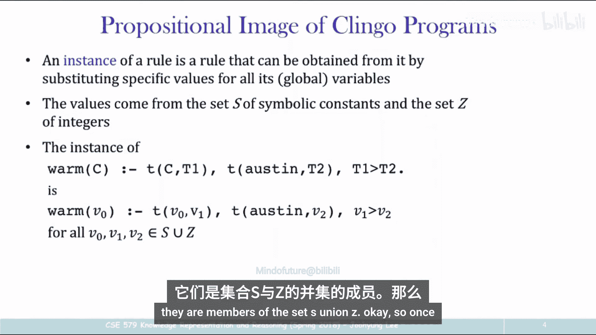
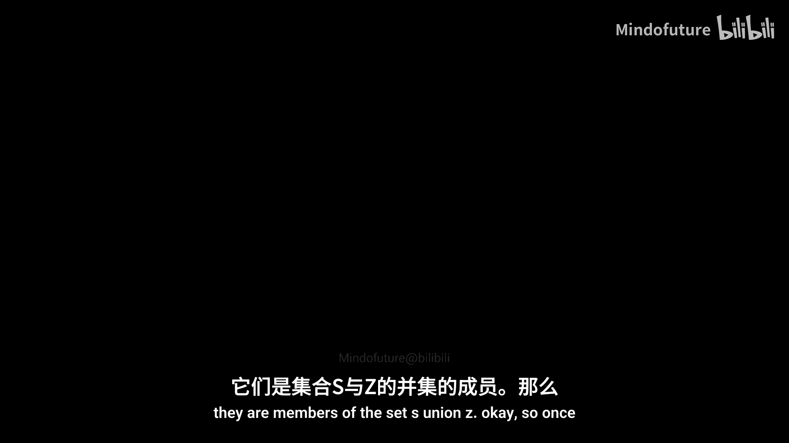
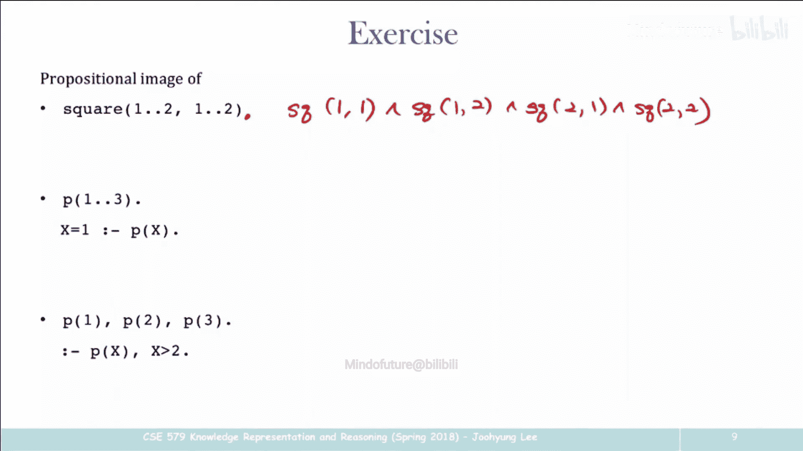
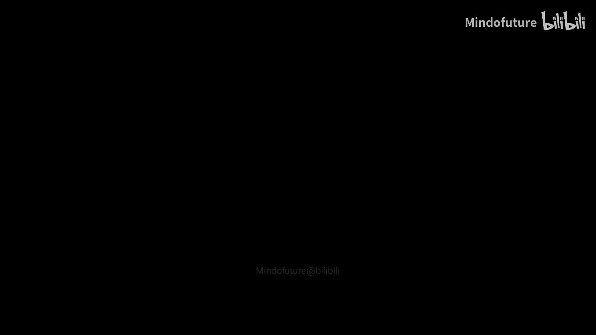
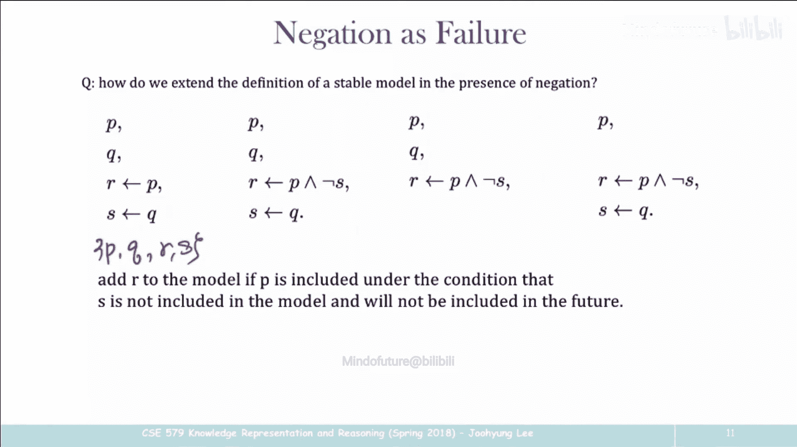
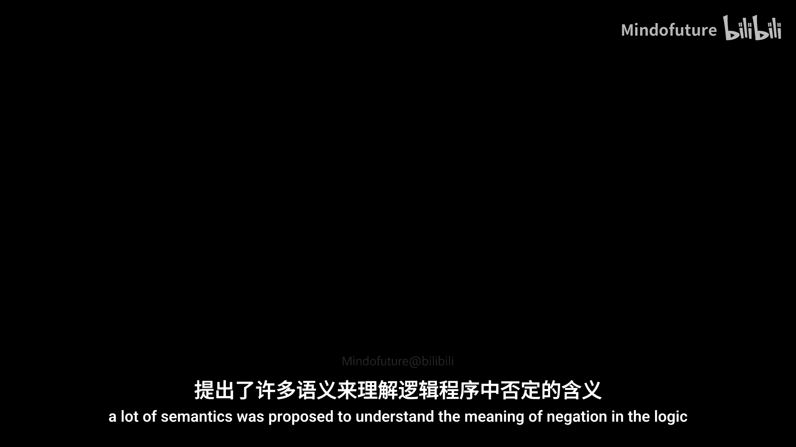
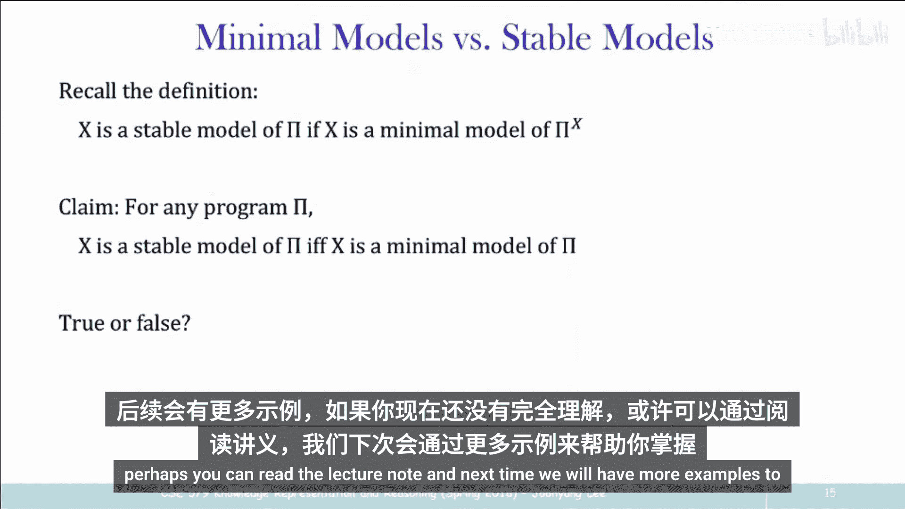

# 【亚利桑那州立大学】知识表征和推理 ｜ Asu Cse 579 Knowledge Representation 2018 p06 P06_Lec8 -BV1RTWyzfEQH_p6-

Okay let's start so we'll continue the discussion of stable models and last time we look at the stable models of Po program and definite program where basically stable models are just the minimal models of the program okay so the question is why do we bother with different terminology so from today they will be different？

Okay， when we go。To a program that is more general than a post program。All right。

 so let's recall what is Klingo program。It's a slightly different terminology。

 but basically the same idea as in person of the logic。

 what do we define define as atom is something？The minimal smallest unit that you can assign the meaning of true and false。

 so in the terminology of Klinggo， an atom is a symbolic constant followed by a list of terms。Okay。

We also allow another kind of atomic formula， which is a comparison。

 although this is actually allowed in first of the logic where in Klinggo we make it more explicit or what means a comparison。

 comparison is a relation between the two termss。Okay。

So we can be equality or equality or less than or greater than okay so these are the comparisons and the comparison usually makes sense when you have numbers so some number is greater than the other but also you can actually technically compare the other symbols okay so some John is greater than Mary so this kind of relation is also possible is because it' basically looking at the code okay and the unode and see what which one is actually greater。

Okay， so what are the clinical rules？Clinggo rules have this form。

 basically what you have seen before as a program， so it is a conjunction of atoms or comparisons like H1 through HM okay so that's one kind of clinicallingo rule now note here that there is no other connective standard conjunction。

Okay， so the second rule here is saying that this。It's also the comma separate list of head and comma separate list of the atoms and comparisons in the body。

And note here that。Unlike the rules that we defined maybe last week。

It's a bit more restricted because you have only atoms and commas。Okay。

 so you don't have the conjunction and disjunction and neigation nested arbitrarily。Okay。Now。

 another confusion that might come here is the meaning of comma in the head and body are actually different。

So we'll get into that soon， but roughly speaking， the comma in the head。

That is between this H and HJ， they did not thisjunction。And comma in the body represent conjunction。

Okay， so throughout the。Today， we will use this convention so something in the。

Hada separated atoms and comparisons are actually disjunction over those atoms in comparison。

 and the body is actually a conjunction of those atoms and comparisons。Okay。

It might be a bit confusing sometimes。But there is some reason that the designers oflinglingual language chose this way。

 they don't have to worry about much overloaded symbols。

 so as long as you remember where the comma occurs， the meaning is actually not ambiguous。

 it could be confusing if you are not used to this convention， but once you got used to it。

 that's actually no problem。Okay。So here is an example that you see。

 so one of C if T of c comma T1 t of Austin comma T2 T1 is greater than T2 so we are going to get into this meeting soon。

 but basically this is just a syntax Okay， so this is second type of the rules where you have the。

Implication symbol represented as colon D and you have a conjunction in the body now most of the time you will see that the head is very simple。

 it's just on one atom okay。I'mNot sure how to I。This。我 good。All right。

 another convention is there are variables and constants。

In first auto logic we declare what are the variables and what are the constants constants belong not the signature Now in the language of Plingo you don't have to define the signature explicitly and that actually gives a lot of convenience。

But one convention here is when you write a capital letter， that's actually the variables。

Okay so when you C the C， T1 and T2， these are some variables that range over other constants。Okay。

Now you will see that what is then the universe that the variables range over。Okay。

 so that I'm going to talk maybe。In a few slides later。So。

So here we talk about clinicallinggo rules in general that have variables。Now。

 the variables are understood as just placeholder for the constants。Okay， so here is a terminology。

 so when you say instance of a rule is' a rule that is obtained from these rules that have variables where the variables are replaced by some particular instances。

Okay， particular objects in the universe。And we are going to do exercise on that today。

Now where these values come from？In first of the logic， you have to specify the universe in separate。

 right so depending on which universe is that you are given。

 then the whole interpretation also changes。On the other hand。There is actually only one universe。

 actually don't。 Let me say this way。 There is actually。

Not much of that generality in the language oflinglingo， okay？

I cannot say actually the universe is only one， but it could be actually multiple still。

 but the values that you are substituting for， I mean replacing with they come from two sets。

One is S， another is Z。Okay， so Z is a set of all integers。Okay， now what is S。

 S is some concern that is not introduced。Okay。Now what you might ask。

 what is that then these set of symbolic constants do I have to specify？嗯。

As long as this set set S contains all the constants that occur in the program， you don't need to。

Okay， so when you get to the example we'll see soon。

 but what we are going to do now is when we have the rules with variables。

 then this rule actually represents infinitely many possible instances because obviously a set of integers is already infinite。

Okay。Alright。So， let's。Look at this。So I said the instance of this， Okay。

 so what is the instance of this？And we'll get into more concrete example。

 but for now you can see that these C， T1 and T2 will be replaced by some members of this S Union Z。

 so here I have V0 V1 V2， they are members of the SA S Union Z。

Okay， so once。

So once you have the set S and Z， then you know what the variables range over。Okay。Are we together。

Okay。And here。嗯。We are going to understand the Klinggo program as first turning into Proal image。

 which means that you replace all the variables with constants in S union Z。

 and then we understand this rule， which we call ground rules that means there's no variables in the rule。

 we rewrite this as a propositional formula。Okay。So。This is actually very straightforward。

 the symbol Col D， you just understand as an implication。Okay。嗯。

And this is the thing that you need to know， so we already covered the first one， as I said。

 the comma in the body， so if you see the comma in the clinical rule。

 turn this into conjunction when you turn into proportion formula。

Same similarly for coma in the head， you turn into this junction。

Now you will see that a simple NO T in the language of clinicalling is just a negation。

And there are also these special symbols， false and true in professionalal logic。

 or inproal formula you right at the bottom and top。

And then it goes back to the professional formula that you saw before。Okay。

 so Klingo program is just one convention to write some particular class of proportional formulas。

Okay。そう。嗯。Yeah， so each of the expression in the。actually， I think I switched the order。

 I said look at the professional image and then turn into the formula actually doesn't matter。

 you can actually do the opposite order too， you can write the sense of formula way and then turn into the image。

They will result in the same。Okay。So let's look at this example。

 so a simple database uses the temperature of these each city。Okay。

And what the knowledge that we want to express is this， so we want to say that cityC is a warm city。

If the temperature in C is T1 and the temperature in Austin is T2 and T1 is greater than T2。

The reason that the cities in Texas was selected here was because the author of this note is from Texas。

Okay。All right。Believe it or not， according to this definition。

 as long as the city's temperature is warmer than Austin than this city is considered as a warm city。

So let's see， it's Austin a swar city。According to this definition。No， I mean。

 the temperature has to be greater than the temperature in Austin。 So it's not。 How about the。

Houston。San Antonio， okay， so we want to derive this simple reasoning。Okay。

 so this is just very simple inference。So here's maybe the first Klingo program。

 the complete Klinggo program that you see。So to write the database in Klingo is actually easy。

 okay it's just table entry， you turn it into atom， okay so T represents temperature。

 so temperature of Austin is 88， temperature of Dallas is 95 and so so。Okay， now each of these thing。

 I wrote this as a one line， but in fact， each of these has one rule and each rule is separated by the period。

Okay so there are actually one， two， three， four rules and the next five。

 so there are actually five rules in this program。O。说有。Nothing special。Right。

So note here that we are writing a declarative sentence。

 so we want to find a city that is warmer than Austin， we are not giving algorithm to find it。

Okay you can， but there's no need to do that when you use this language。

 so you just explain to the system what you considered as a warm city and you ask Klingo and you find all warm city of course this is very simple example so you might think why do you bother soon itll be more clearer when you have more complicated example。

 but I'm going to use as a running example for today maybe also the next class。

Just to show you some point。Okay， so now let's think about what is the propositional image of this program？

So when you have the first four rules， they are already grounded。

 which means that that no variables to replace， so that's okay。

 so they will just they are already propositional image。Okay。

Now what about the next rule now the next rule is a bit tricky now you have to replace C and T1 and T2 and so on okay？

So。This is actually the proal image。Okay so here I write V1 and V2 as just some matter variables that range over all possible values in the set S union fee。

 so V1 and V2 I wrote here can range over any constants and any integers。Okay。

So I can actually see that there are two two cases。嗯。Okay。

 there are two cases where V1 is greater than V2 now what V1 and V2 can be。

 there's any element from S union Z， so it could be maybe Austin greater than 88 that's actually also possible。

Okay but most of the time what makes sense is when this is a number。

 okay so V1 is a temperature of one city and V2 is a temperature of another city， however。

 by definition so far， V1 and V2 can range over any elements。Okay。Now。

 what I wrote as the top and bottom is obviously coming from the。

This symbol right so T1 is greater than T2 if this relation is satisfied when you replace T1 with some element v1 and T2 with some element v2 okay and this particular instance v1 and V2 satisfies this relation。

 then we replace the comparison with top。Okay。For some reason I can that right now， let's say。

So V1 is。Let's say，2。B2 equal3 or let's say should create4， so in that case， the instance here。

We will say， let's say these little equals maybe。哦。フ。This particular instance sat that condition。

Now note here that Phoenix is not even mentioned in the program， but it is actually okay。Okay。

 so any values， in fact， you will see that v0 can be4， V1 can be5。Actually， could be。

 I think it could be often， and we， too， could be。I think Austin is greater than three。

 according to the clinicallingual language， so this is actually also fine。

As long as these V v1 and V2 come from the set as union Z。

 whereas S is a set of all symbolic constants， and z is a set of all integers that is fine。Okay。

 so there are infinitely many possibilities here。Okay。

 so here you will see actually actually infinite many rules。

 but not all of these rules are actually interesting now one thing that you will notice is this rule。

That has bottom where V1 is not greater than V2 Okay。

 then this substitution will result in bottom right This rule is actually harmless right。

 because the rule is always。truee， right， so if you have the body。Death has bottomed。

 the body cannot be satisfied。So it is actually okay to disregard this rule。Okay。

So now if you have this， what remains is actually these two rules that you see。In fact。

 you can actually further simplify this。Okay， so this requires a bit of thinking， but let's see。

 So idea is if the body is never true， then this rule cannot be doesn't matter， right。

 you can delete this rule。Now don' hear that。啊。Among the instantiation of this rule。Okay。

Suppose I wrote maybe Phoenix in place of v0。The rule is， actually。Always true。Do you see why。

So regardless of V1 and V2， let's say this is Phoenix。I can't actually write。Maybe。어디con temperature。

I don't know。 Let's say 100。Okay。Now Austin is actually  AD8， let's actually use this value okay。

So if you have this instance， one of the instances will have like V with Phoenix and V1 is00 and between 88 as actually possible variance。

 right， but this rule is actually not useful。Because。Pinix or100 cannot be proven from the database。

 This is always false。So you don't actually need this rule。

So what matters is the possible instances that may make the body to be true。

 only in that case we actually consider okay， so this is those are the rules that actually matters if the body cannot be true at all。

 then we don't bother。Okay。So let's actually go back So then what is actually the thing that matters here？

So V1 should be greater than D2 and the temperature should be mentioned in the database。

 and then you will see there are only two ground rules that matter here。Where v0 is Dallas。

And V1 is 95。Okay， and V2 must be 88。Okay， that's one instance。 a instances V0 is Houston。

 V1 is 90 and V2 is 88。 Other substitution will make the body simply false。

So you don't have to worry about it。O。Now， what this tells us is actually an interesting thing。

You don't have to worry about the universe。Okay， I didn't actually give the universe explicitly。

 I said as a set of all possible object possible symbolic constants。And all the set of integers。

 you might think that well there's too many。Maybe that's undecidable if you have to infinitely many rules to consider。

 it turns out that that's not the case。O。Also， you will note that in first of the logic。

 you can map constants to any values in the universe。here， integers are map to integers。

And constant are map to itself。 you don't need to worry about whether one the constants one is map to2。

 that is possible in first of the logic but not in here。Okay， question so far， yes。是。这退不员。Iners。

 why he doesn't need allows。Yeah， there's a good question。

 Plingo actually allows real numbers in certain ways which we probably uncover in this class。

 but historically the real numbers are not allowed because when you substitute the values。

 the number of rules can be infinite。In fact， Pling relies on the fact that the ground rules are finite。

it for indigenous versus。Integers are always infinite， however。

 Klinggo accepts a program where this instantiation with respect to the infinite set of integers always generate finite numbers ground rules。

Okay， so we'll see more clearly about that。But for now。

 let's just say that even though you allow the universe to be infinite。Okay，In many cases。

 you will generate finite number books。This is not always true okay so one of the things that you will encounter when you run the Klingo program。

 the Klinggo sometimes complains even for the belly syntax。

 one of the things that happens quite often is Klingo complains that the rule is unsafe。Okay。

 so onafe basically means that the number of rules that are generated by this substitution is infinite。

Okay， so。We'll actually get that provided today。All right， so the whole story here is。This thing。

Can be understood as this thing。O。So in terms of the symbolic constants。

 you'll actually need to worry about the constant that do not even occur in the program because they will never make the body to be true。

 in terms of integers， you may have to worry about those integers that are not even appearing in the program because there are some arithmetic that you can do。

Okay。All right， so。Okay， so when I set propal image， I actually simplified some part there。嗯。

One thing。That is a bit complicated。Is when you have this interval notation。Okay。

 so you remember when we evaluate the terms， the interval was， let's say if you have four data five。

 that means up four and five as the set of values， right？so that notation is actually there。

 but the problem， the difficulty here is when it occurs in the head and body also makes a difference。

Okay。So we'll see an example， let's just read for now。

 so if you see this interval term of intervals in the atom okay。So if it occurs in the head。

 it means a conjunction。If the same attheom occurs in the body， it means disjunction。

 we'll see the example soon， but let's just remember that sometimes when this head is a conjunction。

 when it's a body is a dysfunctionjunction。Similarly。If you have a comparison。

 so previously there was only one value that each of T1 and T2 result in。

 so it's not quite complex to do as long as this comparison is satisfied is true then we replace this top otherwise we replace bottom however。

 this T1 and T2 can be also set values each。Okay。So T1 can be2，34， T2 can be 345。Okay。

 now when you have this kind of case。Also， it matters whether this comparison operator occurs in the head or in the body。

if it occurs in the head， it works like a conjunction。

This T1 less than T2 must be true for all possible values of T1 and T2 when it occurs in the head。

If it occurs in the body it works like a disjunction。

 if at least some of the values of T1 and some of the values of T2 makes this comparison to be true。

 then this is true。I know it's confusing okay， so I prepare some examples Okay。

 just remember some difference between this and we'll come back to this Okay。

 so let's just do the exercise here。So here H this is one of the head atoms， okay？Okay。

 the atoms have occurs in the head。 Now this is P1 dot dot 2。 Okay， so there are two。So。

Where does it correspond？So let's call one， two，3，4， okay， which case does it correspond？

It's one because it occurs in the head and it has the data notation inside。

 so it's exactly that like this T1 is1 and T2 is 2。Okay。Now， in this case。

It should be the conjunction of all our formulas， so what should be the formula here then？Pure1。

And PO2， yes， that's correct， PO1 and PO 2 good。Then what about this one， now it occurs in the body？

It's a thisn is now the second case。Okay。What about this Now note here that we can use arithmetic expression here。

 so P of1 divide by0。 Now King will understand this as an integer arithmetic， of course。

 but one divide by 0 does not make any sense， is's undefined。

So there's no values for one divided by zero。Okay， so then what will be the case？If there's no value。

But do you have to make a conjunction of this assumption？Conjution， because this is the first case。

 right， empty conjunction is equivalent to what。True is a top， okay， so we turn into this。Okay。

 if you don't know why empty conjunction is top。For now let's just memorize it okay I can explain later。

 or if you take a logical course， there's a reason why we do this way okay。

 but for now you can just understand empty conjunction is top， empty dis is bottom。Okay。オラバーです。

This is also empty。Thing， but is it a conjunction or dysfunction。

It is actually the dis because it belongs to the second case， empty dis is actually bottom。Okay。

 good。Now， interval so。Equality between two intervals。 now this comparison occurs in the head。

 so which case are we in， one，2，3，4。Is a three， right， so this comparison occurs in the head。

And when in this case。Every value of V1 and every value of V2。

 this relation has to be true now what is the value of1 do2？So one that what is is value。

It's a set consisting of two values， one and two， what about the values of two datata 3？

Of course2 and 3， right。According to the third case。

Every value that you pick from the first set should be equal to the every value that you pick in the second set。

 event。It's a thought。 So what do we do。The bottom。What about this case？Now it's not every。

 but it' some T1 and some values of T1 and some values of T2 are equal， and this is true。

And this is actually the case， because course if you choose two and two from each side then two equals two。

 so this is tough。Okay。So I know it's a bit confusing。But once you got used to。

You may write many programs in a very succct way。给你。Any question up to this part， yes？

we on restion of。not necessarily。Not necessarily。 So well， so for example here。Okay。

 so when you have this one data this is actually the conjunction。Okay。When you use commma。

 there's a distinction。Okay。So when you say。P1。Comma P2， this is actually P1 or P2。

a few slide back we have this meaning of comma is actually different when it occurs in the head or in the body。

Yeah。Yeah， so you can actually express both conjunction and assumption in the language oflingo。Okay。

 so。Its like this domain。です。Its been。わそにか。For the b j equals1 okay so yeah good。

 so the values are actually the same as before so  one2 means the values are1 and2 and this means2 and 3 now according to the definition this thing is now in the body okay so B is something occurs in the body so this becomes true if for some values B1 and for some values of B2 this comparison hold。

So I can choose one value of2 from the first the left hand side and two on the right hand side。

 because some means I can choose right and they are equal， so this is top。This is like it doesn。

Should be at least running。Yeah。That's what it means in the cos sum。Okay。

So it's basically if you see anything in the body， it works like a's disjunction。Okay。

So when I say2 equals to three， that means either one equals two or two equals two or one equals3 or two equals3。

If this distinction is true， then this is true， did you get what I was talking about。

 maybe let me write here， so this one is basically same as one equals2 or one equals3 or two equals2 or two equals3 because one and two here are coming from the first set and two and three here are coming from the second set。

And of course， if you use this way， then why this bottom is actually obvious when you make a conjunction over this。

 this equality cannot be true all at the same time。Okay。By the way。The homework tool is。嗯。Okay。

 so I was thinking maybe giving you a separate set of formal problems。

 But it turns out that this lecture note has very good set of。Prom。

So I don't think I have to invent a new problem set for this。The only problem is。

All the answers are already available in the lecture lot。Okay。

 so homework two is third election mode， third problems， all the problems there。

 and we'll have a piece。Okay。So next Wednesday， we will have the kiss。You don't have to submit Home。

 so please will replace your homework。Okay。And the problem that I'm going to ask you is almost similar to the problems in the handout。

Yes， how long do you？嗯 about也好 the。I haven't thought too much about it。Basically。

 the homeworkmark is to encourage you to review the materials and I think the quiz will do the same here。

Okay， so let's do some exercise， Okay， so what is the propositional image of this？

So this is just one line。 Okay， so usually the reason that this start notation is used is it actually simplifies the lengthy code。

 Okay， you don't have to write a very lengthy code。 although if you don't mind writing this。

 that's also okay。 So what is the。So let's do first one， so square12 and12 remember this thing， okay。

 the one that is actually in the head right so this is actually the whole rule。

 there is no body okay。So then what should we do。So it's a conjunction of all possible values substitution。

 So so let me just write square， So this is square1 comma 1， square1， comma 2， square 2， comma 1。

Squa2 come2。O。So instead of writing this lengthy code， you can just write this， you say good。你解。

Question about the first one。Yes， when you have same oil， you don't。嗯。Very good。 Yes。

 that's my title。 Oh Yes， thank you。 Yeah， we need period for every， yes。😊，If you miss the period。

 Kling will say the rule is。Yeah， somehow it cannot be parsed and that's actually one of the error that I often find because here is's so small right。

 so you don't expect to see， but Clling always complains about it。Well what about the next one？So P1。

3。So， this is。Yeah conjunction right， so this will be P1， P2， p3。

Now let's see， we know that in the second rule， S can be replaced by all possible values from the universe。

 right？But let's only look at。であ。YeahLets actually do that。 So what is the。Now let's not simplify。

 let's just say what will be the instances here。There are two case。Okay。

So one case is when x equals1， and the other case is when x equal is not one。Okay， so when x equals1。

 what will happen is。True or top。 So let's say top。If。第次。P1 because x equals one。

So we are talking about proportion image， there should be no variable left over。Now。

 this is the case， but now what about the other case when x is not。Thing。

 so let me just write meta variable V。 So v is not equal to one。 Then this last one is the instances。

 How many such instances there in many， as long as B is not equal to one， and this is。Okay。

Now think about something。So the last rule is actually infinite。So I wrote one9。

 but actually V ranges of all possible elements in the universe， can be many。

 but are they really that matter？So， what are they。

Really necessary rules that we have to consider from the last one。Two and three， why。If it is4。

 if V equals4， why don't we need to consider that？😡，We cannot find it。Bs4， PP of4 is never true。

Right， so that we don't have to worry about it。Remember， we are looking at the minimum models here。

 right， so when v equals four then。This is not provable from the program， it's always false。

So going to be part constant the rule is true。Okay。So yeah， so simplifying this。

 basically what Klinginggo will consider inside is not all the set of infinite rules。

 It will consider。let me just one more step slowly。It will consider。These rules。Okay。Now。

 Google is actually more intelligent than what I just said。 So in fact。

 one of these four rules actually also be done。Which one is it。嗯， the。The first one， P1 NP P2 and P3。

One，2， three， four。Second rule， right？So this is redundant because this is also true when the head is already true。

 then the rule is also true。えそう。And what does mean here。

 So now you understand what is the stable models for this program， right。

 St models here should be the minimum model， right， What is the。

What is the stable model for this program？So Klingo is a program that computes stable model for you。

 but you have to understand the concept here， right？So what is a stable model。

There is no stable model， do you get it？Okay why， because the first rule says all of P1 P2 p3 should be true。

 but the second rule says P2 is false， so is P3 is false。Okay。So that's inconsistent。

So there's no model， hence there's no minimum model。Right。ok。

Now let's do the same thing for the next one。So P1， P2， P3。Now this is what。

 how do you turn into the formula？Is a disjunction， yes， P1 or P2 or P3。Okay。No。From the second one。

 we can generate multiple rules， so let's say what can be done。 Now。

 one thing that we have to notice is the head is actually empty。Right， so empty head。I。No。

 head is a conjunction。Right by default， head it's about I'm sorry， how is is。Empty destruction is。

and of course， if you don't remember all these things。

 it's okay just to remember that empty head means bottom。Okay。So this is bottom。Now x。

 so there are actually two cases when the values of x is greater than 2 or less than or equal to2。

 right？So let's say if you pick some V from the domain and substitute for x and let's say this V happened to be greater than2。

 then what is the。What is the instance here？Sos about them if。P P of。V。And。Top， yes， okay。

So whenever B the value that you're substiting for is greater than two， this is the case。

 what about the other one？It's actually a symmetric。

 so this will be bottom if phi is less than equal to2 good。Now呃。Obviously， the last rule。

Is redundant because it's already false here。 So the rule is always true。

 So we can forget about this guy。 But now we are left over here。Okay， but among these instances。

 also we can only look at the essential part， what is the essential ones？Only when v equals three。

Right， because。We should be greater than two。RightBut if v equals4， 4 is not even possible。

 P 4 is always false， so you don't have to worry about them。Okay。

 so this one is simply the essential part is actually only this。そ。What are the stable models here。

有话说。생선 step1， single선2。Okay， so there are two stable models， two minimum models。O。Chrisian。Okay。

Then now we go into the next subject。Which I think I hope I can finish okay？

And I'm not going to rush if you cannot。Quickly follow here okay。So。Yeah。

 let me know if you have questions。 Okay， feel free to interrupt。So far we didn't have any negations。

 so positive program， right so they don't have negation in the program。

 but now let's apply the negation。The first program is actually still positive。

 what were the stable models of the first program？Here， the one here。 What are the table models。第九了。

PQR。S right so minimal models should contain at least P and Q should be true because they are fact Okay this is actually now the clinicallinggo program notation。

 so you may see the comma but just forget about those details so P Q must be true because they are the fact that has to be true and if p is true then R must be included if Q is also true then S must be included so this is actually the minimal model which happen to contain all atoms right。

But then the next one。Is this one。Okay。And for the next program。We have this negation here。Okay。

 so the meaning of this is roughly like this， so we are going to add R to our stable model。Okay。

If peace is true。And you cannot。Dve S。No matter what you do from this program。Okay。

So remember when we are doing the positive program， we are doing this iterative procedure， right。

 we include minimal things and if we have to include another one， we increase that set。

But what he what's written here is a bit mysterious。 The reason for that is when you are。

Considering whether to include R or not， we have to know whether S could be included or not。

 but we are still in the process of generating this set of atoms。

 We don't know whether S will never be derived from the program yet。Still。

 we have to make the decision to use this rule， whether to include R into the stable model or not。

Now， note here that this is not a very simple topic。in '80s。

 a lot of semantics was proposed to understand this meaning of negation in the logic program。

Okay。And there are quite a few definitions about this， and is is termed as negation as failure。

 this is not the typical negation in classical logic， it works somewhat strange。Okay。For now。

 I'm going to explain this in terms of intuition。Okay。

 so let's think without defining the form of setics。

 let's try to assign a meaning some informal meaning here。 So what could be the stable model。

 what could be the intended model of this program。For the programs that I wrote here it' actually a bit easier to think about。

 so what should be the minimum belief that the agent should have？P must be there。

 no matter what is this case， P must be there， Q must be there and S must be there。Okay， good。

 now S is already derived。Which means that not as cannot be true。So this is false。If this is false。

 then what do you do with R？You donate and you close here。So in this case。Is actually。

Fine to say that PQS is a s model because we already know from the previous iteration that S was already derived。

Now， note here that this not S means that S can never be derived from this iteration。

But if it happened to be derived before， then this negation of S is false。Okay。

So consider neation of S SS history， it was not derived yet and it will never be derived later。Okay。

 then not as it true。Otherwise， other six。这个呢。So informal reading， Okay， you have to include P。

 You have to include Q once you have include。Q， you have to include S。

But since you already included an S， not S can never be true， so the third rule does not matter。Okay。

 so I has no chance to be included in the stable model。That was the rationale for the second program。

O。Allright， so then let's go to the next one， what will be the stable model。

 what will be the minimal rational belief that agents should have。DQ。2。还有。

I simply deleted something and then it changes stable model。喂。PQR is actually the same model Y？

So P and Q should be there， that's fine， but what about S from this program。

 is any chance that S can be derived？No， as does not even occur in the head of the rule。

S will be never be proven， no matter how many iterations that you do。

 as cannot be derived because that does not even occur in the head。In the case as。

Is false so negation of S is true。If negation of S is true。And you already derive P。

 you must derive R。So the stable model is PQR。Are we together？能。So let me explain again。

This one becomes true when S cannot be derived at all， and from this particular program that you see。

 S cannot be derived because S does not occur in the head of the rule。

Remember the alternativeative algorithm that we did when you do the minimal model generation。

 if the body is true， then you have to include head。

So those atoms that can be in the samer model are always coming from the head。

But S does not even occur in the head， so there is no chance that S can be proven。

Wth can be generated。Okay。So remember， this rule is kind of generating the set of atoms from the bottom up way。

Okay。What about this last one？别人呢第。PNR。Any other idea？So IPNR。Obviously， P must be there， right。

 but should Q be there？No， Q is not even in the head anymore， right。

 so Q cannot be true if  Q is not true then do you have to derive S？

The only way to derive S is when  Q is true， but since  Q is not derivable， S is also not derivable。

If S is never derivable， what about Nades， is it true or false？true。Okay。

 then what do you have to do with R？You have to include because this rule says r must be in the stable model if p is true and f is never derivable。

And we just said that this is never derivable， there's no path to make us to be derivable。对。

A you together。嗯。Okay， good。So let me just recap this informal reading that I was using。

 so program Pi can be viewed as specification for generating the stable models where you can identify stable models of the set of beliefs that the rational agent could have。

So stable models here that we see is a collection of atoms。And when you generate this set of atoms。

 you have to you apply this informal principle， first this rule must be true。

 okay you're using the true rules。So if the body is true， then head must be true。Okay。

Another thing is minimality。Okay， so in classical logic， if body is false。

 the head can be either true or false。But here， if the body is false， then you don't have to include。

 you shouldn't include head because of that rule。Okay， so these are rational principles which says。

 believe nothing unless youre forced to do。If the body is necessarily true。

 then you have to include the head into your set of belief， which is a stable model。

But if the body is false， then don't do that。Don't believe more than necessary。Okay。Okay。

 that needs actually to informal thing。 So let's actually。Do bit more。

 Okay so this is yet another set of example to So B Q， what is the stable model。Empty。

 this is a positive program， okay you don't have to believe anything。Okay， so empty side is to same。

 What about P if not you。PY。Because Q cannot be derived， right， if  Q cannot be derived。

 then not Q is true， then P must be derived。Right， okay， good。 So this is P。Any question here？

Do you follow。Good。こルバです。WellYou guys在 both。So why。Because all can never be true。

 then not all is true。Right。So then Q must be true， when Q is true， then P B is true。 So P Q good。

What about this guy？Yeah， okay。Q Y r can never be true。 I can never be derived so that not R is true。

 then Q must be true。 Q must be derived。 If Q is derived， then not Q is false so you don't derive P。

What about this guy。Do。2 yeah， two stable models， which is P and Q。

 Now this is a bit tricky the others。Only having only one answer set here and only one stable model。

 but this one actually has two stable models， y。Well， assume that P is true and Q is false。Okay。

 that's what the stable model is saying， right？If you think about this。😡，The P。

Though not p is actually false。Okay so then this rule does not work， but since then Q is not derived。

 notq is true， so then p must be true。And similarly for you。 Now。

 note here that this is a bit challenging。Okay， I， I don't know。Somebody may have some more idea。

 but。This is a case where the informal understanding does not always work well。

OkayNow what you have to do is you have to guess some possible belief and from this belief you're generating the minimum belief and if it happens to be the same as what you believed originally。

 then this is stable model。Now this idea is called fixed point semantics。And。It's actually very。

Brilliant ideas behind these semantics。Now。This example。

 you don't have to actually understand the reading。

 informal intuition that I just explained because that is not to be expected。The others here， though。

 can be explained through the informal reading okay。Now that's where the formal semantics comes in。

When you read this as things， there are some。This reading does not always work。Okay。

 so that's why we are returning to the form semantics to do。

 and this is actually one slide to define the form semantics。

 which will probably lose half of this class。So my goal is to at least retrieve half of each class to understand this definition。

We are going to do more exercises next class， but it's good to know this now。What we are way to do。

 you remember the soft formula finding that we did when we go into professional logic。Okay。

 why did we spend some time on doing that because of this thing？

We have to identify some sub formulas that we are going to transform into top or bottom。

 which part that we are going to do， this is the part of the formula that starts with the negation。

Okay。So the formal definition of so called critical part。

It's a soft formula that begins with negation， but it's not part of another soft formula that begins with negation。

In other words， we are looking at the maximum occurrence of ned formal line。Okay。

 and might be confusing I understand， so let's look at this example。

 So here not P is negation of Q and not R Okay， so there are three occurrences of negation。

 which part is critical， which part is not。So maybe let's throw the past three。Y。你身。Okay。

 so you can draw the pastory， right？走。一に。A criticalical part of the formula。嗯。なのの？我对完。Yeah。

 so this guy。Is negation， negated formula， but it's not a part of another negated formula。

And same for this guy。So these two are the soft formulas that are critical this guy is not why。

 because this time with negation， but it is actually inside another negated formula。Okay。

 so the answer is this guy and this guy。O。Are we together。

You just look at the maximal occurrences of this litigationation。Okay。

That is not a part of another negative formula。Okay， so the semantics will be。In two steps， one is。

Okay。Yeah， maybe three steps， okay， the first thing to do is to identify this critical part。

The second step is we place this critical part with either top or button。Okay。

So which part is going to be replaced with top， which part is going to be replaced bottom depends on the condition。

Okay。No， I should actually say。That we are given this pie as a proportional program。

And we have some S。Wch is an interpretation。Okay。So we are going to transform the program pi into another program。

 which we call redduct here。Hi。And then we are given X。

Using this we are going to construct new program called RedAC。

 which is dennotified this pi superscript X。The redout is obtained from the original program by replacing some critical part or actually all critical part with either true or top or button。

If the critical part is satisfied by X， replace this tar， otherwise replace this parking。Okay。

 so the whole picture is this， you're given the program。And you are given the interpretation。

 look at some sub formulas that start this negation。

And that log formula is true under the interpretation， replace this top。

 otherwise replace this button。Okay， so a first example will help here。Okay。

 let's skip that other definition， Let's actually look at。The example， so here we have。This gamma。

 where you can say pi， let's actually use pi。Okay， so first we consider PQS as our interpretation。

 which means P and Q and S are true and R is false。We are going to obtain this reup。And。First。

 we have to identify what is the critical part in the original program， what is the critical part。

Not as that's only one deation okay so that's easy so this part will be replaced by top or button depending on whether the interpretation that you are given here satisfy this not as or okay so what is the readout here so let me just copy all the other part because they will not be changed。

O。So not S is a top or button。8克。Because S is true， so not as is false。Yeah， okay。Okay， thank you。

Okay， so now S is。False under this interpretation PQS， so we replace this false。就谁。Okay。

 the next one。Again， the other part is the same， so I don't have to do anything。

 but it's not as will be replaced by bottom or top。W套。Because the interpretation says as is false。

 so not as it's actually true。This interpretation saying that as is false， so they not as is true。

 so this is time。Okay， easy to do。Good。Now， let me just keep the last one。

 You can do this for yourself。 But now why so the third step of finding stable model is this。

 So first step， find the critical part， second step。

 replace the critical part with either true or false depending on whether the interpretation satisfied that part。

 The third one is。Don't look at the original program or look at the readout and check whether the interpretation X that youve started with is the minimum model of that readout。

If that is the case， then access called the stable model， otherwise it's not。So， this is some。呃。

Too much， right， Okay， so let me just wecap doing that， okay。

What do you want to do is you want to check。Whether the x。

 the interpretation X that you are given is a stable model of pi。

So remember the input to your decision procedure。Okay here is the program and the interpretation。

 The output is saying whether this interpretation is a stable model or not， yes or not， Okay。

 so how do you do first， given this interpretation。

first find the critical part and then using this interpretation。

 check whether this critical part is either true or false。

And then replace each of the part with bottom or top。Then you get the result。

And now you go back to the previous definition of stable models。

 check whether x that you started with is the minimum model of the V if all these conditions are true。

 then x is a stable model， otherwise it is not。Okay。All right。So。O嗯。

This is something that I'm going to continue next time， but probably。

Next time we can start with this discussion。So why do we bother with this result。

 what happens if we don't say this is the minimum mobile of the result。

 but let's say same as what we did with positive program。

So if you just consider minimum model of pi rather than minimum model of the beta。

How is it different so here's a claim that you can try okay so x is a stable model of pi if and only if x is a minimum model of pi note here that this definition。

 this claim is actually true if the program is hosted。

But you will see that this is normal when the program start to contain de。

 so I already say this is false， so you can come up with some counter example。Okay。Allright。

 let's stop here and let's do the exit ticket。 So we are going to continue the stable models。

mantics more example will follow。 So if you haven't， if you didn't get some idea here。

 perhaps you can read the lecture note and next time we will have more examples to help you understand。

