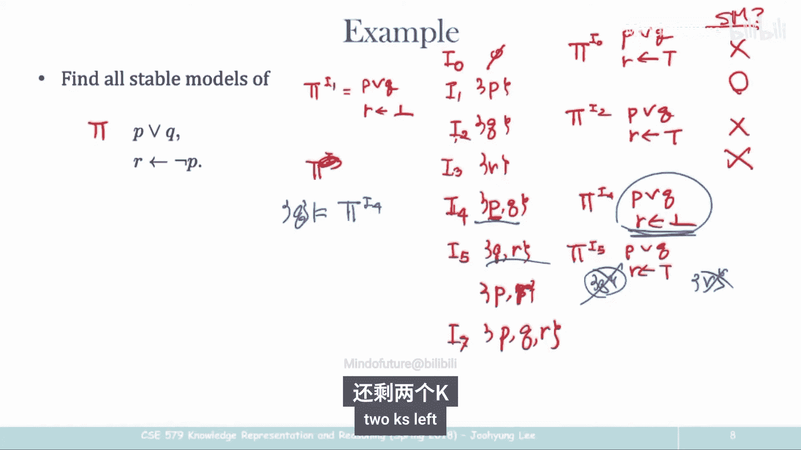
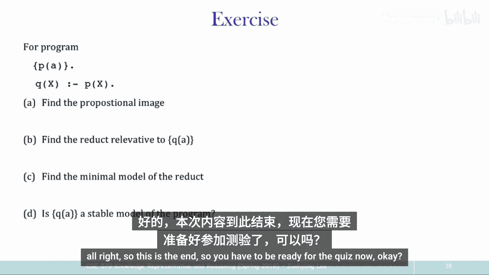

# 【亚利桑那州立大学】知识表征和推理 ｜ Asu Cse 579 Knowledge Representation 2018 p07 P07_Lec9 -BV1RTWyzfEQH_p7-

So today we will continue the definition of a stable model and start new handout which is about programming with Klinginggo so the second PDF file。

 the lecture note is also posted on the Blackboard these two are kind of companions so you might actually read the second file which is called PwC that PDF first and then you can read SM PDF but I think it's better to understand the theory first and then try to go with the implementation so some of the material may be repeated。

 I'm going to minimize those overlap but the lecture note have certain overlaps there。Okay。

So this is what we saw last time。Okay。So we defined the notion of stable model in three steps。

 the first step is to find out such a critical part of a formula which is basically the part that started with negation。

Okay and we form the redux relative to the interpretation that you are given。

 so basically the redux is the transformation from the original program by replacing those critical part with either top or button。

 depending on whether those parts are true or false under the interpretation。Now， you found another。

Program now with this new program， then you see that there is no negation。Okay。

 so then it goes similar to the positive program that you saw。

 it is actually basically the positive program that you get as a redux and then apply the previous definition that applied for the positive program。

 So what is the stable model of positive program。Just minimal models okay so the third step is to find the minimal model of the reader and if that minimal model happens to be the same as the one that you started with when you form the reader。

 then you call that interpretation to be a stable model。Okay。All right。

 so let's do some more practice today。So we are going to find all stable models of this program。Now。

 same models are basically models with certain additional conditions。

 maybe you can call it stability。SoIt is a model in classicalology， but it has。

To test those notion of stability。And。走。When you talk about stable model。

 we need to also think about what is actually the signature that we are looking at。

Because when you define models into a position logic and class first of the logic。

 we started with the signature and the signature determines how many interpretations that you can have right if you have signature to be PQR。

 how many interpretations are there。8， if you have PQRS， how many interpretations do you have？16 now。

 if you look at this positive。This program， this formula。What is the signature？

Well the signature should at least contain PQR， but it may contain other symbols as well。

 right so writing the formula you don't have to use all symbols in the signature for each formula。

Okay so you can say the underlying signature could be also PQRS or PQST or whatever okay as long as those signature contains PQR。

 then that could be understood as underlying signature On the other hand。

 we don't need to care too much about the symbols that do not occur in the program。应该是吧。刘晶晶。Okay。

 hold that question， maybe once we practice this， maybe that will come again and you may get someone understanding for now。

 let's assume that the signature is only PQR。Okay for simple eteem。

 so then we have eight interpretations to try。Right， so for this program， it has P QR。

 So the knife is， of course， you can。generateerate all these。E possibilities。

So there are eight possible interpretations。How do we check that each of them is a stable model or not？

I'm going through these three steps， right？Okay， so let's try that。Actually， so can you be up bit。

Now let's try to be naive as okay， so let's look at i1 or I0， let's call it I0， which is empty set。

 What is the reader， so let's call this one pi。Okay， and let's call this is i0， i1 up to maybe i7。

Okay。So what is pi。Superscript I0。 What is the redux of this program relative to I0。So P or Q。

 the first rule is copied as is because it does not have any critical parts so you don't have anything to replace。

 so for all these redux that you are going to see， it will contain always P or Q。Okay， good。

 What about the next one。So what is the critical part here？Not T because that start with negation。

 So here a critical part is actually very simple。 Okay。

 that's the formula that started with negation。Okay。So。So there are only two choices。

 whether to replace not P with top or bottom， depending on whether not P is actually satisfied by the empty set。

 so does emptyS satisfy not P。Yes， we should be used to that by now， right。

 empty set means he sportss。W is false and art is false and all that items are false， right？

So then P is false。 So neational P is true。 So we replace it with。好。Okay， so the second step is done。

 We form the radar。 Now， the third step is to check whether the empty set is a minimal model of。He。

 don't look the original 프로그램 anymore because that's going， right？

So is I0 a minimum model of the result。 So here you can do multiple ways。 Okay。

 so one thing to do is。First， you can check whether I0 satisfies this data if it does not satisfy。

 you don't even need to care about whether this is minimal right， so that's I0 satisfied be。Why not。

 why doesn't this satisfy？Because PO Q to be true， at least one of them， POQ should be true。

 but emptyS says none of them is true， so PQ is not true。So i0 is not a model of the red。

 hence the conclusion is I0 is not a stable model of this program。Okay。So let me repeat。

So it's basically just。Procedure， you form the Vup and check whether the X that you started with for each of this case。

 whether that X or I is a minimal model of the V。If that condition is true。

 then we call that I is a stable model of the original group。Okay。

That's the definition in the previous slide。Okay， so what we see here is i0 is not a stable model。

Okay。Are we together？Okay， so what about the next one？So let me actually write here pi I1。Again。

 the first one is actually the same right POQ doesn't have any critical parts so nothing to be replaced now what about the second one？

保。Or if。Bottom， why， because now I1 is P。 P is true。 So now P is false。

 So now P is replaced by bottom。O。Now what is the next step？

We have to check whether this one is a minimal model of the red， not the original one， okay。

 be careful。So is I1 a minimal model of this red in order to check first you have to see whether I1 satisfy this red as I want satisfy each of these rule。

 yes。Because P or Q is true because P is true here and this second rule is now toology。

 bottom implies anything is actually true， so it's always satisfied。Okay。

 so then i1 is a model of this， but is it really minimal。

 so now suppose you take out P out of i1 which is now empty set。

 which is smaller than I1 does empty set satisfy this red。

MPT set does not satisfy the reduc because it does not satisfy the first floor。

So I1 is not only a model， but it's also a minimal model。Okay， so I1 is a stable model。So。

 this is stable model。Okay。Are we together？Okay， so this is a good time for you to practice on the quiz。

对。Okay， he， so what about the next one？So let's write pi I2 here。So this is I2， what is the reader？

YourQ。好的。And if top is actually the same as i0 because p is false in i2 right。

 so it's actually the same as case of I0， so the red in this case is actually the same as the redux with respect to I0 okay。

But we are looking at I to。Does I2 satisfy the red now we are looking at the red relative to I2 right don't look at the other red。

 don't look at the original program， only look at the red relative I2， which is P Q and rta。

Does this？Interpretation， satisfy this reader。No， why because？The second rule says r must be true。

 but this one， this interpretation does not have R to be true。Okay， hands。I， too， is not。

A minimum model， because it's not even a model。Hence， I， too， is another stable model。Okay。Yes。

Can you say one more on why the negation a？还好。The I case。So。In I too。

We look at so all we are doing at this moment is。To see whether this will be replaced by top or bottom and that condition depends on which interpretation that you are applying。

 so sometimes it may be true， sometimes it may be false in the case of I2。

 we are applying this interpretation where Q is true but P and R are false。So P is false。On the I2。

 which means this is false， then RP P is true， so then we replace this top。Yes， okay。All right。

 so then let's do the next one。pi i。3。Okay， should I actually do this， Can we be a bit smart。

 Can I3 be a stable model or not？No whyイ。Because I3 wasn't what the read that is？Right。

 I3 must satisfy P or Q。But I still cannot， because it doesn't have PM。没说。Right。

So we don't even need to look at the second rules read because each of the rules must be true for this interpretation。

 and I3 does not satisfy the first rule anyhow。So it cannot be a model of any result。So， this is not。

Okay。What about I？4our。Okay， so I it's basically you just need to look at the。Interpretation。

 whether it interpretation contains P or not。Because all we care is actually not peak。

To determine the truth value of not P， we only need to know whether the interpretation has P or not。

 okay so there are actually just only two cases that you will see。Let's actually look at pi I3。

So this inter I'm sorry， we are looking at pi I4， right？So pie Eiffel。So this one contains P。

RightThen the red is actually the same as what we did for， say， i1， because I1 contained P。

So the V do here is P or Q if bottom。Or if you don't want to look at the other cases， just look at。

The fact that i4 contains P so that not P is false， so not P is replaced by button。Okay。Now does it。

 okay， this is now different from the previous case， so I4。

 does it satisfy the redout relative to I4？Yes， because PQ is true。

 so the first rule is true and second rule is also true。You it a minimum。No。

 well this is a smaller one than PQ that satisfy this without just P。我。That's cute。Okay。

s exactly two smaller model than i that satisfied the。

 Of course you don't have to generate all smaller one。

 at least there's one smaller one that consistss that i4 is a minimum model。嗯。Yq。

That's not satisfy makeup can somebody explain？I just understand that I just say cute that。

A singleton set Q， does it satisfy the without one？It does that， right？Okay。So we are looking at。

This program with respect to this one， right？Okay， the question now is does。Q， satisfy。This redduct。

This three。Of course。Q is2。 So the first one is2 Q or Q is 2 if Q is an interpret。はい。

And second total so even if you take singleton set Q。

 it also satis okay so there are actually two counter examples to the claim that IO is a minimum model。

 it could be because of the presence of the single consent P or it could be the presence of singleton set Q。

有。Since we knew that he is already a stable。 you need to go and take for Yes we do。这个やす。

probably here。こうしてるもる。Soですね一ピそれでピーキビステルも。That's an actually interesting question。

 we will probably get into that in a moment。Okay， but my short answer for now is not necessarily。

His argument exists， we already found that peace。St model， How can be。

Anotherプリケーションビ largerジ than研究しているも。This you。So he said， we can stop not。Yes， and I said。

 that's wrong。可以证明。Get back to the kind of problem。Thankか。Let's I guess。For now。

 let's just practice the current definition， okay？All right， so PQ is not a stable model。

What about QR or this the redox， does this becomes now？I 5。Right。So yeah。

 this one does not contain P， so the same as I0， so pi i5。Its actually same as pi I0。

 which is P or Q， I if true。Okay。Does I5 satisfy these three？3月。You在5 minimum monスマト。

So what is the smaller than I5 that' satisfy in three？怎body的 says？

There it's a smaller one that satisfy this one， right？就我呢些。我son。我能。そんなです。I heard somebody was saying。

 no， this is not minimal。Okay， means that you have some other model that is smaller than QR will satisfy the same reader。

So I'm asking， what is that。Moel to look at。How many smaller small interpretation are there。Only3。

 So's try。 So so I5 obviously satisfy this reader P or Q in Ali。 but what about Q， if I take， say。Q。

So if you compare Q and QR， Q is smaller than QR， right， does Q satisfy this without？のわいな。

Because the second rule now say all must be true。 Oh， so that might not be a good idea。 So forget it。

 What about all then。R is still smaller than QR as now satisfied the with， No， why not。

Okay so and of course empty set obviously does not satisfy too。

 you will see that QR is the smallest set of atoms that satisfy the read。

 you cannot take out interpret any atoms from I5 and still satisfies the readup relative to I5。

Are we together？Okay。ho。Two case left。

Okay， so what about I6？What is pi I6？The same is pi1， i1， so P or Q r if button。

 does PR satisfy this redux？Yes， is it minimal， which one is smaller than I6 but still satisfy the relative to I6？

P。O。发院。All， so this is not a stable model。 and I believe this was a stable model。

 This is not a stable model。 So we found so far two stable models。 And the last one。

It's actually not a stable model， I'll leave this as an exercise。Okay。All right， question。Okay， good。

So then now let's look at something interesting。Wch get back to Arinda's question。So P if not。

Okay so let's just assume that the signature contains only one symbol P， okay？In fact。

 I can let me go through this。Now once we have done this exercise。If you see any。Interpre。

 So suppose course I change the signature to be P Q R S。Okay。

Then what you will see is if I take something like PqS。Okay， let's say。Maybe this is I10。

And ask you to check whether this is a saving model。我디时出。This is never a stable model， why？对说他一个。

Because it contains S。I know this might be a bit trickying， but think about this way。

When you form the gridout， you only some part replace some part of the program with button or top。

Okay， so you don't actually introduce new atoms。When you form the leader。So when I see that I 10 PqS。

Whether to check this is a stable model or not。I can immediately say that this cannot be a stable model。

Because it contains S， which is not even in the program。Okay， so suppose。is okay。

 so this might be a bit。Too much for now， but let me just say anyhow。

 okay because we have to solve the next problem， okay？嗯。It is so the ceiling is like this。

 it is actually okay。To look at。The signature。That comes from the formulas。

You don't need to consider those atoms that is not even in the program because those interpretation can never be a stable model。

 for instance， PQS contains new atom S， which is not in the original program。Now what would happen。

 so suppose PQS is a save model。Then there's a contradiction。

Can you see where a different situation comes？我来。You can find E PQS。Is a stable model。

 which means that the。Okay， so let's actually have a small proof okay。As assume。PqS。

Is the same model。Okay。That means。PqS。Is a minimal。冇得。Of P PQs。However。

 this program does not contain S。So you will actually see that， in fact， PQ。It's also。A model。Of。Tqs。

Hence， you can always find a smaller set than PQS that satis the radar。So在这 country。Now obviously。

 this is not the general statement that I'm saying。

Proof of the general statement is actually the same kind。

 You just need to make it a bit more general notation。Okay。In fact。

 this student can be further refined。And that I lead as a former drop later。All right。

 but let's still go back to the definition so I probably jumped too much in the previous slide because somebody asked。

 but let's just look at the definition so here so what I just said was it is okay to consider only the atoms in the program。

So I would only consider the signature to be P。Because here are all these examples。

 P is the only symbol， right？O。So let's call this as a pi。

And we will check where the empty set is a statement model。オケー，オ디す leader。Pf。T because P is false。

So now P is true， right， you should be familiar with this。Okay。Now empty set。

 are they satisfied withduct？No， so what do you conclude？这谁是拿着这 model。Okay， now what about pi。嗯，P。

What is the reader is opposite， right， then I becomes bottom does P satisfy the program， Yes。

 is you minimal， what is smaller one。Empty set satisfy the same data， right。

 because this rule is actually totalology。So even the empty can satisfy this program。

So for this example， you see that there is no stable model。Okay。Chrision。The next one。

 let's call this again pi。Pi empty set。What is the critical part now， there are actually two negs？

SoWe have to look at almost form right so what is the critical part not not P right。

 so does empty set satisfy this critical part， not P？Now P is actually same as equivalent of P。

 right？For empty set does not satisfy P。 So what should we do。P F bottom。Good。Are we together？

How many of you don't follow the。理的。Okay， good， let me repeat。So。We are't just doing。This slide。

 okay， so just exercising on this。Okay。So。The first part to know is we have to find a sub formula such that it is the kind of largest negated formula。

Okay， are we clear about this？Okay， so then let me not point to it for this example。

 there were two critical part， which is this one and this one， this is the largest negated formula。

 okay。So that part is okay， the next part is we have to replace each of the critical part with either bottom or top。

 and that is actually explained here。Okay， so。When you form this so called red。

 we are given two objects， which is pi aal program and x， which is an interpretation。

So using these objects， we are creating a new program called the redductux of pi relative to that x。

So how do you obtain this， you just copy the original program， but replace each critical part。

With bottom or top， actually。I think it was typepo。So this one is actually at the top。Okay。

Interpretation X satisfy this critical part to replace this path， otherwise replace this path。Okay。

 are we togetherta here？Just replace the negated formula。他我把灯。 depending on the condition。

 whether the interpretation X that you started with satisfy that part or not。Okay。

And then the next is。We call x is a statement model of original program if x is a minimal model of the reader。

Okay， so we are exercising on this definition。Okay， so going back to。This one， okay。

 let's actually resume this case yes。First of all， the P applies not。你 if not所以在 not。

Right not P implies a P。So， when。He is。So I thought on one of those， I thought impplication。False。

 if true applies false。Mtplication is true when the antecedent is false or the consequences。你 case实。

P是谁。He is true。这。是。一样。That第是 to落。So doesn't that satisfy to same？So so this is a red， right。

 Are we together on this part， Okay， now we have to see whether the last case。

 last condition is whether P is a minimal。Moド。Of this three。If this is true。

 then we call P a stable model。Okay， so we are checking。This condition。

 so what do we mean by minimum model of the data？It consists of two parts。

 one is this P things on cell p must satisfy this weta。And did this are the case。

Because buttonton implies P is always true， no matter what interpretation that you apply。

 we call it such a formula as co。Which means no need the single something P。Also， the empty set。

Satisfy the same results。喂。So， what we are seeing is。This is a model。

 but it's not necessarily minimal because empty set also sat P if bottom。Right。

But the M of disincents。Empty says satisfy the reader， right？I agree and said that satisfy why I PE。

But right。And that's the definition。You only need to check whether the empty set or。

对P你 a minimum model不回答。But what you find just now is this is actually another。Mo of the leader。

 which is smaller than。So the claim that single turns P is a minimum model of redductux is false。

Okay。So this claim， we are checking the claim， whether this is true or false。And this is false。

 the counter example is empty set。Empty set also satis the reader。

 so we can call this model to be the minimum model。Okay。I sorry。In this case。

 the model is sort the rule for the model。不好啊。And he said this satisfied here。Okay。

 you should read as bottom things I see。把。8后明。That empty said doesn't satisfy。

Sentifies the bottom white。Okay， so。Okay， let me just do this。 So why empty satisfied it。

 this is actually true。愿意。Oh you we got there from。Setting P is the primary。

So I don't understand the part that you're asking。Yeah， you can do。

But let me just just resolve this first。So which part is your question。

Why don't we go on the Alaska half？O。Okay。So this is the definition。

 somebody I want to see that again。Allright， so then let's go。To this one。Okay。

 so we are back to P if not P， the redductux of pi relative empty set is P if pattern。

 so that's empty set， the minimum model of the redduct。Yes。

 so what do you say empty is a stable model， good。All right， so what about the next case？

So this is opposite， so this should be Pf。Top， is P a minimum model of this redduct？Okay。

 it is because it's basically saying top implies p which is equivalent to P right so P is a minimal model which this minimal model of the red hence P is also a stable model。

😊，Of the original program， right？Now， this actually illustrates a point where you found some two stable model。

 but one stable model can be a proper subset of another stable model。北太公。Okay。

MT set is contained in the singleton set P， but both of them are stable models in this case。Okay。

All right，So that the first one where we red P detect P， so we assume that P is true。

 then only we came to the formula red P hit bottom。

You're asking about the second case second second is， right。Be is true， be it up true。

He is true and not he false。Coect so that is which by button so our index is。I's Steven Warren。

You're talking about okay， let's make it clear you're talking about this case， right？

And the conclusion was this P is not a minimum model。Yes， so this is not a stable model question。

 So which part is the question。The rate of the formula right assuming it is true right so now we are saying that empty set is a stable model So no empty set is not a stable model We didn't say that empty set is a minimum model。

Because we only care， okay， I think we should be clear about the definition。

 so definition was very clear about what to be checked。So。

I guess some people are still confused here。This is the line that you have to pay attention now。

We are calling x is a stable model of pi if x is a minimum model of the reader。Okay。

So this is all we check。If MT set satisfy this reddo doesn't mean that empty set is a stable model。

 we just say that X is not a fixed。That's what definition implies。Okay。没有O。All right， so yeah。

 I think I。It was good to prepare all these exercises because it's just one slide and I could just jump to the next topic。

 but it looks like many questions are rising here。Okay， so we are done with the second case。

 now the third one。😊，Okay， so what is pi empty set？第一。我。top。Which is actually equivalent。

T people talk is tough， right。So。Now one line just showing you right。

 we have to check whether the empty set is a minimum model of this rig through force。True。

 so we conclude that this is a stable model。拍P。So this must be POR。Butom。

 which is equivalent to P Okay， so that's this P mean we are checking this claim that don't think about other things。

 So whether this P thing the P is a minimum model of the reader is。Yes。So then the isテブモ。Again。

 this is similar to the second formula， right， so both empty set and P single trans P are stable models。

We'll come back to this later when we do the Klinggo program。It turns out that this formula。

 P or R T is a very interesting formula。very interesting， so we'll actually give a name later。And。

Maybebe for呃。Maybe I will just skip next slide and we'll come back here。

So one question that might arise。It is about just one line definition x is a stable model of pi。

 if x is a minimum model of pi relative to x。Why bother with this re？

Do we have this critical part and then replace and check minimality okay， so here's a claim。Well。

 let's try to simplify this definition。For any program pi。

 x is a stable model of pi if it only affects just a minimum model of pi。

 so basically just forget about to beta， let's just say minimal model。Okay。Is this claim true？

X is a stable model of pi， if it only x is a minimum model of pi。If this claim is true then。

What we spend for 30 minute is actually just waste of time。Right。False。

 then what is a counter example。P1 RP P， so what was the stable model of P1 P？

There were two empty set and the single ten set P。Okay， so for pi， which was P1 not P。Okay。

Stable models are empty set。And， what is the minimum model。那种你 one mini你 model。计算比三。Okay。So。In fact。

 this。Claim could be true if you apply to。Posive program。But if you start with the negation。

 then this is no longer true。And believe it or not。

 this took a long time to be resolved in the literature。

 so people in AI spent maybe 20 years to argue that what is actually the best definition of obligation litigationation is failure？

And this is probably one of I would say this is the best somebody。

I know there's another group of people who might disagree。

 but I think this is the best definition that we have。Okay。Then。Let's get to this one。So here's this。

这个你 can also说不知道。So the two programs may be equivalent， but their stable models may be different。

Okay。So these are the examples。嗯。So if you look at P， it's not Q。

Let's actually look at the second one part。So P or not P。And Q are not Q。啊 they一块了。

Which means do they have the same models？Do they have same models， P and R P？And Q and up Q。

 do they have same models？Even that last thing in the a year So PN you David have different names。

So then your signature should contain at least PM andQ that's the assumption underlying line。Okay。

 so because the fact that you can write PO and RP P and also you can write PO and RQ means that you are seeing circum contained at least P and Q。

So let me help you， which is not exactly。Enough， but let's just。Say sigma is P or R P and P and Q。

 they， do they have the same models？It's true or false， do they have same models？

So what are the models of one formula， but not the other one？提不。P。So please satisfy what？你说什么。

P satisfy this one。And you're saying that P does not satisfy the second one。对 said。

We're talking about model satisfaction for logic in long time ago。Maybe we you the。

This is a the that the Q P and Q and Q either this candy or not， okay。

 you always have the fact to be true， you get the candy or not， there's no other case。喂。

So these two formulas are actually。Equi because they are topologists， all the models。

 all the interpretation that them。Okay， maybe after you study some more complex concept like stable model。

 you forget about the basic concept of theology。 no matter what interpretation that you apply。Okay。

 but now we know that the stable models are different， right？What are the stable models of this。

 you remember in the previous slide？So the s models of this is empty cell and P。Likewise。

 stable models of Q and Q is empty set or N Q， so they actually have different sets of stable models。

Okay。All right， let's look at the first one。Forget about stable models for now。

 go to the very simple case of propositional logic， P if not Q， Q， if not P， P or Q。啊的亏。Yes。

 and what are their models？They have the same models， so the models of this formula。I。P。Q or PQ。

If you don't know how to verify this。You can draw the tool table and check them or you can do some equivalent information P and notq implies P is actually the same as not not Q or P。

 it is the same as Q or P， but the actually only equilibrium。However。

 the stable models are actually different。 I'm going to actually show you that in the later。

Slide or maybe not。 Okay， let's actually do。 Can you guess what is the stable models actually。

 we already know something here。 Okay， What is stable model of P or Q。So that was single concept， P。

 single concept Q because they are positive program， there is no negation。

 so it's actually very simple。Okay， so this is stable model。What about P if NU。

 what is the paper model here？可以。P。B。Okay， let's check it， so let's call it pi1。

So let's actually write scratch here pi1 relative to。I1 relative to P。 What is the redduct。第一。Pf top。

Okay， if you're not familiar with this transformation。

 you probably have to go through this exercise again。So single that P means that P is true。

 but Q is false， then notq is true。Okay， so that's why this is replaced by top， okay？Okay。

 so then then does P is P a minimum model of the redduct， Yes， so P is a same model， correct？

Let's try Q。What is the stable model of pi1 relative what is the redux of pi1 relative to singleton set Q？

Pf。Butottom， right， So is Q single trans Q a minimum model of the red。 No， So that claim is false。

 So this is not a stable model。And you can try the other two cases if you' are in doubt。

 but they will turn out to be not stable models， so here only P。Is a st model。

And this is actually a symmetric， so you will get only Q singleton the  Q as the state order。

Now you see that these are actually propositionally equivalent to each other。

So they equivalent on the proportional logic， if you just draw the truth table。

 but if find if you compute stable models， they are different。Okay， so。Let's do another exercise。

 We just saw that the stable models of this program is P。And Q。

 so it looks like this is exclusive or。 you don't have P andq both to be true， right？

On the other hand。Now let's actually look at this one。So what are the stable models of this program？

嗯。Yeah。P。Okay， so it does not have any negation。 There's no critical part。

 So all you need to check is whether this is a minimum model is still a minimum model。Yes。

What about Q， what happened to Q？What about PQ。The picture youげなもの。No。

We already checked a piece of model， so hes another minimum model， okay。So suddenly。

We add this one line。And you get only one of them to be the saving model。 Okay。

 that's not too surprising。 What about this guy。P or Q， Q if P， P of Q。毕业。

So the stable model must be。P Q， this must be the minimum model of the red。Okay。Now。

 there's something unpleasant。Here。Well， maybe not certain， but maybe it's strange。说。

Let's actually compare this with。Classical logic。Let's look at the models of PQ。

 what are the models of PRQ？So here this is stable model， but let's just say models。

What are the models of PQ？PQ。And PQ。So there are three models， right？

Now let's look at actually the last one。What are the models？The last last one this。

 What are the models of this。PQ， right？你时你问话过。Now between the first one and the third one。

 so the first program is our third program。What we added was two more rules。Now in classical logic。

 what happens is each of the rule works like a constraint， you have to satisfy additional conditions。

So you start with some many models。When you are asked to satisfy more and more formulas。

 then the set of models actually decreases。Because you not have to。Satisfy additional formulas。

 so when you have more formulas to satisfy， then the number of solutions actually go down。Okay。

And not only the number， but it's always the case that you don't actually introduce new models when you add more formulas。

 you only get rid of some models of the original formulas， which does not satisfy the new rule。

However， you don't introduce new models when you add new formulas。But heres something interesting。

In the stable model semantics， what do you see？Is there was a P and Q Now when you add two more rules like this。

 you get a totally different stable model， which is not even a stable model of the original program。

 P or Q。So by adding some new rules， you actually create new models， new stable models。

 which are not a stable model of original program。Why this is interesting。

 this is so called the difference between monotonic logic and nonmontonic logic。Okay。

 so here is the definition。The logics that you saw before professional logic and first of the logic and most of those kind of logic is actually called monotononic logic。

So here's one definition of monotonicology。So if x satisfies。FNG。Then x satisfies F。

This is one way to state the mono on this。If X satisfy both F andG。

 X will also satisfy only one of the formulas， this is always true。Right。

Because you actually get rid of the restriction， so the previous model is still a model when you get rid of these GPP。

Okay。嗯。This condition can be equivalent until being written as so called control position。

Which means that if x is not a model of F。X cannot be a model of FNG。These two statements。

 the first bulletlet and the second bullet， are actually the same thing。If you search this logic。

 you will see that p implies Q is same as not  Q implies not p， so this is actually the same kind。

Or if you don't know about that， that's okay， just saying that if x was not a model of f。

And when you add more condition G there， then x can not be a model of f because x does not satisfy F。

 so it does not satisfy conjunction with any other formula。

So this is what we know as monotonicologic。Another way to say this thing。

 the set of models of F and G is a subset of the set of models of F。

What that implies is this if you know that x is a model of f。Okay， we can find。

If x is a model of FNG by only checking whether x is a model of G。So in other words。

 one idea is let's think about F as a knowledge base that is already there。

And you already know what are the models of knowledge space？

AndNow somebody adds more formulas to the knowledge base。Okay。

 how do you compute the models of the new knowledge space？According to this monotonistic property。

All you need to do is assuming that you already know that x is a model of the original knowledge base。

 you only need to check whether x satisfies the added conditions。If that is the case， then x is。

A model of the knowledge space。You don't need to recompute the big knowledge base again。

On the other hand。Stte model setics is actually non mono2。

What you see in the previous slide is if you find a stable model of F and G。

 this is not necessarily a stable model of F。So here the example was P or Q and two more rules。

 P if Q， Q if P。The stable models of FNG was。ThatPQ。However， that set is not a stable model of PQ。そう。

This is actually in contrast with the left case。So even if x is not a stable model of M。

 it may be a stable model of F andG。Unlike in monotonic logic。

And also we can say in the same thing here to just say in another way。

 we cannot say the set of stable models of F andG is necessarily a subset of the set of stable models of F。

Thatそそなってケす。Which means。Even if you know that X is a saver model of F and also you know that X is a saver model of G。

 you cannot compose。F and G， you cannot say that X is still a stable model of FNG。Okay。

Now what happens here is this。 So we are actually trying to deviate a bit from the classical logic。

 Why do we need this nanooneity， Remember the old example that like getting to the airport。Okay。

 so what if somebody says that now the car is not drivable or the airport has moved？

did did we talk about that example。So somebody can give a new condition and then it defeats the previous conclusion。

Okay。Because there is certain condition， certain statement。

 and there is an exception to that condition。Now in monotology， what happens is this。One of thes。

 the homework exercises that we did was if the knowledge base is inconsistent。

You can derive anything。So if there's a contradiction。

 then that knowledge base can entail any formula。On the other hand。

 what we often observe in knowledge representation is some knowledge is more like per usual assumption default and some other knowledge is actually exceptions to the default when you add exception。

 then you can revise your knowledge base， you can still derive meaningful conclusion from this knowledge base。

And that's where actually the same all semantics can be useful。And for now， actually。

 this is just a mathematical definition， and when we do the programming next， it'll be more clearer。

Okay， so this is just the one slide that might be。Actually， right， a lot of definitions here。

 There is actually only one definition monotony logic versus non monoonic logic。

 So monotononic logic simply means。They satisfy this condition all the time。

 and the other bulleters are just ament of the rephrase of this condition。我りなもとに。Basically。

 even if x is a stable model of F andG， you cannot claim anything about whether x is a stable model of F。

So that's the definition。Okay， so。Okay， let's get to now the we are done with SMR PF。

 now we are going to PWC programming with Klinggo， okay so we'll just illustrate some part here okay。

So， let me。こうする。Yes。Okay， so here is a Klingo program okay to find say prime numbers。

So can you read this formula now？Okay。So what is this one。

These a composite ns where n goes from one to five。

So n is a kind of variable that ranges over the numbers from one to five。Okay。

 and I is another variable that range from2 to n minus1。And N。the remainder of n divided by I is 0。

 so n is divided by I。Okay， so then we call n a composite number。And prime numbers。

Are simply the opposite。It's a number from two to five and is now the composite。Okay， so。

Let's see how this is done。In order to understand this program。

 you need to mentally turn this into propositional image， that's what we practiced before。

So let's see what happens。So n goes from one to five。Okay， so let's say n equals1。

What is the value of I？When n equals1， what is the value of I？Empty。

 which means that this rule is not effective。So forget about that case， so when n holds one。

 it does not produce a proportional image。Then n equals 2。What is the value of I I。Still。2。2。

1 is empty， right， So its still not。Now， are we together？You're doing increase value too。

 so we still cannot find the I because I goes from2 to1。 What about when n equals3？

What could be the possible I。这个一そ。So now n minus-1 is 2， so I could be2。 Okay。

 so we found one I here。Now， what is n divided by I？And this is not。

Soリメイン がいそリメインド is1 so itsなデ equalと0。So again， this does not make a proportional image。Okay。

Now let's go with n equals 4。Then I can be。2 and 3。Right。So when n equals4 and i equals2。

 n what is the remainder of n divided by I？Its zero is satisfied。

 so that's why you get this rule composite of four and all these three conditions are actually true。

Are we together？Now I could be also three， but what happens when I equals 3， what is4 divided by 3。

 what is the remainder of 4 divided by 3，1， so it's not equal to 0。

 so that does not create a pro image。Okay， so when N equals four we are done。When n equals5。

 I could be2， three， four， right？And we have to check whether n divide by I。

Where the n is divisible by I right， so is 5 divisible by 2。5 divisible by 3，5 divisible by4， no。

 so actually when n equals 5。It doesn't produce any propositional image。So we got with this。

So among the many it looks like a pole loop nested right so when n equals one to five and I goes to2 to n minus-1 and n I goes0 but you don't write the procedural way right you just need to write single line and you're done。

Okay， now what about the second prime of n？When n equals2 to five。And not composite it。

 So basically when n equals 2， right？So first， think about when n equals 2。Is two a composite？

According to this thing，4 is the only composite， right？So this is not。But so here we get prime2。

 and this is true， but its not to actually， let's not compute this one yet。

 we just create a propositional image。What about any three？Yeah， and you equal4 and equal。

 you just copy do thing。Okay。So when you do this。嗯。You will actually run this program later。

 but you will see that time of two， three， and five are true， and composite of four is also true。

 so that will be the stable model。Okay。第。So this is exercise problem I think you can do by yourself。

 so actually all the exercise problems that I did in class is actually coming from the lecture notes so you can take a look at it。

So。So this is exercise problem in the handout。嗯。There's a choice rule。Which I okay。

 so one thing that I told you before， remember P or not P。Okay， so in Klingo， there's actually。

A specific syntax for writing P1 RPP。So if you write P of1 here。

 then Klinggo will understand this as P1 or nu P1。How many st models are here？2。

So the reason that this is called choice rule is either choose P1 to be in the stable model or not。

 so it's kind of choosing these options。And you can also。Use the interval notation。

 And when you do this， Klinggo will understand as。Conjuction over all these formulas where this term。

Inside will be all the values。他是东。And can you guess how many stableable models will be here？

P11 up P on， P21 up P2， P3 on up P3。 How many stable models will be there。嗯。そ you can。

NoSo all the subset of P1 P2 p3 can be a stable model， and here is actually another exercise problem。

😊，O。All right， so we did a lot of exercise today， but if you' are not comfortable。

 maybe you can watch the video game or you can ask me in person or you can post on the Piazza okay？

Alright， so this is the end。 So you have to be ready for the kids。 now， Okay， Allright， thank you。

