# 【亚利桑那州立大学】知识表征和推理 ｜ Asu Cse 579 Knowledge Representation 2018 p08 P08_Lec10 -BV1RTWyzfEQH_p8-

Okay， so we'll start with programming Sclinging， this is actually the new handout。

 if you go to the Blackboard there is a file called pwc。pdf。And as I said before。

 the lecture note that you just studied for today's quiz is about the theory of stable models。

 and this is more like practice of the AnE programming。

And you could have started this one first and then come to the stable models and we just chose the other way。

 and obvious question is why don't we bother with so-called stable models with all these negation and read and what is actually the intion here？

So we are going to talk more about that when you go into the programming side， so just try to。

Remember the definition of stable model and time to time， I will connect to this okay。是。Obviously。

 you already know what is the program for what are the stable models。

 basically programming with Klinggo is just to compute the stable models。

So you just need to encode some program in some S key notation and the Kinggo find the stable models and that's all you need to do if you remember the beginning of the semester I show you the declarative problem solving method where you encode the problem as some representation which is in this case is a logic program。

And then you use some systems like An over to find a solution which correspond to the solutions of the original problem Now these solutions will be encoded by stable models。

 most of the time， the solutions that you are looking at from the original program will be reflected in the stable models。

Right， so this is just notation in SI characters， so you have these things of one thing to be careful though。

Is。The Klingo understand integers， okay it does understand something non integers。

 but let's just focus on the integers for now。So what happens is when you have two integers M and N。

 when you divide then the results may not necessarily be integers in this case you're taking the floor of that number okay largest。

Integer that is smaller than that particular result。So we have two symbols related to the division。

 so cautions and the remainder can be found by each of these symbols and we also have the exponent where we have this。

Double star notation。And the other things are something that you already saw。

 for the historic reason， the deation symbol is encoded as NOT。Okay， and comma is on。

Challenging to remember， so when the comma is actually used in the body it needs a conjunction。

 when it's used in the head， it means disjunction。And。

There are some special atoms for bottom and top。Which is found false and found true。それで正者そののテーション。

So let's revis this simple example， so the example here was to find out what are the warm cities and according to this particular program。

 warm city C was defined as a city that has a temperature higher than Austin so this reflects a basic idea of database reasoning。

 the database like this table can be encoded in this line。

 so you can encode the the fact as this simple rules。Okay。So there are actually four rules here，1，2。

3，4 okay now the other one is the rule here where you can derive new information not explicitly stored in the database。

 so we assume that C is warm if Cs temperature is T1 and T2 is still a temperature and T1 is greater than T2 than C is called1。

So intuitively see it's warm if the temperature is C T1。

 the temperature is in Austin is T2 and T1 is greater than N T2。

 so this is just a reading of these logic rules in terms of English and you should be able to do this。

 right。Now when you find these warm cities note here that we are not describing algorithm to find it。

 we just declare what are the warm cities and it's up to the Klinggo to find that solution so of course are actually dissolving component of the Klinggo which we are not going to talk today so well first focus on how to represent this knowledge in the language of Klinggo now how actually Klinggo find the solution that's actually you already know some part of it when you remember the DPL algorithm right to find the solution for any proportional formulas so tweak of the DPL algorithm can find the stable models too。

If time permits， we'll go into that， but that's actually quite more complicated than DPLL。

 so I'll just probably put some pointers for some of you you are interested in。Okay。

 so then now the next homework for you is actually to run the Kingos， so PWCta P5， the lecture node。

 the next lecture node has many exercise problems。And you will be able to use Klinggo to run these things。

Okay you。All right， so the comment is actually simple， you give the name of the file Klinggo and1。

 LP is the name of the file that's stores the previous program。

 okay there's two line that I show you。And if you type in， it's a command line execution。

 so you type the name of the command and the file name and Klingo returns to sensor。Okay。

So maybe let me show you if I can。

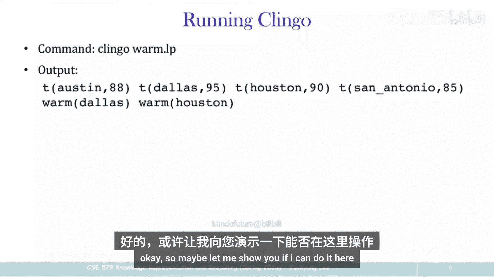

对一条。So。First。This is a file， okay。And nothing to do。 I happen to have multiple versions of Klinggo。

 I'll type Klinggo 5 as a name。 But if you just download most recent version of the Klinggo。

 you can just type Klinggo。Okay， so this is the output of Klingo as you see。

 I don't know what this current version maybe it's a bit more than 5。2。1。

 it doesn't matter as long as Klingo5。It will have the same input program。

Now what is clinicallinggo doing， it read the program and it solves。

So there is actually one answer this answer is actually the stable model Klingo what Klingo does is actually just returned the stable models Now when I type this one I just give the file name sometimes there are multiple stable models then you can actually put zero at the end so in that case Klinggo will return all stable models Now note here that this actually has only one stable model for this particular program so it doesn't actually return more than one okay。

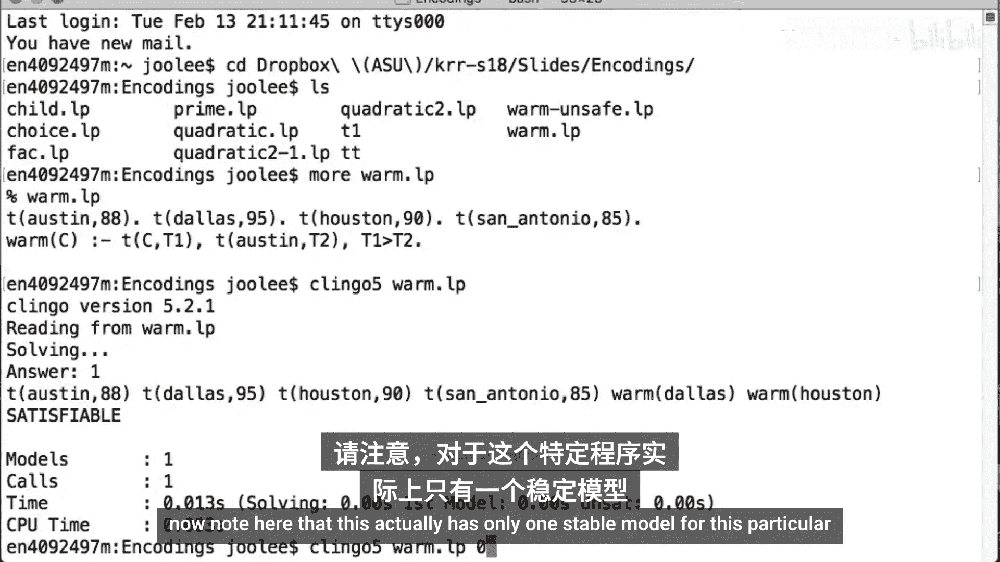

But if you're interested for some problems that you want to solve。

That has multiple solutions you can type some numbers if you put to zero。

 it asks Klinggo to find all solutions， return all solutions， if you use less three。

 then you ask Klinggo to find three solutions。Okay。Now。

 something that you might encounter when you do the program is so called onSafe program。

And you encounter that Klinggo cannot compute this program。

 Cllinggo complains that this program is unsafe so it does not know how to do Now the program here is unsafe program。

And the new rule is the last one。哎，是。This rule is so called unsafe。So what is the SA program？

The complete definition of safe program is a bit more complicated。

 but for now when you talk about the programs with this form。Basically。

 what it means is the variables that occurs in the rule must have an occurrence in the positive body。

给netト。Okay。说。It should be in some atom in the body that is not precede by litigationigation。

And the Klingo program is called Sa。Now， when clicking go find unsafe variables， then it complains。

Now let's look at why this is the case。There is a T occurring here。

s actually goes from the beginning， so let's look at this rule here， okay， so they are variable C。

 T1 and T2。OK now C。Occurs here and here。 Now， when C is in the rule。

For the program to be safe or for the rule to be safe。

 this C must have an occurrence in a positive body。

 which means it should be in an atom in the body that is not preceded by neation。So the C here。

 there are two occurrence and this occurrence makes C to be safe。

 make this rule to be safe with respect to C。Okay， because C has occurrence in the positive body。

Actually to be precise is is an atom in the positive body。What about T1， of course T1 occurs here。

 and this is already a good occurrence？What about T2， T2 occurs here and here。

 this is not a good occurrence， but this one is a good occurrence。Okay， to make this rule to be safe。

Now T1 is greater than T2 is not an atom according to the gllingo terminology。

 it's called comparison， so comparison doesn't contribute to the safety。Okay， so the rule here。

 so the safe program， all variables in the rule must have an occurrence in the positive body。

 which is in some atoms in the body that is not preceded by neation。Only then， the program is safe。

Now， why the classroom rule is not safe？It occurs in two places， T and T here， right。

 this is not a good occurrence as well as this is not a good occurrence。Okay。So this is not safe。

What is inion about safety？When f is safe。Clinggo knows how to ground this program so that it generates only finite number of ground rules。

The propositional image become finite。But when the program is not safe。

 then the propositional image is infinite。Why。We actually saw last time when we consider only these two rules。

 we can only consider。A finite number of propositional image rules right that we saw。

 But now when we add this， what happens to the propositional image。So。Let's say a high temperature。

This rule， when Klinggo turns into proportional image， it will actually generate multiple rules。

 so for instance， 101。1 hundred2。1 under three， so you get the idea， right？

You can go on and it never terminate in generating the propositional image。

So this is another good thing。Yes， so what did he get。请门。The same thing。

 because that TlS1 is still another good occurrence。

 gooddocur should be an atom in the positive body。我 keep we呢个。把那个递给了东西的。本地的责任证。Yeah。

 that is actually another case that we have to。Yes， that's actually the safe。Okay。

So if you can mine this tea to a certain range， that is okay。

So here is actually the thing that I just。Okay the definition here that I just said is actually not complete。

 and I'm not going to。Give a full definition of safety。行。

The reason is when we introduce more construct in the pingral language。

 then the safety becomes becomes more complicated， and basically you don't actually need to know those complex definition。

So one thing to remember here is when the Klinggo program， when it runs。

 it complains that the program is unsafe。Then basically， what it means is。

The prop image may be infinite， so clinicallinggo cannot generate a finite number of growth。

Sos something wrong with your program， and you have to give more information to the Klinggo so that it can generate only finite number。

And that's actually easy to do。You can just put some atom in the positive body for some interval to specify the range of those numbers。

Okay。Okay， so we will come back to yeah。Atoms in the body。 So there are atoms in the body。

These atoms are in the body。And they are not preceded by negation。

ThatSo you don't see the negation in front of the， that's what it means。先加。对你是。

So it should be in an atom that is not in front not preceded by neation。

So what are the atoms that is not precede by ne， let's actually look at this。So， let me。

So let me ask you from the second rule。What are the atoms in the body that is not preceded by negation。

 What are they。This one， this is an atom in the body that is not preceded by negation， right？

What about this one？That's also the case， so there are two atoms in the body that is not precede by neigation。

 so this rule is actually safe because all the variables that occurs in this rule occurs at least one of these atoms。

回と。In the third world， we don't have that at all。This is a compelling。Okay。不了。Well。

 the definition is actually not complete， so you can actually a bit more general。

 but less's not other on this side。The reason that this occurrence in the positive body makes sense。

Is when Klingo generate the proportion image。Los of those atoms will be replaced by button。

Right and those are atoms replaced by button can be thrown out。

 so even if the proportion image by definition is infinite。

Clinggo can only consider some subset of those proportion image。And that offset is actually finite。

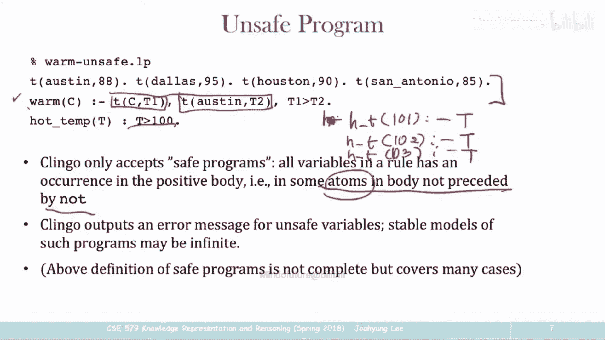

Okay。Theres some other tricks like pooling， which is not very theoretical。

 but if you have to repeat many atoms， you can basically write only one atom so if you have this table that you saw before you can just write。

One T with those semicolon separated list。This is just some convenience。Okay。All right。

 so its one exercise from the lecture note。So what is this rule doing， child X， Y， if parent Y X。

 how do you read this rule？this。不意思。X is a child of， if y is a parentonal， yeah。

 that's actually a natural way to say。Now， if we run the Klinggo on this program consisting of this rule with the fact。

 so the fact is N is the parent of Bob， Bob is parents of Carol and Bob is parents of dance。

 or in terms of family hierarchy， there's an N here。About here。呃， care路。嗯对。

So what will be the stable model in this case？What do you expect to be the state model？水に。

How many stable models will be there？This is a positiveing program， right？说。Obviously。

 the minimum model here should contain all the fact， as well as the fact implied from the fact。

Given fact using this rule， right， the rule allows us to derive a new relation about the child。

 which is actually the kind of opposite to the parent's relation。Okay。So obviously。

 the answer set or stable model will be all these five。Together with a child of Bob。And。

Chard of Carolroll Do。Cd of then。Okay， so that would be the state of model。不。

So let's do a couple more exercises here。Now， given this。

 how do we define grandparents in terms of parent？We did something similar to this in the homework brain with first ofology。

 how do we define grandparents in terms of parent？Can anyone suggest。就。不认问题。百。

So how do you define grandparents in terms of care？对是证两费。Just say the rule。对思。Grandparent next slide。

嗯哼。Yeah。So I have a similar rule here， so C if x is and y is then x is so this is actually easy to understand。

 right？Okay。How to define sibling in terms of parent？哎。Civiling X， Y， if。Parent X C。Parents y Z。

 is it okay？です。So sibling X。喂。平生げ。没人。上课本。Just say the rule。

 there's no common in the language of klingo。Can see why。Earon Zx， Gx。レスモデ？That's not equal to y。给是。

Yeah， that's what I had here too， okay？Yeah， so they have the socalled common parent which is not explicitly here。

 but this parent is actually Z right， so these the parents of those x and Y and also you have to say that X and Y are distinct objects good。

How do we define ancestor in terms of parent？Okay，How do we define ancestor？In terms of parents。

Let me select one person。多不司。呃，第一项。We have this Shao。Okay。

 so how do we define ancestor in terms of heaven？An sister。X。Your parents。That why。X，Y。

Andm parentent X Y。Why do we repeat the penex y here？This one。Is it。那。So this rule。

Are you satisfied this this school？By the way， this rule is actually unsafe。

Because DC Z does not occur in the positive body。喂。So maybe we should throw this out。Maybe。享有。

We just had an ancestor。Okay， just speed out the rules。S says the x of y is an x of z。Ns x Y， Y N xD。

 which one？那也去死吧。XY， okay。And a parent exit。Then assess there of Z1。Andist of D。Okay， is it？Okay。

 so yes， are you talking about these two rules together or just disagree。Okay。

 so we don't need this one。 Okay， let's pause here。

So anncetor X Y if parents of back C and anncestral T1。

This completely defined what these sense true force。我哦喂。这个都。So what we need here。我对的是这一致。嗯。

So it'll say the other rule that you need， just read the rule A XY，xY。

 the previous rule was almost but do you see instead of y so this was rejected。

 but if we have these two rules， okay so we can define this is actually the base case。

 so ancestor is apparent okay？Although it might be a view that you called your parents on your system。

But any of that's how to do。The use of definition goes okay now this is the base case and there's a recursive case here I is recursive because a occurs in both left and right Okay so if x is an ancestor y。

 if x is appearance of Z and z is an ancestor y and in fact you can do a bit different ways too。

 you can actually use two ancestor here and it doesn't matter。

 This is actually our equivalent program so the rule is saying that x is ancestor of Z。

 if x is ancestor y and y is an ancestors of z。Okay， yes。Think of the worth。No。

 doest matter because by definition， we define the program as a set of rules。

By definition set doesn't have any order specific。So if you just write this one first。

 if you switch the order between the rules， cleaning goes out but the same。嗯。All right。

 so that is how we do then can you imagine what will we get with respect to the previous one so we had this family relation and if we add all these things。

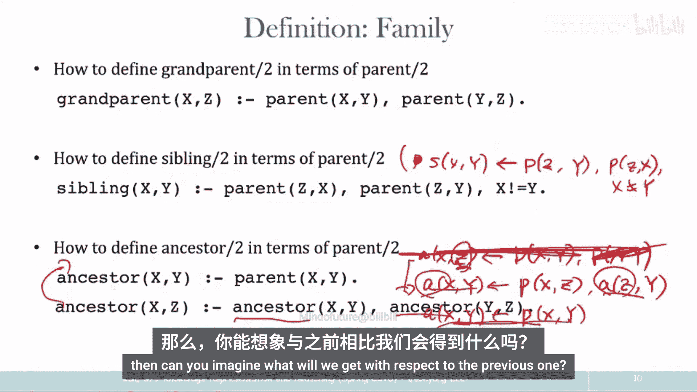

Who are the siblings？So let's go back for the sibling here。

Carol and then right and how many ancesal relations we have？5， so we see five versus the relations。

 right？And is one religion。啊，8的份那个8。安太都卫生。原件。So we have five relations。

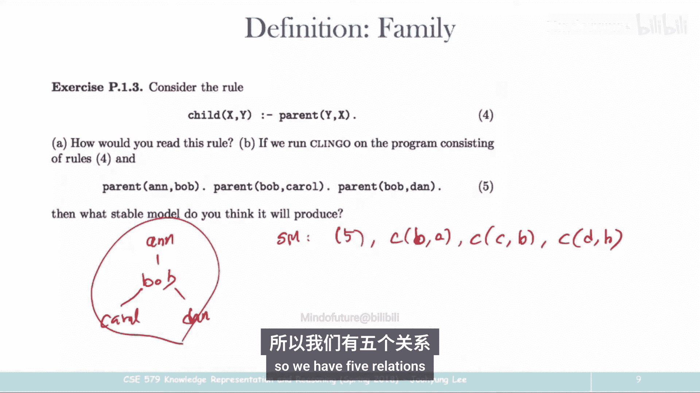

So if you are in doubt， of course， you can run the clinicallinggo program。So， here。This is cha。

 So I typed。The program here， okay， so this is a program that you saw before。Okay。

 and type Kling of5。And。Chard LP and let's just say return all again。

 there's only one stable model for now， and this returns all the family relations。

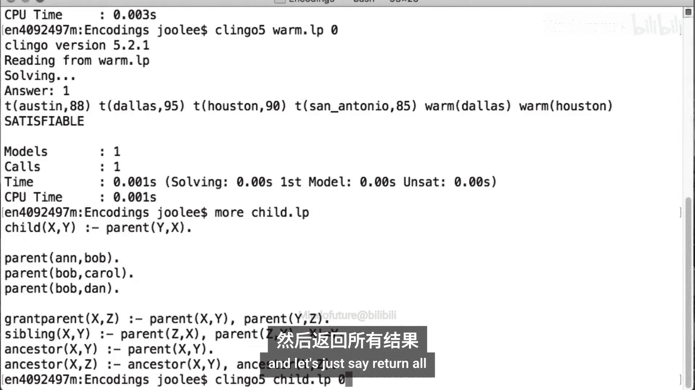

Now let's think about it， we talk about the definition here。

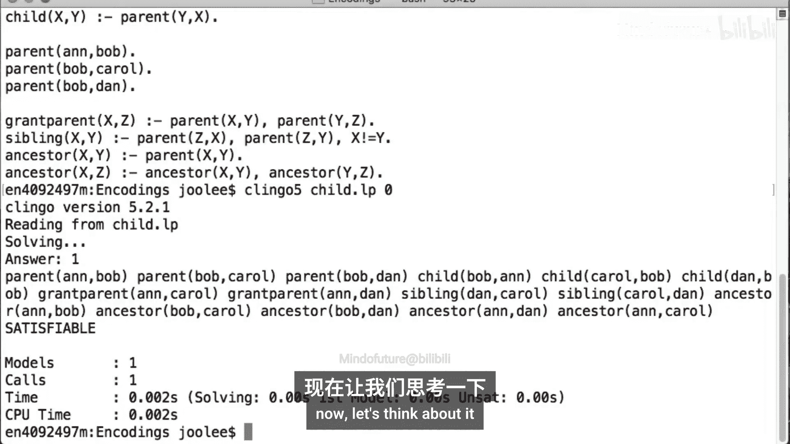

喂。

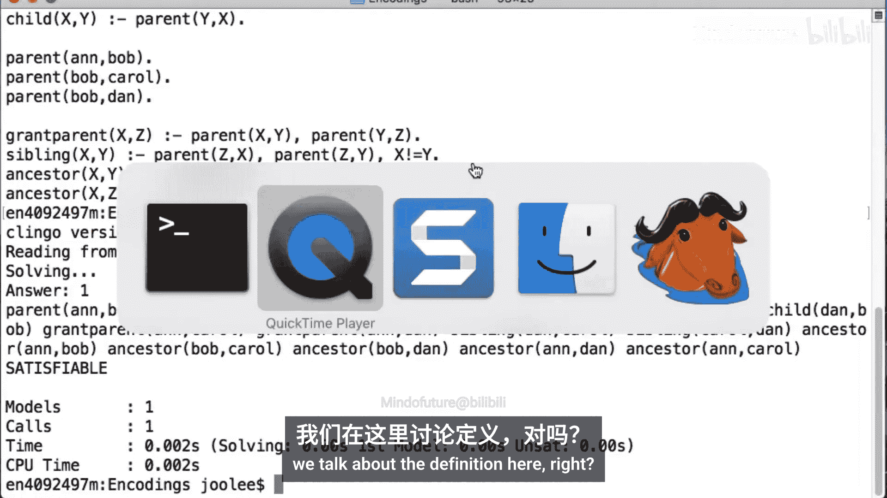

Now。One of the thing about the minimum models。Healp care is the definition。

 so definition usually goes like this， this is true if this condition is true。And nothing else。

So usually we don't articulate that nothing else， but when we define something based on ambition。

 we say that this is the complete characterization of。はい。哦。嗯。So here。

 when you talk about the stable models， it helped us to write this definition very succinctly。5天。

Allれ。Now， let's look get arithmetic。So。This is。The rule that you can read now so n goes from 0 to 10 now the c understand this as 11 rules where n is replaced by 01 to up to 10 so one of the rule it will generate as a proportion image is 0 and 0 star 0 plus0 plus 4 t1。

Tpy of。1，1， plus 1 plus 1 plus 41。原松。In other words， you are generating the polynomial on n。

 where n changes from 0 to 10， what are the values of this polynomia？Okay。So if you do that。

 you can just type Klinggo and let's name this file as quadraratic。So it returns this solution。Okay。

 so when n equals one， the polynomial here will return 43 okay because one plus。One times  one plus。

 yeah， one plus one plus 41 is 43。 And if it is 2 is 47 and so on so。Okay。几点。

Now sometimes we want to have a more general polynomial， so the coefficient here is A and B and C。

 so previously it was just 1，1 and 41， and we can write some placeholder ABC here。Now。

 these placeholders will just keep some。呃， valueue。

And how do we specify this value is in the command line？So the same program here。

 and you call this option。So dash C means you're given the value for these placeholder。So A is now1。

 B is1， C is 41， then it will operate the same as in the previous file。

 but it could be more general if you change the coefficient query with AB and C values。Okay。

And of course， note here that any actually also the placeholder， I can also change the range here。

Yeah。Now there's alternative writing， which is instead of giving this as a command line。

 you want to put this thing in the file， then what you need to do is to have this current thing。

 so pound constant a equals one， then you don't have to give the command line up。Okay。All right。

 so what L on is an integer。So。And the question is。

 what is actually the stable models of this program？PM comm n。

 when n is from1 to 4 and n equals n is2 times n， what will be the stable model here？Okay。

 this is kind of the qualities that the previous decision does not covered。

It is actually the safe because the reason is this actually gives the bound for this M&N。

 so it does not generate infinite infinite。Yes， so as what I said。

 the previous transmission was not complete， it does not capture。So。

But you can actually easily see that why the proportion image is finite in this case。

So let's try to do that。This body is only true when n is going from one to4。

When n gets the value other than the number one to four， then the body is bottom。

 so that klinggo does not need to consider that rule。

 so there are only finite number of rules that the klingo have to consider。

 so this is why it' is actually safe。But obviously， the previous definition。

 the syntactic definition if they didn't cover this。Yes。I more of a question and curiosity。

I think it was figuring out。还始晓得。We can spend more than a。没有。嗯。我的把这。Soci algorithm。

 it doesn't use brute force， no， it doesn't work， so something to distinguish between what I explained theoretically here。

被个有が三0个多。我们。我买嘛也是这特地方。也没什么。And you actually。when you use Pgo to do some complementary research program。

这 time。Although there are some problems that。One cannot use us solve。Because basically。

 what Klinggo is solving。Is at least。The NP class are problems。All right。

 but let's just focus on the current。gram here so what is the stable model here？て。Okay。Is it true？

So the answer is P1，2。P204， this is only one stable model that the program will have。Let's check it。

So。We can try to generate the rules， so n goes from one to four。So。Let's say n equals one。

Okay so then this becomes top。喂。The next one is n equals2 times n。And in order to do that， M must be。

What。One half。But one half is not something that Klingo understand， so Klinggo throws out that rule。

So when n equals one， this will not be。啊。This the rule the rule not be generated。Now。

 then when n equals 2。What is M？M equals1 equal two times 1 equals2。So， this is actually true。Okay。

 the assignment of M and n that satisfy this， as well as resulting in integers。

 that's only when n equals2 m must be1。And similarly， you can do。When3。Again， this is a fraction。

Okay。So this roof will not be generated。When the next one is4 and m can be2 so this is it。

 so the Klinggo will generate only these two rules from this program and obviously the stable model here is P12 and P24 because there is only one stable model containing these two atoms。

Okay。不 I should。So actually。Pinggo is highly sophisticated program。In fact。

 it allows certain real numbers as well。嗯。And actually， in my group。

 we also worked on extending the idea of NS programming to handle real numbers so that we can model the continuous changes。

 continuous dynamics。But in this class we are not going to use that features。

 but if you're interested you can go to this link。Yes。です case。被个这。哎你婚。对来的真实。

M does not have solutions， so PM commma n cannot be generated with its empathy。Okay。

Well you can also say this like one of the example that we had before， P1 divide by zero。Okay。

 so that's empty conjunction， which is tough。So it's the same thing here。

 this is empty conjunction in the head， which is obviously true。Clingo can throw this rule away。

OkaySo basically what Klingo can simplify is when the rule somehow instantiate this way。

 this rule is no longer necessary right， if the body contains along with some other atoms。

 the body contains some bottom right or absolute force team。The rule cannot be useful。

 so Klinggo can forget about this rule Other rules are the rules that has tab in the head。Okay。

 soどうする are also useless。It does not tell us to generate statement models。

 so these two rules can be omitted and this kind of rule that we omitted is actually this type。

Because his empty hat means empty conjunction， which is tough。Okay。

 we already have done the intervals。 so what are the answer said of this？P1 P2 p3， okay。

 so we can just skip that part， so let me just write here。

The answer said will be this what about this guy， square one to three， square one to three？对。Yeah。

 so okay， you are well prepared for the kids then。So one， two， one， three。And。31。Okay。

 so you can feel all the nine things so let'm not repeat the good thing is you can actually run Plinggo to verify all these claim。

And there also on this， I'll just leave there an exercise。Okay， so let's think about this。

 So we want to generate the state model like this。Can we write one rule program to have this as the stable model？

That's not。Let's give some time to think about。Okay， so。Anyone has idea。

Let's give sense to you first。P of M N。M mix one2 four。And it's also one，24。可以。

And it greater than important because it also say， yeah， so this is the solution。对。All right。嗯。

Another thing。Prime， so we saw this before， and its a prime。If it is the number starting from 2 to n。

 and there is no evidence that is composite。嗯。So this was the definition that we saw before。

 I'm not going to repeat this， so we first defined the composite。谁。And define prime。

So prime was defined in terms of composite， and we used this neation as failure。

 so if you cannot say this is composite， then this is prime。Okay。

Now note here that this is another use of stable models with negation。

If you just look at the minimum models， you don't actually get the same idea。Okay。

 because in the minimum model， basically what you have here is actually same as this one。

But what we require here is the minimal models according to this idea of negation as failure。

 so if you just look at the minimal models of P if not  Q。

 then the minimal models is actually P and Q。But the stable models here where we only need P。

 we only need this guy。So when we define the prime number。

 we are only looking at the prime numbers that is not composite。Okay。So， how do we。Actually。

 this is our program。Okay， so let me。Quy。So， this is the。给了 me clear up。

So this is a program that you just saw。Okay， so we can run cleaning of 5 minus C。So here we have the。

Place all the n， so let's call n to be 100。It equal 100。And time。Okay。O。

So it finds prime number up to 100， of course it doesn't take too much of time speaking of the thing。

 so 0。001 second。Let's actually try maybe 1000。Okay，0。015 seconds。And少镇。0。4。Hundred000。系咁。

So relatively quick， but of course， generating prime number is not that simple test。不认啊。Next one。

 Victoriactoria。So how do you find factorial， it's also recursive definition。

 so fact of 01 means theial number factorial of0 is1。

And n plus1 factorial is f times n plus 1 if you have the previous number， so n factorial is f。

Then n plus one factorial is F times n plus1， right？So this is a recursive definition of factoria。

So here is actually I didn't say this， but everything that started with a a person sign is a comment。

 so you can just say Klinggo doesn't care about this comment but it helps you to understand what has been achieved so far。

 so so far you described factorial to be this way。Now you can actually use the projection idea。

 so I don't want to know this binary predicate， I only want to have the first n plus one factorial so then I can project this one into this now note here that unlike in。

Not here that we actually use the same name fact for both urinary and binary。

 so clinicalingo X allows that。嗯。And this is yet another directive to Plinggo。

 if you just usually when you ask Plinggo either find all stable models。

 all the precate names will be displayed， but if you use the pound sign with show command。

 it will only show this predcate。嗯。

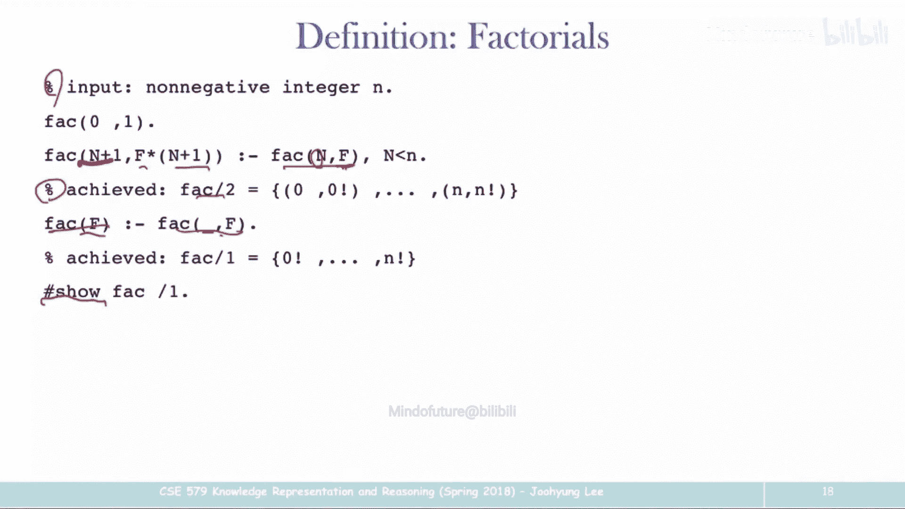

Okay， so。Yeah， okay， so it took 33 seconds to finish 10，000 prime numbers up to 10，000。

 which is not too bad。嗯。So let's actually try。The factorial。Yes。具离。呃。What is the thing。読されたきた。嗯哼。

Yeah， let me tell you later， okay。Okay。So this is the factoria。Okay， no， actually， I did。

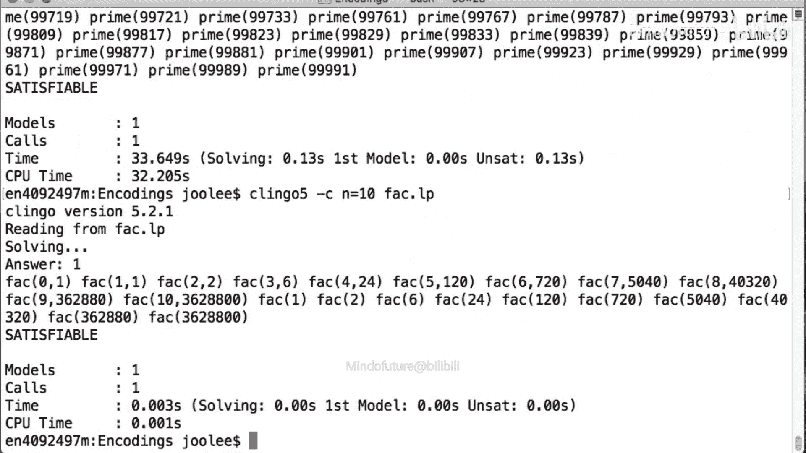

Comment out one thing if I。P it back。

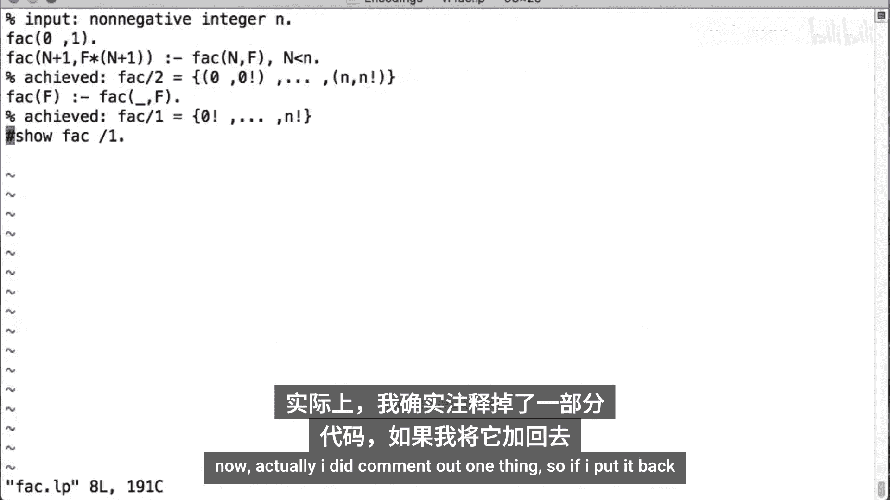

This will only generate a fact， usually a fact preddicate。Okay。Now， the question about these times。

So Klinginggo。Find this So I think the time， I don't know exactly what that is。

 So let's actually go back。

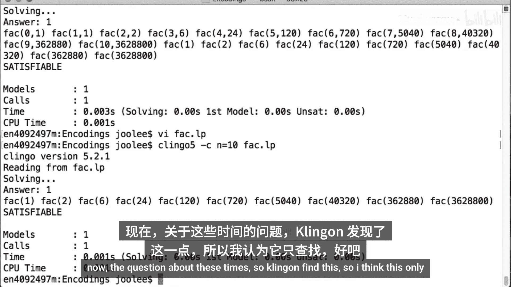

So here。oughSo Klingo can find all stable models and this is far enough really。

But the放送 thing actually point three。And check whether there is no other state model。Here。

 the place do。If I take first aid in the model。But I may wrong， actually I don't。

I don't sometimes these times are not really exact。I usually use a time command in the。

Comd line utility。Okay， I think this is it for today。So let's start the piece now。

