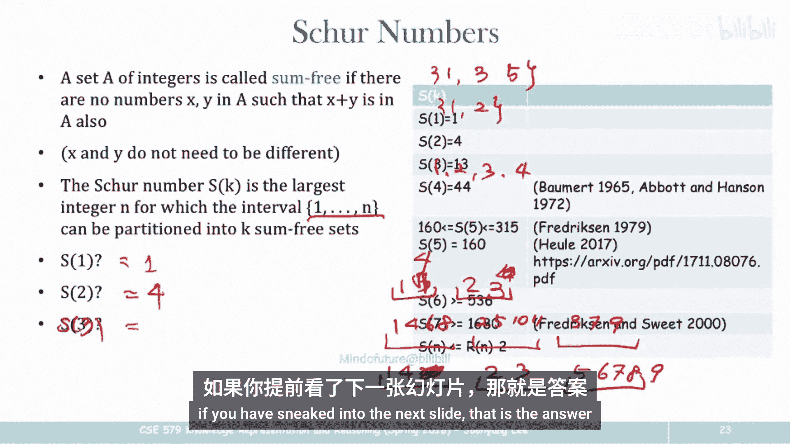
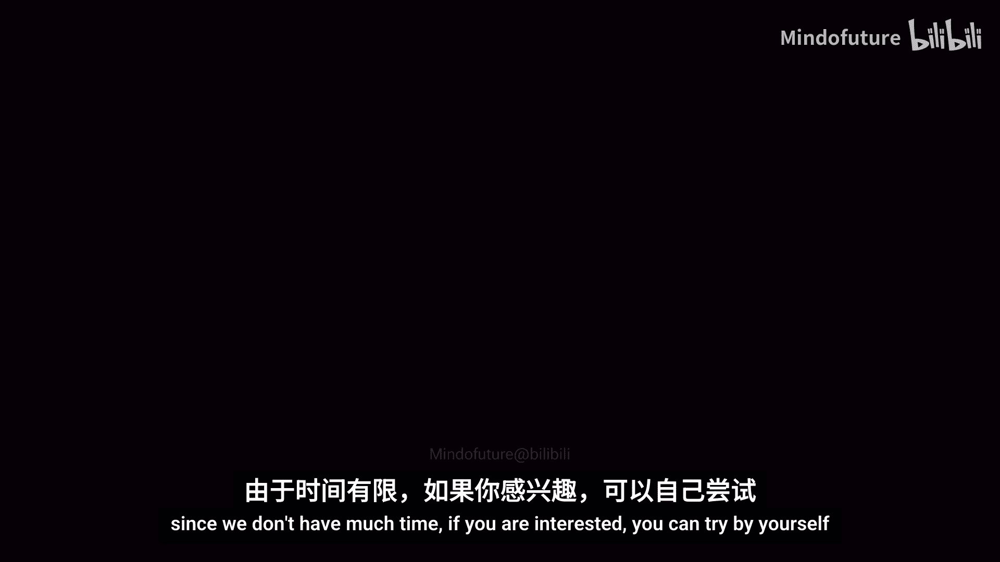
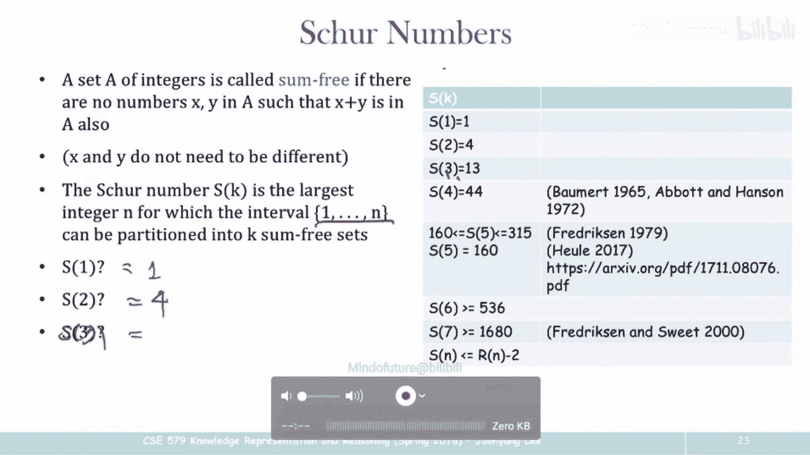

# 【亚利桑那州立大学】知识表征和推理 ｜ Asu Cse 579 Knowledge Representation 2018 p09 P09_Lec11 -BV1RTWyzfEQH_p9-

Okay， so let's start today's lecture。 So we' will talk about some constructs in NSA programming。

 So the two。Things that we'll talk today is choice rules and constraints and there are actually more than this。

 but after studying this， I hope you can get some idea about ASP programming methodology。

 so we will see some examples of the actual programming。Okay。Okay， so what are these choice rules？So。

This is denoted as the colleague， the set praise， and the atoms are separated by semicoola。Okay。

 so one of the homework problem also in the assessment was about the choice rules and I hinted just last time what this choice rule is about。

 so if you have something like P with choice that is just a shorthand notation for P1 r P so what are the stable models of this choice rule P1 P。

Empty set and。Singleton set P right so according to this choice rule P。

 and the name choice comes from this fact that it allows us to choose to include P1。Okay。

And if you can actually have more than one， so here you see two atoms。

 PA and QB are inside the set race， and that is basically P of A or not PA。Conjuction with Q of B。

 or not Q of B。Okay。So that's this conjunction of two choice rules now。

And what are the stable models of this formula？Empty set。Singleton set PA。

 so let's say what are the stable models？Okay， in this case， we have empty set。P of A。Q of B。

And P of A， QB。If you're in doubt， of course， you can check。

The redux relative to each of these set and check whether each set is a minimal model of the redux。

Okay so by now you should be able to do that by yourself。Here， I will just say that that。

4 stable models here。Now each of this stable model is a subset of PA comma QB。

 right so there are four subsets of this set PA comma QB。Okay。Right， so what this tells us is。

We can use these choice rules to generate some possible choices from the beginning。Okay。

So you can run the program with this command， so Klinggo followed by the name of the file。

 so it's one program I call the choice at LP and put0 at the end。

 so it will return all stable models and here denoted by answer in terms of Klinggo output so there are four answers well four stable models the first one is empty which check basically means empty set。

Okay。All right， any question up to this part？Okay so we do a lot of exercise on this thing okay now you can simplify the choice rules in some cases。

 for instance， if you have choice from number1 to 00。

 you don't want to say1 semi P of1 semicolon P of two semicolon P of3 semicolon and zone surface okay so instead of that you can write interval notation so if you say p1 at3。

 then this is actually same as generating the atoms inside P1 P2 p3 and as the choice for this okay so how many stable models are here for this one line。

There are eight because there are three atoms to choose。

 so two times two times two or two to the power of 3。Okay， good。

Now if you have a symbolic constant that the number。

 you cannot actually use the interval notation because interval notation is validd for the integers。

 but you can write this pooling which you can put the argument of the predicate together。

 so this is not really much of saving but it helps you to write something more neatly。

 was something more concisely， so if you have ABC to be included in P you can write these one predicate followed by this a semicoone B semico C okay。

All right， so then here's our exercise for you。Maybe。没事。Pace， okay。Alright。

 so let's open the soccerra tip。Let me just。そ opening。Okay， so。This one。P 1 do3，  Q1 do3。

 So how many stable models will be there。Let's do the second one as well。 Okay。

 so just write two numbers。Okay， so how many stable models are there for the first one。

 How many stable models are there for this second。有单。Let's see。Okay。

 some people didn't submit answers yet。し。Okay， so let's see。我居是。Here。Okay。So 64，5，12， 6436， 648。Okay。

 so many people say。64，60s。3。Was 16。Okay， so the first one seems to be that 64 is the dominant answer。

The second one is a it more diverse。 Okay， what is the majority。I do see some 512 to 29， and also 16。

8， 32， okay so there's a varying answer here。So， let's do this together。

So the first thing here we have。P1 Dta 3 and another one is Q1 D 3， right。

 So how many and stable models were there for the P1 3 in the previous slide。

A and how many are in the， of course in the Q1 that3， there actually should be also8 right。

 and this is a conjunction， so you have a combination， so what this should be dense。60ポ ofライデン策。

What about the second one， The second one has this interval right。

 now how many atoms will be generated inside this set？9ine， because it's a p1， comma 1，1， comma 2，1。

 comma 3，2， coa 1，2， comma 2，2， comma 3， 3 comma 1， 3 comma 2，3 comma 3。

 so there are nine atoms that will be generated。And each of the nine atoms can be either chosen or not。

 So that's a total of59， which is 512。えです。Mr。Empty set cannot be counted twice， yes。

 that's a good question empty set cannot be counted。大先明た。We don't count the empty set twice。

Nothing it matter。I don't think so right。So you have still。没那个。I think it actually matters us， right。

 so empty set and。Basically， you have。6 at to choose So2 to2 6。喂。Because you cannot really。

 when you cross product， you cannot have the empty set counted twice。

 we are not adding we are multiplying。行。If you're in doubt， you can try。Okay。

So all these code can be actually run in Klinggo。Okay and that's actually what your homework three is about running Klinggo to verify each of these cl。

Okay。All right。Let's go to some more extensions。Now you can put some bound in this set so basically this set gives us some choice。

 you can actually put the low bound and upper bound to say the cardinality of the set that I choose should be containing at least one atom and at most two atoms。

O。So here you can try to find the subset of one，2 three that consists of one or two elements。Okay。

 in other words， to set， whose cardinality is either one or two。How many stable models are here then？

How many subsets of the P1 P2 p3？Catifies the cognitive constraint that the cognitive is either one or two6。

 only two extreme case are eliminated， empty set， cognitive is 0 and P1 P2 p3， card3。

 so those two sets are。Halluminated and all the other remaining things becomes a stable model。Okay。

 so here you can be a bit more tuning in the fine grained level。

 not only the arbitrary choice of this set， but you can choose the bound。

And this actually helps often in some programming。Okay， so here is then the question for you， okay。

 so how many stable models will be there for the first one？嗯。😊，63 now， why， because？

MT set is the only one that violates this cardity bound right so the set should contain at least one element。

 only the empty set is the one that is a subset of P12 p6 that does not satisfy the low bound cardinality。

Right。Okay， so there are 6，3。How many。Stable models will be there for this online program。

So you have to choose among the six atoms， P1， P2 up to P6。Whose cardinity is exactly three。Okay。

So that's six choose three， right， what is the number 20 okay？So there are 20 and there are 63。O。

All right。ですく。嗯。The next one。Here we are trying to find a simpler rule than this one。

 so if we have low bound zero， how can you simplify this rule？嗯。

You just you actually don't need this thing right， so0 as a low bound doesn't give any further information。

 so the simpler one is simply just P A good。What aboutですか？How can you simplify this？

So this one says you choose the subset of PA， there are only two subsets， empty set and POA。

 but the cardinality should be one， which means this is actually just the same way to say POA POA must be true。

Okay so it seems like you're giving the choice and then you bound it。

 it turns out that there is only one case that sat this。

 so you can just write PO A as a program and the answer set will be only P of A。

 the single concept P of A。给。What about this guy。IfSomebody says empty set， is it the case？

I don't think so。So P of A we up bound one。Again， like A。

 it does not give information much more information， right。

 you can choose only up to one atom from the set PO A。 So this is actually we done that。

 So this is actually same as POV。Okay。So in each of the case， this one。

 if you give it as an input to Klinggo， versus this one giving as an input to Klinggo。

 they produce the same stable models。Okay。All right。The next one， now we start to use variables。Okay。

So I don't want to write too lengthy code， sometimes things are repeated。

 I can use actually variables and this is actually handy for most of the cases。Now。

 if you use variables like this。So Klingo first try to eliminate these variables to produce positional image。

 that's what we studied in the previous handout if you have P of x and Q of x and x is one to two。

 this is basically same as replace x with all possible occurrences。Okay。

 now the definition of proportional image， if you strictly follow。

 x will be replaced by any numbers and any symbolic constants。

 but not all of them are actually meaningful because some of them will result in actually many of them will result in falls in the body。

So this rule， if you make a proportion image， it will actually produce two rules。

Where x is replaced by one。Now， another one is when X is replaced by2。

Now there are also other rules in the proportional image but when x is not replaced by either 102 that will result in bottom and those rules are actually redundant so we can forget about those kind of additional rules。

 so let's just look at these core rules， these two important rules。Okay。So then now you know。

 after you turn into this propositional program， you can find out what are those stable models。Okay。

 but so this is actually reducing to the ones in the previous slide。 right。

 How many stable models are here。4 right。换一。Somebody can listenend。아닌 down。The first question can be。

对个对个。Yeah， so the first one is I choose one from P1 and Q1。

And so the second one is choose1 from P2 Q2 right so you can choose either P1 and P2 or P1 and Q2 or Q1 and P2 and Q1 and Q2。

 So there are four possible combinations which are shown here。

MT set is not possible because now the upper bound and lower bound is one in one。

 so you have to choose exactly one from each of this set。Okay。我 right一下个。Life is a full of choice。

 right？Okay， one thing that I hit here is X is so called global variable。Okay。

 so this is called global variable。 I didn't actually say what is a local variable。

But and I'm going to talk about this more in the next slide， but let's say in the global variable。

What happens is when you replace the variable with some specific instances。

 the number of rules will increase。Okay， so here x ranges of one and two， two values。

 So when this rule is grounded， it will generate two ground rules， two essential ground rules。

 ground means that there is no variable。Okay。嗯。Sometimes。

We actually use so called local variable and using this combination carefully is one of the success of anE programming。

So here is one。Pdagoical example。So here at index is。On。A predicate that contains one to seven。

 so in other words， if you look at the first line， any stable model must contain index of one index of two or two index of seven。

Right。No。The next one。一思。呃。A program that contains local variable。

Okay so I don't know whether you are keen to see the difference between this occurrence of I and the previous occurrence of x。

 but I'm going to explain that， but here I is socalled local variable。Okay。And not the difference。

That the eye actually occurs only inside these co braces。It does not have currency in the outside。

So those variables are called local variables， so you can say what is a local variable is the variable such that all these occurrences are limited inside this scope of color race。

Okay， so that's a local available。Because there are only two occurrences of eye and they are all bounded by this col race。

So this is called受ければ。Now what are the global variables。

 global variables are all other variables that are not local。Okay。Okay。

 so what happens to the instantiation of the local variable？

If you remember the intentional notation for the set。

 so you know the difference between intentional and extensional representation of set。

In the extensional representation， you enumerate all elements in the set in the intentional notation。

 you write the conditions for being in a set so this is actually you can read it as intentional notation。

そう。Here， if Q is true， the second rule says if Q is true， then。This set。

 you select element from this set where this set。嗯。Contains P of I。Such that index of I is true。Okay。

So what that means is basically Klinggo will understand the second rule in terms of the rule that I shown here okay。

So is it instantiate？The variable I。But unlike in the previous example。

 this instantiation will make the set to be， I mean。

 the instantiation is within the scope of this set。Okay so instead of generating more rules。

 it will not generate more rules。 there's still only one rule。

But the inside will be fully instantiated。Depending on this condition that you are given。

 So index I I can go from one to7。 So here this P of I can go from one to 7。Okay。

 so if you see this rule， you can view this as an of abbreation of this rule。And obviously。

 if you increase the size of the index，  one to 1000。

All you need to do is to change this one to be one soldier。

OkayThen Klinggo will populate this one going from P1 to P1000， so you don't have to type 1。

000 atoms by yourself。Okay。A we to。Let's contrast this with global variable。

 so here is a similar example for using the global variable。And here I is a global variable y。

 because it has an occurrence outside the col race。So there actually actually two colors of I。

And one of these occurrence， the second occurrence of I is outside the col race。

 so I is called a global variable。Okay， so for the global variable， the rule is actually simpler。

 basically as I told you before， it will just generate multiple rules where each rule will replace the currents of I with the instance of I。

Okay。So here this one denote seven rules because I can go from index can go from one to seven。

 so I ranges over one to seven。Okay。Any question up to this part？Yes。最的是这是。宣农人叫。Oh， you're right。

 Actually， this is a typo。 This should be。3米克了。Thank you。

The reason for that is the previous version of Klingo actually used comma for the separator inside set。

 but the new version actually used semi。So semi colonon is actually the new de。All right， so。Okay。

 so we are done with the choice rules。And we'll now look at another construct。

 and this is called constraint。What is your constraint？嗯。This is a simple rule that has empty head。

Okay。Or we actually talk about this when this is empty head， we will understand as button。

 So this is false is P1。Okay。So。What are these rules doing。

 So basically when you add this constraint， what will happen is you will weed up some stable models that violate this constraint。

 So the constraint is saying that P of1 must be。False， okay， that's what the constrain is saying。

Okay let's do a simple example first。So I can write a P or Q。Now I can write this P。

What are the stable models of this program？没有。B。So the stable model here is P。楚。Let's check this。

 so if this is P， okay， we form the readout， right？Okay。

 what is the redux of this program relative to Pete？Same because there is no critical part。

 there's no negation。We have to check whether P is a minimum model of this program， is it？

It's not even empty set， don't go into empty set yet。Is P。A model of this product。のワイスナドモード。

Because of the constraint that I just added。This is P implies false， which is same as deational P。

Right。So when I add this constraint， what will happen is whatever that has P inside cannot be a stable model anymore。

You can readed out those state models that violate this constraint。So。

What should be the right stable model in this case？

Q only right note here that the original program P or Q again the first rule has two stable models。

Single concept P and single concept Q。 But when you add this constraint。

 you are eliminating one of them， which contains the P。Right。

Do you see some similarity between this one and something that we discuss？Olio。What is that。

When you add more formulas， you always decrease number of models， what is that property call？

Thatス calledモノトニスティ。Okay， so monotonity means increase the if you add more formulas。

 the set of models will decrease。The set of models that does not satisfy the additional formulas that are being added。

 they will be no longer the model of the extended program， right？Thatスコモトニスティ。

Now we talk about this before the same modeltics is non monotononic， it does not behave that way。

 however， you can actually simulate this behavior using this constraint。When you add to constraint。

 you always eliminate stable models that violate the constraint。

I don't know whether you're following here， okay？嗯。Let's actually play with some other example。

How can you save models here？2。Okay。So they're empty set。M题。I'm now going to add a constrained P。

 what will happen to the same model， so now I consider these two rule program。好 that the save models。

Empty Sir。Okay， because this guy， so between these two。

 only this will be remaining as a stable model， but this guy will not。Okay。

Because they violate this so you can actually look at the stable models of the original program and then you can get out you can remove some stable models that do not satisfy the constraint that are being added。

Okay。Let's try something。Yes。What are the stable models for actually less right here？In this case。

 empty set does not satisfy the additional constraint that we just had， so it's only the empty set。

这个。Oh， P， I'm sorry， Iton said P， so that's the stable models of this because this P satisfi this。

Okay。All right so。Let's do some exercises here， so basically what I say here is if you add this one。

Okay， well， if you see the program that contains this constraint。

Then you can actually reason about the stable models in a compositional way。

 you can just look at this part first and find out what are the stable models。

 sometimes that's easier to do rather than just looking at the whole program。

Just look at some part of the program that does not contain this constraint and then get these stable models for this program。

And check whether each of them satisfy the additional constraint。

If it violates the constraints throw that away and all the remaining stable models will be the stable models of the whole program。

Okay。So we'll do this exercise now， so for the first program， the leftmost one。

How many stable models are there？黄没意。给的分这。Okay， so how do we reason just look at the first one。

 how many stable models are there for the first rule？就是A。How many of them does not contain P1？诉讼费。

Maybe I should have as differently。 How many of them contains pure bond。4。

 that's the same the other way， right， So those four will be removed。

Because they violate this constraint。The concern is saying don't include P of1。

Those subsets of P1 P2 p3 that contains P1， they will violate this constraint if they contain P1。

 right？So only four of them do not contain P1， and they will be the same model here。Are we together。

啊。Let's give aquiz then。I would ask you to。Go these two， okay。Let me just change this。So this time。

You can talk with your neighbor。And if your neighbors give you more convincing answer。

 you can write his or how answer。Okay。So。Yeah， you see。

 just say how many stable models are here and how many stable models are here。All right。

 so let's see what we got。Oh， only15 as。Okay。So let's hide。Okay， finish up。Okay， so let's see1，6，2，6。

2，2，2，6，6，2，5，2，2。 Okay， so they are more or less in the range。 It's not like 0 or whatever， right。

 Well I guess you guys are following the materials。 So what is right， answer。6，6。

 looks like that's also the majority here， although it's not clear， We know， Okay， let's check it。

So the second rule is saying that you have to generate all subset of P1 p2p3。

 but you have to we up both stable models that contains P1 and P2 together。

 how many subsets of P1 P2 P3 contains both P1 and P2 together。2。

 which are p1 P2 and the total set Yeah P1 P2 p3。 So 8-2 is6。

 So there are only six stable models here。 What about this guy。

 So this guy is saying that you have to choose now the subset。

 but if it is not containing P1 and not containing P2， then it violates the constraint。

 So it's a kind of doubleub ned。 So sometimes it helps you if you write this in terms of the logical formula and simplifyimplified it。

 So this one you' same as not P1 and not P2。And this implies button， right。

 which is basically same as negation of nu P1。嗯。Okay， let me write again， deation of N P1。

And Na Pito。Which is again， equivalent tool。P1 or P2。 So basically。

 it is asking how many stable models。How many subsets of P1 P2 P3 contains both either P1 or P2 or maybe both right。

 So how many of them actually do not contain neither P1 and P2。There are two。

 answerA says those two stable models like empty set and singleton test at P3。

 they're the only two that do not contain neither of these P1 and P2， so if you get rid of those two。

 then the remaining six will be the stable models of the whole program。

So there are different stable models， but the number of them are the same and we don't have time for doing that。

 but this is actually interesting， you will actually realize what happens here is in the same way this is negation of P1 and not P2。

Which is same as。NotP1。W皮图。Which is basically the same as P1 implies P2。

So here is a way to kind of simulate the implication。Okay， in the body， so any stable model。

 if P1 is contained， P2 must be contained in their stable models。

 that's what the constrain is saying。Okay， all right。

Okay so the next thing is now as you see there is some relation between the cognitiveency bound that you saw before versus the constraint right so obviously here we start with the things generate arbitrary choice and then we eliminate some of them。

 you could have gone this some different way， you can actually give a bound for each of them。

 so thenna doesn't say identical but sometimes you can write the one method in terms of another method。

 so here for instance if you have this rule P of a and Q ofB so basically choose the subset of this PA and QB but at most one element so cognitive is bound by one so that is actually the same as just choose any subset but do not choose the one that contains both P of A and Q。

So here you use the cardality bound to represent the stable models。

 and that can be replaced sometimes with this plus choice rule without the cardity bound。

 but with using this constraint。Okay。Okay， and。You can do the similar transformation with this guy。え？

I leave this as an exercise。Okay， so here the upper bound can be replaced by this guy。

And here the low bound can be also eliminated if you use constraint。

And the hint is actually the one that we just saw in the previous slide。Okay。Alright。

 so we don't show the we don't go into the proof of this theM。

 but what you can see is propositional logic can be actually embedded into the stable model semantics。

 So although Klinggo is answer over， it can actually find the models of propositional logic。

 So it can work as a assessover satisifiability over。

 the way that you do is basically coming from this choice rule okay So what is the model in the propositional logic。

 the models are the one that satisfy the given formula app right now how do we simulate this idea in stable models So what you can do is。

You write the same program， I'm sorry， you actually generate all possible choices。

 you generate all possible interpretations， and eliminate those interpretations that do not satisfy these rules。

The given formula life。Okay。So maybe I I should explain with this example。 So F equals P or Q。

 How many models are here。我。思いマ。Okay， we are going back to the basic， right？There are three models。

 So models means。Assuming that， of course， PQ are the only the signature， so models is empty set。

P and Q。 Now， if you ask to find。The stable models。What are the saving models。Actuallyat。

 why do I have the ascent is's actually PQ， right？So what are the stable models of PQ？

Only the first two， right， because in this case， table models are the minimum models。

So it looks like it's difficult to represent the concept of models in terms of stable models。

 but what we can do is。Taking this and transform into another program such that is stable models will be the stable models。

 so what we want to design is this。Stable models。Of this translation。exactlyactly。

The models of the original program。So this is what we want to get。

If you are familiar with theoretical computer science as a reduction idea。

 so if you want to solve one problem。Sometimes you can reduce that problem A into problem B and using this algorithm or solver for B。

 which will also solve the problem A。Okay， so we are working on that。

So what is actually this transformation， it's actually simple now once you use the choice rules。

 basically you write PQ。O。And then， right。P orQ。Okay， let's consider this。Okay。So。

Reason with the same way， what are the stable models of the first line？Yeah， therefore， right。

 all the subset of PQ。 Now， if I add this constraint， what will be the remaining stable models。Well。

 let's say this way， if I add this one among the four stable models of this guy。

 which one violate this constraint？Empty set。Mmpty set makes this false or false and speaks becomes true true impliesly false is false。

 only the empty set violate this， which means that there are remaining three。

 which is the singleton sense and Pq R。Stable models of this guy。Now， if you look at this guy。

 these are exactly the models of the original formula。Okay， so I can understand the。

Models of the original formula in terms of stable models of the translation。

And they are in one to one correspondence， actually they're exactly the same。Okay， which means。嗯。

You can use clinicallinggo to find the models of professional formula。Okay。

I a question up to this part？Okay， good。 So now you messed。Anwret programming。

 or at least the basic con of An programming。Go down the mountain。 And let's。Face the competition。

This is what usually the Kung fu movie is doing， so when somebody whose father or parents was killed by the enemy。

 they go to Shavin Temple and train with martial art and then come back。

the phase of coming back to the so you have hard training on the stable models so let's try to use it What sense that we are doing this here I'm going to use one way to organize rules in anF programming this is a three part there three part。

嗯。Actually we are going to use two part， the first and the third part for the most of time。

 and you already encountered this when you do the choice rule and the constraint。

 so the first part of the program is to generate solution space from the upper bound。Okay。

 so you want to solve some problem and the problems may have multiple solutions。

let's try to generate all possible solutions。Okay，Now some of the possible solution that you generated as candidate may not necessarily be the solution for the original problem。

 then get rid of those things。嗯。So let's illustrate this idea with this entrance problem which we have seen before now you remember when n equals3 there is no solution for this problem when n equals four there are actually two solutions n equals five。

 10 solutions， six actually surprisingly the number goes down so there are only four solutions but from then on actually increases okay and you can actually generate all possible solutions very quickly。

So how do we do that now lets we revisit the program that you have seen before。

 now you can really understand how to write this program。Okay。

 so what are the conditions that we have to represent when we do the NSE programming。

 the representation， we are representing the specification of the problem in terms of NSE programs。

 the programs that。Has stable models， right？So you have to try to think about the English statement as a formal representation first right。

 so try to be as formal as possible， so turn the English into some more structured way。

 so if you look at this problem there are this constrain each column should have exactly one queen each row has exactly one queen and diagonal has exactly one queen right？

That's what we have to say。 So how do we say each column has exactly one queen。

 So this is the rule that use both。Now use this both a local variable and global variable。Okay。So。

 my question is。What is a local available here and what is？act。

We have actually J as the only variable。 Okay， so is J a local variable or global variable。

It's global， right。Okay， so you guys are good。Just so minutes of before we talk about this。

 you still remember it amazing。So j is a global variable because it has an occurrence outside this called race and what we do is just to enumerate the rules right so generate each rule where n is j is replaced by this number。

 so now this n is actually placeholder you can actually change the parameter n when you're giving the command line so let's say for simplicity for now let's say n equals3。

Okay，Now if I call Klingo， how many ground rules that Klingo will generate from this rule？不属于这。3。3。

 because J goes from to 3。 So one of the rule is one。1。就。One， that that。3。我。はくないですよ。Any missinging。

Okay， I should have okay， let me rewrite again。Let me actually delete this guy。没异议。So basically。

 you generate these three rules。各。Now。After that， we see the interval inside， right？

So how does interval work？How many atoms will be here？3。So this rule， for instance。

 the first one will have。Okay。So we are doing the propositionalization。And the next rule will be。

Similar， but now J is 2， right？Similarly。对。Okay， now question。 how many silver models will we here。

So look at those propositional programs。How many stable models？

generatedrated from this rule so in order to answer that I turned into this way。

 first eliminate all global variable and then do the instantiation inside the set using this interval so this is the program that you can look at okay how many stable models are generated from this。

所以你自己。27 because now you know， this is one and one。

 you have to choose exactly one from the first set。One from the second set， one from the third set。

 each set has three choices， so this is three times three times3。There's 27。

 There are 27 stable models。Okay。Now， obviously， this one only says。If you have。

This one each so let's say one， co1，2， co 1，3 comm one。If you think， if you look at this。

This means among these three positions。You have to choose one position to put the queen。

The second rule is saying among these three positions， you have to choose one。

The next one among maybe these three positions， you have to choose one。O。So for each column。

 we are selecting exactly one position and to pin there。Now， for the。For the same column。

 there is only exactly one， but if you just have this one。

 it might be the case that the same row has multiple queens， right？Okay， how can we eliminate that？

So this X one is。I don't want the stable models to encode that the sames two or more ks are on the same row。

 and I can easily write this way， so if I have Q icon comma J and i comma J1 and J and J1 are different。

Okay， then this violate the constraint， in other words， here I is the same variable， right？So。

 for instance， one of the instantiation will say。Q of1， comma 2。And Q of1 comm 3。

If I is 1 and j equals2 and J1 equals3， right？So one of the instantiation will give this one。

 which means you cannot have two pins in onecoma2 and onecoma 3。

OkayNow obviously this is one of the only instance of these rules， so here I J J1 ranges over1 to3。

 so there are actually many ground rules in this case。And together。

 they eliminate all stable models that has two queens on the same row。Okay。Yes。及。个。Pro the。

Can you say again。这能。私で。What use。Oh yeah yeah it actually does not matter。 that's a good question。

 you can use actually j not equal to J1 in this case you will have all the combination1，2，2，1，1，3。

31 right but actually that's not really essential because。Having this one versus。This one。Okay。

It actually means the same， so the order of this does not matter， so if you write this way。

 you will actually generate half of these instances and that may help。

So it doesn't really matter which one that you use。Are we done。So。

Until now we have placed the queens so that they are on the same column。

 I mean no two queens are on the same column， no two queens are on the same role。

 but what about the diagonal， so we have to get rid of that。So how do we present。

 so similar to the second one， if we have two positions i comma J and i1 comma J1。And。

If J is different from J1， which means that these two are the distinct positions。

You can write in a slightly different way， but that does not matter。

 but in it thing is when you have the absolute value difference。

 so I1 minus I and J1 minus J are equal that means they are on the same diagonal。

So then this violate constraint， so if you add these two con together with the first choice rules。

等觉得。Okay。Alright， so。Let's see free。Canect。See this。So this is the program。Okay。

 that exactly the same program I copied。嗯。So， let's checklinglinggo。5。And any equal three。

 how many solutions are there？ノソーションの。There's no solution if it is for。Okay。Actually。

 I should put zero at the end， so there are two solutions。Okay。If it is five， there are 1。If it is 6。

4。Okay。If it is 7。40， if it is 8。92， if it is 9。350， if it is 10。724。You got the idea， right？Okay。

 so it's actually easy to write the program and all hard work is done by theling。

 right you don't have to worry about those algorithms and how to enumerate， right？Okay， that's good。

Okay， so this is what you do， you don't have to repeat this， you can just look it up。Okay。

 so let's actually do another problem， so there's something called short number。Which is。

Dfined in terms of some free sets， so we say a set of integers is some free。

If there are no numbers X Y in a such that their audition is also in the same set。Okay。

 so for instance， if you have one， three。5。Is it some free？Because when you add two numbers。

 one plus three，4，4 is not there， 3 plus 5， a， a is not there，5 plus1，4，4 is not there。A5 point6。

 six is not there。O。So their audition is not in the same set。What about this is sunフ。

Actually I should say that these x and y do not need to be distinct from each other。

 so12 is not sum free because  one plus1 equals2 so you just pick any two numbers which may be duplicate if their sum is not in the same set you say this is some free set。

Now what is the short number， short number SK is the largest integer such that the interval one through n can be partitions into k on pres。

 well this is actually wrong definition， so let's actually try to understand。

So it's a good idea to view this K as like a bucket。

 so you are given K bucket and you have to place the number one through n so that each set。

 each bucket is some free okay so let's play with this idea。In fact， actually。

 SK should be actually the largest interval because smaller interval is actually easy to partition into some threes。

So we want to understand。Maybe SO 1。 So what is SO1， as in SO  one， you are given only one bucket。

and you have to place some number from one to n， larger the better， if you have a larger n。

 that's the best， that's the short number。What is the biggest interval on through end so that you can place in one bucket so that this bucket is some free？

So， if you not no。Any method， you can just try very naively， so starting with interval 1 comma 1。

In one， right can you put one into the one bucket so that this bucket is sound free？Yes。

If youve just put one， one plus one is two， two is not in the same bucket。Okay。

 your goal is to make each bucket to be thumb free。On the other hand you are given the interval。

 you are not choosing any random numbers， you are giving number from one to n。

 and we want to find the largest n that we can divide into kson3s。So one is possible。

 which means that SO1 is at least one。What about one， two？

Can you put one and two into one bucket so that this bucket is not free。No， no， okay。

 so then what is I so on？There's actually one。保嗯保认证保证证。The numbers should start from one to n。Okay。

 that's actually what is given， this interval1 to end， you're not choosing random numbers。O。

All right， so let's do this one。 Now you have two bucket。O。So obviously you can put one， that's fine。

 one， two， can you put one and two into two bucket， you don't have to use old bucket， by the way。

But you can you make each of the。Ft some free。How do you do that。嗯。1 n。Two。

 you cannot put two here because one plus one equal two。Okay， okay， but you can put two here。

2 plus two equals 4，4 is not in the seconds， okay？And everybody's happy。What about one， two three？

哎有给了 me。有で。Okay， I have now one， two， three bucket， and can I put one， two three？Yeah， okay。

 so that's no problem。What is the larger number than3。If I have。Say 1，2，3，4。Can I put it into。

Actually's， why do I have three？是意。Yes， I have to。そです。We are talking about S of2， so two bucket。O。

All right， so  one， two， three，4， can I put into two bucket？Yeah， how do we go。So here's knife idea。

 so let's try one and we know that these two， okay， I can choose three。To be here。Okay。

 then I cannot put four here， so I have to put four here， and then what happens？

This is not something。Right， because two plus two equals four。So what did I do wrong？

I should not have put three here， but if I have put three here， then I could put four here。

 and then everybody is happy。So I had a choice and this choice point is what makes this serial number very complicated mathematical object。

Okay。So four is the right answer， but in order to get into four。

 you should have put the three into the right bucket。O。And it turns out that this is all you can do。

So this is for。If I have time， we can do that。Q。O啊。Let's do this。Sそ3。So now we have three bucket。

Okay， and this time。Anyone who has the number？You can join。So we have three bucket。

 What is the largest。N， one to n that we can put into the three。Song free says。9。11。Okay。11 beat 9。

 because if 11 is a correct answer， then we don't have to look into 9 because in the shared model。

 we have to look at the largest interval trouble。Okay， as you know， if larger and larger。

 it becomes more and more difficult to make these assets three right。

 so according to 11 is the winner， right？Okay， any other we go？9。Okay，11。

 So can you tell me what should we put here。1，4，68， and then2，5，10，11。3 is3，7，9，3，7，9。Okay。

 so let's see。 Are we fine。Looks like。We have a problem。What is the problem here？

5 and 10 should not be put into together because5 plus5 equals 10。 so this is not So 11 was defeated。

 Okay， what about9， somebody said9。Just speed out here what。1，4，2，3。One，4。

 and then the next one is two，3。5，6。7，8，9。This is one。 Okay， so let's see。嗯。Are we fine？

looks like I don't see a counter example。And this seems to indicate S of three is at least nine。

Can you make it10。Yes， can you make it 11。Can you make 12？Can you make 13？Can you make 14？Okay。

 the answer is actually 13， if you have sneaked into the next slide， that is the answer。

Since we don't have much time， if you are interested， you can try by yourself。

 I want to just tell you some interesting history。

So I taught this material last year and until then， as of four was known， as of four bucket。

 you can only make1 to 44 to be divided into four sum freezes。And then from SO5。

 nobody to knew the answer， there was an old paper that says SO5 should be between 160 to 315 that was in 1979。

AndO five was actually shown to be exactly 160。In last year。After I taught KL class。

One of my students in the class sent me an email with the link to the paper。

Okay this was in the archive。 I think it was also published in some conference。

 The the thing is short number five， the title is short number5。 if you look at the abstract。

 this is actually interesting we present solutions of a essentially old problem known as short number5。

 What is the largest number n such de blah blah， this is actually the description that I gave We obtained the solution n equals1 under 60 by encoding the problem into pro logic and applying massively parallel satisfiso techniques on the resulting formulas we constructed the and validateator proof blah。

 blah and multi CPUp ear computations and the proof is two petabyte in sizes and blah， blah。

So you might think this is very weird。Because。This is such another big number， right？

How can be five and one under 60？Okay， this is big number。

 I mean you can actually compute cell number to four pretty quickly。

 but cell number five is not possible。Now， theoretically。

 this known that show number 6 is at least what 536， and number 7 is 1680。Now。

 if you can find show number six， you can publish your paper。And you can be famous。However。

 the authors of this paper that shows serial number five because one of the 60 says that's probably impossible with the current computation resource。

So it is not an undecidable problem， it is decable problem。But it requires massive computation power。

O。So。However， we will actually formalize this problem。

 which is actually the whole program that you see。And you can actually check the answers。So。

 I checked until。Okay， actually， I checked with my computer。

 show number five is at least one under the 30。 that was just one minute。Okay。

 that's the last thing that I checked。没。So if you want to。I don't know。Be famous。

 maybe you can try throw number six。Okay，All right。

 so I will tell you how to do that in the NSA programming next class。

